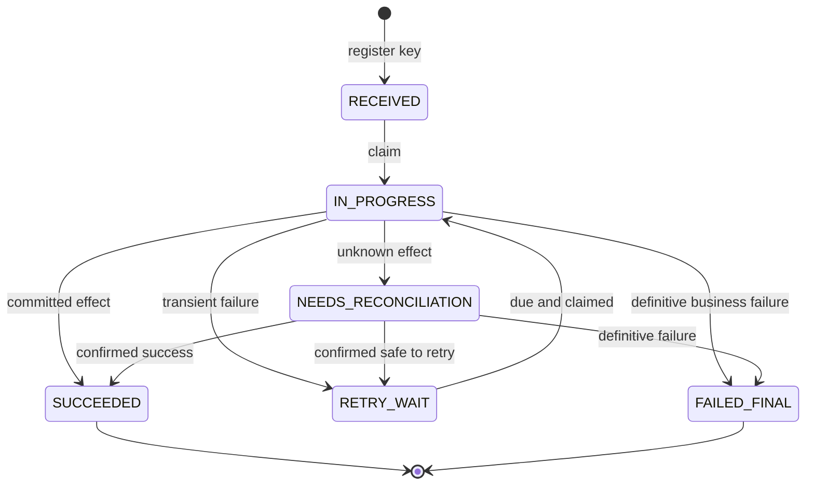
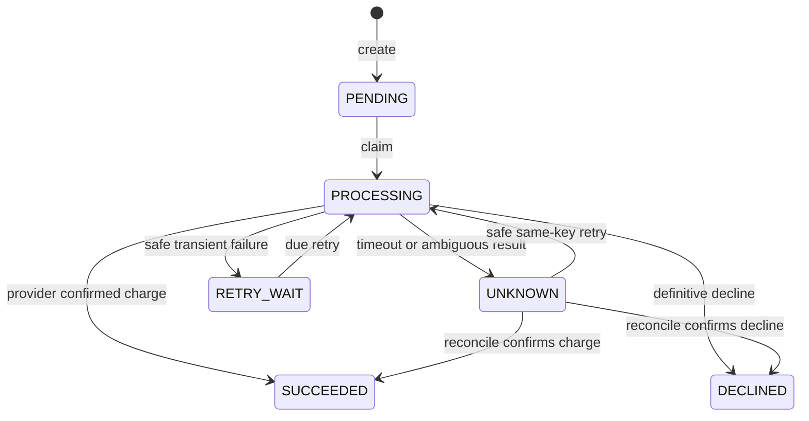
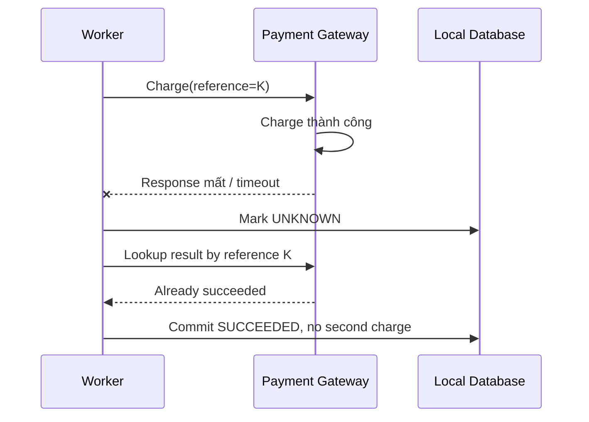
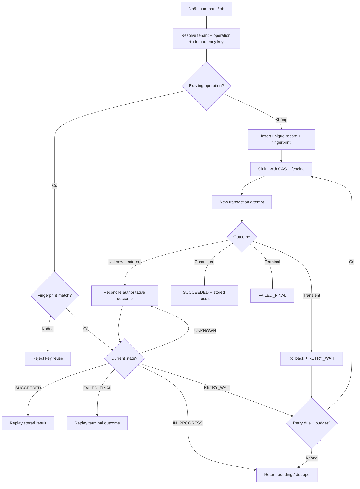

# Thiết kế thử lại theo tính lũy đẳng và trạng thái nghiệp vụ trong JPA

Trong ứng dụng Java dùng JPA, lỗi có thể xuất hiện do `OptimisticLockException`, deadlock, lock timeout, database failover, mất kết nối hoặc một HTTP request được gửi lại sau khi client không nhận được phản hồi. Những lỗi tạm thời (*transient failures*) đôi khi đáng được thử lại. Nhưng thử lại không có thiết kế dễ gây lỗi nghiêm trọng: **tạo hai đơn, trừ kho hai lần, thu tiền hai lần, gửi hai email hoặc ghi một trạng thái nghiệp vụ đã hết hợp lệ**.

Bài **“Thiết kế thử lại theo tính lũy đẳng và trạng thái nghiệp vụ”** thuộc chương **Lỗi và phục hồi** của module **Data Persistence Relational Access ORM JPA**. Trọng tâm là phối hợp:

- **Tính lũy đẳng (*idempotency*):** cùng một yêu cầu logic được gửi lại không làm lặp tác động nghiệp vụ không mong muốn.
- **State machine nghiệp vụ:** biết operation đã thành công, đang xử lý, đang chờ retry, thất bại cuối cùng hay chưa xác định kết quả.
- **Giao dịch và retry boundaries:** mỗi attempt có transaction/persistence context hợp lệ; nếu thất bại phải rollback trước khi retry.
- **Khả năng phục hồi sau crash:** unique constraints, outbox/inbox, retry backoff, idempotency keys tại bên thứ ba và reconciliation.

> **Nguyên tắc:** Không retry chỉ vì có exception. Hãy xác định trước **điều gì đã xảy ra**, **điều gì có thể chưa xảy ra**, và **business state hiện tại có cho phép thực hiện lại hay không**.

---

## 1. Kịch bản mở đầu: timeout sau khi tạo đơn

Client gửi:

```http
POST /orders
Idempotency-Key: 7ac2c3e6-a463-4e49-9c4f-a8a31ca9db40
Content-Type: application/json

{
  "productId": 20,
  "quantity": 2
}
```

Server thực hiện:

```text
BEGIN TRANSACTION
  INSERT purchase_orders(id=100, ...)
  UPDATE products SET stock = stock - 2
COMMIT
```

Nhưng kết nối HTTP đứt **sau commit, trước khi client nhận response**. Client thấy timeout và gửi lại request.

Nếu mỗi lần gọi service lại tạo Order mới:

```text
Lần 1: Order#100, trừ kho 2, COMMIT
Lần 2: Order#101, trừ kho 2, COMMIT
```

Client chỉ muốn **một** đơn nhưng hệ thống tạo **hai**. Timeout không chứng minh giao dịch DB đã rollback; đây là failure window quan trọng mà thiết kế retry phải xử lý.

## 2. Lũy đẳng là gì?

Trong toán học, phép biến đổi lũy đẳng thỏa:

\[
f(f(x)) = f(x)
\]

Trong ứng dụng, hãy hiểu theo **tác động quan sát được của cùng một ý định nghiệp vụ**, không phải “method Java chỉ được gọi một lần”.

| Operation | Nếu gọi hai lần | Lũy đẳng theo nghĩa thường gặp? |
|---|---|---|
| `SET order.status = CANCELLED` | Trạng thái cuối vẫn CANCELLED | Có thể, nếu không phát side effects lặp |
| `stock = stock - 2` | Tổng trừ 4 | Không |
| `CREATE Order` với ID sinh mới | Hai Orders | Không |
| `charge(100_000)` không có key | Hai charges | Không |
| Trả kết quả đã lưu theo một idempotency key | Cùng business result | Có thể đạt được |
| `DELETE resource` | Resource cuối không tồn tại | Có thể theo state; response status có thể khác |

**Một SQL statement có vẻ lũy đẳng về dữ liệu chưa chắc lũy đẳng về side effects**: update status có thể phát Kafka event mỗi lần, hoặc trigger tăng counter.

## 3. “Exactly once” cần diễn đạt cẩn thận

Một message có thể được nhận hai lần; một worker có thể thực thi validations nhiều lần; database có thể rollback một attempt và chấp nhận attempt sau.

Mục tiêu thực dụng:

- **At-least-once delivery** có thể được chấp nhận.
- **Business effect** được bảo vệ khỏi duplicate nhờ unique keys/CAS/state machine.
- Events và consumers có thể deduplicate.
- Bên thứ ba được gọi bằng idempotency key hoặc đối soát kết quả.
- Sau crash, hệ thống biết tiếp tục từ trạng thái đã commit.

Không một `@Retryable` hay `@Transactional` riêng lẻ nào biến HTTP, DB và broker thành hệ thống exactly-once tuyệt đối.

## 4. Phân biệt retry, duplicate và command mới

**Retry:** cùng intent, cùng idempotency key; ví dụ người dùng bấm “Đặt hàng” một lần nhưng mạng timeout.

**Duplicate delivery:** cùng message/event được broker gửi lại vì ACK thất lạc.

**Command mới:** người dùng thực sự muốn đặt thêm một đơn giống hệt.

Nếu dedupe chỉ dựa vào body:

```json
{"productId":20,"quantity":2}
```

thì hai đơn hợp lệ cùng nội dung có thể bị gộp nhầm. Ngược lại, nếu một client retry bằng **key mới**, hai attempts có thể được xem là hai intents độc lập.

Bởi vậy idempotency key thuộc **hợp đồng command**, không chỉ là hash của dữ liệu.

## 5. Idempotency key nên scope thế nào?

Một identity tham khảo:

```text
tenantId
+ operationType
+ idempotencyKey
```

Ví dụ:

```text
tenant=acme
operation=CreateOrder
idempotencyKey=7ac2c3e6-a463-4e49-9c4f-a8a31ca9db40
```

Điều kiện:

- Client tạo key mới cho một intent mới.
- Client giữ nguyên key khi retry intent cũ.
- Server scope key theo tenant/principal và operation phù hợp.
- Key không thay thế authentication hoặc authorization.
- Server kiểm tra reuse key với request payload khác.
- Cần giới hạn độ dài key, rate limit và retention.

Một UUID ngẫu nhiên có thể là lựa chọn thực dụng; định dạng chính xác phải là một phần của API contract.

## 6. Key khác những ID nào?

| Loại ID | Dùng để |
|---|---|
| Idempotency key | Nhận diện một logical command |
| Entity ID `orderId` | Nhận diện một Order |
| Provider payment reference | Nhận diện tác động ở gateway |
| Message/event ID | Dedupe một delivery |
| `@Version` | Phát hiện stale update trên entity |
| Correlation/trace ID | Theo dõi log qua nhiều services |

Một `@Version` không ngăn tạo hai Order khác ID. Một event ID không tự ngăn hai payment attempts có business meaning giống nhau.

## 7. Kiểm request fingerprint

Nếu cùng key được gửi với body khác, server cần từ chối theo policy, không cho thay ý nghĩa của operation đã đăng ký.

Ví dụ:

```text
K → CreateOrder(product=20, quantity=2)
K → CreateOrder(product=20, quantity=5)
```

Đó là **key reuse conflict**, không phải retry hợp lệ.

Có thể lưu SHA-256 của *canonicalized request*:

```java
byte[] canonical = canonicalEncoder.encode(command);
byte[] digest = MessageDigest
    .getInstance("SHA-256")
    .digest(canonical);
String hash = HexFormat.of().formatHex(digest);
```

`canonicalEncoder` là abstraction giả định. Cần quyết định JSON field ordering, Unicode normalization, số thập phân, defaults, operation/API version và các fields có ý nghĩa nghiệp vụ. Không dùng raw JSON bytes nếu client serialization khác nhau nhưng semantics giống nhau.

## 8. TTL/retention ảnh hưởng tính đúng

Một policy mẫu:

```text
CreateOrder key retention:
  72 giờ sau terminal result

Same key trong retention:
  replay result / pending

Sau retention:
  không còn bảo đảm dedupe dựa trên key đó
```

Đây chỉ là ví dụ, không phải thời hạn chuẩn. Retention phải dài hơn khoảng thời gian retry có thể xảy ra theo client, queue redelivery, downtime và business risk.

Với Payment, business uniqueness và provider reference có thể cần lưu lâu hơn TTL của bảng HTTP idempotency. Xóa key quá sớm có thể khiến client retry một operation cũ tạo effect mới.

---

## 9. Vì sao cần trạng thái nghiệp vụ?

Unique key ngăn trùng một request record, nhưng chưa cho biết:

- Đã tạo Order và commit chưa?
- Có worker đang xử lý không?
- Có payment gateway request chưa rõ kết quả không?
- Có thể retry ngay hay phải chờ?
- Failure có phải cuối cùng không?
- Nếu client retry, response nào cần trả?

Vì thế idempotency thường phải đi kèm **operation state machine**.

## 10. State machine của idempotency operation

Một mô hình tham khảo:

```text
RECEIVED
IN_PROGRESS
SUCCEEDED
RETRY_WAIT
FAILED_FINAL
NEEDS_RECONCILIATION
```

| State | Ý nghĩa | Duplicate request nên làm gì? |
|---|---|---|
| `RECEIVED` | Đã đăng ký, chưa claim | Claim/pending theo policy |
| `IN_PROGRESS` | Một attempt đang xử lý | Không chạy trùng, trả pending |
| `SUCCEEDED` | Effect đã commit, result được lưu | Replay stored result |
| `RETRY_WAIT` | Transient error, chưa đến lúc retry | Trả pending/Retry-After |
| `FAILED_FINAL` | Lỗi nghiệp vụ cuối cùng | Replay terminal outcome |
| `NEEDS_RECONCILIATION` | Kết quả ngoài hệ thống chưa chắc chắn | Tra cứu authoritative state |

Tên states có thể khác. Quan trọng là **business meaning và allowed transitions** được định nghĩa rõ.

## 11. Sơ đồ trạng thái



Không cho duplicate request đổi trạng thái terminal `SUCCEEDED` về `IN_PROGRESS`. Một business action đảo ngược như refund là **command mới**, không phải retry cùng CreatePayment command.

## 12. Operation status khác Order status

Ví dụ:

```text
IdempotencyOperation.status = SUCCEEDED
PurchaseOrder.status = PENDING_PAYMENT
PaymentAttempt.status = PROCESSING
```

Điều này có thể hợp lệ nếu command `CreateOrder` được định nghĩa là “tạo order thành công”, không phải “thu tiền thành công”.

Mỗi state machine cần có owner và meaning riêng:

- Request registry: một logical command đã được nhận/xử lý tới đâu?
- Order: trạng thái nghiệp vụ đơn hàng.
- PaymentAttempt: trạng thái tích hợp gateway.
- Outbox: message đã publish hay chưa.

Đừng gộp tất cả thành một boolean `processed`.

## 13. Retryable không có nghĩa chưa thành công

Một lỗi timeout có thể xảy ra **sau khi effect đã thành công**.

Ví dụ:

```text
Gateway nhận charge
Gateway charge thành công
Gateway trả response
Network làm mất response
Worker nhận timeout
```

Worker không biết success hay failure. Trạng thái phù hợp là `UNKNOWN/NEEDS_RECONCILIATION`, không phải tự suy `FAILED_RETRYABLE` và gửi charge mới.

**Retry classification phải xét mức độ chắc chắn của effect**, không chỉ exception type.

## 14. Lỗi terminal do domain policy

Ví dụ:

- Invalid input.
- Không có quyền.
- Order đã CANCELLED.
- Payment bị provider từ chối dứt khoát.
- Product không thể mua theo contract.
- Idempotency key reuse với request khác.

Những lỗi này thường không giải quyết bằng exponential backoff. Với cùng command, hệ thống có thể lưu `FAILED_FINAL` và replay failure. Nếu user thay lựa chọn hoặc thông tin, đó là **command mới với key mới**.

## 15. Lỗi transient thường gặp

Ví dụ:

- Deadlock.
- Serialization failure.
- Optimistic lock conflict, **nếu business state vẫn cho phép re-evaluate**.
- Lock timeout.
- Database connection tạm mất.
- HTTP 503/429 từ một dependency có contract cho phép retry.
- Broker temporary unavailable.

Ngay cả ở đây, retry chỉ an toàn khi operation idempotent hoặc được bao bằng cơ chế dedupe/transaction phù hợp.

---

## 16. Thiết kế bảng idempotency_operations

DDL tham khảo:

```sql
CREATE TABLE idempotency_operations (
    id VARCHAR(36) PRIMARY KEY,
    tenant_id VARCHAR(64) NOT NULL,
    operation_type VARCHAR(80) NOT NULL,
    idempotency_key VARCHAR(128) NOT NULL,
    request_hash CHAR(64) NOT NULL,
    status VARCHAR(32) NOT NULL,
    result_http_status INTEGER,
    result_json TEXT,
    attempt_count INTEGER NOT NULL DEFAULT 0,
    next_attempt_at TIMESTAMP,
    lease_owner VARCHAR(128),
    lease_expires_at TIMESTAMP,
    fencing_token BIGINT NOT NULL DEFAULT 0,
    created_at TIMESTAMP NOT NULL,
    updated_at TIMESTAMP NOT NULL,
    CONSTRAINT uq_idempotency_scope UNIQUE (
        tenant_id, operation_type, idempotency_key
    ),
    CONSTRAINT ck_idempotency_status CHECK (
        status IN (
            'RECEIVED', 'IN_PROGRESS', 'SUCCEEDED',
            'RETRY_WAIT', 'FAILED_FINAL', 'NEEDS_RECONCILIATION'
        )
    )
);
```

Đây là schema minh họa, cần indexes phục vụ due jobs và retention. Trường `result_json` có thể chứa dữ liệu nhạy cảm, phải áp authorization/encryption/retention phù hợp.

## 17. Vì sao UNIQUE phải nằm ở DB?

Cách dễ race:

```java
if (repo.findByKey(key).isEmpty()) {
    repo.save(new Operation(key));
}
```

Hai threads cùng thấy chưa có K rồi cả hai INSERT. Chỉ `findByKey()` ở Java không bảo vệ uniqueness khi concurrent transactions.

Một **UNIQUE constraint tại DB** giúp quyết định ai được ghi operation record. Application xử lý winner/duplicate theo trạng thái đã commit.

## 18. Duplicate INSERT có thể khiến transaction lỗi

Nếu cố INSERT cùng unique key, DB có thể ném constraint exception và transaction JPA bị rollback-only.

Không nên:

```java
@Transactional
public Result process() {
    try {
        insertIdempotencyRecord();
    } catch (DataIntegrityViolationException duplicate) {
        return repository.readExistingResult(); // Có thể đang trong tx lỗi.
    }
}
```

Cần rollback failed transaction rồi **đọc ở transaction mới**, hoặc dùng database-specific atomic upsert với semantics rõ ràng.

Nếu winner transaction còn uncommitted, duplicate path có thể chờ hoặc phải trả pending; không tự coi key tồn tại là request đã thành công.

## 19. PostgreSQL ON CONFLICT

Ví dụ DB-specific:

```sql
INSERT INTO idempotency_operations (
    id, tenant_id, operation_type, idempotency_key,
    request_hash, status, created_at, updated_at
)
VALUES (
    :id, :tenant, 'CreateOrder', :key,
    :hash, 'RECEIVED', CURRENT_TIMESTAMP, CURRENT_TIMESTAMP
)
ON CONFLICT (tenant_id, operation_type, idempotency_key)
DO NOTHING;
```

Sau affected rows=0, đọc existing operation và **so request_hash**. Không suy “DO NOTHING” nghĩa là duplicate request hợp lệ.

`ON CONFLICT` là PostgreSQL-specific, không phải portable JPQL. SQL Server/MySQL/Oracle có những cơ chế upsert khác và concurrency behavior cần test.

## 20. Fingerprint mismatch phải reject

Pseudo-code:

```java
Operation existing = repository.findByScope(
    tenantId, operationType, idempotencyKey
).orElseThrow();

if (!existing.getRequestHash().equals(requestHash)) {
    throw new IdempotencyKeyReuseException();
}

return resolveByStatus(existing);
```

`resolveByStatus()` có thể replay `SUCCEEDED`, trả pending nếu `IN_PROGRESS`, hoặc chuyển flow reconciliation nếu unknown.

Không cho cùng key đổi payload, kể cả operation cũ đang RETRY_WAIT.

## 21. Stored result là một phần hợp đồng

Nếu server đã commit CreateOrder, hãy lưu đủ thông tin để duplicate request nhận lại **cùng business result**, ví dụ Order ID/Location/HTTP code.

```json
{
  "operationId": "op-100",
  "status": "SUCCEEDED",
  "httpStatus": 201,
  "response": {
    "orderId": 100,
    "state": "CONFIRMED"
  }
}
```

Không nhất thiết lưu mọi response headers; cần xác định API policy, security và serialization version.

---

## 22. Mô hình A: thao tác chỉ trong một database

Nếu toàn bộ nghiệp vụ nằm trong cùng DB resource, có thể commit một transaction gồm:

```text
BEGIN
  INSERT idempotency record với UNIQUE key
  UPDATE products để reserve stock
  INSERT purchase_orders
  UPDATE idempotency record thành SUCCEEDED + stored response
COMMIT
```

Nếu transaction rollback, các effects trong transaction đều rollback. Nếu commit thành công nhưng response HTTP mất, client retry đọc operation result đã lưu và **không tạo đơn mới**.

Mô hình này thường đơn giản hơn workflow cần gọi hệ thống ngoài.

## 23. Atomic stock decrement

```sql
UPDATE products
SET stock = stock - :quantity,
    version = version + 1
WHERE id = :product_id
  AND tenant_id = :tenant_id
  AND stock >= :quantity
  AND :quantity > 0;
```

Service cần kiểm affected rows.

- 1 row: stock reserve trong transaction.
- 0 rows: thiếu hàng/không tồn tại/sai tenant/quantity không hợp lệ.
- Rollback: stock reserve bị rollback.

Không đọc stock=5 rồi ở hai transactions cùng SET stock=3 không điều kiện. Với `@Version` trong JPA, native SQL writer phải tuân version contract.

## 24. Domain method bảo vệ trạng thái

Entity:

```java
public enum OrderStatus {
    NEW, CONFIRMED, CANCELLED
}
```

```java
public void confirm() {
    if (status != OrderStatus.NEW) {
        throw new IllegalStateException(
            "Only NEW orders can be confirmed"
        );
    }
    status = OrderStatus.CONFIRMED;
}
```

Nếu retry cùng key sau thành công, không gọi `confirm()` lần nữa; trả stored result.

Nếu một **key mới** yêu cầu confirm Order đã CONFIRMED, domain policy quyết định return idempotent success hoặc conflict. Nếu Order đã CANCELLED, không tự confirm lại chỉ vì retry classifier nhận `OptimisticLockException` trước đó.

## 25. @Version không ngăn duplicate Order creation

```java
@Version
private Long version;
```

bảo vệ write-write conflict trên **một entity cụ thể**.

Nếu request A tạo Order#100, request B tạo Order#101, chúng là hai IDs khác nhau, nên không có optimistic conflict giữa chúng.

Cần idempotency key/unique business reference để ngăn hai CREATE effects. `@Version` và idempotency giải quyết hai câu hỏi khác nhau.

## 26. Operation entity JPA tối giản

```java
@Entity
@Table(
    name = "idempotency_operations",
    uniqueConstraints = @UniqueConstraint(
        name = "uq_idempotency_scope",
        columnNames = {
            "tenant_id", "operation_type", "idempotency_key"
        }
    )
)
public class IdempotencyOperation {

    @Id
    private String id;

    @Column(name = "tenant_id", nullable = false)
    private String tenantId;

    @Column(name = "operation_type", nullable = false)
    private String operationType;

    @Column(name = "idempotency_key", nullable = false)
    private String key;

    @Column(name = "request_hash", nullable = false)
    private String requestHash;

    @Enumerated(EnumType.STRING)
    private OperationStatus status;

    @Column(name = "result_http_status")
    private Integer resultStatus;

    @Lob
    @Column(name = "result_json")
    private String resultJson;

    @Version
    private Long version;

    protected IdempotencyOperation() {}

    public void succeed(int httpStatus, String json) {
        if (status != OperationStatus.RECEIVED
                && status != OperationStatus.IN_PROGRESS) {
            throw new IllegalStateException("Invalid state");
        }
        status = OperationStatus.SUCCEEDED;
        resultStatus = httpStatus;
        resultJson = json;
    }
}
```

```java
public enum OperationStatus {
    RECEIVED, IN_PROGRESS, SUCCEEDED,
    RETRY_WAIT, FAILED_FINAL, NEEDS_RECONCILIATION
}
```

**Ví dụ rút gọn:** Nếu dùng schema ở phần 16, cần mapping/initialization thêm timestamps, `attempt_count`, `fencing_token` và lease fields trước khi chạy thực tế. Đoạn code minh họa vị trí JPA state machine, không phải project build hoàn chỉnh.

## 27. Application service một transaction

Pseudo-code:

```java
@Transactional
public CreateOrderResult createOrder(
        String tenantId,
        String key,
        CreateOrderCommand command) {

    String hash = requestHasher.hash(command);

    IdempotencyOperation op =
        operationFactory.newReceived(
            tenantId, "CreateOrder", key, hash
        );
    em.persist(op);

    int reserved = productRepository.reserveAtomically(
        tenantId,
        command.productId(),
        command.quantity()
    );

    if (reserved != 1) {
        throw new InsufficientStockException();
    }

    PurchaseOrder order = PurchaseOrder.create(command);
    em.persist(order);
    em.flush(); // Nếu cần ID được sinh từ DB.

    CreateOrderResult result =
        new CreateOrderResult(order.getId(), "CONFIRMED");

    op.succeed(201, jsonWriter.write(result));
    return result;
}
```

Các repositories, factory, DTOs/exceptions là **abstractions minh họa**. Production phải làm rõ tenant authorization, entity mappings, transaction manager và outbox.

Quan trọng nhất:

- Operation record, stock, Order và result **commit cùng transaction**.
- UNIQUE conflict phải được giải quyết ở boundary transaction phù hợp.
- Client chỉ được nhận success sau khi transaction interceptor hoàn tất commit.
- Không gọi payment gateway/email/broker trực tiếp trong transaction rồi tin chúng rollback cùng DB.

## 28. Tạo result object không có nghĩa đã commit

Trong Spring:

```java
@Transactional
public Result create() {
    repository.save(...);
    return Result.success();
}
```

Thân method có thể return trước khi Spring interceptor flush/commit. Commit còn có thể lỗi sau dòng `return`.

Do đó:

- Không log “committed success” khi transaction chưa hoàn tất.
- Không tự trả external event trước commit.
- Nếu commit success nhưng HTTP response mất, stored idempotency result sẽ hỗ trợ replay.
- Nếu commit outcome không chắc, tra cứu authoritative DB state theo idempotency key.

## 29. Duplicate key race giữa hai transactions

```text
A: INSERT key=K
B: INSERT key=K → chờ hoặc duplicate
A: COMMIT
B: duplicate conflict
B: ROLLBACK
B: transaction mới SELECT operation(K)
B: check hash + state
B: replay result / pending
```

Nếu B tiếp tục SELECT trên transaction đã bị constraint exception làm aborted, có thể gặp lỗi khác hoặc chỉ rollback cuối cùng. Tách duplicate resolver ra khỏi failed transaction.

## 30. Spring facade và transactional attempt

Một pattern có boundary dễ nhận biết:

```java
@Service
public class OrderFacade {
    private final OrderAttemptService attempts;
    private final IdempotencyReader reader;

    public OrderFacade(
            OrderAttemptService attempts,
            IdempotencyReader reader) {
        this.attempts = attempts;
        this.reader = reader;
    }

    public CreateOrderResult create(
            String tenant,
            String key,
            CreateOrderCommand command) {
        try {
            return attempts.execute(tenant, key, command);
        } catch (DuplicateIdempotencyKeyException ex) {
            return reader.resolveExisting(
                tenant, key, command
            );
        }
    }
}
```

`attempts.execute()` thuộc bean khác có `@Transactional`. `reader.resolveExisting()` phải chạy trong một **transaction mới/đọc hợp lệ** và so fingerprint/state.

Trong thực tế Spring có thể bọc violation thành `DataIntegrityViolationException`; không bắt mọi DB constraint error rồi coi là duplicate idempotency key. Phân loại constraint chính xác, và có thể dùng atomic upsert thay exception path.

---

## 31. Mô hình B: workflow gọi external service

Nếu phải charge qua payment gateway, `@Transactional` của JPA **không làm HTTP call tham gia cùng database transaction**.

Anti-pattern:

```java
@Transactional
public void pay(Order order) {
    em.persist(new PaymentAttempt(...));
    gateway.charge(order.amount()); // External effect.
    order.markPaid();
}
```

Nếu gateway charge thành công nhưng DB commit thất bại, retry có thể tạo charge thứ hai.

Cần tách **DB state registration**, **external call**, **result reconciliation** và **business confirmation**.

## 32. Thiết kế flow payment có trạng thái rõ

```text
T1 (DB):
    Create PaymentAttempt(PENDING, providerKey=stable)
    Create OutboxMessage(ChargeRequested)
    COMMIT

Worker:
    Claim PaymentAttempt
    Call gateway with same providerKey
    Receive result or timeout

T2 (DB):
    Store PaymentAttempt outcome
    If confirmed success: update Order to PAID
    Store OutboxMessage(PaymentSucceeded)
    COMMIT
```

Nếu worker crash, outbox/job record vẫn còn và workflow có thể resume. Nếu provider timeout, không được tự tạo một provider key mới.

## 33. PaymentAttempt state machine



**UNKNOWN khác FAILED.** Một gateway timeout không có nghĩa charge chưa xảy ra.

## 34. Provider idempotency key phải ổn định

Ví dụ:

```http
POST /charges
Idempotency-Key: payment-attempt-8d67...
Content-Type: application/json

{
  "amount": 150000,
  "currency": "VND",
  "paymentMethodToken": "..."
}
```

Cần xác nhận hợp đồng của payment provider:

- Idempotency key được hỗ trợ ở endpoint nào?
- Scope theo merchant/account nào?
- Retention bao lâu?
- Same key, different request bị xử lý ra sao?
- Timeout rồi retry same key trả prior result hay có thể tạo effect mới?
- Có API lookup theo merchant reference/provider transaction ID không?

Không mặc định mọi gateway có chính sách giống nhau.

## 35. Timeout không cho biết charge đã xảy ra chưa



Nếu gateway không có lookup API đáng tin, cần policy reconcile/manual review. **Không gửi charge mới với key mới chỉ vì timeout**.

## 36. Hai lớp idempotency cần đi cùng nhau

**Lớp API:**

```text
(tenant, CreatePayment, client idempotency key)
→ một PaymentAttempt/resource
```

**Lớp gateway:**

```text
PaymentAttempt.providerReference
→ một provider charge effect theo contract
```

API dedupe không tự ngăn worker gửi hai gateway charges nếu mỗi retry tạo provider key khác nhau.

Gateway key duy nhất cũng không ngăn API tạo hai PaymentAttempts với hai references khác nhau cho cùng client command.

## 37. Commit outcome không chắc chắn

Một database client gửi COMMIT rồi mất kết nối trước khi nhận ACK. Có thể DB đã commit hoặc chưa.

Không dùng:

```text
commit() threw exception
⇒ chắc chắn rollback
⇒ cứ tạo payment mới
```

Cần tra cứu committed operation/business resource qua key trong transaction mới. Với external gateway, kiểm tra provider result. Nếu không xác định được, giữ trạng thái `NEEDS_RECONCILIATION` thay vì double-effect.

## 38. Transactional outbox

```text
BEGIN DB TRANSACTION
    UPDATE Order / PaymentAttempt
    INSERT OutboxMessage
COMMIT

Outbox publisher:
    Read committed messages
    Publish broker
    Mark delivered / retry
```

Outbox giải quyết failure window “DB commit rồi process crash trước publish”. Nhưng publisher có thể gửi trùng vì crash sau publish trước khi mark delivered.

Bởi vậy consumer cần idempotency/inbox.

## 39. Inbox và dedupe message

Schema minh họa:

```sql
CREATE TABLE processed_messages (
    consumer_name VARCHAR(80) NOT NULL,
    message_id VARCHAR(128) NOT NULL,
    processed_at TIMESTAMP NOT NULL,
    PRIMARY KEY (consumer_name, message_id)
);
```

Với một **local DB effect**, consumer có thể trong cùng transaction:

1. INSERT message ID marker.
2. Thực hiện business DML.
3. COMMIT cả marker và effect.

Nếu message gửi lại, unique constraint ngăn effect lặp.

Nếu consumer gọi **external provider**, marker DB không atomic với provider; vẫn cần stable provider idempotency key và reconciliation.

## 40. Message ID khác business operation ID

Broker có thể redeliver cùng message ID. Producer cũng có thể vô tình phát hai events khác IDs cho **cùng PaymentAttempt**.

Cần dedupe ở nhiều cấp:

- Message ID: duplicate delivery.
- Business operation ID: duplicate intention/effect.
- External provider reference: duplicate remote charge.
- Unique DB constraints/versions: concurrent write safety.

Không một ID nào tự giải quyết mọi loại trùng lặp.

## 41. Out-of-order events và state transition

Giả sử events đến theo thứ tự sai:

```text
PaymentSucceeded(attempt=321, version=3)
PaymentProcessing(attempt=321, version=2)
```

Nếu consumer cứ set status theo event mới nhận, state có thể **lùi** từ SUCCEEDED sang PROCESSING.

Dùng event sequence/version, allowed transition guards và authoritative lookup. Terminal states thường không được ghi đè bằng events cũ.

---

## 42. Chỉ retry những lỗi phù hợp

| Tình huống | Có thể retry? | Lưu ý |
|---|---|---|
| Deadlock | Thường có | Transaction mới, backoff |
| Serialization failure | Thường có | Reload/recompute toàn unit of work |
| Optimistic conflict | Tùy domain | Reload và revalidate |
| Lock timeout | Có thể | Kiểm DB/transaction state |
| Temporary DB outage | Có thể | Commit outcome có thể unknown |
| HTTP 429 | Có thể | Tôn trọng Retry-After |
| HTTP 503 | Có thể | Backoff/circuit breaker |
| Invalid payload | Không | Sửa request |
| Authorization 403 | Không | Không giải bằng retry |
| Order CANCELLED | Không tự retry | Business conflict |
| Không đủ stock | Không tự retry | Business outcome |
| Same key/different hash | Không | Reject key reuse |
| Duplicate idempotency key | Không tạo effect mới | Resolve existing |
| Timeout khi charge | Không blind retry | Reconcile/same provider key |
| SQL syntax/schema mismatch | Không | Sửa code/migration |

Một exception class không đủ để quyết định retry; phải xét operation type, state và những effects đã có thể xảy ra.

## 43. Retryability là thuộc tính của operation

Một `IOException` có thể an toàn để retry khi đọc một GET, nhưng không an toàn cho một POST charge không có idempotency key.

Một `OptimisticLockException` có thể retry khi cập nhật note, nhưng nếu Order đã bị CANCELLED bởi transaction khác thì command ConfirmOrder phải kết thúc bằng business conflict.

Classifier cần xét:

```text
error category
+ operation type
+ current business state
+ applied/unknown effects
+ idempotency contract
+ attempt budget
```

## 44. Retry phải dùng transaction mới

Sau `OptimisticLockException`, deadlock hoặc flush failure, transaction có thể rollback-only hoặc persistence context không còn an toàn.

Sai:

```java
@Transactional
public void change() {
    try {
        updateEntity();
        em.flush();
    } catch (OptimisticLockException ex) {
        em.clear();
        updateEntity(); // Cùng transaction đã hỏng.
    }
}
```

Đúng về ý tưởng:

```text
Attempt 1:
    BEGIN T1 → load → update → fail
    ROLLBACK T1
    Dispose failed EntityManager/persistence context

Attempt 2:
    BEGIN T2 → reload → revalidate → update
    COMMIT T2
```

`em.clear()` không xóa rollback-only marker. **Không sleep/retry trong transaction lỗi.**

## 45. Spring Retry và @Transactional phải có boundary rõ

Một attempt service:

```java
@Service
public class OrderAttemptService {

    @Transactional
    public void confirmOnce(Long id) {
        PurchaseOrder order =
            repository.findById(id).orElseThrow();
        order.confirm();
        entityManager.flush();
    }
}
```

Một facade **không mang transaction bao ngoài**:

```java
@Service
public class OrderRetryFacade {

    private final OrderAttemptService attempts;

    public OrderRetryFacade(OrderAttemptService attempts) {
        this.attempts = attempts;
    }

    public void confirmWithRetry(Long id) {
        for (int attempt = 1; attempt <= 3; attempt++) {
            try {
                attempts.confirmOnce(id);
                return;
            } catch (OptimisticLockingFailureException ex) {
                if (attempt == 3) {
                    throw ex;
                }
                backoff(attempt);
            }
        }
    }
}
```

Các dependencies/helper methods là minh họa; production cần interrupt handling, error classification, business state evaluation và metrics.

Quan trọng: mỗi lời gọi proxied `confirmOnce()` là một transaction attempt riêng khi không có outer transaction đang bao quanh.

## 46. @Retryable không tự đảm bảo transaction mới

Spring Retry có thể cung cấp:

```java
@Retryable(
    retryFor = OptimisticLockingFailureException.class,
    maxAttempts = 3
)
@Transactional
public void updateOrder() {
    // ...
}
```

Nhưng phải kiểm tra:

- Thứ tự AOP retry advice và transaction advice.
- Retry interceptor nằm ngoài hay trong transaction.
- Có outer `@Transactional(REQUIRED)` không.
- Self-invocation qua `this` có bypass proxy không.
- Lỗi có ném sau method body lúc commit không.
- Side effects có lũy đẳng không.
- Backoff có diễn ra ngoài transaction không.

Khi không chắc, một non-transactional retry coordinator gọi một transactional attempt service riêng là cấu trúc dễ review và test.

## 47. REQUIRED và UnexpectedRollbackException

Outer `@Transactional` gọi inner `@Transactional(REQUIRED)`.

Nếu inner ném RuntimeException qua transactional advice, nó có thể mark **transaction chung** rollback-only. Outer catch rồi retry trong cùng transaction vẫn không thể commit.

Triệu chứng là `UnexpectedRollbackException` ở outer commit.

Không cố “clear rollback-only”. Hãy kết thúc transaction cũ, sau đó retry bằng transaction mới nếu command còn hợp lệ.

## 48. REQUIRES_NEW có trade-offs

`Propagation.REQUIRES_NEW` có thể tạo transaction độc lập khi đi qua Spring proxy:

- Inner có thể commit dù outer rollback.
- Có thể đòi thêm DB connection/resource capacity.
- Nếu outer đang giữ locks, inner có thể bị blocking.
- Không làm external HTTP call trở thành atomic với DB.
- Không thay sự cần thiết của idempotency.

Không dùng REQUIRES_NEW bừa như một mẹo “làm transaction lỗi khỏe lại”.

## 49. Retry và JPA @Version

```java
@Entity
public class PurchaseOrder {
    @Id
    private Long id;

    @Version
    private Long version;

    @Enumerated(EnumType.STRING)
    private OrderStatus status;

    public void confirm() {
        if (status != OrderStatus.NEW) {
            throw new IllegalStateException(
                "Cannot confirm this state"
            );
        }
        status = OrderStatus.CONFIRMED;
    }
}
```

Khi transaction T1 dùng version 7 nhưng T2 đã commit version 8, T1 có thể bị optimistic lock conflict.

Retry T1 phải **reload state** và quyết định lại. Nếu đã CONFIRMED bởi cùng idempotency operation, replay result; nếu bị CANCELLED, không cố force CONFIRMED.

## 50. Pessimistic locking và retry

```java
PurchaseOrder order = em.find(
    PurchaseOrder.class,
    id,
    LockModeType.PESSIMISTIC_WRITE
);
```

Nếu lock timeout/deadlock:

- Rollback attempt.
- Tạo transaction mới.
- Giữ lock ordering nhất quán.
- Dùng bounded backoff.
- Không retry domain conflict.
- Không giữ transaction mở trong lúc sleep.

Thêm khóa không thay business idempotency key. Lock chỉ phối hợp những operations đụng cùng resource theo DB semantics.

---

## 51. Exponential backoff

Một chiến lược cơ bản:

\[
d_n = \min(d_{\max}, d_0 \cdot 2^{n-1})
\]

Với delay ban đầu 200 ms và cap 3200 ms:

| Retry thứ | Delay |
|---|---:|
| 1 | 200 ms |
| 2 | 400 ms |
| 3 | 800 ms |
| 4 | 1600 ms |
| 5+ | 3200 ms |

Không tăng vô hạn. Cần thêm `maxAttempts` và tổng thời gian cho phép (*retry budget/deadline*).

## 52. Jitter tránh retry storm

Nếu 1.000 clients cùng nhận 503, việc tất cả retry ở mốc 200/400/800 ms gây tập trung tải.

*Full jitter* lấy delay ngẫu nhiên trong khoảng:

\[
\operatorname{delay}_n \sim U\left(0, \min(d_{\max}, d_0 2^{n-1})\right)
\]

Ví dụ Java utility:

```java
static long jitterMillis(
        int retryIndex, long baseMs, long capMs) {
    if (retryIndex < 1 || baseMs <= 0 || capMs <= 0
            || capMs == Long.MAX_VALUE) {
        throw new IllegalArgumentException();
    }

    long upper = Math.min(baseMs, capMs);

    for (int n = 1; n < retryIndex; n++) {
        if (upper >= capMs / 2) {
            upper = capMs;
            break;
        }
        upper = Math.min(upper * 2, capMs);
    }

    return ThreadLocalRandom.current().nextLong(upper + 1);
}
```

Đây là đoạn minh họa; cần imports, interrupted-thread policy và scheduling phù hợp khi triển khai thực. Với batch jobs thường nên lưu `nextAttemptAt` thay vì giữ thread ngủ lâu.

## 53. Retry-After và deadline

Provider có thể trả:

```http
HTTP/1.1 429 Too Many Requests
Retry-After: 30
```

Client nên tôn trọng header và retry budget khi contract cho phép. `Retry-After` có thể là số giây hoặc HTTP-date.

Nếu operation có deadline 5 giây nhưng provider yêu cầu chờ 30 giây, hãy trả pending/hẹn async processing thay vì giữ HTTP thread hoặc DB locks.

## 54. Retry policy ví dụ

```text
ConfirmOrder:
  maxAttempts: 4
  maxElapsed: 10 seconds
  baseDelay: 100 milliseconds
  maxDelay: 2000 milliseconds
  jitter: full
  retryable:
    - deadlock
    - serialization failure
    - optimistic conflict if state still NEW
  terminal:
    - unauthorized
    - invalid transition
    - invalid input
```

Các con số chỉ minh họa. Thực tế cần điều chỉnh theo SLA, DB capacity, queue backlog, downstream rate limits và business criticality.

## 55. Circuit breaker và bulkhead

Retry có thể làm hệ thống quá tải hơn nếu dependency đã lỗi lâu.

Nên cân nhắc:

- Circuit breaker hạn chế calls tới dependency không ổn định.
- Bulkhead giới hạn concurrent attempts.
- Rate limiting.
- Backpressure/queue capacity.
- Bounded exponential backoff với jitter.
- Alert khi retry exhaustion tăng.
- Không giữ DB connections/locks trong lúc chờ external API.

Không phải mọi retry cần đồng bộ trong HTTP request.

---

## 56. Nhiều worker và lease

Operation đang `IN_PROGRESS` có thể bị worker crash.

Một mô hình:

```text
status=IN_PROGRESS
leaseOwner=worker-12
leaseExpiresAt=...
fencingToken=5
```

Khi lease hết hạn, worker khác có thể claim và resume.

**Lease expiration không chứng minh worker cũ chưa thực hiện external side effect.** Nó chỉ báo rằng quyền xử lý cần được xem xét lại.

## 57. Claim operation bằng CAS

SQL minh họa:

```sql
UPDATE idempotency_operations
SET status = 'IN_PROGRESS',
    lease_owner = :worker,
    lease_expires_at = :new_expiry,
    fencing_token = fencing_token + 1,
    attempt_count = attempt_count + 1,
    updated_at = :now
WHERE id = :id
  AND (
       status = 'RECEIVED'
       OR (
           status = 'RETRY_WAIT'
           AND next_attempt_at <= :now
       )
       OR (
           status = 'IN_PROGRESS'
           AND lease_expires_at < :now
       )
  );
```

Nếu affected rows=0, worker **không có quyền claim**. Đừng chỉ SELECT rồi set Java state, vì hai workers có thể cùng đọc.

Sau khi claim, cần lấy current fencing token từ DB theo transaction/isolation phù hợp.

## 58. Fencing token chặn stale worker

```text
A claim token=5
A bị pause
Lease A hết hạn
B claim token=6
B finalize
A tỉnh lại và cố finalize bằng token=5
```

Một conditional update:

```sql
UPDATE idempotency_operations
SET status = 'SUCCEEDED',
    result_json = :result,
    updated_at = :now
WHERE id = :id
  AND status = 'IN_PROGRESS'
  AND lease_owner = :worker
  AND fencing_token = :token;
```

A với token 5 không thể overwrite result nếu B đã thay token lên 6. Điều này bảo vệ **local DB state** khi mọi writers tuân CAS.

Nhưng fencing token DB không thể thu hồi một remote charge mà A đã gửi; external API vẫn cần stable idempotency key hoặc downstream fencing support.

## 59. Lease hết hạn không phải failed attempt

A có thể đã charge thành công rồi crash trước khi lưu DB, hoặc đang đợi response.

Khi worker B resume:

1. Read current operation/attempt.
2. Kiểm tra stable provider reference.
3. Reconcile provider outcome.
4. Nếu confirmed success, finalize local state.
5. Nếu confirmed not-applied, có thể retry safe step.
6. Nếu unknown, giữ NEEDS_RECONCILIATION và theo policy chờ/escalate.

Đừng tự charge bằng reference mới chỉ vì lease hết hạn.

## 60. Message retry và poison events

Nếu một message luôn lỗi do invalid schema/unknown event type, retry mãi sẽ lấp đầy queue.

Cần:

- Phân biệt transient errors và poison message.
- Giới hạn attempts.
- Dead-letter/quarantine state.
- Alert và manual repair/replay.
- Idempotency cho replay.
- Không tự biến DLQ status thành business `CANCELLED` nếu không có business policy rõ.

Trạng thái message delivery và trạng thái business operation là hai khái niệm khác nhau.

---

## 61. HTTP response cho duplicate request

Một API có thể định nghĩa:

| Operation state | Response gợi ý |
|---|---|
| New request, completed synchronously | 201 Created/200 OK |
| SUCCEEDED duplicate | Replay stored 201/200 và business result |
| IN_PROGRESS | 202 Accepted + status endpoint |
| RETRY_WAIT | 202 Accepted + Retry-After |
| Same key, different fingerprint | 409 Conflict |
| FAILED_FINAL | Replay terminal error theo contract |
| NEEDS_RECONCILIATION | 202/pending hoặc controlled error |
| Hết retention | Theo documented new-request policy |

Các status codes là **gợi ý thiết kế**, không phải yêu cầu cố định của HTTP/JPA. Quan trọng là không gây duplicate effects và client hiểu có cần polling hay phải bắt đầu business action mới.

## 62. Ví dụ 202 Pending

```http
HTTP/1.1 202 Accepted
Location: /operations/op-100
Retry-After: 3
Content-Type: application/json

{
  "operationId": "op-100",
  "status": "IN_PROGRESS"
}
```

Client nên poll với interval phù hợp; không tạo idempotency key mới vì server chưa có kết quả.

## 63. Replay success

Lần đầu:

```http
HTTP/1.1 201 Created
Location: /orders/100

{
  "orderId": 100,
  "status": "CONFIRMED"
}
```

Retry cùng key:

```http
HTTP/1.1 201 Created
Location: /orders/100

{
  "orderId": 100,
  "status": "CONFIRMED"
}
```

Một số APIs có thể trả 200 khi replay hoặc thêm header riêng. Hợp đồng cần nhất quán về business result và trạng thái, không nhất thiết phải giống từng byte response.

## 64. Authorization khi replay

Key không phải bearer token cấp quyền.

Một user biết K của tenant A không được đọc stored Order result của A nếu user thuộc tenant B.

Mỗi duplicate request cần:

- Authentication.
- Tenant/principal authorization.
- Operation scope.
- Fingerprint comparison.
- Rate limiting.
- Response redaction/permissions.
- Không lộ resource existence của tenant khác qua conflict messages.

## 65. Client retry policy

Client nên:

1. Tạo key trước request đầu tiên.
2. Retry cùng intent với key cũ.
3. Không đổi key khi timeout chưa rõ effect.
4. Tôn trọng Retry-After/backoff.
5. Có max attempts và deadline.
6. Poll status khi server trả 202.
7. Không retry permanent 4xx/business rejection.
8. Tạo key mới chỉ cho command/intent mới.
9. Có telemetry/correlation để hỗ trợ customer support.

Idempotency là **hợp đồng phối hợp client-server**, không chỉ một bảng lưu ở backend.

---

## 66. Saga và compensation

Nếu Order đã tạo, Payment charge thành công nhưng shipment booking thất bại, không thể rollback giao dịch DB đã commit và kỳ vọng charge biến mất.

Workflow có thể:

```text
Order CONFIRMED
Payment SUCCEEDED
Shipment FAILED
  ↓
RefundRequested
  ↓
Refund SUCCEEDED
Order CANCELLED / REFUNDED
```

**Refund là một business command mới**, cần idempotency key, provider reference và state machine riêng.

Không “sửa” lịch sử bằng cách DELETE Payment record đã thành công. Cần giữ audit trail và trạng thái bù trừ.

## 67. Không dùng callback JPA để phát external event

Sai:

```java
@PostPersist
void afterInsert() {
    paymentGateway.charge(...);
}
```

`@PostPersist` chạy sau database INSERT theo JPA lifecycle, **không phải after-commit**. Transaction có thể rollback sau callback.

Tương tự `@PostUpdate`/`@PostRemove` không chứng minh commit.

Đưa external effects sang outbox/worker hoặc một transaction-safe workflow. Chỉ dùng callbacks cho metadata cục bộ như `createdAt`, `updatedAt` nếu phù hợp.

## 68. Bulk SQL cũng cần idempotency

Một batch:

```sql
UPDATE quotas
SET remaining = remaining - 1
WHERE id = :quota;
```

nếu chạy lại sau crash sẽ trừ tiếp. Batch không tự lũy đẳng chỉ vì là SQL trực tiếp.

Cần một logical job-operation ID và atomic marker/unique rule trong cùng transaction, hoặc một statement được thiết kế lũy đẳng với đúng business precondition.

## 69. Transaction isolation không thay command dedupe

SERIALIZABLE hoặc pessimistic locking có thể giảm một số anomalies, nhưng không tự xác định hai HTTP requests cùng body là **cùng intent**.

Vẫn cần:

- Idempotency key.
- Business unique constraints.
- Domain state transitions.
- Outbox/external idempotency.
- Retry sau serialization failure trong transaction mới.

## 70. Retrying terminal operation khác retrying pending operation

Nếu operation đã SUCCEEDED, trả stored result; không mở attempt mới.

Nếu FAILED_FINAL, replay failure hoặc trả terminal status theo contract.

Nếu IN_PROGRESS, đợi/poll; không claim trùng khi lease còn hiệu lực.

Nếu RETRY_WAIT, chỉ claim sau `nextAttemptAt` và còn budget.

Nếu UNKNOWN, reconcile trước.

Điều kiện trên phải được thực thi bởi DB transition/CAS hoặc transaction protocol, không chỉ bằng if-check trong Java trên một stale object.

---

## 71. Observability

Một operation log có thể chứa:

```json
{
  "operationId": "op-100",
  "command": "CreateOrder",
  "tenantId": "acme",
  "attempt": 3,
  "stateBefore": "RETRY_WAIT",
  "stateAfter": "SUCCEEDED",
  "errorCategory": "DEADLOCK",
  "transactionOutcome": "COMMITTED",
  "correlationId": "trace-123"
}
```

Không log raw payment tokens, credentials hay toàn sensitive payload.

Metrics hữu ích:

- Retry attempts/success after retry.
- Idempotency duplicate hit rate.
- Fingerprint mismatch.
- Deadlocks/optimistic conflicts.
- Retry exhaustion.
- IN_PROGRESS age/lease reclaim count.
- UNKNOWN reconciliation backlog.
- Outbox/inbox lag.
- Provider errors/rate limits.
- Double-effect incidents.
- Business completion latency.

## 72. Phân biệt attempt success và business completion

| Quan sát | Diễn giải |
|---|---|
| Attempt returned | Method/worker attempt có return |
| Transaction committed | DB unit of work đã commit |
| API response delivered | Client đã nhận được response |
| Business operation completed | Domain effect và external dependencies đạt terminal goal |

Một DB transaction có thể commit Order `PENDING_PAYMENT` trong khi payment chưa xong. Một gateway charge có thể thành công nhưng DB chưa biết, cần reconciliation. Không gom tất cả vào một boolean `success`.

## 73. Runbook operation kẹt

Khi record ở IN_PROGRESS quá lâu:

1. Xác định current lease/fencing token.
2. Kiểm worker heartbeat và last attempt.
3. Đọc business aggregate status.
4. Kiểm inbox/outbox message IDs.
5. Với external provider, query theo stable reference.
6. Phân loại succeeded, definitive failed, retryable hoặc unknown.
7. Nếu retry, claim bằng CAS với token mới.
8. Ghi audit thao tác manual repair.
9. Không phát effect mới khi chưa rõ old effect.
10. Verify terminal outcome/alerts.

Manual “Retry” button cũng phải an toàn khi operator bấm nhiều lần.

---

## 74. Integration test 1: same key tuần tự

Thực hiện CreateOrder K/H một lần, commit, sau đó gọi lại cùng K/H.

Xác minh:

- Cùng orderId/result.
- Một Order.
- Stock chỉ trừ một lần.
- Một logical outbox event.
- Không có second payment/notification effect.

Đọc lại database ở persistence context mới; đừng chỉ assert mock invocation count.

## 75. Test 2: concurrent duplicate requests

Hai requests cùng key K chạy gần đồng thời, điều phối bằng `CountDownLatch`/barriers.

Xác minh:

- UNIQUE constraint chặn tạo hai operation records.
- Không có hai Orders cho cùng logical command.
- Duplicate request đọc prior result hoặc nhận pending theo contract.
- Không query trong aborted transaction sau constraint exception.
- Test với database/dialect mục tiêu.

## 76. Test 3: same key, different payload

```text
Request A: key=K, quantity=2
Request B: key=K, quantity=5
```

Xác minh B bị từ chối key reuse; A result/effect không đổi. Kiểm thêm JSON canonicalization, field order, number formatting và tenant scope.

## 77. Test 4: response mất sau commit

Inject failure **sau DB commit, trước khi HTTP client nhận response**.

Client retry cùng K.

Kỳ vọng server trả stored Order#100, không tạo Order mới hay trừ stock lần hai.

Đây là một trong các test quan trọng nhất cho idempotency.

## 78. Test 5: rollback trước commit

Inject exception sau INSERT Order/UPDATE Stock nhưng trước COMMIT.

Nếu dùng all-DB atomic pattern, cả Order, Stock và result row rollback cùng nhau.

Retry cùng K có thể chạy lại theo policy. Không được có external email/payment effect đã gửi sớm.

Nếu registration và execution dùng transactions khác nhau, cần kiểm state record chuyển về RECEIVED/RETRY_WAIT đúng cách.

## 79. Test 6: optimistic conflict

T1 và T2 load Order cùng version cũ. T2 commit trước. T1 nhận optimistic conflict.

Xác minh:

- T1 rollback.
- Tạo transaction/persistence context mới.
- Reload state mới.
- Revalidate allowed transition.
- Retry chỉ khi business rule cho phép.
- Không double-publish outbox event.

## 80. Test 7: gateway thành công nhưng DB fail

Gateway charge success; transaction ghi PaymentAttempt outcome rollback.

Khi worker resume:

- Dùng same provider key.
- Lookup/reconcile provider.
- Không charge lần nữa bằng reference mới.
- Finalize local state/idempotent outbox.
- Nếu không biết outcome, giữ UNKNOWN chứ không giả định failure.

## 81. Test 8: lease hết hạn

A token=5 pause, B claim token=6 và finalize, sau đó A resume.

Xác minh stale A không thể ghi kết quả với token cũ; provider effects vẫn được dedupe bằng stable idempotency key.

## 82. Test 9: duplicate/out-of-order events

Gửi cùng event hai lần rồi event có sequence cũ sau sequence mới.

Xác minh inbox dedupe, transition guard và không lùi trạng thái SUCCEEDED về PROCESSING.

## 83. Test 10: retry exhaustion

Inject transient error liên tục.

Xác minh:

- Không quá max attempts/budget.
- Backoff có cap và jitter policy phù hợp.
- Không giữ DB locks trong lúc chờ.
- Operation chuyển state phản ánh exhaustion/needs review.
- Có metric/alert.
- Manual retry được audit và idempotent.

## 84. Test 11: terminal business rejection

Provider trả definitive decline hoặc Order đã CANCELLED.

Kỳ vọng không tự retry như 503. API trả domain outcome phù hợp; một payment method/order command mới dùng operation/key mới.

## 85. Test 12: multi-tenant

Tenant A và B cùng gửi key K; nếu scope theo tenant, chúng là hai operations độc lập.

Xác minh A không đọc được B stored result, không bị hash collision giả, cache keys có tenant/operation, và replay luôn kiểm authorization.

---

## 86. Bảng lỗi thường gặp

| Triệu chứng | Nguyên nhân | Hướng xử lý |
|---|---|---|
| Timeout rồi tạo hai đơn | Không lưu idempotency key | Unique key + replay |
| Hai requests cùng key đều INSERT | Race check-then-insert | DB UNIQUE/upsert |
| Same key nhưng body khác vẫn chạy | Không compare fingerprint | 409/reject |
| Duplicate exception rồi query cùng transaction | DB/JPA tx đã rollback-only | Rollback, query trong tx mới |
| Optimistic retry vẫn fail | Dùng persistence context lỗi | New tx + reload |
| Retry charge hai lần | Provider key thay đổi | Stable key + reconciliation |
| Gateway timeout bị coi rollback | Unknown effect | NEEDS_RECONCILIATION |
| Commit exception bị coi chắc chắn thất bại | Có thể committed | Query authoritative state |
| IN_PROGRESS không bao giờ kết thúc | Worker crash không recovery | Lease/monitoring |
| Hai workers cùng finalize | Không CAS/fencing | Fencing token |
| Worker cũ vẫn charge sau lease | Local fencing không bảo vệ remote | Provider idempotency |
| @Version nhưng vẫn hai Payments | Hai entities khác IDs | Business unique key |
| Inner REQUIRED fail, outer retry | Transaction chung rollback-only | Retry ngoài transaction |
| @Retryable không tạo tx mới | Advice order/self-invocation | Facade + attempt service |
| Backoff giữ lock lâu | Sleep trong transaction | Schedule ngoài transaction |
| 1000 retries cùng mốc | Không jitter | Randomized backoff |
| 429 bị retry ngay | Bỏ Retry-After | Honor header/budget |
| Terminal failure bị retry mãi | Không classifier/state machine | FAILED_FINAL |
| Event đến trễ làm state lùi | No transition/version guard | Version/CAS |
| Outbox gửi message trùng | At-least-once delivery | Inbox/idempotent consumer |
| Dedupe message nhưng payment vẫn trùng | Business effect có key khác | PaymentAttempt/provider key |
| Key hết TTL sớm | Retention ngắn | Policy theo retry window |
| Duplicate key lộ dữ liệu tenant | Scope/auth sai | Tenant-scoped authorization |
| Manual retry charge thêm | Không đối soát unknown state | Controlled repair |
| Test pass nhưng production duplicate | Chỉ happy-path | Fault injection/concurrency tests |
| DLQ bị coi CANCELLED | Lẫn technical và business state | Separate state machines |

---

## 87. Bài tập 1: hai đơn giống nhau

Một khách chủ động đặt hai Orders cùng product/quantity.

**Hỏi:** Server có nên dedupe theo payload?

**Đáp án:** Không. Hai intents có thể giống payload. Client dùng hai keys khác nhau cho hai đơn hợp lệ.

## 88. Bài tập 2: timeout sau commit

Server tạo Order#100 và commit nhưng response mất. Client retry cùng key.

**Đáp án:** Replay stored result Order#100. Không tạo Order khác.

## 89. Bài tập 3: duplicate key trong PostgreSQL

B bị unique violation rồi SELECT existing record ngay trong transaction cũ.

**Đáp án:** Transaction có thể aborted/rollback-only. Rollback rồi đọc bằng transaction mới hoặc dùng atomic upsert.

## 90. Bài tập 4: optimistic conflict

Developer catch OptimisticLockException rồi em.clear() và retry trong cùng @Transactional.

**Đáp án:** Không an toàn. Clear không reset rollback-only; cần tx và persistence context mới, reload và revalidate.

## 91. Bài tập 5: gateway UNKNOWN

Gateway timeout sau request charge; worker muốn gửi request mới với key mới.

**Đáp án:** Không. Tra cứu provider và giữ stable idempotency reference; unknown outcome phải reconcile.

## 92. Bài tập 6: worker cũ

A token=5 đã hết lease; B token=6 finalize; A resume.

**Đáp án:** CAS/fencing chặn A ghi state stale. External effect vẫn cần idempotency.

## 93. Bài tập 7: outbox duplicate

Publisher gửi event, crash trước ACK database, restart gửi lại.

**Đáp án:** Consumer dedupe bằng event ID/inbox và business operation ID; at-least-once publish không tự exactly-once effect.

## 94. Bài tập 8: 409 do Order CANCELLED

ConfirmOrder trả conflict vì Order đã CANCELLED.

**Đáp án:** Không retry bằng backoff như deadlock. Đây là domain rejection; cần command mới nếu nghiệp vụ cho phép.

## 95. Bài tập 9: stock decrement

Worker retry câu `stock = stock - 2` sau timeout, không có operation marker.

**Đáp án:** Có thể trừ hai lần. Dùng unique operation record trong cùng DB transaction hoặc một atomic conditional effect gắn với idempotency identity.

## 96. Bài tập 10: client đổi key khi timeout

Client gửi CreatePayment với key K, timeout, rồi gửi lại key K2.

**Đáp án:** K2 có thể được xem là intent mới; nguy cơ tạo hai payments. Retry phải giữ cùng key khi outcome chưa rõ.

---

## 97. Checklist thiết kế retry

**Ngữ nghĩa và idempotency:**

- Xác định “cùng một logical command” bằng gì?
- Key scope tenant/operation/principal như thế nào?
- Có cần fingerprint và canonicalization không?
- Business unique key có được enforce ở database không?
- Retention đủ dài không?
- Replay stored result hay pending/terminal response thế nào?
- Có hidden side effects không?

**Business state:**

- Những trạng thái nào là terminal?
- Những trạng thái nào retryable?
- Unknown external/commit outcome được xử lý ra sao?
- Có allowed transitions và CAS/version checks không?
- Refund/cancel có phải compensation command riêng không?

**Transaction và JPA:**

- Mỗi attempt có transaction mới không?
- Có outer REQUIRED transaction hoặc self-invocation không?
- Sau lỗi có rollback/discard failed EntityManager không?
- Có @Version/atomic SQL/unique constraints không?
- Có đọc lại và revalidate trước retry không?
- Có publication hay external call trước DB commit không?

**Distribution và resilience:**

- Provider có idempotency key/lookup không?
- Outbox/inbox xử lý duplicates không?
- Lease/fencing có bảo vệ stale workers không?
- Retry budget/backoff/jitter/Retry-After/circuit breaker rõ chưa?
- Có reconciliation và manual intervention path không?
- Có data retention/replay/ordering policy không?

**Tests và quan sát:**

- Sequential/concurrent duplicate?
- Same key/different hash?
- Lost response after commit?
- Rollback before commit?
- Gateway success + DB failure?
- Unknown outcome + retry?
- Lease expiry/stale worker?
- Out-of-order/duplicate messages?
- Retry exhaustion?
- Cross-tenant replay authorization?

## 98. Sơ đồ quyết định



Sơ đồ chỉ biểu diễn decision flow; với remote provider, claim DB transaction, external call và finalize DB transaction là các ranh giới khác nhau.

## 99. Tổng kết

**Tính lũy đẳng không phải một annotation JPA**. Đó là thiết kế phối hợp giữa command identity, database constraints, domain state, transaction boundaries và những systems bên ngoài.

Những nguyên tắc cần nhớ:

1. **Retry cùng intent phải dùng lại idempotency key**, còn intent mới phải có key mới.
2. **Scope key theo tenant/operation và so fingerprint**; key không thay quyền truy cập.
3. **UNIQUE constraint ngăn race check-then-insert**; duplicate DB error có thể làm transaction rollback-only.
4. **All-DB business effects và stored response nên commit atomically** khi có thể.
5. **Timeout và commit exception có thể để lại kết quả UNKNOWN**; phải tra cứu authoritative state.
6. **External HTTP/payment không tự nằm trong JPA @Transactional**; dùng provider idempotency/reconciliation.
7. **@Version/CAS bảo vệ concurrent updates**, không thay idempotency key của CREATE.
8. **SUCCEEDED, FAILED_FINAL, RETRY_WAIT, IN_PROGRESS và NEEDS_RECONCILIATION** phải có semantics/transition rõ.
9. **Sau lỗi persistence, rollback và bắt đầu transaction mới**; `em.clear()` không cứu transaction rollback-only.
10. **Spring retry phải nằm ngoài transactional attempt** và tránh self-invocation/advice ordering sai.
11. **Backoff, jitter, retry budget, circuit breaker và rate limiting** tránh làm hệ thống hỏng nặng hơn.
12. **Lease + fencing bảo vệ local DB state**, nhưng không tự ngăn external side effects.
13. **Outbox/inbox giúp làm việc với at-least-once delivery**, consumer vẫn cần dedupe và allowed transitions.
14. **Refund/compensation là nghiệp vụ mới**, không phải rollback transaction đã commit.
15. **Kiểm thử concurrent duplicates và những failure windows khó** quan trọng hơn chỉ test happy path.

Thiết kế retry đúng không hứa sẽ không còn lỗi. Nó bảo đảm rằng **sau lỗi, hệ thống vẫn biết operation đang ở đâu, không tự nhân đôi tác động nghiệp vụ, và có một đường phục hồi minh bạch, giới hạn được và có thể kiểm chứng**.
