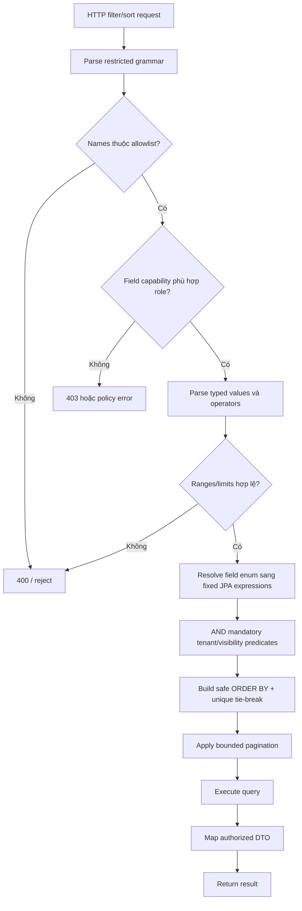

# Kiểm soát trường lọc và trường sắp xếp động bằng danh sách cho phép

Trong các ứng dụng JPA, API liệt kê dữ liệu thường cần cho phép người dùng **lọc (*filter*)** và **sắp xếp (*sort*)** linh hoạt:

```http
GET /api/orders?status=PAID&createdFrom=2026-01-01T00:00:00Z&sort=-createdAt,id&page=0&size=20
```

Tính năng tưởng đơn giản này có thể tạo lỗ hổng nếu server lấy trực tiếp tên trường hoặc cú pháp `ORDER BY` từ request để ghép vào JPQL/SQL, hoặc chuyển tất cả tham số sort/filter tới JPA mà không giới hạn. Hậu quả không chỉ là **SQL/JPQL injection** mà còn là **rò rỉ dữ liệu**, bỏ qua bộ lọc tenant, truy vấn trên trường nhạy cảm, tạo join đắt đỏ và từ chối dịch vụ do truy vấn quá phức tạp.

Giải pháp cốt lõi là **danh sách cho phép (*allowlist*)**: server công bố một tập tên trường API hợp lệ, toán tử lọc hợp lệ, kiểu dữ liệu, hướng sắp xếp và giới hạn tài nguyên. Những tên đó được **ánh xạ tới thuộc tính JPA hoặc Criteria expressions cố định do server định nghĩa**, không được dùng trực tiếp như mảnh cú pháp truy vấn.

Bài **“Kiểm soát trường lọc và trường sắp xếp động bằng danh sách cho phép”** thuộc chương **Bảo mật dữ liệu** của module **Data Persistence Relational Access ORM JPA**. Nội dung sử dụng Jakarta Persistence, JPQL, Criteria API và ví dụ Spring Data JPA.

> **Nguyên tắc:** Bind các **giá trị**; allowlist và ánh xạ tường minh các **cấu trúc truy vấn** như tên trường, phép so sánh, direction, join, expression. Đồng thời áp dụng những điều kiện **tenant/authorization** do server kiểm soát, không để người dùng xóa hoặc ghi đè chúng.

---

## 1. Vấn đề xuất phát từ một API truy vấn linh hoạt

Một API cho phép:

```http
GET /api/orders?filterField=status&filterValue=PAID&sortField=createdAt&sortDirection=desc
```

Nếu lập trình viên xây:

```java
String jpql =
    "select o from PurchaseOrder o " +
    "where o." + filterField + " = :value " +
    "order by o." + sortField + " " + sortDirection;

TypedQuery<PurchaseOrder> query =
    em.createQuery(jpql, PurchaseOrder.class);

query.setParameter("value", filterValue);
```

thì chỉ `filterValue` được bind. Ba chuỗi `filterField`, `sortField`, `sortDirection` được đưa vào **cấu trúc JPQL**.

Vấn đề:

- Request quyết định những thuộc tính nào có thể truy vấn.
- Tên field có thể không tồn tại hoặc thuộc vùng dữ liệu không cho phép.
- Cú pháp sort có thể bị biến đổi thành expression/query fragment nguy hiểm tùy cách tạo câu query.
- User có thể chọn trường nhạy cảm dù API không trả trường đó.
- User có thể làm query có join lớn hoặc ordering tốn tài nguyên.

**Không dùng một phần request chưa được kiểm soát làm JPQL/SQL identifier hay expression.**

## 2. SQL injection và JPQL injection khác gì?

SQL injection xảy ra khi dữ liệu ngoài bị diễn giải thành cú pháp SQL. JPQL injection có ý tưởng tương tự nhưng thông qua ngôn ngữ truy vấn entity của JPA.

Ví dụ nguy cơ:

```java
String sql =
    "select * from purchase_orders order by " + requestSort;

em.createNativeQuery(sql).getResultList();
```

Đây là cách ghép **cấu trúc truy vấn** từ input.

JPQL cũng nguy hiểm nếu ghép:

```java
String jpql =
    "select o from PurchaseOrder o order by o." + requestSort;
```

Chỉ vì dùng ORM/JPA không có nghĩa việc ghép chuỗi trở nên an toàn. Ngay cả khi một dạng payload bị provider từ chối bởi parser, việc để client điều khiển query structure vẫn là thiết kế thiếu kiểm soát.

## 3. Vì sao setParameter() không bind tên cột?

JPA parameters dùng cho **giá trị**, chẳng hạn:

```java
TypedQuery<PurchaseOrder> q = em.createQuery(
    "select o from PurchaseOrder o where o.status = :status",
    PurchaseOrder.class
);
q.setParameter("status", OrderStatus.PAID);
```

Nhưng không thể viết:

```jpql
select o
from PurchaseOrder o
order by :columnName
```

rồi hy vọng:

```java
query.setParameter("columnName", "createdAt");
```

sẽ trở thành:

```jpql
order by o.createdAt
```

Một bind parameter biểu diễn **giá trị** chứ không phải tên thuộc tính, identifier, direction hay JPQL fragment. Tùy provider, dạng query có thể bị từ chối hoặc được hiểu là sort theo hằng số, **không phải sort theo cột mong muốn**.

Vì vậy:

- Giá trị `PAID` → bind.
- Giá trị thời gian `Instant` → bind.
- Field `createdAt` → chọn từ allowlist server.
- Operator `>=` → chọn từ tập enum do server cho phép.
- Direction `ASC/DESC` → chọn từ enum.
- Join tới `customer` → phải là đường dẫn được thiết kế trước.

## 4. Danh sách cho phép khác danh sách cấm

**Denylist:**

```java
if (!sort.contains(";")
        && !sort.contains("--")) {
    // Tưởng an toàn.
}
```

không đủ vì:

- Cú pháp JPQL/SQL có nhiều dạng.
- Có encoding/case/whitespace khác nhau.
- Một tên field hợp lệ về cú pháp vẫn có thể là trường không được phép.
- Một expression được framework hỗ trợ có thể rất tốn chi phí.
- Một input không có ký tự “nguy hiểm” vẫn có thể trỏ tới `passwordHash`.

**Allowlist:**

```java
if (!ALLOWED_SORTS.containsKey(clientField)) {
    throw new BadRequestException(
        "Unsupported sort field"
    );
}
```

là cách ưu tiên: chỉ tên đã được server phê duyệt mới được chuyển thành thuộc tính truy vấn.

Không dùng regex tên biến như `[A-Za-z_][A-Za-z0-9_]*` làm biện pháp duy nhất. Regex chỉ giới hạn **hình thức**, không quyết định **quyền và ý nghĩa** của field.

## 5. “Allowlist field” phải gồm cả quyền truy cập

Một field tồn tại trong entity chưa chắc nên được client dùng làm filter/sort.

Ví dụ entity có:

```text
PurchaseOrder
  id
  tenantId
  status
  totalAmount
  createdAt
  customerEmail
  paymentRiskScore
  internalFraudFlag
  deletedAt
```

Ngay cả khi API không trả `paymentRiskScore`, client có thể dùng field này để đoán điểm rủi ro qua việc lọc:

```http
GET /api/orders?paymentRiskScoreMin=80
```

Nếu response có số lượng hoặc danh sách khớp, thông tin nhạy cảm có thể bị suy ra.

**Được phép trả trường trong response, được phép filter theo trường, và được phép sort theo trường là ba quyền khác nhau.**

---

## 6. Thiết kế hợp đồng API trước khi viết Criteria

Ví dụ API Order cho phép:

| Public field | Filter | Operators | Sort | Đối tượng |
|---|---|---|---|---|
| `status` | Có | `eq`, `in` | Có thể không | Người dùng tenant |
| `createdAt` | Có | `gte`, `lt` | Có | Người dùng tenant |
| `total` | Có | `gte`, `lte` | Có | Người dùng tenant |
| `id` | Có | `eq` | Có | Người dùng tenant |
| `customerName` | Theo quyền | `contains` | Theo quyền | Support role |
| `tenantId` | Không từ client | Server-enforced equality | Không | Hạ tầng |
| `deletedAt` | Không từ client | Server-enforced null check | Không | Hạ tầng |
| `paymentRiskScore` | Không | — | Không | Internal only |

Tên field public **không cần trùng** JPA property. Ví dụ client dùng `total`, entity lưu `totalAmount`.

Nhờ tách tên public khỏi persistence path, API có thể duy trì hợp đồng ổn định khi Java entity được refactor.

## 7. Phân tách filter và sort allowlists

Không nên dùng một danh sách field duy nhất rồi cho tất cả operations.

Ví dụ `notes` có thể lọc chứa từ khóa nhưng sort trên cột văn bản dài tốn chi phí. Một trường tính toán có thể sort được nhưng không nên cho arbitrary comparison.

Thiết kế nên có:

- `filterAllowedFields`.
- `filterAllowedOperators` theo từng field.
- `sortAllowedFields`.
- Role/tenant scope cho từng capability.
- Query cost limits theo field.
- Một số field chỉ được sử dụng khi có index hoặc giới hạn khoảng thời gian.

**Field được phép lọc không mặc nhiên được phép sắp xếp.**

## 8. Ví dụ request contract

Một cú pháp đơn giản:

```http
GET /api/orders?status=PAID&createdFrom=2026-01-01T00:00:00Z&totalMin=100000&sort=-createdAt,id&page=0&size=25
```

Các quy tắc:

- `status`: một giá trị trong enum public.
- `createdFrom`: thời điểm ISO-8601 hợp lệ.
- `totalMin`: số tiền Decimal không âm, dưới giới hạn hợp lý.
- `sort`: danh sách public names có thể mang dấu `-` chỉ DESC.
- `page`: số nguyên không âm, có trần.
- `size`: từ 1 đến 100 chẳng hạn.
- `tenantId`: **không nhận từ request**, lấy từ principal đã xác thực.
- Không cho unknown query keys.

Các số giới hạn là ví dụ; production phải cân theo dữ liệu, index và SLA.

## 9. Không cho query param override bắt buộc

Một lỗi nguy hiểm:

```java
Map<String, String> filters = new HashMap<>();
filters.put("tenantId", authenticatedTenant);

filters.putAll(request.getParameterMap()); // Client ghi đè tenantId?
```

Dù ví dụ có khác kiểu `Map` theo API thực tế, ý tưởng anti-pattern là rõ: merge params từ client lên bộ lọc bắt buộc.

Một query an toàn phải **xây predicates bắt buộc từ server**, chẳng hạn:

```java
Predicate tenantPredicate =
    cb.equal(root.get("tenantId"), identity.tenantId());

Predicate notDeleted =
    cb.isNull(root.get("deletedAt"));
```

Sau đó nối thêm filter do user yêu cầu bằng AND. Không đưa `tenantId`/`deletedAt` vào allowlist như các field mà client có thể sửa.

---

## 10. Entity mẫu

```java
import jakarta.persistence.*;
import java.math.BigDecimal;
import java.time.Instant;

@Entity
@Table(name = "purchase_orders")
public class PurchaseOrder {

    @Id
    private Long id;

    @Column(name = "tenant_id", nullable = false)
    private String tenantId;

    @Enumerated(EnumType.STRING)
    @Column(nullable = false)
    private OrderStatus status;

    @Column(name = "total_amount", nullable = false)
    private BigDecimal totalAmount;

    @Column(name = "created_at", nullable = false)
    private Instant createdAt;

    @Column(name = "deleted_at")
    private Instant deletedAt;

    @Column(name = "customer_name")
    private String customerName;

    @Column(name = "payment_risk_score")
    private Integer paymentRiskScore;

    protected PurchaseOrder() {}

    public Long getId() { return id; }
    public String getTenantId() { return tenantId; }
    public OrderStatus getStatus() { return status; }
    public BigDecimal getTotalAmount() { return totalAmount; }
    public Instant getCreatedAt() { return createdAt; }
}
```

```java
public enum OrderStatus {
    NEW, PAID, CANCELLED
}
```

Đây là entity mẫu, không phải toàn bộ application. Nếu cần lọc `customerName` từ relation Customer thay vì một scalar column, phải định nghĩa join rõ ở layer Criteria và đánh giá cardinality/performance; không tự cho client gửi đường dẫn tùy ý.

## 11. DTO tách khỏi entity

Đừng bind HTTP request trực tiếp thành JPA entity hoặc `Path<?>`.

Một request DTO:

```java
public record OrderSearchRequest(
    String status,
    String createdFrom,
    String totalMin,
    String sort,
    Integer page,
    Integer size
) {}
```

Sau parse/validation, chuyển sang kiểu đã kiểm soát:

```java
public record ValidatedOrderSearch(
    OrderStatus status,
    Instant createdFrom,
    BigDecimal totalMin,
    List<SortTerm> sorts,
    int page,
    int size
) {}
```

```java
public record SortTerm(
    OrderSortField field,
    SortDirection direction
) {}
```

Không để `String` chưa kiểm tra chạy sâu tới query builder.

## 12. Field enum mang ý nghĩa public

```java
public enum OrderSortField {
    CREATED_AT("createdAt"),
    TOTAL("total"),
    ID("id");

    private final String publicName;

    OrderSortField(String publicName) {
        this.publicName = publicName;
    }

    public static OrderSortField fromPublicName(String input) {
        for (OrderSortField field : values()) {
            if (field.publicName.equals(input)) {
                return field;
            }
        }
        throw new IllegalArgumentException(
            "Unsupported sort field"
        );
    }
}
```

Những public names là constants từ server. Người dùng chỉ chọn được một thành viên của enum.

Không tạo một enum case kiểu `ARBITRARY("...")` nhận raw expression từ request.

## 13. Direction enum

```java
public enum SortDirection {
    ASC, DESC;

    public static SortDirection parse(String input) {
        return switch (input) {
            case "asc" -> ASC;
            case "desc" -> DESC;
            default -> throw new IllegalArgumentException(
                "Unsupported sort direction"
            );
        };
    }
}
```

Chỉ có hai giá trị được phép. Không nối trực tiếp một string `sortDirection` vào `ORDER BY`.

Có thể chấp nhận uppercase/lowercase bằng normalization có kiểm soát, nhưng không chấp nhận arbitrary suffixes như SQL fragments.

## 14. Cú pháp sort bằng dấu trừ

Request:

```text
sort=-createdAt,id
```

Parser:

```java
static List<SortTerm> parseSort(String raw) {
    if (raw == null || raw.isBlank()) {
        return List.of(
            new SortTerm(
                OrderSortField.CREATED_AT,
                SortDirection.DESC
            )
        );
    }

    String[] parts = raw.split(",", -1);

    if (parts.length > 3) {
        throw new IllegalArgumentException(
            "Too many sort fields"
        );
    }

    List<SortTerm> result = new ArrayList<>();
    Set<OrderSortField> seen = new HashSet<>();

    for (String part : parts) {
        if (part.isEmpty()) {
            throw new IllegalArgumentException("Empty sort term");
        }

        boolean descending = part.startsWith("-");
        String publicField = descending
            ? part.substring(1)
            : part;

        OrderSortField field =
            OrderSortField.fromPublicName(publicField);

        if (!seen.add(field)) {
            throw new IllegalArgumentException(
                "Duplicate sort field"
            );
        }

        result.add(new SortTerm(
            field,
            descending
                ? SortDirection.DESC
                : SortDirection.ASC
        ));
    }
    return List.copyOf(result);
}
```

Các imports `java.util.*` cần thêm. Parser có các thuộc tính:

- Giới hạn số sort terms.
- Không dùng raw field để tạo Criteria.
- Không cho field lặp.
- Không cho chuỗi rỗng.
- Direction được xác định bằng cú pháp nhỏ đã công bố.
- Unknown name bị từ chối.

Tùy API có thể dùng `sort=createdAt:desc` thay cho dấu `-`; quan trọng là grammar **nhỏ, tường minh**.

## 15. Không mặc định unknown sort thành createdAt

Một pattern che lỗi:

```java
OrderSortField safeField;
try {
    safeField = OrderSortField.fromPublicName(raw);
} catch (Exception ex) {
    safeField = OrderSortField.CREATED_AT;
}
```

Tuy không chắc tạo injection, cách này gây:

- Client tưởng server đã sort theo field được yêu cầu.
- Lỗi chính tả không được phát hiện.
- Monitoring khó biết client đang gửi field sai.
- Có thể khiến pagination sai kỳ vọng.
- Hợp đồng API thiếu rõ ràng.

Nên **fail closed với 400 Bad Request** cho unknown/unauthorized sort field, ngoại trừ khi API đã định nghĩa fallback rõ ràng.

## 16. Giới hạn và khử trùng có ý nghĩa khác nhau

Các giới hạn cần thiết:

- Max length của `sort`.
- Max number of sort fields.
- Max filter count.
- Max IN-list size.
- Max page size/offset.
- Max string length và date range.
- Max nested depth nếu có AST.

Những giới hạn này giảm denial-of-service và giúp parse predictably, nhưng **không thay allowlist**. Một chuỗi identifier rất ngắn vẫn có thể trỏ tới field nhạy cảm nếu server cho phép.

---

## 17. Criteria API: query structure từ constants

JPA CriteriaBuilder cung cấp cách dựng query với expression objects thay vì ghép JPQL string.

Ví dụ:

```java
CriteriaBuilder cb = em.getCriteriaBuilder();

CriteriaQuery<PurchaseOrder> cq =
    cb.createQuery(PurchaseOrder.class);

Root<PurchaseOrder> root =
    cq.from(PurchaseOrder.class);

cq.select(root);
```

Nhưng Criteria **không tự biến mọi input thành an toàn**. Nếu viết:

```java
root.get(untrustedField)
```

thì client vẫn đang quyết định path được truy cập. Nó có thể gây exception, truy vấn trường không được phép hoặc trigger joins/provider behavior không mong muốn.

Cần mapping từ enum đã allowlist sang **expression được viết tường minh**.

## 18. Chọn sort path từ enum

```java
static Path<?> sortPath(
        Root<PurchaseOrder> root,
        OrderSortField field) {

    return switch (field) {
        case CREATED_AT -> root.get("createdAt");
        case TOTAL      -> root.get("totalAmount");
        case ID         -> root.get("id");
    };
}
```

Ở đây `"createdAt"`, `"totalAmount"` và `"id"` là **constants trong code server**, không đến từ query string.

Dù dùng literal JPA property names trong source, rủi ro injection từ client đã được loại bỏ ở bước mapping. Nếu thay đổi entity field, code cần được cập nhật và integration test phát hiện mapping lỗi.

## 19. Dựng ORDER BY an toàn

```java
static List<Order> buildOrderBy(
        CriteriaBuilder cb,
        Root<PurchaseOrder> root,
        List<SortTerm> terms) {

    List<Order> orders = new ArrayList<>();

    for (SortTerm term : terms) {
        Path<?> path = sortPath(root, term.field());

        orders.add(
            term.direction() == SortDirection.ASC
                ? cb.asc(path)
                : cb.desc(path)
        );
    }

    if (terms.stream().noneMatch(
            t -> t.field() == OrderSortField.ID)) {
        orders.add(cb.asc(root.get("id")));
    }

    return orders;
}
```

Các điểm bảo vệ:

- `terms` đã được parse/allowlist.
- Không đưa raw property string từ client vào `root.get()`.
- Direction là enum.
- `id` tie-breaker được thêm khi chưa có, giúp sort ổn định hơn khi nhiều rows có cùng `createdAt` hoặc `totalAmount`.

Nếu `id` không unique trong scope bảng hoặc có composite key, cần tie-breaker bảo đảm thứ tự duy nhất theo mapping thực tế.

## 20. Vì sao cần tie-breaker?

Giả sử 10.000 Orders có cùng `createdAt` do batch import, API sort chỉ:

```sql
ORDER BY created_at DESC
```

Database không có nghĩa vụ giữ thứ tự cố định giữa rows bằng nhau. Khi dùng `OFFSET/LIMIT`, các pages có thể bị lặp hoặc bỏ sót khi query execution order thay đổi.

Thêm:

```sql
ORDER BY created_at DESC, id ASC
```

tạo total order khi ID unique.

**Lưu ý:** Stable tie-breaker không ngăn mọi vấn đề pagination khi dữ liệu được insert/delete giữa các page requests; snapshot consistency hoặc keyset pagination cần xét riêng.

## 21. Multi-sort không đồng nghĩa arbitrary expression

API có thể cho:

```text
sort=-createdAt,total,id
```

nhưng chỉ những terms được allowlist.

Không cho:

```text
sort=lower(customerName)
sort=customer.orders.total
sort=someFunction(...)
```

trừ khi server định nghĩa riêng **một public capability** ánh xạ tường minh tới expression đã đánh giá bảo mật/hiệu năng.

Một danh sách cho phép các JPA paths không tự cho phép mọi function, join hay subquery do client gợi ý.

---

## 22. Filter allowlist và toán tử tương ứng

Ví dụ bộ lọc Order:

| Public filter key | JPA field | Operator do server chọn | Kiểu |
|---|---|---|---|
| `status` | `status` | equals | `OrderStatus` |
| `createdFrom` | `createdAt` | greater/equal | `Instant` |
| `createdBefore` | `createdAt` | less than | `Instant` |
| `totalMin` | `totalAmount` | greater/equal | `BigDecimal` |
| `totalMax` | `totalAmount` | less/equal | `BigDecimal` |
| `customerNameContains` | `customerName` | LIKE with escape | String |
| `id` | `id` | equals | Long |

Không lấy input `operator` rồi ghép:

```java
"where o." + field + " " + operator + " :value"
```

Thay vào đó, mỗi public filter key có một semantics xác định hoặc một tập operators enum riêng được kiểm soát.

## 23. Parse filter fields trước khi build query

Một API có thể dùng:

```java
Map<String, String> filters;
```

nhưng chỉ sau khi đã:

1. Kiểm HTTP parameter names thuộc allowlist.
2. Từ chối những key xuất hiện nhiều lần nếu API chỉ chấp nhận một giá trị.
3. Giới hạn số lượng và chiều dài.
4. Phân biệt unknown filter và query controls như `page`, `size`, `sort`.
5. Parse giá trị sang kiểu Java phù hợp.

Không dùng một `Map<String,Object>` từ JSON request làm query expressions trực tiếp.

## 24. Từ chối field không được hỗ trợ

```java
private static final Set<String> FILTER_KEYS =
    Set.of(
        "status",
        "createdFrom",
        "createdBefore",
        "totalMin",
        "totalMax",
        "id"
    );

static void validateFilterNames(Set<String> names) {
    for (String name : names) {
        if (!FILTER_KEYS.contains(name)) {
            throw new IllegalArgumentException(
                "Unsupported filter"
            );
        }
    }
}
```

Không dùng:

```java
if (requestField.startsWith("order.")) {
    return root.get(requestField.substring(6));
}
```

Vì prefix check vẫn để user quyết định arbitrary attribute sau prefix.

## 25. Parse enum an toàn

Giá trị status nên được parse sang enum có rule rõ:

```java
static OrderStatus parseStatus(String raw) {
    try {
        return OrderStatus.valueOf(raw);
    } catch (IllegalArgumentException ex) {
        throw new BadRequestException(
            "Unsupported order status"
        );
    }
}
```

Cần quyết định có cho case-insensitive input không. Nếu muốn, normalize bằng `toUpperCase(Locale.ROOT)` rồi parse; không gửi raw string vào concatenated JPQL.

Quan trọng: một status enum hợp lệ về Java vẫn có thể **không được phép cho user role này**. Ví dụ status nội bộ `UNDER_FRAUD_REVIEW` cần capability riêng hoặc không công khai.

## 26. Parse thời gian

```java
static Instant parseInstant(String raw) {
    try {
        return Instant.parse(raw);
    } catch (DateTimeParseException ex) {
        throw new BadRequestException(
            "Invalid ISO-8601 timestamp"
        );
    }
}
```

Đừng concat raw time vào JPQL/SQL; dùng parameter binding.

Một API cần thống nhất:

- UTC/offset support.
- Inclusive/exclusive range boundaries.
- Precision (millisecond/microsecond).
- Default timezone nếu chấp nhận local date.
- Không tạo một range quá lớn nếu truy vấn dữ liệu lớn.

Ví dụ tốt khi filter timestamp:

```text
createdAt >= from
AND createdAt < before
```

Nửa khoảng [from, before) giảm lỗi “23:59:59.999” khi database precision khác nhau.

## 27. Parse số tiền

```java
static BigDecimal parseMoney(String raw) {
    try {
        BigDecimal money = new BigDecimal(raw);

        if (money.signum() < 0 || money.scale() > 2) {
            throw new BadRequestException(
                "Invalid amount"
            );
        }

        if (money.compareTo(
                new BigDecimal("1000000000000")) > 0) {
            throw new BadRequestException(
                "Amount out of range"
            );
        }

        return money;
    } catch (NumberFormatException ex) {
        throw new BadRequestException(
            "Invalid decimal amount"
        );
    }
}
```

Giới hạn scale/maximum chỉ minh họa, phải khớp currency, schema và domain policy. Không dùng `double` khi yêu cầu so sánh tiền chính xác.

Nếu API cho phép filter theo currency, tiền phải đi cùng currency context hoặc dữ liệu chuẩn hóa; so sánh 100 USD và 100 VND bằng một field không có currency sẽ sai nghiệp vụ.

## 28. Kiểm khoảng lọc hợp lệ

Một request có thể gửi:

```http
?createdFrom=2026-12-01T00:00:00Z&createdBefore=2026-01-01T00:00:00Z
```

Từ lớn hơn trước. Server nên trả 400, không chạy một query bất ngờ luôn rỗng rồi che lỗi client.

```java
if (from != null && before != null
        && !from.isBefore(before)) {
    throw new BadRequestException(
        "createdFrom must precede createdBefore"
    );
}
```

Có thể yêu cầu maximum range như 90 ngày cho endpoint báo cáo có index hạn chế. Giới hạn đó là **cost policy**, không phải SQL injection defense.

## 29. Dựng Criteria predicates chỉ từ fields đã biết

Ví dụ:

```java
static List<Predicate> filters(
        CriteriaBuilder cb,
        Root<PurchaseOrder> root,
        ValidatedOrderSearch request,
        String authenticatedTenant) {

    List<Predicate> p = new ArrayList<>();

    // Hai điều kiện server-enforced.
    p.add(cb.equal(
        root.get("tenantId"),
        authenticatedTenant
    ));
    p.add(cb.isNull(root.get("deletedAt")));

    if (request.status() != null) {
        p.add(cb.equal(
            root.get("status"),
            request.status()
        ));
    }

    if (request.createdFrom() != null) {
        p.add(cb.greaterThanOrEqualTo(
            root.<Instant>get("createdAt"),
            request.createdFrom()
        ));
    }

    if (request.totalMin() != null) {
        p.add(cb.greaterThanOrEqualTo(
            root.<BigDecimal>get("totalAmount"),
            request.totalMin()
        ));
    }

    return p;
}
```

Đây là ví dụ Criteria với request typed. Các conditions đều do server chọn; chỉ **values** đến từ request, sau parse/validation.

Không đưa property path hay operator chưa xác minh từ client vào `root.get()`.

## 30. Query hoàn chỉnh có filter và sort

```java
public List<PurchaseOrder> search(
        ValidatedOrderSearch request,
        String tenantId) {

    CriteriaBuilder cb = em.getCriteriaBuilder();

    CriteriaQuery<PurchaseOrder> query =
        cb.createQuery(PurchaseOrder.class);

    Root<PurchaseOrder> root =
        query.from(PurchaseOrder.class);

    List<Predicate> predicates =
        filters(cb, root, request, tenantId);

    query.select(root);
    query.where(predicates.toArray(Predicate[]::new));
    query.orderBy(buildOrderBy(
        cb, root, request.sorts()
    ));

    TypedQuery<PurchaseOrder> typed =
        em.createQuery(query);

    int offset = Math.multiplyExact(
        request.page(), request.size()
    );

    return typed
        .setFirstResult(offset)
        .setMaxResults(request.size())
        .getResultList();
}
```

Giả sử `request.page()/size()` đã được giới hạn, `Math.multiplyExact` giúp tránh integer overflow. Production cần xem xét giới hạn maximum offset; không cho page lên hàng triệu chỉ vì phép nhân chưa overflow.

Query return entity chỉ phù hợp khi API/service không serialize trực tiếp các trường nhạy cảm; thường nên map sang **DTO projection** theo role.

## 31. Count query phải xây predicates trên root mới

Nếu API trả tổng số rows, cần count query:

```java
CriteriaQuery<Long> countQuery =
    cb.createQuery(Long.class);

Root<PurchaseOrder> countRoot =
    countQuery.from(PurchaseOrder.class);

List<Predicate> countPredicates =
    filters(cb, countRoot, request, tenantId);

countQuery.select(cb.count(countRoot));
countQuery.where(
    countPredicates.toArray(Predicate[]::new)
);

long total = em
    .createQuery(countQuery)
    .getSingleResult();
```

**Không tái sử dụng `Predicate` objects gắn với `root` của query đầu** cho một CriteriaQuery khác. Xây predicates mới dựa trên countRoot.

Khi có joins hoặc `distinct`, count semantics cần được thiết kế riêng; không mặc định `count(root)` chính xác cho mọi query có to-many join.

---

## 32. Không nhận arbitrary nested property path

Nguy hiểm nếu API cho:

```http
?sort=customer.account.owner.department.name
```

rồi server làm:

```java
String[] path = raw.split("\\.");
Path<?> p = root;

for (String segment : path) {
    p = p.get(segment);
}
```

Ngay cả khi không có injection text fragments, nó:

- Cho client điều khiển association traversal.
- Có thể gây join phức tạp hoặc lỗi ORM.
- Có thể truy cập field nhạy cảm ở quan hệ khác.
- Tăng N+1/query cost và cardinality bất ngờ.
- Không có bảo đảm authorization trên related entities.

**Không cho user tự truyền arbitrary entity navigation path.**

## 33. Cho phép một nested field cụ thể

Nếu nghiệp vụ cần sort theo customer name, định nghĩa public capability `customerName` và mapping riêng:

```java
static Expression<String> customerNameSort(
        Root<PurchaseOrder> root) {

    Join<PurchaseOrder, Customer> customer =
        root.join("customer", JoinType.LEFT);

    return customer.get("displayName");
}
```

Lúc này:

- Chỉ join `customer` đã biết.
- Chỉ lấy `displayName` đã biết.
- Join type do server chọn.
- Server có thể kiểm role trước khi cho sort.
- Có thể đánh giá index/query plan.

Nếu `PurchaseOrder` mẫu chỉ có scalar `customerName`, dùng `root.get("customerName")` thay vì đoạn này. Hai ví dụ thuộc **hai mapping alternatives**.

## 34. Authorization cho related entity

Một join tới Customer phải xét:

- Customer thuộc cùng tenant?
- Relationship có tenant invariant không?
- User có quyền xem/sort theo Customer?
- Có private customer fields?
- Có soft-deleted Customer cần loại bỏ?
- Có policies nào chỉ áp trong repository Customer nhưng không tự áp khi join từ Order?

Một join được allowlist về cú pháp **chưa đủ** nếu nó bỏ qua access-control policy của related entity.

## 35. To-many join gây duplicate rows

Ví dụ filter Order theo OrderLine.productCategory.

```java
Join<PurchaseOrder, OrderLine> lines =
    root.join("lines", JoinType.INNER);
```

Một Order có 3 Lines matching sẽ xuất hiện 3 SQL join rows. Kết quả pagination/count có thể bị trùng hoặc lệch.

Cần cân nhắc:

- `criteria.distinct(true)`, nhưng có trade-offs.
- `EXISTS` subquery để kiểm tồn tại match thay vì nhân bản root.
- Count distinct khi thích hợp.
- Không dùng fetch join to-many với OFFSET/LIMIT mà không hiểu provider behavior.
- Index join/filter columns.

**Một nested field được phép lọc vẫn có thể cần query strategy riêng để giữ semantics của pagination.**

## 36. Chọn EXISTS cho quan hệ nhiều phần tử

Ý tưởng: “Order có ít nhất một Line thuộc category X”.

```java
Subquery<Long> sub =
    query.subquery(Long.class);

Root<OrderLine> line =
    sub.from(OrderLine.class);

sub.select(line.get("id"));

sub.where(
    cb.equal(
        line.get("order").get("id"),
        root.get("id")
    ),
    cb.equal(
        line.get("category"),
        allowedCategory
    )
);

predicates.add(cb.exists(sub));
```

`allowedCategory` là giá trị đã parse/bind. Các tên properties là constants. Cần mapping thật cho `OrderLine.order/category`.

EXISTS thường tránh duplicate root rows do to-many join. Hiệu năng thực tế cần kiểm bằng indexes và execution plan.

---

## 37. LIKE là một ranh giới riêng

Một filter chứa keyword thường viết:

```java
cb.like(
    root.get("customerName"),
    "%" + keyword + "%"
);
```

Nếu keyword chứa `%` hoặc `_`, các ký tự đó là wildcard của SQL LIKE. Điều này không nhất thiết là SQL injection, nhưng có thể khiến filter **rộng hơn kỳ vọng** và tiêu thụ tài nguyên.

Phải quyết định:

- API cho phép wildcards hay chỉ **literal substring**?
- Có min/max keyword length?
- Có limit đối với `contains` trên bảng lớn?
- Có index/full-text search thay thế không?

Nếu API hứa “tìm chuỗi literal”, hãy escape LIKE wildcard characters.

## 38. Escape ký tự LIKE

Ví dụ helper:

```java
static String escapeLikeLiteral(String input) {
    return input
        .replace("\\", "\\\\")
        .replace("%", "\\%")
        .replace("_", "\\_");
}
```

Sau đó Criteria:

```java
String pattern =
    "%" + escapeLikeLiteral(keyword) + "%";

Predicate nameMatches = cb.like(
    root.get("customerName"),
    pattern,
    '\\'
);
```

Ở đây `'\\'` được thể hiện theo syntax Java trong code block: literal char của backslash được viết bằng `'\\'` ở source. Khi sử dụng thực tế phải bảo đảm JPA provider/DB dialect hỗ trợ escape character và test với `%`, `_`, `\\`.

Nếu dùng parameter query, bind `pattern` như một value. Escape LIKE giải quyết **wildcard semantics**; parameter binding giải quyết **query injection**; allowlist quyết định **field nào được search**.

## 39. Filter case-insensitive có cost riêng

Có thể:

```java
Predicate p = cb.like(
    cb.lower(root.get("customerName")),
    "%" + escapeLikeLiteral(
        keyword.toLowerCase(Locale.ROOT)
    ) + "%",
    '\\'
);
```

Nhưng:

- Lowercase/collation có vấn đề locale và Unicode.
- Function trên column có thể ngăn dùng index thông thường.
- DB-specific collation/citext/function index có thể phù hợp hơn.
- Không cho client tự chọn arbitrary functions.
- Keyword length/contains query cost vẫn cần giới hạn.

Một public filter `customerNameContains` nên ánh xạ tới một implementation đã đo performance, không một raw user expression.

## 40. Empty string, NULL và SQL 3-valued logic

```jpql
where o.customerName = :name
```

với `name = null` không có nghĩa `IS NULL` theo SQL semantics thông thường.

Nếu API hỗ trợ filter null, nên có một capability rõ:

```text
customerNameIsNull=true
```

được ánh xạ thành:

```java
cb.isNull(root.get("customerName"))
```

Đừng dùng client operator `=null` hoặc ghép `IS NULL` tùy ý vào query.

Cũng phải quyết định empty string có nghĩa “không filter”, literal empty value hay invalid request; tránh parser silently bỏ qua điều kiện bảo mật quan trọng.

## 41. IN-list cần số phần tử tối đa

Nếu API cho:

```http
GET /api/orders?statusIn=NEW,PAID
```

server parse thành list enum an toàn:

```java
List<OrderStatus> statuses =
    parseAllowedStatuses(rawStatuses);

if (statuses.isEmpty() || statuses.size() > 5) {
    throw new BadRequestException(
        "Invalid status list size"
    );
}

predicates.add(root.get("status").in(statuses));
```

Không ghép:

```java
"where status in (" + rawStatuses + ")"
```

Dùng collection values qua Criteria/query binding và giới hạn số lượng để tránh queries phình to.

Đồng thời quyết định semantics của list rỗng: trả empty result hay 400; không vô tình bỏ filter và trả **toàn bộ** dữ liệu.

## 42. Toán tử so sánh nên gắn với field type

Một API biểu thức linh hoạt có thể cho:

```json
{
  "filters": [
    {"field": "total", "op": "gte", "value": "100000"},
    {"field": "status", "op": "eq", "value": "PAID"}
  ]
}
```

Không cho `op` tùy ý. Cần allowlist theo field:

```text
total:
  eq, gte, lte

createdAt:
  gte, lt

status:
  eq, in

customerName:
  contains
```

Một `gt` trên enum hoặc `contains` trên `BigDecimal` không nên được tự động chuyển kiểu.

## 43. Operator enum

```java
public enum FilterOperator {
    EQ, IN, GTE, LTE, LT, CONTAINS
}
```

Mỗi `FilterField` xác định tập operators được phép. Khi build Criteria, dùng `switch(field, operator)` hoặc handler registry **được server khởi tạo**, không dùng raw operation string thành expression.

Không public các SQL operators đặc thù như regexp hoặc user-defined functions trừ khi đã đánh giá security, complexity và indexing.

## 44. AST filter phải có giới hạn độ sâu

Nếu API nhận:

```json
{
  "or": [
    {"and": [
      {"field": "status", "op": "eq", "value": "NEW"},
      {"field": "total", "op": "gte", "value": "100"}
    ]},
    {"field": "status", "op": "eq", "value": "PAID"}
  ]
}
```

thì không nên cho nested AND/OR vô hạn.

Cần:

- Max AST depth.
- Max total nodes/conditions.
- Max OR branches.
- Max IN-list elements.
- Max string lengths.
- Max joins/subqueries.
- Operator whitelist per field.
- Mandatory tenant/access predicates ở ngoài toàn bộ user expression.

Ví dụ tổng hợp an toàn:

```text
WHERE tenant_id = :trustedTenant
  AND deleted_at IS NULL
  AND (userAllowedExpression)
```

Không để user expression có thể `OR true` thoát ra ngoài tenant guard.

## 45. Nhóm OR sai có thể làm lộ tenant

Anti-pattern logic:

```sql
WHERE tenant_id = :tenant
  AND status = 'PAID'
  OR status = 'NEW'
```

Do `AND` ưu tiên trước `OR`, kết quả có thể gồm **mọi tenant có status NEW**.

Đúng:

```sql
WHERE tenant_id = :tenant
  AND (status = 'PAID' OR status = 'NEW')
```

Trong Criteria API:

```java
Predicate userChoice = cb.or(
    cb.equal(root.get("status"), OrderStatus.PAID),
    cb.equal(root.get("status"), OrderStatus.NEW)
);

Predicate secure = cb.and(
    cb.equal(root.get("tenantId"), trustedTenant),
    cb.isNull(root.get("deletedAt")),
    userChoice
);
```

Tách **mandatory security predicates** khỏi AST user-supplied giúp giảm nguy cơ precedence bugs.

## 46. Không cho client nhập raw JPQL/WHERE

Một số “generic search APIs” nhận:

```json
{"where": "status = 'PAID' OR 1=1"}
```

hoặc:

```json
{"orderBy": "createdAt DESC"}
```

rồi nối trực tiếp vào JPQL.

Đây là bề mặt injection rộng, khó audit và không có capability model. Không nên xây public API kiểu “client gửi một phần SQL/JPQL”.

Thay bằng **DSL nhỏ có typed fields/operators/values**; server sở hữu toàn bộ query syntax.

---

## 47. Sắp xếp theo expression tính toán

Nhu cầu hợp lệ:

```text
sort=customerNameNormalized
```

Server có thể định nghĩa:

```java
Expression<String> normalized =
    cb.lower(root.get("customerName"));

Order order = cb.asc(normalized);
```

Nếu đây là một **public enum sort option**, an toàn hơn nhiều so với để client nhập `lower(customerName)`.

Cần đánh giá:

- DB index/collation.
- NULL order.
- Tính portable giữa providers/dialects.
- Trường có chứa sensitive signal không.
- Có mất tính stable order khi các values bằng nhau không.

## 48. Alias public không phải JPQL expression

Ví dụ public name `total` có thể trỏ tới `totalAmount` hoặc một calculated expression do server định nghĩa. Việc refactor database column sau này không bắt buộc thay API name.

Không để client gửi underlying SQL column như `total_amount` chỉ vì bảng có column đó. JPA property names và database column names thuộc hai tầng khác nhau.

**Một mapping layer tường minh là nơi quản lý quyền, tính ổn định và portability.**

## 49. Null ordering cần chính sách rõ

Một sort field có thể NULL:

```text
customerName = null
```

Thứ tự NULL khi `ASC/DESC` phụ thuộc DB/dialect hoặc cấu hình.

Nếu API yêu cầu nhất quán:

- Định nghĩa `NULLS FIRST/LAST` ở contract.
- Dùng Criteria CASE expression hoặc provider-supported null handling khi cần.
- Bảo đảm tie-breaker unique.
- Viết integration tests trên database mục tiêu.

Không nhận raw `NULLS LAST` từ client rồi concat vào SQL. Nếu muốn client chọn null ordering, dùng enum allowlist riêng với giới hạn.

## 50. Collation, locale và tính ổn định

Sort tên người dùng có thể khác giữa:

- Case-sensitive vs insensitive collation.
- Accent-sensitive vs insensitive.
- Unicode normalization.
- DBMS và locale.
- Postgres/MySQL/SQL Server.

Nếu API cam kết thứ tự tiếng Việt, có thể cần collation/index phù hợp, không chỉ gọi `lower()` trên mọi database. Client không được tùy ý chỉ định một collation name nếu chưa được allowlist và đánh giá.

## 51. Mọi sort phải xét query cost

Một trường có index như `createdAt` thường dễ dùng cho pagination hơn một expression `lower(longText)`.

Khi expose sort field, review:

- Index có hỗ trợ WHERE + ORDER BY không?
- Sort trên function có cần functional index?
- Cardinality và dữ liệu NULL?
- OFFSET/LIMIT có yêu cầu sort toàn bảng không?
- Join path có nhân rows không?
- Có làm lộ thông tin qua relative order không?

**Allowlist là security policy và cũng là resource policy.**

---

## 52. Spring Data Sort không phải allowlist

Spring Data có:

```java
Sort sort = Sort.by(
    Sort.Order.desc("createdAt")
);
```

API tốt nếu property name là server constant.

Nguy hiểm khi:

```java
Sort sort = Sort.by(rawClientProperty);
```

hoặc:

```java
Pageable pageable = PageRequest.of(
    page, size, Sort.by(requestSort)
);
```

mà `requestSort` chưa qua allowlist. Spring có thể validate property paths ở một số ngữ cảnh, nhưng **không quyết định field nào user được phép sử dụng**. Validation framework không thay access-control policy.

## 53. Mapping public name sang Spring Sort

```java
private static final Map<String, String> SORT_FIELDS =
    Map.of(
        "createdAt", "createdAt",
        "total", "totalAmount",
        "id", "id"
    );

static Sort safeSort(List<SortTermInput> inputs) {
    if (inputs.size() > 3) {
        throw new BadRequestException("Too many sorts");
    }

    List<Sort.Order> orders = new ArrayList<>();
    Set<String> seen = new HashSet<>();

    for (SortTermInput input : inputs) {
        String property = SORT_FIELDS.get(input.field());

        if (property == null || !seen.add(property)) {
            throw new BadRequestException(
                "Unsupported/duplicate sort field"
            );
        }

        Sort.Direction direction =
            switch (input.direction()) {
                case "asc" -> Sort.Direction.ASC;
                case "desc" -> Sort.Direction.DESC;
                default -> throw new BadRequestException(
                    "Invalid sort direction"
                );
            };

        orders.add(new Sort.Order(direction, property));
    }

    if (!seen.contains("id")) {
        orders.add(Sort.Order.asc("id"));
    }

    return Sort.by(orders);
}
```

`SortTermInput` là request DTO, còn `SORT_FIELDS` do server khai báo. Mọi property string được chuyển vào `Sort.Order` đều lấy từ **map constant**, không phải input nguyên trạng.

## 54. Pageable phải giới hạn page size

```java
int page = Math.max(0, requestPage);
int size = Math.min(
    Math.max(requestSize, 1),
    100
);

Pageable pageable = PageRequest.of(
    page, size, safeSort(sortTerms)
);
```

Đoạn trên minh họa giới hạn nhưng **clamping âm thành 0 có thể che request sai**. API bảo mật/nhất quán thường nên trả 400 cho `page < 0`, `size <= 0` hoặc `size > MAX`, trừ khi contract công bố chính sách clamp.

Với số trang cực lớn, vẫn có thể gây expensive OFFSET. Nên có max offset hoặc keyset pagination.

## 55. JpaSort.unsafe cần tránh ở public input

Spring Data JPA có những phương tiện sắp xếp bằng expression đặc thù, chẳng hạn `JpaSort.unsafe(...)`.

Chúng phục vụ trường hợp developer **cố ý** dùng expression được kiểm soát, không phải cách cho client gửi arbitrary SQL/JPQL function.

Không viết:

```java
JpaSort.unsafe(untrustedRequestSort)
```

Vì đã bỏ qua ý tưởng property-path validation. Nếu thật sự dùng unsafe expression, nó phải là **hằng số server-chosen** tương ứng một enum value đã review.

## 56. Spring Data Specification không cấp quyền tự động

Một pattern:

```java
Specification<PurchaseOrder> spec =
    (root, query, cb) -> cb.and(
        cb.equal(
            root.get("tenantId"),
            trustedTenant
        ),
        cb.isNull(root.get("deletedAt")),
        cb.equal(
            root.get("status"),
            validatedStatus
        )
    );
```

Rồi:

```java
repository.findAll(spec, pageable);
```

Nếu `validatedStatus` đã parse và `pageable` dùng safe Sort thì pattern có thể phù hợp.

Nhưng `Specification` không tự:

- Kiểm authorization.
- Kiểm user field allowlist.
- Giới hạn nested joins.
- Chống query complexity.
- Bảo vệ count query khỏi duplicate rows.

**Specification là công cụ cấu trúc code, không phải security policy.**

## 57. Tránh repository API nhận raw Sort từ controller

Một service interface dễ bị misuse:

```java
Page<PurchaseOrder> search(
    Map<String, Object> filters,
    Sort userProvidedSort
);
```

nếu bất kỳ controller nào có thể tạo Sort từ request trước khi validation.

Tốt hơn:

```java
Page<OrderView> search(
    ValidatedOrderSearch request,
    AuthenticatedIdentity actor
);
```

Application service nhận **typed validated capability request**, rồi build JPA query. Return `OrderView` DTO theo quyền thay vì entity đầy đủ.

## 58. Static JPA metamodel giảm lỗi refactor

Nếu dự án có generated static metamodel, Criteria có thể dùng:

```java
root.get(PurchaseOrder_.createdAt)
```

thay:

```java
root.get("createdAt")
```

Ưu điểm:

- Giảm lỗi gõ sai property names.
- Phát hiện sai mapping sớm qua compiler.
- Giữ type information.
- Cùng với enum allowlist, mapping rõ ràng.

Nhưng generated metamodel **không thay allowlist**. Một user không được phép chọn mọi attribute chỉ vì chúng có trong `PurchaseOrder_`.

---

## 59. Phân quyền theo vai trò

Giả sử:

- CUSTOMER được filter/sort theo `createdAt`, `status`, `total`.
- SUPPORT được filter thêm theo `customerName` sau khi check scope.
- RISK_ANALYST có thể dùng một số risk fields nhưng chỉ trong một endpoint riêng.

Không nên thêm tất cả fields vào global map rồi hy vọng controller không expose.

Có thể mô hình hóa capability:

```java
record SortCapability(
    OrderSortField field,
    Set<Role> roles
) {}
```

Khi parse:

```java
if (!capability.roles().contains(actor.role())) {
    throw new ForbiddenSearchFieldException();
}
```

Cũng cần kiểm tenant/record-level authorization. Role đơn lẻ không nhất thiết đủ.

## 60. Filter field có thể rò dữ liệu dù không trả field

Ví dụ response chỉ có:

```json
{"orderId":100,"status":"NEW"}
```

Nhưng API cho filter `paymentRiskScore > 80`. Client thử các ngưỡng và xem có bao nhiêu records khớp, từ đó suy ra field nội bộ.

Thậm chí cho sort theo risk score cũng có thể tiết lộ relative ranking giữa Orders.

Vì vậy đánh giá security của filter/sort fields phải xét **inference attacks**, không chỉ xem response DTO có ẩn field hay không.

## 61. Response count cũng cần được phân quyền

Nếu query có:

```http
GET /api/orders?customerEmailContains=example.com
```

và trả:

```json
{"totalElements":12345}
```

thì total count có thể tiết lộ thông tin về tập dữ liệu nhạy cảm.

Bộ lọc tenant/ownership phải áp dụng cho cả **data query và count query**. Nếu policy yêu cầu không tiết lộ số lượng chính xác, có thể dùng response không có exact count hoặc endpoint khác phù hợp.

Không xây count query bỏ điều kiện tenant vì “chỉ đếm, không trả records”.

## 62. Mandatory security filter phải có trong cả export

Lỗi thường gặp:

- API search áp `tenantId`.
- API export CSV gọi repository khác không áp `tenantId`.
- Frontend chỉ ẩn trường, backend vẫn nhận sort/filter.
- Background report chạy một query với pagination parameters nhưng không scope auth.

Nếu dữ liệu nhiều tenant, mọi entrypoint đọc (list, count, export, admin, batch preview) cần enforcement nhất quán.

Tốt nhất là có một policy/criteria builder trung tâm **mà API không thể vô hiệu hóa**, kết hợp DB RLS khi threat model yêu cầu.

## 63. Client không được điều khiển thuộc tính tenant

Không đưa các keys sau vào public allowlist khi caller không có quyền:

```text
tenantId
ownerId
deletedAt
isInternal
permissionMask
accessScope
```

Ngay cả nếu client gửi giá trị giống session hiện tại, server không nên dùng request value làm nguồn authority.

Nếu admin được lọc theo tenant khác, tạo **admin-specific capability** với authorization/audit rõ ràng, không mở chung cho mọi user.

## 64. Soft delete là predicate bắt buộc

Khi entity có `deletedAt`:

```java
cb.isNull(root.get("deletedAt"))
```

cần được áp dụng nếu API chỉ trả active records.

Không cho client gửi:

```http
?deletedAtIsNull=false
```

rồi vô hiệu hóa visibility policy, trừ khi endpoint và vai trò đã được thiết kế cho “include deleted”.

ORM filters/provider-specific soft delete annotations có thể hỗ trợ, nhưng direct JPQL/native SQL và một số join paths vẫn cần kiểm tra.

## 65. Database Row-Level Security là lớp bổ sung

Một DBMS hỗ trợ RLS có thể giới hạn rows theo tenant/user/session context ngay tại database.

RLS có ích khi có nhiều code paths nhưng cần chú ý:

- Database role và session variable phải được set an toàn.
- Connection pooling phải reset context đúng.
- Admin/migration roles có thể bypass RLS.
- JPA Criteria vẫn cần filter/sort allowlist để hạn chế fields và query cost.
- Test multi-tenant với connection reuse.

**RLS không thay allowlist của API**, vì RLS bảo vệ rows, không nhất thiết bảo vệ expressions hoặc lượng tài nguyên query.

---

## 66. Không để arbitrary JSON property names thành entity paths

Một REST endpoint kiểu:

```json
{
  "sort": [
    {"field": "createdAt", "dir": "desc"}
  ],
  "filters": {
    "status": "PAID"
  }
}
```

có thể hợp lý nếu parser validate schema và allowlist.

Nhưng không nên deserialise một object map rồi lặp:

```java
for (String field : filters.keySet()) {
    predicates.add(cb.equal(
        root.get(field),
        filters.get(field)
    ));
}
```

Field names phải đi qua **validation + mapping** trước query construction.

## 67. Trường computed hoặc JSONB cần review riêng

Nếu entity lưu JSONB metadata và API cho filter:

```text
metadata.someUserSelectedKey
```

thì dynamic path có thể làm query complexity và policy phức tạp.

Có thể định nghĩa một số keys public đã biết:

```text
deliveryCity
salesChannel
```

và mapping server-generated expressions với named parameters. Không cho client tự nhập arbitrary JSON path hoặc SQL function name, trừ khi có sandbox DSL với bảo vệ chuyên biệt đã thiết kế và test.

## 68. Không dùng reflection để expose toàn bộ fields

Một anti-pattern:

```java
for (Field field : PurchaseOrder.class.getDeclaredFields()) {
    allowed.add(field.getName());
}
```

Khi developer thêm `fraudScore` hoặc `internalReviewReason` vào entity, API vô tình công bố capability mới.

Một allowlist nên được **review cố ý**, không tự expand mỗi khi entity schema đổi.

Có thể generate documentation từ allowlist, nhưng không generate allowlist từ toàn bộ model mà không có security classification.

## 69. Mặc định khóa khi thêm field mới

Khi entity thêm property:

```java
private String internalInvestigationNote;
```

field đó **không tự được filter/sort** vì không có trong enum/mapping.

Đó là đặc tính “fail closed” tốt. Muốn expose, developer phải:

1. Đánh giá sensitivity.
2. Chọn public name.
3. Xác định role/tenant.
4. Đánh giá query cost/indexes.
5. Thêm parser/mapping.
6. Viết tests và API docs.

## 70. Version hóa API sort fields

Nếu public field `total` từng là `totalAmount` rồi đổi thành `totalAfterDiscount`, dù tên request không đổi, **ngữ nghĩa sort đã thay**.

Cần xem xét:

- API version.
- Backward compatibility.
- Old clients dùng key cũ.
- Deprecation strategy.
- Pagination cursors còn hợp lệ không.
- Metric về field usage.

Allowlist vừa là security boundary vừa là public API contract.

---

## 71. Pagination và giới hạn tài nguyên

Ngay cả khi field/direction hợp lệ:

```http
GET /api/orders?sort=-createdAt&page=99999999&size=10000
```

có thể khiến query dùng OFFSET rất lớn.

Cần:

- Size min/max.
- Page/offset max.
- Total sort terms max.
- Filter count max.
- Statement/transaction timeout.
- Rate limits.
- Query-specific indexes.
- Keyset/cursor pagination cho deep browsing.

Allowlist không tự bảo vệ hệ thống khỏi truy vấn tốn kém.

## 72. Keyset pagination

Với sort:

```sql
ORDER BY created_at DESC, id DESC
```

trang kế tiếp có thể dùng cursor của row cuối:

```sql
WHERE tenant_id = :trustedTenant
  AND (
      created_at < :lastCreatedAt
      OR (
          created_at = :lastCreatedAt
          AND id < :lastId
      )
  )
ORDER BY created_at DESC, id DESC
LIMIT :size;
```

Đây là SQL minh họa cho keyset pagination. Nếu public API cho ASC/DESC phối hợp nhiều fields, cursor predicate phải được xây đúng cho từng direction, NULL semantics và tie-breaker.

Cursor cần được validate và có thể ký/HMAC nếu không muốn client sửa internal state; **cursor không thay authorization và tenant filtering**.

## 73. Cursor phải gắn với filter/sort contract

Nếu page 1 dùng:

```text
status=PAID
sort=-createdAt,id
```

mà page 2 nhận cursor cũ trong request:

```text
status=NEW
sort=total
```

thì cursor boundary không còn diễn giải chính xác.

Có thể gắn vào cursor:

- API version.
- Canonical filter fingerprint.
- Sort field/direction list.
- Last ordered values.
- Tenant scope.
- Expiry.

Server phải check cursor khớp request hiện tại; không tin cursor tự khai tenant hoặc role.

## 74. Không fetch join to-many tùy tiện khi phân trang

Một query `JOIN FETCH o.lines` với pagination có thể tạo duplicate root rows hoặc pagination trong memory tùy provider. Với ORDER BY dynamic, vấn đề càng phức tạp.

Một pattern thực dụng:

1. Query IDs được filter/sort/paginate.
2. Load những entities/DTO cần hiển thị theo ID list.
3. Khôi phục đúng thứ tự ở response layer khi cần.

Phải bảo vệ tenant/authorization ở cả hai bước. Cân nhắc transaction snapshot nếu yêu cầu consistency mạnh giữa hai reads.

## 75. Count query có thể là bottleneck

`select count(...)` trên query có nhiều joins/filter có thể tốn hơn data query.

Một số API chỉ cần:

- `hasNext`.
- Một trang dữ liệu + 1 row.
- Approximate count.
- Asynchronous analytics endpoint.

Không bắt buộc trả exact total count nếu security, latency hoặc product requirement không cần. Nhưng nếu công bố `totalElements`, phải đúng scope và consistency contract.

## 76. Query timeouts là lớp bảo vệ sau cùng

Có thể cấu hình query timeout hint/DB statement timeout phù hợp provider:

```java
typedQuery.setHint(
    "jakarta.persistence.query.timeout",
    2000
);
```

Ý tưởng: giới hạn thời gian chạy (giá trị thường tính theo milliseconds theo JPA hint semantics; behavior thực tế phụ thuộc provider/DB).

Timeout không thay:

- Allowlist.
- Indexes.
- Rate limits.
- Max predicates/IN-list.
- Resource pools.
- Proper cancellation/rollback handling.

Một query đã timeout có thể ảnh hưởng transaction state; cần xử lý lỗi như một persistence operation failure phù hợp.

---

## 77. Contract lỗi: 400, 403, 422

Một policy tham khảo:

| Tình huống | Response có thể chọn |
|---|---|
| Unknown filter field | 400 Bad Request |
| Unknown sort field | 400 Bad Request |
| Direction khác asc/desc | 400 Bad Request |
| Sai định dạng Instant/BigDecimal | 400 Bad Request |
| Too many filters/sort terms | 400 Bad Request hoặc 422 theo API |
| Field tồn tại nhưng role không được phép dùng | 403 Forbidden hoặc 400 generic để tránh field enumeration |
| Page size vượt limit | 400 hoặc clamp nếu API công bố |
| Resource không thuộc tenant | Trả theo authorization/not-found policy |

Không công bố stack trace, JPQL string hoặc database column details trong client error.

## 78. Error response không tiết lộ schema nội bộ

Ví dụ:

```json
{
  "type": "https://example.invalid/problems/invalid-query",
  "title": "Invalid query parameter",
  "status": 400,
  "detail": "Unsupported sort field",
  "parameter": "sort"
}
```

Nên tránh:

```text
Unknown property PurchaseOrder.internalFraudScore
Did you mean paymentRiskScore?
```

vì có thể tiết lộ schema/field nội bộ. API docs có thể liệt kê **các public fields được cấp quyền**.

## 79. Fail closed không phải tự động trả 500

Một field từ client không nằm trong allowlist là **validation error dự đoán được**, không phải internal server error.

Nên chuyển thành 400/appropriate response ở boundary. Logging có thể ghi field name đã giới hạn/escaped để debug, nhưng tránh echo raw attacker-controlled strings ở logs mà không chuẩn hóa.

Nếu một mapping constant trong code bị sai sau refactor, đó mới là **server programming/configuration error** cần internal diagnostics và integration test.

## 80. Ghi log an toàn

Nên log:

```json
{
  "endpoint": "SearchOrders",
  "tenantScope": "acme",
  "filterFields": ["status", "createdAt"],
  "sortFields": ["createdAt", "id"],
  "pageSize": 25,
  "durationMs": 18,
  "resultCount": 25
}
```

Không log toàn bộ query params nếu chúng chứa email/phone/PII hay ký tự control. Dùng bounded lengths và structured fields, tránh log injection.

Metrics có thể đo tần suất unknown-field rejection, slow queries và expensive filters để cập nhật allowlist/index policy.

---

## 81. Test 1: allowed sort

Request:

```http
GET /api/orders?sort=-createdAt,id
```

Kỳ vọng:

- Parser tạo `CREATED_AT DESC, ID ASC`.
- Criteria expression dùng known JPA properties.
- Không có raw expression từ request.
- Các Orders cùng createdAt được tie-break bằng ID.
- Response vẫn tenant-scoped.

## 82. Test 2: unknown sort field

```http
GET /api/orders?sort=internalFraudFlag
```

Kỳ vọng 400/forbidden theo policy; không query trường nội bộ và không tạo `ORDER BY` từ raw string.

Nếu entity thật có field tên đó, test vẫn phải từ chối vì **không thuộc allowlist**.

## 83. Test 3: ký tự cấu trúc trong sort

Ví dụ:

```http
GET /api/orders?sort=createdAt%20desc
```

Nếu API grammar chỉ hỗ trợ `-createdAt` hoặc `createdAt`, input `createdAt desc` phải bị từ chối. Không tự “dọn” string rồi concat phần còn lại.

Test thêm:

- Dấu phẩy liên tiếp.
- Blank term.
- Field lặp.
- Direction lạ.
- Quá nhiều terms.
- Chuỗi quá dài.
- Dấu chấm path traversal.

## 84. Test 4: filter unknown field

```http
GET /api/orders?paymentRiskScoreMin=80
```

Kỳ vọng từ chối hoặc không nhận capability này; không chạy query và không trả count cho field nhạy cảm.

Nếu admin role được phép dùng, test riêng **admin endpoint + authority + tenant scope**, không chỉ hidden frontend control.

## 85. Test 5: tenant predicate không bị override

User tenant A gửi:

```http
GET /api/orders?tenantId=B&status=PAID
```

Kỳ vọng request bị từ chối do `tenantId` không nằm trong public filter set; query không bao giờ dùng tenant B từ client.

Dùng DB seed A/B để xác minh không có records của B trong data, count hoặc export.

## 86. Test 6: OR grouping

Yêu cầu:

```text
tenant=A AND (status=NEW OR status=PAID)
```

Test với dataset của tenant B có status NEW và PAID.

Kỳ vọng không có dữ liệu B. Nếu Criteria AST accidentally tạo:

```text
(tenant=A AND status=NEW) OR status=PAID
```

test phải phát hiện leak.

## 87. Test 7: LIKE wildcard literal

Keyword:

```text
50%_sale
```

Nếu API cam kết literal contains, kết quả chỉ match string chứa đúng dấu percent và underscore, không coi chúng là wildcards.

Thử thêm backslash, Unicode, chuỗi rỗng, max length; xác minh actual SQL dialect/escape behavior.

## 88. Test 8: range/timezone

Requests:

```http
?createdFrom=2026-01-01T00:00:00Z&createdBefore=2026-02-01T00:00:00Z
```

Xác minh:

- Inclusive lower, exclusive upper.
- Đúng boundary với precision của DB.
- Input thiếu timezone bị reject nếu contract yêu cầu Instant.
- From >= before bị reject.
- Không cho range quá lớn nếu có policy.

## 89. Test 9: duplicate query parameters

```http
GET /api/orders?status=NEW&status=PAID
```

Nếu API chỉ cho một `status`, phải từ chối thay vì để framework tùy ý chọn đầu/cuối. Nếu cho multi-value, quy định rõ semantics và parser riêng với max count.

## 90. Test 10: SQL injection dưới dạng giá trị

Input filter value chứa ký tự SQL/JPQL đặc biệt, ví dụ apostrophe hoặc backslash.

Kỳ vọng:

- Query vẫn được tạo từ Criteria constants.
- Giá trị được bind/literal-safe theo API.
- Không thay đổi cấu trúc WHERE.
- Không lộ data ngoài tenant.
- Không có lỗi parser do concatenated input.

Không cần tạo payload tấn công phức tạp; test cần chứng minh **data stays data**.

## 91. Test 11: nested path không được khai báo

```http
GET /api/orders?sort=customer.account.owner.name
```

Kỳ vọng reject; không tự tạo association traversal. Nếu `customerName` đã được allowlist, server dùng mapping cố định tương ứng.

## 92. Test 12: join cardinality và pagination

Với to-many relation:

- Order#1 có 3 matching Lines.
- Order#2 có 1 matching Line.

Filter “có Line thuộc category X” phải trả **2 Orders** chứ không 4 row duplicates. Count và paging phải theo Order identity, không raw join row count.

Dùng EXISTS hoặc chiến lược distinct phù hợp, test trên DB mục tiêu.

## 93. Test 13: sort stability

Seed nhiều Orders cùng `createdAt`, yêu cầu `sort=-createdAt`.

Kỳ vọng thêm tie-breaker ID. Lặp query với cùng snapshot cho kết quả stable. Nếu có concurrent inserts/deletes, đánh giá keyset/snapshot semantics riêng.

## 94. Test 14: resource limits

Thử:

- `size=1000000`.
- `page=99999999`.
- 50 sort terms.
- IN-list rất dài.
- Keyword chứa hàng nghìn ký tự.
- AST depth vượt giới hạn.
- Many OR branches.

Kỳ vọng server từ chối trước khi query DB hoặc áp policy an toàn; không để request chiếm tài nguyên không giới hạn.

## 95. Test 15: field capability theo role

CUSTOMER yêu cầu sort `customerName` hoặc risk field; SUPPORT yêu cầu same field trong allowed tenant scope.

Kỳ vọng:

- Role restrictions được enforcement ở service/backend.
- Data và count không rò ra ngoài quyền.
- Không có endpoint khác như export bỏ qua policy.
- Không rely vào frontend ẩn option.

## 96. Test 16: Spring Data direct Sort bypass

Gọi repository integration với `safeSort(...)` và cùng endpoint đã thử raw property injection trước đó.

Kỳ vọng code path production **không nhận Sort từ HTTP binder nguyên trạng**, và các helpers chỉ đưa constant-mapped properties vào `Sort.Order`.

Không chỉ test `OrderSortField.fromPublicName()` unit; cần kiểm end-to-end request → service → SQL với DB thật.

---

## 97. Bảng lỗi thường gặp

| Hiện tượng | Nguyên nhân | Cách xử lý |
|---|---|---|
| Sort injection | Nối raw sort string vào JPQL/SQL | Enum allowlist + Criteria expression |
| `setParameter("field", ...)` không sort | Parameters không là identifiers | Mapping fixed paths |
| Người dùng lọc được trường nhạy cảm | Expose toàn bộ entity fields | Field-level capability allowlist |
| Thêm entity field làm API lộ field | Reflection tạo allowlist tự động | Danh sách cố định review rõ |
| Trường ngoài allowlist bị bỏ qua lặng lẽ | Fallback/silent ignore | 400 fail closed |
| Query chọn cột nhầm | Public/API name trùng field SQL không ổn | Mapping public → JPA path |
| Filter giá trị có apostrophe gây JPQL lỗi | Ghép value vào query | Parameter binding |
| LIKE tìm `%` nhưng trả mọi record | Không escape wildcard | Escape LIKE + size limit |
| CustomerName sort gây query chậm | Lower/function/join thiếu index | Review plan/index/capability |
| Nested path lạ gây join lớn | root.get(userPath) | Fixed join handlers |
| Count trả tổng của toàn tenant khác | Bỏ tenant ở count query | Shared mandatory predicates |
| `OR` lọt ngoài tenant guard | Grouping sai | AND(tenant, userExpression) |
| Soft-deleted rows xuất hiện | Không áp deletedAt predicate | Server-enforced visibility |
| Multi-sort không ổn định | Không có unique tie-breaker | Thêm ID tie-break |
| Pagination lặp/mất rows | Equal sort values/concurrent changes | Stable order, cursor/snapshot |
| Query result có duplicates | To-many join | EXISTS/distinct/count design |
| Too many query filters | Không cost budget | Max conditions/depth/IN/size |
| `JpaSort.unsafe(raw)` gây risk | Raw expression từ client | Chỉ server constants |
| Unknown status enum gây 500 | Parse không handle | Validation 400 |
| Date range sai | Không kiểm from/before | Typed range validation |
| JSON query tự do quá mạnh | Public raw WHERE/AST không giới hạn | Restricted typed DSL |
| 403 field policy chỉ ở UI | Backend không check role | Authorization ở service |
| RLS có nhưng filter vẫn tốn tài nguyên | RLS chỉ bảo vệ rows | Allowlist + query limits |
| Count exact tiết lộ thông tin | Field/aggregate inference | Scope count và role |
| Dynamic identifier regex vẫn lộ field | Regex chỉ kiểm hình thức | Semantic allowlist |
| Query code khó refactor | String field names rải rác | Central mapping/static metamodel |
| Export bỏ qua tenant | Entry points không dùng chung policy | Test/search/export scopes |
| L2/cache trả data sai | Cache keys không chứa tenant/filter | Cache namespace + invalidation |
| Cursor dùng lại với sort khác | Cursor không gắn query contract | Cursor fingerprint validation |
| Null ordering khác DB | Không có null policy | Explicit mapping/test dialect |
| Query timeout ném exception | Query quá nặng/timeout chưa handle | Limits/index/rollback policy |

---

## 98. Bài tập 1: vì sao bind sort không hoạt động?

Developer thử:

```jpql
select o from PurchaseOrder o order by :field
```

và bind `field="createdAt"`.

**Đáp án:** Parameter là giá trị, không được diễn giải thành JPA attribute path. Chọn expression từ allowlist rồi dùng Criteria/JPA structure cố định.

## 99. Bài tập 2: regex field name đủ chưa?

API chấp nhận mọi field khớp `[A-Za-z_]+`.

**Đáp án:** Chưa. `paymentRiskScore` hoàn toàn hợp regex nhưng có thể là thông tin nhạy cảm. Phải allowlist theo capability/role.

## 100. Bài tập 3: tenant OR precedence

Query:

```sql
WHERE tenant_id = :tenant AND status = 'NEW'
   OR status = 'PAID'
```

**Đáp án:** Có thể trả PAID rows của tenant khác. Cần `tenant_id = :tenant AND (status=NEW OR status=PAID)` và test cross-tenant.

## 101. Bài tập 4: sort theo status internal

Field `riskScore` không có trong Order DTO nhưng client được sort theo nó.

**Đáp án:** Relative ordering có thể tiết lộ thông tin. Không cho sort/filter field nhạy cảm chỉ vì response không hiển thị trực tiếp.

## 102. Bài tập 5: LIKE special characters

User tìm literal `50%_sale` nhưng server dùng `LIKE '%50%_sale%'`.

**Đáp án:** `%` và `_` mang nghĩa wildcard. Escape literal LIKE characters và bind pattern; kiểm dialect/escape.

## 103. Bài tập 6: unknown sort silently ignored

Request `sort=cretaedAt` bị sai chính tả, server tự dùng `id` mà không báo.

**Đáp án:** Có thể không gây injection nhưng làm contract mơ hồ và pagination sai kỳ vọng. Trả validation error theo API policy.

## 104. Bài tập 7: raw JpaSort.unsafe

Controller gọi `JpaSort.unsafe(request.getSort())`.

**Đáp án:** Không phù hợp với untrusted input. Unsafe expression chỉ được tạo từ server constants đã review, không từ client string.

## 105. Bài tập 8: count query thiếu tenant

Data query có `tenantId`, count query không có.

**Đáp án:** Count rò thông tin và pagination metadata sai. Count query phải xây lại cùng mandatory security predicates trên root mới.

## 106. Bài tập 9: to-many join

Order#1 có 3 Lines phù hợp, Order#2 có 1. Query join trả 4 rows.

**Đáp án:** Query cần tính theo Orders, không theo join rows. Dùng EXISTS hoặc distinct/count strategy phù hợp.

## 107. Bài tập 10: phân trang sâu

Request `page=10000000&size=100` dù sort/filters đều allowlist.

**Đáp án:** Vẫn có nguy cơ query cost lớn. Giới hạn offset/page và cân nhắc keyset pagination.

## 108. Bài tập 11: thêm entity field mới

Developer thêm `internalComment` vào entity. Tên tự xuất hiện trong filter options vì reflection.

**Đáp án:** Đó là rủi ro expose capabilities ngoài ý muốn. Allowlist nên được review và cập nhật chủ động.

## 109. Bài tập 12: cursor của sort cũ

Client dùng cursor từ `sort=-createdAt` cho `sort=total`.

**Đáp án:** Không được dùng như cùng một continuation. Cursor phải gắn với query/sort fingerprint và scope, hoặc trả invalid cursor.

---

## 110. Checklist triển khai

**Thiết kế API:**

- Có danh sách public filter names rõ chưa?
- Mỗi field có toán tử/kiểu/giới hạn riêng chưa?
- Sort fields có danh sách độc lập với filter fields chưa?
- Public names đã tách khỏi JPA/SQL properties chưa?
- Có định nghĩa grammar direction/multi-sort chưa?
- Unknown/unauthorized fields bị từ chối không?
- Có role-level field capability và tenant ownership không?

**Bảo vệ truy vấn:**

- Values được bind/typed đúng không?
- Field/path/expression đều từ constants do server định nghĩa không?
- Không ghép raw request vào JPQL/SQL/ORDER BY không?
- Mandatory tenant/soft-delete được AND bên ngoài user expression không?
- Cả data/count/export queries dùng cùng security scope không?
- Nested joins/collection filters có review cardinality không?
- LIKE wildcard có escaped theo contract không?
- NULL, enum, date/time, Decimal được parse đúng không?

**Độ ổn định và hiệu năng:**

- Có unique tie-breaker không?
- Có max sort terms/filter count/IN-list/size/page không?
- Có giới hạn AST depth nếu API hỗ trợ AND/OR lồng nhau không?
- Có index hỗ trợ fields đã allowlist không?
- Query count/fetch join pagination có được xem xét không?
- Có query timeout/rate limit/slow query telemetry không?
- Cursors có gắn filter/sort/tenant fingerprint không?

**Kiểm thử:**

- Unknown field, sensitive field, nested path bị reject?
- Same input có sort ổn định?
- Cross-tenant data/count/export không rò?
- OR grouping chính xác?
- Wildcards/Unicode/NULL/ranges?
- Concurrent inserts và deep pages?
- Queries có joins to-many có duplicate rows không?
- Role changes/permission revocation có được áp không?
- Spring Sort/JpaSort.unsafe không bypass validation?
- Tests chạy trên database/dialect thật?

## 111. Sơ đồ quyết định



Lưu ý: bảo mật thực tế còn phụ thuộc hệ thống authentication/authorization, database roles, soft-delete policy, encryption và kiểm soát dữ liệu tại các entrypoints khác. Allowlist là **một lớp** quan trọng, không phải toàn bộ mô hình bảo mật.

## 112. Tổng kết

Trong ORM/JPA, một search API có thể linh hoạt mà không cho client kiểm soát cấu trúc truy vấn tùy ý.

Phân biệt cốt lõi:

```java
// Đúng: bind value
cb.equal(root.get("status"), validatedStatus);

// Không đúng: đưa client field trực tiếp vào path
root.get(untrustedField);

// Đúng: chọn field từ enum/mapping server
sortPath(root, validatedSortField);
```

Những nguyên tắc cần nhớ:

1. **Parameter binding bảo vệ giá trị, không bind identifiers/ORDER BY expressions**.
2. **Allowlist field thay vì denylist hoặc regex hình thức**; một field hợp lệ cú pháp chưa chắc được phép truy vấn.
3. **Phân biệt filter allowlist và sort allowlist**, kèm operators, types và roles.
4. **Map public names sang JPA paths/Criteria expressions cố định**; không đưa raw request vào `root.get()`, JPQL concat hay `JpaSort.unsafe`.
5. **Tenant/authorization/soft-delete predicates phải do server kiểm soát**, được AND đúng với user filters và áp dụng ở data/count/export.
6. **Không expose sensitive fields qua filtering, sorting hoặc counts** dù response DTO không hiển thị field.
7. **Nested paths và joins phải là capabilities được định nghĩa trước**, có kiểm soát permission, cardinality và query plan.
8. **LIKE escaping khác query parameter binding**; cần cả hai khi API tìm substring literal.
9. **Typed parsing cho enum, Instant, Decimal, null và range** giúp tránh query mơ hồ và lỗi mapping.
10. **Sort ổn định cần unique tie-breaker**; deep pagination còn cần max offset hoặc keyset.
11. **Giới hạn độ phức tạp**: số filter, số sort, size, IN-list, AST depth, query timeouts và rate limits.
12. **Spring Data Sort/Pageable/Specification không tự thực thi security allowlist**; các objects phải được tạo từ validated capabilities.
13. **Thêm field vào entity không được tự mở capability mới**; allowlist cần review chủ động.
14. **Integration tests phải chứng minh cả bảo mật lẫn semantics**, đặc biệt cross-tenant, OR grouping, LIKE, count và pagination.

Thiết kế tốt không yêu cầu hy sinh tính linh hoạt của người dùng. Nó chuyển quyền quyết định **trường nào, phép so sánh nào, cách sắp xếp nào và phạm vi dữ liệu nào được phép** về phía server. Khi mọi cấu trúc truy vấn đều xuất phát từ allowlist và policy đáng tin cậy, JPA có thể cung cấp filter/sort động mà không biến API thành cánh cửa cho client tự điều khiển JPQL/SQL hoặc truy cập dữ liệu vượt quyền.
