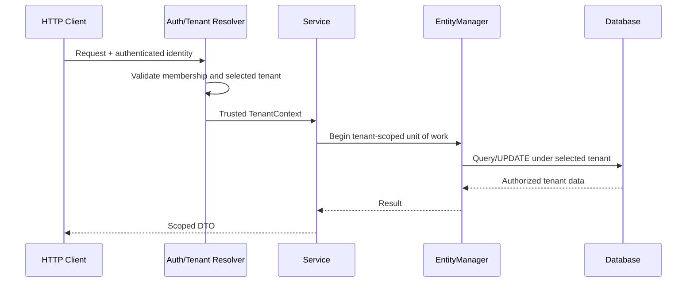
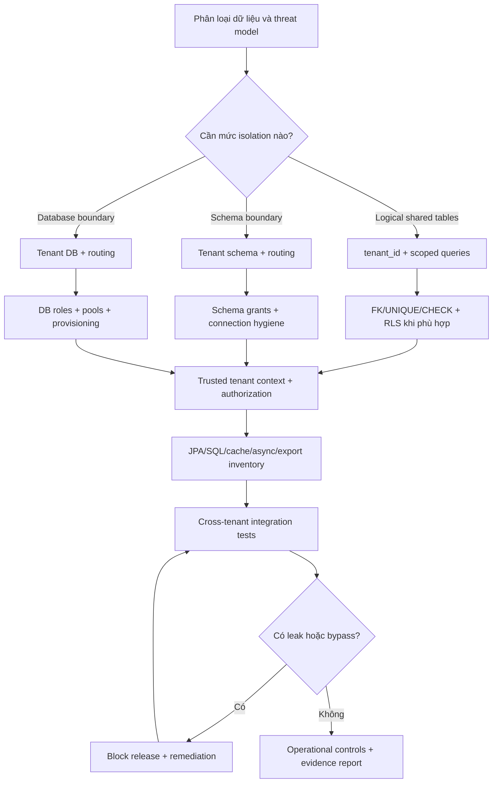

# Đánh giá phân tách dữ liệu khi nhiều khách hàng dùng chung mô hình

Một ứng dụng SaaS có thể phục vụ hàng trăm hoặc hàng nghìn khách hàng tổ chức (**tenants**) trên cùng một hệ thống Java. Họ dùng chung mã nguồn, entity model, repository, bảng dữ liệu, database cluster hoặc một phần hạ tầng. Thiết kế đó tiết kiệm chi phí và giúp triển khai đồng nhất, nhưng tạo ra một yêu cầu an toàn quan trọng: **dữ liệu của tenant A không được bị đọc, sửa, xuất, xóa hoặc suy luận trái phép từ tenant B**.

Trong JPA, chỉ thêm trường `tenantId` vào entity **chưa đủ**. Một method `findById(id)`, JPQL query quên predicate, native SQL, batch job, association join, cache key sai, export CSV hoặc database connection dùng lại sai ngữ cảnh đều có thể phá ranh giới tenant.

Bài **“Đánh giá phân tách dữ liệu khi nhiều khách hàng dùng chung mô hình”** thuộc chương **Bảo mật dữ liệu**, module **Data Persistence Relational Access ORM JPA**, trình bày phương pháp thiết kế và **đánh giá được bằng bằng chứng** một hệ thống nhiều khách hàng dùng chung domain/entity model.

Các câu hỏi chính:

- Có những mức dùng chung dữ liệu/hạ tầng nào? Khi nào nên chung bảng, tách schema hoặc tách database?
- Tenant identity đến từ đâu, có đáng tin không, được truyền qua EntityManager/transaction như thế nào?
- Một JPA query, bulk update, native SQL hoặc relationship có thể vô tình vượt tenant boundary ở đâu?
- Hibernate multitenancy, application predicates và PostgreSQL row-level security (RLS) bảo vệ những lớp nào?
- Composite keys, unique constraints, foreign keys và version columns cần thiết kế ra sao?
- Cache, search indexes, message consumers, scheduled jobs, backup, logging và xuất báo cáo có giữ tenant isolation không?
- Dùng bộ tiêu chí và integration tests nào để kết luận phân tách **đạt yêu cầu**, thay vì chỉ nhận định bằng code review?

> **Nguyên tắc:** Tenant isolation không phải một `WHERE tenant_id = ?` rải rác trong code. Đó là **hợp đồng bảo mật xuyên suốt hệ thống**: xác thực tenant, giới hạn quyền trên từng thao tác, ràng buộc ở dữ liệu, quản lý persistence context, bảo vệ đường truy cập phụ và kiểm chứng bằng thử nghiệm độc lập.

---

## 1. Tenant là ai?

Trong mô hình nhiều khách hàng, một **tenant** thường là một tổ chức/khách hàng trả phí có phạm vi dữ liệu và cấu hình riêng:

```text
Tenant ACME:
    Users: Alice, Bob
    Orders: 100, 101
    Products: 20, 21

Tenant BETA:
    Users: Carol
    Orders: 200, 201
    Products: 30, 31
```

Các tenants có thể dùng chung:

- Ứng dụng và business logic.
- JPA entity classes.
- Database server.
- Schema hoặc tables.
- Cache cluster.
- Message broker và search index.

Nhưng **quyền truy cập** phải được giới hạn theo tenant và user/role trong tenant đó.

Tenant không nhất thiết là user. Trong tenant ACME, Alice có thể chỉ xem Orders mình phụ trách; Bob có thể là manager được xem toàn tenant. Vì vậy:

```text
Đúng tenant
    ≠
Đã được phép xem mọi resource của tenant
```

**Tenant isolation** và **object-level authorization** là hai lớp cần phối hợp.

## 2. Các chiều phân tách cần đánh giá

| Chiều | Câu hỏi |
|---|---|
| **Logical/data** | Row/document có owner tenant rõ và bắt buộc không? |
| **Read authorization** | Mọi query/lookup/count/export đều giới hạn tenant? |
| **Write authorization** | INSERT/UPDATE/DELETE có ngăn tác động tenant khác? |
| **Referential integrity** | Child của tenant A có thể tham chiếu parent tenant B? |
| **Transaction/context** | EntityManager/connection có gắn đúng tenant suốt unit of work? |
| **Cache** | Cache keys/entries có phân biệt tenant? |
| **Async/integration** | Jobs, messages và consumers có mang tenant context đáng tin? |
| **Operational** | Backup/restore, migration, support, analytics có vượt ranh giới? |
| **Physical** | Resource, schema, database hoặc encryption key có tách riêng? |
| **Availability** | Tenant nhiều tải có làm tenants khác bị gián đoạn? |

Một hệ thống có thể đạt **logical isolation** nhưng không có **physical isolation**. Không nên quảng bá “dữ liệu hoàn toàn tách biệt” nếu thực chất chỉ có tenant predicate.

## 3. Threat model điển hình

Xét các tác nhân/sự cố:

1. User hợp lệ của tenant A đoán ID Order thuộc tenant B.
2. Repository developer quên tenant predicate trong một method mới.
3. Endpoint nhận trực tiếp `tenantId` từ URL/body và tin đó là quyền.
4. Một native SQL/bulk JPQL `UPDATE` không scope tenant.
5. API lọc/sắp xếp động cho phép tìm trên trường nhạy cảm tenant khác.
6. Worker đọc message thiếu tenant rồi dùng tenant cũ từ ThreadLocal.
7. L2/Redis cache key chỉ là `orderId`, trong khi ID trùng giữa tenants.
8. DBA/migration chạy một UPDATE không có WHERE tenant.
9. Support/admin endpoint có quyền rộng nhưng thiếu audit.
10. Một backup tenant A chứa rows của tenants khác.
11. Một search index dùng chung thiếu tenant filter.
12. Một hệ thống báo cáo tổng hợp trả count toàn bộ tenants.

Mục tiêu đánh giá là tìm **đường vượt ranh giới** trong cả code lẫn vận hành, không chỉ chứng minh một repository cụ thể chạy đúng.

## 4. Dữ liệu “rò rỉ” không chỉ là SELECT trả row

Các biểu hiện vi phạm:

- Xem nội dung Order của tenant khác.
- Thay trạng thái hoặc xóa Order của tenant khác.
- Tạo OrderLine tham chiếu Product của tenant khác.
- Export dữ liệu toàn bộ database.
- Đếm số Orders của tenant khác qua aggregate endpoint.
- Sort/filter theo trường nội bộ rồi suy ra thông tin.
- Cache trả nhầm DTO của tenant khác.
- Log/trace chứa payload dữ liệu khách hàng khác.
- Restore nhầm backup gây ghi đè dữ liệu tổ chức khác.
- Message duplicate/late event sửa aggregate ở tenant không đúng.

**Đánh giá phải bao gồm tính bí mật, tính toàn vẹn và khả năng vận hành**, không chỉ chống một dạng SQL injection.

---

## 5. Ba mô hình phân tách phổ biến

Ba cách tổ chức dữ liệu quan hệ:

1. **Shared database, shared schema, shared tables**: nhiều tenants cùng bảng, thường dùng cột `tenant_id`.
2. **Shared database, separate schemas**: mỗi tenant có schema riêng.
3. **Separate database per tenant**: mỗi tenant có database/logical database riêng, có thể vẫn trên cùng cluster.

Một hệ thống có thể lai: tenants nhỏ dùng shared tables, tenants lớn dùng schema/database riêng.

## 6. Mô hình 1: chung bảng, có tenant_id

```sql
CREATE TABLE purchase_orders (
    id BIGINT PRIMARY KEY,
    tenant_id UUID NOT NULL,
    status VARCHAR(20) NOT NULL,
    total_amount DECIMAL(18,2) NOT NULL
);
```

Dữ liệu:

```text
id   tenant_id   status
100  ACME        NEW
101  ACME        PAID
200  BETA        NEW
201  BETA        CANCELLED
```

Ưu điểm:

- Dễ chia sẻ schema và migrations.
- Pool connections đơn giản hơn.
- Hiệu quả chi phí với nhiều tenants nhỏ.
- Cross-tenant aggregate có thể thực hiện có kiểm soát khi cần.

Rủi ro:

- Thiếu `tenant_id` predicate có thể đọc/ghi nhiều tenants ngay lập tức.
- Constraint không scope đúng làm các tenants cản trở nhau.
- Tenant lớn có thể gây noisy-neighbor trong cùng bảng/index.
- Backup/xóa/restore một tenant đòi lọc chính xác theo ownership.
- Cần bảo vệ cả SQL ngoài JPA.

Đây là mô hình **logical isolation** đòi các lớp phòng thủ rõ.

## 7. Mô hình 2: mỗi tenant một schema

```text
Database: saas_db
    schema acme:
        purchase_orders
        products
    schema beta:
        purchase_orders
        products
```

Ưu điểm:

- Có ranh giới schema rõ hơn.
- Backup/export/migration theo schema có thể thuận tiện tùy DBMS.
- Một số quyền truy cập có thể cấp theo schema.

Rủi ro:

- Kết nối phải chọn đúng schema trước mọi query.
- Search path/schema switching sai hoặc còn sót trong pool có thể chuyển nhầm tenant.
- Migrations phải được chạy và kiểm chứng cho nhiều schemas.
- Số lượng objects, schema versions và operations tăng nhanh.
- DB admin hoặc role có quyền rộng vẫn có thể truy cập mọi schema.

**Riêng schema không đồng nghĩa riêng database, và cũng không tự đảm bảo application route đúng schema.**

## 8. Mô hình 3: mỗi tenant một database

```text
Tenant ACME → Database acme_db
Tenant BETA → Database beta_db
```

Ưu điểm:

- Data plane separation mạnh hơn.
- Có thể điều chỉnh backup/restore, scaling, quota, maintenance theo tenant.
- Dễ định nghĩa database-level roles, encryption/key policy cho một số yêu cầu.
- Sự cố ở một database có thể được cô lập tốt hơn, tùy topology.

Rủi ro:

- Provisioning/migrations/monitoring phức tạp.
- Connection pools có thể tăng theo số tenant.
- Tenant routing sai có thể dùng nhầm database.
- Nếu tất cả databases trên cùng host/cluster, vẫn chia sẻ hạ tầng vật lý.
- Cross-tenant analytics khó hơn và cần pipeline có phân quyền.

Một database riêng không tự chống **IDOR/BOLA** nếu application có credential đến nhiều databases và route sai.

## 9. Bảng so sánh mô hình

| Tiêu chí | Chung bảng | Riêng schema | Riêng database |
|---|---|---|---|
| Chi phí per tenant | Thường thấp | Trung bình | Thường cao hơn |
| Migrations | Một schema chính | Nhiều schemas | Nhiều databases |
| Nguy cơ thiếu tenant WHERE | Rất đáng chú ý | Có thể giảm, nhưng routing vẫn quan trọng | Giảm trong một DB, routing vẫn quan trọng |
| Isolation vật lý | Thấp | Vẫn chung database | Có thể cao hơn |
| Backup/restore tenant | Khó hơn | Tùy DBMS, có thể thuận hơn | Thường thuận hơn |
| Số database objects | Ít | Tăng theo tenant | Tăng theo tenant |
| Pool/resource management | Tương đối đơn giản | Cần schema context hygiene | Cần routing/pooling theo tenant |
| Noisy neighbor | Chung bảng/index | Chung DB resources | Có thể tách tài nguyên tốt hơn |
| Cross-tenant reporting | Dễ về kỹ thuật, cần bảo vệ | Cần hợp nhất | Cần pipeline/aggregation |
| Compliance/residency | Cần đánh giá riêng | Cần đánh giá riêng | Có thể cấu hình theo tenant/region |

Đây là **định hướng kiến trúc**, không phải đánh giá tuyệt đối. Mức an toàn thực tế phụ thuộc quyền DB, connection routing, roles, logging, backup, tests và cách vận hành.

## 10. Chọn mức phân tách theo yêu cầu

Một quy trình ra quyết định:

1. Phân loại dữ liệu (thông thường, nhạy cảm, thông tin thanh toán, bí mật thương mại...).
2. Xác định yêu cầu của khách hàng về data residency, backup, xóa dữ liệu, audit và isolation.
3. Ước lượng số tenants, dữ liệu/traffic, SLA.
4. Đánh giá mức tin cậy của các writers và khả năng DB enforce.
5. Phân tích chi phí provision/migrate/monitor.
6. Xác định nơi cần strong physical isolation.
7. Thử các tình huống leak và thao tác vận hành.
8. Chọn mô hình hoặc hybrid route có policy rõ.

Không mặc định “khách hàng càng lớn thì nhất thiết phải database riêng”; quyết định cần gắn với threat model, SLA, hạ tầng và hợp đồng thực tế.

---

## 11. Khái niệm tenant ownership

Mọi dữ liệu tenant-owned cần có owner rõ:

```text
PurchaseOrder → Tenant
Product → Tenant
OrderLine → PurchaseOrder + Tenant
PaymentAttempt → Order + Tenant
Attachment → Tenant + owning resource
AuditEvent → Tenant + actor
```

Các bảng dùng chung toàn hệ thống như country codes hoặc public product catalog có thể không có tenant owner, nhưng phải được **khai báo rõ là global data**.

Tránh tình trạng một số entities ngầm được xem là global chỉ vì thiếu cột `tenant_id`.

## 12. Phân loại entity theo tenancy

| Entity type | Ví dụ | Quy tắc |
|---|---|---|
| Tenant-owned | Order, Invoice | Bắt buộc có owner tenant |
| Shared immutable reference | Country, CurrencyCode | Có thể global, read-only với user thường |
| Tenant configuration | TenantSettings | Scope tenant, quyền admin nội bộ tenant |
| Cross-tenant platform metadata | BillingPlan, PlatformFeature | Quyền platform, không qua tenant repository chung |
| Platform audit/operations | JobRun, Deployment | Cần access control riêng |
| Cross-tenant analytics | Aggregated metrics | De-identification/consent/policy theo yêu cầu |

Không ép mọi entity dùng cùng tenant predicate nếu global data thực sự có semantics khác. Nhưng sự ngoại lệ phải được thiết kế có chủ đích và review.

## 13. Tenant ID là dữ liệu định danh, không phải bằng chứng quyền

Request:

```http
GET /api/orders/200
X-Tenant-Id: beta
```

Nếu server tin raw `X-Tenant-Id`, user ACME có thể thử chuyển tenant chỉ bằng header.

Tenant ID được chọn trong request chỉ có thể là **đầu vào để xác minh quyền**, không phải authority.

Cần:

- Xác thực identity (session/JWT/service identity).
- Kiểm tenant membership/assignment của identity.
- Nếu user được vào nhiều tenants, xác định selected tenant có được phép không.
- Đóng gói thành trusted tenant context.
- Không dùng một header/body field chưa được xác minh làm tenant scope cuối cùng.

## 14. User có thể thuộc nhiều tenants

Một user có thể là consultant của ACME và BETA.

Mô hình:

```text
User U
  membership tenant=ACME role=EDITOR
  membership tenant=BETA role=VIEWER
```

Khi chọn tenant BETA:

- Query được scope vào BETA.
- WRITE phải xét role VIEWER và có thể bị từ chối.
- Cache/key/transactions dùng BETA.
- Không cộng gộp quyền EDITOR từ ACME vào BETA.

**Tenant membership và role được đánh giá trong tenant đã chọn**, không chỉ kiểm user tồn tại trên toàn hệ thống.

## 15. TrustedTenantContext

Một abstraction:

```java
public record TenantContext(
    UUID tenantId,
    String principalId,
    Set<String> roles
) {
    public TenantContext {
        Objects.requireNonNull(tenantId);
        Objects.requireNonNull(principalId);
        roles = Set.copyOf(roles);
    }
}
```

Một service nhận context **đã xác thực và phân quyền**:

```java
public OrderView findOrder(
        Long orderId,
        TenantContext actor) {
    // Xây query với actor.tenantId(), không dùng request tenant.
}
```

Không để controller tạo tùy tiện `new TenantContext(headerTenantId, ...)` mà chưa xác minh membership.

## 16. Fail closed khi thiếu tenant

Một lỗi nguy hiểm:

```java
UUID tenantId = TenantHolder.get();

if (tenantId == null) {
    return repository.findAll(); // Sai: trả mọi tenant.
}
```

Thay bằng:

```java
UUID tenantId = requireTrustedTenant();
```

và fail khi không có context. Với platform-level operation cần cross-tenant, hãy dùng **API/service/role riêng**, không mặc định missing tenant nghĩa là “all tenants”.

## 17. Tenant context phải bất biến trong unit of work

Không nên:

```text
Transaction T1 bắt đầu cho ACME
Load Order của ACME
Giữa transaction đổi TenantHolder sang BETA
Load Product của BETA trong cùng EntityManager
```

Đó là sự trộn dữ liệu hai scopes trong một persistence context.

Thiết kế an toàn hơn:

- Xác định tenant trước khi mở EntityManager/transaction.
- Không đổi tenant trong transaction.
- Không dùng EntityManager của tenant này cho tenant khác.
- Với thao tác cross-tenant được cấp quyền, dùng orchestration và transaction boundaries rõ.
- Kiểm tenant immutable hoặc có guard so sánh ở request/transaction boundary.

## 18. ThreadLocal không phải identity provider

Một cách tiện dùng trong imperative Spring:

```java
public final class TenantHolder {
    private static final ThreadLocal<UUID> CURRENT =
        new ThreadLocal<>();

    public static UUID requireTenant() {
        UUID tenant = CURRENT.get();
        if (tenant == null) {
            throw new IllegalStateException("Missing tenant");
        }
        return tenant;
    }

    public static void set(UUID tenant) {
        CURRENT.set(Objects.requireNonNull(tenant));
    }

    public static void clear() {
        CURRENT.remove();
    }

    private TenantHolder() {}
}
```

Nếu dùng, phải thiết lập từ trusted authorization layer và **luôn clear trong finally**.

```java
try {
    TenantHolder.set(authorizedTenantId);
    chain.doFilter(request, response);
} finally {
    TenantHolder.clear();
}
```

ThreadLocal chỉ là **cách truyền context trong thread hiện tại**, không phải cơ chế xác thực hoặc kiểm quyền.

## 19. @Async, thread pool và tenant context

`@Async` và executor chạy trên thread khác. ThreadLocal có thể:

- Không được truyền sang worker.
- Bị thiếu nên query không có tenant nếu code fallback không an toàn.
- Bị sót tenant từ task trước nếu không clear.
- Bị leak khi thread pool reuse threads.

Giải pháp:

- Truyền tenant ID/authorization scope tường minh vào job.
- Xác thực nguồn job/service identity khi cần.
- Set context tại entrypoint worker, dùng try/finally clear.
- Với wrapper executor, truyền có chủ đích và không copy thông tin nhạy cảm quá mức.
- Không dùng `InheritableThreadLocal` như giải pháp chung cho thread pools.

## 20. Reactive stack có context khác

Trong reactive programming, request có thể chuyển threads. `ThreadLocal` không phải phương tiện đáng tin cậy để gắn tenant xuyên suốt reactive operators.

Nếu dùng Reactor hoặc reactive transaction management, dùng context propagation model phù hợp (ví dụ Reactor Context) và API dành cho reactive stack.

Không copy một giải pháp ThreadLocal từ JPA imperative sang reactive và mặc định nó bảo vệ mọi query.

## 21. Transaction phải mở sau khi chọn tenant

Đặc biệt với tenant-aware session/connection routing:



Nếu application tạo Hibernate Session hoặc lấy pooled connection **trước khi tenant được xác định**, việc đổi ThreadLocal sau đó có thể quá muộn, tùy provider/connection strategy.

---

## 22. Schema cho shared-table model

Một ví dụ PostgreSQL (cú pháp và UUID type tùy DBMS):

```sql
CREATE TABLE tenants (
    id UUID PRIMARY KEY,
    display_name VARCHAR(150) NOT NULL
);

CREATE TABLE purchase_orders (
    id BIGINT PRIMARY KEY,
    tenant_id UUID NOT NULL REFERENCES tenants(id),
    external_reference VARCHAR(100) NOT NULL,
    status VARCHAR(20) NOT NULL,
    created_at TIMESTAMP WITH TIME ZONE NOT NULL,
    version BIGINT NOT NULL DEFAULT 0,

    CONSTRAINT uq_order_tenant_id
        UNIQUE (tenant_id, id),
    CONSTRAINT uq_order_external_reference
        UNIQUE (tenant_id, external_reference),
    CONSTRAINT ck_order_status
        CHECK (status IN ('NEW','PAID','CANCELLED'))
);
```

Ở đây:

- `id` globally unique trong bảng.
- `tenant_id` bắt buộc.
- `UNIQUE(tenant_id,id)` cung cấp composite referenced key cho tenant-safe FK.
- `external_reference` được phép trùng **giữa tenants** nhưng unique **trong tenant**.
- `version` hỗ trợ optimistic concurrency.

Có thể dùng composite primary key `(tenant_id,id)` thay cho globally unique ID; cả hai cần đánh giá mapping/identifier strategy và query patterns.

## 23. Vì sao UNIQUE phải scope theo tenant?

Giả sử hai khách hàng có mã hóa đơn `INV-001`:

```text
ACME / INV-001
BETA / INV-001
```

Nếu tạo:

```sql
UNIQUE (external_reference)
```

thì BETA không thể dùng mã hợp lệ chỉ vì ACME đã dùng.

Thường muốn:

```sql
UNIQUE (tenant_id, external_reference)
```

Tuy nhiên một số IDs như external provider transaction ID có thể globally unique theo provider contract; cần phân loại **business uniqueness** thay vì tự thêm tenant cho mọi unique index.

## 24. Composite foreign key chống liên kết chéo tenant

Một OrderLine có:

```sql
CREATE TABLE order_lines (
    id BIGINT PRIMARY KEY,
    tenant_id UUID NOT NULL,
    order_id BIGINT NOT NULL,
    product_id BIGINT NOT NULL,
    quantity INTEGER NOT NULL,

    CONSTRAINT fk_line_order_tenant
        FOREIGN KEY (tenant_id, order_id)
        REFERENCES purchase_orders (tenant_id, id)
);
```

Nếu tenant ACME cố tạo OrderLine trỏ tới Order của BETA, composite FK **không match**, kể cả khi Order ID hợp lệ.

Nếu chỉ có:

```sql
FOREIGN KEY (order_id)
REFERENCES purchase_orders(id)
```

thì DB vẫn cho phép child của ACME tham chiếu Order BETA nếu các IDs khác hợp lệ.

**Tenant-aware FK là lớp bảo vệ tính toàn vẹn rất quan trọng trong shared-table multitenancy.**

## 25. Product FK cũng cần tenant alignment

Nếu `product_id` là Product tenant-owned, thêm:

```sql
CREATE TABLE products (
    id BIGINT PRIMARY KEY,
    tenant_id UUID NOT NULL REFERENCES tenants(id),
    name VARCHAR(150) NOT NULL,
    CONSTRAINT uq_product_tenant_id UNIQUE (tenant_id, id)
);

ALTER TABLE order_lines
ADD CONSTRAINT fk_line_product_tenant
FOREIGN KEY (tenant_id, product_id)
REFERENCES products (tenant_id, id);
```

Nhờ vậy một OrderLine không thể liên kết tới Product thuộc tenant khác, bất kể JPA service có quên kiểm hay không.

Nếu Product là catalog global có chủ đích, thiết kế FK khác và ghi rõ exception; không thêm tenant_id giả vào global data mà không có business semantics.

## 26. Nhiều columns cùng tenant phải đồng nhất

Một association có thể chứa:

```text
OrderLine.tenantId = ACME
OrderLine.orderId = Order thuộc BETA
OrderLine.productId = Product thuộc ACME
```

Dù `OrderLine.tenantId` chính xác về mặt Java object, relationship vẫn rò tenant.

Checklist:

- FK child → parent scope tenant.
- FK parent → tenant tồn tại.
- Các join dùng cả tenant và ID khi cần.
- Không cho user gán tùy ý parent IDs thuộc tenant khác.
- Test INSERT/UPDATE SQL trực tiếp để chứng minh DB chặn cross-tenant references.

## 27. Cột tenant_id phải bắt buộc

Không cho:

```sql
tenant_id UUID NULL
```

trong bảng tenant-owned nếu NULL có thể được diễn giải thành “global” hoặc “bất kỳ tenant” không kiểm soát.

Một row không xác định owner làm truy vấn/authorization mơ hồ.

Thiết kế tốt:

- `NOT NULL` ở DB.
- FK tới tenants nếu phù hợp.
- Không có fallback owner mặc định.
- Tenant owner được gán từ trusted context khi INSERT.
- Cân nhắc DB trigger/constraints/privileges nếu owner không được phép đổi.

## 28. Tenant ID có nên được thay đổi?

Một application có thể map:

```java
@Column(
    name = "tenant_id",
    nullable = false,
    updatable = false
)
private UUID tenantId;
```

`updatable=false` giúp provider không đưa cột vào managed UPDATE bình thường, nhưng **không ngăn JDBC/native SQL có quyền sửa tenant_id**.

Nếu dữ liệu không được chuyển owner:

- Service không expose operation thay tenant.
- Database privilege hoặc trigger/constraint đảm bảo bất biến khi cần.
- Audit mọi migration/tenant transfer đặc biệt.
- Với chuyển dữ liệu hợp pháp, làm như một workflow có kiểm tra toàn bộ dependent rows/FKs và cache.

Không coi mapping annotation là chính sách security DB.

## 29. Composite primary key hay global ID?

**Globally unique ID + tenant_id:**

- Dễ mapping `@Id Long/UUID`.
- Các URLs có thể nhận một ID đơn.
- Vẫn cần `tenant_id` trong WHERE để kiểm quyền.
- FK nên ràng tenant alignment.

**Composite PK (tenant_id, local_id):**

- Ràng buộc identity theo tenant chặt hơn.
- Có thể dùng `@EmbeddedId`/`@IdClass`.
- Associations và APIs phức tạp hơn.
- Cần xem Hibernate/JPA identity map, key generators, foreign keys.

Không chọn composite key chỉ để thay authorization; kể cả key có tenant, server vẫn phải xác minh tenant đó thuộc quyền caller.

---

## 30. Entity JPA minh họa

```java
import jakarta.persistence.*;
import java.time.Instant;
import java.util.UUID;

@Entity
@Table(
    name = "purchase_orders",
    uniqueConstraints = @UniqueConstraint(
        name = "uq_order_external_reference",
        columnNames = {"tenant_id", "external_reference"}
    )
)
public class PurchaseOrder {

    @Id
    private Long id;

    @Column(
        name = "tenant_id",
        nullable = false,
        updatable = false
    )
    private UUID tenantId;

    @Column(
        name = "external_reference",
        nullable = false
    )
    private String externalReference;

    @Enumerated(EnumType.STRING)
    @Column(nullable = false)
    private OrderStatus status;

    @Column(name = "created_at", nullable = false)
    private Instant createdAt;

    @Version
    private Long version;

    protected PurchaseOrder() {}

    public static PurchaseOrder create(
            Long id,
            UUID trustedTenant,
            String externalRef,
            Instant now) {
        PurchaseOrder order = new PurchaseOrder();
        order.id = id;
        order.tenantId = trustedTenant;
        order.externalReference = externalRef;
        order.status = OrderStatus.NEW;
        order.createdAt = now;
        return order;
    }

    public Long getId() { return id; }
    public UUID getTenantId() { return tenantId; }
    public OrderStatus getStatus() { return status; }
}
```

```java
public enum OrderStatus {
    NEW, PAID, CANCELLED
}
```

Đoạn code minh họa identity/tenancy, không phải ví dụ đầy đủ về ID generation, validation hoặc authorization. Một factory nhận `trustedTenant` **không tự đảm bảo caller truyền trusted identity**; kiểm tra cần ở service boundary.

## 31. @Version không phải tenant isolation

```java
@Version
private Long version;
```

giúp phát hiện optimistic concurrency conflict khi nhiều writers cập nhật cùng row và tuân version policy.

Nó **không** ngăn:

- User ACME load Order của BETA.
- UPDATE sai tenant nếu WHERE chỉ theo ID và quyền được cấp quá rộng.
- Cross-tenant association.
- Cache trả DTO của tenant khác.

Version protection và tenant ownership protection giải quyết hai nhóm vấn đề khác nhau.

## 32. @Column(nullable=false) không chứng minh schema thật

Một annotation:

```java
@Column(name = "tenant_id", nullable = false)
private UUID tenantId;
```

có thể ảnh hưởng DDL generation nhưng không tự sửa physical production schema đã tồn tại.

Cần dùng migrations và schema verification để xác nhận:

- Column thật NOT NULL.
- FK/unique constraints tồn tại.
- Data legacy không có NULL owner.
- Các external writers không có quyền bypass tùy ý.

Không coi JPA model là bằng chứng duy nhất về tính toàn vẹn database.

---

## 33. Query JPA phải scope theo trusted tenant

Sai:

```java
public PurchaseOrder get(Long id) {
    return em.find(PurchaseOrder.class, id);
}
```

Nếu dùng shared table mà không có tenant-aware JPA provider enforcement, lời gọi chỉ theo PK có thể trả entity của tenant khác.

Một query service rõ ràng:

```java
public Optional<PurchaseOrder> findOwnedOrder(
        Long id,
        TenantContext actor) {

    return em.createQuery(
        """
        select o
        from PurchaseOrder o
        where o.id = :id
          and o.tenantId = :tenant
        """,
        PurchaseOrder.class
    )
    .setParameter("id", id)
    .setParameter("tenant", actor.tenantId())
    .getResultStream()
    .findFirst();
}
```

Lưu ý: nếu đối tượng đã managed trong persistence context với sai tenant từ trước, không nên dùng cùng context; tenant được xác định trước khi mở unit of work.

## 34. Object-level authorization còn quan trọng

Ngay cả khi `o.tenantId = :tenant` đúng:

```text
Alice thuộc ACME, role SALESPERSON
Order#100 thuộc ACME nhưng do Bob phụ trách
```

Alice có thể vẫn không được xem.

Query có thể cần:

```jpql
where o.tenantId = :tenant
  and o.assignedUserId = :authorizedUser
```

hoặc một policy phù hợp role/relationship.

**Tenant equality là điều kiện cần, chưa phải điều kiện đủ cho mọi user.**

## 35. BOLA/IDOR qua ID đoán được

Endpoint:

```http
GET /api/orders/200
```

không được dựa vào việc `id=200` “khó đoán”. UUID cũng không thay access check.

Test phải chứng minh user tenant A nhận response theo security policy khi yêu cầu Order thuộc tenant B; không chỉ dựa vào việc UI không hiển thị link.

Cần áp cho mọi read/write/export/download endpoint liên quan resource.

## 36. Spring Data repository inherited methods có rủi ro

Repository:

```java
interface OrderRepository
        extends JpaRepository<PurchaseOrder, Long> {
}
```

cung cấp `findById()`, `findAll()`, `deleteById()`...

Nếu các methods này được gọi trực tiếp từ API service trong shared-table setup không có tenant enforcement ở provider/DB, dễ bỏ qua owner.

Có thể xây:

```java
interface OrderRepository
        extends JpaRepository<PurchaseOrder, Long> {

    Optional<PurchaseOrder> findByIdAndTenantId(
        Long id, UUID tenantId
    );

    Page<PurchaseOrder> findByTenantIdAndStatus(
        UUID tenantId,
        OrderStatus status,
        Pageable pageable
    );
}
```

Nhưng **chỉ đổi tên query method chưa giải quyết quyền**: `tenantId` phải được lấy từ trusted context, và những inherited methods vẫn có thể bị gọi nơi khác.

Cân nhắc custom repository facade, static analysis/code review hoặc database RLS để giảm tác động của lỗi quên predicate.

## 37. Không nhận tenantId từ request như một giá trị query đáng tin

Sai:

```java
@GetMapping("/orders")
public List<OrderView> list(@RequestParam UUID tenantId) {
    return service.listOrders(tenantId);
}
```

nếu không xác minh quyền trên tenant được chọn.

Tốt hơn:

```java
@GetMapping("/orders")
public List<OrderView> list(
        @AuthenticationPrincipal Principal principal) {

    TenantContext tenant =
        authorizedTenantResolver.resolve(principal);

    return service.listOrders(tenant);
}
```

`authorizedTenantResolver` là service minh họa, phải xác thực membership và selected tenant. Không lấy tenantId từ một claim JWT chưa xác minh chữ ký, issuer, audience, expiry và quyền thực tế.

## 38. Query động phải giữ predicate bắt buộc

Ví dụ Criteria:

```java
CriteriaBuilder cb = em.getCriteriaBuilder();
CriteriaQuery<PurchaseOrder> cq =
    cb.createQuery(PurchaseOrder.class);
Root<PurchaseOrder> root =
    cq.from(PurchaseOrder.class);

Predicate tenantGuard = cb.equal(
    root.get("tenantId"),
    actor.tenantId()
);

Predicate statusFilter = cb.equal(
    root.get("status"),
    validatedStatus
);

cq.select(root);
cq.where(cb.and(tenantGuard, statusFilter));
```

Nếu API có filter/sort động, fields/operators phải lấy từ allowlist server, còn tenant guard phải được **AND bên ngoài biểu thức user-supplied**.

Không cho client cung cấp raw JPQL `where` hoặc đổi toán tử để bypass tenant guard.

## 39. OR precedence có thể làm lọt tenant

Sai:

```sql
WHERE tenant_id = :tenant AND status = 'NEW'
   OR status = 'PAID'
```

Do precedence, mọi row PAID của tenant khác có thể được trả.

Đúng:

```sql
WHERE tenant_id = :tenant
  AND (status = 'NEW' OR status = 'PAID')
```

Trong Criteria:

```java
Predicate requestedStatuses = cb.or(
    cb.equal(root.get("status"), OrderStatus.NEW),
    cb.equal(root.get("status"), OrderStatus.PAID)
);

cq.where(cb.and(tenantGuard, requestedStatuses));
```

Test phải seed nhiều tenants với mỗi status để phát hiện lỗi này.

## 40. Count và aggregate cũng phải scope tenant

Một API:

```http
GET /api/orders/summary
```

trả:

```json
{"totalOrders": 5000, "totalRevenue": 150000000}
```

Nếu `COUNT/SUM` không scope tenant, user có thể suy ra doanh thu toàn platform dù không xem được từng Order.

Queries cần áp tenant scope ở data query, count query, summary, charts, exports và search suggestions.

## 41. Bulk update/delete cũng là entrypoint quyền ghi

Nguy hiểm:

```java
em.createQuery(
    """
    update PurchaseOrder o
    set o.status = :status
    where o.createdAt < :cutoff
    """
).executeUpdate();
```

Nếu shared table và tenant guard không được provider/DB áp tự động cho bulk DML, statement có thể đổi toàn bộ tenants.

An toàn hơn:

```java
int changed = em.createQuery(
    """
    update PurchaseOrder o
    set o.status = :status
    where o.tenantId = :tenant
      and o.createdAt < :cutoff
    """
)
.setParameter("status", OrderStatus.CANCELLED)
.setParameter("tenant", actor.tenantId())
.setParameter("cutoff", cutoff)
.executeUpdate();
```

Cần thêm business state precondition, `@Version` handling, audit và cache invalidation; bulk DML không tự chạy per-entity callbacks/dirty checking.

## 42. Native SQL, JDBC và stored procedures

Các đường này có thể bypass provider-level tenant mechanisms.

Ví dụ SQL:

```sql
UPDATE purchase_orders
SET status = 'CANCELLED'
WHERE tenant_id = :trusted_tenant
  AND id = :order_id
  AND status = 'NEW';
```

Một stored procedure cũng phải:

- Nhận/tra tenant context đáng tin.
- Kiểm quyền và điều kiện nghiệp vụ.
- Scope mọi SELECT/UPDATE/DELETE.
- Kiểm cross-tenant relationships.
- Không cho caller chọn arbitrary schema/table identifiers.
- Ghi audit theo policy.

Chính vì có nhiều writers, database constraints/RLS và least privilege là lớp defense in depth có giá trị.

## 43. INSERT cũng cần kiểm tenant owner

Một INSERT sai:

```java
PurchaseOrder order = new PurchaseOrder();
order.setTenantId(body.tenantId()); // Không tin body.
em.persist(order);
```

Tenant owner phải xuất phát từ trusted context. Một database policy có `WITH CHECK` phù hợp sẽ giúp chặn INSERT có tenant khác trong shared-table environment.

Nếu một endpoint hỗ trợ tạo dữ liệu **hộ tenant khác** (platform admin), cần authorization, audit và explicit target tenant semantics; không làm fallback chung.

## 44. UPDATE tenant_id bị coi là data transfer

Đổi:

```sql
UPDATE purchase_orders
SET tenant_id = :other_tenant
WHERE id = :id;
```

không chỉ là sửa một field. Nó **chuyển quyền sở hữu**; có thể kéo theo Orders, Lines, Payments, Attachments, Events, cache, billing, encryption keys và audit.

Nên chặn ở application/DB policy thông thường. Nếu thật sự có workflow chuyển owner, phải thiết kế một operation riêng với approvals/consistency checks và rollback plan.

## 45. DELETE phải scope tenant

```java
repository.deleteById(id);
```

có thể nguy hiểm nếu không có tenant-aware enforcement tại provider/DB.

Một phương thức rõ hơn:

```java
@Transactional
public void deleteOwnedOrder(Long id, TenantContext actor) {
    PurchaseOrder order = findOwnedOrder(id, actor)
        .orElseThrow(NotFoundException::new);

    policy.assertCanDelete(actor, order);
    em.remove(order);
}
```

Nếu dùng soft delete, cần giữ tenant filter cả khi update `deletedAt` và khi query dữ liệu active.

---

## 46. Hibernate multitenancy là tính năng provider-specific

Jakarta Persistence không định nghĩa một portable annotation/API hoàn chỉnh để tự phân chia tất cả truy vấn theo tenant cho mọi provider/version.

Hibernate cung cấp các cách multitenancy như:

- Tenant discriminator trong shared tables.
- Schema-per-tenant.
- Database-per-tenant.
- Tenant identifier resolution và multi-tenant connection handling.
- Trong các phiên bản Hibernate ORM phù hợp, hỗ trợ `@TenantId` cho discriminator mapping.

Các API/configuration names và behavior thay đổi theo phiên bản Hibernate. Phải đối chiếu tài liệu của **version đang dùng** và test các thao tác cụ thể, không giả định chỉ cần bật một setting là mọi SQL/ORM path đều được bảo vệ.

## 47. @TenantId trong Hibernate

Một mapping minh họa theo các phiên bản Hibernate hỗ trợ:

```java
@Entity
public class TenantOwnedOrder {
    @Id
    private Long id;

    @org.hibernate.annotations.TenantId
    private String tenantId;

    private String status;
}
```

Trong cơ chế discriminator multitenancy được cấu hình đúng, provider có thể dùng session tenant identifier để giới hạn dữ liệu và gán tenant cho entity mới.

Nhưng cần kiểm:

- Hibernate version và cách tenant identifier được resolve.
- TenantId field type và mapping.
- Session/EntityManager tenant được xác định khi nào.
- Hành vi `find()`, JPQL, Criteria, associations.
- Bulk DML, native SQL, stored procedures, filters và cache.
- Reuse session/context, admin cross-tenant operations.
- Khi thiếu tenant identifier, hệ thống có fail closed không?

**@TenantId là provider feature, không phải lời bảo đảm mọi external SQL đều tenant-safe.**

## 48. Tenant identifier resolver

Hibernate có những extension points cho việc resolve tenant identifier, ví dụ `CurrentTenantIdentifierResolver` ở cấu hình phù hợp.

Một resolver cần lấy từ **trusted tenant context**, không từ raw request header.

Vấn đề cần đánh giá:

- Resolver được gọi khi tạo session hay tại mỗi query?
- Có session đã mở trước khi context được xác định không?
- Một transaction có thể đổi tenant không?
- Có context leakage qua thread pool không?
- Có test thiếu tenant, tenant invalid và user đổi workspace không?

Không dùng một tenant mặc định “public” để cứu missing context trên bảng chứa dữ liệu khách hàng.

## 49. Schema/database routing cần connection hygiene

Khi Hibernate/JPA dùng connection provider để đổi schema/database:

- Xác định target tenant trước khi lấy connection/query.
- Set schema hoặc chọn datasource đúng cách.
- Reset mọi session state khi trả connection về pool.
- Không để tenant trước đó lưu trong `search_path`.
- Test với pool reuse, transaction rollback, exception, timeouts.
- Không chia sẻ EntityManager xuyên các tenants.
- Có health metrics theo pool/tenant và giới hạn connection growth.

Một routing function sai có thể đưa cả query an toàn tới **sai database**. Khi đó entity query có WHERE đúng logic ở tenant context cũ vẫn là lỗi.

## 50. Hibernate @Filter là tiện ích, không phải hàng rào tuyệt đối

Một Hibernate filter có thể thêm tenant predicate cho một số ORM queries khi được enable đúng.

Tuy nhiên phải biết chính xác các loại truy cập được áp:

- `EntityManager.find()`/identifier loading.
- Lazy collections.
- Entity associations.
- Bulk JPQL/HQL DML.
- Native SQL/JDBC.
- Second-level cache.
- Stored procedures.

Tùy version và path, filter có thể không áp tự động như developer tưởng. **Một filter được enable trong request không chứng minh mọi đường ghi/đọc đều tenant-safe.**

Nếu dùng filter, cần integration tests cho từng path và DB-level defense in depth khi threat model yêu cầu.

## 51. Một EntityManager không được trộn tenants

Persistence context quản lý identity map của entities; một EntityManager chứa Order đã loaded dưới tenant A không được đổi tenant context rồi dùng tiếp cho tenant B.

Rủi ro:

- Reuse managed reference của A trong B.
- Association proxy được initialize trong context sai.
- Cache keys/lookup semantics khó reasoning.
- Flush pending changes của A khi đang phục vụ B.
- Tenant validation tại Session creation không được áp lại.

Thiết kế: **một unit of work gắn một tenant**; cross-tenant operation có orchestration riêng và quyền rõ.

---

## 52. Database RLS là lớp bảo vệ bổ sung

Với PostgreSQL, **Row-Level Security (RLS)** có thể đặt policy trực tiếp trên bảng để giới hạn rows theo database session/transaction context.

Đặc biệt hữu ích trong shared-table model: một SQL query quên `WHERE tenant_id` có thể vẫn bị DB policy lọc.

Nhưng RLS chỉ an toàn khi:

- Policy được định nghĩa đúng.
- Application DB role không bypass policy.
- Tenant context được thiết lập tin cậy.
- Connection pool/session state không bị rò.
- Tất cả relevant tables và commands được bảo vệ.
- Tests chạy với **database role thật** của ứng dụng.

## 53. PostgreSQL RLS policy minh họa

Ví dụ PostgreSQL:

```sql
ALTER TABLE purchase_orders
    ENABLE ROW LEVEL SECURITY;

ALTER TABLE purchase_orders
    FORCE ROW LEVEL SECURITY;

CREATE POLICY orders_tenant_policy
ON purchase_orders
TO app_role
USING (
    tenant_id = NULLIF(
        current_setting('app.tenant_id', true), ''
    )::uuid
)
WITH CHECK (
    tenant_id = NULLIF(
        current_setting('app.tenant_id', true), ''
    )::uuid
);
```

Ý nghĩa:

- `USING` giới hạn những rows ứng dụng có thể nhìn hoặc thao tác theo command semantics.
- `WITH CHECK` giới hạn rows được tạo/sửa thành giá trị mới.
- `current_setting(..., true)` trả NULL khi setting không tồn tại; `NULLIF` xử lý chuỗi rỗng.
- So sánh với NULL không cho match, tạo default deny trong trường hợp thiếu tenant.
- `FORCE ROW LEVEL SECURITY` làm cả table owner chịu policy, nhưng không thay quyền hạn của superuser hoặc role có BYPASSRLS.

Đây là **PostgreSQL-specific design**, không phải JPQL. Schema/roles cần có sẵn và grants phải được cấu hình đúng.

## 54. Set tenant context theo transaction

PostgreSQL hỗ trợ transaction-local configuration qua `set_config(..., true)`.

Ví dụ JDBC trong một transaction đang active:

```java
String observed = jdbcTemplate.queryForObject(
    "select set_config('app.tenant_id', ?, true)",
    String.class,
    trustedTenantId.toString()
);
```

Điều kiện:

- Lệnh được thực hiện **trong đúng DB transaction/connection** mà JPA SQL sẽ dùng.
- Thiết lập trước query/INSERT/UPDATE đầu tiên.
- Không gọi trong autocommit statement rồi tưởng context còn ở statement tiếp theo.
- Với Spring JPA + JDBC, phải kiểm hai operations thật sự tham gia cùng transaction/connection.
- Không đưa raw request tenant vào setting.
- Test cả khi exceptions/rollbacks/connection pool reuse.

Một service cần biết transaction đã mở trước khi set RLS variable, nhưng tenant identity phải được xác định trước khi transaction bắt đầu để không chọn nhầm datasource/session.

## 55. RLS không tự thay authentication

Nếu application cho user điều khiển SQL hoặc gọi arbitrary `set_config('app.tenant_id', ...)` với DB role chung, user có thể đặt tenant context khác.

RLS dựa trên custom session variable **không tự biết application user được quyền tenant nào**. Nó là lớp defense in depth chống query quên predicate, **không là security boundary độc lập chống arbitrary SQL execution trong app role**.

Cần:

- Server-side trusted membership resolution.
- Không cho user gửi raw SQL/JPQL.
- Parameterized queries và allowlist identifiers.
- Least-privilege DB role.
- Không cấp BYPASSRLS cho application role.
- Nếu threat model đòi chống application compromise, cân nhắc stronger isolation/DB role mapping thay vì chỉ custom variable.

## 56. RLS policy còn phụ thuộc role ownership

PostgreSQL RLS có các điều kiện quan trọng:

- Table owners mặc định có thể bỏ qua RLS nếu không FORCE.
- Superusers và roles có `BYPASSRLS` có thể vượt RLS.
- Migration/admin role đôi khi intentionally bypass, nhưng phải audit.
- Khi nhiều policies cùng tồn tại, permissive/restrictive combination có thể ảnh hưởng kết quả.
- Table privileges (GRANT) vẫn áp dụng song song.
- Một function với elevated privileges hoặc security-definer behavior có thể làm thay đổi threat model.

Đừng test RLS chỉ bằng database superuser rồi kết luận application đã được bảo vệ.

## 57. WITH CHECK chống INSERT/UPDATE sai owner

Giả sử app role đang có:

```text
app.tenant_id = ACME
```

Một SQL cố:

```sql
INSERT INTO purchase_orders (
    id, tenant_id, external_reference, status, created_at
)
VALUES (
    300, :betaTenantId, 'X-1', 'NEW', CURRENT_TIMESTAMP
);
```

nên bị policy `WITH CHECK` từ chối nếu tenant_id khác active context và role chịu RLS.

Tương tự UPDATE chuyển `tenant_id` sang tenant khác phải bị chặn. Tuy nhiên RLS một mình không đảm bảo **bất biến tenant_id không bao giờ đổi sang một owner khác nếu người có quyền cũng đổi session tenant**; cần privileges/trigger/workflow controls cho immutable ownership.

## 58. RLS phải áp lên các bảng liên quan

Bảo vệ `purchase_orders` nhưng để `order_lines` không có RLS có thể vẫn cho:

```sql
SELECT * FROM order_lines;
```

và trả mọi tenant.

Cần inventory các tenant-owned tables:

- Orders, Lines, Products, Payments.
- Attachments metadata và content pointers.
- Notifications, Audit, Jobs.
- Custom fields/configuration.
- Search/index projections.

Không tin “join với Orders đã bảo vệ rồi” nếu một repository có thể query Lines trực tiếp.

## 59. Composite FK và RLS là hai lớp khác nhau

**Composite FK** bảo vệ rằng child/parent có cùng tenant, kể cả khi app bug cố liên kết chéo tenant.

**RLS** bảo vệ rows mà application DB role được phép thấy/sửa theo context.

Cả hai cần thiết trong nhiều shared-table systems:

```text
RLS đúng, FK sai:
    Một elevated writer có thể tạo relation cross-tenant.

FK đúng, RLS thiếu:
    User có thể đọc Order của tenant khác qua SELECT không scope.
```

Chúng giải quyết **quyền truy cập** và **toàn vẹn quan hệ**, không thể thay nhau.

## 60. Test RLS bằng SQL trực tiếp

Các trường hợp bắt buộc:

1. Set tenant ACME bằng transaction-local setting.
2. SELECT `purchase_orders` không có WHERE tenant.
3. Chỉ nhận rows ACME.
4. UPDATE Order BETA theo ID, xác minh 0 rows hoặc policy rejection theo command.
5. INSERT với tenant BETA, xác minh rejection.
6. Bỏ tenant context, xác minh default deny/error.
7. Reuse pooled connection sau commit/rollback, xác minh không giữ tenant cũ.
8. Chạy với app role, không phải owner/superuser.
9. Test policy mới khi thêm bảng tenant-owned.

Nếu kết quả chỉ đúng với một SELECT nhưng UPDATE vẫn sửa tenant khác, RLS setup chưa đạt mục tiêu.

---

## 61. JPA first-level cache và tenant boundary

Persistence context (L1) giữ managed entities theo identity. Nếu một EntityManager bị reuse sai giữa tenants, cùng entity instance có thể được thấy hoặc flush trong scope không đúng.

Ví dụ anti-pattern:

```text
Request ACME:
    EntityManager load Order#100

Ứng dụng giữ EntityManager qua requests
Request BETA:
    Tái sử dụng EntityManager cũ
```

Giải pháp:

- EntityManager per unit of work/request theo transaction strategy.
- Không singleton hóa EntityManager instance thủ công.
- Không chuyển tenant giữa lifespan của EntityManager.
- Không lưu managed entity lâu dài ở session/application cache.
- Không share EntityManager giữa threads.
- Kết thúc transaction/context khi lỗi.

**L1 cache không phải cơ chế chia sẻ an toàn giữa tenants.**

## 62. L2 cache phải có tenant-aware identity

Nếu tenants dùng local numeric IDs:

```text
ACME Order#100
BETA Order#100
```

Một cache key chỉ là:

```text
Order:100
```

có thể làm hai objects đè nhau.

Trong multi-tenancy provider configuration, Hibernate có tenant-aware cache key behavior ở những paths phù hợp, nhưng cần xác minh provider/version/cache setup. Với **custom application cache**, server phải tự scope:

```text
tenant=ACME:Order:100
tenant=BETA:Order:100
```

Không mặc định Redis/Spring Cache tự hiểu `@TenantId`.

## 63. Spring Cache key thiếu tenant

Nguy hiểm:

```java
@Cacheable(
    cacheNames = "orderViews",
    key = "#orderId"
)
public OrderView findOrder(
        UUID tenantId, Long orderId) {
    // ...
}
```

Nếu Order IDs trùng giữa tenants, hoặc nếu method chỉ cho phép một user xem Order trong cùng tenant, cache trả value có thể vượt quyền.

Một lựa chọn tốt hơn:

```java
@Cacheable(
    cacheNames = "orderViews",
    key = "#tenantId.toString() + ':' + #orderId"
)
public OrderView findOrder(
        UUID tenantId, Long orderId) {
    // ...
}
```

Nhưng tenantId vẫn phải **đã được xác thực/authorized**, và cache key có thể cần thêm permission-sensitive representation version khi user roles khác nhau được xem fields khác nhau.

Nếu cache lưu DTO có redaction theo role, chỉ tenant + ID có thể vẫn **chưa đủ** để ngăn user ít quyền nhận DTO được cache bởi admin.

## 64. Query cache và aggregations

Cache của query:

```jpql
select o
from PurchaseOrder o
where o.status = 'PAID'
```

nếu không scope tenant có thể trả dữ liệu sai ngay tại DB query hoặc ở query result cache.

Custom cache keys cần chứa:

- Trusted tenant.
- Query/filter/sort signature.
- Authorization/visibility scope khi response phụ thuộc role.
- Page/cursor.
- Data version/TTL/invalidation policy.

Không cache cross-tenant dashboard results rồi dùng cho endpoint tenant-scoped chỉ vì cùng loại response.

## 65. Cache invalidation phải scope đúng

Nếu tenant ACME cập nhật Order#100:

```text
EVICT Order:100
```

có thể evict nhầm BETA hoặc không phân biệt keys.

Key:

```text
Order:ACME:100
```

giúp invalidation chính xác.

Nếu backend hỗ trợ provider-level tenant-aware cache API, kiểm rằng eviction/refresh đúng tenant và không có stale managed entities trong L1. Database external writers cũng cần invalidation policy riêng.

---

## 66. Search indexes và object storage

Tenant-owned data không chỉ nằm trong RDBMS.

**Search index:**

```text
documents: order-search
fields: tenantId, orderId, customerName, total
```

Search query bắt buộc có trusted tenant filter hoặc index/alias theo tenant được phân quyền. Không tin `tenantId` do client gửi.

**Object storage:**

```text
tenant/acme/orders/100/invoice.pdf
tenant/beta/orders/100/invoice.pdf
```

Đường dẫn có tenant prefix không tự bảo vệ truy cập nếu storage credentials/presigned URLs bị dùng sai. Kiểm quyền trước khi tạo signed URL, giới hạn TTL và đối chiếu owner của attachment metadata.

Ranh giới tenant phải trải qua **DB → search → files → cache → export**.

## 67. Background jobs cũng có tenant scope

Một scheduled job:

```java
@Scheduled(fixedDelay = 60000)
void expireOldOrders() {
    repository.expireOldOrders();
}
```

có thể update toàn bộ tenants nếu câu SQL không scope và job thực sự chỉ được chạy cho một tenant.

Hai mô hình hợp lệ:

- **Per-tenant job:** loop tenants đã được cấp quyền, chạy mỗi tenant trong context/transaction riêng.
- **Platform job:** có quyền multi-tenant rõ, dùng dedicated service/role và audit.

Không để missing TenantHolder ở scheduler tự biến thành “all tenants”.

## 68. Truyền tenant qua message

Một message:

```json
{
  "eventId": "evt-204",
  "tenantId": "a98b2fd4-85a5-4f99-b7b4-d56354e2f49b",
  "orderId": 100,
  "type": "OrderConfirmed"
}
```

Consumer cần:

- Xác thực nguồn message/service.
- Xác nhận tenant association của Order trong DB.
- Không dùng tenant từ message chưa đáng tin để đọc mọi dữ liệu.
- Scope cache/queries/updates theo tenant.
- Dedupe bằng event ID và business operation ID.
- Set context per message, clear trong finally.
- Không reuse EntityManager giữa message processing cho các tenants khác nhau.

Một message bị tamper với tenantId có thể biến thành cross-tenant write nếu consumer không kiểm ownership.

## 69. External callbacks/webhooks

Nếu Payment Provider gửi webhook có external payment ID:

```json
{"providerPaymentId":"pay_xyz","status":"SUCCEEDED"}
```

Không nên lấy một tenantId tự khai từ webhook rồi update Order tùy ý.

Đường an toàn:

1. Verify webhook signature/authenticity và chống replay.
2. Resolve PaymentAttempt theo external reference **đã lưu**.
3. Lấy tenant owner từ PaymentAttempt trong DB.
4. Kiểm related Order cùng tenant.
5. Áp state transition idempotent, scoped theo owner.
6. Ghi audit/outbox theo policy.

Một callback không có tenant owner phải được xử lý như trường hợp thiếu ngữ cảnh, không mặc định global permission.

## 70. Cross-tenant admin/reporting phải là capability riêng

Một platform admin có thể cần xem toàn hệ thống. Đó là **ngoại lệ có chủ đích**, không phải fallback khi tenant null.

Thiết kế:

- Endpoint/service riêng.
- Privileged role và purpose of access.
- Strong authentication, review/approval nếu dữ liệu nhạy cảm.
- Read-only role khi có thể.
- Audit query, actor, tenant scopes, thời điểm, export.
- Rate limit và bounded selection.
- Không reuse kết quả cache privileged cho tenant endpoint.
- Có thể dùng dedicated database role/connection khi cần vượt RLS.

Cross-tenant analytics nên ưu tiên aggregate/de-identification theo product policy thay vì trả raw tenant data cho mọi operator.

## 71. Support impersonation

Support có thể cần “xem như khách hàng” khi xử lý sự cố.

Cần phân biệt:

```text
actor = support-agent-17
effectiveTenant = ACME
reason = ticket-482
```

Không ghi audit như thể chính user ACME thực hiện hành động. Lưu:

- Actor thật.
- Effective tenant.
- Delegation/impersonation mode.
- Reason/ticket.
- Allowed actions và expiry.
- Approval nếu cần.

Với write access, nên giới hạn mạnh hơn read; không cấp blanket cross-tenant privilege không có logging.

---

## 72. Migration cần tính đến mọi tenant

Với shared tables:

```sql
UPDATE purchase_orders
SET status = 'CANCELLED'
WHERE status = 'LEGACY';
```

có thể cố ý toàn tenant khi migration toàn platform, nhưng phải có:

- Review scope.
- Batching/locks/rollback.
- Data invariants.
- Version/audit/cache protocol.
- Pre/post counts by tenant.
- Canary hoặc staging.
- Authorization của migration role.

Một migration intended per tenant phải có tenant predicate tường minh; không dùng RLS bypass admin role rồi quên WHERE.

## 73. Schema-per-tenant migration drift

Khi có 1.000 schemas, migration có thể thành công ở 999 schemas và thất bại ở một schema.

Cần:

- Registry tenant → schema version.
- Per-tenant migration status.
- Retry/recovery với idempotent scripts.
- Quarantine tenant schema chưa phù hợp.
- Deployment compatibility giữa app versions.
- Báo cáo tenant nào chưa migrate.
- Không route tenant tới app version không tương thích schema.

Separate schema tăng khả năng vận hành theo tenant nhưng cũng tăng nguy cơ drift.

## 74. Database-per-tenant migration orchestration

Khi mỗi tenant có DB riêng:

- Bootstrap schema cho tenant mới.
- Chạy migrations per DB với locks và version metadata.
- Kiểm routing tới correct DB.
- Theo dõi pool/connectivity per tenant.
- Không leak credentials.
- Rollback/roll-forward theo tenant khi incident.
- Có chính sách khi tenant DB đang offline.
- Không chạy global destructive SQL qua tất cả DBs ngoài review/approval.

Một migration script đúng cho một DB không chứng minh orchestration chạy đúng trên mọi tenant DB.

## 75. Backup và restore theo tenant

Shared-table backup thường gồm nhiều tenants. Nếu phải restore **chỉ ACME**, không thể đơn thuần đưa toàn bộ backup lên production và tránh ảnh hưởng BETA.

Cần kế hoạch:

- Xác định tất cả tables/assets thuộc ACME.
- Giữ referential integrity.
- Chọn consistent point-in-time snapshot.
- Ngăn ghi đè state mới ngoài phạm vi dự kiến.
- Bảo vệ IDs, unique keys, version, audit/outbox.
- Làm mới cache/search projections sau restore.
- Kiểm files/object storage và external references.
- Audit operator và approval.

Với database-per-tenant, restore đơn lẻ có thể đơn giản hơn, nhưng vẫn cần cross-system dependencies.

## 76. Tenant deletion/offboarding

“Xóa tenant” không chỉ:

```sql
DELETE FROM tenants WHERE id = :id;
```

Dữ liệu có thể ở:

- Orders, Lines, Payments.
- Object storage.
- Search indexes.
- Cache.
- Logs/metrics/audits.
- Backups.
- Outbox/inbox.
- Data warehouse.
- External SaaS integrations.

Cần retention/legal hold policy theo hợp đồng/pháp luật hiện hành, lịch xóa và bằng chứng thực hiện. Không tự tuyên bố hoàn toàn xóa dữ liệu nếu backup/logs vẫn giữ bản sao theo retention policy.

## 77. Encryption và keys

Encryption at rest bảo vệ dữ liệu trên storage nhưng **không thay tenant row authorization** khi application đang có quyền decrypt/read database.

Tùy yêu cầu, có thể:

- Dùng DB/storage encryption chung.
- Dùng per-tenant encryption keys.
- Mã hóa selected sensitive fields ở application layer.
- Phân quyền key management.
- Rotation/revocation theo tenant.
- Theo dõi backup và recovery key dependencies.

Per-tenant keys nâng khả năng cryptographic isolation nhưng tăng chi phí vận hành/restore. Đánh giá phải nêu rõ lớp nào được bảo vệ (disk, backup, runtime access, administrator, app compromise).

## 78. Data residency và replication

Một tenant yêu cầu dữ liệu lưu trong vùng địa lý cụ thể có thể cần tenant-aware routing cả:

- Primary database.
- Read replicas.
- Backups.
- Search indexes.
- Object storage.
- Analytics warehouses.
- Logs/telemetry.
- Third-party processors.

Không kết luận đạt residency chỉ vì primary database đặt đúng region. Yêu cầu cụ thể phụ thuộc hợp đồng/quy định cần đánh giá ở dự án thực.

---

## 79. Isolation và noisy neighbor

Ngay cả khi không leak row nào, tenant có traffic rất lớn có thể gây:

- Slow queries cho tenants khác.
- DB connection exhaustion.
- Cache eviction thrashing.
- Search index overload.
- Message queue backlog.
- Long-running migrations/locks.

Các biện pháp:

- Per-tenant rate limits và quotas.
- Query timeouts/statement budgets.
- Indexes có tenant prefix khi phù hợp query plan.
- Bounded exports/report jobs.
- Resource pools/bulkheads.
- Dedicated resources cho tenants lớn.
- Monitoring latency/throughput per tenant với telemetry an toàn.

**Confidentiality isolation** và **performance isolation** là hai tiêu chí khác nhau, đều cần nêu trong đánh giá.

## 80. Thiết kế indexes cho shared tables

Query thường gặp:

```sql
SELECT *
FROM purchase_orders
WHERE tenant_id = :tenant
  AND status = 'PAID'
ORDER BY created_at DESC, id DESC
LIMIT 50;
```

Một index có thể cân nhắc:

```sql
CREATE INDEX idx_orders_tenant_status_created
ON purchase_orders (
    tenant_id,
    status,
    created_at DESC,
    id DESC
);
```

Index thực tế cần dựa vào database planner, cardinality, query mix và write cost. Đặt tenant_id ở đầu composite index có thể hữu ích cho nhiều tenant-scoped queries nhưng không luôn là lựa chọn tối ưu cho mọi workload.

Không đổi tính đúng để lấy hiệu năng: query vẫn cần scope tenant ngay cả khi planner không chọn index mong muốn.

## 81. Keyset pagination cần tenant predicate

Ví dụ:

```sql
SELECT id, created_at, status
FROM purchase_orders
WHERE tenant_id = :trusted_tenant
  AND (
      created_at < :cursor_created_at
      OR (
          created_at = :cursor_created_at
          AND id < :cursor_id
      )
  )
ORDER BY created_at DESC, id DESC
LIMIT :page_size;
```

Cursor không thể tự khai tenant mà được server tin. Nếu cursor được tạo ở ACME rồi gửi lại khi user ở BETA, server phải reject hoặc xác minh tenant/cursor scope và áp tenant predicate của BETA đúng.

Có thể ký/HMAC cursor và gắn filter/sort fingerprint để chống sửa nội dung; không coi ký cursor là thay authorization.

---

## 82. Kiểm thử tenant isolation phải bao cả read và write

Một test chỉ chứng minh:

```java
findByTenantId(ACME)
```

trả Orders ACME chưa đủ.

Cần thử những entrypoints dễ quên:

- `findById`, `getReference`/lazy association.
- Paginated list.
- Count/aggregate/search.
- Export/download.
- Create/update/delete.
- JPQL bulk/native SQL.
- Stored procedures.
- Child insert/update relationships.
- Cache hits/misses.
- Background workers.
- Database RLS policy.
- Support/admin endpoints.
- Backup/restore/migrations.

**Bộ test nên chứng minh một user không thể truy cập dữ liệu ngoài tenant kể cả khi biết chính xác ID.**

## 83. Seed dữ liệu để phát hiện lỗi thật

Nên tạo hai tenants với IDs có chủ đích:

```text
ACME:
    Order id=101, status=PAID
    Product id=201

BETA:
    Order id=102, status=PAID
    Product id=202
```

Với schema hỗ trợ tenant-local IDs, có thể tạo:

```text
ACME Order localId=7
BETA Order localId=7
```

để kiểm cache/identity collision.

Cần ít nhất:

- Cùng status giữa tenants (phát hiện count/query quên tenant).
- Child rows.
- Soft-deleted rows.
- User nhiều roles.
- Support/admin role.
- Cross-tenant foreign key attempt.
- Cache chứa cả hai tenants.

## 84. Test đọc ID tenant khác

Given:

```text
Actor Alice ∈ ACME
Order#102 ∈ BETA
```

When:

```http
GET /api/orders/102
```

Then:

- Không trả Order BETA.
- Response là 404 hoặc 403 theo security policy.
- Không leak sensitive details trong lỗi.
- Logs xác định request/actor nhưng không in dữ liệu BETA.
- Data/count/cache không bị nhiễm.

Không chỉ test khi Order ID không tồn tại; phải **thực sự có resource thuộc tenant khác**.

## 85. Test ghi ID tenant khác

Các thao tác:

```http
PATCH /api/orders/102
DELETE /api/orders/102
POST /api/orders/102/lines
```

khi actor ACME.

Kỳ vọng:

- Không thay Order BETA.
- Không tạo Line cross-tenant.
- Không phát domain event/outbox effect cho BETA.
- Transaction rollback đúng.
- BETA state/version vẫn nguyên.

Với bulk/native endpoints phải test affected rows theo tenant.

## 86. Test SQL trực tiếp phá FK

Thử với DB constraints:

```sql
INSERT INTO order_lines (
    id, tenant_id, order_id, product_id, quantity
)
VALUES (
    999, :tenant_acme, :order_beta, :product_acme, 1
);
```

Kỳ vọng composite FK `(tenant_id,order_id)` chặn. Nếu application validation chặn trước nhưng database cho phép trực tiếp, tầng integrity chưa đủ chống external writers/migration mistakes.

## 87. Test multi-tenant unique key

Seed:

```text
ACME external_reference=INV-001
BETA external_reference=INV-001
```

Kỳ vọng cả hai được tạo thành công nếu uniqueness scoped theo tenant.

Sau đó thử tạo lần hai `INV-001` trong ACME; DB phải reject.

Đây là test chứng minh **không cản trở tenants hợp lệ** đồng thời giữ invariant trong mỗi tenant.

## 88. Test JPQL bulk update

Seed Orders NEW ở cả ACME/BETA.

Cho actor ACME gọi bulk cancel cũ theo cutoff.

Kỳ vọng:

- Chỉ ACME rows thay đổi.
- BETA status/version giữ nguyên.
- Affected rows đúng phạm vi.
- Cache invalidation và audit theo policy.
- Nếu test DB RLS, query cố tình thiếu tenant WHERE bằng app role cũng không được sửa BETA.

## 89. Test count và OR grouping

Query yêu cầu:

```text
tenant=ACME AND (status=NEW OR status=PAID)
```

Seed BETA có NEW/PAID.

Kỳ vọng data, total count và dashboard summary **không chứa BETA**. Test đặc biệt hữu ích cho builders có dynamic AND/OR vì precedence bug thường nằm ở đây.

## 90. Test shared cache collision

Hai tenants dùng local Order ID=7.

1. Đọc ACME Order#7, cache response.
2. Đọc BETA Order#7.
3. Đọc lại ACME.
4. Đổi roles và đọc lại nếu DTO phụ thuộc quyền.
5. Invalidate ACME Order#7.
6. Kiểm BETA cache không bị thay/trả sai.

Nếu hệ thống dùng global IDs, vẫn test wrong-tenant cache hit bằng cùng public URL/resource key khi authorization thay đổi.

## 91. Test ThreadLocal contamination

Một thread pool xử lý:

```text
Task 1: tenant ACME, kết thúc bằng exception
Task 2: tenant BETA, reuse cùng thread
```

Kỳ vọng tenant context được reset trong `finally`, task BETA không nhận ACME tenant hoặc security roles.

Thử thêm:

- Missing tenant.
- @Async.
- Message duplicate.
- Scheduler không có request context.
- Transaction suspend/resume.

Không chỉ test normal path; lỗi exception mới dễ làm sót cleanup.

## 92. Test Hibernate session routing

Với schema/database multitenancy:

1. Tạo EntityManager/Session cho ACME.
2. Query và commit/rollback.
3. Release pooled connection.
4. Tạo Session cho BETA dùng connection có thể được reuse.
5. Xác minh SQL đi đúng schema/database.
6. Test timeout/exception giữa transaction.
7. Thử tạo session thiếu tenant; phải fail closed.

Chạy với connection pool thật và multi-threaded load ở mức kiểm soát.

## 93. Test RLS bằng ứng dụng thật

Không chỉ unit-test một policy string.

- Dùng app database role không có BYPASSRLS.
- Mở transaction, set trusted tenant ACME.
- SELECT không WHERE, chỉ thấy ACME.
- UPDATE BETA bị chặn.
- INSERT BETA bị chặn.
- Bỏ tenant setting thì deny/error.
- Reset qua commit/rollback/pool reuse.
- Test bảng OrderLine và Product.
- Test app role grants, trigger/functions với quyền đặc biệt.

Nếu test chạy bằng owner/superuser, kết quả không đại diện cho runtime.

## 94. Test cross-tenant export/search/file

- Export CSV cho ACME chỉ có ACME rows.
- Search index query cho ACME không có BETA documents.
- Download attachment BETA bằng ID bị từ chối.
- Signed URL không cấp cho user thiếu quyền.
- Dashboard chart/count đúng tenant.
- Outbox/notification không gửi BETA data cho ACME subscriber.

Những điểm rò rỉ này có thể xảy ra dù repository Order thông thường đã an toàn.

## 95. Test support/admin exceptions

Kiểm:

- User thường không truy cập cross-tenant endpoint.
- Support phải có role đúng và ticket/reason nếu policy yêu cầu.
- Impersonation lưu actor thật/effectiveTenant.
- Cross-tenant exports bị audit và bounded.
- Cache/response không được dùng lại ở tenant-scoped endpoint.
- Admin DB role chỉ được dùng ở code path được kiểm soát.

Tránh test chỉ dựa vào UI ẩn nút admin.

## 96. Property-based và regression tests

Một property tổng quát:

```text
Với mọi tenant A != B,
mọi resource r thuộc B,
mọi actor u chỉ có quyền ở A,
mọi entrypoint đọc/ghi không được gây
unauthorized effect trên r.
```

Có thể generate tenant/resource/role combinations, nhưng cần cả integration tests cụ thể trên database thật.

Mỗi bug cross-tenant phát hiện được nên trở thành regression test ở entrypoint đã gây ra, không chỉ sửa một repository method rồi dừng.

---

## 97. Bộ tiêu chí đánh giá theo mức trưởng thành

Một scorecard ví dụ, từ 0 tới 3 cho mỗi nhóm:

| Mức | Diễn giải |
|---|---|
| **0 — Chưa kiểm soát** | Không có enforcement hoặc bằng chứng; dễ vượt tenant |
| **1 — Theo quy ước code** | Có tenant_id/WHERE nhưng dễ quên, ít tests |
| **2 — Có enforcement và tests** | Trusted context, DB constraints, centralized predicates, integration tests |
| **3 — Defense in depth + vận hành** | DB RLS/physical separation khi cần, cross-path tests, audit/monitoring, recovery/controls |

Chấm từng lĩnh vực:

- Identity/membership resolution.
- Row ownership/constraints.
- Read query authorization.
- Write/bulk/native access.
- Entity associations.
- JPA context/connection routing.
- Cache/search/files.
- Background jobs/events.
- Admin/support.
- Migration/backup/deletion.
- Observability/audit.
- Resource fairness/availability.

Đây là công cụ **đánh giá nội bộ**, không phải tiêu chuẩn chứng nhận bảo mật. Một điểm trung bình cao không bù được một lỗ hổng nghiêm trọng ở endpoint đọc toàn bộ dữ liệu.

## 98. Đặt tiêu chí pass/fail thay vì chỉ điểm trung bình

Ví dụ minimum gates cho shared-table SaaS:

1. **Không có cross-tenant read/write ở mọi entrypoint đã biết.**
2. Tenant context được xác thực; thiếu context phải fail closed.
3. DB NOT NULL và tenant-aware FK/unique constraints cho bảng phù hợp.
4. Không có repository/admin API công khai bypass tenant.
5. Native SQL/bulk/ETL được kiểm tra ownership.
6. Cache keys/DTO visibility scope đúng.
7. Tests chạy trên DB/provider runtime thật.
8. RLS được bật và test với app role nếu kiến trúc yêu cầu RLS.
9. Cross-tenant privileged operations có audit.
10. Có quy trình incident response khi nghi lộ tenant data.

Nếu fail điều kiện trọng yếu, không nên kết luận an toàn chỉ vì nhiều tiêu chí khác đạt.

## 99. Mẫu bảng kiểm tra một thành phần

Ví dụ review `OrderRepository`:

| Câu hỏi | Bằng chứng cần thu |
|---|---|
| Query list có tenant predicate? | SQL log/test dataset ACME/BETA |
| `findById` có thể bypass? | Service call inventory + integration test |
| Update/Delete scope tenant? | Test BETA row unchanged |
| Bulk DML có guard? | Generated SQL + affected rows |
| Cache keys tenant-aware? | Cache test với ID collision |
| Associations có FK tenant? | Schema introspection + negative INSERT |
| Admin exceptions được kiểm quyền? | Security test + audit sample |
| RLS có enforce? | App-role SQL test |
| Export/count scope đúng? | Cross-tenant seed + endpoint test |

Bằng chứng tốt nhất là **kết quả hành vi có thể tái lập**, không chỉ comment “filter by tenant” trong code.

## 100. Mẫu báo cáo rủi ro

Một phát hiện nên ghi:

```text
ID: TENANT-007
Severity: Critical
Affected path: GET /api/orders/{id}
Condition:
    Alice (ACME) request Order#200 belonging to BETA
Observed:
    HTTP 200 with BETA order fields
Root cause:
    Service calls JpaRepository.findById(id) without tenant enforcement
Impact:
    Unauthorized cross-tenant read
Containment:
    Disable endpoint / add policy guard / revoke exposed tokens if needed
Permanent fix:
    Tenant-scoped repository boundary + authorization
    DB-level defense where applicable
Regression:
    Integration test ACME → BETA Order#200
Owner:
    Order service team
```

Đây là một **mẫu review**; severity thực tế phải được xác định theo dữ liệu, phạm vi ảnh hưởng và incident response process.

## 101. Ưu tiên sửa lỗi theo hậu quả

| Rủi ro | Ưu tiên thường gặp |
|---|---|
| Đọc toàn bộ tenant khác qua API công khai | Rất cao |
| Ghi/xóa tenant khác | Rất cao |
| Attachment/download cross-tenant | Rất cao |
| Background job không scope, gây bulk corruption | Rất cao |
| Cache leak do key collision | Rất cao |
| Count/sort inference trên trường nhạy cảm | Cao tùy dữ liệu |
| Missing FK tenant alignment | Cao, nhất là khi nhiều writers |
| Migration/restore tenant-specific chưa có runbook | Cao theo yêu cầu vận hành |
| Noisy-neighbor query latency | Theo SLA/availability impact |
| Tenant field index chưa tối ưu | Theo performance evidence |

Không mặc định mọi lỗi tenant có cùng severity; đánh giá exposure, dữ liệu, khả năng khai thác, blast radius và controls hiện hữu.

---

## 102. Anti-pattern 1: “Có tenantId trong entity là đủ”

Sai lầm:

```java
@Entity
class Order {
    UUID tenantId;
}
```

nhưng API vẫn dùng `findAll()`/`findById()` không guard.

Cột owner chỉ là dữ liệu; **nếu query không enforcement, nó không giới hạn quyền**. Bổ sung repository/service policy, DB constraints/RLS hoặc tenant-aware provider strategy đã test.

## 103. Anti-pattern 2: tenant từ HTTP header là quyền

Sai:

```java
UUID tenant = UUID.fromString(
    request.getHeader("X-Tenant-Id")
);
```

rồi query trực tiếp.

Đúng hơn: selected tenant chỉ được chấp nhận sau khi authenticated user được xác minh membership/role trong tenant đó.

## 104. Anti-pattern 3: fallback sang mọi tenants

Sai:

```java
if (tenantId == null) {
    return repository.findAll();
}
```

Thiếu context phải từ chối. Platform-wide query cần **separate authorized capability**, không tận dụng lỗi null.

## 105. Anti-pattern 4: filter Hibernate được coi là DB security

Một `@Filter` có thể áp cho ORM queries, nhưng JDBC/migrations/native SQL và một số provider paths có semantics khác.

Giải pháp: inventory all writers, test từng path, dùng DB-level constraints/RLS khi threat model yêu cầu.

## 106. Anti-pattern 5: cache key chỉ là resource ID

Sai:

```text
cache: "Order:100"
```

nếu ID có thể trùng hoặc response tùy tenant/role.

Đúng hơn:

```text
cache: "Order:tenantACME:100:visibilityV2"
```

nhưng đừng coi cache key thay authorization ở lúc tạo/read stored response.

## 107. Anti-pattern 6: child FK không ràng tenant

Sai:

```sql
FOREIGN KEY (order_id) REFERENCES purchase_orders(id)
```

khi OrderLine.tenant_id phải khớp Order. Nên dùng composite FK `(tenant_id,order_id)` phù hợp schema.

## 108. Anti-pattern 7: API count không scope tenant

Data list đã lọc tenant, dashboard count lại tổng toàn hệ thống.

Count/aggregate cũng có thể làm lộ thông tin. Reuse cùng mandatory authorization predicates và test.

## 109. Anti-pattern 8: RLS dùng app role có BYPASSRLS

Bật policy nhưng ứng dụng kết nối bằng owner/superuser/bypass role có thể khiến query không bị lọc như kỳ vọng.

Test với production-equivalent application role, schema grants và pooled connections.

## 110. Anti-pattern 9: support actions không audit

Support mở tenant BETA để điều tra nhưng logs ghi như user BETA tự làm.

Lưu actor thật, effectiveTenant, reason và các actions; giới hạn impersonation.

## 111. Anti-pattern 10: shared-schema backup phục hồi toàn hệ thống

Muốn restore một tenant nhưng restore toàn shared DB vào production, làm thay đổi tenants khác.

Thiết kế snapshot/restore pipeline tenant-scoped hoặc isolated restore+selective migration, có checksums/verification và rollback.

---

## 112. Checklist trước khi đưa multi-tenant JPA vào production

**Kiến trúc và ownership**

- Đã chọn rõ shared-table/schema/database và lý do?
- Có danh sách tenant-owned/global entities?
- Mỗi row tenant-owned có owner NOT NULL?
- Unique constraints scope đúng?
- Cross-tenant FK đã được ngăn?
- Tenant transfer có policy riêng?
- Có dữ liệu nhạy cảm cần physical/cryptographic separation?

**Authentication và authorization**

- Tenant lấy từ identity/membership đáng tin?
- Multi-membership role được kiểm đúng?
- Thiếu tenant có fail closed?
- User không xem được object khác tenant hoặc khác quyền?
- Support/admin exceptions có role, reason và audit?
- Không có client-controlled tenant override?

**JPA/SQL**

- Mọi query list/find/count/export có tenant guard?
- `findById`/`deleteById` được kiểm soát?
- Bulk/native/stored procedure/JDBC có tenant-safe contract?
- Hibernate tenant identifier resolver/router được test theo version?
- EntityManager một tenant mỗi unit of work?
- Không trộn tenants trong một transaction?
- RLS/DB roles phù hợp nếu dùng?

**Caches và integrations**

- L1/L2/query/application cache tenant-aware?
- Cache entry nhạy cảm theo role được scope?
- Search/index/blob/download có authorization?
- Messages/webhooks resolve trusted tenant owner?
- @Async/ThreadLocal được set/clear đúng?
- Scheduled jobs không fallback global?
- Outbox/events không mang tenant sai?

**Vận hành**

- Migrations chạy đúng tenant scope?
- Backup/restore tenant-specific có runbook?
- Deletion/retention tính cả backups/logs/search?
- Per-tenant quotas và noisy-neighbor telemetry?
- Tenant data residency/keys có được kiểm toàn pipeline?
- Incident response có quy trình xác định blast radius?

**Kiểm thử và bằng chứng**

- Seed tối thiểu hai tenants với dữ liệu tương tự?
- Cross-tenant read/write/delete bị chặn?
- FK negative test?
- RLS tested bằng app role?
- Cache collision/async contamination?
- Export/count/search/download?
- Admin bypass regression?
- Tests chạy với DB/provider/configuration thật?

## 113. Sơ đồ lựa chọn và đánh giá



Sơ đồ khái quát không thay threat model và compliance assessment cụ thể. Những hệ thống cần isolation cao có thể kết hợp database-per-tenant **và** access controls tại ứng dụng, không chọn một lớp rồi bỏ các lớp còn lại.

## 114. Kết luận

**Nhiều khách hàng dùng chung một JPA entity model** là một kiến trúc phổ biến, nhưng mức bảo mật phụ thuộc việc ranh giới tenant có được **bảo vệ trong mọi đường đi dữ liệu** hay không.

Những điểm quan trọng nhất:

1. **Tenant là phạm vi ownership**, không đồng nghĩa một user; sau tenant check vẫn có object-level authorization.
2. **Shared-table, schema-per-tenant và database-per-tenant là các mô hình khác nhau**, có trade-offs về cost, routing, migrations, blast radius và physical isolation.
3. **tenant_id trong entity không tự hạn chế SELECT/UPDATE.** Cần query predicates, provider configuration hoặc database enforcement được kiểm chứng.
4. **Trusted tenant context phải xuất phát từ identity/membership**, không từ header/body tùy ý; thiếu tenant phải fail closed.
5. **Một EntityManager/transaction nên gắn với một tenant**, không reuse context giữa tenants.
6. **Composite foreign keys và tenant-scoped unique constraints bảo vệ data integrity**, đặc biệt trong shared tables.
7. **JPA findById, bulk/native SQL, JDBC, stored procedures và background jobs là những đường dễ bypass**, phải có enforcement/test riêng.
8. **Hibernate @TenantId/filters/schema routing là provider-specific features**; kiểm exact version và không coi chúng bảo vệ mọi external writer.
9. **PostgreSQL RLS có thể bổ sung defense in depth**, nhưng cần app role không bypass, trusted session setting và connection pool hygiene.
10. **Cache keys, search indexes, files, exports, count queries và messages cũng thuộc tenant boundary**, không chỉ database.
11. **Admin/support cross-tenant access phải là capability rõ và có audit**, không phải fallback khi tenant null.
12. **Backup/restore, migrations, deletion, encryption và data residency phải được đánh giá theo toàn bộ data lifecycle**.
13. **Noisy-neighbor/resource isolation là rủi ro riêng**, cần quotas, indexes, rate limits và monitoring.
14. **Dùng integration tests với hai hoặc nhiều tenants và bằng chứng hành vi thật**, không chỉ đọc annotations hoặc kiểm một query.
15. **Một lỗ hổng cross-tenant nghiêm trọng không thể được bù bởi điểm trung bình tốt**; phải có pass/fail gates và regression tests.

Cách đánh giá hiệu quả nhất là **đi theo toàn bộ vòng đời của một resource tenant-owned**: từ tạo row, liên kết parent/child, truy vấn, cache, event, export, backup đến xóa dữ liệu; tại mỗi điểm, chứng minh tenant B không thể xem hoặc thay dữ liệu tenant A nếu không có một quyền cross-tenant được cấp rõ ràng. Khi quyền, ownership, transaction routing, database enforcement và vận hành được kiểm chứng cùng nhau, kiến trúc dùng chung JPA model mới đạt được **phân tách dữ liệu có thể tin cậy và kiểm toán được**.
