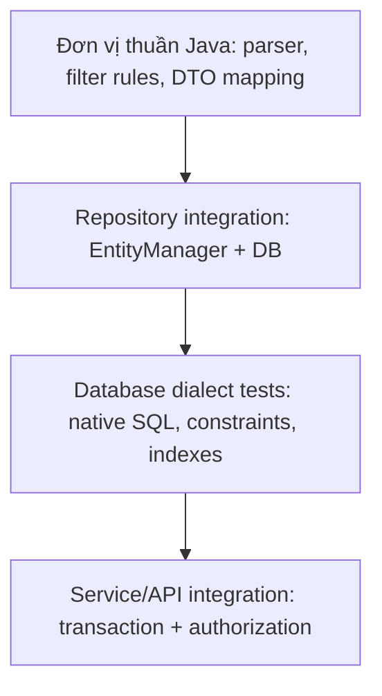
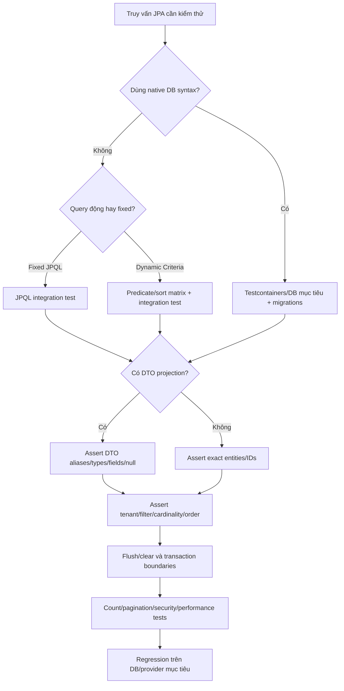

# Kiểm thử JPQL, Criteria, DTO và native SQL

Khi sử dụng JPA, một câu truy vấn **chạy được** chưa chắc đã **đúng**. Nó có thể trả thiếu bản ghi, nhân đôi Order vì `JOIN` tới collection, đếm sai khi phân trang, đổi thứ tự khi nhiều rows có cùng ngày tạo, chỉ hoạt động trên H2 nhưng lỗi trên PostgreSQL, hoặc trả DTO có những trường không đúng như hợp đồng API.

Bốn kiểu truy vấn thường xuất hiện trong một hệ thống Java persistence là:

- **JPQL**: truy vấn bằng tên entity, property và quan hệ của mô hình đối tượng.
- **Criteria API**: dựng cấu trúc truy vấn bằng Java objects, thường dùng cho filter/sort động.
- **DTO projection**: chỉ lấy dữ liệu cần thiết và chuyển sang một kiểu trả về chuyên dụng.
- **Native SQL**: truy vấn trực tiếp bảng, cột, cú pháp và tính năng của database.

Bài **“Kiểm thử JPQL, Criteria, DTO và native SQL”** thuộc chương **Kiểm thử JPA**, module **Data Persistence Relational Access ORM JPA**. Mục tiêu là xây dựng một quy trình kiểm thử đủ sâu để bảo đảm **đúng dữ liệu, đúng cardinality, đúng quyền truy cập, đúng transaction boundary và đúng database dialect**.

> **Nguyên tắc:** Đừng chỉ assert câu query không ném exception hoặc trả một list không rỗng. Hãy kiểm **bản ghi nào xuất hiện, bản ghi nào bắt buộc không xuất hiện, số lượng, giá trị, thứ tự, kiểu projection, hành vi sau flush/clear và kết quả khi chạy trên database mục tiêu**.

---

## 1. Vì sao cần kiểm thử truy vấn JPA?

Một repository method:

```java
List<PurchaseOrder> findPaidOrders();
```

có thể hoạt động bình thường với ba rows đơn giản, nhưng vẫn sai khi:

- Có hai tenants cùng dùng database.
- Một Order có nhiều OrderLines.
- Customer bị soft delete.
- `status` là enum chứ không phải string tùy ý.
- `totalAmount` là `BigDecimal` với precision lớn.
- Date boundaries là nửa khoảng [from, to).
- Dữ liệu được thay ở persistence context nhưng chưa flush.
- Query được cache hoặc dùng một EntityManager đã managed state cũ.
- Database thực khác H2 ở chức năng/dialect/collation.
- Một sort field không unique làm pagination không ổn định.

Test phải xây **dataset phản ví dụ**: có những rows mà một câu query viết sai sẽ trả nhầm, chứ không chỉ dataset khiến mọi query đều pass.

## 2. Bốn tầng điều cần xác nhận

| Tầng | Câu hỏi |
|---|---|
| **Syntax và mapping** | JPQL/Criteria có đúng entity/property, native SQL đúng bảng/cột và dialect? |
| **Semantics** | Filter, join, grouping, null, distinct, sorting và paging đúng không? |
| **Persistence** | Flush, transaction isolation, managed entity, dirty checking và projection có được hiểu đúng? |
| **Bảo mật/vận hành** | Tenant guard, field authorization, query cost, SQL statement count và schema migrations có đúng? |

Một unit test mock `EntityManager` có thể xác minh orchestration, nhưng **không chứng minh JPQL thực thi đúng trên database**.

## 3. Test pyramid cho data access



Các mức bổ trợ nhau:

- **Unit tests:** validate input, map sort/filter names, transform domain objects, không cần DB.
- **JPA integration tests:** chạy query thật qua EntityManager/provider/database.
- **Dialect tests:** chạy với cùng loại DBMS và migration schema như production.
- **End-to-end tests:** bảo đảm HTTP/service + security policy + DTO không bị bypass.

Một bài kiểm thử JPQL cần **ít nhất một môi trường chạy JPA query thật**.

## 4. So sánh mục tiêu của bốn loại truy vấn

| Loại | Assertions đặc trưng | Rủi ro nổi bật |
|---|---|---|
| JPQL | Entity/property path, join, aggregation, filter, sort | Join nhân bản rows; null; constructor grammar |
| Criteria | Predicate tree, AND/OR grouping, dynamic sort, count | Nhầm root, sai grouping, expression type |
| DTO projection | Field order/type/alias, null và precision, không lộ dữ liệu thừa | Constructor mismatch; mapping sai vị trí |
| Native SQL | Column names, aliases, result mapping, dialect, CTE/window | Khác DBMS; scalar types; cache/L1; SQL injection |
| Cả bốn | Tenant, pagination, transaction, concurrency, performance | Dữ liệu sai dù query chạy thành công |

---

## 5. Dùng một domain mẫu xuyên suốt

Giả sử hệ thống có:

```text
Tenant
  ├── Customer
  └── PurchaseOrder
        ├── Customer (many-to-one)
        └── OrderLine (one-to-many)
```

Mỗi Order có:

- `id`: định danh.
- `tenantId`: owner tenant.
- `status`: NEW, PAID, CANCELLED.
- `totalAmount`: BigDecimal.
- `createdAt`: Instant.
- `deletedAt`: soft-delete timestamp hoặc NULL.
- `customer`: association.
- `lines`: collection.
- `version`: optimistic locking.

Chúng ta sẽ kiểm thử cùng ý nghĩa dữ liệu bằng JPQL, Criteria, DTO projection và native SQL.

## 6. Entity Customer

```java
import jakarta.persistence.*;

@Entity
@Table(name = "customers")
public class Customer {

    @Id
    private Long id;

    @Column(name = "tenant_id", nullable = false)
    private String tenantId;

    @Column(nullable = false)
    private String name;

    protected Customer() {}

    public Customer(Long id, String tenantId, String name) {
        this.id = id;
        this.tenantId = tenantId;
        this.name = name;
    }

    public Long getId() { return id; }
    public String getTenantId() { return tenantId; }
    public String getName() { return name; }
}
```

Ở production, cần database constraints để bảo đảm association tenant alignment. Những đoạn mapping dưới đây tập trung vào query testing, không đại diện toàn bộ security/schema design.

## 7. Entity PurchaseOrder

```java
import jakarta.persistence.*;
import java.math.BigDecimal;
import java.time.Instant;
import java.util.ArrayList;
import java.util.List;

@Entity
@Table(name = "purchase_orders")
public class PurchaseOrder {

    @Id
    private Long id;

    @Column(name = "tenant_id", nullable = false)
    private String tenantId;

    @Enumerated(EnumType.STRING)
    @Column(nullable = false)
    private OrderStatus status;

    @Column(name = "total_amount", nullable = false)
    private BigDecimal totalAmount;

    @Column(name = "created_at", nullable = false)
    private Instant createdAt;

    @Column(name = "deleted_at")
    private Instant deletedAt;

    @ManyToOne(fetch = FetchType.LAZY)
    @JoinColumn(name = "customer_id")
    private Customer customer;

    @OneToMany(mappedBy = "order")
    private List<OrderLine> lines = new ArrayList<>();

    @Version
    private Long version;

    protected PurchaseOrder() {}

    public PurchaseOrder(
            Long id,
            String tenantId,
            OrderStatus status,
            BigDecimal totalAmount,
            Instant createdAt,
            Customer customer) {
        this.id = id;
        this.tenantId = tenantId;
        this.status = status;
        this.totalAmount = totalAmount;
        this.createdAt = createdAt;
        this.customer = customer;
    }

    public Long getId() { return id; }
    public String getTenantId() { return tenantId; }
    public OrderStatus getStatus() { return status; }
    public BigDecimal getTotalAmount() { return totalAmount; }
    public Instant getCreatedAt() { return createdAt; }
    public Customer getCustomer() { return customer; }

    public void markDeleted(Instant when) {
        this.deletedAt = when;
    }

    public void changeTotal(BigDecimal value) {
        this.totalAmount = value;
    }
}
```

## 8. Entity OrderLine và enum

```java
@Entity
@Table(name = "order_lines")
public class OrderLine {

    @Id
    private Long id;

    @Column(name = "tenant_id", nullable = false)
    private String tenantId;

    @ManyToOne(fetch = FetchType.LAZY)
    @JoinColumn(name = "order_id", nullable = false)
    private PurchaseOrder order;

    @Column(nullable = false)
    private String sku;

    @Column(nullable = false)
    private int quantity;

    protected OrderLine() {}

    public OrderLine(
            Long id,
            String tenantId,
            PurchaseOrder order,
            String sku,
            int quantity) {
        this.id = id;
        this.tenantId = tenantId;
        this.order = order;
        this.sku = sku;
        this.quantity = quantity;
    }
}
```

```java
public enum OrderStatus {
    NEW, PAID, CANCELLED
}
```

Trong shared-table production, cột `tenant_id` ở `OrderLine` phải tương thích với owner tenant của parent Order; có thể dùng composite foreign key trong migration để enforce. Chỉ có `@JoinColumn(order_id)` như ví dụ không tạo bảo đảm đó.

## 9. Dataset tối thiểu phải phân biệt được query đúng và sai

Thiết kế fixture:

| ID | Tenant | Customer | Status | Total | CreatedAt | Lines |
|---|---|---|---|---:|---|---:|
| 101 | ACME | Alice | NEW | 100.00 | 2026-01-01T10:00Z | 2 |
| 102 | ACME | Alice | PAID | 200.00 | 2026-01-02T10:00Z | 1 |
| 103 | ACME | Bob | PAID | 150.00 | 2026-01-02T10:00Z | 0 |
| 104 | ACME | Bob | CANCELLED | 50.00 | 2026-01-03T10:00Z | 1 |
| 201 | BETA | Carol | PAID | 900.00 | 2026-01-02T10:00Z | 1 |

Đặc điểm có chủ đích:

- Có row tenant BETA đáp ứng filter PAID: phát hiện thiếu tenant predicate.
- Có hai Orders cùng `createdAt`: phát hiện sort tie-breaker sai.
- Có Order 0 Lines, 1 Line, 2 Lines: phát hiện join nhân bản.
- Có nhiều khách hàng và trạng thái: kiểm grouping, associations.
- Có `BigDecimal` gồm số có phần thập phân.
- Có thể thêm một Order `deletedAt != null` để kiểm soft delete.

Không chỉ seed đúng một row cho mỗi truy vấn; như vậy nhiều bugs vẫn trả một row đúng tình cờ.

## 10. Tạo fixtures deterministically

Một helper setup có thể tạo Customer trước Order rồi OrderLine:

```java
void seed(EntityManager em) {
    Customer alice = new Customer(1L, "ACME", "Alice");
    Customer bob   = new Customer(2L, "ACME", "Bob");
    Customer carol = new Customer(3L, "BETA", "Carol");

    em.persist(alice);
    em.persist(bob);
    em.persist(carol);

    PurchaseOrder o101 = new PurchaseOrder(
        101L, "ACME", OrderStatus.NEW,
        new BigDecimal("100.00"),
        Instant.parse("2026-01-01T10:00:00Z"),
        alice
    );

    PurchaseOrder o102 = new PurchaseOrder(
        102L, "ACME", OrderStatus.PAID,
        new BigDecimal("200.00"),
        Instant.parse("2026-01-02T10:00:00Z"),
        alice
    );

    PurchaseOrder o103 = new PurchaseOrder(
        103L, "ACME", OrderStatus.PAID,
        new BigDecimal("150.00"),
        Instant.parse("2026-01-02T10:00:00Z"),
        bob
    );

    PurchaseOrder o104 = new PurchaseOrder(
        104L, "ACME", OrderStatus.CANCELLED,
        new BigDecimal("50.00"),
        Instant.parse("2026-01-03T10:00:00Z"),
        bob
    );

    PurchaseOrder o201 = new PurchaseOrder(
        201L, "BETA", OrderStatus.PAID,
        new BigDecimal("900.00"),
        Instant.parse("2026-01-02T10:00:00Z"),
        carol
    );

    for (PurchaseOrder order :
            List.of(o101, o102, o103, o104, o201)) {
        em.persist(order);
    }

    em.persist(new OrderLine(
        1001L, "ACME", o101, "SKU-A", 1
    ));
    em.persist(new OrderLine(
        1002L, "ACME", o101, "SKU-B", 2
    ));
    em.persist(new OrderLine(
        1003L, "ACME", o102, "SKU-C", 1
    ));
    em.persist(new OrderLine(
        1004L, "ACME", o104, "SKU-D", 1
    ));
    em.persist(new OrderLine(
        2001L, "BETA", o201, "SKU-Z", 3
    ));
}
```

Thêm imports `java.util.List`, `java.math.BigDecimal`, `java.time.Instant` khi dùng. Test nào cần soft-delete có thể gọi `o104.markDeleted(...)` trước flush hoặc bổ sung fixture chuyên biệt.

**Fixture sử dụng IDs cố định** giúp test dễ hiểu, nhưng cần database state được reset giữa tests để tránh xung đột primary key.

---

## 11. Chọn môi trường kiểm thử

Các lựa chọn phổ biến:

1. **JPA test với DB embedded:** nhanh, tiện cho query portable và mapping cơ bản.
2. **Testcontainers với DBMS mục tiêu:** tốt cho PostgreSQL/MySQL-specific SQL, constraints, transaction behavior, data types.
3. **Integration environment đã migrate schema:** kiểm version migration, indexes, privileges, RLS, triggers và stored procedures.
4. **Full application/API test:** kiểm authorization, endpoint DTO, transaction boundaries và serialization.

Không bắt buộc mọi unit test phải chạy Docker. Nhưng các native SQL features hoặc behaviors nhạy cảm dialect **cần được thử trên database tương ứng**.

## 12. Vì sao H2 không thay thế hoàn toàn PostgreSQL?

Một test có thể pass trên H2 nhưng sai trên PostgreSQL vì:

- SQL grammar khác.
- UUID/JSONB/ARRAY types khác.
- `ILIKE`, `DISTINCT ON`, window hoặc CTE semantics khác.
- Collation/NULL ordering khác.
- Date/time precision và timezone khác.
- Transaction isolation, locking, deadlock và error states khác.
- Aggregate result type khác trong native queries.
- Indexes, query planner, RLS và function behavior khác.

H2 phù hợp cho test nhanh ở phạm vi phù hợp, không chứng minh native PostgreSQL query dùng đúng production semantics.

## 13. Spring Boot @DataJpaTest

Với Spring Boot, repository slice test có thể dùng:

```java
@DataJpaTest
class OrderRepositoryTest {

    @Autowired
    private TestEntityManager testEntityManager;

    @Test
    void canPersistOrder() {
        // ...
    }
}
```

`@DataJpaTest` thường:

- Cấu hình subset JPA/repositories/components cần cho data-layer test.
- Mặc định chạy transactional test và rollback sau mỗi test.
- Có thể tự thay datasource bằng embedded DB nếu cấu hình/phụ thuộc phù hợp.
- Không mặc định nạp mọi service/controller bean.
- Có thể kết hợp Testcontainers và migration configuration.

Phải biết rõ **database nào thật sự được test dùng**, không dựa vào tên annotation.

## 14. Testcontainers với PostgreSQL

Ví dụ Spring Boot/JUnit 5:

```java
@Testcontainers
@DataJpaTest
@AutoConfigureTestDatabase(
    replace = AutoConfigureTestDatabase.Replace.NONE
)
class OrderJpaPostgresTest {

    @Container
    static PostgreSQLContainer<?> postgres =
        new PostgreSQLContainer<>("postgres:16-alpine");

    @DynamicPropertySource
    static void databaseProperties(DynamicPropertyRegistry registry) {
        registry.add(
            "spring.datasource.url",
            postgres::getJdbcUrl
        );
        registry.add(
            "spring.datasource.username",
            postgres::getUsername
        );
        registry.add(
            "spring.datasource.password",
            postgres::getPassword
        );
    }

    @PersistenceContext
    EntityManager em;

    @BeforeEach
    void setUp() {
        seed(em);
        em.flush();
        em.clear();
    }

    @Test
    void queryRunsOnPostgres() {
        // ...
    }
}
```

Đây là skeleton; cần dependencies và imports tương ứng JUnit 5, Spring Boot Test, Spring Testcontainers integration nếu dùng, Testcontainers PostgreSQL và JDBC driver. Image tag chỉ minh họa một version PostgreSQL; tốt nhất pin version phù hợp production và cập nhật theo quy trình dự án.

Container phải thực sự start trong môi trường test. Nếu không có Docker/runtime tương thích, test cần báo environment dependency thay vì silently chuyển DB.

## 15. Tạo schema bằng migrations hay Hibernate DDL?

Có hai mục tiêu khác nhau.

**Test nhanh mapping/query:**

```properties
spring.jpa.hibernate.ddl-auto=create-drop
```

có thể tiện trong test đặc biệt, nhưng không chứng minh schema migration production.

**Test physical schema và native SQL:**

- Chạy Flyway/Liquibase migrations như production.
- Dùng `ddl-auto=validate` hoặc cấu hình tương đương để kiểm ORM mapping khớp schema.
- Không cho Hibernate tự tạo một schema “dễ tính” khác migration thật.
- Kiểm indexes, constraints, views, triggers/RLS nếu có.

Mô hình trên là lựa chọn; không bật đồng thời create-drop và migration theo cách khiến một bên xóa schema của bên kia.

## 16. Không share trạng thái giữa tests

Nếu mỗi test seed IDs cố định, database phải sạch.

Các cách:

- Spring transactional rollback per test.
- SQL cleanup theo dependency order.
- Database/schema riêng cho test suite.
- Testcontainers isolated instance.
- Test fixtures transactionally inserted and removed.

Không để test A phụ thuộc vào thứ tự chạy trước test B. Dùng `@TestMethodOrder` để làm tests pass do shared state thường che lỗi isolation.

## 17. EntityManager không thread-safe

Đừng dùng cùng `EntityManager` instance cho hai threads chạy test concurrent. Với concurrent/locking tests, tạo EntityManager/transaction riêng cho mỗi thread hoặc dùng service proxied với transaction management phù hợp.

Một test với hai readers/writers chỉ có ý nghĩa nếu thực sự có **hai persistence contexts** và transaction boundaries được điều phối.

---

## 18. Vì sao cần flush() và clear()?

`em.persist(order)` đưa entity vào persistence context, nhưng SQL INSERT có thể chưa thực thi ngay.

`em.flush()` yêu cầu đồng bộ pending changes với database trong transaction hiện tại.

`em.clear()` detach mọi managed entities, giúp truy vấn sau phải hydrate từ database/provider/cache phù hợp thay vì trả lại đúng object managed cũ.

Pattern:

```java
seed(em);
em.flush();
em.clear();

List<PurchaseOrder> rows = queryOrders(em);
```

Cần hiểu:

- **Flush không phải commit**; transaction có thể rollback sau đó.
- **Clear không flush**; nếu có pending changes chưa flush, chúng có thể bị mất.
- **Clear không xóa L2/query cache**.
- **Clear không đổi transaction isolation**; không tự nhìn thấy commit bên ngoài nếu transaction snapshot không cho phép.

## 19. Một test không clear có thể dương tính giả

Ví dụ:

```java
PurchaseOrder order = em.find(
    PurchaseOrder.class, 101L
);

order.changeTotal(new BigDecimal("300.00"));

PurchaseOrder reread = em.find(
    PurchaseOrder.class, 101L
);

assertSame(order, reread);
assertEquals(
    new BigDecimal("300.00"),
    reread.getTotalAmount()
);
```

Test này chỉ chứng minh managed object có value mới, **không chứng minh SQL UPDATE đã chạy hoặc DB lưu đúng**.

Muốn kiểm DB state:

```java
em.flush();
em.clear();

PurchaseOrder persisted = em.find(
    PurchaseOrder.class, 101L
);
assertEquals(
    0,
    new BigDecimal("300.00").compareTo(
        persisted.getTotalAmount()
    )
);
```

Với assertion về **commit thực sự**, còn phải kết thúc transaction rồi đọc bằng transaction mới.

## 20. Test transactional rollback che commit-time bugs

Spring test:

```java
@DataJpaTest
@Transactional
class MyJpaTest { ... }
```

thường rollback sau test. Một lỗi chỉ lộ khi database commit hoặc interceptor kết thúc có thể không được quan sát nếu test không tạo transaction commit thật.

Với những yêu cầu như deferred constraints, `UnexpectedRollbackException`, after-commit events hay transaction completion:

- Test bằng service entrypoint có transaction boundary thật.
- Để test method không nằm trong outer test transaction, hoặc điều khiển transaction explicitly.
- Nếu dùng Spring Test `TestTransaction`, hiểu rõ start/end/flagForCommit.
- Đọc DB ở transaction mới.
- Không coi `flush()` tương đương `commit()`.

## 21. Seed data nên đặt ở đâu?

Có thể dùng:

- `@BeforeEach` + EntityManager.
- `@Sql` với SQL script.
- Reusable fixture builders.
- Repository methods.
- Test-specific factory helpers.

Quy tắc thực dụng:

- Khi test **JPA mapping/query**, seed qua JPA giúp fixtures dễ đọc.
- Khi test **database constraints/native SQL/migrations**, seed bằng SQL độc lập có thể phát hiện thiếu mapping/constraint.
- Khi test **migration compatibility**, chạy migration rồi seed các dữ liệu legacy/new variants.

Không để fixture builder tự động sửa dữ liệu xấu mà test cần giữ để kiểm tra negative cases.

---

# Phần I — Kiểm thử JPQL

## 22. JPQL dùng entity/property, không phải table/column

JPQL:

```jpql
select o
from PurchaseOrder o
where o.tenantId = :tenant
  and o.status = :status
order by o.createdAt desc, o.id asc
```

Tương ứng SQL có thể dùng:

```sql
SELECT ...
FROM purchase_orders
WHERE tenant_id = ?
  AND status = ?
ORDER BY created_at DESC, id ASC;
```

Test có nhiệm vụ xác nhận generated SQL trả dữ liệu đúng, không nhất thiết assert SQL string chính xác từng byte vì Hibernate/provider có thể thay aliases và join order.

## 23. Test filter JPQL theo tenant và status

```java
@Test
void jpqlFiltersPaidOrdersWithinTenant() {
    List<Long> ids = em.createQuery(
        """
        select o.id
        from PurchaseOrder o
        where o.tenantId = :tenant
          and o.status = :status
        order by o.id asc
        """,
        Long.class
    )
    .setParameter("tenant", "ACME")
    .setParameter("status", OrderStatus.PAID)
    .getResultList();

    assertEquals(List.of(102L, 103L), ids);
}
```

Điểm quan trọng:

- `Order#201` thuộc BETA cũng PAID nên test sẽ fail nếu quên tenant filter.
- `Order#101` NEW và `Order#104` CANCELLED không được xuất hiện.
- Assert **exact IDs**, không chỉ list size bằng 2.

## 24. Negative assertion bảo vệ dữ liệu

Ngoài expected list:

```java
assertFalse(ids.contains(201L));
```

có thể làm test intent rõ hơn. Nhưng exact equality với list đã sorted đã bao phủ case này.

Với API security, test thêm actor BETA query Order#101 trả không được phép hoặc not found theo policy. Chỉ test repository query đúng không thay service authorization tests.

## 25. Named parameters và type binding

```java
.setParameter("status", OrderStatus.PAID)
```

dùng enum, thay vì nối chuỗi:

```java
"where o.status = '" + statusFromRequest + "'"
```

Test nên có input chứa ký tự đặc biệt đối với text filters để chắc chắn values vẫn được bind.

**Parameter binding bảo vệ giá trị**, nhưng không tự bảo vệ dynamic JPQL property names, sort direction hay arbitrary fragments. Các cấu trúc đó cần allowlist server.

## 26. Test một khoảng thời gian nửa mở

Tìm Orders tạo từ ngày 2/1 đến trước ngày 3/1:

```java
Instant from = Instant.parse(
    "2026-01-02T00:00:00Z"
);
Instant before = Instant.parse(
    "2026-01-03T00:00:00Z"
);

List<Long> ids = em.createQuery(
    """
    select o.id from PurchaseOrder o
    where o.tenantId = :tenant
      and o.createdAt >= :from
      and o.createdAt < :before
    order by o.id
    """,
    Long.class
)
.setParameter("tenant", "ACME")
.setParameter("from", from)
.setParameter("before", before)
.getResultList();

assertEquals(List.of(102L, 103L), ids);
```

**Nửa khoảng [from, before)** tránh rủi ro biểu diễn “cuối ngày” bằng `23:59:59.999` trong khi DB precision cao hơn milliseconds.

Test boundary cụ thể: đúng `from` có được bao gồm; đúng `before` phải bị loại.

## 27. Test null semantics

SQL/JPQL dùng ba giá trị logic với NULL.

Sai nếu muốn tìm Orders chưa soft-delete:

```jpql
where o.deletedAt = :nothing
```

và bind `null`; điều đó không tương đương một cách portable với `IS NULL`.

Đúng:

```jpql
where o.deletedAt is null
```

Test nên có ít nhất một soft-deleted Order và một active Order cùng status/tenant, bảo đảm query không trả soft-deleted row.

## 28. Test JOIN many-to-one

```java
List<Long> ids = em.createQuery(
    """
    select o.id
    from PurchaseOrder o
    join o.customer c
    where o.tenantId = :tenant
      and c.name = :name
    order by o.id
    """,
    Long.class
)
.setParameter("tenant", "ACME")
.setParameter("name", "Alice")
.getResultList();

assertEquals(List.of(101L, 102L), ids);
```

Case cần thêm:

- Order không có Customer nếu mapping cho phép.
- INNER JOIN vs LEFT JOIN.
- Customer name trùng giữa tenants.
- Join tới association có ownership/soft-delete constraints.

Một join đúng về JPA syntax chưa chắc an toàn nếu Customer association có thể liên kết chéo tenant trong database.

## 29. Test LEFT JOIN khác INNER JOIN

Nếu Order có `customer == null`, query:

```jpql
select o from PurchaseOrder o left join o.customer c
```

có thể giữ Order không có Customer. Ngược lại:

```jpql
join o.customer c
```

loại Order đó.

Test cần seed row thực sự có NULL association để phân biệt. Nếu toàn bộ test fixtures đều luôn có Customer, LEFT và INNER có thể cho kết quả như nhau, không phát hiện bug.

## 30. JOIN to-many dễ nhân bản root

Order#101 có hai Lines.

```jpql
select o.id
from PurchaseOrder o
join o.lines l
where o.id = 101
```

có thể tạo hai kết quả ID 101 (tùy selection/distinct).

Kiểm thử phải nắm rõ:

- **Join rows**: mỗi OrderLine matching là một row.
- **Root entities**: một PurchaseOrder logic là một entity.
- `distinct` có semantics khác khi projection nhiều columns.
- Query với pagination trên join có thể có rows trùng/lệch.

Nếu use case chỉ cần “Orders có ít nhất một Line phù hợp”, `EXISTS` thường cho semantics rõ.

## 31. EXISTS cho to-many filter

```java
List<Long> ids = em.createQuery(
    """
    select o.id
    from PurchaseOrder o
    where o.tenantId = :tenant
      and exists (
          select l.id
          from OrderLine l
          where l.order = o
            and l.sku = :sku
      )
    order by o.id
    """,
    Long.class
)
.setParameter("tenant", "ACME")
.setParameter("sku", "SKU-A")
.getResultList();

assertEquals(List.of(101L), ids);
```

Test thêm Order có **hai Lines cùng SKU** để chắc chắn Order chỉ xuất hiện một lần.

Không chỉ chuyển `JOIN` thành `DISTINCT` theo thói quen; xem query plan và semantics của business condition.

## 32. Aggregate COUNT và COUNT DISTINCT

Một query:

```jpql
select count(o)
from PurchaseOrder o
join o.lines l
where o.tenantId = :tenant
```

đếm **join rows** theo semantics, không nhất thiết số Orders.

Nếu cần số Orders có ít nhất một Line:

```jpql
select count(distinct o.id)
from PurchaseOrder o
join o.lines l
where o.tenantId = :tenant
```

Test dataset:

- Order#101 có 2 Lines.
- Order#102 có 1.
- Order#103 có 0.
- Order#104 có 1.

Kỳ vọng:

- COUNT join rows của ACME = 4.
- COUNT DISTINCT Orders có Line = 3.
- COUNT toàn Orders ACME = 4.

Ba số này **khác nhau** và không nên bị dùng nhầm.

## 33. SUM và kiểu BigDecimal

```java
BigDecimal totalPaid = em.createQuery(
    """
    select sum(o.totalAmount)
    from PurchaseOrder o
    where o.tenantId = :tenant
      and o.status = :status
    """,
    BigDecimal.class
)
.setParameter("tenant", "ACME")
.setParameter("status", OrderStatus.PAID)
.getSingleResult();

assertEquals(
    0,
    new BigDecimal("350.00").compareTo(totalPaid)
);
```

Tổng `200.00 + 150.00 = 350.00`, không bao gồm BETA 900.

Sử dụng `compareTo()` khi cần so giá trị Decimal mà không phụ thuộc scale (`350.0` và `350.00` có thể khác nhau theo `equals`). Nếu scale là phần contract, assert scale riêng.

## 34. SUM trên tập rỗng có thể trả NULL

SQL aggregate `SUM` trên không có rows thường trả NULL; `COUNT` trả 0.

Ví dụ:

```jpql
select sum(o.totalAmount)
from PurchaseOrder o
where o.tenantId = :tenant
  and o.status = :status
```

Nếu không có matching Orders:

```java
BigDecimal value = query.getSingleResult();
// value có thể null.
```

Có thể dùng `coalesce` với expression type tương thích:

```jpql
select coalesce(sum(o.totalAmount), :zero)
from PurchaseOrder o
where o.tenantId = :tenant
```

Cần test empty dataset thay vì giả định mọi tenant luôn có Orders.

## 35. GROUP BY và HAVING

Ví dụ tính số Orders theo status:

```jpql
select o.status, count(o)
from PurchaseOrder o
where o.tenantId = :tenant
group by o.status
```

Test expected map ACME:

```text
NEW       → 1
PAID      → 2
CANCELLED → 1
```

Nếu dùng `HAVING count(o) >= 2`, chỉ PAID xuất hiện.

Không assert group result ordering khi query không có `ORDER BY`. Convert vào map hoặc thêm ORDER BY rõ.

## 36. LIKE và wildcard semantics

Tìm Customer tên có chứa literal `%` hoặc `_`:

- `%` và `_` là LIKE wildcards, không phải ký tự bình thường.
- Parameter binding tránh SQL injection nhưng **không tự escape wildcard semantics**.
- Nếu API cung cấp literal substring search, phải escape pattern và chỉ định escape character phù hợp.
- Test `%`, `_`, backslash, Unicode, empty string và keyword length.

Trên database khác nhau, case-insensitive match/collation có thể khác. Test tên tiếng Việt/accent trên DB mục tiêu khi product contract yêu cầu.

## 37. DISTINCT với entity và scalar projection

```jpql
select distinct o
from PurchaseOrder o
join o.lines l
where o.tenantId = :tenant
```

khác:

```jpql
select distinct o.id, l.sku
from PurchaseOrder o
join o.lines l
where o.tenantId = :tenant
```

Query thứ hai distinct theo **cặp (Order ID, SKU)** nên một Order vẫn có nhiều rows. Không coi DISTINCT tự trả một row per Order cho mọi projection.

Test phải assert **cardinality của kiểu kết quả mà business thực sự mong muốn**.

## 38. JPQL ORDER BY và phân trang

```java
List<Long> ids = em.createQuery(
    """
    select o.id
    from PurchaseOrder o
    where o.tenantId = :tenant
    order by o.createdAt desc, o.id asc
    """,
    Long.class
)
.setParameter("tenant", "ACME")
.setFirstResult(0)
.setMaxResults(2)
.getResultList();

assertEquals(List.of(104L, 102L), ids);
```

Ở fixture:

- Order#104 ngày 3/1 đứng đầu.
- Orders #102/#103 cùng ngày 2/1, ID asc nên #102 trước #103.

Thêm tie-breaker unique giúp test ổn định, nhưng không ngăn mọi vấn đề nếu rows thay đổi giữa các page requests.

## 39. Test page 2 và count riêng

Nếu dùng `pageSize=2` và order `createdAt desc, id asc`:

```text
Page 0: [104, 102]
Page 1: [103, 101]
```

Assert cả hai pages và tổng count = 4.

Count query **không cần ORDER BY**, nhưng phải giữ cùng tenant/filter semantics. Với collection joins, phải cân nhắc `count(distinct o.id)` hoặc EXISTS.

## 40. ORDER BY không có tie-breaker là không đủ

Một test chỉ kiểm:

```text
Sort createdAt DESC
```

có thể pass ngẫu nhiên do DB trả ID tăng dần, nhưng SQL không hứa thứ tự giữa các rows cùng timestamp.

Test nên seed **tối thiểu hai rows cùng sort key** và yêu cầu tie-breaker cố định, ví dụ `ORDER BY createdAt DESC, id ASC`.

## 41. JPQL update/delete có semantics khác SELECT

Bulk JPQL:

```java
int updated = em.createQuery(
    """
    update PurchaseOrder o
    set o.status = :newStatus
    where o.tenantId = :tenant
      and o.status = :oldStatus
    """
)
.setParameter("newStatus", OrderStatus.CANCELLED)
.setParameter("oldStatus", OrderStatus.NEW)
.setParameter("tenant", "ACME")
.executeUpdate();
```

Test nên xác nhận:

- Affected rows đúng expected (ở fixture là 1).
- BETA không thay đổi.
- Managed entities đã loaded có thể stale.
- Bulk DML không tự chạy per-entity callbacks và không tự tăng `@Version` theo managed lifecycle.
- Nếu contract yêu cầu version/audit timestamp, phải set riêng hoặc đổi strategy.

Sau bulk DML test nên `flush` trước khi thao tác nếu có pending changes và `clear()`/mở context mới trước assert actual persisted state.

---

# Phần II — Kiểm thử Criteria API

## 42. Criteria API giải quyết vấn đề nào?

Criteria API hữu ích cho queries có nhiều optional filters mà không muốn nối JPQL string.

```java
CriteriaBuilder cb = em.getCriteriaBuilder();
CriteriaQuery<PurchaseOrder> cq =
    cb.createQuery(PurchaseOrder.class);

Root<PurchaseOrder> root =
    cq.from(PurchaseOrder.class);
```

Dù dùng Java objects, Criteria vẫn có thể sai:

- AND/OR precedence.
- Dùng sai field/property.
- Root/Predicate từ query khác.
- Sort trên field không được allowlist.
- Join collection làm duplicate rows.
- Count query sai.
- Date/Decimal comparison type sai.
- Missing tenant predicate.

Do đó **Criteria cần integration tests về kết quả**, không chỉ unit tests kiểm method builder được gọi.

## 43. Test Criteria filter cơ bản

```java
@Test
void criteriaFiltersByTenantAndStatus() {
    CriteriaBuilder cb = em.getCriteriaBuilder();

    CriteriaQuery<Long> cq =
        cb.createQuery(Long.class);

    Root<PurchaseOrder> o =
        cq.from(PurchaseOrder.class);

    cq.select(o.get("id"));

    cq.where(cb.and(
        cb.equal(o.get("tenantId"), "ACME"),
        cb.equal(o.get("status"), OrderStatus.PAID)
    ));

    cq.orderBy(cb.asc(o.get("id")));

    List<Long> ids = em.createQuery(cq)
        .getResultList();

    assertEquals(List.of(102L, 103L), ids);
}
```

Ý nghĩa tương đương JPQL test ở phần trước. Có thể dùng **cùng expected IDs** để so semantics, nhưng test độc lập vẫn cần query code thật.

## 44. Kiểu của Path trong Criteria

Khi so timestamp:

```java
Path<Instant> createdAt =
    root.get("createdAt");
```

hoặc:

```java
Path<Instant> createdAt =
    root.<Instant>get("createdAt");
```

Điều này giúp method `greaterThanOrEqualTo` nhận Comparable type tương ứng.

Nếu có generated static metamodel:

```java
Path<Instant> createdAt =
    root.get(PurchaseOrder_.createdAt);
```

có thể giảm string typos. Metamodel không tự validate quyền filter/sort từ client; allowlist vẫn cần.

## 45. Filter động bằng các values đã parse

Một request typed:

```java
public record OrderFilter(
    OrderStatus status,
    Instant from,
    Instant before,
    BigDecimal minTotal
) {}
```

Criteria predicate builder:

```java
static List<Predicate> predicates(
        CriteriaBuilder cb,
        Root<PurchaseOrder> o,
        String trustedTenant,
        OrderFilter filter) {

    List<Predicate> p = new ArrayList<>();

    p.add(cb.equal(
        o.get("tenantId"), trustedTenant
    ));
    p.add(cb.isNull(o.get("deletedAt")));

    if (filter.status() != null) {
        p.add(cb.equal(
            o.get("status"), filter.status()
        ));
    }

    if (filter.from() != null) {
        p.add(cb.greaterThanOrEqualTo(
            o.<Instant>get("createdAt"),
            filter.from()
        ));
    }

    if (filter.before() != null) {
        p.add(cb.lessThan(
            o.<Instant>get("createdAt"),
            filter.before()
        ));
    }

    if (filter.minTotal() != null) {
        p.add(cb.greaterThanOrEqualTo(
            o.<BigDecimal>get("totalAmount"),
            filter.minTotal()
        ));
    }

    return p;
}
```

Test tổ hợp: không filter, chỉ status, from/before, minTotal, tất cả cùng lúc, và ranges rỗng.

## 46. Bộ test cho optional filters

| Case | Filter | Expected IDs ACME |
|---|---|---|
| Không có filter thêm | none | 101,102,103,104 |
| status=PAID | status | 102,103 |
| minTotal=150 | total | 102,103 |
| createdAt ngày 2/1 | from/before | 102,103 |
| status=PAID và minTotal=200 | kết hợp | 102 |
| status=CANCELLED và minTotal=100 | kết hợp | Không có |
| tenant=BETA, status=PAID | tenant khác | 201 |

Khi test có soft delete, expected IDs phải loại rows deleted theo policy.

Không để null/empty filter vô tình bỏ cả mandatory tenant predicate.

## 47. AND/OR precedence và nguy cơ leak

Sai về mặt logic:

```sql
WHERE tenant_id = 'ACME' AND status = 'NEW'
   OR status = 'PAID'
```

do operator precedence, có thể trả Order#201 thuộc BETA.

Trong Criteria, đúng:

```java
Predicate requested = cb.or(
    cb.equal(o.get("status"), OrderStatus.NEW),
    cb.equal(o.get("status"), OrderStatus.PAID)
);

Predicate secure = cb.and(
    cb.equal(o.get("tenantId"), trustedTenant),
    cb.isNull(o.get("deletedAt")),
    requested
);

cq.where(secure);
```

Test cần có BETA PAID row để phát hiện OR escape; fixture đã có Order#201.

## 48. Test nested AND/OR bằng bảng chân trị

Một predicate:

```text
tenant = ACME
AND (status = PAID OR totalAmount >= 200)
```

Với fixture:

- #101 NEW/100: không match.
- #102 PAID/200: match.
- #103 PAID/150: match.
- #104 CANCELLED/50: không match.
- #201 BETA/PAID/900: không match.

Expected IDs: `[102, 103]`.

Test này phân biệt **logic nhóm đúng** với query bị thiếu ngoặc/tenant.

## 49. Criteria query root không thể dùng tùy tiện lại

Một anti-pattern:

```java
Predicate p = cb.equal(
    dataRoot.get("tenantId"), tenant
);

countQuery.where(p); // Predicate thuộc dataRoot khác.
```

`Predicate` gắn với root/query tree tương ứng; dùng lại với count query khác có thể gây lỗi hoặc generated query không hợp lệ.

Tốt hơn:

```java
Root<PurchaseOrder> countRoot =
    countQuery.from(PurchaseOrder.class);

List<Predicate> countPredicates =
    predicates(cb, countRoot, tenant, filter);
```

Test data query và count query **độc lập** nhưng cùng filter contract.

## 50. Criteria count query

```java
CriteriaQuery<Long> countQuery =
    cb.createQuery(Long.class);

Root<PurchaseOrder> countRoot =
    countQuery.from(PurchaseOrder.class);

countQuery.select(cb.count(countRoot));

countQuery.where(
    predicates(
        cb,
        countRoot,
        "ACME",
        new OrderFilter(OrderStatus.PAID, null, null, null)
    ).toArray(Predicate[]::new)
);

Long total = em.createQuery(countQuery)
    .getSingleResult();

assertEquals(2L, total);
```

Nếu data query join to-many và trả distinct Orders, count query phải dùng compatible semantics; `count(root)` không luôn đủ.

## 51. Criteria JOIN và DISTINCT

```java
CriteriaQuery<Long> cq =
    cb.createQuery(Long.class);

Root<PurchaseOrder> root =
    cq.from(PurchaseOrder.class);

Join<PurchaseOrder, OrderLine> line =
    root.join("lines", JoinType.INNER);

cq.select(root.get("id")).distinct(true);

cq.where(cb.equal(
    root.get("tenantId"), "ACME"
));
```

Test expected IDs có Lines: `[101, 102, 104]` sau ORDER BY ID. Nếu bỏ distinct, #101 có thể xuất hiện hai lần.

Cần test tính đúng khi filter qua collection, không chỉ syntax của join.

## 52. Criteria EXISTS

```java
CriteriaQuery<Long> cq =
    cb.createQuery(Long.class);

Root<PurchaseOrder> order =
    cq.from(PurchaseOrder.class);

Subquery<Long> sub =
    cq.subquery(Long.class);

Root<OrderLine> line =
    sub.from(OrderLine.class);

sub.select(line.get("id"));

sub.where(
    cb.equal(line.get("order"), order),
    cb.equal(line.get("sku"), "SKU-A")
);

cq.select(order.get("id"));

cq.where(
    cb.equal(order.get("tenantId"), "ACME"),
    cb.exists(sub)
);
```

Expected IDs: `[101]`.

Test thêm case hai lines cùng SKU trong một Order để chứng minh EXISTS không nhân rows.

## 53. Criteria sort động an toàn

Không viết:

```java
root.get(request.sortField())
```

vì request có thể chọn field không được phép hoặc association path quá phức tạp.

Cho phép public enum:

```java
public enum SortField {
    CREATED_AT,
    TOTAL,
    ID
}
```

Mapping cố định:

```java
static Expression<?> sortExpression(
        Root<PurchaseOrder> root,
        SortField field) {

    return switch (field) {
        case CREATED_AT -> root.get("createdAt");
        case TOTAL -> root.get("totalAmount");
        case ID -> root.get("id");
    };
}
```

Test reject unknown field và sort ordering. Field-level authorization phải được kiểm ở API/service khi cần.

## 54. Test sort nhiều trường

Ví dụ `createdAt DESC, id ASC` trong Criteria:

```java
cq.orderBy(
    cb.desc(root.get("createdAt")),
    cb.asc(root.get("id"))
);
```

Expected ACME IDs: `[104, 102, 103, 101]`.

Test thêm:

- Không cung cấp sort → default có tie-breaker.
- Same timestamp → ID quyết định thứ tự.
- Null sort value → xác định DB/policy.
- Pagination page 0/page 1.
- Trường không được phép → reject trước DB query.

## 55. Criteria multiselect và Tuple

Criteria có thể trả:

```java
CriteriaQuery<Tuple> cq =
    cb.createTupleQuery();

Root<PurchaseOrder> root =
    cq.from(PurchaseOrder.class);

cq.multiselect(
    root.get("id").alias("orderId"),
    root.get("totalAmount").alias("amount")
);

cq.where(cb.equal(
    root.get("tenantId"), "ACME"
));

List<Tuple> rows = em.createQuery(cq)
    .getResultList();
```

Test:

- Alias có tên đúng.
- Type của `orderId` là `Long`.
- Type của `amount` là `BigDecimal`.
- Không giả định iteration order nếu không có ORDER BY.
- NULL values/aggregate types được xử lý.

Tuple hữu ích nhưng không tự bảo vệ kiểu API output; DTO vẫn cần mapping rõ.

---

# Phần III — Kiểm thử DTO projection

## 56. Vì sao dùng DTO thay vì trả entity?

Entity thường có nhiều attributes/associations, một số nhạy cảm hoặc lazy.

API list chỉ cần:

```text
orderId
customerName
total
status
```

DTO giúp:

- Query chỉ select dữ liệu cần thiết.
- Tránh serialize entity graph không chủ đích.
- Giữ output contract ổn định.
- Giảm nguy cơ LazyInitializationException nếu service trả DTO hoàn chỉnh.
- Tách API model khỏi persistence model.

Tuy nhiên **DTO projection không tự bảo đảm authorization**: WHERE tenant/ownership vẫn cần.

## 57. DTO record

```java
package com.example.orders.dto;

import java.math.BigDecimal;

public record OrderRow(
    Long orderId,
    String customerName,
    BigDecimal total
) {}
```

Cần test:

- Field order và constructor argument types.
- Name/total đúng Order.
- Decimal precision/scale theo contract.
- Null Customer name theo join type.
- BETA rows không xuất hiện.
- DTO không chứa dữ liệu ngoài quyền.

## 58. JPQL constructor expression

```java
List<OrderRow> rows = em.createQuery(
    """
    select new com.example.orders.dto.OrderRow(
        o.id,
        c.name,
        o.totalAmount
    )
    from PurchaseOrder o
    join o.customer c
    where o.tenantId = :tenant
    order by o.id
    """,
    OrderRow.class
)
.setParameter("tenant", "ACME")
.getResultList();
```

FQCN của DTO phải đúng package/class thực tế. JPA constructor expression cần constructor tương thích với selected arguments; record canonical constructor có thể phù hợp.

Không dùng entity constructor hoặc DTO private constructor mà provider không truy cập được theo mapping.

## 59. Test DTO bằng exact values

```java
assertEquals(
    List.of(
        new OrderRow(
            101L, "Alice", new BigDecimal("100.00")
        ),
        new OrderRow(
            102L, "Alice", new BigDecimal("200.00")
        ),
        new OrderRow(
            103L, "Bob", new BigDecimal("150.00")
        ),
        new OrderRow(
            104L, "Bob", new BigDecimal("50.00")
        )
    ),
    rows
);
```

`record.equals()` dùng `BigDecimal.equals()`, có xét scale. Nếu provider/database trả scale khác, test này có thể fail dù giá trị số bằng nhau; cần quyết định DTO contract có đòi scale=2 không.

Nếu chỉ quan tâm giá trị, assert từng amount bằng `compareTo() == 0`, còn scale là test riêng.

## 60. Type mismatch trong constructor projection

Ví dụ DTO constructor nhận:

```java
OrderRow(Long id, String name, double total)
```

nhưng JPQL `o.totalAmount` là `BigDecimal`.

Một provider có thể không tìm được constructor tương thích hoặc chuyển kiểu ngoài kỳ vọng.

Test integration với **JPQL query thật** sẽ phát hiện lỗi khi query được parse/executed. Unit test tự `new OrderRow(...)` không phát hiện mismatch của JPQL expression.

## 61. Thứ tự constructor arguments là một phần contract

Sai:

```jpql
select new com.example.orders.dto.OrderRow(
    o.id,
    o.totalAmount,
    c.name
)
```

trong khi constructor nhận `(Long, String, BigDecimal)`.

Test phải thực thi query và assert fields; chỉ kiểm `rows.size()` không phát hiện mapping bị hoán vị trong các DTO có cùng kiểu.

Một DTO có hai String fields (ví dụ customerName và statusLabel) đặc biệt dễ bị tráo mà vẫn compile.

## 62. LEFT JOIN projection và nullable field

Nếu Order không có Customer:

```jpql
select new com.example.orders.dto.OrderRow(
    o.id,
    c.name,
    o.totalAmount
)
from PurchaseOrder o
left join o.customer c
```

thì `customerName` có thể NULL.

Test cần seed Order không có Customer và xác nhận:

- Row vẫn xuất hiện.
- DTO field null đúng policy.
- Không ném NPE khi mapper/serializer xử lý.
- Nếu business contract không cho Customer null, validation/database constraint phải enforce thay vì âm thầm loại bằng INNER JOIN.

## 63. Interface-based projection trong Spring Data

Spring Data JPA có thể hỗ trợ interface projection:

```java
public interface OrderSummaryView {
    Long getId();
    BigDecimal getTotalAmount();
}
```

Repository method có thể trả projection thay vì entity.

Test nên xác nhận:

- Getter names tương ứng selected aliases/properties.
- Nested projections có thể tạo joins và materialization khác dự tính.
- Không có surprise lazy loads hoặc sensitive fields.
- Result count/pagination chính xác.
- Đường query được framework tạo có tenant guard.

Projection interface là Spring Data feature, không phải constructor expression portable của JPA.

## 64. Test Object[] projection cẩn thận

JPQL:

```jpql
select o.id, o.totalAmount
from PurchaseOrder o
where o.tenantId = :tenant
```

có thể trả `Object[]` cho mỗi row.

Mapper:

```java
Object[] row = results.get(0);
Long id = (Long) row[0];
BigDecimal total = (BigDecimal) row[1];
```

Rủi ro:

- Sai index.
- Sai type.
- Select list bị refactor.
- NULL và numeric conversions.

DTO constructor hoặc Tuple aliases có thể rõ nghĩa hơn. Nếu dùng Object[] vì performance/library constraint, test từng index/type.

## 65. Criteria DTO projection bằng cb.construct()

```java
CriteriaQuery<OrderRow> cq =
    cb.createQuery(OrderRow.class);

Root<PurchaseOrder> o =
    cq.from(PurchaseOrder.class);

Join<PurchaseOrder, Customer> c =
    o.join("customer", JoinType.INNER);

cq.select(cb.construct(
    OrderRow.class,
    o.get("id"),
    c.get("name"),
    o.get("totalAmount")
));

cq.where(cb.equal(
    o.get("tenantId"), "ACME"
));

cq.orderBy(cb.asc(o.get("id")));

List<OrderRow> rows = em
    .createQuery(cq)
    .getResultList();
```

So sánh `rows` với expected DTO list của JPQL test. Cả hai dùng cùng business semantics nhưng hai cách xây query khác nhau.

## 66. Test DTO không phải managed entity

Một constructor-projected DTO:

```java
OrderRow row = query.getSingleResult();
```

không phải managed JPA entity.

Nếu code tạo một DTO mới và thay field, JPA không dirty-check DTO để cập nhật database. Test nên xác nhận logic API không dựa vào việc sửa projection rồi kỳ vọng automatic flush.

Entity projection và DTO projection có **lifecycle semantics khác nhau**, dù field names giống nhau.

## 67. DTO giúp tránh N+1 nhưng phải test thật

Ví dụ:

```java
List<PurchaseOrder> orders =
    repository.findAll();

for (PurchaseOrder order : orders) {
    String name = order.getCustomer().getName();
}
```

nếu Customer LAZY, có thể phát sinh N+1 SQL queries.

DTO projection:

```jpql
select new com.example.orders.dto.OrderRow(
    o.id, c.name, o.totalAmount
)
from PurchaseOrder o
join o.customer c
where o.tenantId = :tenant
```

có thể lấy dữ liệu cần thiết với một logical query.

Nhưng không khẳng định “chắc chắn một SQL statement” cho mọi provider/config/cache mà không đo. Test SQL statement count và query plan trên setup đại diện.

## 68. Không dùng DTO như lớp authorization duy nhất

Ngay cả nếu DTO chỉ gồm ID/Total, query:

```jpql
select new ...OrderRow(...)
from PurchaseOrder o
```

không có tenant WHERE vẫn có thể trả tổng/ID của tenant khác.

Test DTO phải bao gồm cross-tenant row (như Order#201) và xác nhận bị loại.

Nếu DTO chứa trường theo role, kiểm user CUSTOMER/SUPPORT/ADMIN với data fixtures phù hợp; không để cache của admin projection bị dùng lại cho user ít quyền.

## 69. DTO với aggregate/grouping

Một DTO:

```java
public record StatusCount(
    OrderStatus status,
    Long count
) {}
```

JPQL:

```jpql
select new com.example.orders.dto.StatusCount(
    o.status, count(o)
)
from PurchaseOrder o
where o.tenantId = :tenant
group by o.status
```

Kỳ vọng ACME:

```text
NEW       → 1
PAID      → 2
CANCELLED → 1
```

Không assert list order nếu không có ORDER BY. Convert `List<StatusCount>` thành Map hoặc thêm ORDER BY.

---

# Phần IV — Kiểm thử native SQL

## 70. Native SQL khác JPQL ở đâu?

JPQL:

```jpql
select o from PurchaseOrder o
where o.tenantId = :tenant
```

Native SQL:

```sql
SELECT *
FROM purchase_orders
WHERE tenant_id = :tenant
```

Native SQL dùng **physical table/column names**:

- `purchase_orders` thay vì `PurchaseOrder`.
- `tenant_id` thay vì `tenantId`.
- DB-specific syntax/functions.
- JDBC driver/native scalar types.
- Result mapping phụ thuộc columns/aliases.

Do đó native SQL cần test trên **schema và DB dialect thật**.

## 71. Test native scalar IDs

```java
@SuppressWarnings("unchecked")
List<Number> ids = em.createNativeQuery(
    """
    SELECT id
    FROM purchase_orders
    WHERE tenant_id = :tenant
      AND status = :status
    ORDER BY id
    """
)
.setParameter("tenant", "ACME")
.setParameter("status", "PAID")
.getResultList();

List<Long> actual = ids.stream()
    .map(Number::longValue)
    .toList();

assertEquals(List.of(102L, 103L), actual);
```

Native scalar numeric result type phụ thuộc JPA provider, JDBC type và DBMS; không cast mù mọi giá trị sang `Long` khi provider có thể trả `BigInteger` hoặc kiểu khác.

`Number.longValue()` cũng cần kiểm range nếu type có thể vượt Long.

## 72. Native count không luôn là Long

```java
Object raw = em.createNativeQuery(
    """
    SELECT COUNT(*)
    FROM purchase_orders
    WHERE tenant_id = :tenant
    """
)
.setParameter("tenant", "ACME")
.getSingleResult();

long count = ((Number) raw).longValue();

assertEquals(4L, count);
```

Test xác nhận `raw` thật là `Number` trong provider/driver đang dùng; không hard-code `(Long) raw` nếu code cần hỗ trợ nhiều dialects.

## 73. Native entity result mapping

JPA có thể map native result về entity:

```java
List<PurchaseOrder> orders = em.createNativeQuery(
    """
    SELECT *
    FROM purchase_orders
    WHERE tenant_id = :tenant
    ORDER BY id
    """,
    PurchaseOrder.class
)
.setParameter("tenant", "ACME")
.getResultList();
```

Nhưng:

- Query phải trả đủ columns provider cần để hydrate entity.
- Aliases/column names phải khớp mapping.
- Association foreign keys/versions/discriminators có thể cần được include.
- Managed instances đã có trong persistence context có thể được reuse và giữ stale state.
- Entity lifecycle và lazy associations vẫn áp dụng.

**Native entity result không phải DTO**; nếu chỉ chọn `id,total_amount`, không nên tự mặc định mapping đủ cho `PurchaseOrder.class`.

## 74. Native Object[] projection

```java
List<Object[]> rows = em.createNativeQuery(
    """
    SELECT id, total_amount
    FROM purchase_orders
    WHERE tenant_id = :tenant
    ORDER BY id
    """
)
.setParameter("tenant", "ACME")
.getResultList();
```

Test mapping:

```java
Object[] first = rows.get(0);

assertEquals(101L, ((Number) first[0]).longValue());

BigDecimal amount =
    (BigDecimal) first[1];

assertEquals(
    0,
    new BigDecimal("100.00").compareTo(amount)
);
```

Column type `DECIMAL/NUMERIC` thường được trả `BigDecimal` nhưng cần xác minh driver. Với computed expressions/casts hoặc aggregate trên dialect khác, type có thể đổi.

## 75. @SqlResultSetMapping cho native DTO

JPA hỗ trợ khai báo result set mapping, chẳng hạn `@SqlResultSetMapping` và `@ConstructorResult`.

Ví dụ trên một entity được quản lý:

```java
@SqlResultSetMapping(
    name = "OrderNativeRowMapping",
    classes = @ConstructorResult(
        targetClass = com.example.orders.dto.OrderRow.class,
        columns = {
            @ColumnResult(name = "order_id", type = Long.class),
            @ColumnResult(name = "customer_name", type = String.class),
            @ColumnResult(name = "amount", type = BigDecimal.class)
        }
    )
)
@Entity
@Table(name = "purchase_orders")
public class PurchaseOrder {
    // Entity mapping...
}
```

Query:

```java
List<OrderRow> rows = em.createNativeQuery(
    """
    SELECT o.id AS order_id,
           c.name AS customer_name,
           o.total_amount AS amount
    FROM purchase_orders o
    JOIN customers c ON c.id = o.customer_id
    WHERE o.tenant_id = :tenant
    ORDER BY o.id
    """,
    "OrderNativeRowMapping"
)
.setParameter("tenant", "ACME")
.getResultList();
```

Ví dụ này minh họa annotation nên được **gắn vào entity thật**, không định nghĩa trùng class. Test alias/type/constructor và kết quả chính xác. Với shared-table production, relationship join cần thỏa tenant ownership constraints; có thể phải join cả tenant_id và c.id hoặc dựa composite FK đã enforce.

## 76. Mapping alias là contract

Nếu query đổi:

```sql
o.id AS orderId
```

nhưng mapping vẫn tìm:

```text
order_id
```

thì có thể lỗi mapping hoặc giá trị thiếu.

Test result set mapping bằng native query thật mới phát hiện:

- Alias sai chính tả.
- DB folding/case behavior.
- Numeric type mismatch.
- Column order/constructor mismatch.
- Null handling.

Không chỉ unit-test DTO constructor độc lập.

## 77. @EntityResult/@FieldResult khi mapping phức tạp

JPA cũng có `@EntityResult` và `@FieldResult` để ánh xạ native result về entity khi aliases không trùng physical mappings.

Cần test:

- ID columns có đầy đủ.
- Embedded/composite identifiers.
- Discriminator/inheritance mapping nếu có.
- Version columns và generated state.
- Nullable associations.
- Entity identity trong persistence context.

Nếu use case chỉ cần vài scalar fields, **DTO/constructor result** thường rõ hơn so với cố hydrate một entity bị thiếu columns.

## 78. Native SQL và database dialect

PostgreSQL:

```sql
SELECT DISTINCT ON (customer_id)
       customer_id, id, created_at
FROM purchase_orders
WHERE tenant_id = :tenant
ORDER BY customer_id, created_at DESC, id DESC;
```

`DISTINCT ON` không phải standard JPQL và không portable sang mọi DBMS.

Một native query dùng dialect feature phải có:

- Integration test trên DBMS mục tiêu.
- Kết quả với nhiều rows cùng customer/timestamp.
- Empty dataset test.
- Index/performance test khi cần.
- Migration/schema compatibility.

Không kỳ vọng H2 “PostgreSQL mode” chứng minh mọi PostgreSQL feature tương đương.

## 79. Window functions

Ví dụ native SQL:

```sql
SELECT
    id,
    tenant_id,
    total_amount,
    ROW_NUMBER() OVER (
        PARTITION BY tenant_id
        ORDER BY total_amount DESC, id ASC
    ) AS rank_in_tenant
FROM purchase_orders
WHERE status = 'PAID';
```

Bài kiểm thử cần xác nhận:

- Partition theo tenant.
- BETA không lẫn với ACME trong ranking.
- Ordering tie-breaker.
- Scalar type của `ROW_NUMBER()` theo driver.
- Nếu endpoint tenant-scoped, WHERE tenant từ **trusted context** vẫn cần, không lấy toàn platform result rồi lọc ở Java.

Window functions hữu ích nhưng phải kiểm logic partition/sort chứ không chỉ query chạy được.

## 80. CTE và subquery

Native SQL:

```sql
WITH paid_totals AS (
    SELECT tenant_id, SUM(total_amount) AS paid_total
    FROM purchase_orders
    WHERE status = 'PAID'
    GROUP BY tenant_id
)
SELECT paid_total
FROM paid_totals
WHERE tenant_id = :tenant;
```

Expected ACME = 350.00, BETA = 900.00.

Test nên có tenant không có Paid Orders để xác định response `NULL`/0/empty row theo contract.

Native SQL CTE semantics và query plan phụ thuộc DBMS/version; test behavior trên runtime mục tiêu.

## 81. SQL identifiers không bind bằng parameters

An toàn:

```sql
SELECT id
FROM purchase_orders
WHERE tenant_id = :tenant;
```

Nguy hiểm:

```java
String sql =
    "SELECT id FROM purchase_orders ORDER BY "
    + request.sortField();
```

Bind parameter chỉ đại diện cho **giá trị**, không phải table/column/ORDER BY expression. Test allowlist dynamic sort names và direction trước khi build native SQL.

Nếu cần sort nhiều fields, map public enum sang **server-owned constant SQL fragments**, không gắn raw request text.

## 82. Native LIKE, JSON và array parameters

Các features như:

- PostgreSQL `ILIKE`.
- JSONB operators.
- `ANY(array)`.
- Regex.
- Interval arithmetic.

có syntax và binding khác nhau theo driver/provider.

Test:

- Ký tự `%` và `_` trong LIKE.
- Unicode/collation.
- JSON keys thiếu/null.
- Empty arrays/IN lists.
- Type casts.
- Typed binding.
- Không concat raw values vào SQL.

Một query dùng feature vendor-specific cần test against that vendor's DB.

## 83. Native UPDATE bypass JPA dirty checking

```java
int updated = em.createNativeQuery(
    """
    UPDATE purchase_orders
    SET status = :status,
        version = version + 1
    WHERE tenant_id = :tenant
      AND id = :id
    """
)
.setParameter("status", "PAID")
.setParameter("tenant", "ACME")
.setParameter("id", 101L)
.executeUpdate();
```

Test:

- `updated == 1`.
- Order#101 status đổi ở DB.
- Order#201/BETA không đổi.
- Version policy tăng đúng một lần.
- `@PreUpdate`, Bean Validation không tự chạy per entity như managed updates.
- Managed Order#101 đã loaded **có thể stale**.
- Nếu trong cùng transaction có pending managed writes, phải quản lý flush/clear cẩn thận.

## 84. Test stale managed entity sau native UPDATE

```java
PurchaseOrder order =
    em.find(PurchaseOrder.class, 101L);

em.flush();

em.createNativeQuery(
    """
    UPDATE purchase_orders
    SET total_amount = :amount
    WHERE tenant_id = :tenant AND id = :id
    """
)
.setParameter("amount", new BigDecimal("333.00"))
.setParameter("tenant", "ACME")
.setParameter("id", 101L)
.executeUpdate();

// 'order' có thể vẫn giữ giá trị cũ trong memory.
em.clear();

PurchaseOrder refreshed =
    em.find(PurchaseOrder.class, 101L);

assertEquals(
    0,
    new BigDecimal("333.00").compareTo(
        refreshed.getTotalAmount()
    )
);
```

Đây là test quan sát local persistence context, **không phải khuyến nghị production UPDATE bỏ qua @Version**. Trong hệ thống có concurrent JPA writers, native SQL phải tuân version/audit contract để tránh lost updates.

## 85. Native delete và foreign keys

```sql
DELETE FROM purchase_orders
WHERE tenant_id = :tenant
  AND id = :id;
```

Nếu Order có OrderLines và FK không cascade, DELETE có thể bị DB từ chối. Native DELETE không tự gọi JPA cascade/orphanRemoval semantics theo từng entity.

Test nên xác minh:

- FK constraint thực.
- Tenant scope.
- Affected row count.
- Parent/child state sau commit/rollback.
- Cache/invalidation.
- Không có orphan rows nếu requirement cấm.

Nếu schema có DB `ON DELETE CASCADE`, test bằng migrations thật, không chỉ mapping annotations.

## 86. ResultSet type conversion cần được kiểm cụ thể

| SQL type/query | Java type có thể gặp | Điều cần kiểm |
|---|---|---|
| BIGINT/COUNT | `Long`, `BigInteger` hoặc `Number` | Range và conversion |
| NUMERIC/DECIMAL | `BigDecimal` | Precision, scale |
| TIMESTAMP WITH TIME ZONE | `Instant`/`OffsetDateTime` hoặc driver representation | Timezone, precision |
| UUID | `UUID` hoặc driver-specific value | Mapping/cast |
| JSONB | String/vendor object | Serialization/format |
| BOOLEAN | `Boolean` hoặc numeric representation ở một số DBMS | Dialect |
| Window rank | `Number` | Order và long conversion |

Không dựa vào type của một in-memory DB để khẳng định native projection chạy trên production driver.

---

# Phần V — Kiểm thử những semantics chung

## 87. So sánh kết quả JPQL và Criteria

Với cùng tenant/status/sort contract, có thể dựng hai implementations:

```java
List<OrderRow> jpqlRows =
    jpqlRepository.searchPaid("ACME");

List<OrderRow> criteriaRows =
    criteriaRepository.searchPaid("ACME");

assertEquals(jpqlRows, criteriaRows);
```

Đây là **differential test** hữu ích, nhưng không nên chỉ assert hai kết quả bằng nhau: cả hai implementations có thể cùng sai (ví dụ đều quên tenant).

Cần một **oracle độc lập**:

```java
assertEquals(
    List.of(/* exact expected DTO rows */),
    jpqlRows
);
```

rồi mới so hai implementations.

## 88. So sánh DTO và entity query

Một entity query có thể trả Order, sau đó map bằng Java. Một DTO constructor query lấy trực tiếp projection.

Test:

- Hai cách cùng business values.
- DTO query không thiếu fields/rows.
- Entity mapping không serialize associations ngoài dự kiến.
- Query statement count và performance khi có N+1.
- Tenant/soft delete conditions giống nhau.

Không coi kết quả bằng nhau trên 5 rows là benchmark production performance.

## 89. Count query và data query phải tương thích

Một `Page<OrderRow>` thường cần:

1. Data query: WHERE + ORDER BY + LIMIT/OFFSET.
2. Count query: cùng WHERE theo root semantics, không ORDER BY.

Sai nếu data query filter `status=PAID` và count query chỉ filter tenant.

Test:

- TotalElements=2 với ACME PAID.
- Page contents là #102/#103 theo sort.
- Last page/empty page.
- To-many joins không làm count nhân bản.

Nếu product chỉ cần `hasNext`, có thể tránh exact count; test behavior theo API contract.

## 90. Flush/clear và implicit flush mode

Trong transaction JPA, provider có thể flush tự động trước query tùy flush mode và context.

Không viết test phụ thuộc vô tình vào auto flush:

```java
em.persist(order);
List<PurchaseOrder> rows = query();
```

rồi coi đó chứng minh DB state.

Test có chủ đích:

- `em.flush()` để đồng bộ.
- `em.clear()` để loại L1 managed objects.
- Nếu kiểm `FlushModeType.COMMIT` vs AUTO, test riêng với expected provider semantics.
- Nếu kiểm transaction commit, kết thúc transaction thật.

## 91. L1/L2 cache và stale data

Một query sau `clear()` có thể vẫn chịu second-level cache (nếu bật) hoặc query cache provider-specific.

Các test về external native/JDBC updates cần xét:

- Existing managed entity trong L1.
- Shared entity cache L2.
- Query cache results.
- Application cache/Redis.
- Transaction isolation/replica lag.

Nếu test chỉ quan tâm query semantics, có thể disable caches trong test profile cho tính ổn định; nếu test cache behavior thì cần cấu hình tương đương production.

## 92. LazyInitializationException khi trả entity

Anti-pattern:

```java
@Transactional(readOnly = true)
public PurchaseOrder load(Long id) {
    return repository.findById(id).orElseThrow();
}
// Controller sau transaction gọi order.getLines().size()
```

nếu collection LAZY chưa initialized, có thể gặp `LazyInitializationException` với Hibernate.

Test service/API integration:

- Open Session in View on/off theo production.
- Transaction scope.
- DTO projection được tạo hoàn chỉnh trước boundary.
- Không phụ thuộc implicit lazy loading từ serializer.

Không chỉ test khi `@Transactional` test method vẫn mở context rộng hơn production.

## 93. N+1 queries cần test hoặc đo số SQL

Một query Order list rồi lặp Customers/Lines có thể phát sinh nhiều SQL.

Có thể dùng Hibernate statistics trong môi trường được cấu hình:

```java
SessionFactory sf = emf.unwrap(SessionFactory.class);

Statistics stats = sf.getStatistics();
stats.clear();

List<OrderRow> rows = runProjectionQuery();

long statements =
    stats.getPrepareStatementCount();

assertTrue(statements <= expectedBudget);
```

Cần enable statistics trong test profile. Đây là **Hibernate-specific**, không phải portable JPA API.

Statement count có thể bị ảnh hưởng bởi fixture setup, session initialization và cache; reset counters **sau seed/flush/clear** và trước measured operation. Không assert một con số quá cứng nếu setup có legitimate additional queries; định nghĩa budget rõ.

## 94. Query plan khác query correctness

Một truy vấn trả đúng 5 rows có thể rất chậm ở 50 triệu rows.

Test/performance assessment có thể kiểm:

- Indexes trên tenant/status/createdAt.
- Avoid full table scan cho hot queries.
- Query plan của native/JPQL-generated SQL.
- Join cardinality.
- Pagination cost.
- Query timeout.
- Aggregation size.

Không cần chạy `EXPLAIN` trong mọi unit test; performance regression tests riêng với realistic data distribution thường phù hợp hơn.

## 95. Security tenant phải dùng fixture chống lọt

Với tất cả query types:

- JPQL, Criteria, DTO, native SQL, count, aggregate và export.
- Seed tenant A và B có cùng status/date/amount pattern.
- Authenticate actor A; verify không thấy B.
- Check cả row IDs, counts, sums, result DTO fields.
- Không nhận tenant từ request mà không xác thực membership.
- Nếu RLS bật, test với production-equivalent DB role.

**Có tenant predicate trong một query không chứng minh toàn bộ application có tenant isolation.** Cần test entrypoints và writers liên quan.

## 96. SQL injection prevention cho queries động

JPQL/Criteria/native queries đều có thể có **dynamic values**, nhưng không cho input làm query structure chưa được allowlist.

Đúng:

```java
query.setParameter("status", validatedStatus);
```

Sai:

```java
String jpql =
    "select o from PurchaseOrder o where o." +
    request.getFilterField() + " = :value";
```

Test unknown filter/sort names, malicious-looking strings, operator mismatch và role-sensitive fields.

Một field thuộc entity nhưng không trong allowlist vẫn phải bị từ chối.

## 97. BigDecimal: equality và rounding

Dữ liệu tiền thường dùng `BigDecimal`/DECIMAL.

Test:

- Giá trị số: `compareTo() == 0`.
- Scale khi API contract đòi 2 chữ số thập phân.
- Precision/rounding khi SUM hoặc multiply.
- Currency assumptions.
- Không convert qua `double` nếu yêu cầu chính xác.
- Null aggregate behavior.

Ví dụ:

```java
assertEquals(
    0,
    new BigDecimal("200.00").compareTo(actual)
);
```

Nếu cần exact serialized JSON money string, thêm API serialization test riêng.

## 98. Instant, timezone và boundaries

Dùng UTC/offset-aware timestamps như:

```text
2026-01-02T10:00:00Z
```

Test:

- Query nhận `Instant`, không raw locale-dependent string.
- Inclusive/exclusive boundaries.
- Database column timezone type.
- Precision microseconds/milliseconds.
- Session timezone/driver conversion.
- Daylight saving ở nơi sử dụng local dates.
- Ordering khi timestamps giống nhau.

Không dùng system clock hiện tại trong fixture khi không cần; fixed instants giúp test tái lập.

## 99. Enum và legacy data

```java
@Enumerated(EnumType.STRING)
private OrderStatus status;
```

Test query filter với enum value và persistence round-trip. Với legacy DB rows chứa status không còn có trong Java enum, hydration có thể fail.

Nếu migrations đổi enum labels, test dữ liệu cũ/mới theo rollout compatibility; không chỉ seed rows mới.

Không dùng ordinal enum mapping cho long-lived schema mà không đánh giá rủi ro khi enum order thay đổi.

## 100. NULL ordering và collation

Sorting NULL values có thể khác giữa DBMS; JPQL/Criteria portable behavior có hạn chế nếu API yêu cầu NULL FIRST/LAST rõ.

Test trên DB mục tiêu:

- NULL values đứng ở đâu.
- Case/accent collation.
- Stable tie-breaker.
- Same-sort-key results.
- Pagination across pages.

Nếu product cần deterministic ordering across DB migrations, viết explicit expressions/provider handling và regression tests.

---

# Phần VI — Kiểm thử lỗi, transaction và concurrency

## 101. Query syntax error có thể xuất hiện muộn

Một JPQL string sai property:

```jpql
select o from PurchaseOrder o
where o.total_amount > :min
```

dùng column name thay vì property `totalAmount`.

Tùy provider, lỗi xuất hiện lúc `createQuery()`, query validation khi khởi tạo repository, hoặc khi execute. Test repository query thật ở startup/integration sẽ phát hiện.

Không chỉ unit test build string rồi khẳng định có chứa `select`.

## 102. Assert exception đúng phạm vi

Nếu query dự kiến invalid, test:

```java
assertThrows(
    RuntimeException.class,
    () -> em.createQuery(
        "select o from MissingEntity o"
    ).getResultList()
);
```

Đây là ví dụ tổng quát; test production nên assert **loại lỗi cụ thể hợp lý cho provider/version** khi cần.

Tránh test dựa vào exact exception message hoặc SQL alias sinh tự động — chúng có thể thay khi upgrade Hibernate/JPA driver.

## 103. Bean Validation khác database constraints

Entity annotation:

```java
@Column(nullable = false)
private String tenantId;
```

không chứng minh production schema có physical NOT NULL.

Với native SQL:

```sql
INSERT INTO purchase_orders (..., tenant_id)
VALUES (..., NULL);
```

nếu DB cho phép, SQL có thể thành công bất chấp JPA mapping annotation.

Khi cần bảo đảm data integrity trên mọi writers, test database constraints thật (NOT NULL, UNIQUE, FK, CHECK) sau migrations.

## 104. Transaction rollback sau persistence exception

Nếu native/JPQL UPDATE hoặc flush gây constraint/lock exception:

- Transaction có thể bị rollback-only.
- Database có thể ở trạng thái aborted.
- Managed context không còn an toàn để tiếp tục.
- Không retry bên trong cùng transaction bị lỗi.
- Rollback và tạo transaction/EntityManager mới cho attempt tiếp.

Test recovery nên có transaction boundary thật. Không dùng `em.clear()` như cách reset rollback-only.

## 105. Test optimistic concurrency

Hai transactions T1/T2:

```text
T1: load Order#101 version=7
T2: load Order#101 version=7
T2: change total + commit version=8
T1: change total + flush/commit
```

Kỳ vọng provider phát hiện stale write theo `@Version` khi các writers tuân version policy.

Test phải dùng hai EntityManagers/transactions độc lập, không dùng cùng persistence context. Sau conflict, rollback T1 rồi đọc committed state bằng transaction mới.

## 106. Native bulk SQL và version policy

Một native update:

```sql
UPDATE purchase_orders
SET total_amount = :newTotal
WHERE id = :id;
```

không tự tăng JPA `@Version`. Nếu test chỉ check total mới, có thể bỏ qua lost-update bug.

Khi external SQL thay state được version bảo vệ, contract có thể yêu cầu:

```sql
UPDATE purchase_orders
SET total_amount = :newTotal,
    version = version + 1
WHERE id = :id
  AND tenant_id = :tenant
  AND version = :expectedVersion;
```

Test affected rows và subsequent JPA optimistic conflict khi dùng version cũ.

## 107. Lock timeout và deadlock

Một test concurrent có thể:

1. T1 khóa Order bằng `PESSIMISTIC_WRITE`.
2. T2 cố lấy cùng lock.
3. T2 gặp lock timeout hoặc chờ đến khi T1 kết thúc.
4. Assert behavior đúng theo DB/provider config.
5. Cleanup transactions và connections.

Dùng barriers/latches và timeout rõ, không dựa duy nhất vào `Thread.sleep()`. Lock behavior khác DBMS, nên cần test trên database mục tiêu.

## 108. Test commit-time failures

Một số constraint hoặc trigger chỉ báo lỗi khi flush/commit.

Nếu test chỉ chạy `repository.save(...)` mà không flush/commit, nó có thể pass giả.

Tách test:

- Mapping/flush-time errors: `em.flush()`.
- Commit-time behavior: kết thúc transaction thật.
- After-commit event/outbox: kiểm committed state ở context mới.
- Exception mapping: test service caller nhận gì sau interceptor.

## 109. Rollback-only không biến mất khi catch exception

Trong Spring `@Transactional`, một inner REQUIRED method ném RuntimeException có thể đánh dấu transaction chung rollback-only. Outer catch không tự cứu transaction; commit có thể ném `UnexpectedRollbackException`.

Test query/repository failure cùng transaction cần biết điều đó. Nếu mục tiêu là retry, coordinator nên nằm **ngoài transaction attempt**, và mỗi attempt dùng transaction mới.

## 110. External JDBC writer và stale JPA state

Một JDBC job hoặc native SQL query có thể update DB trong khi EntityManager đã load entity cũ.

Test:

1. EntityManager A load Order#101.
2. JDBC/EntityManager B update và commit.
3. A vẫn có managed object cũ.
4. A `find()` cùng ID có thể trả object cũ.
5. A `refresh()` hoặc tạo context mới dưới isolation thích hợp để thấy state mới.
6. Kiểm version/optimistic conflict trước khi A ghi.

Không coi việc gọi `find()` lần nữa tự refresh L1 state.

---

# Phần VII — Tổ chức test suite đáng tin cậy

## 111. Đặt tên test theo behavior, không theo method call

Tên tốt:

```text
jpqlReturnsOnlyPaidOrdersBelongingToTenant
criteriaOrFilterCannotEscapeTenantPredicate
dtoProjectionPreservesTotalAndCustomerName
nativeCountUsesCorrectTenantAndNumericType
bulkUpdateDoesNotRefreshAlreadyManagedEntity
paginationUsesStableIdTieBreaker
```

Tên yếu:

```text
testQuery
testFindAll
testDto
```

Một test nên thể hiện **tiền điều kiện, hành vi, kết quả mong đợi**.

## 112. Arrange–Act–Assert

Mẫu:

```java
@Test
void findsOnlyCurrentTenantPaidOrders() {
    // Arrange: seed ACME/BETA, flush, clear.

    // Act:
    List<Long> actual =
        repository.findPaidOrderIds("ACME");

    // Assert:
    assertEquals(List.of(102L, 103L), actual);
}
```

Arrange là một bộ dữ liệu **đủ phân biệt**. Assert exact IDs, không chỉ `assertFalse(actual.isEmpty())`.

Không đặt quá nhiều hành vi không liên quan vào một test khiến failure khó chẩn đoán.

## 113. Test matrix gợi ý

| Behavior | JPQL | Criteria | DTO | Native |
|---|:---:|:---:|:---:|:---:|
| Tenant/status filter | ✓ | ✓ | ✓ | ✓ |
| Null/date/decimal | ✓ | ✓ | ✓ | ✓ |
| Join many-to-one | ✓ | ✓ | ✓ | ✓ |
| To-many duplicates | ✓ | ✓ | ✓ | ✓ |
| Count/group/having | ✓ | ✓ | ✓ | ✓ |
| Sort/pagination stability | ✓ | ✓ | ✓ | ✓ |
| Constructor/alias/type mapping | — | ✓ | ✓ | ✓ |
| Query field allowlist | Có nếu động | ✓ | Có nếu động | ✓ |
| DB-specific functions | Không áp dụng | Tùy extension | Tùy query | ✓ |
| Bulk DML & stale L1 | ✓ | ✓ | Không áp dụng | ✓ |
| Commit/constraint/concurrency | ✓ | ✓ | Theo use case | ✓ |
| N+1/SQL count | ✓ | ✓ | ✓ | ✓ |

Không bắt buộc tạo test trùng lặp máy móc cho mọi ô; chọn test theo actual production query paths và rủi ro.

## 114. Data builders giúp fixtures rõ nghĩa

Một helper builder có thể tạo Orders với defaults:

```java
PurchaseOrder order(
    long id,
    String tenant,
    OrderStatus status,
    BigDecimal total,
    Instant createdAt,
    Customer customer
) {
    return new PurchaseOrder(
        id, tenant, status, total, createdAt, customer
    );
}
```

Không giấu quá nhiều defaults trong fixtures: nếu một test cần soft-delete hoặc tenant mismatch, phải dễ nhìn ra.

Một default tenant=ACME ở builder có thể vô tình khiến toàn bộ tests thiếu BETA rows và bỏ lọt leak.

## 115. Test data không nên phụ thuộc thứ tự database trả rows

Không có `ORDER BY`, SQL không hứa thứ tự.

Sai:

```java
assertEquals(
    List.of(101L, 102L, 103L),
    queryWithoutOrderBy()
);
```

Nếu thứ tự không phải requirement, dùng set hoặc sort in test trước assert. Nếu thứ tự là requirement, thêm `ORDER BY` vào query và test exact order.

Đừng để test pass nhờ physical row insertion order của H2.

## 116. Tách integration fixtures khỏi unit fixtures

Unit tests có thể tạo DTO objects trong memory. Integration tests cần:

- Migrations/schema thật.
- Persisted rows.
- `flush()/clear()`.
- Database transactions.
- Provider and dialect.
- Real query execution.

Không test “native SQL mapping” bằng cách tự tạo `new OrderRow(...)`: điều đó chỉ test Java constructor, không test ResultSet columns/types.

## 117. Kiểm SQL logging có chủ đích

Có thể bật logging generated SQL/bind params ở test profile để debug:

- Missing tenant WHERE.
- Extra joins.
- N+1.
- Unexpected Cartesian product.
- Count query wrong.
- Native SQL aliases/types.

Nhưng không để logging nhạy cảm ở production và không log PII/secrets trong CI artifacts công khai.

Test SQL structure bằng substring matching quá cứng có thể fail khi provider đổi formatting; assertions kết quả + optional statement-count/query-plan test thường bền hơn.

## 118. Testcontainers và parallel tests

Khi test suite chạy song song:

- Không share một mutable schema mà test cleanup của A xóa rows B.
- Dùng IDs/tenants unique theo test hoặc isolated transactions.
- Nếu có committed tests, cân nhắc schema/database riêng.
- Bảo đảm container lifecycle rõ ràng.
- Không dùng static mutable EntityManager.
- Không để một transaction mở vượt test timeout.

Một suite ổn định phải pass khi chạy **một test**, cả class và toàn suite, không phụ thuộc execution order.

## 119. CI và version matrix

Trong CI, chia test phù hợp:

- Fast JPA tests trên mỗi PR.
- Native dialect/migration tests trên PR có thay SQL/schema.
- Concurrency/performance tests theo lịch hoặc pipeline phù hợp.
- Compatibility tests khi nâng Hibernate/Jakarta Persistence/JDBC driver/DB major version.

Không mặc định upgrade provider không ảnh hưởng constructor projection, native mappings, pagination behavior hoặc generated SQL. Các regression tests hiện có phải bắt được sự khác biệt thực sự của use case.

## 120. Khi database không khả dụng

Nếu Testcontainers không start do Docker/permission/resource limits, test phải **fail hoặc được phân loại rõ như infrastructure blocker** theo CI policy.

Không silently fallback sang H2 rồi vẫn công bố “PostgreSQL native SQL tests passed”.

Việc phân biệt environment failure với query defect giúp báo cáo chất lượng đáng tin cậy.

---

# Phần VIII — Bài tập thực hành

## 121. Bài tập 1: JPQL tenant filter

Dataset có ACME Paid Orders #102/#103 và BETA Paid Order #201.

**Yêu cầu:** Viết JPQL trả Paid Order IDs của ACME theo ID tăng dần.

**Kết quả cần assert:** `[102, 103]`, không có #201.

## 122. Bài tập 2: thời gian nửa mở

**Yêu cầu:** Lấy Orders ACME tạo trong [2026-01-02T00:00Z, 2026-01-03T00:00Z).

**Kết quả:** `[102, 103]`. Thêm một Order đúng thời điểm before để kiểm bị loại.

## 123. Bài tập 3: to-many duplicate

Order#101 có hai Lines.

**Yêu cầu:** Viết hai queries: đếm join rows và đếm unique Orders có Lines.

**Kết quả trên ACME:** join rows = 4, unique Orders with Lines = 3.

Giải thích tại sao `count(o)` và `count(distinct o.id)` khác nhau.

## 124. Bài tập 4: Criteria OR precedence

**Yêu cầu:** Filter Orders ACME có status NEW hoặc PAID.

**Kết quả:** `[101, 102, 103]`. BETA #201 bị loại.

Viết negative test phát hiện `(tenant=ACME AND status=NEW) OR status=PAID`.

## 125. Bài tập 5: Criteria count

**Yêu cầu:** Viết Criteria data query và Criteria count query cùng filter ACME/PAID.

**Kết quả:** data 2 rows; count 2. Count query phải dùng root/predicates riêng, không reuse tree nodes từ data query.

## 126. Bài tập 6: DTO constructor

**Yêu cầu:** Tạo `OrderRow(Long,String,BigDecimal)` và JPQL constructor expression.

**Kết quả:** Field names/amount của #101 đúng; test hoán vị constructor args phải bị phát hiện khi query chạy.

## 127. Bài tập 7: Native COUNT type

**Yêu cầu:** Dùng native SQL đếm Orders ACME, code không phụ thuộc hard cast Long.

**Kết quả:** Giá trị 4; dùng `Number` và kiểm kiểu driver theo DB mục tiêu.

## 128. Bài tập 8: PostgreSQL DISTINCT ON

**Yêu cầu:** Lấy Order mới nhất theo Customer trong ACME bằng native `DISTINCT ON` với tie-breaker.

**Kết quả:** Alice→#102, Bob→#104. Test trên PostgreSQL; không dựa H2 làm oracle cho dialect-specific syntax.

## 129. Bài tập 9: bulk UPDATE stale state

**Yêu cầu:** Load Order#101 managed, chạy native UPDATE total từ 100→333 rồi đọc lại.

**Kết quả:** Managed reference có thể cũ; sau clear/new context, DB value là 333. Giải thích `@Version` và audit implications.

## 130. Bài tập 10: pagination stable

**Yêu cầu:** Sort ACME Orders `createdAt DESC, id ASC`, page size 2.

**Kết quả:** Page 0 [104,102], page 1 [103,101]; count 4.

## 131. Bài tập 11: soft delete

**Yêu cầu:** Mark Order#104 deleted, chạy JPQL/Criteria/DTO/native active-only queries.

**Kết quả:** Các truy vấn phải loại #104; không quên predicate ở count/export. Phân biệt logic soft delete với physical DELETE.

## 132. Bài tập 12: unknown filter/sort

**Yêu cầu:** API nhận filter field `paymentRiskScore` dù không nằm trong allowlist, hoặc sort field `customer.account.secret`.

**Kết quả:** Từ chối trước khi build JPA path/native SQL. Parameter binding cho values không cho phép arbitrary identifiers.

## 133. Bài tập 13: commit thực sự

**Yêu cầu:** Viết test một business transaction chỉ lỗi ở commit.

**Kết quả:** Test method không vô tình giữ outer rollback-only test transaction; caller quan sát commit exception, DB được đọc lại bằng transaction mới.

## 134. Bài tập 14: concurrent @Version

**Yêu cầu:** Dùng hai EntityManagers/transactions, cập nhật cùng Order với version cũ.

**Kết quả:** Một attempt thành công, attempt stale gặp optimistic conflict theo provider; retry cần transaction mới.

## 135. Bài tập 15: n+1 và DTO

**Yêu cầu:** So sánh SQL statement count của entity list + lazy Customer access với DTO projection query.

**Kết quả:** Ghi số statements trên setup xác định; xem SQL logs, tránh đo cả fixture inserts; không kết luận performance chỉ từ list size.

---

# Phần IX — Checklist tổng hợp

## 136. Checklist thiết kế fixture

- Có ít nhất hai tenants thật sự khác nhau?
- Có rows đúng/sai status để bắt thiếu predicate?
- Có một row soft deleted?
- Có association NULL nếu use case cho phép?
- Có root 0/1/nhiều children?
- Có cùng sort key để kiểm tie-breaker?
- Có BigDecimal với scale, Instant boundary, Unicode?
- Có data lớn/legacy edge cases khi cần?
- Fixture được reset độc lập giữa tests?
- Có negative cases cố ý tạo dữ liệu dễ gây bug?

## 137. Checklist JPQL

- Query dùng entity/property names đúng?
- Typed parameters, enum, Instant, BigDecimal đúng?
- AND/OR grouping có test?
- INNER/LEFT JOIN semantics rõ?
- To-many join có tránh duplicate root khi cần?
- COUNT, SUM, GROUP BY, HAVING đúng?
- SUM empty set và NULL semantics rõ?
- Sort/pagination deterministic?
- Query result không cross tenant?
- Bulk DML có kiểm affected rows, version/cache/callback caveats?

## 138. Checklist Criteria

- Dynamic fields/operators qua allowlist?
- Query values được parse typed trước?
- Mandatory tenant/visibility predicates không thể bị bỏ?
- Không `root.get(untrustedPath)`?
- Parentheses/AND/OR tree đúng?
- Optional filters và empty lists được kiểm?
- Join/subquery/cardinality đúng?
- Count query dùng root mới?
- Sort fields, direction và tie-breaker hợp lệ?
- Generated SQL/result được test trên database thật?

## 139. Checklist DTO

- Constructor expression FQCN đúng?
- Constructor argument order/types đúng?
- Nullability được test?
- BigDecimal precision/scale theo contract?
- Projection không phát lộ field nhạy cảm?
- Tenant/role query guard đúng?
- DTO không bị giả định là managed entity?
- Interface projection aliases/getters đúng?
- Query tránh N+1 hoặc đã đo SQL statements?
- Serialization/API output được test theo quyền?

## 140. Checklist native SQL

- Test trên đúng DB dialect/schema migration?
- Table/column aliases đúng?
- Scalar `Number`/DECIMAL/timestamps/UUID/JSON types đúng?
- `@SqlResultSetMapping` có aliases/types/constructor?
- Entity result có đầy đủ mapped columns?
- No raw untrusted identifier/string concatenation?
- Vendor functions, CTE/window/JSON operators được test?
- Bulk SQL scope tenant/version/audit đúng?
- Managed L1 stale sau native update được xử lý?
- FK/constraints/triggers/RLS được kiểm bằng DB thật?

## 141. Checklist transaction và CI

- `flush()/clear()` được dùng có chủ đích?
- Test commit-time behavior có transaction boundary thật?
- Test isolation/concurrency dùng independent EntityManagers?
- Không retry trong rollback-only transaction?
- Không dùng EntityManager chung cho threads?
- Không assert row order nếu query không ORDER BY?
- Tests pass khi chạy độc lập và song song theo policy?
- SQL logs/statement counts không chứa dữ liệu nhạy cảm?
- Testcontainers failure không bị thay bằng DB khác âm thầm?
- Có regression tests cho provider/driver/schema upgrade?

---

## 142. Sơ đồ quyết định chọn kiểu kiểm thử



Một query có thể vừa là Criteria vừa là DTO projection; một native SQL query cũng có thể trả DTO. Sơ đồ chỉ giúp **lựa chọn assertions và môi trường**, không chia các loại thành bốn thế giới tách rời.

## 143. Các lỗi thường gặp

| Hiện tượng | Nguyên nhân | Hướng kiểm thử/sửa |
|---|---|---|
| JPQL trả mọi tenants | Thiếu tenant guard | Seed BETA row matching + exact IDs |
| Test pass dù query không ghi DB | Chỉ xem managed state | Flush/clear/new context |
| H2 pass, PostgreSQL fail | Dialect/schema khác | Testcontainers DB mục tiêu |
| JOIN làm Order lặp | To-many cardinality | EXISTS/distinct và exact count |
| Count quá cao | Count joined rows | Count distinct root/EXISTS |
| Page lặp hoặc thiếu rows | Sort không unique | Stable tie-breaker |
| Query theo ngày thiếu row | Boundary/timezone sai | Half-open range tests |
| SUM trả null gây NPE | Empty aggregate | Test empty set/coalesce |
| DTO constructor không chạy | Sai FQCN/type/args | Execute actual projection |
| DTO field bị hoán đổi | Cùng type nhưng index sai | Assert field-level values |
| Native COUNT ClassCastException | Numeric result type khác | Assert Number/conversion |
| Native entity thiếu cột | Projection không đủ mapping | Full columns hoặc DTO |
| Alias mapping lỗi | @ColumnResult alias không khớp | Integration mapping test |
| Native UPDATE hiện DB mới nhưng entity cũ | L1 stale | Clear/refresh/new context |
| Bulk DML không tăng @Version | Bypass managed lifecycle | Test explicit version contract |
| OR filter lộ tenant khác | Parentheses sai | Security fixture + grouping test |
| LIKE query match quá rộng | Wildcards chưa escape | Literal wildcard cases |
| Spring test bỏ sót commit error | Mặc định rollback test | Real transaction completion test |
| Test assert SQL text quá cứng | Provider aliases khác | Assert behavior/statement budget |
| N+1 không bị phát hiện | Chỉ assert result list | SQL statement count |
| Query test phụ thuộc thứ tự chạy | Shared mutable DB fixtures | Isolate/reset state |
| Parser field dynamic lộ dữ liệu | Không allowlist | Reject unknown/sensitive fields |
| Query chậm trên production | Dataset quá nhỏ, thiếu indexes | Plan/performance tests |
| Native CTE/window chạy sai | Dialect/partition/sort khác | Real DB tests |
| Cache trả DTO tenant khác | Cache key/scope sai | Multi-tenant cache test |

## 144. Tổng kết

**Kiểm thử truy vấn JPA là kiểm thử hành vi của dữ liệu và ranh giới persistence**, không phải chỉ xem code có compile hoặc query có trả một row hay không.

Các điểm cần ghi nhớ:

1. **JPQL cần kiểm tên entity/property, join semantics, null, aggregate và exact expected IDs**.
2. **Criteria cần kiểm tổ hợp predicates, AND/OR grouping, dynamic allowlists, root/count query và sort**.
3. **DTO projection cần kiểm constructor/alias/type/order/null và quyền truy cập**, không chỉ list size.
4. **Native SQL cần chạy trên database dialect và migration schema thật**, nhất là scalar conversion, vendor functions, mapping và bulk writes.
5. **Fixture phải có phản ví dụ**, gồm multi-tenant rows, 0/nhiều children, same sort key, null, soft delete và boundary values.
6. **Flush đồng bộ SQL nhưng không commit; clear bỏ L1 managed state nhưng không bỏ L2 cache hay rollback-only marker**.
7. **Spring transactional tests có thể che commit-time failures**, cần kiểm transaction boundary thực ở những use cases tương ứng.
8. **COUNT của join rows khác COUNT distinct root**, và pagination cần stable ordering.
9. **SUM/BigDecimal/Instant/enum/NULL có type và boundary semantics cần được assert cụ thể**.
10. **Native/bulk SQL không tự cập nhật managed state hoặc bảo đảm @Version/callbacks như managed updates**.
11. **Tenant và authorization assertions phải có trong cả JPQL, Criteria, DTO, native, count, export và cache**.
12. **Statement count/query plan tests giúp phát hiện N+1/slow query**, nhưng tách chúng khỏi correctness assertions và dùng realistic setup.
13. **Không share EntityManager giữa threads; concurrency tests cần independent transactions và deterministic coordination**.
14. **CI phải phân biệt lỗi query với lỗi test infrastructure và provider/dialect incompatibility**.
15. **Một regression test tốt mô tả dữ liệu nào bắt buộc phải có và dữ liệu nào bắt buộc không được có**, khiến query sai thất bại một cách rõ ràng.

Khi kiểm thử cùng một dataset có chủ đích qua **JPQL, Criteria, DTO projection và native SQL**, developer có thể phát hiện khác biệt từ query semantics, JPA persistence context, mapping types và database dialect trước khi chúng trở thành lỗi dữ liệu hoặc lỗ hổng bảo mật ở production.
