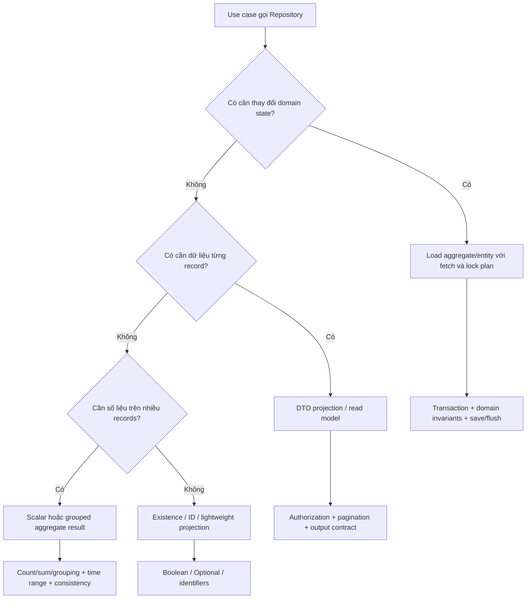
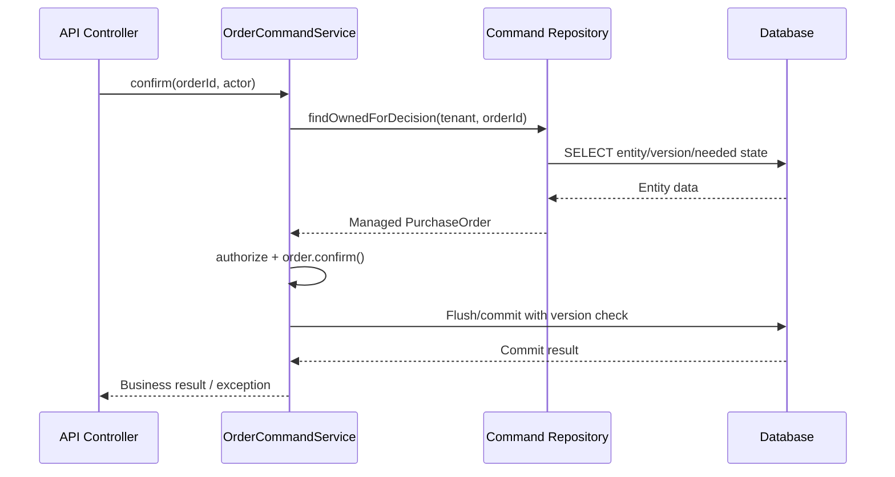
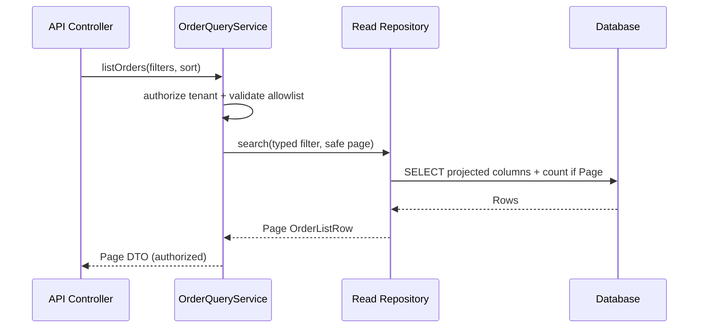
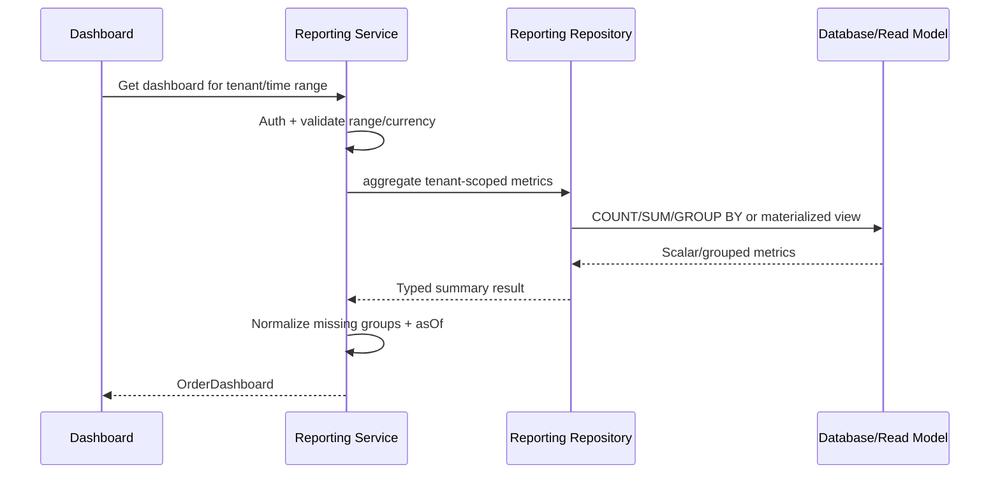
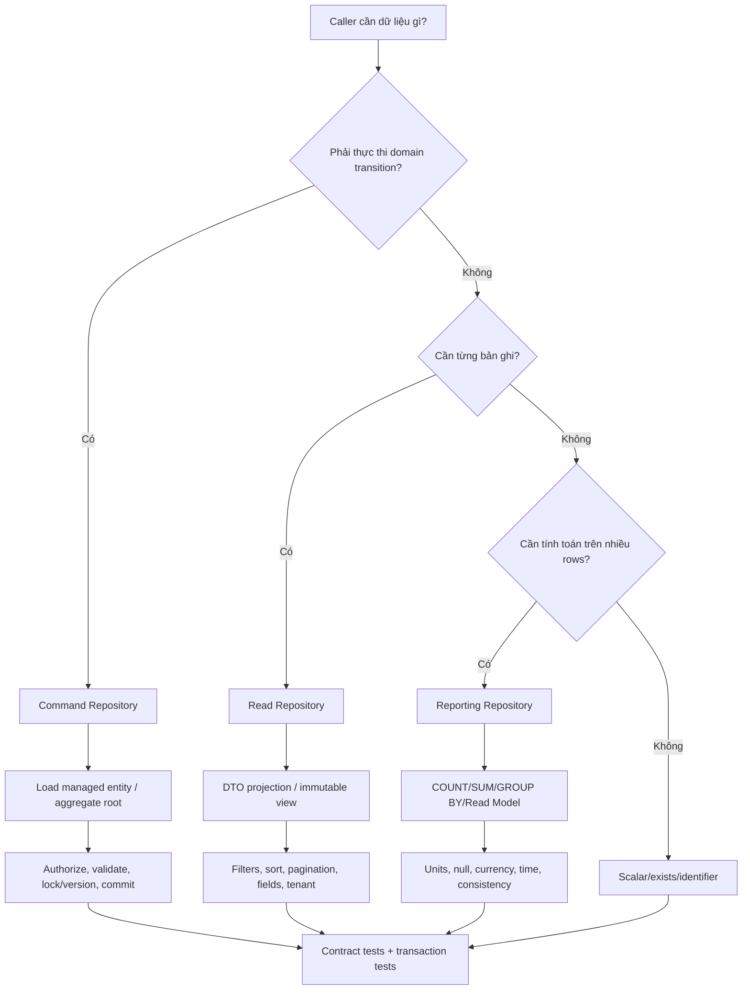

# Lựa chọn trả entity, DTO và kết quả tổng hợp trong thiết kế Repository JPA

Một repository trong ứng dụng Java sử dụng JPA có thể trả về `PurchaseOrder` entity, `OrderListRow` DTO, `Long`, `BigDecimal`, một nhóm số liệu như `StatusSummary` hoặc một trang dữ liệu `Page<OrderListRow>`. Những kiểu trả về ấy không chỉ khác nhau về cú pháp. Chúng thể hiện **mục đích của thao tác**, **ranh giới transaction**, **lượng dữ liệu lấy từ database**, **hợp đồng dữ liệu cho caller** và **mức rủi ro vô tình sửa hoặc làm lộ dữ liệu**.

Ví dụ, cùng một bảng đơn hàng nhưng có ba yêu cầu khác nhau:

- **Xác nhận đơn hàng:** cần tải thực thể có trạng thái và áp dụng quy tắc nghiệp vụ trước khi ghi. Một **entity/aggregate root** có thể phù hợp.
- **Hiển thị danh sách đơn hàng:** chỉ cần ID, trạng thái, tên khách hàng và tổng tiền. **DTO projection** thường phù hợp hơn trả toàn bộ entity.
- **Vẽ biểu đồ doanh thu:** cần số đơn và tổng doanh thu theo trạng thái/tháng. Một **kết quả tổng hợp** từ `COUNT`/`SUM`/`GROUP BY` là lựa chọn tự nhiên.

Bài **“Lựa chọn trả entity, DTO và kết quả tổng hợp”** thuộc chương **Thiết kế Repository**, module **Data Persistence Relational Access ORM JPA**. Nội dung xây dựng cách quyết định kiểu trả về có chủ đích, kèm ví dụ JPQL, Criteria API, Spring Data JPA, native SQL, phân trang, kiểm thử và các sai lầm thường gặp.

> **Thông điệp chính:** Repository không phải lúc nào cũng nên trả entity, cũng không phải lúc nào cũng phải trả DTO. Hãy chọn kiểu trả về dựa trên **ý định sử dụng**: cần thao tác với trạng thái domain hay chỉ đọc một hình chiếu dữ liệu, hay cần tính toán kết quả từ nhiều rows.

---

## 1. Repository giải quyết trách nhiệm nào?

Trong kiến trúc ứng dụng, repository thường che giấu chi tiết tìm kiếm/lưu trữ đối tượng nghiệp vụ.

Một giao diện minh họa:

```java
public interface OrderRepository {
    Optional<PurchaseOrder> findOwnedOrder(
        UUID tenantId, Long orderId
    );

    void save(PurchaseOrder order);

    List<OrderListRow> findRecentOrderRows(
        UUID tenantId, int limit
    );

    List<StatusSummary> summarizeByStatus(
        UUID tenantId
    );
}
```

Ba nhánh trách nhiệm:

1. **Command-side persistence**: lấy và lưu aggregate/entity để xử lý nghiệp vụ.
2. **Read/query projection**: trả dữ liệu đúng với nhu cầu một view/use case.
3. **Aggregate/reporting query**: trả các phép đo đã tính ở database.

Một interface có thể chứa cả ba trong ứng dụng nhỏ. Khi codebase lớn, có thể tách:

```text
OrderCommandRepository
OrderReadRepository
OrderReportingRepository
```

Đây là quyết định thiết kế, không phải yêu cầu bắt buộc của JPA. Quan trọng hơn tên interface là **contract và ranh giới mà kiểu trả về thể hiện**.

## 2. Ba kiểu trả về chính

| Lựa chọn | Đại diện | Dùng khi |
|---|---|---|
| **Entity** | `PurchaseOrder`, `Optional<PurchaseOrder>` | Cần domain behavior, dirty checking, quan hệ, lock/version |
| **DTO / projection** | `OrderListRow`, `OrderDetailView` | Đọc cho API/UI, chỉ lấy trường cần thiết, tách persistence model |
| **Kết quả tổng hợp** | `Long`, `BigDecimal`, `StatusSummary` | Count, sum, avg, min/max, group by, KPI, dashboard |

Một **aggregate result** có thể chính là một **DTO** được thiết kế cho thống kê. Phân loại ở bảng dựa trên *ý nghĩa của truy vấn*, không phải hai khái niệm Java class hoàn toàn tách biệt.

## 3. Không nhầm hai nghĩa của từ “aggregate”

Trong Domain-Driven Design (DDD):

- **Aggregate** là một nhóm entities/value objects có ranh giới nhất quán.
- **Aggregate root** là đầu mối truy cập/thao tác nghiệp vụ, ví dụ `PurchaseOrder`.

Trong SQL/JPQL:

- **Aggregate function** là `COUNT`, `SUM`, `AVG`, `MIN`, `MAX`.
- **Aggregate query result** là một số hoặc nhóm số liệu như doanh thu theo tháng.

Hai ý nghĩa này độc lập:

```text
DDD aggregate root:
    PurchaseOrder ── OrderLine ── Money

SQL aggregate result:
    status=PAID, count=21, total=50_000_000
```

Không chọn trả `PurchaseOrder` chỉ vì công việc có chữ “tổng hợp”; cũng không cho rằng mọi phép `SUM` là một DDD aggregate.

## 4. Kiểu trả về là một phần của kiến trúc

So sánh:

```java
PurchaseOrder getOrder(Long id);
```

và:

```java
Optional<OrderDetailView> getOrderDetail(
    UUID tenantId, Long id
);
```

Method thứ nhất gợi ý caller nhận một entity có lifecycle JPA. Method thứ hai nói rõ đây là read model và khả năng không tìm thấy.

Hai chữ ký tạo kỳ vọng rất khác nhau về:

- Ai được quyền thay đổi dữ liệu?
- Dữ liệu được load đầy đủ đến mức nào?
- Có cần transaction/persistence context còn mở?
- Có được trả thẳng qua REST serialization?
- Caller có thể giả định các trường nằm trong output contract?
- Có phải tất cả properties của entity đều cần thiết?

Do đó thiết kế return type nên diễn ra **trước khi chọn câu JPQL**.

## 5. Sơ đồ quyết định ban đầu



Sơ đồ là mặc định thực hành, không cấm ngoại lệ. Chẳng hạn một query đọc một entity để kiểm invariant nhưng không sửa vẫn có thể hợp lý; một read-heavy service có thể dùng DTO cho hầu hết truy vấn.

---

# Phần I — Hiểu entity là gì trước khi quyết định trả entity

## 6. Entity JPA không chỉ là POJO

Một object được quản lý bởi `EntityManager` có thể tham gia:

- **Persistence context** và first-level identity map.
- **Dirty checking** và automatic flush.
- **Lazy loading** thông qua proxies/collections.
- **Entity lifecycle callbacks**.
- **Optimistic locking** với `@Version`.
- **Cascades** và association management.
- **Transaction-scoped unit of work**.

Vì vậy return `PurchaseOrder` cho caller khác return một immutable `OrderListRow` record.

## 7. Entity mẫu: PurchaseOrder

```java
import jakarta.persistence.*;
import java.math.BigDecimal;
import java.time.Instant;
import java.util.ArrayList;
import java.util.List;
import java.util.UUID;

@Entity
@Table(name = "purchase_orders")
public class PurchaseOrder {

    @Id
    @GeneratedValue(strategy = GenerationType.IDENTITY)
    private Long id;

    @Column(name = "tenant_id", nullable = false, updatable = false)
    private UUID tenantId;

    @Enumerated(EnumType.STRING)
    @Column(nullable = false)
    private OrderStatus status;

    @Column(name = "total_amount", nullable = false)
    private BigDecimal totalAmount;

    @Column(name = "created_at", nullable = false)
    private Instant createdAt;

    @ManyToOne(fetch = FetchType.LAZY)
    @JoinColumn(name = "customer_id")
    private Customer customer;

    @OneToMany(
        mappedBy = "order",
        cascade = CascadeType.ALL,
        orphanRemoval = true
    )
    private List<OrderLine> lines = new ArrayList<>();

    @Version
    private Long version;

    protected PurchaseOrder() {}

    public void confirm() {
        if (status != OrderStatus.NEW) {
            throw new IllegalStateException(
                "Only NEW orders may be confirmed"
            );
        }

        if (lines.isEmpty()) {
            throw new IllegalStateException(
                "Order must have at least one line"
            );
        }

        status = OrderStatus.CONFIRMED;
    }

    public Long getId() { return id; }
    public UUID getTenantId() { return tenantId; }
    public OrderStatus getStatus() { return status; }
    public BigDecimal getTotalAmount() { return totalAmount; }
    public Instant getCreatedAt() { return createdAt; }
    public Customer getCustomer() { return customer; }
    public List<OrderLine> getLines() {
        return List.copyOf(lines);
    }
}
```

```java
public enum OrderStatus {
    NEW, CONFIRMED, CANCELLED
}
```

`List.copyOf(lines)` trả một list không cho sửa cấu trúc thông qua reference đó, nhưng không biến `OrderLine` bên trong thành bất biến. Domain methods nên đảm nhiệm việc thêm/xóa lines để giữ invariants.

## 8. Khi nào trả entity là phù hợp nhất?

Một trường hợp:

```java
@Transactional
public void confirmOrder(
        UUID trustedTenant,
        Long orderId
) {
    PurchaseOrder order =
        orderRepository.findOwnedForUpdate(
            trustedTenant, orderId
        ).orElseThrow(OrderNotFoundException::new);

    order.confirm();
}
```

Trong transaction, entity được quản lý và trạng thái đổi qua domain method. JPA có thể flush các changes khi transaction hoàn tất. `@Version` có thể phát hiện concurrent modification.

Không nhất thiết gọi `save()` cho managed entity chỉ để dirty checking hoạt động; cần biết semantics của repository/framework đang dùng.

Lợi ích:

- Domain invariants được đặt trong entity/aggregate root.
- Có thể dùng optimistic/pessimistic locking.
- Một unit of work nhất quán.
- Không phải map DTO ngược thành entity chỉ để cập nhật.

## 9. Trả entity không đồng nghĩa được sửa mọi field

Một entity có public setters cho `tenantId`, `status`, `totalAmount` có thể khiến caller bypass domain rules.

Thiết kế tốt:

- Dùng methods mô tả hành vi: `confirm()`, `cancel()`, `changeAddress()`.
- Hạn chế setters công khai cho invariant-sensitive fields.
- Không nhận request JSON rồi bind trực tiếp thành entity và `merge()`.
- Kiểm authorization trong application service trước khi cho mutate.
- Kiểm transaction/locking phù hợp.

**Return entity cho command-side service là để thao tác domain có kiểm soát**, không phải trao quyền chỉnh sửa tùy ý.

## 10. Entity managed, detached và transient

Ba trạng thái quan trọng:

| Trạng thái | Ý nghĩa thực hành |
|---|---|
| Transient/new | Object chưa thuộc persistence context, chưa persist |
| Managed | Được EntityManager theo dõi và có thể dirty-check |
| Detached | Có identity đã tồn tại nhưng không còn managed bởi context đó |

Ví dụ:

```java
PurchaseOrder order = em.find(
    PurchaseOrder.class, id
);

em.detach(order);

// 'order' không còn được dirty-check bởi em.
```

Khi một service trả entity ra ngoài transaction, entity có thể trở thành detached, tùy context scope. Caller không được mặc định rằng thay đổi Java object sẽ tự persist.

## 11. Trả entity qua REST là rủi ro mặc định

Anti-pattern:

```java
@GetMapping("/orders/{id}")
public PurchaseOrder getOrder(@PathVariable Long id) {
    return repository.findById(id).orElseThrow();
}
```

Các vấn đề:

- JSON serializer có thể đi qua lazy association và ném `LazyInitializationException`.
- Nếu OSIV bật, serializer có thể kích hoạt thêm queries/N+1 ngoài service logic.
- Cascade/circular relationships có thể gây recursion.
- Entity mới thêm `internalNote` có thể bị expose ngoài ý định.
- Object graph lớn gây response không kiểm soát.
- API contract bị gắn chặt với persistence model.

Thông thường nên map entity thành một **response DTO** trong application service hoặc query trực tiếp thành DTO projection.

## 12. Open Session in View không phải chiến lược API

Trong một số Spring configurations, Open Session/EntityManager in View giữ persistence context mở tới tận khi view được render.

Điều đó có thể giúp serializer lazy-load nhưng không giải quyết:

- Chọn chính xác field nào được API trả.
- Kiểm authorization cho nested associations.
- N+1 queries.
- Request latency và connection/resource pressure.
- Transaction semantics khi queries xảy ra ngoài service transaction.

**Không dùng OSIV để thay việc thiết kế fetch plan và read DTO.**

## 13. @Transactional(readOnly = true) không tự làm entity bất biến

Một Spring method:

```java
@Transactional(readOnly = true)
public PurchaseOrder findForDisplay(Long id) {
    return repository.findById(id).orElseThrow();
}
```

có read-only hint/optimizations tùy transaction manager và provider, nhưng không nên diễn giải annotation này thành **quyền bảo mật hoặc bất biến vật lý**.

Nó không tự:

- Giới hạn JSON fields.
- Chặn mọi native/JDBC UPDATE ở DB.
- Đảm bảo entity không bị thay đổi sau khi detached.
- Đảm bảo transaction khác không sửa row.
- Thay database read-only privileges.

Nếu caller chỉ cần view, trả DTO vẫn thường rõ nghĩa hơn.

## 14. Entity identity map có tác dụng và giới hạn

Trong một persistence context:

```java
PurchaseOrder a =
    em.find(PurchaseOrder.class, 101L);

PurchaseOrder b =
    em.find(PurchaseOrder.class, 101L);

assertSame(a, b);
```

Nếu record đã managed, hai lần đọc có thể trả cùng object reference theo identity guarantee của JPA.

Có lợi cho command-side consistency, nhưng:

- Một external writer update DB có thể không làm object a tự refresh.
- Một DTO projection không mang entity identity semantics.
- Không chia sẻ EntityManager giữa threads.
- Không reuse EntityManager từ tenant này sang tenant khác.
- Không coi first-level cache là một application cache tổng quát.

## 15. Dirty checking là lý do chọn entity khi ghi

```java
@Transactional
public void updateOrderTotal(Long id, BigDecimal newTotal) {
    PurchaseOrder order = em.find(
        PurchaseOrder.class, id
    );

    order.recalculateTotal(newTotal);
    // Flush/commit đồng bộ state nếu operation hợp lệ.
}
```

Trong ví dụ, method `recalculateTotal()` giả định tồn tại và thực hiện business invariant checks. Điểm chính: **managed entity được theo dõi thay đổi**, không cần caller trả về một DTO rồi map ngược chỉ để update.

Tuy vậy, với bulk changes trên hàng triệu rows, tải hàng triệu managed entities để sửa lần lượt có thể quá đắt; bulk SQL/JPQL và một command-specific repository operation có thể phù hợp hơn.

## 16. Khi nào không nên trả entity cho một truy vấn đọc?

Các dấu hiệu:

- Controller/UI chỉ cần vài fields.
- Query là trang danh sách nhiều rows.
- Trả entity có lazy graph lớn.
- Read operation không cần domain methods.
- Public response contract phải ổn định qua refactor JPA.
- Có trường nhạy cảm/role-dependent output.
- Dữ liệu là từ nhiều entities và không cần graph managed.
- Query đọc từ report/materialized view.
- Consumer cần immutable snapshot.

Trong các trường hợp này, cân nhắc **DTO/read model**.

---

# Phần II — DTO và projection cho read-side repository

## 17. DTO là gì?

**Data Transfer Object** là kiểu dữ liệu để chuyển kết quả theo nhu cầu của caller, không có nghĩa vụ biểu diễn đầy đủ một JPA entity.

Ví dụ:

```java
package com.example.orders.read;

import java.math.BigDecimal;
import java.time.Instant;

public record OrderListRow(
    Long orderId,
    OrderStatus status,
    String customerName,
    BigDecimal totalAmount,
    Instant createdAt
) {}
```

Một `record` thuận tiện vì:

- Constructor xác định rõ fields.
- Accessors và `equals/hashCode/toString` được tạo.
- Fields là final ở cấp record.
- Dễ assert trong tests.
- Không chứa JPA lifecycle hoặc lazy proxies.

Lưu ý: `record` bất biến **nông**; nếu component là mutable list/object, bản thân object bên trong vẫn có thể thay đổi. Chọn component types/defensive copies phù hợp khi cần.

## 18. DTO khác entity ở chỗ nào?

| Khía cạnh | Entity JPA | DTO |
|---|---|---|
| JPA managed state | Có khi được quản lý bởi EntityManager | Không |
| Dirty checking | Có với managed entity | Không |
| Lazy loading | Có thể có | Không tự có lazy JPA associations |
| Mục đích | Domain lifecycle/persistence | Read/API transfer |
| Output fields | Theo model, có thể rộng | Theo use case |
| API serialization | Cần kiểm soát rất kỹ | Thường dễ kiểm soát hơn |
| Type stable khi schema đổi | Không nhất thiết | Có thể tách rời |
| Mapping cost | Provider hydrate entity | Projection/mapper |
| Business behavior | Có thể có methods/invariants | Thường không |
| Lock/version | Có thể có `@Version` | Chỉ chứa snapshot nếu được chọn |

Chọn DTO không phải vì entity “xấu”, mà vì **đường đọc và đường ghi có những nhu cầu khác nhau**.

## 19. DTO bằng mapping từ entity

Cách đơn giản:

```java
@Transactional(readOnly = true)
public OrderListRow getRow(UUID tenantId, Long id) {
    PurchaseOrder order =
        orderRepository.findByIdAndTenantId(
            id, tenantId
        ).orElseThrow();

    return new OrderListRow(
        order.getId(),
        order.getStatus(),
        order.getCustomer().getName(),
        order.getTotalAmount(),
        order.getCreatedAt()
    );
}
```

Ưu điểm:

- Dễ reuse entity/domain services.
- Mapping Java rõ ràng.
- Có thể phù hợp khi chỉ đọc một aggregate đã load.

Nhược điểm:

- Cần load entity state nhiều hơn DTO cần.
- `getCustomer()` có thể kích hoạt lazy query.
- Với danh sách n rows, mapping có thể sinh N+1.
- Mapping có thể phụ thuộc transaction còn mở.
- Không có lợi thế select đúng cột nếu JPA hydrate entity đầy đủ.

Cho một detail view nhỏ, mapping entity→DTO có thể hoàn toàn phù hợp. Với list lớn, projection trực tiếp thường đáng cân nhắc.

## 20. JPQL constructor projection

```java
List<OrderListRow> rows = em.createQuery(
    """
    select new com.example.orders.read.OrderListRow(
        o.id,
        o.status,
        c.name,
        o.totalAmount,
        o.createdAt
    )
    from PurchaseOrder o
    left join o.customer c
    where o.tenantId = :tenant
    order by o.createdAt desc, o.id asc
    """,
    OrderListRow.class
)
.setParameter("tenant", trustedTenantId)
.getResultList();
```

Ưu điểm:

- Chọn chính xác fields cần.
- DTO được tạo từ query result, không phải managed entity.
- Hợp lý với danh sách/report.
- Không lazy-load customer về sau chỉ để lấy tên.

Giới hạn:

- Constructor type và thứ tự arguments phải khớp.
- FQCN trong JPQL thường phải khai báo rõ.
- JPQL không phải SQL table/column syntax.
- Nested collections không tự “nhét” vào một DTO list đẹp.
- Projection không tự áp tenant/authorization nếu query quên predicate.

## 21. Constructor mismatch là lỗi cần test

Nếu DTO:

```java
record OrderListRow(
    Long id,
    OrderStatus status,
    String customerName,
    BigDecimal total,
    Instant createdAt
) {}
```

mà JPQL chọn `o.totalAmount` ở vị trí customerName, query sẽ lỗi mapping hoặc trả dữ liệu sai với các fields có cùng type.

Một integration test phải thực thi query thật và assert:

```text
orderId=102
status=CONFIRMED
customerName="Alice"
totalAmount=200.00
createdAt=...
```

Đừng chỉ test rằng list không rỗng.

## 22. Criteria DTO projection

```java
CriteriaBuilder cb = em.getCriteriaBuilder();

CriteriaQuery<OrderListRow> cq =
    cb.createQuery(OrderListRow.class);

Root<PurchaseOrder> order =
    cq.from(PurchaseOrder.class);

Join<PurchaseOrder, Customer> customer =
    order.join("customer", JoinType.LEFT);

cq.select(cb.construct(
    OrderListRow.class,
    order.get("id"),
    order.get("status"),
    customer.get("name"),
    order.get("totalAmount"),
    order.get("createdAt")
));

cq.where(cb.equal(
    order.get("tenantId"), trustedTenantId
));

cq.orderBy(
    cb.desc(order.get("createdAt")),
    cb.asc(order.get("id"))
);

List<OrderListRow> rows =
    em.createQuery(cq).getResultList();
```

Ưu điểm của Criteria là dễ kết hợp filters động đã typed/allowlisted. Nó không tự an toàn nếu dùng `root.get(rawClientField)` hoặc nối user-supplied query fragments.

## 23. Spring Data JPA class-based projections

Một repository interface:

```java
public interface OrderJpaRepository
        extends JpaRepository<PurchaseOrder, Long> {

    @Query(
        """
        select new com.example.orders.read.OrderListRow(
            o.id,
            o.status,
            c.name,
            o.totalAmount,
            o.createdAt
        )
        from PurchaseOrder o
        left join o.customer c
        where o.tenantId = :tenant
        """
    )
    Page<OrderListRow> findOrderRows(
        @Param("tenant") UUID tenantId,
        Pageable pageable
    );
}
```

Nếu thực tế dùng dynamic sort từ `Pageable`, service phải chuyển public sort names qua allowlist server; không nhận `Sort.by(untrustedField)` nguyên trạng.

Đối với query có joins phức tạp, có thể cần `countQuery` riêng để `Page` tính total đúng. Test trên Spring Data/JPA version mục tiêu, nhất là khi có DISTINCT/to-many joins.

## 24. Spring Data interface projection

```java
public interface OrderSummaryView {
    Long getId();
    OrderStatus getStatus();
    BigDecimal getTotalAmount();
}
```

Repository:

```java
List<OrderSummaryView> findByTenantIdAndStatus(
    UUID tenantId,
    OrderStatus status
);
```

Spring Data có thể tạo proxy projection theo properties được hỗ trợ.

Ưu điểm:

- Ít boilerplate.
- Có thể dùng derived methods.
- Phù hợp với simple read models.

Cần thận trọng:

- Nested projection qua associations có thể làm query fetch nhiều dữ liệu hơn dự kiến tùy framework/query shape.
- Không phải mọi expression/property được map như nhau.
- Interface getter names/aliases là contract.
- Một số open projections dùng SpEL có thể cần materialize target entity và không có cùng tối ưu select column như closed projections.
- Tránh đưa entity references ra ngoài qua projection interface.

**Không mặc định interface projection nhanh hơn constructor DTO chỉ vì ít code.**

## 25. Dynamic projection

Spring Data có thể hỗ trợ các methods kiểu:

```java
<T> List<T> findByTenantId(
    UUID tenantId,
    Class<T> type
);
```

Caller chọn projection type ở code:

```java
List<OrderSummaryView> views =
    repo.findByTenantId(
        tenantId, OrderSummaryView.class
    );
```

Phù hợp khi một query family cần nhiều read shapes. Nhưng:

- Không nhận `Class<T>` từ input ngoài mà không allowlist.
- Không biến một generic repository thành endpoint tự truy xuất mọi entity fields.
- Test từng projection type thực tế.
- Với quyền khác nhau, vẫn phải enforce authorization và projection policy.

## 26. Tuple và Object[] có nên trở thành public return type?

JPQL:

```jpql
select o.id, o.totalAmount
from PurchaseOrder o
```

có thể trả `Object[]`; Criteria có `Tuple`.

Chúng tiện ở tầng data access nhưng khó dùng làm public application contract:

- `row[0]` phụ thuộc vị trí.
- Cast type dễ sai.
- Không có tên field rõ ràng trong Java API.
- Refactor query có thể tạo runtime bug.

Ví dụ:

```java
List<Tuple> tuples = em.createQuery(
    cb.createTupleQuery()
        // ... select alias expressions ...
).getResultList();
```

Trong repository implementation, có thể chuyển `Tuple` thành typed DTO. Không nên trả `Tuple` cho controller và bắt controller hiểu các alias JPA.

## 27. DTO projection không đồng nghĩa read-only DB

Một DTO query chỉ đọc nhưng:

- Có thể chạy trong transaction khác.
- Có thể dựa vào native SQL side effects nếu code sai.
- Không tự áp `@Transactional(readOnly=true)`.
- Không làm database immutable.
- Không bảo vệ tenant nếu WHERE thiếu guard.

DTO là **hợp đồng kết quả**, không phải toàn bộ security/transaction policy.

## 28. DTO theo use case, không một DTO vạn năng

Một cách thiếu hiệu quả:

```java
public record OrderDto(
    Long id,
    OrderStatus status,
    BigDecimal total,
    CustomerDto customer,
    List<OrderLineDto> lines,
    List<PaymentDto> payments,
    List<AuditDto> audits,
    ...
) {}
```

dùng chung cho list, detail và admin export sẽ gây overfetch và nhiều nullable fields.

Nên tách:

```text
OrderListRow
OrderDetailView
OrderInvoiceView
OrderAdminView
OrderSearchDocument
```

Mỗi DTO phục vụ một nhu cầu và quyền truy cập cụ thể. Có thể reuse nested value DTO nếu không biến graph thành một entity mirror.

## 29. Snapshot semantics của DTO

Một DTO là snapshot các values tại thời điểm query. Nếu entity thay đổi sau đó:

```text
10:00 read OrderListRow(status=NEW)
10:01 another transaction confirms Order
10:02 DTO vẫn status=NEW
```

Điều này không nhất thiết là bug; UI/read model thường chấp nhận snapshot theo request.

Nếu client chuẩn bị ghi dựa trên dữ liệu DTO cũ, nên có:

- Entity version hoặc ETag.
- Domain state revalidation trong transaction ghi.
- Optimistic concurrency control.
- Conflict response khi precondition không còn đúng.

**DTO snapshot không cấp quyền ghi theo trạng thái cũ.**

---

# Phần III — Kết quả tổng hợp: scalar, grouped result và read model

## 30. Aggregate SQL trả dữ liệu khác entity

Một dashboard hỏi:

> “Tenant ACME có bao nhiêu đơn đã xác nhận và tổng giá trị của chúng?”

Không cần load 50.000 Orders vào Java chỉ để:

```java
orders.stream().filter(...).count();
```

Thường nên dùng phép tổng hợp ở database:

```jpql
select count(o), sum(o.totalAmount)
from PurchaseOrder o
where o.tenantId = :tenant
  and o.status = :status
```

Database tính kết quả trên tập rows và trả rất ít dữ liệu.

## 31. Trả scalar khi contract chỉ cần một số

Ví dụ Spring Data:

```java
long countByTenantIdAndStatus(
    UUID tenantId,
    OrderStatus status
);
```

Caller hỏi một số lượng, `long` đủ rõ.

Hoặc JPQL:

```java
long count = em.createQuery(
    """
    select count(o)
    from PurchaseOrder o
    where o.tenantId = :tenant
    """,
    Long.class
)
.setParameter("tenant", tenantId)
.getSingleResult();
```

Không cần tạo entity “OrderCountEntity”. Một scalar result có thể được wrap trong service response nếu cần bổ sung thời gian/scope/metadata.

## 32. COUNT không giống List.size()

```java
List<PurchaseOrder> orders =
    repository.findAllByTenantId(tenantId);

int count = orders.size();
```

So với:

```java
long count =
    repository.countByTenantId(tenantId);
```

Cách tải List:

- Có thể materialize rất nhiều entities.
- Có memory/CPU/cache overhead.
- Có lazy associations/N+1 nếu vô tình truy cập.
- Chỉ đếm dữ liệu đã load, có thể bị pagination giới hạn.

COUNT query cho database làm nhiệm vụ đếm; chọn đúng predicate và hiểu transaction isolation. Khi cần số lượng chính xác và dữ liệu có thay đổi đồng thời, count cũng là một snapshot theo transaction semantics.

## 33. SUM trên BigDecimal

```java
BigDecimal total = em.createQuery(
    """
    select sum(o.totalAmount)
    from PurchaseOrder o
    where o.tenantId = :tenant
      and o.status = :status
    """,
    BigDecimal.class
)
.setParameter("tenant", tenantId)
.setParameter("status", OrderStatus.CONFIRMED)
.getSingleResult();
```

Với `BigDecimal` persistent field, `SUM` có kiểu kết quả tương ứng theo JPA semantics.

Nhưng **SUM trên tập rỗng thường trả null**, không phải BigDecimal.ZERO. Code cần chủ động xác định contract.

## 34. Chuẩn hóa kết quả SUM rỗng

Có hai cách.

**Ở application layer:**

```java
BigDecimal normalized =
    total != null ? total : BigDecimal.ZERO;
```

**Hoặc trong query:**

```jpql
select coalesce(sum(o.totalAmount), :zero)
from PurchaseOrder o
where o.tenantId = :tenant
```

và bind `zero = BigDecimal.ZERO`. Query compatibility/type inference phải được test theo provider.

Chọn:

- NULL nếu “chưa có dữ liệu” khác “tổng bằng 0”.
- ZERO nếu dashboard contract rõ ràng muốn tổng bằng 0 khi không có rows.

Đừng để service tùy nơi chuyển NULL, tùy nơi ném NPE.

## 35. Kiểu kết quả của aggregate functions

Trong JPA/JPQL, các quy tắc thường gặp:

| Hàm | Kiểu kết quả khái quát |
|---|---|
| `COUNT` | `Long` |
| `SUM` trên integer fields | `Long` theo nhóm kiểu tích phân chuẩn |
| `SUM` trên `BigInteger` | `BigInteger` |
| `SUM` trên floating-point fields | `Double` |
| `SUM` trên `BigDecimal` | `BigDecimal` |
| `AVG` | `Double` |
| `MIN` / `MAX` | Kiểu của expression được tổng hợp |

Đừng cast toàn bộ results sang `Integer` chỉ vì bảng hiện có ít rows. Với native SQL, numeric scalar types còn phụ thuộc driver/DBMS và cần test thực tế.

## 36. AVG và tiền tệ

Nếu muốn “giá trị trung bình một đơn hàng”:

```jpql
select avg(o.totalAmount)
from PurchaseOrder o
where o.tenantId = :tenant
```

Kết quả `AVG` trong JPQL thường là `Double`, không phải `BigDecimal`, nên có sai số biểu diễn floating point.

Với tính toán tài chính cần precision/rounding nghiêm ngặt, cân nhắc:

- Dùng SUM(BigDecimal) và COUNT(Long) rồi tính `BigDecimal.divide(..., scale, RoundingMode)` trong service.
- Hoặc native SQL `AVG(NUMERIC)` với cast/type mapping đã kiểm trên DB mục tiêu.
- Không trộn nhiều currencies vào cùng average.
- Định nghĩa rounding mode ở business contract.

Ví dụ:

```java
BigDecimal average =
    count == 0L
        ? BigDecimal.ZERO
        : total.divide(
            BigDecimal.valueOf(count),
            2,
            RoundingMode.HALF_UP
        );
```

Các con số/rounding chỉ là ví dụ; quyết định finance rounding phụ thuộc yêu cầu nghiệp vụ.

## 37. Grouped aggregate result

Một báo cáo:

```text
status       count     total
NEW          12        1_000_000
CONFIRMED    21        5_500_000
CANCELLED     3          120_000
```

không thể biểu diễn tốt bằng một `Long` hoặc một Order entity. Nên tạo DTO có semantics:

```java
public record StatusSummary(
    OrderStatus status,
    Long orderCount,
    BigDecimal totalAmount
) {}
```

## 38. JPQL constructor projection cho GROUP BY

```java
List<StatusSummary> summaries = em.createQuery(
    """
    select new com.example.orders.read.StatusSummary(
        o.status,
        count(o),
        sum(o.totalAmount)
    )
    from PurchaseOrder o
    where o.tenantId = :tenant
    group by o.status
    order by o.status
    """,
    StatusSummary.class
)
.setParameter("tenant", trustedTenantId)
.getResultList();
```

Ưu điểm:

- DB nhóm rows.
- Java nhận typed rows.
- Không cần expose raw `Object[]` cho service.
- Query rõ theo tenant.

Hạn chế: **một status không có row sẽ không xuất hiện** trong grouped result. Dashboard có thể cần bổ sung các statuses còn thiếu bằng zero nếu contract yêu cầu.

## 39. Group-by không trả nhóm rỗng

Giả sử tenant chưa có `CANCELLED` Orders.

Query:

```jpql
select o.status, count(o)
from PurchaseOrder o
where o.tenantId = :tenant
group by o.status
```

sẽ không tự tạo row `CANCELLED → 0`.

Service có thể:

1. Khởi tạo map mọi enum statuses với zero.
2. Ghi đè các statuses thật được query trả.
3. Trả một dashboard DTO theo thứ tự cố định.

Hoặc dùng reference table/outer joins/native SQL tùy yêu cầu.

Phải phân biệt **không có group** và **group có count=0** trong contract.

## 40. Tổng hợp theo thời gian

Báo cáo tháng:

```text
month       orderCount      revenue
2026-01     120             18_500_000
2026-02     135             22_100_000
```

JPQL chuẩn không có một hàm trích tháng portable hoàn toàn giống nhau trên mọi DB/provider/version, nên có lựa chọn:

- Group theo một persisted `businessMonth`/date dimension đã chuẩn hóa.
- Gọi function được provider/dialect hỗ trợ và test.
- Native SQL có `date_trunc`/database-specific expressions.
- Dùng materialized/reporting table được cập nhật theo pipeline.

Nếu time bucket ảnh hưởng billing/business cutoff, phải chốt **timezone, calendar, inclusive/exclusive boundary** trước khi code.

## 41. Kết quả tổng hợp có thể gồm nhiều metrics

Ví dụ:

```java
public record OrderDashboard(
    long totalOrders,
    long confirmedOrders,
    BigDecimal confirmedRevenue,
    Instant asOf
) {}
```

Repository có thể trả một nội bộ `OrderAggregateValues`:

```java
public record OrderAggregateValues(
    Long totalCount,
    Long confirmedCount,
    BigDecimal confirmedRevenue
) {}
```

Sau đó application service bổ sung `asOf`/scope/visibility context khi tạo API DTO.

Không nhất thiết nhồi mọi field của dashboard vào một query khổng lồ nếu readability hoặc transaction consistency sẽ bị ảnh hưởng; nhưng nếu nhiều metrics cần cùng một database snapshot, cần thiết kế cách query hợp lý.

## 42. Conditional aggregation và portability

Một số reports dùng SQL:

```sql
SELECT
    COUNT(*) AS total_count,
    SUM(CASE WHEN status = 'CONFIRMED' THEN 1 ELSE 0 END)
      AS confirmed_count,
    SUM(CASE WHEN status = 'CONFIRMED'
             THEN total_amount ELSE 0 END)
      AS confirmed_revenue
FROM purchase_orders
WHERE tenant_id = :tenant;
```

Đây là SQL minh họa. Nếu dùng JPQL Criteria CASE expressions, chú ý type inference và provider support. Nếu dùng native SQL, test aliases, JDBC numeric types và empty-set behavior.

Nên đặt result vào typed summary/DTO thay vì đưa `Object[]` xuyên nhiều layers.

## 43. COUNT với JOIN có thể sai

Một Order có ba OrderLines. Query:

```jpql
select count(o)
from PurchaseOrder o
join o.lines l
where o.tenantId = :tenant
```

đếm **join rows**, không nhất thiết đếm số Orders.

Nếu dashboard hỏi “bao nhiêu đơn có ít nhất một line”, có thể dùng:

```jpql
select count(distinct o.id)
from PurchaseOrder o
join o.lines l
where o.tenantId = :tenant
```

hoặc EXISTS semantics phù hợp.

Test fixture phải có Order 0/1/nhiều Lines để phát hiện count bị nhân bản.

## 44. Tổng hợp từ to-many JOIN có thể nhân đôi doanh thu

Một lỗi nghiêm trọng:

```jpql
select sum(o.totalAmount)
from PurchaseOrder o
join o.lines l
where o.tenantId = :tenant
```

Nếu Order#101 có total=100 và 3 Lines, tổng có thể cộng 100 ba lần.

`SUM(DISTINCT o.totalAmount)` **không phải cách sửa tổng quát**: hai Orders khác nhau có cùng amount sẽ bị gộp sai.

Giải pháp thường là:

- Aggregate trên root `PurchaseOrder` mà không join to-many nếu không cần.
- Dùng `EXISTS` để lọc Order theo Line condition.
- Dùng subquery/pre-aggregation theo Order ID nếu cần.
- Với complex report, dùng native SQL CTE/grouping có kiểm thử.

Đây là khác biệt quan trọng giữa **đếm rows** và **tổng hợp theo business entity identity**.

## 45. DISTINCT không sửa mọi loại aggregate

```sql
SUM(DISTINCT total_amount)
```

loại các **giá trị số trùng nhau**, không loại các row join trùng theo Order ID.

Ví dụ hai Orders:

```text
Order#1 total=100
Order#2 total=100
```

tổng đúng = 200, nhưng SUM(DISTINCT total_amount) = 100.

Trước khi chọn DISTINCT, hỏi rõ **đơn vị tính toán**: row, Order, Line, Customer, Payment hay Product?

## 46. Aggregate result không phải một state được JPA dirty-check

```java
StatusSummary summary =
    repository.summarize(...).get(0);
```

`summary` là kết quả tính toán, không phải managed entity.

Nếu caller tạo một summary mới với total khác, **không có database state nào tự đổi**. Không viết API cho phép client PUT một summary để cập nhật nhiều Orders trừ khi đó là một command nghiệp vụ riêng được thiết kế cẩn thận.

## 47. Kết quả tổng hợp có tính nhất thời

Ngay sau query trả:

```text
Confirmed revenue = 5_500_000
```

transaction khác có thể confirm thêm một Order.

Vì vậy dashboard là một **ảnh chụp theo thời điểm/isolation**, không phải một hằng số vĩnh viễn.

Nếu cần:

- **Strong transactional consistency**: đặt cùng transaction/isolation phù hợp và hiểu snapshot.
- **Near-real-time metrics**: query trực tiếp hoặc materialized view refresh policy.
- **Eventually consistent analytics**: outbox/CDC/warehouse có latency được công bố.

Kiểu trả về `OrderDashboard` nên phản ánh thời điểm đo, ví dụ `asOf` hoặc `lastUpdatedAt` nếu cần.

## 48. Khi nào dùng read model/materialized view?

Nếu dashboard cần:

- Hàng trăm triệu Orders.
- Tổng hợp nhiều bảng với joins phức tạp.
- Historical monthly charts.
- Truy vấn liên tục với latency thấp.
- Dữ liệu nguồn thay đổi nhiều lần/giây.

Mỗi request chạy `SUM/GROUP BY` trên OLTP tables có thể quá đắt.

Có thể thiết kế:

```text
Order transaction
    → Outbox / CDC
    → Analytics projection updater
    → order_daily_stats
    → Reporting repository
```

Report repository trả `DailySalesSummary` từ bảng tổng hợp đã xây sẵn. Cần bảo đảm idempotent updates, backfill/reconciliation và dữ liệu trễ được ghi rõ.

---

# Phần IV — Thiết kế interface trả về đúng semantics

## 49. Optional<Entity> cho lookup có thể không có

Thay vì:

```java
PurchaseOrder findById(Long id); // Có thể null?
```

một contract rõ:

```java
Optional<PurchaseOrder> findByIdAndTenantId(
    Long id, UUID tenantId
);
```

Caller quyết định:

```java
PurchaseOrder order = repository
    .findByIdAndTenantId(id, tenantId)
    .orElseThrow(OrderNotFoundException::new);
```

`Optional` làm rõ “có thể không tìm thấy”, nhưng:

- Không biến mọi list thành `Optional<List<T>>`.
- Không nên trả `Optional` cho aggregate COUNT nếu count có thể là 0.
- Không dùng `Optional<entity>` như authorization check duy nhất nếu tenant/user scope chưa đáng tin.
- Cần phân biệt not found với DB unavailable; đừng biến persistence exception thành Optional.empty.

## 50. List<T> cho tập hữu hạn

```java
List<OrderListRow> findRecentRows(
    UUID tenantId,
    int maxItems
);
```

phù hợp khi:

- Số lượng có giới hạn thực tế.
- Result order được định nghĩa.
- Caller cần xử lý tất cả items trong memory.
- Không cần page metadata.

Trả empty list cho không có rows thường rõ hơn trả null hoặc Optional.empty.

Nhưng một `List<PurchaseOrder> findAll()` trên bảng hàng triệu rows không phải contract vận hành an toàn.

## 51. Page<T> khi cần total count

Trong Spring Data:

```java
Page<OrderListRow> page =
    readRepository.findOrderRows(
        tenantId,
        PageRequest.of(0, 20, safeSort)
    );
```

`Page<T>` cung cấp dữ liệu page và metadata như total elements/pages, thường kéo theo count query hoặc tối ưu cụ thể của framework.

Phù hợp khi UI cần:

- Hiện số trang.
- Tổng số items chính xác.
- Chuyển đến trang N.

Trade-off:

- COUNT có thể đắt với joins/filters.
- Count và data query có thể thấy snapshots khác nhau dưới concurrent writes.
- OFFSET sâu có thể chậm.
- Dynamic sort phải allowlist.

Không mặc định Page luôn phù hợp cho infinite scroll hoặc activity feeds.

## 52. Slice<T> khi chỉ cần “còn trang nữa không?”

Spring Data `Slice<T>` thường tập trung vào:

- Nội dung slice hiện tại.
- Có slice tiếp theo không.

Không buộc phải tính total count chính xác như `Page`.

Phù hợp khi:

- Infinite scrolling.
- Activity feed.
- Dashboard list.
- Tổng số không cần hiển thị.

Cần kiểm framework implementation để xác nhận query count không được gọi trên đường cụ thể; một custom query vẫn có thể tự thực hiện COUNT.

## 53. Keyset/cursor pagination cho dữ liệu lớn

Offset pagination:

```sql
ORDER BY created_at DESC, id DESC
OFFSET 100000 LIMIT 50;
```

có thể đắt và bị ảnh hưởng insert/delete giữa requests.

Keyset:

```sql
SELECT id, status, total_amount, created_at
FROM purchase_orders
WHERE tenant_id = :tenant
  AND (
      created_at < :last_created_at
      OR (
          created_at = :last_created_at
          AND id < :last_id
      )
  )
ORDER BY created_at DESC, id DESC
LIMIT :size;
```

Read repository có thể trả:

```java
public record CursorPage<T>(
    List<T> items,
    String nextCursor
) {}
```

Cần encode/sign cursor nếu có dữ liệu nội bộ, gắn với tenant/filter/sort contract, và duy trì một **unique stable ordering**.

## 54. Stream<T> dùng khi nào?

Một số JPA/Spring Data APIs hỗ trợ stream kết quả:

```java
Stream<OrderListRow> streamForExport(
    UUID tenantId
);
```

Có thể hợp lý khi export rất lớn, nhưng có điều kiện:

- Database cursor/connection cần tồn tại khi stream được consume.
- Transaction/lifecycle phải bao quanh việc consume.
- Stream phải đóng đúng cách, ví dụ `try-with-resources`.
- Fetch size/driver cursor behavior tùy DB/provider.
- Không return open stream sang controller rồi consume sau transaction.
- Không dùng streaming để bỏ qua tenant authorization hoặc export limits.

Ví dụ ý tưởng:

```java
@Transactional(readOnly = true)
public void exportOrders(
        UUID tenantId,
        OrderWriter writer) {

    try (Stream<OrderListRow> rows =
            repository.streamForExport(tenantId)) {
        rows.forEach(writer::write);
    }
}
```

`OrderWriter` là abstraction giả định; exception/cancellation và backpressure cần được xử lý tùy exporter.

## 55. Scalar, Optional, List, Page: bảng chọn

| Câu hỏi | Return type gợi ý |
|---|---|
| Có Order này không? | `boolean` / `existsBy...` |
| Một Order để thay trạng thái? | `Optional<PurchaseOrder>` |
| Một Order detail để xem? | `Optional<OrderDetailView>` |
| Một danh sách ngắn có giới hạn? | `List<OrderListRow>` |
| Danh sách phân trang có tổng số? | `Page<OrderListRow>` |
| Feed chỉ cần hasNext? | `Slice<OrderListRow>` hoặc cursor page |
| Tổng số Orders? | `long` |
| Tổng doanh thu? | `BigDecimal` hoặc nullable/typed result |
| Thống kê theo status? | `List<StatusSummary>` |
| Một dashboard nhiều metrics? | `OrderDashboard` |
| Export rất lớn? | Streaming/chunked DTO process có transaction control |

Đây là gợi ý, không có kiểu “chuẩn duy nhất” cho mọi thiết kế.

---

# Phần V — Thiết kế repository theo command và query

## 56. Command repository trả entity cho một lý do rõ

Một interface:

```java
public interface OrderCommandRepository {

    Optional<PurchaseOrder> findForDecision(
        UUID tenantId,
        Long orderId
    );

    void add(PurchaseOrder order);
}
```

Service:

```java
@Transactional
public void confirm(
        UUID tenantId,
        Long orderId) {

    PurchaseOrder order =
        commands.findForDecision(tenantId, orderId)
            .orElseThrow();

    permissionPolicy.assertCanConfirm(order);
    order.confirm();
}
```

Repository không cần expose toàn bộ table methods nếu application service chỉ được phép ra các quyết định nghiệp vụ có kiểm soát.

## 57. Read repository có thể không biết đến entity public type

```java
public interface OrderReadRepository {

    Page<OrderListRow> search(
        UUID tenantId,
        OrderFilter filter,
        Pageable pageable
    );

    Optional<OrderDetailView> findDetail(
        UUID tenantId,
        Long id
    );
}
```

Caller không nhận `PurchaseOrder` nên không thể vô tình dựa vào dirty checking hoặc lazy entity graph.

Để query read model trực tiếp từ database, implementation có thể dùng JPA Criteria, JPQL constructor, Spring Data interface projection hoặc native SQL.

## 58. Reporting repository mô tả business metric

```java
public interface OrderReportingRepository {

    long countOrders(
        UUID tenantId,
        Instant from,
        Instant before
    );

    BigDecimal sumConfirmedRevenue(
        UUID tenantId,
        Instant from,
        Instant before
    );

    List<StatusSummary> summarizeByStatus(
        UUID tenantId
    );
}
```

Tên methods nên mô tả **đơn vị, phạm vi và business definition**.

Ví dụ `sumConfirmedRevenue` phải xác định:

- Có trừ refund không?
- Currency nào?
- “Confirmed” có được coi là doanh thu không, hay “Paid”?
- Thời gian theo `createdAt`, `paidAt` hay `recognizedAt`?
- Có bao gồm soft-deleted/test orders không?
- Timezone, cutoff và tenant nào?

Một `SUM` chính xác về SQL vẫn có thể sai về định nghĩa doanh thu.

## 59. Command/query separation không bắt buộc là hai database

Có thể dùng:

```text
One PostgreSQL Database
    ├── OrderCommandRepository → entities
    ├── OrderReadRepository    → DTOs
    └── ReportingRepository    → grouped results
```

Đó đã là phân tách contract hợp lý.

CQRS không nhất thiết phải dùng event sourcing, Kafka hay separate read replica. Tách database/read model chỉ khi quy mô và consistency requirements biện minh.

## 60. CQRS giúp giới hạn model coupling

Một domain entity có thể phức tạp:

```text
Order
    State transitions
    Invariants
    Version
    Lines
    Payment rules
```

Trong khi một screen cần:

```text
OrderListRow
    id, status, name, total, createdAt
```

Không ép UI đi qua toàn bộ domain graph chỉ để hiển thị 5 fields. Query model có thể đổi theo màn hình mà không làm bẩn domain API.

Ngược lại, không để controller cập nhật Order bằng cách sửa một read DTO rồi `merge()`; command phải revalidate state trong transaction riêng.

## 61. Service layer chịu trách nhiệm ghép nhiều queries

Một controller có thể cần Order detail + shipping quote + current permissions.

Không nên tạo một repository method trả object chứa mọi kết quả của mọi dependency, vì repository chỉ phụ trách persistence access.

Application service có thể:

1. Gọi order read repository để lấy DTO.
2. Kiểm quyền.
3. Gọi provider/service khác khi phù hợp.
4. Tạo API response composite.

Repository không nên trở thành một orchestration service gọi HTTP, phát messages hoặc xử lý payment.

## 62. Avoid returning EntityManager/Query/Stream without ownership

Không nên return:

```java
TypedQuery<PurchaseOrder> createQuery(...);
```

cho controller rồi để controller tự quyết định filters, tenant, pagination và transaction.

Tốt hơn repository trả **đã thực thi result** hoặc một API query specification typed nội bộ đã hạn chế quyền. Với streaming phải làm rõ ai sở hữu lifecycle và chịu trách nhiệm đóng.

Kiểu trả về không nên làm lộ chi tiết persistence framework vượt boundary không cần thiết.

---

# Phần VI — Performance: entity, projection và aggregate

## 63. Entity hydration có chi phí

Một query `select o from PurchaseOrder o` thường cần materialize entity state cần thiết theo mapping.

Chi phí có thể gồm:

- Allocate entity/proxy/collection wrappers.
- Persistence context identity entries.
- Snapshot/dirty checking metadata.
- Load eager associations theo mapping/fetch plan.
- L1/L2 cache interactions.
- Lazy loads khi caller truy cập associations.

DTO projection vài fields có thể tránh một phần chi phí đó.

Nhưng không khẳng định DTO **luôn nhanh hơn**: một DTO query với nhiều joins/functions có thể tốn hơn một entity lookup theo primary key có cache hit. Đo trên workload thực tế.

## 64. N+1 khi trả entity list

Anti-pattern:

```java
List<PurchaseOrder> orders =
    repository.findAllByTenantId(tenantId);

for (PurchaseOrder order : orders) {
    String customer =
        order.getCustomer().getName();
}
```

Nếu `customer` LAZY và mỗi Customer chưa cached, một query lấy Orders có thể kéo theo nhiều queries lấy Customers.

Giải pháp tùy use case:

- DTO constructor projection join đúng fields.
- Fetch join many-to-one cho entity read.
- EntityGraph.
- Batch fetching/provider settings.
- Tách query IDs + batch load.
- Cache hiệu quả nếu patterns phù hợp.

Không chỉ thêm `FetchType.EAGER` cho mọi association vì có thể làm vấn đề tải dữ liệu trầm trọng hơn.

## 65. DTO projection thường giảm N+1 cho list

```jpql
select new com.example.orders.read.OrderListRow(
    o.id, o.status, c.name,
    o.totalAmount, o.createdAt
)
from PurchaseOrder o
left join o.customer c
where o.tenantId = :tenant
```

Với một many-to-one join, query có thể trả một row per Order (giả định data integrity và relationship cardinality đúng). Không cần lazy-load Customer name từng Order.

Đây là lý do cụ thể để chọn DTO cho list UI, thay vì khẩu hiệu “DTO luôn tốt hơn entity”.

## 66. Fetch join khi command cần aggregate graph

Một command cần kiểm OrderLines:

```java
@Query(
    """
    select distinct o
    from PurchaseOrder o
    left join fetch o.lines
    where o.id = :id
      and o.tenantId = :tenant
    """
)
Optional<PurchaseOrder> findWithLines(
    Long id, UUID tenant
);
```

Đây là pattern minh họa với Spring Data JPA.

Ưu điểm: fetch Lines cần cho invariant trong một query shape cụ thể.

Nhược điểm:

- To-many join nhân rows ở SQL level.
- Nhiều collections fetch cùng lúc gây Cartesian explosion.
- Không mặc định phù hợp với pagination.
- Dùng `distinct` có behavior/provider-specific performance aspects.
- Nếu collection rất lớn, load tất cả để xử lý một invariant có thể không thích hợp.

Chọn fetch plan theo command, không đặt eager fetch toàn domain model.

## 67. @EntityGraph cho entity fetch plan

```java
@EntityGraph(attributePaths = {"customer"})
Optional<PurchaseOrder> findByIdAndTenantId(
    Long id, UUID tenantId
);
```

Spring Data có thể áp EntityGraph để fetch Customer cùng Order theo query/fetch semantics của provider.

Ưu điểm:

- Giữ method return entity.
- Nêu rõ association cần đọc.
- Tránh phụ thuộc caller tự gọi lazy getters.

Nhưng EntityGraph không tự:

- Tạo DTO.
- Loại bỏ mọi N+1 trong nested collections.
- Bảo vệ tenant nếu security predicate thiếu.
- Bảo đảm một SQL statement với mọi provider.
- Làm cho entity immutable.

## 68. Fetch join to-many với Pageable dễ gặp vấn đề

Một query:

```jpql
select o from PurchaseOrder o
left join fetch o.lines
where o.tenantId = :tenant
order by o.createdAt desc
```

nếu kết hợp `setFirstResult/setMaxResults` hoặc Spring Page có thể gặp:

- SQL join row expansion.
- Pagination in memory ở provider.
- Missing/duplicate root entities.
- Count query không phù hợp.
- Performance và memory tăng mạnh.

Một chiến lược thường dùng:

1. Query **Order IDs** theo tenant/filter/sort và page.
2. Batch-load Order details/Lines cho IDs đó.
3. Sắp lại response theo ID order đã chọn.
4. Hoặc query DTO flat rows rồi group trong service khi dataset nhỏ và có bounds.

Phải test count/order/cardinality trên database thật.

## 69. Trả entity không phải cách duy nhất để sửa hàng loạt

Với command:

> “Đánh dấu 100.000 Orders cũ thành EXPIRED.”

Loading 100.000 managed entities để gọi `setStatus` có thể rất tốn.

Một command repository method:

```java
@Modifying
@Query(
    """
    update PurchaseOrder o
    set o.status = :expired
    where o.tenantId = :tenant
      and o.status = :pending
      and o.createdAt < :cutoff
    """
)
int expireOrders(
    UUID tenant,
    OrderStatus pending,
    OrderStatus expired,
    Instant cutoff
);
```

Đây là bulk JPQL; cần biết:

- Không tự kích hoạt per-entity callbacks/dirty checking.
- Không tự tăng `@Version` như entity update thông thường.
- Có thể làm managed entities/L2 cache stale.
- Phải giữ tenant/state preconditions.
- Business invariants có thể không phù hợp với bulk shortcut.

**Không bắt buộc trả entity để thực hiện mọi dạng write**, nhưng bulk command phải có semantics rõ.

## 70. Trả aggregate giúp database làm việc nó giỏi

Để tính sum doanh thu theo trạng thái:

```java
List<PurchaseOrder> all =
    repository.findAllByTenantId(tenantId);

BigDecimal total = all.stream()
    .filter(o -> o.getStatus() == OrderStatus.CONFIRMED)
    .map(PurchaseOrder::getTotalAmount)
    .reduce(BigDecimal.ZERO, BigDecimal::add);
```

Nếu có hàng triệu Orders, đây là design không tối ưu.

Query `SUM` có thể tận dụng indexes, execution engine và chuyển ít dữ liệu hơn. Cần test correctness và DB plan; đừng tải dữ liệu lớn chỉ để cộng/đếm.

## 71. Aggregate queries cũng có chi phí

Một `COUNT(*)` trên bảng cực lớn có thể tốn thời gian, nhất là khi:

- Filters không có index.
- Join nhiều tables.
- DISTINCT trên cardinality cao.
- Range thời gian quá rộng.
- RLS/tenant predicates khó tối ưu.
- Snapshot consistency đắt.

Nếu UI chỉ cần “có thêm trang”, `Slice` hoặc `exists` có thể tốt hơn COUNT toàn bộ.

Nếu analytics không cần real-time exact count, có thể dùng cached/materialized metric với consistency contract rõ.

## 72. Nên đo cái gì?

Đối với cùng use case, đo:

- Số SQL statements.
- Rows được scan/returned.
- Response latency p50/p95.
- Allocations/memory.
- Transaction/connection duration.
- N+1 query count.
- Result payload size.
- Count query cost.
- Cache hit behavior.
- Database EXPLAIN plan.

Không chỉ kết luận từ số dòng Java code. Một DTO có constructor expression dài hơn có thể tiết kiệm nhiều round-trips, hoặc ngược lại phức tạp hóa query không cần thiết.

---

# Phần VII — Bảo mật và hợp đồng dữ liệu

## 73. Repository trả entity có thể làm lộ field nhạy cảm

Một entity:

```java
@Entity
class Customer {
    String email;
    String phone;
    String internalRiskNote;
    String billingTokenReference;
}
```

nếu được serialized trực tiếp, các fields mới có thể vô tình xuất hiện trong API.

Read DTO:

```java
public record CustomerPublicView(
    Long id,
    String displayName
) {}
```

làm output contract rõ hơn, nhưng chỉ khi:

- Query fetch đúng dữ liệu được phép.
- Mapping không lộ fields qua nested objects.
- Authorization vẫn được kiểm.
- Logs/cache không lưu sensitive projection sai scope.

DTO giảm rủi ro **overexposure**, không thay hoàn toàn bảo mật.

## 74. Tenant filter bắt buộc cho mọi return type

Một query trả entity:

```jpql
select o from PurchaseOrder o
where o.id = :id
```

có thể rò tenant khác.

Một DTO query:

```jpql
select new ...OrderListRow(...)
from PurchaseOrder o
```

cũng có thể rò như vậy.

Một aggregate query:

```jpql
select sum(o.totalAmount)
from PurchaseOrder o
```

có thể rò **doanh thu tổng toàn hệ thống** dù không trả individual rows.

Mọi loại result phải enforce:

```jpql
where o.tenantId = :trustedTenant
```

và các object/role policies khác khi cần.

## 75. Count/sort/filter cũng là kênh suy luận

Một client không xem được `riskScore` nhưng được filter theo nó có thể suy điểm rủi ro qua result count. Tương tự, sort theo field nhạy cảm có thể lộ relative ranking.

Khi thiết kế repository read methods, review không chỉ selected DTO fields mà còn:

- Filterable fields.
- Sortable fields.
- COUNT/aggregates.
- Group keys.
- Search suggestions.
- Export scope.
- Cache keys.
- Report granularity.

Một summary không có PII trực tiếp vẫn có thể tiết lộ số liệu nhạy cảm.

## 76. Repository không nên tin tenantId từ URL/body

Sai:

```java
return repository.findByTenantId(
    request.getTenantId()
);
```

nếu không xác minh quyền.

Đúng hơn:

```java
UUID tenantId = authorizedTenantResolver
    .requireTenant(principal, selectedTenant);

return repository.findOrderRows(
    tenantId, pageable
);
```

`authorizedTenantResolver` phải kiểm membership/role. Nếu user được quyền nhiều tenants, selected tenant chỉ là lựa chọn trong tập đã ủy quyền.

## 77. Filter/sort động phải dùng allowlist

```java
Sort.by(rawClientField)
```

không tự trở nên hợp lệ vì repository trả DTO.

Cần mapping:

```java
private static final Map<String, String> SORT_FIELDS =
    Map.of(
        "createdAt", "createdAt",
        "total", "totalAmount",
        "id", "id"
    );
```

Service parse các public names thành các field được phép, giới hạn direction/size/depth. Không đưa raw client property/SQL expression tới JPQL/Criteria/native SQL.

## 78. API response contract khác persistence contract

Entity có thể dùng `BigDecimal totalAmount`, nhưng API cần:

```json
{
  "orderId": 101,
  "total": {
    "amount": "100.00",
    "currency": "VND"
  }
}
```

Nên tạo DTO đáp ứng API contract thay vì buộc entity lưu dữ liệu theo cấu trúc JSON đó.

Ngược lại, business Money value object có thể là một component tự nhiên của domain model; chuyển sang API representation là trách nhiệm rõ của read/service mapper.

Không để JPA annotation changes vô tình phá backward compatibility của public API.

## 79. DTO có thể version hóa độc lập

Ví dụ:

```text
OrderListRowV1: id, status, total
OrderListRowV2: id, status, total, currency, customerName
```

Một public API nâng version có thể giữ query/mapping riêng.

Tuy nhiên không tạo hàng chục DTOs không được sử dụng. Cần cân bằng:

- Sự ổn định của public contract.
- Khả năng reuse.
- Số query variants.
- Code maintainability.
- Security classification.

## 80. Result type nên mô tả units và currency

Một method:

```java
BigDecimal sumRevenue(UUID tenantId);
```

không cho biết currency, thời gian, trạng thái đủ điều kiện hay đơn vị tiền.

Một contract tốt hơn:

```java
public record RevenueTotal(
    String currency,
    BigDecimal amount,
    Instant fromInclusive,
    Instant beforeExclusive
) {}
```

Nếu report gồm nhiều currencies, có thể group theo currency và trả `List<RevenueTotal>`; không cộng trực tiếp VND với USD mà không có conversion policy.

**Chính xác về kiểu SQL không đồng nghĩa chính xác về đơn vị nghiệp vụ.**

---

# Phần VIII — Native SQL và kết quả không phải entity

## 81. Native SQL có thể trả DTO nhưng cần mapping

Native query:

```sql
SELECT
    o.id AS order_id,
    c.name AS customer_name,
    o.total_amount AS total_amount
FROM purchase_orders o
LEFT JOIN customers c ON c.id = o.customer_id
WHERE o.tenant_id = :tenant
ORDER BY o.created_at DESC, o.id ASC;
```

JPA không tự biết một `record OrderListRow` đầy đủ cần những trường gì nếu result columns không khớp constructor. Có thể dùng:

- `@SqlResultSetMapping` + `@ConstructorResult`.
- Hibernate/native transformer provider-specific.
- Manual tuple/Object[] mapping trong repository implementation.
- Spring Data projection mapping nếu hỗ trợ theo version/query.
- JDBC row mapper cho reporting use case.

Chọn strategy có hợp đồng type/alias và test trên DB dialect thực.

## 82. @SqlResultSetMapping và ConstructorResult

Một minh họa trên entity được quản lý:

```java
@SqlResultSetMapping(
    name = "OrderTotalRowMap",
    classes = @ConstructorResult(
        targetClass =
            com.example.orders.read.OrderTotalRow.class,
        columns = {
            @ColumnResult(name = "order_id", type = Long.class),
            @ColumnResult(
                name = "total_amount",
                type = BigDecimal.class
            )
        }
    )
)
@Entity
@Table(name = "purchase_orders")
public class PurchaseOrder {
    // Các mapping entity...
}
```

DTO:

```java
public record OrderTotalRow(
    Long orderId,
    BigDecimal totalAmount
) {}
```

Query:

```java
List<OrderTotalRow> rows = em.createNativeQuery(
    """
    select id as order_id,
           total_amount as total_amount
    from purchase_orders
    where tenant_id = :tenant
    order by id
    """,
    "OrderTotalRowMap"
)
.setParameter("tenant", trustedTenantId)
.getResultList();
```

Chú ý: annotation ví dụ phải được tích hợp vào entity thật, không khai báo hai `PurchaseOrder` classes trong cùng project. Test exact aliases, numeric conversion và null semantics.

## 83. Native scalar result type phụ thuộc driver

Native `COUNT(*)`:

```java
Object result = em.createNativeQuery(
    """
    select count(*)
    from purchase_orders
    where tenant_id = :tenant
    """
)
.setParameter("tenant", tenantId)
.getSingleResult();

long count = ((Number) result).longValue();
```

Result có thể là một subtype `Number` theo provider/driver. Không hard-cast `(Long) result` khi cần hỗ trợ dialects khác.

Với `DECIMAL`/`NUMERIC`, thường gặp `BigDecimal`; với raw numeric expression, test type để tránh precision loss.

## 84. Native entity result không giống DTO result

```java
List<PurchaseOrder> orders = em.createNativeQuery(
    """
    select *
    from purchase_orders
    where tenant_id = :tenant
    """,
    PurchaseOrder.class
)
.setParameter("tenant", tenantId)
.getResultList();
```

Có thể hydrate **managed entities** với đầy đủ mapped columns tùy provider. Nếu chỉ SELECT vài columns rồi yêu cầu resultClass entity, có thể thiếu ID/version/association columns và gây lỗi/hành vi không phù hợp.

Nếu mục tiêu chỉ trả report/list rows, trả DTO/native scalar thay vì dùng incomplete native entity mapping.

## 85. CTE/window functions phù hợp với báo cáo phức tạp

Ví dụ PostgreSQL:

```sql
WITH ranked AS (
    SELECT
        o.tenant_id,
        o.id,
        o.total_amount,
        ROW_NUMBER() OVER (
            PARTITION BY o.tenant_id
            ORDER BY o.total_amount DESC, o.id ASC
        ) AS rank_in_tenant
    FROM purchase_orders o
    WHERE o.status = 'CONFIRMED'
)
SELECT id, total_amount, rank_in_tenant
FROM ranked
WHERE tenant_id = :tenant
  AND rank_in_tenant <= 10
ORDER BY rank_in_tenant;
```

Một result DTO:

```java
public record TopOrderRow(
    Long orderId,
    BigDecimal total,
    Long rank
) {}
```

Cần test numeric type của `rank_in_tenant`, tenant partitioning, tie-breakers và database version.

Native SQL có lý do chính đáng khi diễn đạt analytic query rõ/hiệu quả hơn JPQL. Không cần trả entity khi kết quả không phải một entity.

---

# Phần IX — Transaction, consistency và cache

## 86. Trả entity có thể phụ thuộc transaction còn mở

Nếu service:

```java
@Transactional(readOnly = true)
public PurchaseOrder find(Long id) {
    return repository.findById(id).orElseThrow();
}
```

và controller sau transaction gọi:

```java
order.getLines().size();
```

thì lazy collection có thể chưa initialized; với Hibernate sẽ có khả năng `LazyInitializationException` nếu session đã đóng.

Nếu trả DTO được tạo đầy đủ trước khi rời service, caller không cần persistence context để đọc DTO fields.

Đây là một **boundary design reason**, không chỉ optimization.

## 87. Detached entity không phải DTO

Một detached `PurchaseOrder` vẫn giữ:

- Entity identity.
- Mappings và associations.
- Khả năng lazy proxies chưa initialized.
- Domain methods.
- Version/fields tại thời điểm detach.

Nó không có cùng hợp đồng như read DTO và có thể gây lỗi khi caller `merge()` stale state sau đó.

Không dùng `em.detach(entity)` như cách tạo public API DTO.

## 88. Repository query trả DTO không tự cô lập snapshot

Một DTO projection và một entity query cùng chạy trong transaction `READ_COMMITTED` có thể quan sát committed state tại các statements khác nhau tùy DB.

Nếu service chạy:

```text
Query 1: count confirmed Orders
Query 2: sum confirmed revenue
```

một transaction khác có thể cập nhật giữa hai queries. Dashboard có thể có count/revenue không cùng một logical snapshot.

Cân nhắc:

- Một SQL query trả cả metrics.
- Isolation/snapshot phù hợp.
- Read replica lag policy.
- Materialized view với `asOf`.
- Eventual consistency contract.

Return DTO không tự tạo transactional consistency.

## 89. @Transactional(readOnly=true) và read replicas

Một read-side repository có thể được route tới replica. Lợi ích:

- Giảm tải primary.
- Scale reporting/list queries.

Nhưng:

- Replica có thể lag.
- Một query ngay sau command commit có thể chưa thấy state mới.
- Count và detail từ hai replicas có thể khác.
- Không dùng replica cho các decisions đòi authoritative state nếu consistency contract không cho phép.

Nên mô tả rõ **staleness tolerance** của read DTO và reporting result. Command-side decision thường cần transaction/DB phù hợp để kiểm invariant.

## 90. Cache DTO khác cache entity

Caching read DTO có thể phù hợp:

```text
key = tenantId + orderId + visibilityScope + projectionVersion
value = OrderDetailView
```

Các lưu ý:

- Cache key chứa tenant.
- Nếu output khác theo role, chứa scope/permission context hoặc không shared cache.
- Invalidation khi Order/Customer thay đổi.
- Không cache stale status quá lâu đối với operation quan trọng.
- Serialization version và TTL.
- Không đưa Hibernate managed entity/proxy vào distributed cache một cách vô tư.

JPA L2 cache và Spring/Redis application cache là hai hệ thống khác nhau; cần hiểu cả hai nếu cùng bật.

## 91. Aggregate result có thể cache theo khoảng thời gian

Một report:

```java
RevenueTotal confirmedRevenue(
    UUID tenantId,
    Instant from,
    Instant before
);
```

cache key phải bao gồm:

- Tenant.
- Time range.
- Status/metric definition.
- Currency.
- Visibility.
- Aggregation version.
- Data freshness policy.

Cache sai scope có thể trả doanh thu tenant B cho tenant A, kể cả không có row entity nào lộ trực tiếp.

## 92. Native/bulk updates có thể làm entity stale

Một native SQL writer cập nhật `purchase_orders` trong cùng transaction nhưng một `PurchaseOrder` đã managed vẫn giữ in-memory state cũ.

Test cần xét:

- `flush()` pending managed changes trước bulk nếu thích hợp.
- `clear()/refresh()` hoặc transaction mới sau native/bulk update.
- `@Version` protocol khi update ngoài managed lifecycle.
- Cache invalidation.
- Không mix query summary từ DB và stale managed entity state mà tưởng chúng tự đồng bộ.

Đây là lý do repository bulk command thường có contract riêng thay vì trả managed entity như thể đã được làm mới.

---

# Phần X — Kiểm thử kiểu trả về

## 93. Dùng cùng fixture cho ba lựa chọn

Ví dụ dataset:

| Order ID | Tenant | Status | Total | Customer | Lines |
|---|---|---|---:|---|---:|
| 101 | ACME | NEW | 100.00 | Alice | 2 |
| 102 | ACME | CONFIRMED | 200.00 | Alice | 1 |
| 103 | ACME | CONFIRMED | 150.00 | Bob | 0 |
| 201 | BETA | CONFIRMED | 900.00 | Carol | 1 |

Kỳ vọng:

- Command lookup ACME/#102 → một managed PurchaseOrder.
- Read list ACME → 3 DTO rows.
- Summary ACME/CONFIRMED → count 2, total 350.00.
- BETA/#201 không có trong bất kỳ ACME read/count/summary nào.
- Join OrderLines không nhân đôi Order#101 trong list/count khi business contract hỏi unique Orders.

Fixture có **phản ví dụ** để phát hiện thiếu tenant predicate hoặc join mistakes.

## 94. Test repository trả entity

```java
@Test
void loadsOwnedEntityForCommand() {
    PurchaseOrder order =
        repository.findByIdAndTenantId(
            102L, ACME
        ).orElseThrow();

    assertEquals(102L, order.getId());
    assertEquals(ACME, order.getTenantId());
    assertEquals(
        OrderStatus.CONFIRMED,
        order.getStatus()
    );
}
```

Tùy test configuration, nên `flush()/clear()` sau seed để assertions kiểm DB state thực, không chỉ references vẫn trong persistence context.

## 95. Test entity boundary với tenant khác

```java
@Test
void doesNotReturnEntityFromAnotherTenant() {
    Optional<PurchaseOrder> result =
        repository.findByIdAndTenantId(
            201L, ACME
        );

    assertTrue(result.isEmpty());
}
```

Đây là test cần thiết vì một repository method chỉ `findById(201)` có thể tìm thấy Order BETA.

Tương tự với update/delete methods, cần test không thể sửa row tenant khác. Nếu DB có RLS, test bằng app role thật.

## 96. Test DTO projection exact fields

```java
@Test
void returnsCorrectReadProjection() {
    List<OrderListRow> rows =
        readRepository.findRowsByTenant(
            ACME
        );

    assertEquals(
        List.of(101L, 102L, 103L),
        rows.stream()
            .map(OrderListRow::orderId)
            .toList()
    );

    OrderListRow paid = rows.get(1);

    assertEquals(
        OrderStatus.CONFIRMED,
        paid.status()
    );

    assertEquals(
        "Alice",
        paid.customerName()
    );

    assertEquals(
        0,
        new BigDecimal("200.00").compareTo(
            paid.totalAmount()
        )
    );
}
```

Giả định repository trả `ORDER BY id ASC`. Nếu không có ORDER BY, không assert list order mà không có contract.

## 97. Test aggregate COUNT và SUM

```java
@Test
void summaryCountsOnlyCurrentTenant() {
    long count =
        reporting.countByTenantAndStatus(
            ACME, OrderStatus.CONFIRMED
        );

    BigDecimal total =
        reporting.sumByTenantAndStatus(
            ACME, OrderStatus.CONFIRMED
        );

    assertEquals(2L, count);

    assertEquals(
        0,
        new BigDecimal("350.00").compareTo(total)
    );
}
```

BETA có một CONFIRMED Order với total=900, nên test phát hiện query thiếu tenant predicate.

## 98. Test empty aggregate result

Với tenant không có Orders:

- `COUNT` phải là 0.
- `SUM` có thể là NULL ở query layer.
- Service normalization phải theo contract.
- GROUP BY có thể trả empty list.
- Dashboard có thể cần tất cả statuses với zero.

Test riêng việc ứng dụng biểu diễn “không có dữ liệu” ra API; không chỉ assert query chạy thành công.

## 99. Test group-by với missing status

Nếu ACME không có CANCELLED Orders:

```text
Grouped result:
NEW        → 1, 100
CONFIRMED  → 2, 350
```

Không có row CANCELLED.

Nếu API cần:

```text
CANCELLED  → 0, 0
```

test service layer bổ sung nhóm thiếu. Không giả định `GROUP BY` tự sinh mọi enum values.

## 100. Test count/sum khi join to-many

Thêm Order#101 có 2 Lines và một Order khác có 3 Lines.

Nếu query thống kê trên Orders join Lines:

- `COUNT(o)` có thể tăng theo số Lines.
- `SUM(o.totalAmount)` có thể nhân theo số Lines.
- `COUNT(DISTINCT o.id)` có thể sửa distinct Order count, nhưng `SUM(DISTINCT totalAmount)` không phải sửa tổng.

Test phải assert **unique Order semantics**, không chỉ shape của result DTO.

## 101. Test flush/clear với entity và DTO

```java
em.persist(order);
em.flush();
em.clear();

OrderListRow row =
    readRepository.findRow(
        tenantId, order.getId()
    ).orElseThrow();
```

Lưu ý: nếu `order` đã detached sau `clear()`, `order.getId()` với scalar ID thường vẫn đọc được, nhưng nên giữ ID trước khi clear để test rõ.

`flush()` không commit; cần transaction completion thật nếu test semantics commit/outbox.

## 102. Test N+1 và query performance

Có thể bật Hibernate statistics trong test profile:

```java
SessionFactory sf = emf.unwrap(SessionFactory.class);

Statistics stats = sf.getStatistics();
stats.clear();

List<OrderListRow> rows =
    readRepository.findRowsByTenant(ACME);

long statements = stats.getPrepareStatementCount();

assertTrue(statements <= queryBudget);
```

Đây là Hibernate-specific code; cần bật statistics và đặt `queryBudget` theo kỳ vọng test.

Không đo cả fixture seeding. Không chỉ giả định DTO query luôn một statement — kiểm generated SQL/projection strategy thực tế.

## 103. Test Spring Data Page và count

Với `Page<OrderListRow>`:

- Assert `content` exact IDs.
- Assert `totalElements` theo tenant/filter.
- Assert page 0/1 không lặp hoặc bỏ records khi sort stable.
- Seed cùng `createdAt` để kiểm tie-breaker.
- Seed Order có nhiều Lines để kiểm count distinct/EXISTS.
- Kiểm page size giới hạn.

Count query cần cùng mandatory tenant/soft-delete predicates như data query.

## 104. Test transaction và domain behavior

Với command entity:

1. Load Order trong transaction.
2. Call `confirm()`.
3. Commit thật.
4. Dùng EntityManager/transaction mới đọc trạng thái.
5. Kiểm `@Version`/outbox nếu contract yêu cầu.
6. Thử stale concurrent update bằng hai transactions độc lập.

Không dùng việc entity object trong memory đổi status làm bằng chứng database đã commit.

## 105. Test DTO không bị serialize field nhạy cảm

Một integration/API test:

- Auth tenant ACME.
- Gọi endpoint list.
- Assert JSON có fields được công bố.
- Assert không có internal notes, customer security attributes hoặc lazy entity graph.
- Gọi bằng role ít quyền và role cao.
- Gọi ID của tenant BETA → không thấy dữ liệu.

DTO class là một phần của phòng chống overexposure nhưng phải test cả query authorization và serialization configuration.

---

# Phần XI — Những quyết định ít rõ ràng

## 106. “Màn hình chi tiết” có nên trả entity?

Không có câu trả lời duy nhất.

Nếu màn hình chỉ đọc dữ liệu, DTO là mặc định hợp lý:

```java
Optional<OrderDetailView> findDetail(
    UUID tenantId, Long id
);
```

Nếu trong một application service transaction cần load Order để thực hiện domain method, entity hợp lý:

```java
Optional<PurchaseOrder> findForDecision(
    UUID tenantId, Long id
);
```

Tên “detail” của UI không có nghĩa domain phải load toàn bộ aggregate graph. Tập fields của API detail và tập state cần cho command có thể khác nhau.

## 107. “Lấy entity rồi map DTO” có sai không?

Không. Nó phù hợp khi:

- Truy vấn ít rows.
- Entity đã cần cho domain logic.
- Mapping đơn giản.
- Fetch plan đã rõ.
- Hiệu năng chấp nhận được.
- Không bị N+1.

Projection trực tiếp có ích khi large lists/read-heavy endpoints hoặc cần kiểm soát selected fields. Nên quyết định bằng đo lường và boundary design, không dùng quy tắc giáo điều.

## 108. “Mọi repository đều phải trả DTO” có đúng không?

Không. Nếu command cần:

- Áp domain method.
- Duy trì aggregate invariants.
- Sử dụng `@Version`.
- Cascade managed changes.
- Phối hợp optimistic/pessimistic locks.

việc thay entity bằng DTO rồi map ngược có thể làm kiến trúc khó và sai hơn.

DTO thuộc query/read boundary; entity thuộc domain/persistence boundary trong nhiều thiết kế.

## 109. Projection không tự giảm số joins

Một DTO có fields:

```text
Order → Customer → Address → City
```

vẫn cần join/path hoặc nhiều queries để lấy dữ liệu.

Nếu DTO yêu cầu 50 fields từ 12 relations, query có thể phức tạp hơn entity fetch plan thích hợp. DTO **giảm overfetch và tách contract**, nhưng performance phải xét actual SELECT/JOIN/cardinality.

## 110. Aggregate query có luôn nhanh hơn tính Java?

Không chắc trong mọi trường hợp.

Ví dụ bạn vừa load sẵn 20 OrderLines vì command cần validate, tính tổng nhỏ trong memory có thể hợp lý hơn thêm query.

Ngược lại, để báo cáo tổng doanh thu 12 tháng trên hàng triệu rows, aggregate query/read model thường phù hợp.

Hỏi:

- Dataset đã ở memory chưa?
- Quy mô dữ liệu?
- Transaction snapshot nào cần?
- Query có index/aggregation thuận lợi?
- Có cross-tenant security risk?
- Có cache/materialized result không?

## 111. Return boolean exists khác trả entity

Nếu mục tiêu chỉ biết record tồn tại:

```java
boolean existsByTenantIdAndExternalReference(
    UUID tenantId,
    String reference
);
```

thường rõ và ít dữ liệu hơn fetch entity.

Nhưng existence check **không bảo đảm uniqueness/concurrency**. Nếu sau `exists=false` code INSERT, hai transactions có thể race. DB UNIQUE constraint vẫn cần.

## 112. Return IDs khi cần xử lý batch

Một worker có thể query:

```java
List<Long> findPendingOrderIds(
    UUID tenantId,
    int batchSize
);
```

sau đó xử lý từng ID trong transaction riêng.

Ưu điểm:

- Tránh materialize toàn entity graph một lần.
- Dễ batch/partition work.
- Giảm transaction dài.
- Có thể apply locks/claims có điều kiện.

Nhưng ID list không bảo đảm state còn pending khi worker xử lý. Mỗi command cần reload/revalidate trong transaction của mình.

## 113. Optional DTO cho one-row lookup

```java
Optional<OrderDetailView> findDetail(
    UUID tenantId, Long id
);
```

phù hợp khi không có Order hoặc không có quyền nhìn theo visibility policy.

Nếu query có join to-many tạo nhiều rows, không nên dùng `getSingleResult()` rồi cố ép vào một DTO; cần load children riêng hoặc shape read model khác.

## 114. DTO chứa collection cần chiến lược riêng

Một Order detail view:

```java
public record OrderDetailView(
    Long id,
    OrderStatus status,
    List<OrderLineView> lines
) {}
```

không được tạo tự động dễ dàng chỉ bởi một simple JPQL constructor expression lấy cả collection.

Các chiến lược:

1. Query header DTO rồi query line DTOs theo Order ID.
2. Một flat query, group rows vào nested DTO ở service.
3. Fetch entity aggregate rồi map sau khi load đủ associations.
4. Provider-specific advanced projection nếu team hiểu rõ.
5. Batch load khi nhiều Orders cùng một page.

Cần tránh Cartesian product và giữ stable line order. Không chỉ chọn DTO vì thấy record đẹp.

## 115. Polymorphism/inheritance trong entity projections

Nếu JPA dùng inheritance:

```text
Payment
  ├── CardPayment
  └── BankPayment
```

trả base entity có thể dẫn tới polymorphic hydration theo mapping.

Một API read DTO có thể muốn:

```text
PaymentView(id, type, amount, status)
```

thay vì serialize subclass-specific internal fields.

Test provider inheritance mapping, discriminator, type conversions và authorization theo payment type. Native query entity mapping có thể cần columns đặc thù để hydrate chính xác hierarchy.

## 116. Version/ETag trong DTO

Một read DTO phục vụ màn hình chỉnh sửa có thể cần version:

```java
public record OrderEditView(
    Long orderId,
    String shippingAddress,
    Long version
) {}
```

Client gửi expected version khi update. Command service:

1. Load entity trong transaction.
2. Kiểm current version/preconditions.
3. Áp domain change.
4. Commit với optimistic lock.
5. Trả 409/412 theo API semantics khi stale.

**Version trong DTO là thông tin precondition**, không làm DTO được JPA quản lý.

## 117. Reporting result không nên bị dùng cho quyết định quan trọng một cách mù quáng

Một report trả:

```text
StockAvailable=10
```

có thể stale nếu được tính từ replica/cache/materialized view.

Nếu cần reserve stock, không dùng số liệu report làm căn cứ duy nhất:

```sql
UPDATE products
SET stock = stock - :qty
WHERE id = :id
  AND tenant_id = :tenant
  AND stock >= :qty;
```

và kiểm affected rows trong transaction.

Read aggregate có thể hỗ trợ UI, nhưng **command phải bảo vệ invariant tại write boundary**.

---

# Phần XII — Mẫu thiết kế end-to-end

## 118. Ví dụ một Order API gồm ba nhu cầu

```text
POST /orders/{id}/confirm
    → command service + entity

GET /orders?page=0&size=20
    → read repository + Page<OrderListRow>

GET /orders/summary?from=...&before=...
    → reporting repository + OrderDashboard
```

Mỗi endpoint có một kiểu trả về khác nhau vì **mỗi endpoint trả lời câu hỏi khác nhau**.

## 119. Command flow



Trong flow này entity có ích vì service cần thực thi domain behavior và kiểm invariants. Không trả entity trực tiếp cho HTTP client; controller trả một response DTO/identifier theo API contract.

## 120. Read-list flow



Ở đây không cần quản lý dirty checking hay load toàn aggregate.

## 121. Reporting flow



Đây là nơi aggregate result phù hợp hơn trả toàn bộ entities để service tự đếm.

## 122. Ví dụ service phân tách rõ

```java
@Service
public class OrderApplicationService {

    private final OrderCommandRepository commands;
    private final OrderReadRepository reads;
    private final OrderReportingRepository reports;

    public OrderApplicationService(
            OrderCommandRepository commands,
            OrderReadRepository reads,
            OrderReportingRepository reports) {
        this.commands = commands;
        this.reads = reads;
        this.reports = reports;
    }

    @Transactional
    public void confirm(
            UUID tenantId,
            Long orderId) {
        PurchaseOrder order = commands.findForDecision(
            tenantId, orderId
        ).orElseThrow();

        order.confirm();
    }

    @Transactional(readOnly = true)
    public Page<OrderListRow> list(
            UUID tenantId,
            OrderFilter filter,
            Pageable safePage) {
        return reads.search(tenantId, filter, safePage);
    }

    @Transactional(readOnly = true)
    public List<StatusSummary> summary(
            UUID tenantId) {
        return reports.summarizeByStatus(tenantId);
    }
}
```

Ví dụ giả định các interfaces/DTOs, `OrderFilter` và security resolution đã được triển khai. Ở production không nên để controller tùy ý truyền tenantId; service boundary phải nhận hoặc resolve **trusted tenant context**.

---

# Phần XIII — Các lỗi thiết kế thường gặp

## 123. Lỗi 1: trả entity cho mọi GET

Vấn đề:

- Overfetch.
- N+1.
- LazyInitializationException.
- JSON recursion.
- Field leakage.
- API coupling với persistence model.

Giải pháp: dùng read DTO/projection cho endpoints chỉ cần read shape; nếu vẫn map từ entity, kiểm fetch plan và output contract.

## 124. Lỗi 2: DTO được dùng như entity để cập nhật

Sai:

```java
OrderListRow dto = repository.findRow(...);
dto.status = CONFIRMED; // Record còn không cho sửa như thế.
```

Ngay cả với mutable DTO, thay field không làm JPA dirty-check.

Đúng: command service load managed entity và áp domain behavior trong transaction, hoặc dùng một typed bulk command có preconditions rõ.

## 125. Lỗi 3: query COUNT nhưng trả List entity

Nếu requirement là “có bao nhiêu Orders?”, đừng tải toàn bộ Orders rồi `size()` trừ khi data đã bounded/in memory và đó là lựa chọn có chủ đích.

Trả `long`/summary result từ COUNT query.

## 126. Lỗi 4: SUM trên tập rỗng gây NPE

```java
BigDecimal total = repository.sum(...);
return total.add(fee); // total có thể null.
```

Định nghĩa NULL/zero semantics và normalize trước khi dùng. Test tenant trống.

## 127. Lỗi 5: SUM sai vì JOIN collection

Join OrderLines làm Order total lặp nhiều lần. Không dùng `SUM(DISTINCT totalAmount)` như bản vá; định nghĩa đúng đơn vị tổng hợp và dùng EXISTS/subquery/pre-aggregation.

## 128. Lỗi 6: DTO projection constructor sai

`select new ...` dùng arguments không khớp thứ tự/types. Test query thật, không chỉ test DTO constructor.

## 129. Lỗi 7: Page count thiếu tenant

Data query có WHERE tenant, count query không có, dẫn tới totalElements sai và có thể rò thống kê tenant khác.

Test cả content và metadata của Page.

## 130. Lỗi 8: trả Stream sau transaction

Một Stream phụ thuộc JDBC cursor/EntityManager nhưng caller consume sau khi transaction/connection đã đóng.

Để consumer nằm trong lifecycle rõ, hoặc xử lý/export trong service transaction với try-with-resources.

## 131. Lỗi 9: DTO thiếu field version khi edit

UI đọc data cũ rồi PUT ghi đè thay đổi mới mà không có optimistic precondition.

Có thể thêm `version` vào edit view và kiểm tại command boundary. Không dùng list DTO làm command validation.

## 132. Lỗi 10: native count cast Long mù

JDBC/native result là `BigInteger` hoặc subtype khác của `Number`. Test provider/driver và convert có kiểm range.

## 133. Lỗi 11: một DTO quá lớn cho mọi màn hình

List/detail/report dùng cùng giant DTO làm overfetch và permission matrix khó quản lý.

Tách DTO theo use case, tận dụng nhỏ gọn và có kiểm soát.

## 134. Lỗi 12: projection query không enforce quyền

Không trả entity vẫn có thể trả sai tenant hoặc group counts nhạy cảm. Áp tenant, owner, role policy ở query/service và test negative cases.

## 135. Lỗi 13: entity graph được coi là miễn phí

`JOIN FETCH` nhiều collections có thể tạo Cartesian explosion, count/pagination lỗi hoặc materialize rất nhiều objects.

Chọn fetch plan có bounds; dùng separate read projections khi phù hợp.

## 136. Lỗi 14: dashboard dùng replica để ra quyết định ghi

Một count/stock summary từ replica có thể trễ. Quyết định ghi quan trọng cần check authoritative state và atomic update/locking, không chỉ tin read model.

## 137. Lỗi 15: tính trung bình tiền qua Double mà không biết

JPQL AVG có thể trả Double; không dùng kết quả làm số tiền thanh toán chính xác mà không có rounding policy và precision strategy.

## 138. Lỗi 16: thiếu business definition trong tên hàm tổng hợp

`sumRevenue()` có thể đếm sai nếu không rõ recognized vs paid vs confirmed, refund và currency.

Định nghĩa metric trong repository/service contract, test các edge statuses/financial rules.

---

# Phần XIV — Bài tập thực hành

## 139. Bài tập 1: chọn entity hay DTO?

Use case: xác nhận một Order, cần kiểm status và Lines, có `@Version`.

**Lựa chọn:** Tải entity/aggregate root với fetch plan/lock phù hợp, áp domain method và commit. API có thể trả response DTO sau command, không trả managed entity.

## 140. Bài tập 2: màn hình danh sách 10.000 Orders

Cần `id,status,total,customerName` có phân trang.

**Lựa chọn:** DTO projection và `Page/Slice/CursorPage` theo UX. Không tải tất cả 10.000 managed entities, kiểm JOIN/sort ổn định và tenant scope.

## 141. Bài tập 3: đếm số Orders

Cần một số lượng theo tenant/status.

**Lựa chọn:** `long` từ COUNT query, không List entity. COUNT trên tập rỗng là 0.

## 142. Bài tập 4: tính doanh thu tenant trống

Không có Orders khớp.

**Lựa chọn:** SUM có thể null. Định nghĩa service trả `BigDecimal.ZERO` hoặc Optional/nullable metric theo business semantics; test empty dataset.

## 143. Bài tập 5: tổng doanh thu sau JOIN Lines

Một Order total 100 có 3 Lines. SQL SUM trả 300.

**Giải thích:** Join tạo ba rows mang cùng Order total. Sửa query để tổng theo Order identity, không dùng SUM(DISTINCT amount) mù quáng.

## 144. Bài tập 6: DTO constructor sai thứ tự

DTO cần `(Long, String, BigDecimal)`, JPQL chọn `(id,total,customerName)`.

**Lựa chọn:** Sửa projection order/types. Viết integration test assert từng field với fixture đủ phân biệt.

## 145. Bài tập 7: Page và count

Data query chỉ có tenant ACME, count query đếm toàn database.

**Lựa chọn:** Count query dùng cùng authorization/filter semantics. Test `totalElements` và content với BETA rows matching.

## 146. Bài tập 8: N+1 khi map entity thành DTO

Service load 100 Orders rồi gọi `getCustomer().getName()`.

**Lựa chọn:** DTO projection join Customer hoặc entity fetch plan/batch phù hợp. Đo statement count sau fixture seed.

## 147. Bài tập 9: không có Customer

Order không có Customer; JPQL constructor dùng INNER JOIN.

**Kết quả:** Order bị loại.

Nếu business muốn giữ Order và customerName null, dùng LEFT JOIN và DTO nullable, test.

## 148. Bài tập 10: kiểu native COUNT

Driver trả `BigInteger` nhưng code cast Long.

**Lựa chọn:** Mapping phù hợp với Number/conversion, test trên DB mục tiêu; tránh truncation.

## 149. Bài tập 11: Edit view stale version

Client đọc version=7, user khác commit version=8, client gửi update.

**Lựa chọn:** Check precondition/optimistic locking trong command transaction; trả conflict/precondition failure theo API policy.

## 150. Bài tập 12: dữ liệu thuộc tenant khác

DTO summary không có tenant filter.

**Hệ quả:** Có thể lộ count/revenue tenant khác dù không trả Order entities. Thêm trusted tenant predicate và integration test.

## 151. Bài tập 13: report theo tháng

Dùng PostgreSQL `date_trunc('month',...)`.

**Lựa chọn:** Native SQL/DB-specific projection hoặc persisted month bucket, test timezone/dialect. Không ép kết quả thành managed Order entity.

## 152. Bài tập 14: trả Optional<List<T>>

Không có matching rows.

**Lựa chọn:** Thường trả empty `List<T>`; `Optional<List<T>>` tạo hai kiểu “không có” ít hữu ích nếu không có semantics riêng. Dùng Optional cho một nullable lookup.

## 153. Bài tập 15: export hàng triệu rows

API muốn stream CSV.

**Lựa chọn:** Chunked/streaming DTO with controlled transaction, fetch size và resource closure. Không trả giant List entity hoặc open JPA Stream vượt transaction boundary.

---

# Phần XV — Checklist lựa chọn return type

## 154. Câu hỏi về nghiệp vụ

- Caller đang thực hiện command hay query?
- Có cần thay đổi managed domain state?
- Có invariant cần kiểm trong aggregate root?
- Có optimistic/pessimistic locking?
- Có cần dữ liệu từng row hay chỉ một số tổng hợp?
- Có cần group theo dimension/thời gian?
- “Doanh thu”, “số đơn”, “trung bình” được định nghĩa cụ thể ra sao?
- Có currency/unit/timezone/precision?

## 155. Câu hỏi về dữ liệu trả về

- Caller cần chính xác những fields nào?
- Fields có phải public/authorized cho role/tenant không?
- Có nested relations hoặc collections không?
- Một DTO là snapshot đủ hay cần managed entity?
- Có cần `version`/ETag cho edit view?
- Khi không có data trả null, Optional, empty List hay zero?
- Có cần page metadata hay chỉ hasNext?
- API response có phải ổn định khi schema/entity đổi?

## 156. Câu hỏi về hiệu năng

- Có overfetch không?
- Có N+1/lazy loads?
- Có join to-many làm duplicate roots?
- Có fetch join với pagination không?
- COUNT có quá đắt không?
- Có thể làm aggregate tại DB thay vì load rows không?
- Report có cần materialized read model không?
- SQL scalar types có convert chính xác không?
- Có cần streaming/chunking?
- Cache và invalidation policy nào áp dụng?

## 157. Câu hỏi về transaction và consistency

- Transaction đang active ở đâu?
- Entity sẽ trở thành detached khi nào?
- Caller có phụ thuộc dirty checking không?
- DTO được tạo trước khi đóng persistence context chưa?
- `flush()` khác `commit()` đã được hiểu đúng?
- Aggregate metrics có cần cùng một snapshot?
- Read replica lag có được chấp nhận?
- Native/bulk SQL có thể làm managed state stale?
- Retry sau lỗi có transaction mới không?

## 158. Câu hỏi về bảo mật

- Tenant lấy từ trusted context?
- Query có object-level authorization?
- Count/grouping có thể leak sensitive information?
- DTO có vô tình chứa internal field?
- Dynamic field/sort có allowlist?
- Cache keys có tenant/permission scope?
- Native SQL có parameter binding và identifier allowlist?
- CSV/export có cùng row visibility policy?
- Repository command có ngăn update/delete tenant khác?

## 159. Câu hỏi về kiểm thử

- Có fixture nhiều tenants, nhiều statuses, 0/1/nhiều children?
- Assert exact expected IDs/amounts?
- Test constructor DTO aliases/types?
- Test SUM empty, GROUP BY missing group?
- Test COUNT DISTINCT vs join rows?
- Test sorting ties/pagination?
- Test @Version/transaction completion?
- Test N+1/statements sau seed?
- Test DB dialect thật cho native SQL?
- Test cross-tenant negative paths?

---

## 160. Bảng quyết định theo tình huống

| Tình huống | Trả về ưu tiên | Lý do | Cần chú ý |
|---|---|---|---|
| Xác nhận Order | Entity/Optional entity | Domain method, invariants, version | Transaction, authorization |
| Hủy Order | Entity hoặc command result | State transition | Locking, idempotency |
| Xem chi tiết Order | Detail DTO | API contract và bounded fields | Nested relations/rights |
| Danh sách Orders | Page/Slice DTO | Projection + pagination | N+1, count, stable sort |
| Existence by reference | boolean | Chỉ cần biết có tồn tại | Không thay UNIQUE |
| Lấy một ID | Optional ID/scalar | Không cần hydrate entity | Security scope |
| Tổng số Orders | long | COUNT tại DB | Tenant/soft-delete |
| Tổng doanh thu | BigDecimal/RevenueTotal | SUM tại DB | Currency, NULL |
| Số Orders theo status | List<StatusSummary> | GROUP BY | Missing groups, count joins |
| Top khách hàng | List<RankedCustomer> DTO | Aggregate/ranking | Native/window/dialect |
| Báo cáo nhiều năm | Read model/materialized view | Giảm tải OLTP | Freshness/reconciliation |
| Xuất dữ liệu lớn | Stream/chunk DTO | Giới hạn memory | Close/transaction |
| Ghi hàng loạt | Command method trả count | Bulk DML | Callbacks/version/cache |
| Client sửa với ETag | Edit DTO có version + command entity | Optimistic precondition | Revalidate trong transaction |

---

## 161. Sơ đồ tổng kết



## 162. Tổng kết

**Entity, DTO và kết quả tổng hợp là ba lựa chọn thể hiện ba nhu cầu khác nhau của repository.**

Điểm cốt lõi:

1. **Trả entity khi caller cần domain behavior và managed persistence state**, đặc biệt trong command transaction với invariants, `@Version` và associations được kiểm soát.
2. **Trả DTO khi caller chỉ cần một read shape**, đặc biệt API list/detail, projection vài trường, role-sensitive output và dữ liệu qua ranh giới transaction.
3. **Trả scalar hoặc grouped aggregate result khi câu hỏi là COUNT, SUM, AVG, MIN/MAX hoặc thống kê theo dimension**; tránh hydrate cả bảng để tự tính trong Java.
4. **Đừng nhầm DDD aggregate root với SQL aggregate function**: cùng tên nhưng khác vấn đề.
5. **DTO không tự an toàn hoặc nhanh hơn**; query phải có tenant/authorization, đúng join cardinality và được đo performance.
6. **Entity không nên tự động được serialize ra REST**; lazy loading, overfetch, recursion và thông tin nhạy cảm là rủi ro thực.
7. **Constructor/Tuple/native projections phải kiểm aliases, argument order/types, NULL và BigDecimal semantics**, không chỉ compile.
8. **COUNT của join rows khác COUNT distinct Orders, SUM qua to-many join có thể bị nhân đôi**; SUM(DISTINCT amount) không phải cách sửa tổng quát.
9. **COUNT trên tập rỗng bằng 0; SUM có thể null; GROUP BY không tự tạo các nhóm thiếu** — hợp đồng response phải giải quyết.
10. **Page cần count query và stable sort; Slice/cursor có thể phù hợp hơn khi không cần total**, nhất là deep pagination.
11. **Stream/batch return types đòi quản lý connection, transaction và resource closure**; không đẩy open cursor ra ngoài boundary vô định.
12. **Native SQL và read replicas có đặc trưng type/dialect/freshness riêng**; không dùng reporting snapshot làm bằng chứng ghi authoritative.
13. **Phân tách command/read/reporting repositories có thể giúp hợp đồng rõ hơn ngay cả khi chỉ có một database**; không bắt buộc CQRS phức tạp.
14. **Test cùng dataset có phản ví dụ** để chứng minh entity lookup, DTO projection và summary result đều đúng tenant, đúng rows, đúng số liệu và đúng transaction semantics.
15. **Chọn theo mục tiêu nghiệp vụ và tính đúng trước, sau đó đo query/memory/cost**, thay vì áp một quy tắc duy nhất “Repository luôn trả entity” hoặc “Repository luôn trả DTO”.

Một repository được thiết kế tốt không chỉ “lấy dữ liệu” mà còn nói rõ **caller đang nhận loại sự thật nào**: một thực thể có vòng đời và hành vi, một ảnh chụp dữ liệu để hiển thị, hay một phép đo trên tập bản ghi. Khi return type phản ánh đúng ý nghĩa đó, code dễ bảo trì hơn, query hiệu quả hơn và ranh giới dữ liệu an toàn, dễ kiểm thử hơn.
