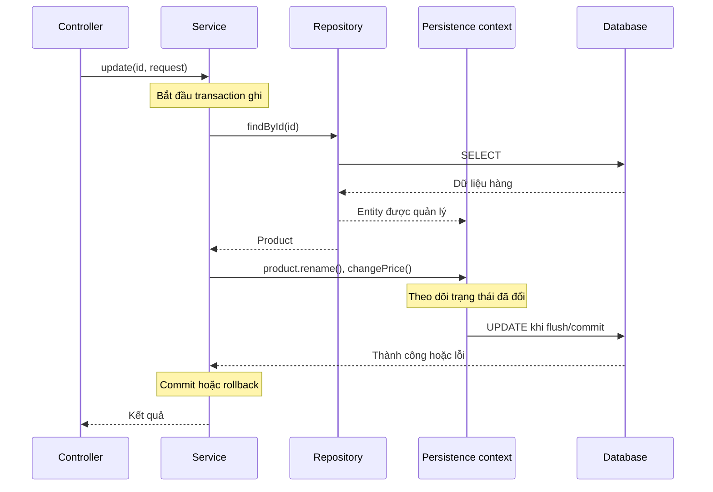

# Thiết kế phương thức cập nhật dựa trên entity đang được quản lý

Trong ứng dụng sử dụng **JPA (Jakarta Persistence)**, một cách cập nhật dữ liệu quan trọng là **tải entity vào persistence context, thay đổi trạng thái của chính đối tượng đó và để JPA đồng bộ thay đổi xuống cơ sở dữ liệu khi flush/commit**. Kỹ thuật này thường được gọi là *managed-entity update*; cơ chế phát hiện thay đổi thường được gọi là *dirty checking*.

Khi thiết kế Repository, cần hiểu rằng Repository chủ yếu đảm nhiệm việc **truy xuất aggregate/entity cần sửa**. Nghiệp vụ cập nhật diễn ra trên entity trong một **transaction ghi** do lớp service quản lý. Nếu entity đang được quản lý, thông thường không cần gọi `save()` sau mỗi thay đổi.

## 1. Entity được quản lý là gì?

**Persistence context** là phạm vi JPA theo dõi các entity đã tải hoặc được đưa vào quản lý. Trong cùng một persistence context, một bản ghi có khóa chính xác định thường tương ứng với một đối tượng entity được quản lý. `EntityManager.find(...)`, truy vấn JPQL trả về entity hoặc `JpaRepository.findById(...)` có thể đưa entity vào trạng thái này.

| Trạng thái | Ý nghĩa | Hệ quả khi thay đổi thuộc tính |
| --- | --- | --- |
| **New / transient** | Đối tượng mới tạo bằng `new`, chưa được quản lý | JPA chưa tự ghi; cần `persist` hoặc cơ chế lưu tương ứng |
| **Managed / persistent** | Đối tượng thuộc persistence context hiện hành | JPA có thể phát hiện thay đổi và phát SQL khi flush |
| **Detached** | Đối tượng từng được quản lý nhưng không còn thuộc persistence context hiện hành | Thay đổi trực tiếp không tự đồng bộ xuống DB |
| **Removed** | Đối tượng đã được đánh dấu xóa trong persistence context | JPA xử lý xóa khi đồng bộ, theo các quy tắc vòng đời |

Ví dụ với `EntityManager` thuần JPA:

```java
@Transactional
public void renameProduct(Long id, String newName) {
    Product product = entityManager.find(Product.class, id);
    if (product == null) {
        throw new ProductNotFoundException(id);
    }

    // product đang được quản lý trong transaction hiện tại.
    product.rename(newName);

    // Không cần entityManager.merge(product) hoặc persist(product).
    // JPA đồng bộ thay đổi tại flush/commit.
}
```

Từ góc nhìn SQL, quá trình thường có dạng:

```text
BEGIN TRANSACTION
SELECT id, name, price, version, ... FROM products WHERE id = ?
-- Ứng dụng gọi product.rename(...), chưa nhất thiết có SQL UPDATE ngay.
UPDATE products SET name = ?, ..., version = ? WHERE id = ? AND version = ?
COMMIT
```

Đây chỉ là SQL minh họa. **Dirty checking quyết định có thay đổi cần đồng bộ hay không; danh sách cột trong câu `UPDATE` phụ thuộc JPA provider và cấu hình.** Chẳng hạn, Hibernate có thể cập nhật nhiều cột dù chỉ một thuộc tính bị sửa; tối ưu hóa bằng `@DynamicUpdate` là tính năng riêng của Hibernate, không phải quy định bắt buộc của JPA.



## 2. Phân chia trách nhiệm Repository, Service và Entity

Một thiết kế dễ duy trì có ba lớp trách nhiệm:

1. **Repository** định nghĩa cách tìm entity cần cập nhật: theo `id`, theo điều kiện nghiệp vụ hoặc với quan hệ cần tải trước.
2. **Service** mở transaction, xác minh sự tồn tại và quyền thao tác, điều phối quy tắc nghiệp vụ; xử lý lỗi ở ranh giới ứng dụng.
3. **Entity** cung cấp phương thức diễn đạt thay đổi có chủ đích, ví dụ `rename`, `changePrice`, `deactivate`, thay vì cho mọi caller sửa trực tiếp toàn bộ field.

Lợi ích của phương thức entity có tên rõ nghĩa là tập trung quy tắc bất biến, chống các trạng thái không hợp lệ và cho thấy *ý định nghiệp vụ*. Việc dùng setter không sai về mặt JPA, nhưng những thao tác có quy tắc nên được đóng gói trong entity hoặc domain service phù hợp.

### 2.1. Định nghĩa entity với quy tắc cập nhật

Ví dụ sử dụng Java 17+, Spring Data JPA và `jakarta.persistence`:

```java
import jakarta.persistence.*;
import java.math.BigDecimal;

@Entity
@Table(name = "products")
public class Product {
    @Id
    @GeneratedValue(strategy = GenerationType.IDENTITY)
    private Long id;

    @Version
    private Long version;

    @Column(nullable = false, length = 120)
    private String name;

    @Column(nullable = false, precision = 15, scale = 2)
    private BigDecimal price;

    @Column(nullable = false)
    private boolean active = true;

    protected Product() { // Constructor cho JPA
    }

    public Product(String name, BigDecimal price) {
        rename(name);
        changePrice(price);
    }

    public void rename(String newName) {
        if (newName == null || newName.isBlank()) {
            throw new IllegalArgumentException("Tên sản phẩm không được trống");
        }
        String normalized = newName.strip();
        if (normalized.length() > 120) {
            throw new IllegalArgumentException("Tên sản phẩm quá 120 ký tự");
        }
        this.name = normalized;
    }

    public void changePrice(BigDecimal newPrice) {
        if (newPrice == null || newPrice.signum() <= 0) {
            throw new IllegalArgumentException("Giá phải lớn hơn 0");
        }
        this.price = newPrice;
    }

    public void deactivate() {
        this.active = false;
    }

    public Long getId() { return id; }
    public Long getVersion() { return version; }
    public String getName() { return name; }
    public BigDecimal getPrice() { return price; }
    public boolean isActive() { return active; }
}
```

`@Version` hỗ trợ **optimistic locking** khi có cập nhật đồng thời (phần 6). Các phương thức thay đổi không tự lưu DB: chúng chỉ điều chỉnh trạng thái object. JPA thực hiện đồng bộ vì object đó *đang managed*.

### 2.2. Repository tập trung vào truy vấn

```java
import org.springframework.data.jpa.repository.JpaRepository;

public interface ProductRepository extends JpaRepository<Product, Long> {
    // Có sẵn findById, findAll, save, ...
    // Có thể thêm truy vấn tìm theo tiêu chí nghiệp vụ khi cần.
}
```

Không nhất thiết phải định nghĩa `updateName(...)`, `updatePrice(...)` ở Repository cho mọi tình huống. Với thao tác thay đổi một aggregate có nhiều quy tắc, Repository chỉ cần trả về entity managed để service gọi các phương thức trên entity.

### 2.3. Transaction bao trùm cả tải và sửa

```java
import jakarta.validation.constraints.NotBlank;
import jakarta.validation.constraints.NotNull;
import jakarta.validation.constraints.Positive;
import jakarta.validation.constraints.Size;
import java.math.BigDecimal;

public record UpdateProductRequest(
    @NotBlank @Size(max = 120) String name,
    @NotNull @Positive BigDecimal price
) {}

public record ProductView(Long id, String name, BigDecimal price, boolean active) {
    public static ProductView from(Product p) {
        return new ProductView(p.getId(), p.getName(), p.getPrice(), p.isActive());
    }
}
```

```java
import org.springframework.stereotype.Service;
import org.springframework.transaction.annotation.Transactional;

@Service
public class ProductService {
    private final ProductRepository products;

    public ProductService(ProductRepository products) {
        this.products = products;
    }

    @Transactional
    public ProductView replace(Long productId, UpdateProductRequest request) {
        Product product = products.findById(productId)
            .orElseThrow(() -> new ProductNotFoundException(productId));

        product.rename(request.name());
        product.changePrice(request.price());

        // Không cần products.save(product) khi product đang managed.
        return ProductView.from(product);
    }

    @Transactional
    public void deactivate(Long productId) {
        Product product = products.findById(productId)
            .orElseThrow(() -> new ProductNotFoundException(productId));
        product.deactivate();
    }
}
```

```java
public class ProductNotFoundException extends RuntimeException {
    public ProductNotFoundException(Long id) {
        super("Không tìm thấy sản phẩm: " + id);
    }
}
```

Trong API HTTP, controller có thể gọi `productService.replace(id, request)` từ một `@PutMapping("/{id}")`, dùng `@Valid @RequestBody UpdateProductRequest` để xác thực dữ liệu đầu vào. Lớp xử lý ngoại lệ có thể ánh xạ `ProductNotFoundException` thành **404**, lỗi validation thành **400**, và xung đột phiên bản thành **409**. Đây là trách nhiệm HTTP/application, không cần cài vào chính Repository.

**Điểm then chốt:** `@Transactional` nằm ở phương thức service công khai được gọi qua Spring proxy. Nếu dùng `@Transactional` trên phương thức `private` hoặc tự gọi phương thức trong cùng object (*self-invocation*), cơ chế proxy thông thường không tạo transaction mới như mong đợi. Transaction phải còn hiệu lực trong lúc **tải và sửa** entity.

## 3. Cơ chế dirty checking, flush và commit

Sau `findById`, JPA provider đưa entity vào persistence context. Khi entity thay đổi, provider ghi nhận sai khác so với trạng thái đã tải (cách triển khai có thể là snapshot hoặc bytecode enhancement). SQL được thực hiện vào thời điểm **flush** thích hợp; commit thường kích hoạt flush nếu chưa đồng bộ.

Phân biệt các mốc:

| Thao tác | Vai trò |
| --- | --- |
| `product.rename(...)` | Thay đổi bộ nhớ của đối tượng managed; chưa bảo đảm SQL chạy tức thì |
| `EntityManager.flush()` | Yêu cầu đồng bộ các thay đổi đang chờ với DB; **chưa commit** transaction |
| `Transaction commit` | Kết thúc transaction thành công; các thay đổi được commit |
| `Transaction rollback` | Hủy thay đổi DB trong transaction, kể cả SQL đã gửi khi flush |
| `EntityManager.clear()` / đóng context | Các entity đang managed trở thành detached; thay đổi tiếp theo không được theo dõi bởi context cũ |

```java
@Transactional
public void changeAndValidate(Long id, BigDecimal price) {
    Product product = products.findById(id)
        .orElseThrow(() -> new ProductNotFoundException(id));

    product.changePrice(price);
    entityManager.flush(); // Dùng khi cần kiểm tra lỗi DB ngay tại đây.

    // Transaction vẫn đang mở. Có lỗi tiếp theo thì vẫn có thể rollback.
}
```

Chỉ gọi `flush()` khi có nhu cầu rõ ràng như phát hiện lỗi ràng buộc cơ sở dữ liệu trước bước kế tiếp, phối hợp truy vấn phụ thuộc dữ liệu mới hoặc cần giá trị version đã được cập nhật. Flush nhiều lần làm tăng chi phí. Nếu không có lý do đặc biệt, để transaction tự flush/commit là lựa chọn bình thường.

Một entity được tải rồi gán lại đúng giá trị cũ thường không cần SQL `UPDATE` nếu provider xác định không có thay đổi; tuy nhiên không nên suy luận số lượng câu SQL chỉ từ số setter. Kiểm tra SQL thực tế nếu đang tối ưu hiệu năng.

## 4. Thiết kế thao tác cập nhật toàn phần và cập nhật một phần

**Thay thế toàn phần** (thường gắn với HTTP `PUT`) có thể yêu cầu mọi trường cập nhật phải được cung cấp. Trong ví dụ `replace(...)`, `name` và `price` là bắt buộc; `active`, `id` và `version` không được client trực tiếp sửa qua DTO này.

**Cập nhật một phần** (thường gắn với HTTP `PATCH`) chỉ sửa thuộc tính được chỉ định. Cần phân biệt ba trạng thái của mỗi trường: không gửi, gửi giá trị và gửi `null` để xóa giá trị nếu nghiệp vụ cho phép.

Đối với các trường **không cho phép null** như `name` và `price`, một DTO đơn giản có thể quy ước `null` là *không cập nhật*:

```java
public record PatchProductRequest(String name, BigDecimal price) {}

@Transactional
public ProductView patch(Long id, PatchProductRequest request) {
    Product product = products.findById(id)
        .orElseThrow(() -> new ProductNotFoundException(id));

    if (request.name() != null) {
        product.rename(request.name());
    }
    if (request.price() != null) {
        product.changePrice(request.price());
    }
    return ProductView.from(product);
}
```

Ví dụ trên **không phân biệt một trường bị bỏ qua với trường được gửi giá trị JSON `null`**, nên chỉ thích hợp khi quy ước API cho phép như vậy. Nếu entity có `description` nullable và client cần chủ động xóa mô tả bằng `null`, hãy dùng mô hình dữ liệu nhận biết *field presence* (chẳng hạn một wrapper ba trạng thái hoặc kiểm tra sự tồn tại của key bằng JSON tree), đồng thời validation từng nhánh. Không nên dùng `BeanUtils.copyProperties`, mapper cập nhật hàng loạt hoặc gán toàn bộ DTO mà không kiểm soát field nào được phép thay đổi.

Ví dụ payload:

```json
{
  "price": 149000.00
}
```

Yêu cầu trên chỉ đổi giá. `name` vẫn giữ giá trị trong entity managed đang tải từ DB; không có chuyện phải dựng một `Product` khác với tất cả thuộc tính cũ để truyền vào `save()`.

## 5. Vì sao không cập nhật bằng entity tự dựng từ request?

Một lỗi thiết kế thường thấy:

```java
// KHÔNG NÊN dùng cho yêu cầu cập nhật một phần.
Product product = new Product(request.name(), request.price());
// Gán id cũ vào object mới (nếu có cách làm điều đó).
products.save(product);
```

Object mới không phải entity đã được tải và quản lý. Việc dùng `save()` trên entity có ID sẵn có thường dẫn tới `merge` theo cơ chế của Spring Data JPA, tùy chiến lược nhận diện entity mới. `merge` **sao chép trạng thái** từ object detached vào một instance managed và trả về instance đó; object đầu vào không tự trở thành managed. Nếu object chỉ chứa một phần dữ liệu, các field thiếu, `null`, collection hoặc quan hệ có thể bị ghi đè ngoài ý muốn.

Khi thực sự cần xử lý detached entity:

```java
Product managedCopy = entityManager.merge(detachedProduct);
// managedCopy mới là instance managed; detachedProduct vẫn detached.
```

`merge` có trường hợp sử dụng chính đáng, nhưng không phải API cập nhật mặc định cho request CRUD thông thường. Mẫu **load → kiểm tra → mutate** giúp kiểm soát quyền thay đổi, thực thi logic nghiệp vụ trên dữ liệu hiện tại và giảm nguy cơ mất trường. Đối với entity đã managed, `products.save(product)` thường dư thừa, dù nó có thể vẫn chạy được.

### 5.1. Nhận biết object managed

```java
Product product = entityManager.find(Product.class, id);
boolean managed = entityManager.contains(product); // true nếu tìm thấy và còn trong context

entityManager.detach(product);
boolean stillManaged = entityManager.contains(product); // false
```

`contains(null)` trả về `false`; cần kiểm tra null trước khi gọi các phương thức trên entity. Khi persistence context kết thúc, entity đã lấy ra có thể được dùng để hiển thị nhưng các thay đổi sau đó không tự được lưu. Tránh cập nhật entity ở controller rồi kỳ vọng một repository call trước đó đã đủ mở transaction ghi.

## 6. Cập nhật đồng thời và optimistic locking

Giả sử hai request đọc cùng sản phẩm với `version = 7`:

1. Request A tải giá 100 và muốn đổi thành 110.
2. Request B cũng tải version 7 và muốn đổi thành 120.
3. A flush/commit thành công, version tăng lên 8.
4. B cố cập nhật dựa trên version 7; thao tác cập nhật không còn khớp version và JPA báo lỗi optimistic locking.

```java
@Version
private Long version;
```

Với version column, câu lệnh cập nhật có điều kiện về phiên bản, về ý tưởng:

```sql
UPDATE products
SET price = ?, version = 8
WHERE id = ? AND version = 7;
```

Nếu số hàng cập nhật không phù hợp, provider báo lỗi; Spring có thể chuyển thành `ObjectOptimisticLockingFailureException` hoặc ngoại lệ liên quan. Xử lý xung đột cần phù hợp nghiệp vụ: báo **HTTP 409 Conflict**, yêu cầu client tải dữ liệu mới, hoặc áp dụng chiến lược thử lại có giới hạn nếu thao tác an toàn và có thể chạy lại.

**Không tự động retry một cập nhật dựa trên ý định cũ của người dùng** nếu lần tải mới có thể thay đổi quyết định nghiệp vụ. Với API cần phòng ngừa stale update từ client đã đọc lâu trước đó, có thể dùng ETag/`If-Match` hoặc version trong request, kiểm tra giá trị client gửi với version hiện tại *trước khi sửa*; chỉ `@Version` ở DB chưa thay thế hoàn toàn kiểm tra này nếu request mới tải lại entity rồi ghi đè thay đổi mà client chưa thấy.

Lưu ý thêm: optimistic locking bảo vệ các entity có `@Version` tham gia cập nhật; nó không tự giải quyết mọi xung đột khi cập nhật entity con hoặc nhiều aggregate khác nhau. Nếu tác vụ sửa cả parent và children, thiết kế ranh giới consistency và version tương ứng.

## 7. Cập nhật quan hệ trong aggregate

Đối với entity có quan hệ, cần thay đổi **đúng phía sở hữu (owning side)** và duy trì hai chiều quan hệ trong bộ nhớ nếu mapping là bidirectional.

```java
@Entity
public class PurchaseOrder {
    @Id @GeneratedValue
    private Long id;

    @OneToMany(mappedBy = "order", cascade = CascadeType.ALL, orphanRemoval = true)
    private List<OrderItem> items = new ArrayList<>();

    public void addItem(OrderItem item) {
        items.add(item);
        item.assignTo(this); // Gán @ManyToOne owning side.
    }

    public void removeItem(OrderItem item) {
        if (items.remove(item)) {
            item.assignTo(null);
        }
    }
}

@Entity
public class OrderItem {
    @Id @GeneratedValue
    private Long id;

    @ManyToOne(fetch = FetchType.LAZY)
    @JoinColumn(name = "order_id")
    private PurchaseOrder order;

    void assignTo(PurchaseOrder order) {
        this.order = order;
    }
}
```

*Các class rút gọn ở trên cần bổ sung constructor JPA, import và các thuộc tính nghiệp vụ khi sử dụng thật.* Khi một `PurchaseOrder` đã managed, gọi `order.addItem(...)` hoặc `order.removeItem(...)` trong transaction giúp JPA phát hiện thay đổi quan hệ theo mapping. Với `orphanRemoval = true`, bỏ item khỏi quan hệ có thể dẫn tới **xóa bản ghi con** khi flush. Chỉ bật tùy chọn đó nếu đúng ý nghĩa nghiệp vụ.

Không tùy tiện thay toàn bộ collection bằng một list mới đã map từ request: cách đó có thể làm mất metadata persistence collection, khiến JPA phải xử lý thay đổi quan hệ không mong muốn hoặc tạo/xóa các dòng ngoài dự định. Thay vào đó, so sánh ID hiện có, tìm phần tử cần thêm/sửa/xóa và gọi phương thức của aggregate. Với quan hệ lớn, đánh giá chi phí nạp collection và cân nhắc thiết kế riêng phù hợp.

## 8. Khi nào dùng `@Modifying` bulk update?

Cập nhật entity managed phù hợp khi cần đọc trạng thái hiện tại, kiểm tra invariant, chạy domain methods, callback hoặc concurrency control qua `@Version`. Trái lại, **bulk update** phù hợp cho thao tác đơn giản trên rất nhiều dòng mà không cần gọi nghiệp vụ riêng cho từng entity.

```java
public interface ProductRepository extends JpaRepository<Product, Long> {
    @Modifying(flushAutomatically = true, clearAutomatically = true)
    @Query("update Product p set p.active = false where p.id in :ids")
    int deactivateAllByIds(@Param("ids") Collection<Long> ids);
}
```

Phương thức này cần được gọi trong transaction ghi, ví dụ từ service `@Transactional`. Nó có thể giảm số lượng round trip so với tải từng entity, nhưng **JPQL bulk update đi thẳng vào DB, bỏ qua cơ chế dirty checking của các instance đang managed, không tự kích hoạt entity callbacks và không tự tăng `@Version`**. Vì vậy những instance đã tải trong persistence context có thể cũ sau bulk update.

`flushAutomatically = true` yêu cầu flush thay đổi đang chờ trước khi chạy query; `clearAutomatically = true` làm sạch persistence context sau query để giảm rủi ro đọc dữ liệu stale, đồng thời biến các entity đang giữ thành detached. Cần hiểu hậu quả này trước khi phối hợp bulk update với nhiều thao tác khác trong cùng transaction. Muốn bảo vệ version trong bulk update thì phải thiết kế điều kiện và việc tăng version một cách tường minh, hoặc quay lại phương pháp entity managed.

| Trường hợp | Hướng ưu tiên | Lý do |
| --- | --- | --- |
| Cập nhật một sản phẩm có kiểm tra nghiệp vụ | Tải managed entity rồi gọi domain method | Dễ bảo đảm invariant và quyền thao tác |
| Sửa một phần thuộc tính, giữ nguyên trường khác | Tải managed entity rồi patch có kiểm soát | Tránh mất dữ liệu do field bị bỏ trống |
| Cập nhật aggregate có quan hệ con | Sửa entity và helper quan hệ trong transaction | Duy trì đồng bộ hai phía và lifecycle |
| Thay một cờ đơn giản của hàng nghìn sản phẩm | Xem xét bulk update | Tránh tải hàng nghìn entity nếu không cần nghiệp vụ từng dòng |
| Đồng bộ object detached có đầy đủ trạng thái được kiểm soát | Xem xét `merge` có chủ ý | Phải hiểu việc sao chép trạng thái và instance trả về |

## 9. Các lỗi triển khai thường gặp

**Thiếu transaction ghi.** Gọi `findById` riêng lẻ rồi chỉnh object ở nơi khác có thể khiến entity đã detached. Đưa toàn bộ quá trình tìm và sửa vào phương thức service `@Transactional` được gọi qua proxy. Không dựa vào Open Session in View để duy trì hành vi ghi dữ liệu.

**Dùng `@Transactional(readOnly = true)` cho cập nhật.** Đây là ý định transaction đọc; tùy provider và Spring integration, flush có thể bị tối ưu hoặc tắt. Dùng transaction ghi cho thao tác có cập nhật.

**Gọi `save()` để “bắt buộc cập nhật” entity managed.** Trong mô hình managed, thay đổi được flush theo transaction. Nếu không thấy SQL, cần kiểm tra transaction, trạng thái managed, dữ liệu thực sự có thay đổi và cấu hình flush trước khi thêm `save()`.

**Map toàn bộ request lên entity, kể cả ID, version và quan hệ.** DTO đầu vào phải có whitelist thuộc tính được phép chỉnh. ID và `@Version` không nên được gán trực tiếp từ request như một field thông thường; `@Version` do JPA quản lý.

**Quên ranh giới tải lazy association.** Việc cập nhật quan hệ nên được thực hiện trong transaction; nếu cần nhiều liên kết, thiết kế truy vấn fetch phù hợp để tránh N+1, nhưng không mặc định fetch toàn bộ graph.

**Không xử lý dữ liệu đồng thời.** Khi có nhiều người dùng ghi cùng một bản ghi, cân nhắc `@Version`, chính sách xung đột và precondition HTTP. Transaction chỉ bảo đảm atomicity cho riêng thao tác, không tự ngăn mọi tình huống lost update.

**Nhầm `flush()` với `commit()`.** `flush()` gửi SQL nhưng transaction vẫn có thể rollback. Không công bố tác vụ đã bền vững chỉ vì vừa flush thành công.

**Bulk update trộn với entity managed đang mở.** Cùng bản ghi có thể tồn tại trạng thái stale trong bộ nhớ; cân nhắc flush/clear hoặc tách transaction theo ranh giới nghiệp vụ.

## 10. Cách kiểm chứng hành vi cập nhật

Trong kiểm thử tích hợp, có thể tạo sản phẩm, gọi service trong transaction phù hợp rồi **flush, clear và tải lại từ DB** để xác nhận dữ liệu thực sự được ghi; nếu chỉ kiểm tra lại chính object đang managed, kết quả có thể phản ánh bộ nhớ thay vì DB.

```java
// Minh họa phần kiểm chứng bên trong một integration test có transaction.
Product created = products.save(new Product("Bút", new BigDecimal("10000")));
Long id = created.getId();
entityManager.flush();
entityManager.clear();

service.replace(id, new UpdateProductRequest("Bút bi", new BigDecimal("12000")));

entityManager.flush();
entityManager.clear();

Product reloaded = products.findById(id).orElseThrow();
assertEquals("Bút bi", reloaded.getName());
assertEquals(0, new BigDecimal("12000").compareTo(reloaded.getPrice()));
```

Nếu service dùng transaction độc lập trong test không có transaction ngoài, sau khi service trả về thường đã commit. Nếu test sử dụng `@Transactional`, service có thể tham gia chính transaction của test; vì vậy mẫu trên chủ động flush/clear và hiểu rollback mặc định của framework test. Một bài kiểm thử concurrency riêng nên dùng **hai transaction/persistence context độc lập** để xác nhận rằng cập nhật trên version cũ bị từ chối.

Với cập nhật managed entity, tiêu chí thiết kế cốt lõi là: **truy xuất đúng đối tượng trong transaction ghi, thay đổi qua API nghiệp vụ có kiểm soát, để persistence context đồng bộ, và chủ động xử lý đồng thời cùng vòng đời entity**. Khi hiểu rõ bốn điểm này, các phương thức cập nhật trong service và Repository sẽ gọn, giữ được invariant và tránh phần lớn lỗi ghi đè dữ liệu do thao tác trên entity detached.
