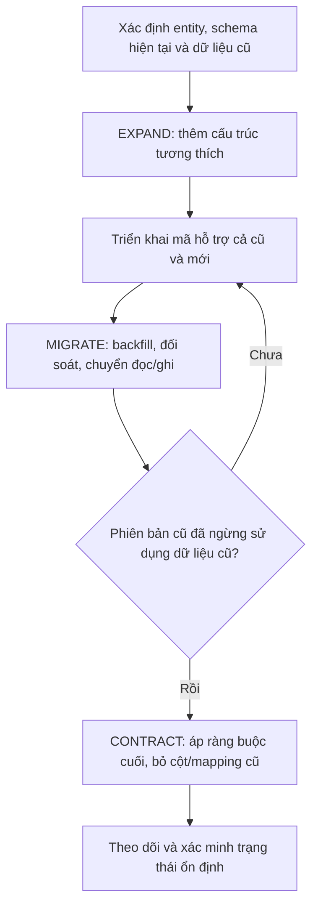

# Đồng bộ thay đổi entity và thay đổi lược đồ theo kế hoạch

Trong hệ thống dùng **JPA/Hibernate với cơ sở dữ liệu quan hệ**, mã nguồn entity và lược đồ cơ sở dữ liệu (database schema) là hai phần của cùng một hợp đồng lưu trữ. Entity mô tả ứng dụng **đọc, ghi và liên kết dữ liệu như thế nào**; lược đồ quyết định **bảng, cột, kiểu dữ liệu, ràng buộc và chỉ mục thực sự tồn tại**. Khi sản phẩm phát triển, hai phần này phải thay đổi theo một kế hoạch triển khai thống nhất.

Ví dụ: đổi tên thuộc tính `fullName` thành `displayName` trong Java không tự đổi tên cột `full_name` thành `display_name` trên PostgreSQL. Nếu ứng dụng được triển khai trước khi cột mới tồn tại, truy vấn có thể lỗi. Ngược lại, nếu xóa cột cũ khi vẫn còn phiên bản ứng dụng đang dùng cột đó, các phiên bản cũ sẽ lỗi trong quá trình rolling deployment.

Mục tiêu của **đồng bộ có kế hoạch** là thực hiện thay đổi theo thứ tự: thiết kế hợp đồng dữ liệu, tạo migration có thể theo dõi, triển khai phiên bản ứng dụng tương thích, chuyển dữ liệu, xác minh trạng thái mới, rồi mới loại bỏ cấu trúc cũ. Các bước cần xét đến dữ liệu hiện hữu, kết nối đang mở, phiên bản ứng dụng chạy đồng thời, thời gian khóa bảng và khả năng khôi phục.

## 1. Ba thành phần cần đồng bộ

| Thành phần | Vai trò | Ví dụ |
| --- | --- | --- |
| **JPA entity và mapping** | Quy định cách Java ánh xạ sang bảng/cột/quan hệ | `@Entity`, `@Table`, `@Column`, `@JoinColumn`, `@Version` |
| **Lược đồ database** | Thực thi kiểu dữ liệu, `NOT NULL`, `FOREIGN KEY`, `UNIQUE`, index, default | `customers.display_name varchar(160)` |
| **Migration và tiến trình triển khai** | Thay đổi database một cách có phiên bản, phối hợp với thay đổi ứng dụng | File `V...__add_display_name.sql`, deployment theo nhiều đợt |

Trong ứng dụng, ví dụ mapping sau có nghĩa JPA sẽ tìm cột `display_name` trong bảng `customers`:

```java
import jakarta.persistence.Column;
import jakarta.persistence.Entity;
import jakarta.persistence.Id;
import jakarta.persistence.Table;

@Entity
@Table(name = "customers")
public class Customer {
    @Id
    private Long id;

    @Column(name = "display_name", length = 160, nullable = false)
    private String displayName;

    protected Customer() {}

    public String getDisplayName() {
        return displayName;
    }
}
```

Nếu database mới chỉ có cột `full_name`, đoạn mapping này **không tạo ra cột mới một cách an toàn trong sản xuất**. Ứng dụng thường thất bại khi khởi động để kiểm tra schema hoặc khi truy vấn được thực thi. Cần một migration thay đổi cơ sở dữ liệu trước khi đưa phiên bản ứng dụng phụ thuộc cột mới vào hoạt động.

Cũng không phải mọi thay đổi annotation sẽ được công cụ migration tự suy ra chính xác:

- Đổi tên field Java nhưng giữ nguyên `@Column(name = "...")` có thể **không yêu cầu thay đổi lược đồ**.
- Đổi `@Column(name = "full_name")` thành `@Column(name = "display_name")` **đòi hỏi** cột mới hoặc một chiến lược rename.
- Đổi `nullable = true` sang `nullable = false` cần xác minh dữ liệu cũ không có `NULL` và tạo ràng buộc tương ứng trong DB.
- Đổi `@ManyToOne`, `@JoinColumn` hoặc `@JoinTable` có thể yêu cầu tạo cột khóa ngoại, chỉ mục và di trú dữ liệu quan hệ.
- Thêm `@Index` hoặc `@UniqueConstraint` trong mapping không bảo đảm lược đồ production đã có chỉ mục/ràng buộc tương ứng, nhất là khi tắt chức năng tự tạo schema.
- Đổi enum, converter, kiểu ngày giờ hoặc định dạng JSON có thể thay đổi **cách dữ liệu được mã hóa**, dù hình dạng cột SQL không đổi.

**Nguyên tắc:** coi định nghĩa entity và migration là hai thay đổi liên quan trong cùng một tính năng, nhưng có **thời điểm áp dụng khác nhau** khi cần bảo đảm tương thích.

## 2. Phân loại thay đổi trước khi lập kế hoạch

Không phải mọi thay đổi lược đồ đều có cùng mức rủi ro.

| Loại thay đổi | Ví dụ | Chiến lược thường dùng |
| --- | --- | --- |
| **Bổ sung tương thích** | Thêm cột nullable, thêm bảng mới | Tạo migration trước, sau đó ứng dụng mới mới dùng |
| **Bổ sung có ràng buộc** | Thêm cột bắt buộc trên bảng đã có dữ liệu | Thêm nullable → backfill → kiểm tra → đặt `NOT NULL` |
| **Đổi tên** | `full_name` → `display_name` | Thêm cột mới → dual-write → backfill → chuyển read → bỏ cột cũ |
| **Thay đổi kiểu** | `integer` → `bigint`, `varchar(80)` → `varchar(160)` | Xét khả năng mở rộng trực tiếp và chi phí rewrite/lock theo DB |
| **Thu hẹp dữ liệu** | `varchar(160)` → `varchar(80)`, giảm precision | Kiểm tra dữ liệu vượt giới hạn, sửa dữ liệu trước khi siết |
| **Quan hệ** | Thêm `customer_id` vào `orders` | Tạo khóa nullable → backfill → kiểm tra khóa ngoại → bắt buộc nếu cần |
| **Index/constraint** | `UNIQUE(email)`, index tìm kiếm | Kiểm tra trùng lặp, thiết kế cách build index tránh khóa kéo dài |
| **Xóa cấu trúc** | Drop cột/bảng cũ | Chỉ thực hiện khi không còn mã nguồn hoặc tiến trình sử dụng |
| **Thay đổi ý nghĩa dữ liệu** | Đổi mã trạng thái, đơn vị tiền tệ | Migration dữ liệu và ứng dụng phải có quy tắc chuyển đổi rõ ràng |

Với các thay đổi mang tính mở rộng đơn giản, một lần triển khai có thể đủ nếu thứ tự migration → application được kiểm soát. Với đổi tên/xóa/thu hẹp, cần nhiều phiên bản ứng dụng và **khoảng thời gian tương thích**.

### 2.1. Quy trình Expand → Migrate → Contract



**Expand** là bước thêm khả năng mới mà không phá mã đang chạy. **Migrate** là bước đưa dữ liệu và thao tác đọc/ghi sang hợp đồng mới. **Contract** là bước loại bỏ phần tương thích cũ sau khi chứng minh không còn người dùng của phần đó.

Một migration có thể hoàn tất thành công nhưng toàn bộ hệ thống vẫn chưa hoàn tất đổi hợp đồng dữ liệu: ứng dụng cũ, job batch, report, consumer hoặc query SQL thủ công có thể còn dùng cột cũ.

## 3. Ví dụ xuyên suốt: đổi `customers.full_name` sang `customers.display_name`

Giả sử hệ thống có bảng:

```sql
CREATE TABLE customers (
    id         bigint PRIMARY KEY,
    full_name  varchar(100) NOT NULL
);
```

Ứng dụng hiện tại (phiên bản **A**) dùng entity:

```java
@Entity
@Table(name = "customers")
public class Customer {
    @Id
    private Long id;

    @Column(name = "full_name", length = 100, nullable = false)
    private String fullName;

    protected Customer() {}

    public String getFullName() {
        return fullName;
    }
}
```

Yêu cầu mới là lưu tên hiển thị trong cột `display_name varchar(160)`; về lâu dài không còn cột `full_name`. Nếu triển khai theo kiểu `ALTER TABLE ... RENAME COLUMN ...` trong một lần, phiên bản A đang hoạt động sẽ không đọc/ghi được. Vì vậy hãy thay đổi theo nhiều đợt.

Các câu SQL bên dưới dùng **PostgreSQL**. Ngữ pháp, khóa bảng, thời lượng DDL và khả năng transaction khác nhau giữa PostgreSQL, MySQL, SQL Server và Oracle; khi đổi hệ quản trị phải điều chỉnh migration và kế hoạch vận hành.

### Đợt 1 — Expand: thêm cột mới, giữ cột cũ

Tạo migration phiên bản, ví dụ `V20261115_001__add_customer_display_name.sql`:

```sql
ALTER TABLE customers
    ADD COLUMN display_name varchar(160);
```

Chưa thêm `NOT NULL` vì các bản ghi hiện có chưa có giá trị `display_name`. Phiên bản A tiếp tục chạy bình thường vì `full_name` vẫn tồn tại và không thay đổi.

**Thứ tự:** chạy migration thêm cột trước khi triển khai mã cần tham chiếu cột mới.

### Đợt 2 — Ứng dụng B hỗ trợ hai cột

Phiên bản **B** vẫn **đọc từ `full_name`**, nhưng mọi lần đổi tên phải **ghi đồng thời `full_name` và `display_name` trong cùng transaction**. Entity tạm thời có cả hai mapping:

```java
import jakarta.persistence.*;

@Entity
@Table(name = "customers")
public class Customer {
    @Id
    private Long id;

    @Column(name = "full_name", length = 100, nullable = false)
    private String fullName;

    @Column(name = "display_name", length = 160)
    private String displayName;

    protected Customer() {}

    public String getName() {
        // B vẫn đọc dữ liệu từ cột cũ.
        return fullName;
    }

    public void rename(String newName) {
        if (newName == null || newName.isBlank()) {
            throw new IllegalArgumentException("Tên không được để trống");
        }

        String normalized = newName.strip();
        // Trong thời gian còn ghi full_name, giữ giới hạn 100 ký tự.
        if (normalized.length() > 100) {
            throw new IllegalArgumentException("Tên dài hơn 100 ký tự");
        }

        this.fullName = normalized;
        this.displayName = normalized;
    }
}
```

Service thực hiện cập nhật managed entity trong transaction:

```java
@Service
public class CustomerService {
    private final CustomerRepository customers;

    public CustomerService(CustomerRepository customers) {
        this.customers = customers;
    }

    @Transactional
    public void rename(Long id, String newName) {
        Customer customer = customers.findById(id)
            .orElseThrow(() -> new CustomerNotFoundException(id));

        customer.rename(newName);
        // Dirty checking ghi hai cột khi JPA flush/commit.
    }
}
```

Mẫu này giúp duy trì nhất quán giữa hai cột khi B ghi dữ liệu. Trong khi triển khai rolling, một số instance A còn sống chỉ ghi `full_name`; vì vậy **chưa được chuyển mọi luồng đọc sang `display_name`**. Cần bảo đảm mọi đường ghi dữ liệu (API, batch, tác vụ định kỳ) đều chuyển sang B hoặc có cơ chế đồng bộ tương đương.

Việc giữ giới hạn 100 ký tự trong B cũng quan trọng: dù cột mới chứa được 160 ký tự, cột cũ vẫn giới hạn 100. Nới giới hạn nghiệp vụ khi bỏ hẳn phụ thuộc vào cột cũ.

### Đợt 3 — Backfill và đối soát dữ liệu

Sau khi **không còn phiên bản A ghi dữ liệu**, đưa dữ liệu cũ vào cột mới. Với bảng nhỏ, migration hoặc job backfill có thể dùng:

```sql
UPDATE customers
SET display_name = full_name
WHERE display_name IS DISTINCT FROM full_name;
```

`IS DISTINCT FROM` là toán tử PostgreSQL xử lý so sánh kể cả trường hợp `NULL`. Dùng điều kiện khác biệt giúp job an toàn khi chạy lại.

Đối soát trước khi chuyển đọc:

```sql
SELECT COUNT(*) AS mismatch_count
FROM customers
WHERE display_name IS DISTINCT FROM full_name;

SELECT COUNT(*) AS missing_count
FROM customers
WHERE display_name IS NULL;
```

Cả hai số đếm phải bằng 0 nếu đây là yêu cầu của nghiệp vụ. Một lần backfill **trong khi còn A ghi dữ liệu** có thể bỏ sót cập nhật tiếp theo từ A; khi đó cần chạy đối soát lại sau khi A ngừng hoạt động.

Với bảng hàng triệu bản ghi, không nên mặc định chạy một câu `UPDATE` lớn trong migration khởi động ứng dụng: thao tác có thể giữ khóa lâu, tạo WAL/redo lớn, gây replication lag và làm chậm giao dịch. Có thể backfill theo dải khóa chính hoặc theo lô ngắn, ghi lại tiến độ, cho phép retry, giới hạn lưu lượng và đo số bản ghi còn thiếu. Sau từng lô, commit để giải phóng tài nguyên; bước đối soát cuối chỉ hoàn tất khi các luồng ghi tương thích đã chạy ổn định.

Nếu hệ thống có nhiều nguồn ghi độc lập hoặc queue xử lý chậm, phải thống kê cả các nguồn đó trước khi kết luận dữ liệu hai cột đã đồng nhất.

### Đợt 4 — Siết ràng buộc mới và chuyển sang đọc cột mới

Khi đã backfill và không còn bản ghi `display_name` rỗng, có thể áp đặt ràng buộc:

```sql
ALTER TABLE customers
    ALTER COLUMN display_name SET NOT NULL;
```

Đây là thay đổi có thể cần khóa/kiểm tra bảng tùy kích thước và phiên bản PostgreSQL; với bảng rất lớn, phải đánh giá biện pháp giảm khóa và lên lịch phù hợp trước khi thực hiện.

Triển khai ứng dụng **C**, trong đó phương thức `getName()` đọc `displayName`, nhưng các thao tác sửa vẫn **dual-write cả hai cột** để tương thích trong giai đoạn chuyển tiếp. Với annotation, lúc này có thể phản ánh điều kiện mới bằng `@Column(name = "display_name", nullable = false, length = 160)`. Giữ logic kiểm tra độ dài đáp ứng giới hạn cột cũ cho đến khi loại bỏ hoàn toàn các bản ghi phụ thuộc nó.

Chỉ triển khai C sau khi **mọi instance còn đọc `full_name` đã ngừng chạy**, hoặc chứng minh các luồng cũ còn chạy được đồng bộ đầy đủ trong thời gian chồng lấp. Với chiến lược tuần tự dễ hiểu, đợi hết phiên bản B trước khi đưa phiên bản chỉ đọc cột mới và chỉ ghi cột mới vào hệ thống.

### Đợt 5 — Cho phép bỏ ghi cột cũ

Trước khi triển khai phiên bản chỉ ghi cột mới, cần bỏ `NOT NULL` của `full_name`. Nếu không, INSERT của phiên bản mới sẽ thất bại vì không còn giá trị cột cũ:

```sql
ALTER TABLE customers
    ALTER COLUMN full_name DROP NOT NULL;
```

Triển khai ứng dụng **D**, chỉ còn mapping và ghi `display_name`; mọi phiên bản đang phục vụ request phải **đọc từ `display_name`**. Ứng dụng C, nếu còn chạy trong lúc rolling, đọc `display_name` và vẫn có thể ghi cả hai cột. Chỉ được cho phép sự chồng lấp này nếu không còn phiên bản B đọc dữ liệu từ `full_name` vì từ thời điểm D hoạt động, cột cũ có thể không được đồng bộ nữa.

Khi chắc chắn **không còn phiên bản ứng dụng, tác vụ nền, báo cáo hoặc SQL trực tiếp dùng `full_name`**, thực hiện migration Contract cuối cùng:

```sql
ALTER TABLE customers
    DROP COLUMN full_name;
```

Lúc này entity chỉ còn `displayName`. Đợi đến thời điểm này mới nâng giới hạn tên được chấp nhận từ 100 lên 160 ký tự nếu nghiệp vụ yêu cầu.

### Bảng tương thích giữa các đợt

| Trạng thái DB | Ứng dụng có thể đang chạy | Đọc | Ghi | Điều kiện để chuyển đợt |
| --- | --- | --- | --- | --- |
| Schema 1: chỉ `full_name` | A | Cột cũ | Cột cũ | Migration thêm cột phải hoàn tất trước khi triển khai B |
| Schema 2: thêm `display_name` nullable | A, B | Cột cũ | A: cũ; B: cả hai | Đợi hết mọi A trước khi đối soát cuối |
| Schema 2: dữ liệu đã backfill | B | Cột cũ | Cả hai | Giá trị hai cột đồng nhất |
| Schema 3: `display_name NOT NULL` | B, C trong đợt chuyển tiếp | B: cũ; C: mới | Cả hai | Loại B trước khi ứng dụng bỏ ghi cột cũ |
| Schema 4: `full_name` nullable | C, D | Cột mới | C: cả hai; D: mới | Mọi luồng đọc đều dùng cột mới |
| Schema 5: đã xóa `full_name` | D | Cột mới | Cột mới | Không còn C hoặc tiến trình cũ dùng cột cũ |

Ví dụ này cố ý chia nhiều đợt để diễn giải **hợp đồng tương thích**. Một hệ thống đơn node có cửa sổ bảo trì rõ ràng có thể dùng kế hoạch ít bước hơn; một hệ thống nhiều phiên bản/zero-downtime thường cần khoảng chồng lấp dài hơn.

## 4. Tổ chức migration có phiên bản

Có thể dùng **Flyway** hoặc **Liquibase** để quản lý lịch sử thay đổi. Công cụ được chọn nên chạy trong CI/CD hoặc một migration job có quyền DB rõ ràng. Ứng dụng production thường chỉ cần quyền DML; quyền thay đổi schema nên được giới hạn cho quy trình triển khai.

### 4.1. Ví dụ với Flyway và Spring Boot

Thư mục tiêu biểu:

```text
src/main/resources/
└── db/
    └── migration/
        ├── V20261115_001__add_customer_display_name.sql
        ├── V20261115_002__require_customer_display_name.sql
        ├── V20261115_003__allow_null_legacy_full_name.sql
        └── V20261115_004__drop_customer_full_name.sql
```

Các file thể hiện **thứ tự migration**, nhưng không có nghĩa phải chạy cả bốn trong một lần triển khai. Ví dụ bước 002 chỉ được phép chạy sau khi backfill/đối soát hoàn tất; bước 004 phải đợi ứng dụng cũ đã rời hệ thống. Quy trình release phải **chọn đúng tập migration được phép** theo từng đợt. Không đưa trước file Contract phá tương thích vào artifact mà một lệnh `migrate` sẽ vô tình chạy toàn bộ.

Với ứng dụng Spring Boot dùng Gradle Kotlin DSL, ví dụ khai báo cơ bản:

```kotlin
dependencies {
    implementation("org.springframework.boot:spring-boot-starter-data-jpa")
    implementation("org.flywaydb:flyway-core")
    runtimeOnly("org.flywaydb:flyway-database-postgresql")
    runtimeOnly("org.postgresql:postgresql")
}
```

Cấu hình trong môi trường dùng migration lúc khởi động, minh họa:

```yaml
spring:
  jpa:
    hibernate:
      ddl-auto: validate
  flyway:
    enabled: true
    locations: classpath:db/migration
```

`ddl-auto: validate` yêu cầu Hibernate kiểm tra một số thành phần của schema phù hợp mapping hiện tại; nó **không thực hiện migration**. Khả năng validate không thay thế kiểm tra dữ liệu, constraint, index, trigger và các tiến trình tiêu thụ dữ liệu ngoài JPA.

Trong môi trường nhiều replica, có thể cho migration chạy bằng **job triển khai riêng** trước khi khởi động app phiên bản mới, thay vì cho tất cả replica đồng thời cố gắng nâng schema. Flyway có cơ chế điều phối lịch sử migration, nhưng job riêng giúp kiểm soát thời điểm DDL, quyền truy cập và thời hạn khóa. Nếu dùng job riêng, ứng dụng có thể tắt `spring.flyway.enabled` tại runtime phù hợp và vẫn giữ chế độ kiểm tra schema trước khi nhận request.

Một quy trình vận hành Flyway thường xem `info` để biết migration đã áp dụng/chờ áp dụng, thực hiện `validate` và chạy `migrate` với cấu hình kết nối dành riêng cho môi trường. Flyway quản lý lịch sử và checksum trong bảng `flyway_schema_history` (mặc định). **Không sửa nội dung file versioned migration đã được áp dụng** vì sẽ tạo sai lệch checksum giữa môi trường; khi cần thay đổi, tạo migration mới. Chỉ dùng cơ chế sửa lịch sử sau khi phân tích nguyên nhân và có quyết định vận hành rõ ràng.

### 4.2. Ví dụ tương ứng với Liquibase

Nếu dự án dùng Liquibase, có thể mô tả cùng bước Expand bằng changeSet YAML:

```yaml
databaseChangeLog:
  - changeSet:
      id: add-customer-display-name-20261115
      author: team
      changes:
        - addColumn:
            tableName: customers
            columns:
              - column:
                  name: display_name
                  type: varchar(160)
```

Liquibase theo dõi changeSet trong bảng lịch sử riêng và có khả năng tạo/định nghĩa rollback trong những trường hợp phù hợp. Tuy vậy, **rollback DDL chưa chắc khôi phục được dữ liệu đã mất**. Nên thống nhất một cơ chế migration có chủ sở hữu thay vì vô tình để hai công cụ cùng quản lý thay đổi schema trên một database.

## 5. Đồng bộ một số dạng thay đổi JPA thường gặp

### 5.1. Thêm field bắt buộc cho bảng đã có dữ liệu

Yêu cầu thêm `Customer.status` là enum không được null. Thực hiện theo thứ tự:

1. Thêm cột `status` nullable hoặc có default được thiết kế rõ ràng.
2. Triển khai ứng dụng xử lý cả bản ghi chưa có status; luồng tạo mới bắt đầu ghi status.
3. Backfill dữ liệu cũ theo quy tắc nghiệp vụ; đối soát mọi giá trị hợp lệ.
4. Thêm `NOT NULL`, constraint và mapping `@Column(nullable = false)` sau khi dữ liệu đáp ứng.
5. Gỡ nhánh xử lý trạng thái thiếu nếu không còn cần.

```java
@Enumerated(EnumType.STRING)
@Column(name = "status", nullable = false, length = 24)
private CustomerStatus status;
```

`EnumType.STRING` lưu tên hằng enum dạng chuỗi. Khi đổi tên hằng Java, dữ liệu chuỗi đã tồn tại **không tự đổi**. Cần di trú các giá trị DB, giữ tương thích với phiên bản cũ hoặc áp dụng converter có chủ đích trong khoảng chuyển tiếp. `EnumType.ORDINAL` thường đặc biệt rủi ro khi thêm hoặc sắp xếp lại enum vì giá trị số có thể đổi ý nghĩa.

### 5.2. Thêm khóa ngoại và quan hệ `@ManyToOne`

Giả sử thêm quan hệ `Order.customer`:

```java
@ManyToOne(fetch = FetchType.LAZY, optional = false)
@JoinColumn(name = "customer_id", nullable = false)
private Customer customer;
```

Một lộ trình an toàn với bảng đơn hàng đã có dữ liệu là thêm `customer_id` nullable, sửa ứng dụng để ghi `customer_id` cho đơn mới, tìm cách gán khách hàng cho đơn cũ, kiểm tra tất cả khóa ngoại trỏ tới bản ghi có thật, rồi mới tạo/validate FK và đặt `NOT NULL` theo yêu cầu.

```sql
-- Ví dụ pha Expand: chưa bắt buộc và chưa gán dữ liệu cũ.
ALTER TABLE orders ADD COLUMN customer_id bigint;

-- Sau khi mọi bản ghi đã có customer hợp lệ:
ALTER TABLE orders
    ADD CONSTRAINT fk_orders_customer
    FOREIGN KEY (customer_id) REFERENCES customers(id);
```

Nếu dữ liệu lịch sử có đơn hàng không thuộc khách hàng nào, cần quyết định nghiệp vụ (khách hàng hệ thống, cho phép null hay xử lý ngoại lệ). Không được giả định giá trị mặc định để ép tất cả về một bản ghi tùy ý. Với bảng lớn, cân nhắc cơ chế thêm rồi validate ràng buộc với mức khóa phù hợp từng DB; đánh giá index trên cột foreign key để hỗ trợ truy vấn và tác vụ xóa/cập nhật liên quan.

### 5.3. Thay đổi kiểu hoặc độ dài cột

Ví dụ nới `price` từ `numeric(10,2)` lên `numeric(15,2)` hoặc `varchar(80)` lên `varchar(160)`. Cần đánh giá:

- Có phải thay đổi chỉ mở rộng miền giá trị hay cần **chuyển nghĩa** dữ liệu?
- DDL thực tế có rewrite bảng hoặc khóa ghi kéo dài trên phiên bản DB đang dùng không?
- Java mapping `@Column(precision = ..., scale = ...)`, kiểu `BigDecimal` và validation DTO có được cập nhật đồng thời không?
- Những consumer ngoài JPA có giả định độ dài/precision cũ không?
- Việc rollback xuống kiểu nhỏ có làm mất hoặc làm tròn dữ liệu đã ghi theo kiểu mới không?

Thu hẹp kiểu cần kiểm tra trước, chẳng hạn phát hiện các giá trị vượt độ dài mới:

```sql
SELECT COUNT(*) AS too_long
FROM customers
WHERE char_length(display_name) > 80;
```

Chỉ khi đã xử lý các bản ghi vi phạm mới cân nhắc `ALTER COLUMN` sang kiểu hẹp. Với thay đổi kiểu không tương thích hoặc cần chuyển đổi phức tạp, chiến lược **cột mới + chuyển dữ liệu + đổi mapping** thường an toàn hơn thay đổi kiểu trực tiếp.

### 5.4. Chuyển đổi khóa chính hoặc chia/tách bảng

Thay đổi ID `int` sang `bigint`, đổi tự nhiên sang surrogate key hoặc chia một entity thành hai bảng không chỉ liên quan một annotation. Cần xác định toàn bộ FK từ bảng khác, tham chiếu trong event/message, khóa cache, URL công khai, báo cáo và query ngoại hệ thống. Với mô hình lớn, nên tạo khóa/cột mới song song, xây dựng ánh xạ hai chiều hoặc bảng chuyển đổi, chuyển các consumer rồi mới bỏ khóa cũ.

Các quan hệ `@OneToMany` với `cascade` và `orphanRemoval` còn ảnh hưởng hành vi lưu/xóa. Di trú schema phải phù hợp với vòng đời entity và không kích hoạt xóa dữ liệu ngoài ý muốn khi ứng dụng mới truy xuất dữ liệu cũ.

### 5.5. Tạo hoặc thay đổi index

Index phục vụ truy vấn và có thể thay đổi độc lập với entity. Trước khi tạo `UNIQUE` cần phát hiện dữ liệu trùng; trước khi thêm index lớn cần đánh giá kích thước, khóa và mức tải.

Với PostgreSQL, ví dụ:

```sql
CREATE INDEX CONCURRENTLY idx_orders_customer_id
    ON orders(customer_id);
```

`CONCURRENTLY` giảm mức cản trở thao tác đọc/ghi nhưng có giới hạn riêng, bao gồm **không chạy trong transaction block thông thường**. Công cụ migration phải cấu hình migration đó chạy ngoài transaction, đồng thời xác định cách xử lý nếu index build thất bại. Không sao chép trực tiếp cú pháp này sang MySQL/Oracle/SQL Server; các DB có cơ chế online index khác nhau.

## 6. Chọn chiến lược tạo schema và kiểm tra sai lệch

Trong phát triển cục bộ, một số nhóm bật Hibernate tự tạo schema để thử nghiệm nhanh. Nhưng ở production, các chế độ này mang ý nghĩa rất khác nhau:

| `spring.jpa.hibernate.ddl-auto` | Ý nghĩa vận hành | Gợi ý |
| --- | --- | --- |
| `create` / `create-drop` | Tạo lại schema; có thể xóa dữ liệu | Chỉ phù hợp môi trường test được phép xóa |
| `update` | Hibernate thử điều chỉnh schema dựa trên mapping | Không dùng làm cơ chế di trú production |
| `validate` | Đối chiếu một phần mapping với schema đã tồn tại | Hữu ích để phát hiện sai lệch khi khởi động |
| `none` | Không tạo/sửa/validate schema bằng Hibernate | Phù hợp khi quy trình khác phụ trách kiểm tra |

`ddl-auto=update` không biết đầy đủ ý định nghiệp vụ: một lần đổi tên có thể bị hiểu thành **thêm cột mới** thay vì bảo toàn dữ liệu cột cũ; cũng không giải quyết backfill, lock timeout, thứ tự rolling deployment hay đường rollback. Do đó hãy đưa DDL và data migration vào các file có phiên bản, được review và chạy theo kế hoạch.

Ngay cả khi `validate` thành công, vẫn cần xét **schema drift**: thay đổi thủ công ở production, index thiếu, constraint khác nhau, collation/timezone khác hoặc dữ liệu không đáp ứng bất biến của code. Lịch sử migration là căn cứ theo dõi, nhưng thông tin cấu trúc thực tế của DB vẫn phải được kiểm tra khi có nghi ngờ.

## 7. Lập kế hoạch tương thích khi triển khai nhiều phiên bản

Ở môi trường rolling deployment, blue/green hoặc canary, **hai phiên bản ứng dụng có thể dùng một database trong cùng thời điểm**. Thay đổi schema phải thỏa:

- **Backward compatibility ở pha Expand:** migration mới không làm phiên bản cũ bị hỏng.
- **Forward compatibility trước khi deploy app mới:** cột/bảng/constraint mà app mới yêu cầu đã sẵn sàng.
- **Write compatibility:** mọi bản đang chạy biết cách tạo và sửa dữ liệu đủ cho các bản khác có thể đọc.
- **Data compatibility:** dữ liệu đang nằm trên disk đã đáp ứng hợp đồng mới, kể cả bản ghi lâu năm.
- **Contract sau khi rút bản cũ:** không còn instance, cron job, ETL hoặc báo cáo dùng cấu trúc chuẩn bị xóa.

Xét một deployment gồm:

```text
T0:  app A ────────────────────────┐
                                   │
T1:  DB expand + cột mới           │
                                   │
T2:  app B (dual-write) ───────────┤  A và B chồng lấp
                                   │
T3:  Không còn app A ───────────────┘
T4:  Backfill + đối soát
T5:  app C (đọc mới, còn dual-write)
T6:  DB nới ràng buộc cũ; app D chỉ dùng mới
T7:  Không còn app C
T8:  DB drop cột cũ
```

Trình tự này có thể phải dài hơn nếu có consumer hoặc batch chạy hàng đêm. Cần xác định ai sở hữu thông tin “đã hết phiên bản cũ”, ví dụ deployment control plane, danh sách instance đang phục vụ, job scheduler, dashboard consumer hoặc nhật ký truy vấn.

**Transaction ứng dụng** bảo vệ cập nhật trên một đơn vị công việc; transaction không làm cho hai phiên bản ứng dụng mặc nhiên tương thích. Nếu code mới vừa ghi format dữ liệu mới mà code cũ không đọc được, cần chuẩn bị nhánh tương thích hoặc ngừng code cũ trước khi ghi.

## 8. Data migration: chạy được nhiều lần, quan sát được và có điểm dừng

Thay đổi DDL và thay đổi dữ liệu nên phân tách khi phạm vi quá lớn hoặc thời gian chạy không dự đoán được.

Một chương trình backfill vận hành nên có:

1. **Điều kiện chọn bản ghi rõ ràng**, chỉ xử lý dữ liệu chưa chuyển hoặc còn khác biệt.
2. **Phân lô ổn định** theo khóa chính hoặc tiêu chí đã định; không bỏ sót khi có ghi đồng thời.
3. **Commit theo lô**, giới hạn tốc độ để tránh tạo tải DB/replica quá lớn.
4. **Khả năng chạy lại** mà không phá dữ liệu đã được cập nhật hợp lệ.
5. **Theo dõi tiến độ**: số bản ghi đã xử lý, còn tồn, lỗi, thời gian và độ trễ replication.
6. **Điều kiện dừng/khôi phục** khi latency, lock wait, replication lag hoặc lỗi vượt mức chấp nhận.

Ví dụ backfill theo từng lô trên PostgreSQL (minh họa một lô, job lặp lại đến khi không còn bản ghi cần xử lý):

```sql
WITH next_batch AS (
    SELECT id
    FROM customers
    WHERE display_name IS DISTINCT FROM full_name
    ORDER BY id
    LIMIT 1000
    FOR UPDATE SKIP LOCKED
)
UPDATE customers AS c
SET display_name = c.full_name
FROM next_batch AS b
WHERE c.id = b.id;
```

Job nên commit sau mỗi lô. `SKIP LOCKED` giúp bỏ qua hàng đang bị khóa, nhưng không có nghĩa những hàng đó đã hoàn tất; job phải lặp lại và đối soát cuối để chắc chắn không còn hàng bị bỏ qua. Nếu cùng lúc ứng dụng ghi vào bảng, cần xác định thời điểm nguồn dữ liệu cũ còn là giá trị chuẩn và điểm chuyển sang nguồn mới. Không dùng backfill từ cột cũ **sau khi cột mới đã trở thành nguồn dữ liệu chuẩn** vì có thể ghi đè thay đổi mới nhất.

Với phép chuyển đổi không thể lặp lại đơn giản (chẳng hạn đổi đơn vị tiền tệ hoặc chuẩn hóa dữ liệu theo thuật toán), cần dùng cột đánh dấu phiên bản hoặc tiêu chí idempotent có bằng chứng, tránh nhân đôi biến đổi khi retry.

## 9. DDL có tác động vận hành riêng

Các thao tác tưởng đơn giản như `ADD COLUMN`, `SET NOT NULL`, `CREATE INDEX` hoặc `DROP COLUMN` có chi phí khác nhau theo DB engine, phiên bản, kích cỡ bảng và lưu lượng thực tế.

### Khóa, transaction và downtime

- Một số DDL cần khóa bảng hoặc khóa metadata. Nếu đang có transaction dài, migration có thể bị chặn; ngược lại migration chờ khóa có thể khiến request phía sau xếp hàng.
- Khả năng rollback DDL không đồng nhất: PostgreSQL hỗ trợ transaction cho nhiều DDL, trong khi một số thao tác (như `CREATE INDEX CONCURRENTLY`) không chạy trong transaction; các DB khác có thể implicit commit.
- Thay đổi kiểu dữ liệu có thể yêu cầu viết lại nhiều trang dữ liệu; thêm index có thể cần nhiều CPU/I/O và dung lượng đĩa.
- Khi có replication, cần theo dõi lag và ảnh hưởng đến read replica.
- Với thao tác rủi ro, cần ước lượng thời gian, cấu hình timeout phù hợp và chuẩn bị đường dừng an toàn.

Vì vậy câu “migration chạy thành công trên database trống” chưa đủ để kết luận nó an toàn cho bảng production có hàng chục triệu bản ghi.

### Backup, rollback và roll-forward

Rollback mã ứng dụng tương đối đơn giản nếu **schema Expand còn tương thích**. Sau khi xóa cột hoặc chuyển đổi dữ liệu mất thông tin, chạy migration `down` hoặc khôi phục mã cũ có thể không còn khả thi.

Một kế hoạch release nên xác định:

- Trong pha nào có thể rollback **chỉ ứng dụng** mà không đổi database.
- Lúc nào chỉ được **roll-forward** bằng migration sửa lỗi tiếp theo.
- Khi nào phải khôi phục từ bản backup hoặc PITR (point-in-time recovery), cùng mức mất dữ liệu/thời gian ngừng dịch vụ có thể chấp nhận.
- Ai có quyền kích hoạt restore và cách xác minh backup thực sự phục hồi được.

Không coi lệnh `DROP COLUMN` là bước rollback đáng tin chỉ vì nó đảo lại `ADD COLUMN`: dữ liệu cột đó có thể đã được người dùng sử dụng từ lúc thêm vào.

## 10. Xây dựng quy trình phát hành có kiểm soát

Một quy trình thực tế có thể chia thành các mốc sau:

**Mốc 1 — Xác định hợp đồng hiện tại.** Ghi lại entity, tên bảng/cột vật lý, kiểu dữ liệu, index, khóa ngoại, trigger, dữ liệu hiện hữu và các caller bên ngoài (API, báo cáo, batch). Kiểm tra cả phiên bản ứng dụng đang chạy và version migration đã áp dụng.

**Mốc 2 — Thiết kế trạng thái đích.** Chọn tên cột, nullability, precision/scale, quy tắc default, trạng thái enum, giới hạn dữ liệu và đường chuyển đổi. Nêu các trạng thái trung gian cần duy trì tương thích.

**Mốc 3 — Viết migration Expand.** Thêm cấu trúc không phá phiên bản cũ. Nếu migration có khả năng khóa bảng lớn, tách thành job vận hành và lên kế hoạch cho từng engine.

**Mốc 4 — Triển khai phiên bản ứng dụng tương thích.** Mã mới đọc/ghi đúng với cả dữ liệu cũ và mới, có kiểm soát transaction và lỗi. Nếu cần dual-write, kiểm soát tất cả luồng ghi, kể cả job định kỳ.

**Mốc 5 — Chuyển dữ liệu và kiểm tra tính toàn vẹn.** Backfill có thể chạy lại, đối soát số bản ghi và giá trị, kiểm tra FK/UNIQUE/NOT NULL dự kiến. Đảm bảo không còn người ghi theo định dạng cũ trước khi chuyển dữ liệu cuối.

**Mốc 6 — Chuyển nguồn đọc/ghi.** Triển khai ứng dụng ưu tiên hợp đồng mới, theo dõi tỷ lệ lỗi SQL, latency, lock wait, kết quả đối soát và độ trễ replication. Điều kiện chuyển phải được xác định cụ thể chứ không chỉ dựa vào một lần pipeline thành công.

**Mốc 7 — Contract.** Sau khi hết toàn bộ consumer cũ, thêm các ràng buộc cuối và xóa cột/bảng/nhánh mapping đã lỗi thời. Cập nhật tài liệu dữ liệu và phương án khôi phục tương ứng.

Thứ tự có thể được mô tả trong một release record:

```yaml
change: customer-display-name
database: postgresql
current_contract: customers.full_name
target_contract: customers.display_name
phases:
  - name: expand
    database_change: add nullable display_name
    app_compatibility: A and B
  - name: dual_write
    application_change: B writes both columns
    exit_condition: no A writers remain
  - name: backfill
    data_change: reconcile display_name from full_name
    exit_condition: mismatch_count == 0
  - name: switch_read
    application_change: C reads display_name; still writes both
    exit_condition: no B readers remain
  - name: retire_legacy_write
    database_change: relax full_name nullability
    application_change: D writes only display_name
    exit_condition: no C instances or legacy consumers remain
  - name: contract
    database_change: drop full_name
    exit_condition: schema and application use display_name only
```

Đây là mẫu **runbook mô tả kế hoạch**, không phải cấu hình mặc định được Flyway/Liquibase tự thực thi. Các điều kiện thoát giữa từng pha phải do pipeline và người phụ trách vận hành xác nhận bằng dữ liệu thực tế.

## 11. Kiểm thử thay đổi entity và migration

Kiểm thử nên phản ánh đường nâng cấp database thật, tránh chỉ dựng schema mới từ `@Entity` và bỏ qua dữ liệu cũ.

### Từ schema cũ lên schema mới

Một bài kiểm thử tích hợp có giá trị có thể chạy theo trình tự:

1. Khởi tạo database cùng loại/version production (ví dụ PostgreSQL qua Testcontainers).
2. Áp migration đến version đang được sử dụng; nạp các bản ghi cũ và các tình huống dữ liệu biên.
3. Áp migration Expand của release mới.
4. Chạy các thao tác CRUD qua ứng dụng tương thích, xác nhận dữ liệu cũ vẫn truy vấn được và dữ liệu mới được ghi đúng.
5. Chạy backfill, kiểm tra giá trị và ràng buộc; kiểm tra việc chạy lại không làm hỏng dữ liệu.
6. Chạy chuyển đọc/ghi, áp Contract khi đã thỏa điều kiện tương thích.
7. Thử luồng lỗi: null, dữ liệu trùng unique, FK thiếu, độ dài quá lớn, optimistic locking, race condition khi có nhiều transaction.

Ví dụ Spring Boot integration test thường dùng entity manager `flush()` và `clear()` trước khi tải lại record để không vô tình kiểm tra object còn nằm trong persistence context mà chưa được đồng bộ xuống database. Đồng thời, phép thử schema cần thực thi **script migration thật**, không cho Hibernate tạo schema tương ứng trạng thái đích rồi coi đó là bằng chứng migration hợp lệ.

### Hợp đồng tương thích giữa hai phiên bản

Khi rolling deployment, cần kiểm thử tối thiểu các cặp:

| Database sau migration | Ứng dụng | Kết quả mong đợi |
| --- | --- | --- |
| Schema Expand | Phiên bản cũ | Vẫn đọc/ghi dữ liệu theo hợp đồng cũ |
| Schema Expand | Phiên bản dual-write | Đọc cũ, ghi cả hai, không mất dữ liệu |
| Schema đã backfill | Phiên bản đọc mới | Đọc đầy đủ lịch sử, cập nhật đúng |
| Schema Contract | Chỉ phiên bản mới | Không còn truy vấn cột đã xóa |

H2 hoặc database in-memory có thể hữu ích cho một số unit test nhưng khác PostgreSQL/MySQL ở DDL, lock, index, constraint, collations và transaction. Đối với migration quan trọng, cần ít nhất một môi trường kiểm thử bằng đúng engine production.

## 12. Những lỗi thiết kế cần tránh

**Triển khai entity trước khi chạy migration.** Mapping truy vấn cột chưa tồn tại gây lỗi SQL. Thứ tự release phải tạo cấu trúc cần thiết trước khi mã sử dụng nó.

**Đổi tên/xóa cột ngay trong lúc còn phiên bản cũ.** Khi hai phiên bản dùng chung DB, thao tác DDL có thể làm một phần traffic lỗi. Dùng Expand–Migrate–Contract hoặc cửa sổ bảo trì được kiểm soát.

**Dùng `ddl-auto=update` thay migration.** Tự cập nhật schema không biết kế hoạch chuyển dữ liệu, không bảo đảm tính tương thích nhiều phiên bản hoặc khả năng kiểm tra lịch sử.

**Thêm `NOT NULL` quá sớm.** Bản ghi hiện hữu chưa được backfill hoặc request của phiên bản cũ còn ghi `NULL`. Cần xác minh điều kiện trước khi siết constraint.

**Chạy backfill một lần nhưng vẫn còn writer cũ.** Writer cũ có thể làm giá trị cũ và mới sai lệch sau khi backfill; cần điều kiện kết thúc writer cũ và đối soát cuối.

**Chạy DDL hoặc UPDATE lớn trong startup của nhiều instance.** Khóa, timeout và độ trễ replica có thể ảnh hưởng toàn hệ thống. Tách migration job và lô backfill khi cần.

**Sửa file migration đã áp dụng.** Dẫn tới checksum khác nhau và không thể tái hiện lịch sử giữa môi trường. Tạo migration tiếp theo để điều chỉnh.

**Chỉ kiểm tra entity compile thành công.** Mapping Java hợp lệ không chứng minh schema phù hợp, dữ liệu sạch, index có tồn tại hoặc rollback khả thi. Cần thực thi migration thực tế và đọc lại dữ liệu qua DB.

**Không tính đến consumer ngoài ứng dụng chính.** SQL báo cáo, worker, ETL, BI, hệ thống đồng bộ dữ liệu hoặc job chạy ít thường vẫn có thể tham chiếu cột cũ. Contract chỉ an toàn khi đã xác nhận các consumer này không còn phụ thuộc.

## 13. Gợi ý tiêu chí hoàn thành cho một thay đổi lược đồ

Một thay đổi entity/schema được coi là chuyển đổi ổn định khi có thể trả lời được các câu hỏi vận hành:

- Migration nào đã chạy ở mỗi môi trường, theo thứ tự nào và có đúng checksum không?
- Phiên bản ứng dụng đang chạy có tương thích với schema hiện tại không?
- Backfill đã hoàn tất chưa; còn `NULL`, giá trị sai, khóa ngoại mồ côi hoặc giá trị trùng gây lỗi constraint không?
- Có còn ứng dụng, batch, report hoặc consumer nào truy vấn cấu trúc chuẩn bị xóa không?
- Thời gian khóa DDL, tỷ lệ lỗi SQL, latency và replication lag có ở mức chấp nhận được không?
- Nếu phải dừng release ngay tại pha hiện tại, rollback ứng dụng có còn an toàn không; khi nào phải roll-forward?
- Entity mapping, migration cuối, API contract, kiểm thử và tài liệu dữ liệu đã thống nhất chưa?

**Thông điệp chính:** thay đổi entity trong JPA là thay đổi hợp đồng phần mềm; thay đổi schema là thay đổi trạng thái dữ liệu đang tồn tại. Hai thay đổi này cần được **đồng bộ theo kế hoạch triển khai**, có phiên bản migration, trạng thái trung gian tương thích, backfill và đối soát, cùng điều kiện rõ ràng trước khi bỏ cấu trúc cũ. Làm đúng chuỗi này giúp hệ thống tiếp tục phục vụ trong khi mô hình dữ liệu tiến hóa và cho phép đội phát triển kiểm soát các rủi ro quan trọng nhất của vận hành và di trú.

