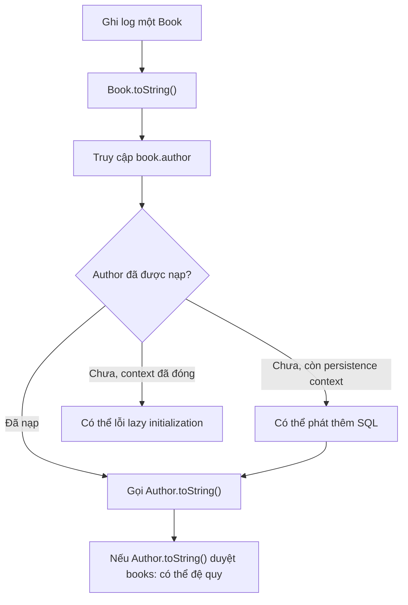

# Tránh đưa quan hệ tải chậm vào equals, hashCode và toString

Khi thiết kế **entity và định danh** trong JPA, ba phương thức Java quen thuộc — `equals()`, `hashCode()` và `toString()` — có thể gây truy vấn SQL ngoài dự kiến nếu chúng truy cập các quan hệ được tải chậm (*lazy association*). Tệ hơn, trên mô hình quan hệ hai chiều, chúng có thể đi vòng giữa các entity, dẫn tới đệ quy vô hạn. Khi `EntityManager` đã đóng, truy cập quan hệ chưa nạp có thể gây lỗi tải dữ liệu.

Quy tắc nền tảng là:

> **Không đưa quan hệ `@ManyToOne`, `@OneToMany`, `@OneToOne`, `@ManyToMany` hoặc collection entity vào `equals()`, `hashCode()` và `toString()`.** Hãy chọn tiêu chí định danh ổn định, chỉ dùng các thuộc tính cần thiết và tránh duyệt đồ thị entity từ các phương thức này.

Bài học giải thích cơ chế xảy ra lỗi, cách lựa chọn chiến lược so sánh entity, các lưu ý với Hibernate proxy và cách dùng Lombok an toàn trong một ứng dụng JPA.

## 1. Ba phương thức này được gọi thường xuyên hơn bạn nghĩ

Các phương thức `equals`, `hashCode` và `toString` có vai trò khác nhau:

| Phương thức | Được dùng khi | Yêu cầu thiết kế trong entity |
|---|---|---|
| `equals(Object)` | So sánh hai đối tượng, tìm phần tử trong collection, kiểm tra trùng lặp | Phản ánh khái niệm bằng nhau đã chọn; tránh truy cập quan hệ |
| `hashCode()` | Đưa đối tượng vào `HashSet`, dùng làm khóa `HashMap` | Nhất quán với `equals`; không thay đổi khi đối tượng đang là khóa |
| `toString()` | Ghi log, debug, quan sát đối tượng hoặc nối chuỗi | Ngắn, an toàn, không tự động duyệt dữ liệu liên quan |

Ngay cả khi lập trình viên không gọi trực tiếp, framework ghi log, IDE debugger và thư viện tạo phương thức tự động vẫn có thể gọi chúng.

Ví dụ:

```java
log.debug("Order: {}", order);  // Logger có thể gọi order.toString().
Set<Book> books = new HashSet<>();
books.add(book);                 // HashSet gọi book.hashCode().
boolean found = books.contains(book);  // Dùng hashCode và có thể dùng equals.
```

Nếu các phương thức này duyệt `order.getCustomer()` hay `book.getReviews()`, hoạt động tưởng như chỉ xử lý đối tượng Java có thể kích hoạt SQL hoặc xảy ra lỗi ngoài ý muốn.

## 2. Lazy loading liên quan gì đến equals, hashCode và toString?

### 2.1. Quan hệ tải chậm hoạt động thế nào?

Giả sử có `Book` liên kết với `Author`:

```java
@Entity
public class Book {
    @Id
    @GeneratedValue(strategy = GenerationType.IDENTITY)
    private Long id;

    private String title;

    @ManyToOne(fetch = FetchType.LAZY)
    private Author author;
}
```

Khi query `Book`, JPA provider có thể chưa tải toàn bộ dữ liệu `Author`. Với Hibernate, quan hệ có thể được biểu diễn qua proxy hoặc cơ chế bytecode enhancement. Khi code thật sự truy cập nội dung liên quan, provider có thể phải thực thi truy vấn bổ sung.

```java
Book book = em.find(Book.class, bookId);

// Một số trường hợp sẽ phát thêm SQL để tải Author:
String authorName = book.getAuthor().getName();
```

Lưu ý mặc định của JPA: quan hệ `@ManyToOne` và `@OneToOne` có `FetchType.EAGER`, còn `@OneToMany` và `@ManyToMany` có `FetchType.LAZY`. Vì vậy, muốn biểu đạt ý định tải chậm ở `@ManyToOne`, nên khai báo `fetch = FetchType.LAZY` tường minh. Khả năng thực hiện lazy thực tế vẫn phụ thuộc loại quan hệ, provider và cấu hình.

### 2.2. Truy cập quan hệ trong phương thức tưởng như vô hại

Một cách triển khai nguy hiểm:

```java
@Override
public String toString() {
    return "Book{" +
            "id=" + id +
            ", title='" + title + '\'' +
            ", author=" + author +
            '}';
}
```

Nối `author` vào chuỗi có thể gọi `author.toString()`. Nếu `author` là proxy chưa nạp, provider có thể truy vấn cơ sở dữ liệu để lấy dữ liệu tác giả. Khi lấy danh sách nhiều `Book` và ghi log từng phần tử, thao tác này dễ làm tăng số truy vấn, thậm chí tạo ra hiện tượng N+1.



Điểm quan trọng: **`FetchType.LAZY` là chiến lược trì hoãn tải**, không phải cam kết rằng một lời gọi phương thức Java sẽ tuyệt đối không phát SQL. Với proxy của Hibernate, ngay cả lời gọi phương thức trên chính proxy (bao gồm phương thức do entity ghi đè) đôi khi cũng có thể làm proxy khởi tạo. Tuy vậy, loại bỏ truy cập quan hệ khỏi ba phương thức nói trên giúp ngăn con đường phổ biến dẫn đến việc duyệt cả đồ thị entity.

## 3. Những lỗi có thể xảy ra khi đưa association vào ba phương thức

### 3.1. N+1 query do toString hoặc equals

Ví dụ:

```java
List<Book> books = em.createQuery(
        "SELECT b FROM Book b", Book.class
).getResultList();

for (Book book : books) {
    System.out.println(book); // toString nếu duyệt author sẽ gây tải thêm.
}
```

Query chính có thể chỉ lấy danh sách sách; mỗi lần `toString()` đọc thuộc tính của tác giả chưa nạp lại có thể thực hiện thêm truy vấn. Số SQL cụ thể phụ thuộc các tác giả trùng nhau, cache và provider.

Với `equals()` hoặc `hashCode()`, vấn đề còn khó nhận biết hơn: chỉ một thao tác `Set.contains(book)` cũng có thể gián tiếp duyệt quan hệ.

### 3.2. Lỗi khi EntityManager đã đóng

Đối tượng đã được tải trước đó có thể ở trạng thái *detached* khi `EntityManager` đóng. Nếu quan hệ lazy chưa được nạp mà `toString()` cố truy cập nó, Hibernate có thể ném `LazyInitializationException`:

```java
Book book;

EntityManager em = emf.createEntityManager();
try {
    book = em.find(Book.class, bookId);
} finally {
    em.close();
}

// Không bảo đảm an toàn nếu toString() đi qua lazy association.
System.out.println(book);
```

Lỗi này phụ thuộc trạng thái nạp thực tế của quan hệ và cách triển khai provider. Không nên “sửa” bằng cách tự ý đổi mọi quan hệ thành `EAGER`, vì có thể khiến ứng dụng tải dữ liệu nhiều hơn mức cần thiết.

### 3.3. Đệ quy vô hạn với quan hệ hai chiều

Ví dụ cấu trúc hai chiều:

```java
@Entity
class Author {
    @Id
    private Long id;

    @OneToMany(mappedBy = "author")
    private List<Book> books = new ArrayList<>();
}

@Entity
class Book {
    @Id
    private Long id;

    @ManyToOne(fetch = FetchType.LAZY)
    private Author author;
}
```

Nếu `Book.toString()` in `author`, trong khi `Author.toString()` lại in `books`, hai phương thức có thể lặp:

```text
Book.toString()
  -> Author.toString()
       -> Book.toString()
            -> Author.toString()
                 -> ...
```

Kết quả có thể là `StackOverflowError`. Vấn đề tương tự xảy ra khi `equals()` hoặc `hashCode()` so sánh toàn bộ quan hệ hai chiều.

### 3.4. Collection thay đổi làm hashCode không ổn định

Giả sử `Book.hashCode()` tính từ `reviews`. Khi một đánh giá mới được thêm vào collection, hash code của sách có thể thay đổi. Nếu sách đã nằm trong `HashSet`, thao tác `contains` hoặc `remove` về sau có thể không tìm thấy nó.

Ngay cả khi collection đã được tải đầy đủ, **dùng một quan hệ có thể thay đổi để tính hashCode vẫn sai về mặt hợp đồng HashMap/HashSet**.

### 3.5. Nguy cơ tiết lộ dữ liệu khi ghi log

Quan hệ entity có thể chứa email khách hàng, thông tin nội bộ hoặc nhiều dữ liệu không cần ghi log. Một `toString()` in toàn bộ đồ thị khiến log chứa dữ liệu nhạy cảm và quá dài. Chỉ ghi những trường được chủ động chọn cho mục đích quan sát.

## 4. Hiểu định danh entity trước khi viết equals

Trong JPA, cần phân biệt ba khái niệm:

1. **Đồng nhất tham chiếu Java:** `a == b`, nghĩa là cùng một đối tượng trong bộ nhớ.
2. **Đồng nhất bản ghi DB:** hai entity biểu diễn cùng khóa chính trong cùng kiểu entity và phạm vi định danh.
3. **Đồng nhất nghiệp vụ:** hai đối tượng có cùng khóa nghiệp vụ ổn định, chẳng hạn mã sản phẩm duy nhất do hệ thống quy định.

Trong cùng một persistence context, JPA duy trì một instance được quản lý cho một identity tương ứng. Nhưng khi hai `EntityManager` khác nhau tải cùng bản ghi, ta có thể nhận được hai object Java khác nhau:

```java
Book fromFirstManager = em1.find(Book.class, 42L);
Book fromSecondManager = em2.find(Book.class, 42L);

// Không nên giả định hai tham chiếu Java là một.
boolean sameReference = fromFirstManager == fromSecondManager;

// Có xem chúng bằng nhau hay không phụ thuộc chiến lược equals().
boolean sameEntity = fromFirstManager.equals(fromSecondManager);
```

Không có một công thức `equals/hashCode` duy nhất phù hợp mọi entity. Cần chọn chính sách tương ứng với vòng đời và cách dùng entity trong collection.

### Ba chiến lược thường gặp

| Chiến lược | Phù hợp khi | Lưu ý |
|---|---|---|
| Không ghi đè `equals/hashCode` | Chủ yếu làm việc với managed entity trong một persistence context; không cần so sánh detached theo DB identity | Hai instance tải ở hai context khác nhau không tự bằng nhau |
| Dùng khóa nghiệp vụ bất biến (*natural key*) | Có thuộc tính duy nhất, tồn tại ngay khi tạo entity và không thay đổi trong vòng đời | Đảm bảo tính duy nhất ở database, không đưa quan hệ vào khóa |
| Dùng khóa chính database | Cần xem hai entity đã lưu có cùng loại và cùng ID là bằng nhau | ID có thể `null` trước persist, hash code phải ổn định qua thời điểm gán ID; để ý proxy và inheritance |

**Không nên dùng tất cả field** để so sánh entity. Thuộc tính mutable hoặc quan hệ có thể làm kết quả `equals` thay đổi, gây tác dụng phụ khi object ở trong cấu trúc dữ liệu dạng hash.

## 5. Ví dụ entity an toàn khi dùng khóa chính được tạo bởi database

Một cách thực dụng cho entity có `@GeneratedValue` là:

- Dùng ID khác `null` để xác định hai entity đã tồn tại có bằng nhau hay không.
- Không xem hai entity mới cùng có ID `null` là bằng nhau, trừ khi là cùng tham chiếu.
- Dùng một giá trị `hashCode` cố định theo loại entity, để giá trị không đổi khi ID được gán.
- Không đọc quan hệ trong `equals`, `hashCode` hoặc `toString`.

Ví dụ Java 17 với Jakarta Persistence:

```java
package example.domain;

import jakarta.persistence.*;
import java.util.ArrayList;
import java.util.List;
import java.util.Objects;

@Entity
@Table(name = "books")
public class Book {

    @Id
    @GeneratedValue(strategy = GenerationType.IDENTITY)
    private Long id;

    @Column(nullable = false)
    private String title;

    @ManyToOne(fetch = FetchType.LAZY, optional = false)
    @JoinColumn(name = "author_id", nullable = false)
    private Author author;

    @OneToMany(mappedBy = "book", fetch = FetchType.LAZY)
    private List<Review> reviews = new ArrayList<>();

    protected Book() {
        // Constructor không tham số dành cho JPA.
    }

    public Book(String title, Author author) {
        this.title = Objects.requireNonNull(title);
        this.author = Objects.requireNonNull(author);
    }

    public Long getId() {
        return id;
    }

    public String getTitle() {
        return title;
    }

    public Author getAuthor() {
        return author;
    }

    public List<Review> getReviews() {
        return reviews;
    }

    @Override
    public boolean equals(Object other) {
        if (this == other) {
            return true;
        }
        if (!(other instanceof Book that)) {
            return false;
        }

        Long currentId = getId();
        return currentId != null && currentId.equals(that.getId());
    }

    @Override
    public int hashCode() {
        return Book.class.hashCode();
    }

    @Override
    public String toString() {
        return "Book{id=" + getId()
                + ", title='" + title + "'}";
    }
}
```

Trong ví dụ này, `Author` và `Review` là các entity khác được ánh xạ phù hợp trong ứng dụng. Ta chỉ tập trung vào phần liên quan đến định danh và phương thức cơ bản của `Book`.

### Vì sao không có author và reviews trong ba phương thức?

Đối với `equals` và `hashCode`, chúng **không định nghĩa identity** của sách. Một đánh giá mới hay việc chuyển tác giả (nếu nghiệp vụ cho phép) không nên khiến cùng bản ghi sách biến thành một khóa khác trong `Set`.

Đối với `toString`, chúng là những quan hệ có thể bị tải chậm. In ID và tiêu đề vừa đủ để nhận diện sách trong log, đồng thời tránh duyệt hàng loạt review hoặc author.

### Vì sao kiểm tra ID khác null?

Hai `Book` vừa tạo chưa có khóa chính DB:

```java
Book first = new Book("Java", author);
Book second = new Book("Java", author);

// first và second là hai đối tượng mới khác nhau.
// Chúng không được xem là cùng một bản ghi chỉ vì id đều null.
System.out.println(first.equals(second)); // false
System.out.println(first.equals(first));  // true
```

Nếu viết `Objects.equals(this.id, other.id)` mà không kiểm tra `id != null`, hai entity mới đều `null` có thể bị coi là bằng nhau — một lỗi phổ biến.

### Vì sao hashCode không tính từ ID?

Ví dụ lỗi:

```java
@Override
public int hashCode() {
    return Objects.hashCode(id);
}
```

Khi entity mới được thêm vào `HashSet` trước khi persist, `id` có thể là `null`. Sau khi persist và khóa được tạo, `id` thay đổi, kéo theo giá trị hash code:

```java
Book book = new Book("Java Persistence", author);
Set<Book> set = new HashSet<>();

set.add(book);

// Sau khi thực hiện persist(book), provider gán ID.
// Nếu hashCode() dựa vào ID, vị trí tra cứu của Set có thể lệch.
em.persist(book);

boolean stillFound = set.contains(book);
```

Kết quả `stillFound` không đáng tin nếu hash code thay đổi lúc object vẫn nằm trong set. Dùng `Book.class.hashCode()` tạo một hash code cố định cho toàn bộ `Book`, nên sự kiện gán ID không làm hash code thay đổi.

Đánh đổi: nhiều entity cùng lớp có cùng hash bucket, có thể khiến thao tác hash collection kém hiệu quả khi collection rất lớn. Đây là một đánh đổi có chủ đích nhằm bảo toàn tính ổn định; không nên tự đổi sang hash dựa vào generated ID mà bỏ qua vòng đời entity.

### Phạm vi áp dụng của ví dụ

Đây là **một chiến lược minh họa cho entity `Book` không dùng kế thừa entity phức tạp**. `instanceof Book` xử lý được nhiều kiểu proxy kế thừa `Book`, nhưng với hierarchy có nhiều concrete entity subclass hoặc chiến lược định danh khác nhau, phép so sánh có thể cần xác định **kiểu entity thực tế**. Không sao chép nguyên xi công thức này cho mọi hierarchy.

Ngoài ra, với Hibernate proxy chưa khởi tạo, việc gọi `equals` hoặc `toString` trên chính proxy vẫn có thể dẫn đến proxy initialization tùy cách provider thực hiện method interception. Mã trên bảo đảm không cố ý truy cập quan hệ, nhưng **không phải lời hứa rằng mọi lần gọi trên proxy đều không phát SQL**.

## 6. Kiểm soát proxy và kiểu entity khi so sánh

Hibernate có thể tạo proxy subclass cho entity lazy. Vì vậy:

```java
Book entity = em.find(Book.class, bookId);
Book reference = em.getReference(Book.class, bookId);
```

`reference` có thể là proxy, không có cùng `getClass()` như instance `Book` thường. Do đó, cách kiểm tra sau dễ gây lỗi bất đối xứng hoặc coi hai object cùng bản ghi là khác nhau:

```java
if (this.getClass() != other.getClass()) {
    return false;
}
```

Đối với entity không có hierarchy kế thừa phức tạp, `instanceof` cùng cách kiểm tra ID có thể đủ cho yêu cầu ứng dụng. Khi cần so sánh loại entity thực tế (ví dụ các subclass có thể có cùng giá trị ID), có thể dùng metadata của provider.

Ví dụ **riêng cho Hibernate**:

```java
import org.hibernate.proxy.HibernateProxy;

static Class<?> effectiveEntityClass(Object value) {
    if (value instanceof HibernateProxy proxy) {
        return proxy.getHibernateLazyInitializer().getPersistentClass();
    }
    return value.getClass();
}
```

Từ đó có thể so sánh `effectiveEntityClass(this)` và `effectiveEntityClass(other)` trước khi so sánh ID, đồng thời dùng loại entity hiệu dụng nhất quán cho `hashCode`. Đây là API của Hibernate, **không phải Jakarta Persistence portable API**. Những chiến lược dựa trên proxy cần được thiết kế nhất quán giữa `equals` và `hashCode`, đặc biệt khi sử dụng entity inheritance.

Không nên dùng quan hệ như `getAuthor().getId()` để “bù” cho việc phân biệt loại entity. Cách đó đưa association trở lại logic định danh và làm tăng sự phụ thuộc vào lazy proxy.

## 7. Khi có natural key bất biến, có thể dùng khóa nghiệp vụ

Giả sử hệ thống có mã sản phẩm `sku` duy nhất, được cấp ngay khi tạo object và **không được thay đổi** sau đó. Đây có thể là lựa chọn tốt hơn generated ID khi ứng dụng cần so sánh cả entity mới chưa persist.

```java
@Entity
@Table(name = "products")
public class Product {

    @Id
    @GeneratedValue(strategy = GenerationType.IDENTITY)
    private Long id;

    @Column(nullable = false, unique = true, updatable = false)
    private String sku;

    @ManyToOne(fetch = FetchType.LAZY)
    private Category category;

    protected Product() {
    }

    public Product(String sku, Category category) {
        this.sku = Objects.requireNonNull(sku);
        this.category = category;
    }

    public String getSku() {
        return sku;
    }

    @Override
    public boolean equals(Object other) {
        if (this == other) {
            return true;
        }
        if (!(other instanceof Product that)) {
            return false;
        }
        return sku != null && sku.equals(that.getSku());
    }

    @Override
    public int hashCode() {
        return sku == null ? 0 : sku.hashCode();
    }

    @Override
    public String toString() {
        return "Product{sku='" + sku + "'}";
    }
}
```

Đoạn mã giả định `Category` là entity riêng. `sku` được truyền từ lúc khởi tạo và phải luôn ổn định trước khi entity được dùng làm phần tử `HashSet` hoặc khóa `HashMap`. Khi object đã được lưu vào hash collection, **không được thay `sku`**. Cần có unique constraint ở database để đảm bảo sự duy nhất ngay cả dưới các giao dịch cạnh tranh.

`updatable = false` chỉ điều khiển SQL update mà JPA sinh cho cột này; nó không tự ngăn mọi thay đổi trên object Java, SQL trực tiếp hoặc cập nhật ngoài hệ thống. Tính bất biến phải là quy tắc nghiệp vụ được thực thi nhất quán.

Không dùng một trường *có thể đổi* như tiêu đề, giá bán, tên hiển thị hoặc địa chỉ nhận hàng làm natural key. Một field đơn giản nhưng mutable vẫn làm `equals/hashCode` trở nên nguy hiểm.

## 8. Lombok: nguồn lỗi phổ biến trong JPA entity

### 8.1. Tránh `@Data` trên entity có quan hệ

Lombok `@Data` sinh getter, setter, `toString`, `equals`, `hashCode` cùng một số thành phần khác dựa trên field của class. Nếu dùng không kiểm soát trên entity có association, các phương thức sinh ra có thể bao gồm `author`, `reviews` hoặc những field không nên tham gia identity.

Ví dụ không nên dùng:

```java
@Data
@Entity
public class Book {
    @Id
    @GeneratedValue(strategy = GenerationType.IDENTITY)
    private Long id;

    private String title;

    @ManyToOne(fetch = FetchType.LAZY)
    private Author author;

    @OneToMany(mappedBy = "book")
    private List<Review> reviews = new ArrayList<>();
}
```

Các quan hệ hai chiều làm nguy cơ đệ quy tăng lên; collection lazy làm số truy vấn và vòng đời persistence context trở thành vấn đề khó kiểm soát.

### 8.2. Cách dùng Lombok có chọn lọc

Có thể chỉ sinh getter và sinh `toString` từ field được chỉ định rõ:

```java
@Getter
@ToString(onlyExplicitlyIncluded = true)
@Entity
public class Book {

    @Id
    @GeneratedValue(strategy = GenerationType.IDENTITY)
    @ToString.Include
    private Long id;

    @ToString.Include
    private String title;

    @ManyToOne(fetch = FetchType.LAZY)
    private Author author;

    @OneToMany(mappedBy = "book")
    private List<Review> reviews = new ArrayList<>();

    protected Book() {
    }

    // equals/hashCode: viết thủ công theo chiến lược ID đã chọn.
}
```

Ví dụ trên là minh họa các annotation Lombok; để biên dịch phải có dependency và cấu hình Lombok tương ứng. Với `onlyExplicitlyIncluded = true`, chỉ `id` và `title` xuất hiện trong `toString`. Đồng thời, không yêu cầu Lombok tự sinh `equals/hashCode` từ toàn bộ state của entity.

Nếu dự án đã dùng `@ToString` hoặc `@EqualsAndHashCode` mặc định, có thể loại từng association bằng:

```java
@ToString.Exclude
@EqualsAndHashCode.Exclude
@ManyToOne(fetch = FetchType.LAZY)
private Author author;
```

Và áp dụng tương tự với collection. **Tuy nhiên, chỉ exclude quan hệ chưa đủ bảo đảm equals/hashCode đúng**: nếu Lombok vẫn đưa generated ID vào hash code thì giá trị hash có thể thay đổi khi persist. Cần chọn rõ chiến lược định danh thay vì chỉ thêm annotation loại trừ.

### 8.3. Tại sao không dùng `@EqualsAndHashCode.Include` tùy ý?

`@EqualsAndHashCode.Include` hữu ích với **natural key thực sự bất biến**. Nhưng nếu đánh dấu `@Id @GeneratedValue` làm field duy nhất được include, hai entity mới có ID `null` có thể bị xem là bằng nhau, và hash code có thể thay đổi sau persist. Đây là lý do phương án viết `equals/hashCode` thủ công cho generated ID thường dễ kiểm soát hơn.

Ngoài ra, trường trong superclass hoặc quan hệ được ánh xạ bằng phương thức getter cũng cần được cân nhắc trong thiết kế Lombok. Tránh để annotation quyết định identity theo hiệu ứng mặc định mà người bảo trì không nhìn thấy.

## 9. toString an toàn để log và debug

Phương án đơn giản nhất là hiển thị **ID và một số scalar field**:

```java
@Override
public String toString() {
    return "Order{id=" + id + ", status=" + status + "}";
}
```

Không cần in đối tượng `customer`, `items`, `payments` hoặc `shipments`. Khi cần thông tin liên quan, hãy tải và định dạng nó **có chủ đích** trong service hoặc query dành cho log, với giới hạn dữ liệu và quyền truy cập rõ ràng.

Thay vì:

```java
log.info("Saved order: {}", order); // Nếu toString duyệt quan hệ thì nguy hiểm.
```

Có thể chọn:

```java
log.info("Saved order id={}, status={}",
        order.getId(), order.getStatus());
```

Khi gọi trực tiếp `getId()` hay `getStatus()` trên một **entity proxy chưa khởi tạo**, khả năng phát SQL còn phụ thuộc provider và field truy cập; ví dụ log này tránh **duyệt association** nhưng không có nghĩa mọi getter trên proxy đều miễn phí.

### DTO cho dữ liệu cần hiển thị

Đừng biến `toString()` của entity thành bản báo cáo đầy đủ. Nếu cần trả về dữ liệu sản phẩm và tên danh mục, dùng truy vấn projection hoặc DTO riêng:

```java
public record BookSummary(
        Long id,
        String title,
        String authorName
) {}
```

```java
List<BookSummary> summaries = em.createQuery(
        """
        SELECT new example.dto.BookSummary(
            b.id, b.title, a.name
        )
        FROM Book b JOIN b.author a
        ORDER BY b.id
        """,
        BookSummary.class
).getResultList();
```

Giả định `BookSummary` ở package `example.dto` và `Author` có field `name`. Query này thể hiện rõ dữ liệu cần chọn và truy vấn join, không phải đợi logger vô tình gọi lazy getter. DTO giúp định nghĩa hợp đồng dữ liệu cho API, log hoặc báo cáo độc lập với entity graph.

Cần phân biệt: JSON serializer như Jackson cũng có thể duyệt lazy association nếu serialize thẳng entity. `@ToString.Exclude` **không điều khiển JSON serialization**. Với API, hãy dùng DTO hoặc cấu hình serialization riêng; không coi việc sửa `toString` là đã giải quyết mọi đường tải lazy.

## 10. Tình huống thực tế và cách xử lý

| Tình huống | Biểu hiện | Hướng xử lý |
|---|---|---|
| Entity dùng Lombok `@Data` và có `@OneToMany` | Log hoặc `HashSet` phát truy vấn ngoài dự kiến | Tách annotation, loại association khỏi ba phương thức |
| `Book.toString()` gọi `Author.toString()` rồi in lại `books` | `StackOverflowError` | Chỉ in field scalar được chọn |
| `equals` so sánh mọi field gồm `reviews` | So sánh entity rất chậm, có thể đọc DB | Dùng chính sách identity: reference, stable natural key hoặc DB ID |
| `hashCode` dựa vào generated ID | `Set.contains` có thể sai sau persist | Giữ hash ổn định khi ID thay đổi, hoặc không đưa entity vào hash collection trước khi có ID |
| `getClass()` dùng trực tiếp với Hibernate proxy | Cùng bản ghi nhưng bị coi khác kiểu | Thiết kế so sánh kiểu nhất quán, cân nhắc proxy và inheritance |
| Ghi log entity detached còn lazy relation chưa tải | `LazyInitializationException` | Không duyệt relation trong log; query DTO nếu cần dữ liệu |
| Đổi mọi `LAZY` thành `EAGER` để tránh exception | Endpoint tải nhiều dữ liệu và khó kiểm soát | Thiết kế ranh giới transaction và fetch plan đúng cho từng use case |
| JSON trực tiếp entity có quan hệ hai chiều | Dữ liệu trả về quá lớn hoặc vòng lặp khi serialize | DTO hoặc cấu hình serialization theo API contract |

## 11. Bài thực hành: quan sát sự khác biệt

### Bài 1 — Phát hiện truy vấn do log

Tạo hai entity `Author` và `Book` với `Book.author` khai báo `fetch = FetchType.LAZY`. Tải danh sách sách rồi ghi log từng `Book`. Thử hai phiên bản:

- Phiên bản A: `Book.toString()` nối thêm `author.getName()`.
- Phiên bản B: `Book.toString()` chỉ in `id` và `title`.

Bật log SQL trong môi trường thử nghiệm và quan sát số truy vấn. Tùy cache và provider, số lượng có thể khác, nhưng bài tập cho thấy vì sao ghi log một object có thể kéo theo truy cập DB.

### Bài 2 — Tái hiện vòng lặp quan hệ hai chiều

Cho `Author` giữ `List<Book>` và `Book` giữ `Author`. Viết thử `toString` in cả quan hệ ở hai phía trên dữ liệu nhỏ trong môi trường thử nghiệm, rồi thay bằng `toString` chỉ in scalar field. Giải thích tại sao vòng lặp xuất hiện.

### Bài 3 — Kiểm tra hashCode khi persist

Xây dựng `Book` với ID tự sinh, thêm `Book` mới vào `HashSet` trước persist. So sánh kết quả khi `hashCode()` dựa trên `id` và khi dùng `Book.class.hashCode()` ổn định. Mục tiêu là hiểu quy tắc của hash collection, **không phải** tối ưu query.

### Bài 4 — So sánh object từ hai EntityManager

Dùng hai `EntityManager` tải cùng một bản ghi sách. Kiểm tra `a == b`, `a.equals(b)` theo các chiến lược so sánh đã học. Sau đó thử `em.getReference(Book.class, id)` để quan sát hành vi proxy của provider.

### Bài 5 — Kiểm tra Lombok

Thay `@Data` trên entity bằng `@Getter` và `@ToString(onlyExplicitlyIncluded = true)`; tự viết `equals/hashCode` theo chiến lược identity phù hợp. So sánh code sinh ra và hành vi khi gọi `toString` trên collection có quan hệ lazy.

## 12. Nguyên tắc áp dụng cho entity trong dự án

- **Định danh:** Xác định rõ entity có cần so sánh detached instance hay không. Nếu không, có thể giữ `equals/hashCode` mặc định; nếu có, dùng khóa nghiệp vụ bất biến hoặc generated ID với quy tắc rõ ràng.
- **Tính ổn định:** Những field thay đổi sau khi object vào `HashSet/HashMap` không được làm thay đổi hash code.
- **Quan hệ:** Không để association, collection entity hoặc thuộc tính phụ thuộc vào chúng tham gia `equals`, `hashCode`, `toString`.
- **Proxy:** Hiểu khả năng lazy initialization khi gọi method trên proxy. Cân nhắc proxy và entity inheritance nếu logic equality phân biệt kiểu runtime.
- **Logging:** Chỉ in ID, status, mã hoặc các scalar field cần thiết; không in toàn bộ entity graph hay dữ liệu nhạy cảm.
- **Lombok:** Tránh `@Data` cho entity có quan hệ. Sinh phương thức có chọn lọc hoặc tự triển khai khi identity cần các quy tắc riêng.
- **Quan sát SQL:** Khi nghi ngờ truy vấn bất ngờ, xem SQL và call path thực tế. Không chữa các vấn đề của `toString` bằng cách tải eager toàn bộ quan hệ.

**Kết luận:** Trong JPA, association mang theo cơ chế tải dữ liệu và vòng đời persistence context. Còn `equals` và `hashCode` phải mô tả identity ổn định; `toString` chỉ nên cung cấp thông tin nhận diện gọn. Giữ ba phương thức này độc lập với quan hệ lazy giúp tránh các truy vấn vô ý, lỗi detached entity, vòng lặp quan hệ và sự cố khi dùng collection dạng hash.
