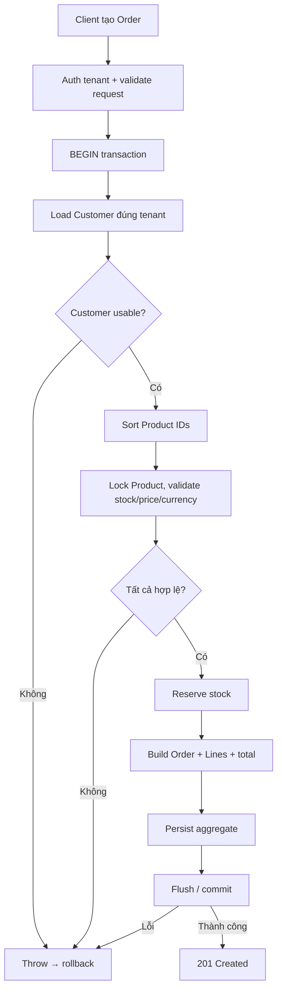
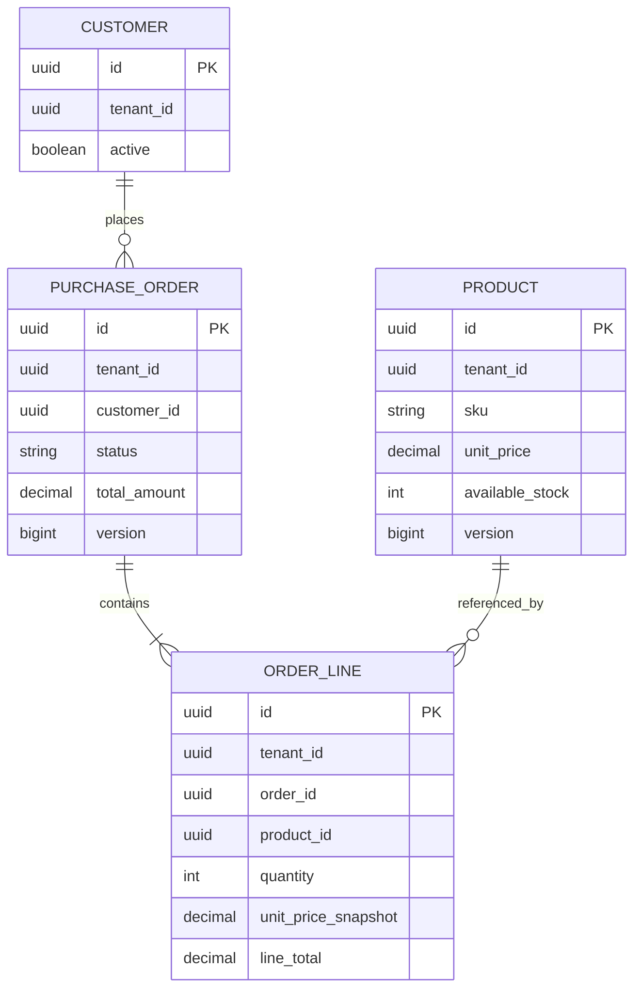
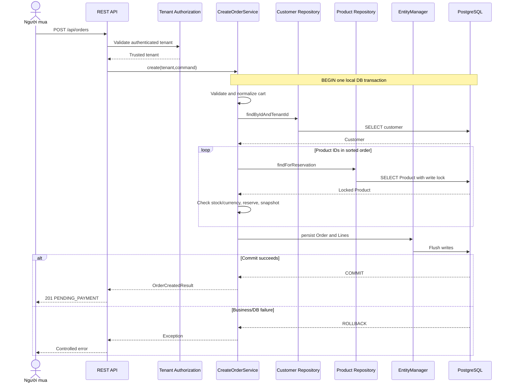

# Thực hiện nghiệp vụ tạo đơn hàng trong một giao dịch

Một khách hàng bấm **Đặt hàng**. Server phải kiểm tra quyền và giỏ hàng, xác minh sản phẩm đang bán, giữ đủ tồn kho, chốt đơn giá, tạo đơn hàng cùng từng dòng hàng rồi trả mã đơn. Dù người dùng chỉ thấy một nút bấm, cơ sở dữ liệu phải thực hiện **nhiều thay đổi nhất quán**.

Nếu Order được lưu nhưng OrderLines không được lưu, đơn hàng không có hàng. Nếu OrderLines thành công nhưng giữ tồn kho thất bại, hệ thống có thể bán hàng không còn. Nếu hai người cùng mua sản phẩm chỉ còn một đơn vị, thao tác kiểm tra tồn kho phải được bảo vệ khỏi race condition. Nếu response HTTP thất lạc sau commit, lần retry không được vô tình tạo đơn thứ hai.

Bài **“Thực hiện nghiệp vụ tạo đơn hàng trong một giao dịch”** thuộc chương **Thực hành tổng hợp**, module **Data Persistence Relational Access ORM JPA**. Chúng ta triển khai một luồng từ API tới entity, repository, transaction, database và integration tests bằng **Java, Spring Boot, Jakarta Persistence, Spring Data JPA và PostgreSQL**.

Mục tiêu cuối bài:

- Tạo một Order cùng những OrderLines hợp lệ.
- Trừ số lượng hàng khả dụng của từng Product trong **cùng database transaction**.
- Bảo vệ giá, tenant, state và stock invariants.
- Ngăn bán vượt tồn kho khi nhiều requests chạy đồng thời.
- Rollback **toàn bộ** nếu bất kỳ bước bắt buộc nào lỗi.
- Phân biệt database transaction với thanh toán, email và message broker.
- Kiểm chứng bằng integration tests trên database thật, kể cả lỗi và concurrency.
- Xử lý hợp lý khi HTTP timeout sau commit và client retry.

> **Nguyên tắc trung tâm:** Một nghiệp vụ tạo Order phải có **một transaction boundary ở application service** bao trùm tất cả thay đổi cần atomic trong cùng database. Annotation `@Transactional` chỉ quản lý ranh giới giao dịch; domain invariants, concurrency control, quyền tenant và idempotency vẫn cần được thiết kế chủ động.

---

# Phần I — Phân tích yêu cầu trước khi viết code

## 1. Kịch bản tạo đơn hàng

Client gửi:

```http
POST /api/orders
Content-Type: application/json

{
  "customerId": "6b9c40cc-38d0-4e4e-93b2-020a8cb40201",
  "items": [
    {
      "productId": "096d4f9a-efc9-4a79-9f7e-43c08e131101",
      "quantity": 2
    },
    {
      "productId": "096d4f9a-efc9-4a79-9f7e-43c08e131102",
      "quantity": 1
    }
  ]
}
```

Giả sử:

```text
Customer C1: active=true, tenant=ACME
Product P1: stock=5, price=125000.00, currency=VND
Product P2: stock=4, price=125000.00, currency=VND
```

Kết quả mong đợi sau commit:

```text
Order:
    status = PENDING_PAYMENT
    totalAmount = 375000.00
    currency = VND
    customer = C1
    lines = [P1 × 2, P2 × 1]

Product P1:
    availableStock = 3

Product P2:
    availableStock = 3
```

Không có payment charge hoặc email tự động trong transaction tạo Order này.

## 2. Vì sao Order ban đầu là PENDING_PAYMENT?

Đặt hàng và thu tiền là **hai trách nhiệm khác nhau**.

Ở bước tạo:

```text
Order PENDING_PAYMENT
Stock reserved
Database COMMIT
```

Sau đó mới có thể:

```text
PaymentAttempt CREATED
Gateway charge
Gateway confirms success
Order → PAID
```

JPA `@Transactional` không thể rollback một giao dịch thanh toán của nhà cung cấp qua HTTP khi transaction database lỗi. Vì vậy ta không gọi payment gateway trong transaction tạo đơn.

## 3. Những điều kiện đúng sau khi commit

| Bất biến | Cách bảo vệ |
|---|---|
| Đơn có ít nhất một dòng hàng | Domain validation |
| Mỗi dòng có quantity dương | Input/domain validation + DB CHECK |
| Customer thuộc tenant đã xác thực | Tenant-scoped query + FK tenant-aware |
| Product thuộc tenant | Tenant-scoped locked query + FK |
| Product đang active | Business validation trong transaction |
| Tồn kho không âm | Pessimistic row locks + domain check + DB CHECK |
| Giá của OrderLine là giá đã chốt | Snapshot từ Product đang được khóa |
| Tổng đơn bằng tổng các dòng | Tính trong domain từ Line snapshots |
| Không trộn currency | Currency check |
| Order/Lines/Stock cùng commit hoặc rollback | Một DB transaction |
| Không tự đánh dấu PAID | Trạng thái khởi tạo PENDING_PAYMENT |

Không có một annotation JPA duy nhất bảo vệ tất cả những điều trên.

## 4. Invariants và database transaction khác nhau

**Transaction atomicity** đảm bảo các thay đổi trong transaction được commit hoặc rollback cùng nhau. Nhưng một transaction vẫn có thể commit dữ liệu sai nếu code cho quantity âm hoặc giá client gửi làm giá chính thức.

Do đó:

```text
Authorization
+ Input validation
+ Domain invariants
+ Database constraints
+ Concurrency control
+ Transaction boundary
= Quy trình tạo đơn an toàn
```

## 5. Giới hạn của một local transaction

Những thao tác có thể cùng local transaction khi chung một database/transaction manager:

- UPDATE Product stock.
- INSERT PurchaseOrder.
- INSERT OrderLine.
- INSERT OutboxEvent.

Những thao tác **không tự được rollback** theo database:

- Payment gateway.
- Email, SMS.
- HTTP microservice khác.
- Object storage.
- Kafka/RabbitMQ publish.
- Search index.

Đừng dùng cụm “tất cả trong một transaction” cho cả HTTP và SQL nếu không có distributed protocol được thiết kế riêng.

## 6. ACID trong kịch bản này

| ACID | Ví dụ |
|---|---|
| Atomicity | Không có Order committed nếu giữ một Product thất bại |
| Consistency | Không có stock âm, OrderLine thiếu parent, hoặc total sai |
| Isolation | Hai buyers cùng Product phải được kiểm stock trên state được bảo vệ |
| Durability | Sau commit thành công, Order/Lines/stock tồn tại theo bảo đảm DB |

Isolation là chỗ dễ sai nhất khi implement nghiệp vụ thương mại điện tử.

## 7. Race condition cổ điển

Product chỉ còn một đơn vị.

```text
Transaction T1                    Transaction T2
--------------------------------------------------
SELECT stock = 1
                                  SELECT stock = 1
if stock>=1 → true
                                  if stock>=1 → true
Create Order A
                                  Create Order B
Update stock
                                  Update stock
COMMIT
                                  COMMIT
```

Nếu không có row lock, optimistic concurrency hoặc atomic conditional UPDATE thích hợp, cả hai có thể tưởng mình mua được hàng.

**Mở hai transactions** không tự biến check-then-update thành an toàn ở mọi isolation level.

## 8. Chiến lược thực hành được chọn

Bài dùng **pessimistic row locking**:

```java
@Lock(LockModeType.PESSIMISTIC_WRITE)
```

Luồng:

1. Mở transaction.
2. Lấy Product bằng truy vấn có `PESSIMISTIC_WRITE`.
3. Kiểm `availableStock >= quantity` khi Product đã được khóa.
4. Trừ stock trên managed entity.
5. Tạo Order/Lines.
6. Commit.

Các buyers tranh cùng Product sẽ phải đợi/timeout tùy DB và lock settings.

## 9. Khóa Product theo thứ tự cố định

Hai carts:

```text
Cart A: Product X rồi Y
Cart B: Product Y rồi X
```

Nếu mỗi transaction khóa theo input order, nguy cơ deadlock tăng.

Chuẩn hóa thành:

```text
Cart A: lock X rồi Y
Cart B: lock X rồi Y
```

Sắp xếp Product IDs trước khi lấy lock giúp thống nhất thứ tự. Đây là biện pháp **giảm** deadlock, không bảo đảm mọi deadlock biến mất vì triggers, foreign keys và writers khác vẫn có thể ảnh hưởng.

## 10. Sơ đồ giao dịch



---

# Phần II — Thiết kế database và các mối quan hệ

## 11. Data model



OrderLine giữ Product ID và snapshot giá bán. Không tính lại giá lịch sử từ Product.currentPrice.

## 12. DDL PostgreSQL — Customer

```sql
CREATE TABLE customers (
    id UUID PRIMARY KEY,
    tenant_id UUID NOT NULL,
    display_name VARCHAR(200) NOT NULL,
    active BOOLEAN NOT NULL DEFAULT TRUE,
    CONSTRAINT uq_customer_tenant_id
        UNIQUE (tenant_id, id)
);
```

Khóa `UNIQUE(tenant_id,id)` phục vụ composite FK từ Order để bảo vệ tenant alignment.

## 13. DDL PostgreSQL — Product

```sql
CREATE TABLE products (
    id UUID PRIMARY KEY,
    tenant_id UUID NOT NULL,
    sku VARCHAR(100) NOT NULL,
    active BOOLEAN NOT NULL DEFAULT TRUE,
    currency CHAR(3) NOT NULL,
    unit_price NUMERIC(19,2) NOT NULL,
    available_stock INTEGER NOT NULL,
    version BIGINT NOT NULL DEFAULT 0,
    CONSTRAINT uq_product_tenant_id
        UNIQUE (tenant_id,id),
    CONSTRAINT uq_product_tenant_sku
        UNIQUE (tenant_id,sku),
    CONSTRAINT ck_product_stock
        CHECK (available_stock >= 0),
    CONSTRAINT ck_product_price
        CHECK (unit_price >= 0)
);
```

Database CHECK là lớp bảo vệ cuối cùng chống stock âm; domain logic cung cấp error có ý nghĩa cho người dùng.

## 14. DDL PostgreSQL — Order

```sql
CREATE TABLE purchase_orders (
    id UUID PRIMARY KEY,
    tenant_id UUID NOT NULL,
    customer_id UUID NOT NULL,
    status VARCHAR(32) NOT NULL,
    currency CHAR(3) NOT NULL,
    total_amount NUMERIC(19,2) NOT NULL,
    created_at TIMESTAMPTZ NOT NULL,
    version BIGINT NOT NULL DEFAULT 0,
    CONSTRAINT uq_order_tenant_id
        UNIQUE (tenant_id,id),
    CONSTRAINT fk_order_customer_tenant
        FOREIGN KEY (tenant_id,customer_id)
        REFERENCES customers (tenant_id,id),
    CONSTRAINT ck_order_total
        CHECK (total_amount >= 0),
    CONSTRAINT ck_order_status
        CHECK (status IN (
            'PENDING_PAYMENT','PAID','CANCELLED','EXPIRED'
        ))
);
```

Order ban đầu `PENDING_PAYMENT`. Ràng buộc Customer thuộc tenant Order không chỉ dựa vào Java check.

## 15. DDL PostgreSQL — OrderLine

```sql
CREATE TABLE order_lines (
    id UUID PRIMARY KEY,
    tenant_id UUID NOT NULL,
    order_id UUID NOT NULL,
    product_id UUID NOT NULL,
    sku_snapshot VARCHAR(100) NOT NULL,
    quantity INTEGER NOT NULL,
    unit_price_snapshot NUMERIC(19,2) NOT NULL,
    line_total NUMERIC(19,2) NOT NULL,
    CONSTRAINT fk_line_order_tenant
        FOREIGN KEY (tenant_id,order_id)
        REFERENCES purchase_orders (tenant_id,id),
    CONSTRAINT fk_line_product_tenant
        FOREIGN KEY (tenant_id,product_id)
        REFERENCES products (tenant_id,id),
    CONSTRAINT ck_line_quantity
        CHECK (quantity > 0),
    CONSTRAINT ck_line_price
        CHECK (unit_price_snapshot >= 0),
    CONSTRAINT ck_line_total
        CHECK (line_total >= 0)
);
```

Composite FK bảo đảm OrderLine không được tham chiếu Order hoặc Product của tenant khác.

## 16. Indexes cần cân nhắc

```sql
CREATE INDEX idx_orders_tenant_customer_created
ON purchase_orders (
    tenant_id,customer_id,created_at DESC
);

CREATE INDEX idx_lines_tenant_order
ON order_lines (tenant_id,order_id);
```

Một unique constraint có thể đã tạo index cho `(tenant_id,id)`; không thêm index duplicate nếu không có query plan chứng minh cần.

Indexes giúp truy vấn nhưng không thay mandatory tenant filter, lock và integrity constraints.

## 17. Tại sao phải snapshot đơn giá?

Product hiện tại:

```text
P1 price=125000.00
```

Tạo OrderLine:

```text
productId=P1
quantity=2
unitPriceSnapshot=125000.00
lineTotal=250000.00
```

Một tuần sau Product đổi giá thành 149000.00. Lịch sử Order vẫn phải hiển thị đúng 250000.00 cho dòng mua cũ.

Vì vậy lưu `unitPriceSnapshot`, `skuSnapshot` và `lineTotal`. Không lấy `price` từ JSON client.

## 18. BigDecimal và tiền

```java
BigDecimal lineTotal = unitPrice.multiply(
    BigDecimal.valueOf(quantity)
);
```

Tránh dùng `double` cho phép tính tiền cần độ chính xác decimal. Tùy currency/business rule, phải xác định precision, scale, rounding và maximum total. Không cộng USD và VND trực tiếp khi chưa có conversion policy.

## 19. Một Order là một aggregate root

Order giữ những OrderLines của mình. Ở domain layer, thay vì để controller tạo tùy tiện Lines, dùng:

```java
order.addLine(productId,sku,quantity,price);
```

Order tự:

- Kiểm trạng thái cho phép thêm dòng.
- Tạo Line.
- Liên kết Line với Order.
- Cộng vào tổng đơn.
- Bảo đảm số lượng dòng > 0 trước khi persist.

Cách này giúp tránh các dòng hàng không thuộc aggregate hợp lệ.

---

# Phần III — Entity mapping

## 20. Customer entity

```java
package com.example.shop.domain;

import jakarta.persistence.*;
import java.util.UUID;

@Entity
@Table(name = "customers")
public class Customer {
    @Id
    private UUID id;

    @Column(name="tenant_id", nullable=false, updatable=false)
    private UUID tenantId;

    @Column(name="display_name", nullable=false)
    private String displayName;

    @Column(nullable=false)
    private boolean active;

    protected Customer() {}

    public UUID getId() { return id; }
    public UUID getTenantId() { return tenantId; }
    public boolean isActive() { return active; }
}
```

Trong thực tế, Customer có thể thêm customer-level permissions: thuộc đúng tenant không tự có nghĩa mọi user trong tenant được đặt hàng thay mọi Customer.

## 21. Product entity và reserve()

```java
package com.example.shop.domain;

import jakarta.persistence.*;
import java.math.BigDecimal;
import java.util.UUID;

@Entity
@Table(name = "products")
public class Product {

    @Id
    private UUID id;

    @Column(name="tenant_id", nullable=false, updatable=false)
    private UUID tenantId;

    @Column(nullable=false)
    private String sku;

    @Column(nullable=false)
    private boolean active;

    @Column(nullable=false, length=3)
    private String currency;

    @Column(name="unit_price", nullable=false)
    private BigDecimal unitPrice;

    @Column(name="available_stock", nullable=false)
    private int availableStock;

    @Version
    private Long version;

    protected Product() {}

    public UUID getId() { return id; }
    public UUID getTenantId() { return tenantId; }
    public String getSku() { return sku; }
    public String getCurrency() { return currency; }
    public BigDecimal getUnitPrice() { return unitPrice; }
    public int getAvailableStock() { return availableStock; }

    public void reserve(int quantity) {
        if (!active) {
            throw new ProductUnavailableException(
                "Product cannot be purchased"
            );
        }
        if (quantity <= 0) {
            throw new IllegalArgumentException(
                "Quantity must be positive"
            );
        }
        if (availableStock < quantity) {
            throw new InsufficientStockException(
                id, availableStock, quantity
            );
        }
        availableStock -= quantity;
    }
}
```

Không cho caller tùy ý `setAvailableStock(-100)`. Product giữ invariant riêng của inventory row.

## 22. OrderStatus và PurchaseOrder

```java
public enum OrderStatus {
    PENDING_PAYMENT, PAID, CANCELLED, EXPIRED
}
```

```java
package com.example.shop.domain;

import jakarta.persistence.*;
import java.math.BigDecimal;
import java.time.Instant;
import java.util.*;

@Entity
@Table(name = "purchase_orders")
public class PurchaseOrder {
    @Id
    private UUID id;

    @Column(name="tenant_id", nullable=false, updatable=false)
    private UUID tenantId;

    @Column(name="customer_id", nullable=false, updatable=false)
    private UUID customerId;

    @Enumerated(EnumType.STRING)
    @Column(nullable=false)
    private OrderStatus status;

    @Column(nullable=false, length=3)
    private String currency;

    @Column(name="total_amount", nullable=false)
    private BigDecimal totalAmount;

    @Column(name="created_at", nullable=false)
    private Instant createdAt;

    @OneToMany(
        mappedBy="order",
        cascade=CascadeType.PERSIST,
        orphanRemoval=true
    )
    private List<OrderLine> lines = new ArrayList<>();

    @Version
    private Long version;

    protected PurchaseOrder() {}

    private PurchaseOrder(
            UUID id,
            UUID tenantId,
            UUID customerId,
            String currency,
            Instant now) {
        this.id = Objects.requireNonNull(id);
        this.tenantId = Objects.requireNonNull(tenantId);
        this.customerId = Objects.requireNonNull(customerId);
        this.currency = Objects.requireNonNull(currency);
        this.createdAt = Objects.requireNonNull(now);
        this.status = OrderStatus.PENDING_PAYMENT;
        this.totalAmount = new BigDecimal("0.00");
    }

    public static PurchaseOrder start(
            UUID id,
            UUID tenantId,
            UUID customerId,
            String currency,
            Instant now) {
        return new PurchaseOrder(
            id,tenantId,customerId,currency,now
        );
    }

    public void addLine(
            UUID productId,
            String sku,
            int quantity,
            BigDecimal unitPrice) {
        if (status != OrderStatus.PENDING_PAYMENT) {
            throw new IllegalStateException(
                "Cannot add line to this order"
            );
        }
        if (quantity <= 0 || unitPrice.signum() < 0) {
            throw new IllegalArgumentException(
                "Invalid line"
            );
        }

        OrderLine line = new OrderLine(
            UUID.randomUUID(),
            tenantId,
            this,
            productId,
            sku,
            quantity,
            unitPrice
        );
        lines.add(line);
        totalAmount = totalAmount.add(
            line.getLineTotal()
        );
    }

    public void assertReady() {
        if (lines.isEmpty()) {
            throw new IllegalStateException(
                "Order needs at least one line"
            );
        }
    }

    public UUID getId() { return id; }
    public OrderStatus getStatus() { return status; }
    public BigDecimal getTotalAmount() {
        return totalAmount;
    }
    public String getCurrency() { return currency; }
}
```

Kết quả đã tính từ dòng hàng là nguồn truth trong entity. Nếu có coupon, tax, shipping, hãy đặt những thành phần đó vào domain pricing policy thay vì để controller sửa `totalAmount`.

## 23. OrderLine entity

```java
package com.example.shop.domain;

import jakarta.persistence.*;
import java.math.BigDecimal;
import java.util.*;

@Entity
@Table(name="order_lines")
public class OrderLine {
    @Id
    private UUID id;

    @Column(name="tenant_id",nullable=false,updatable=false)
    private UUID tenantId;

    @ManyToOne(fetch=FetchType.LAZY,optional=false)
    @JoinColumn(name="order_id",nullable=false)
    private PurchaseOrder order;

    @Column(name="product_id",nullable=false)
    private UUID productId;

    @Column(name="sku_snapshot",nullable=false)
    private String skuSnapshot;

    @Column(nullable=false)
    private int quantity;

    @Column(name="unit_price_snapshot",nullable=false)
    private BigDecimal unitPriceSnapshot;

    @Column(name="line_total",nullable=false)
    private BigDecimal lineTotal;

    protected OrderLine() {}

    OrderLine(
            UUID id,
            UUID tenantId,
            PurchaseOrder order,
            UUID productId,
            String sku,
            int quantity,
            BigDecimal unitPrice) {
        this.id = Objects.requireNonNull(id);
        this.tenantId = Objects.requireNonNull(tenantId);
        this.order = Objects.requireNonNull(order);
        this.productId = Objects.requireNonNull(productId);
        this.skuSnapshot = Objects.requireNonNull(sku);
        this.quantity = quantity;
        this.unitPriceSnapshot = Objects.requireNonNull(unitPrice);
        this.lineTotal = unitPrice.multiply(
            BigDecimal.valueOf(quantity)
        );
    }

    public BigDecimal getLineTotal() {
        return lineTotal;
    }
}
```

Mapping JPA ở đây dùng `order_id` cho association. **Composite tenant-aware FK** từ migration là lớp đảm bảo tenant alignment ở database; `@JoinColumn` đơn lẻ không thay constraint này.

## 24. Cascade PERSIST và aggregate lifecycle

Khi:

```java
order.addLine(...);
em.persist(order);
```

và `@OneToMany(cascade=PERSIST)` đã được mapping đúng, JPA sẽ persist OrderLines mới.

Lưu ý:

- Parent reference của Line phải được set đúng.
- Không gọi `persist(line)` nhiều lần không cần thiết.
- Không gộp các transaction của Order và Lines thành những commit riêng.
- `orphanRemoval` có lifecycle semantics riêng; không dùng để xóa tùy tiện các dòng của đơn đã hoàn thành.
- UUID của Order/Line được gán tại application, không phụ thuộc INSERT trả generated ID.

## 25. @Version có tác dụng gì?

Trên Product và Order:

```java
@Version
private Long version;
```

JPA có thể phát hiện stale write khi có writers cập nhật cùng entity theo version protocol.

Tuy nhiên:

- Ở bài thực hành, `PESSIMISTIC_WRITE` là cơ chế bảo vệ tồn kho chính.
- `@Version` không thay row lock khi code chọn locking strategy.
- Native SQL/bulk JPQL phải tuân version protocol nếu có writers đi qua đường đó.
- Version không bảo vệ Customer/Product tenant scope.
- Version không ngăn duplicate CREATE Orders có IDs khác nhau.

---

# Phần IV — Input contract và normalize cart

## 26. Request DTO

```java
package com.example.shop.api;

import jakarta.validation.Valid;
import jakarta.validation.constraints.*;
import java.util.*;

public record CreateOrderRequest(
    @NotNull UUID customerId,
    @NotEmpty @Size(max=50)
    List<@Valid CreateOrderItemRequest> items
) {}

public record CreateOrderItemRequest(
    @NotNull UUID productId,
    @Min(1) @Max(1000)
    int quantity
) {}
```

Bean Validation là tuyến đầu. Service vẫn cần validate vì có thể được gọi từ CLI, job hoặc message consumer mà không qua REST controller.

## 27. Application command DTO

```java
public record CreateOrderCommand(
    UUID customerId,
    List<Item> items
) {
    public record Item(
        UUID productId,
        int quantity
    ) {}
}
```

Tách HTTP DTO khỏi application command giúp domain/application layer không phụ thuộc transport.

Không có field `tenantId` từ client như một nguồn quyền. Server resolve tenant từ authenticated principal/membership.

## 28. Duplicate Product IDs trong cart

Một request có thể gửi:

```text
Product X × 1
Product X × 2
Product Y × 1
```

Có hai contract hợp lệ:

- Từ chối duplicate Product ID.
- Gộp duplicate thành X×3.

Bài chọn **gộp** rồi khóa mỗi Product đúng một lần.

## 29. Normalize vừa validate vừa sort

```java
package com.example.shop.application;

import java.util.*;

public final class CartNormalizer {
    private CartNormalizer() {}

    public static List<CreateOrderCommand.Item> normalize(
            CreateOrderCommand command) {
        if (command == null
                || command.customerId() == null
                || command.items() == null
                || command.items().isEmpty()) {
            throw new InvalidOrderRequestException(
                "Empty or invalid cart"
            );
        }

        if (command.items().size() > 50) {
            throw new InvalidOrderRequestException(
                "Too many request lines"
            );
        }

        TreeMap<UUID,Integer> merged = new TreeMap<>();

        for (CreateOrderCommand.Item item : command.items()) {
            if (item == null
                    || item.productId() == null
                    || item.quantity() <= 0
                    || item.quantity() > 1000) {
                throw new InvalidOrderRequestException(
                    "Invalid item"
                );
            }

            try {
                merged.merge(
                    item.productId(),
                    item.quantity(),
                    Math::addExact
                );
            } catch (ArithmeticException overflow) {
                throw new InvalidOrderRequestException(
                    "Quantity overflow"
                );
            }
        }

        if (merged.size() > 50) {
            throw new InvalidOrderRequestException(
                "Too many products"
            );
        }

        for (Integer qty : merged.values()) {
            if (qty > 1000) {
                throw new InvalidOrderRequestException(
                    "Total quantity per product too large"
                );
            }
        }

        return merged.entrySet().stream()
            .map(e -> new CreateOrderCommand.Item(
                e.getKey(),e.getValue()
            ))
            .toList();
    }
}
```

`TreeMap<UUID,...>` tạo thứ tự cố định trước khi lấy Product locks. Vì đã gộp duplicate lines, service không trừ cùng Product hai lần do dữ liệu đầu vào lặp.

## 30. Không lấy giá từ client

Một request có thể giả tạo:

```json
{
  "productId": "096d4f9a-efc9-4a79-9f7e-43c08e131101",
  "quantity": 2,
  "unitPrice": 1,
  "status": "PAID"
}
```

Server không được dùng `unitPrice`/`status` để tính Order. Có thể reject unknown fields theo strict request schema; nếu framework mặc định ignore, business service vẫn chỉ dùng trusted fields đã định nghĩa.

## 31. Giới hạn cart để bảo vệ tài nguyên

Một request tạo Order với 500.000 dòng sẽ giữ rất nhiều row locks và memory, có thể gây từ chối dịch vụ.

Giới hạn nên xét:

- Number of items.
- Distinct Products.
- Quantity per line và sau merge.
- Total units.
- Total amount.
- Request body bytes.
- Tenant-specific quotas/rate limits.
- Transaction timeout.

Các giá trị 50/1000 là ví dụ; production chọn theo domain và SLA.

---

# Phần V — Repository và locking

## 32. CustomerRepository

```java
package com.example.shop.persistence;

import com.example.shop.domain.Customer;
import org.springframework.data.jpa.repository.JpaRepository;
import java.util.*;

public interface CustomerRepository
        extends JpaRepository<Customer,UUID> {
    Optional<Customer> findByIdAndTenantId(
        UUID id,UUID tenantId
    );
}
```

Không dùng `findById(id)` như một authorization check trên shared database nếu chưa có DB/provider enforcement phù hợp.

## 33. ProductRepository

```java
package com.example.shop.persistence;

import com.example.shop.domain.Product;
import jakarta.persistence.LockModeType;
import org.springframework.data.jpa.repository.*;
import org.springframework.data.repository.query.Param;
import java.util.*;

public interface ProductRepository
        extends JpaRepository<Product,UUID> {

    @Lock(LockModeType.PESSIMISTIC_WRITE)
    @Query(
        """
        select p from Product p
        where p.id = :id
          and p.tenantId = :tenant
        """
    )
    Optional<Product> findForReservation(
        @Param("id") UUID id,
        @Param("tenant") UUID tenantId
    );
}
```

Phải gọi method trong transaction active. Nếu Product không tồn tại hoặc thuộc tenant khác, không trả entity.

## 34. Điều gì xảy ra khi có PESSIMISTIC_WRITE?

Trên PostgreSQL với Hibernate/JPA provider phù hợp, locking query thường dẫn tới row-level lock như `SELECT ... FOR UPDATE`.

Hai transactions tranh cùng Product:

```text
T1: lock Product X
T2: attempt lock Product X → wait or timeout
T1: reserve → COMMIT
T2: continue → read/check state → reserve or fail
```

Exact SQL và lock timeout semantics phụ thuộc provider/DB. Vì vậy concurrency test phải chạy trên DB mục tiêu.

## 35. Tránh khóa theo thứ tự request

Nếu client gửi X,Y hoặc Y,X khác nhau, hai transactions có thể acquire locks theo thứ tự ngược. `CartNormalizer` đã sort UUID và service sẽ đọc từng Product theo thứ tự đó.

Với nhiều Product IDs, có thể batch locking để giảm round-trips, nhưng `ORDER BY` trong một SQL query không luôn là bảo đảm về thứ tự **acquire locks** trên mọi DBMS. Khi tối ưu, phải test deadlock behavior thật.

## 36. OrderRepository

```java
package com.example.shop.persistence;

import com.example.shop.domain.PurchaseOrder;
import org.springframework.data.jpa.repository.JpaRepository;
import java.util.*;

public interface OrderRepository
        extends JpaRepository<PurchaseOrder,UUID> {
    Optional<PurchaseOrder> findByIdAndTenantId(
        UUID id,UUID tenantId
    );
}
```

Bài sử dụng `EntityManager.persist(order)` để minh họa tạo entity mới với UUID được cấp trước. `JpaRepository.save()` cũng có thể dùng, nhưng với assigned IDs Spring Data có logic `isNew`/persist-or-merge cần hiểu theo mapping.

## 37. Có cần gọi save(product) khi giảm stock?

Nếu Product đang **managed** trong cùng persistence context:

```java
Product product = products
    .findForReservation(id,tenant)
    .orElseThrow();

product.reserve(quantity);
```

Dirty checking của JPA có thể tạo UPDATE tại flush/commit. Không cần gọi `save(product)` chỉ để thay đổi managed entity được ghi.

Điều này khác với detached entity hoặc native/bulk SQL update.

## 38. Cẩn thận với REQUIRES_NEW

Nếu `reserveStock()` dùng `REQUIRES_NEW` để commit stock trong transaction độc lập, trong khi Order transaction phía ngoài rollback, stock có thể đã giảm vĩnh viễn.

```text
T_stock: reserve + COMMIT
T_order: persist Order + ERROR + ROLLBACK
→ stock giảm nhưng Order không có
```

Những thay đổi phải thành công/thất bại cùng nhau **không được commit tách rời**.

---

# Phần VI — Application service thực thi toàn bộ nghiệp vụ

## 39. Result DTO

```java
package com.example.shop.application;

import com.example.shop.domain.OrderStatus;
import java.math.BigDecimal;
import java.util.UUID;

public record OrderCreatedResult(
    UUID orderId,
    OrderStatus status,
    BigDecimal totalAmount,
    String currency
) {}
```

Trả DTO nhỏ giúp API không lộ managed entity graph.

## 40. Các domain exceptions

```java
public class InvalidOrderRequestException
        extends RuntimeException {
    public InvalidOrderRequestException(String message) {
        super(message);
    }
}

public class ProductUnavailableException
        extends RuntimeException {
    public ProductUnavailableException(String message) {
        super(message);
    }
}

public class CustomerUnavailableException
        extends RuntimeException {
    public CustomerUnavailableException(String message) {
        super(message);
    }
}
```

```java
public class InsufficientStockException
        extends RuntimeException {
    private final UUID productId;

    public InsufficientStockException(
            UUID productId,
            int available,
            int requested) {
        super("Insufficient stock");
        this.productId = productId;
    }

    public UUID getProductId() {
        return productId;
    }
}
```

Các classes là minh họa riêng; package/import cần được điều chỉnh khi đưa vào dự án. Không trả internal SQL stack trace hoặc nhạy cảm inventory details cho mọi caller.

## 41. Clock bean

```java
@Configuration
public class ClockConfig {
    @Bean
    Clock clock() {
        return Clock.systemUTC();
    }
}
```

Tiêm `Clock` giúp test dùng fixed time:

```java
Clock.fixed(
    Instant.parse("2026-01-01T09:00:00Z"),
    ZoneOffset.UTC
);
```

## 42. Service code chính

```java
package com.example.shop.application;

import com.example.shop.domain.*;
import com.example.shop.persistence.*;
import jakarta.persistence.EntityManager;
import org.springframework.stereotype.Service;
import org.springframework.transaction.annotation.Transactional;
import java.time.Clock;
import java.util.*;

@Service
public class CreateOrderService {

    private final CustomerRepository customers;
    private final ProductRepository products;
    private final EntityManager em;
    private final Clock clock;

    public CreateOrderService(
            CustomerRepository customers,
            ProductRepository products,
            EntityManager em,
            Clock clock) {
        this.customers = customers;
        this.products = products;
        this.em = em;
        this.clock = clock;
    }

    @Transactional
    public OrderCreatedResult create(
            UUID trustedTenant,
            CreateOrderCommand command) {

        Objects.requireNonNull(trustedTenant);

        // 1. Normalize, merge and sort Product IDs.
        List<CreateOrderCommand.Item> items =
            CartNormalizer.normalize(command);

        // 2. Authoritative Customer lookup.
        Customer customer = customers
            .findByIdAndTenantId(
                command.customerId(),trustedTenant
            )
            .orElseThrow(() ->
                new CustomerUnavailableException(
                    "Customer unavailable"
                )
            );

        if (!customer.isActive()) {
            throw new CustomerUnavailableException(
                "Inactive customer"
            );
        }

        // 3. Create an Order in pending-payment state.
        PurchaseOrder order = PurchaseOrder.start(
            UUID.randomUUID(),
            trustedTenant,
            customer.getId(),
            "VND",
            clock.instant()
        );

        // 4. Each Product row is locked in fixed ID order.
        for (CreateOrderCommand.Item item : items) {
            Product product = products
                .findForReservation(
                    item.productId(),trustedTenant
                )
                .orElseThrow(() ->
                    new ProductUnavailableException(
                        "Product unavailable"
                    )
                );

            if (!order.getCurrency().equals(
                    product.getCurrency()
                )) {
                throw new InvalidOrderRequestException(
                    "Mixed currency cart"
                );
            }

            // Stock check and decrement under row lock.
            product.reserve(item.quantity());

            // Use server-side price and SKU snapshots.
            order.addLine(
                product.getId(),
                product.getSku(),
                item.quantity(),
                product.getUnitPrice()
            );
        }

        order.assertReady();

        // 5. Cascade PERSIST inserts all OrderLines.
        em.persist(order);

        // @Transactional interceptor commits before the
        // external caller sees a successful return.
        return new OrderCreatedResult(
            order.getId(),
            order.getStatus(),
            order.getTotalAmount(),
            order.getCurrency()
        );
    }
}
```

Các repositories và classes đã được định nghĩa ở các phần trước. Đây là cấu trúc tham khảo cho Spring Boot/Jakarta JPA; project thực cần imports/dependencies và migrations.

## 43. Từng bước service có ý nghĩa gì?

| Bước | Mục đích |
|---|---|
| Normalize | Chặn input xấu và thống nhất thứ tự khóa |
| Lookup Customer | Không tạo đơn cho Customer ngoài tenant/inactive |
| Start Order | Khởi tạo aggregate ở PENDING_PAYMENT |
| Lock Product | Bảo vệ stock read/decision |
| Check currency | Không cộng tiền khác đơn vị |
| Reserve stock | Áp domain invariant khi đang có lock |
| AddLine | Lưu snapshot giá, SKU, quantity, line total |
| Persist Order | Cascade persist OrderLines trong cùng transaction |
| Commit | Hoàn tất tất cả local DB writes |
| Return DTO | Không trả managed entity |

## 44. Vì sao persist Order ở cuối?

Bài trước hết giữ hàng và dựng Order trong memory, rồi persist.

Nếu Product thứ hai thiếu hàng:

```text
Product X đã reserve trong managed state
Product Y không đủ
Throw runtime exception
Transaction ROLLBACK
```

Thay đổi Product X chưa commit và sẽ rollback.

Thứ tự `persist()` không phải điều quyết định atomicity: nếu đã INSERT Order ở đầu nhưng transaction rollback, Order INSERT cũng phải bị rollback.

## 45. Return DTO không có nghĩa đã commit ngay tại dòng return

Spring transaction interceptor thường:

1. Mở hoặc tham gia transaction.
2. Chạy method body.
3. Method body tạo return value.
4. Interceptor flush/commit transaction.
5. Nếu commit thành công, caller nhận result.
6. Nếu commit lỗi, exception được propagate.

Vì vậy controller nhận result thành công từ proxied service sau khi transaction interceptor kết thúc thành công.

## 46. Có nên em.flush()?

Có thể chủ động:

```java
em.persist(order);
em.flush();
```

để phát hiện sớm nhiều FK/NOT NULL/UNIQUE violations.

Tuy nhiên:

- Flush **không phải commit**.
- Transaction vẫn có thể rollback.
- Một số lỗi xuất hiện ở commit.
- Gọi flush nhiều lần có thể giảm batching.
- Assigned UUID Order ID không yêu cầu flush để lấy ID.

Với bài thực hành, để transaction interceptor flush/commit cũng hợp lý.

## 47. Spring AOP self-invocation

Sai:

```java
@Service
public class OrderService {
    public Result create(...) {
        return this.createInTransaction(...);
    }

    @Transactional
    public Result createInTransaction(...) {
        // ...
    }
}
```

Trong proxy-based Spring transaction management, gọi `this.createInTransaction()` có thể bypass proxy nên annotation không có tác dụng.

Đặt `@Transactional` trên public method được gọi qua Spring-managed bean như ví dụ `CreateOrderService.create()`.

## 48. Runtime vs checked exceptions

Spring `@Transactional` mặc định rollback với `RuntimeException` hoặc `Error` trong cấu hình phổ biến.

Checked exceptions cần `rollbackFor` nếu muốn rollback theo kiểu đó:

```java
@Transactional(rollbackFor = OrderCheckedException.class)
```

Ở bài, domain failures được mô hình hóa bằng RuntimeException. Không nuốt exceptions để cố tiếp tục commit.

## 49. Không catch lỗi để bỏ qua

Sai:

```java
@Transactional
void create() {
    try {
        product.reserve(qty);
    } catch (InsufficientStockException ex) {
        log.warn("Not enough stock",ex);
    }
    em.persist(order); // Có thể tạo order không hợp lệ.
}
```

Đúng: lỗi bắt buộc rollback phải propagate hoặc đánh dấu rollback rồi kết thúc flow theo business contract.

Nếu persistence/flush failure khiến transaction rollback-only, `em.clear()` không cứu được transaction đó.

---

# Phần VII — REST controller và xử lý lỗi

## 50. Controller tạo command và gọi service

```java
@RestController
@RequestMapping("/api/orders")
public class OrderController {
    private final CreateOrderService service;
    private final TenantAuthorization auth;

    public OrderController(
            CreateOrderService service,
            TenantAuthorization auth) {
        this.service=service;
        this.auth=auth;
    }

    @PostMapping
    public ResponseEntity<OrderCreatedResult> create(
            @Valid @RequestBody CreateOrderRequest request,
            Authentication principal) {

        UUID tenantId = auth
            .requireAuthorizedTenant(principal);

        CreateOrderCommand command =
            new CreateOrderCommand(
                request.customerId(),
                request.items().stream()
                    .map(item ->
                        new CreateOrderCommand.Item(
                            item.productId(),
                            item.quantity()
                        )
                    )
                    .toList()
            );

        OrderCreatedResult result =
            service.create(tenantId,command);

        return ResponseEntity.created(
            URI.create("/api/orders/" + result.orderId())
        ).body(result);
    }
}
```

`TenantAuthorization` là abstraction do ứng dụng triển khai để kiểm identity, tenant membership và quyền thao tác. Không dùng raw `X-Tenant-Id` header như bằng chứng quyền.

## 51. Response thành công

```http
HTTP/1.1 201 Created
Location: /api/orders/726a0a28-2b21-4d4a-ae1b-7a6cb43068df
Content-Type: application/json

{
  "orderId": "726a0a28-2b21-4d4a-ae1b-7a6cb43068df",
  "status": "PENDING_PAYMENT",
  "totalAmount": 375000.00,
  "currency": "VND"
}
```

Không trả managed Order entity; DTO đã đủ thông tin mà UI cần.

## 52. Error mapping gợi ý

| Tình huống | HTTP |
|---|---|
| Invalid request/quantity | 400 Bad Request |
| Customer/Product không có trong tenant scope | 404 hoặc 403 theo policy |
| Customer inactive | 409/422 tùy API contract |
| Product inactive | 409/422 |
| Stock insufficient | 409 Conflict |
| Mixed currencies | 422 hoặc 400 |
| Lock timeout/deadlock sau retry exhaustion | Controlled error, có thể 503 |
| Database unavailable | 503 Service Unavailable |
| Unexpected server failure | 500, không lộ DB stack trace |

Các codes có thể điều chỉnh theo API contract; JPA không áp một mã HTTP duy nhất.

## 53. Exception handler

```java
@RestControllerAdvice
public class OrderApiErrors {

    @ExceptionHandler(InsufficientStockException.class)
    public ResponseEntity<ProblemDetail> stock(
            InsufficientStockException ex) {
        ProblemDetail problem =
            ProblemDetail.forStatus(HttpStatus.CONFLICT);
        problem.setTitle("Insufficient stock");
        problem.setDetail(
            "Requested quantity is unavailable"
        );
        return ResponseEntity
            .status(HttpStatus.CONFLICT)
            .body(problem);
    }

    @ExceptionHandler(InvalidOrderRequestException.class)
    public ResponseEntity<ProblemDetail> invalid(
            InvalidOrderRequestException ex) {
        ProblemDetail problem =
            ProblemDetail.forStatus(HttpStatus.BAD_REQUEST);
        problem.setTitle("Invalid order request");
        problem.setDetail(ex.getMessage());
        return ResponseEntity.badRequest().body(problem);
    }
}
```

Production cần thêm handlers cho validation, missing/inactive product/customer, persistence infrastructure và lock errors. Log thông tin đủ điều tra nhưng không trả SQL hoặc private data cho client.

---

# Phần VIII — Phân tích các đường rollback

## 54. Case A: tất cả hợp lệ

Ban đầu:

```text
P1 stock=5, price=125000.00
P2 stock=4, price=125000.00
```

Client mua P1×2 và P2×1. Sau commit:

```text
P1 stock=3
P2 stock=3
Order status=PENDING_PAYMENT
Order total=375000.00
OrderLines count=2
```

Đây là happy path, nhưng không phải test duy nhất cần có.

## 55. Case B: sản phẩm thứ hai thiếu hàng

```text
P1 stock=5
P2 stock=0
```

Trong transaction:

```text
BEGIN
    lock P1
    P1.reserve(2) → managed value 3
    lock P2
    P2.reserve(1) → InsufficientStockException
ROLLBACK
```

Sau rollback:

```text
P1 stock=5
P2 stock=0
Order chưa tạo
OrderLines chưa tạo
```

Đây là case quyết định để chứng minh **atomic rollback**, vì một Product đã bị thay đổi trong memory trước khi failure.

## 56. Case C: Customer inactive

Service đọc Customer theo tenant và thấy `active=false`.

Exception xảy ra trước khi lock/giảm stock. Không có Order nào được tạo. Nếu tồn tại Customer BETA nhưng request đến từ tenant ACME, repository phải xem như không có Customer hợp lệ trong scope.

## 57. Case D: FK constraint lỗi ở flush

Một lỗi programming/migration khiến OrderLine trỏ Product/Order không cùng tenant. DB composite FK từ chối.

```text
BEGIN
    UPDATE Products
    INSERT Order
    INSERT OrderLine
    FLUSH → FK violation
ROLLBACK
```

Tất cả DB writes thuộc transaction phải rollback. JPA có thể ném exception tại flush/commit, không nhất thiết ngay tại `persist()`.

## 58. Case E: failure sau em.persist()

```java
em.persist(order);
throw new IllegalStateException(
    "Simulated failure"
);
```

Nếu exception propagate qua transactional boundary và transaction rollback, Order/Lines/stock đều không được commit, dù entity instances đã có IDs trong memory.

Có object Java không chứng minh database row tồn tại sau rollback.

## 59. Case F: lỗi khi COMMIT

Transaction có thể fail tại commit do deferred constraint, deadlock/serialization hoặc hạ tầng.

Phân biệt hai tình huống:

- **Rõ ràng rollback:** DB từ chối và transaction được rollback.
- **Kết quả chưa xác định:** connection mất trong lúc gửi COMMIT hoặc ACK mất; DB có thể đã commit nhưng client không biết.

Tình huống thứ hai cần idempotency/reconciliation trước khi retry command tạo đơn.

## 60. Case G: response HTTP bị mất sau commit

```text
Order COMMIT thành công
Server gửi HTTP 201
Network mất response
Client retry
```

Nếu retry tạo UUID Order mới và không có idempotency key, có thể tạo hai Orders hợp lệ về transaction nhưng trùng business intent.

**Atomicity không thay idempotency.**

---

# Phần IX — Kiểm thử tích hợp đúng transaction boundary

## 61. Vì sao không chỉ mock repository?

Mock test có thể xác nhận service gọi `reserve()` và `persist()`, nhưng không chứng minh:

- Hibernate cascade PERSIST đúng.
- Foreign keys/checks đúng.
- Lock thực sự serialize tranh stock.
- Dirty checking UPDATE Product.
- Rollback stock sau failure.
- Commit-time exception.
- @Version conflict.
- PostgreSQL lock behavior.

Cần integration tests chạy JPA provider và database.

## 62. Môi trường PostgreSQL/Testcontainers

Ví dụ skeleton:

```java
@Testcontainers
@SpringBootTest
@AutoConfigureTestDatabase(
    replace=AutoConfigureTestDatabase.Replace.NONE
)
class CreateOrderIT {

    @Container
    static PostgreSQLContainer<?> postgres =
        new PostgreSQLContainer<>("postgres:16-alpine");

    @DynamicPropertySource
    static void datasource(
            DynamicPropertyRegistry registry) {
        registry.add(
            "spring.datasource.url",
            postgres::getJdbcUrl
        );
        registry.add(
            "spring.datasource.username",
            postgres::getUsername
        );
        registry.add(
            "spring.datasource.password",
            postgres::getPassword
        );
    }

    @Autowired
    CreateOrderService service;

    @Autowired
    JdbcTemplate jdbc;

    // Fixtures and tests...
}
```

Cần dependencies/imports và migrations tương ứng. Pin PostgreSQL version theo production. Không coi H2 là bằng chứng đầy đủ cho row locks/deadlocks/foreign keys của DB khác.

## 63. Không bọc test trong outer transaction nếu cần assert commit

Với test:

```java
@Transactional
@Test
void createsOrder() {
    service.create(...);
}
```

service có thể **join test transaction** rồi test framework rollback cuối test. Khi đó chưa thực sự kiểm service commit boundary như production.

Khi muốn kiểm state sau commit:

- Không dùng outer test `@Transactional`.
- Seed fixture ở transaction đã committed.
- Gọi service qua Spring-managed proxy.
- Đọc lại DB state sau lời gọi.
- Cleanup fixtures độc lập.
- Với concurrent tests, mỗi thread có transaction riêng.

## 64. Fixture có chủ đích

```text
Tenant ACME:
  Customer C1 active=true
  Product P1 stock=5 price=125000
  Product P2 stock=4 price=125000
  Product P3 stock=0
  Product P4 active=false

Tenant BETA:
  Customer C2 active=true
  Product P5 stock=100
```

Dataset cần đủ phản ví dụ để phát hiện sai tenant, thiếu stock, inactive product, duplicate lines và total calculation.

## 65. Test tạo Order thành công

Pseudo-test:

```java
@Test
void createsOrderLinesAndReservesStock() {
    OrderCreatedResult result =
        service.create(
            acmeTenant,
            command(
                customerC1,
                item(productP1,2),
                item(productP2,1)
            )
        );

    assertEquals(
        OrderStatus.PENDING_PAYMENT,
        result.status()
    );

    assertMoneyEquals(
        "375000.00",result.totalAmount()
    );

    assertEquals(3,stockOf(productP1));
    assertEquals(3,stockOf(productP2));
    assertEquals(2,countLines(result.orderId()));
    assertEquals(1,countOrder(result.orderId()));
}
```

Các helpers là fixtures minh họa. Assert tất cả DB effects, không chỉ non-null Order ID.

## 66. Test rollback khi Product thứ hai thiếu

```java
@Test
void rollsBackFirstReservationWhenSecondFails() {
    setStock(productP1,5);
    setStock(productP2,0);

    long beforeOrders=countOrders(acmeTenant);
    long beforeLines=countLines(acmeTenant);

    assertThrows(
        InsufficientStockException.class,
        () -> service.create(
            acmeTenant,
            command(
                customerC1,
                item(productP1,2),
                item(productP2,1)
            )
        )
    );

    assertEquals(5,stockOf(productP1));
    assertEquals(0,stockOf(productP2));
    assertEquals(beforeOrders,countOrders(acmeTenant));
    assertEquals(beforeLines,countLines(acmeTenant));
}
```

Chú ý: UUID Product IDs quyết định thứ tự lock. Để thật sự thử “Product thứ hai thất bại”, fixtures phải bảo đảm P1 được sort trước P2.

## 67. Test Customer/Product sai tenant

Cho client ACME gửi Customer ID hoặc Product ID thuộc BETA.

Expected:

- Không Order mới.
- Không OrderLine mới.
- BETA stock không đổi.
- Response không leak thông tin của tenant khác.
- Query scoped theo authenticated tenant.

Không dựa vào UUID khó đoán như một access-control mechanism.

## 68. Test product inactive

Seed P4 `active=false`, stock đủ.

Expected: `ProductUnavailableException`, toàn transaction rollback.

Product.reserve() kiểm active bên trong domain, sau khi locked Product được load.

## 69. Test duplicate Product ID

Command:

```text
P1 × 1
P1 × 2
```

Expected:

- Một OrderLine P1 quantity=3.
- P1 stock giảm 3.
- Total = 3 × authoritative Product price.
- Không có duplicate OrderLine ngoài contract.

Đây là kiểm thử `CartNormalizer` và transaction kết hợp.

## 70. Test price snapshot

Sau khi Order được commit với P1 price=125000:

1. Đổi Product.price thành 140000 bằng một transaction khác.
2. Query OrderLine cũ.
3. Assert `unitPriceSnapshot=125000`.
4. Assert `lineTotal` không đổi.
5. Assert Order total không đổi.

Giá lịch sử không phải derived field từ Product.currentPrice.

## 71. Test cạnh tranh: stock còn một

Hai threads cùng tạo đơn P1×1 khi stock=1.

Expected:

- Một attempt tạo Order thành công.
- Attempt còn lại không tạo Order do stock conflict hoặc nhận lock timeout theo policy.
- Final stock=0.
- Một Order committed.
- Không có stock âm.
- Không có OrderLine của failed attempt.

## 72. Điều phối concurrency test

```java
ExecutorService pool =
    Executors.newFixedThreadPool(2);

CountDownLatch start = new CountDownLatch(1);

Callable<Object> attempt = () -> {
    start.await();
    try {
        return service.create(
            acmeTenant,
            command(customerC1,item(productP1,1))
        );
    } catch (InsufficientStockException ex) {
        return ex;
    }
};

Future<Object> a=pool.submit(attempt);
Future<Object> b=pool.submit(attempt);

start.countDown();

Object r1=a.get(10,TimeUnit.SECONDS);
Object r2=b.get(10,TimeUnit.SECONDS);

pool.shutdown();
```

Đây là skeleton, không phải test hoàn chỉnh:

- Seed stock=1 đã commit.
- Gọi service qua Spring proxy.
- Mỗi thread dùng transaction/persistence context riêng.
- Thêm `try/finally` cleanup, timeout và assertions.
- Nếu lock timeout thay vì InsufficientStock, xử lý theo documented policy.
- Không share một EntityManager giữa threads.

## 73. Vì sao Thread.sleep() không đủ?

Một concurrency test dùng:

```java
Thread.sleep(100);
```

để hy vọng hai operations giao nhau thường phụ thuộc scheduler/CPU.

Nên dùng barriers/latches, test hooks khi cần và assert committed invariants. Khi muốn chứng minh thứ tự khóa, có thể dùng DB instrumentation/traces trên môi trường test.

## 74. Test DB constraints bằng SQL trực tiếp

Để chứng minh DB bảo vệ integrity, thử INSERT invalid:

```sql
INSERT INTO order_lines (
    id,tenant_id,order_id,product_id,
    sku_snapshot,quantity,unit_price_snapshot,line_total
)
VALUES (
    :id,:acme_tenant,:beta_order,:acme_product,
    'SKU',1,100.00,100.00
);
```

Composite FK phải chặn OrderLine ACME tham chiếu Order BETA.

Tương tự thử stock<0 và quantity<=0. Test với schema migrations thật, không chỉ JPA annotations.

## 75. Test commit-time failure

Một số lỗi xuất hiện ở `flush()/commit()`, không ngay tại `em.persist()`.

Cần test transaction boundary thật khi yêu cầu:

- Deferred constraints.
- Rollback-only marker.
- After-commit outbox/event semantics.
- Lỗi outer transaction interceptor.
- Đọc state bằng transaction mới.

`@DataJpaTest` mặc định rollback sau mỗi test có thể không phát hiện hết commit-time behavior của service.

---

# Phần X — Alternative concurrency strategies

## 76. Atomic conditional UPDATE

Một chiến lược thay thế cho pessimistic load:

```sql
UPDATE products
SET available_stock = available_stock - :qty,
    version = version + 1
WHERE id = :product_id
  AND tenant_id = :tenant_id
  AND active = TRUE
  AND available_stock >= :qty;
```

Kiểm affected row count:

- 1: đã reserve trong transaction.
- 0: không tìm thấy/không hợp lệ/stock thiếu.

Câu UPDATE dùng điều kiện stock>=quantity giúp DB bảo vệ stock atomically.

## 77. Vì sao không trộn hai chiến lược một cách tùy tiện?

Nếu đã:

```java
product.reserve(qty);
```

rồi còn gọi:

```sql
UPDATE products SET available_stock = available_stock - :qty
```

thì có thể trừ stock **hai lần**.

Phải chọn một authoritative write path và tài liệu hóa quy tắc dùng cho mọi writers.

## 78. Atomic UPDATE và giá chốt

Nếu dùng atomic decrement rồi lấy giá Product trong query riêng, giá có thể đổi giữa những thời điểm đó.

Cần design rõ:

- Khóa/đọc cùng authoritative price version.
- Dùng vendor feature như `UPDATE ... RETURNING` nếu phù hợp.
- Chốt price từ price-list version/effective time.
- Hoặc giữ pessimistic Product lock như bài thực hành.

Stock an toàn **không tự làm price snapshot nhất quán**.

## 79. Optimistic locking

Một lựa chọn khác:

1. Load Product có `@Version`.
2. Check stock.
3. Reserve.
4. Flush UPDATE với version predicate.
5. Nếu conflict, rollback toàn transaction.
6. Retry bằng transaction mới nếu business state vẫn hợp lệ.

Không retry trong transaction đã rollback-only. Under high contention, nhiều retries có thể làm tăng latency; row lock/atomic UPDATE có thể hợp lý hơn.

## 80. Lock timeout và deadlock

Có thể gặp lock wait, lock timeout, deadlock trong production.

Policy cần:

- Timeout rõ.
- Bounded attempts.
- Exponential backoff/jitter nếu retry safe.
- New transaction per attempt.
- Re-read Product/Customer/business state.
- Không sleep trong transaction đang giữ locks.
- Metrics về lock waits/deadlocks.

Không biến mọi exception thành retryable; invalid request hoặc stock thiếu không giải quyết bằng backoff vô hạn.

---

# Phần XI — Idempotency cho HTTP retries

## 81. Transaction atomic không chống duplicate intent

Hai transactions tạo hai UUID Orders khác nhau có thể đều hợp lệ về database và business state nếu stock đủ.

Nếu cùng một thao tác client gửi lại do timeout, vẫn có thể tạo hai Orders ngoài ý định.

## 82. Idempotency-Key

API có thể nhận:

```http
POST /api/orders
Idempotency-Key: 8956b0b2-a6cc-42c4-b1dd-6b707f4d8bcb
```

Quy tắc:

- Cùng logical intent → giữ nguyên key khi retry.
- Intent mua mới → key mới.
- Scope key theo tenant/operation.
- Same key + different request hash → reject.
- Key không thay authentication/authorization.
- Retention đủ dài cho retry policy.

## 83. Dùng unique operation record

```sql
CREATE TABLE idempotency_operations (
    id UUID PRIMARY KEY,
    tenant_id UUID NOT NULL,
    operation_type VARCHAR(64) NOT NULL,
    idempotency_key VARCHAR(128) NOT NULL,
    request_hash CHAR(64) NOT NULL,
    status VARCHAR(32) NOT NULL,
    order_id UUID,
    created_at TIMESTAMPTZ NOT NULL,
    CONSTRAINT uq_operation UNIQUE (
        tenant_id,operation_type,idempotency_key
    )
);
```

Không dùng check-then-insert ở Java như cơ chế dedupe duy nhất vì hai requests concurrent cùng thấy key chưa tồn tại. DB UNIQUE/atomic claim là cần thiết.

## 84. Ghi operation cùng transaction

Với effect chỉ trong cùng database:

```text
BEGIN
    Register operation K (UNIQUE)
    Lock Products
    Reserve stocks
    Persist Order + Lines
    Mark K SUCCEEDED + orderId
COMMIT
```

Nếu HTTP response mất sau commit, request cùng K có thể replay committed result thay vì tạo Order mới.

## 85. Duplicate unique key phải xử lý sau rollback

Nếu duplicate INSERT gây constraint violation, transaction PostgreSQL có thể ở trạng thái aborted. Không catch exception rồi query tiếp bằng EntityManager/transaction đó.

Rollback transaction lỗi, sau đó đọc existing operation ở transaction mới hoặc dùng database-specific atomic upsert có contract rõ.

## 86. Pending không đồng nghĩa succeeded

Các trạng thái idempotency có thể gồm:

```text
RECEIVED
IN_PROGRESS
SUCCEEDED
FAILED_FINAL
NEEDS_RECONCILIATION
```

Duplicate request:

- SUCCEEDED → replay result.
- IN_PROGRESS → pending/202 hoặc wait có giới hạn.
- Same key/different payload → conflict.
- Unknown commit outcome → tra cứu authoritative operation state.
- FAILED_FINAL → replay terminal outcome theo policy.

Không suy “key tồn tại nghĩa là Order đã tạo xong”.

---

# Phần XII — Thanh toán và outbox

## 87. Không gọi payment gateway trong transaction tạo Order

Sai:

```java
@Transactional
public void createAndCharge(...) {
    reserveProducts();
    em.persist(order);
    gateway.charge(cardToken,amount);
}
```

Nếu gateway charge thành công nhưng DB commit thất bại, tiền đã thu trong khi Order không tồn tại.

HTTP call không rollback cùng JPA transaction.

## 88. Hai transactions và worker

```text
T1:
    Order PENDING_PAYMENT
    Reserve stock
    Outbox PaymentRequested
    COMMIT

Worker:
    Call gateway with stable provider key
    Reconcile unknown timeout result

T2:
    Record PaymentSucceeded
    Order PAID
    Outbox OrderPaid
    COMMIT
```

T1 và T2 là **hai local transactions**, được phối hợp bằng state machine/saga, không phải một distributed ACID transaction giả định.

## 89. Outbox schema

```sql
CREATE TABLE outbox_events (
    id UUID PRIMARY KEY,
    tenant_id UUID NOT NULL,
    aggregate_id UUID NOT NULL,
    event_type VARCHAR(120) NOT NULL,
    payload_json TEXT NOT NULL,
    created_at TIMESTAMPTZ NOT NULL,
    published_at TIMESTAMPTZ
);
```

Trong T1:

```java
em.persist(order);
em.persist(
    OutboxEvent.orderCreated(
        tenantId,order.getId(),clock.instant()
    )
);
```

`OutboxEvent.orderCreated` là factory minh họa. Cần mapping/payload serialization tương ứng.

Order + Stock + Outbox cùng commit/rollback. Publisher chỉ đọc committed outbox rows.

## 90. Outbox không bảo đảm gửi một lần tuyệt đối

Một publisher có thể:

```text
Publish event thành công
Crash trước khi mark published
Restart và publish lại
```

Consumer phải dedupe theo event ID/business operation và áp state transition guards. At-least-once delivery là mô hình thực dụng.

## 91. Email after commit vẫn có failure window

Một after-commit callback không gửi email trước rollback, nhưng process có thể crash sau commit trước callback.

Nếu email/notification cần durable retries, dùng outbox/queue. Nếu notification có thể mất theo product policy, đơn giản hơn có thể chấp nhận after-commit hook, nhưng phải công khai trade-off.

## 92. Hủy Order là compensation mới

Một Order đã commit nhưng không thanh toán và hết hạn. Không thể rollback transaction tạo Order trong quá khứ.

Tạo command mới:

```text
BEGIN
    Lock Order and verify PENDING_PAYMENT
    Transition to EXPIRED
    Restore reserved stock exactly once
    Write outbox
COMMIT
```

Cần idempotency/locking cho compensation để hai workers không hoàn stock hai lần.

---

# Phần XIII — Bảo mật và vận hành

## 93. Tenant phải được resolve từ identity

Một header/body `tenantId` là input chưa đáng tin.

Server cần:

1. Authenticate principal.
2. Validate tenant membership và role.
3. Resolve selected tenant đã được phép.
4. Truyền trusted tenant tới application service.
5. Scope mọi Customer/Product/Order queries theo tenant.

Tenant equality chưa chắc đủ quyền mua thay một Customer cụ thể; khi cần, thêm object-level policy.

## 94. Không leak dữ liệu tenant khác qua lỗi

Khi Product ID thuộc tenant BETA nhưng caller ACME, API có thể trả not-found theo policy thay vì tiết lộ tên/giá/tồn kho của Product BETA.

Không return database constraint details, SQL, account data hoặc stack traces cho client.

## 95. Cache không phải authoritative stock

UI có thể đọc cached stock=5 nhưng khi tạo Order, stock có thể còn 0.

Transaction phải kiểm authoritative DB state với chosen concurrency strategy. Cache chỉ cung cấp hint/availability snapshot trừ khi có reservation contract được thiết kế riêng.

## 96. Structured logs

Nên log:

```json
{
  "operation": "CreateOrder",
  "tenant": "ACME",
  "requestId": "req-123",
  "orderId": "726a0a28-2b21-4d4a-ae1b-7a6cb43068df",
  "result": "COMMITTED"
}
```

Không log “COMMITTED” ngay khi gọi `persist()` chưa hoàn tất transaction. Tránh log card tokens, full PII và raw sensitive payloads.

## 97. Các metrics hữu ích

- Order creation success/failure counts.
- Business rejections: stock, inactive product, invalid customer.
- Lock wait timeouts/deadlocks.
- Transaction duration p50/p95.
- Database errors.
- Retry budget exhaustion.
- Idempotency duplicate hit rate.
- Outbox publish lag.
- PENDING_PAYMENT Order age.
- Compensation stock restoration failures.

Phân biệt thiếu hàng (domain conflict) với database outage (system incident).

---

# Phần XIV — Tình huống nâng cao

## 98. Reservation model thay vì giảm stock ngay

Bài dùng:

```text
Product.availableStock -= quantity
```

Một dự án khác có thể dùng:

```text
InventoryOnHand
InventoryReserved
InventoryAvailable = OnHand - Reserved
Reservation(orderId,productId,qty,expiresAt)
```

Khi Order PENDING_PAYMENT quá hạn, một worker hủy reservation idempotently. Model này dễ theo dõi holds/expiry hơn nhưng phức tạp hơn. Nếu Order và Reservations cùng một database, vẫn có thể commit atomically trong T1.

## 99. Discount/coupon

Nếu áp mã giảm giá:

- Validate coupon thuộc tenant/campaign đúng.
- Kiểm remaining uses bằng lock/atomic update.
- Tính discount trên authoritative prices.
- Lưu discount snapshot.
- Commit coupon redemption cùng Order.
- Rollback coupon usage nếu Order creation fail.

Một coupon service khác database đòi saga/reservation contract.

## 100. Shipping/tax từ external provider

Không giữ Product locks trong khi chờ external shipping quote hàng chục giây.

Có thể lấy quote trước, nhận quote token/expiry, rồi validate quote còn hợp lệ khi tạo Order. Nếu external provider là nguồn giá cuối cùng, cần explicit consistency/compensation strategy.

## 101. Multi-warehouse inventory

Stock có thể nằm tại `InventoryStock(productId,warehouseId)` thay vì Product.

Phải lock/reserve **inventory rows authoritative**, không chỉ Product header. Nếu nhiều warehouses, lock theo composite key cố định và quyết định allocation trước/đúng trong transaction.

## 102. Bundles và sản phẩm con

Một bundle có nhiều components dùng chung tồn kho với các Products độc lập. Normalize thành một tập stock requirements theo Product ID trước khi lock, tránh bán cùng unit hai lần qua bundle và direct SKU.

## 103. Price changes during checkout

Trong demo, Product row lock bảo vệ price/stock state nằm cùng Product row khi các writers tuân DB lock semantics.

Nếu price ở price-list table/service khác, chỉ lock Product **không bảo vệ giá bên ngoài**. Cần pricing version/effective-date policy hoặc lock nguồn giá tương ứng.

## 104. Read replicas và quyết định giữ stock

Catalog/search có thể đọc từ replica. Nhưng khi reserve stock, phải kiểm authoritative write database (hoặc inventory service) theo transaction contract.

Không dùng stale replica stock để quyết định chắc chắn đủ hàng.

## 105. Khi cần long-running checkout

Nếu checkout yêu cầu OTP, payment redirects hoặc user xác nhận nhiều bước, không giữ database transaction mở suốt workflow.

Chuyển sang Order/Reservation state machine, transaction ngắn cho mỗi state transition, expiry/compensation và idempotency.

---

# Phần XV — Câu hỏi thực hành

## 106. Bài tập 1: tạo Order thành công

P1 stock=5, giá 100; P2 stock=3, giá 50. Cart P1×2, P2×1.

**Kết quả:** P1 stock=3, P2 stock=2, Order total=250, hai Lines, PENDING_PAYMENT. Tất cả commit trong một transaction.

## 107. Bài tập 2: Product thứ hai thiếu

P1 đủ, P2 stock=0; service đã reserve P1.

**Kết quả:** Rollback toàn transaction; P1 stock không giảm committed; Order/Lines không tồn tại.

## 108. Bài tập 3: hai requests stock=1

Hai buyers cùng mua một đơn vị.

**Kết quả:** Chỉ một Order thành công; attempt còn lại gặp thiếu hàng/timeout theo contract. Không stock âm.

## 109. Bài tập 4: duplicate lines

Cart gửi P1×1 và P1×3.

**Kết quả:** Theo contract merge, tạo P1×4, stock giảm 4 và một Line. Validate max quantity sau gộp.

## 110. Bài tập 5: self-invocation

Một bean gọi `this.createTransactional()` có `@Transactional`.

**Kết quả:** Có thể bypass Spring proxy. Gọi public method qua Spring-managed bean boundary.

## 111. Bài tập 6: REQUIRES_NEW cho stock

Stock commit bằng REQUIRES_NEW, Order outer transaction fail.

**Kết quả:** Partial commit. Chuyển stock update về cùng transaction nếu cần atomic.

## 112. Bài tập 7: em.flush() rồi exception

Order đã flush INSERT nhưng transaction chưa commit, sau đó throw RuntimeException.

**Kết quả:** Rollback; DB không giữ Order committed. Flush không phải commit.

## 113. Bài tập 8: client gửi price=1

Product database price=125000.

**Kết quả:** Chỉ tin authoritative price trong transaction, lưu snapshot. Reject/ignore untrusted price input.

## 114. Bài tập 9: Product sai tenant

Customer ACME, Product BETA.

**Kết quả:** Tenant-scoped query không trả Product; không reserve; DB FK tenant-aware chặn cross-tenant Line nếu code có bug.

## 115. Bài tập 10: gửi email trước commit

Email thành công, DB rollback.

**Kết quả:** Email không thể tự rollback theo JPA. Dùng transactional outbox/after-commit theo durability requirement.

## 116. Bài tập 11: timeout sau commit

Order commit nhưng HTTP response mất, client retry.

**Kết quả:** Reuse idempotency key, replay existing Order; không tạo Order mới mù quáng.

## 117. Bài tập 12: hai currencies

Cart có USD và VND.

**Kết quả:** Reject mixed currency hoặc dùng conversion policy có tỷ giá/currency snapshot rõ; không cộng BigDecimal trực tiếp.

## 118. Bài tập 13: hoàn hàng sau timeout thanh toán

Order PENDING_PAYMENT hết hạn.

**Kết quả:** Một compensation transaction mới đổi state và khôi phục stock đúng một lần, không rollback transaction tạo Order đã commit.

## 119. Bài tập 14: native SQL sửa stock

External writer update stock trực tiếp nhưng không cập nhật @Version.

**Kết quả:** Có thể phá version protocol của JPA. Cần atomic predicate/version update và cache handling thống nhất.

## 120. Bài tập 15: test chỉ assert Order ID

Test pass khi service return UUID nhưng không kiểm stock/Lines.

**Kết quả:** Chưa chứng minh transaction đúng. Assert Order, Lines, snapshots, stock và rollback cases trong committed database state.

---

# Phần XVI — Bảng xử lý sự cố

## 121. Troubleshooting

| Triệu chứng | Nguyên nhân | Hướng khắc phục |
|---|---|---|
| Order tồn tại nhưng không có Lines | Cascade/mapping/transaction lỗi | Aggregate persist + FK + integration test |
| Stock giảm dù Order fail | Partial transaction/REQUIRES_NEW | Chung transaction |
| Hai Orders bán đơn vị cuối | Read/check không khóa | Pessimistic lock/atomic update |
| Stock âm | Không domain guard hoặc DB CHECK | Kiểm stock + lock + DB CHECK |
| OrderLine price thay khi Product price đổi | Không snapshot | Lưu unitPriceSnapshot |
| Client đặt được giá 1 | Tin request price | Server-side pricing |
| Currency tổng sai | Cộng currency khác nhau | Currency policy |
| Duplicate Product trừ hai lần | Không normalize cart | Merge/reject duplicate IDs |
| Deadlock | Lock order không nhất quán | Sort Product IDs, retry an toàn |
| Lock timeout | Transaction giữ lock quá lâu | Ngắn transaction, không HTTP trong tx |
| Product không cùng tenant được dùng | Query theo ID đơn lẻ | Tenant predicate + composite FK |
| `@Transactional` không chạy | Self-invocation/proxy bypass | Service proxy public boundary |
| Stock commit sớm | REQUIRES_NEW | Không tách atomic writes |
| `flush()` thành công nhưng Order mất | Rollback sau flush | Phân biệt flush/commit |
| Exception bị nuốt, Order vẫn commit | Catch/continue | Propagate rollback-worthy failures |
| Commit lỗi nhưng client được success | Bỏ transaction interceptor boundary | Gọi service proxied và xử lý commit errors |
| Test không thấy rollback | Đọc stale managed entity | Đọc state bằng context mới |
| Test service luôn rollback | Outer test @Transactional | Integration test commit boundary |
| Native stock update bỏ version | Concurrency protocol không đồng nhất | Duy trì version/CAS |
| Email gửi khi DB rollback | External effect trong tx | Outbox/after-commit |
| Duplicate Orders khi retry | Không idempotency key | UNIQUE operation record + replay |
| Payment charge trùng | Retry gateway dùng key mới | Stable provider key + reconciliation |
| Outbox gửi duplicate | At-least-once delivery | Inbox/idempotent consumer |
| Hủy Order restore stock hai lần | Compensation không idempotent | State/lock/version guards |
| Order bị gán PAID sớm | Gộp tạo đơn và thanh toán | PENDING_PAYMENT + payment workflow |
| Product cache hiển thị stock sai | Cache stale | Reserve trên authoritative DB |
| Timeout lúc COMMIT không rõ effect | Ambiguous commit outcome | Query operation identity trước retry |

---

# Phần XVII — Checklist trước khi bàn giao

## 122. Kiểm đầu vào và nghiệp vụ

- Request DTO không có untrusted price/status/tenant authority?
- Customer ID và Product IDs hợp lệ?
- Cart không rỗng?
- Quantities dương và có limits?
- Duplicate Product IDs được xử lý có chủ đích?
- Arithmetic overflow khi merge bị chặn?
- Product active và đúng tenant?
- Customer active và đúng tenant?
- Currency đồng nhất?
- Giá lấy từ authoritative Product?
- OrderLines lưu snapshot?
- Order total từ các line totals?
- Trạng thái ban đầu là PENDING_PAYMENT?

## 123. Kiểm transaction

- Public service method có `@Transactional` hoạt động qua Spring proxy?
- Customer/Product/Order/Line nằm cùng database/transaction manager?
- Không có accidental REQUIRES_NEW?
- Product được lock trước stock check?
- Multiple Products được lock theo thứ tự cố định?
- Managed Product được dirty-checked/flush?
- Order cascade persist Lines?
- Runtime domain errors rollback?
- Không nuốt persistence exceptions?
- Không nhầm flush với commit?
- Không gọi payment/email trong local DB transaction?
- Không share EntityManager giữa threads?

## 124. Kiểm schema và integrity

- Product stock >=0 DB CHECK?
- OrderLine quantity >0 DB CHECK?
- Tenant IDs NOT NULL?
- Tenant-aware FK Order→Customer?
- Tenant-aware FK Line→Order và Line→Product?
- Price/line total không âm?
- @Version columns/migrations phù hợp?
- Physical schema được tạo bằng migrations đã test?
- Indexes phù hợp query/lock patterns?
- Application DB role/tenant RLS phù hợp security model?

## 125. Kiểm concurrency

- Hai requests stock=1 không oversell?
- Deadlock không phổ biến do lock order khác nhau?
- Có timeout/metrics?
- Retry dùng transaction mới?
- Có bounded retry budget?
- @Version/native writer protocol nhất quán?
- Price snapshot nhất quán với source?
- Không tính lại total từ stale cache?
- Lock failures được chuyển thành controlled errors?

## 126. Kiểm API và reliability

- Tenant được authorized trước service?
- Không trả JPA entity trực tiếp?
- 201 chỉ sau commit?
- Error responses không lộ SQL/PII?
- Idempotency key cho retryable CreateOrder?
- Duplicate key có UNIQUE constraint?
- Same key/different body bị reject?
- Commit outcome unknown được reconcile?
- Payment workflow tách biệt?
- Outbox/consumer idempotency nếu publish event?
- Expire/cancel restore stock đúng một lần?

## 127. Kiểm thử

- Success: Order + Lines + Stock?
- Product thứ hai fail: rollback Product đầu tiên?
- Customer/Product inactive?
- Cross-tenant negative cases?
- Duplicate cart items?
- Stock=1 concurrent requests?
- Price snapshot sau price change?
- Foreign key/check constraints thật?
- Flush/commit distinction?
- Service test không nằm trong outer test transaction?
- Outbox không committed khi rollback?
- HTTP lost-response idempotency?
- DB target/Testcontainers?
- Test data độc lập, không phụ thuộc execution order?

---

## 128. Sơ đồ tổng kết toàn bộ thao tác



Trong Spring, transaction interceptor hoàn tất commit **sau method body return nhưng trước khi caller nhận return value thành công**. Diagram gom hai giai đoạn đó để dễ theo dõi.

## 129. Kết luận

Thực hành tạo Order minh họa cách đưa một **use case nghiệp vụ** vào một transaction JPA đúng nghĩa.

Những điểm cần nhớ:

1. **Một transaction bao toàn bộ local DB effects cần atomic**: stock, Order, OrderLines và outbox record nếu có.
2. **Validation của request không thay validation của database state**; kiểm stock sau khi được bảo vệ bởi lock/version/atomic update.
3. **Pessimistic row lock giúp tránh overselling** khi những writers tuân cùng contract và DB provider thực thi đúng.
4. **Khóa nhiều Product theo thứ tự cố định** để giảm nguy cơ deadlock.
5. **Không tin tenant, price, total hoặc status do client tự khai**; chốt giá và quyền từ authoritative sources.
6. **Order là aggregate root**, Lines được tạo bằng domain method và persist cùng transaction.
7. **BigDecimal và line price snapshots** giúp số tiền và lịch sử không bị sai sau khi Product đổi giá.
8. **@Transactional phải được gọi qua transaction-aware Spring proxy**; self-invocation và REQUIRES_NEW không phù hợp có thể phá atomicity.
9. **Dirty checking cập nhật Product managed**, còn `flush()` không tương đương COMMIT.
10. **Business/persistence errors phải rollback đầy đủ**, kể cả stock đã bị sửa trước khi Product thứ hai thất bại.
11. **HTTP timeout sau commit không chứng minh rollback**; cần idempotency/reconciliation nếu client retry.
12. **Payment/email/broker không nằm trong local JPA transaction**; dùng outbox, state machine, idempotency và compensation cho workflow ngoài DB.
13. **Kiểm thử phải quan sát committed state trên DB thật**, cả happy path, rollback, FK constraints, tenant isolation và concurrency stock=1.
14. **Không giữ transaction mở qua những bước checkout kéo dài**; mỗi state transition có transaction ngắn và guard rõ.
15. **Tính đúng của nghiệp vụ quan trọng hơn việc repository.save() chạy thành công**; một Order hợp lệ phải đúng cả quan hệ, số tiền, tồn kho và quyền truy cập.

Khi thiết kế đúng, một yêu cầu tạo đơn hàng sẽ tạo ra **toàn bộ Order hợp lệ cùng thay đổi tồn kho đã được bảo vệ**, hoặc **không để lại thay đổi database đã commit nào**. Đó là nền tảng chắc chắn để triển khai tiếp thanh toán, vận chuyển, báo cáo và các quy trình thương mại điện tử phân tán.
