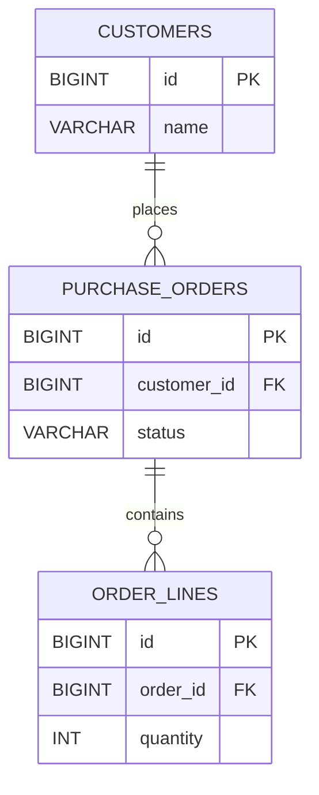

# Phát hiện và xử lý N+1 bằng fetch join hoặc entity graph

Khi sử dụng **JPA/Hibernate** để truy xuất dữ liệu quan hệ, một truy vấn trả về danh sách entity có thể vô tình làm phát sinh hàng chục, hàng trăm hoặc hàng nghìn truy vấn SQL bổ sung khi chương trình truy cập các quan hệ. Đây là **vấn đề N+1 queries**: một truy vấn lấy N bản ghi gốc, rồi thêm một nhóm truy vấn lấy dữ liệu liên kết cho từng bản ghi.

Bài thực hành này hướng dẫn cách **tái hiện N+1, tìm vị trí gây ra các truy vấn, giải quyết bằng JPQL `JOIN FETCH` hoặc JPA `EntityGraph` và xác minh số SQL thực thi**. Ngoài bài toán đơn giản với `@ManyToOne`, nội dung còn xét quan hệ collection, phân trang, đồng thời chỉ ra những tình huống không nên áp dụng fetch join một cách máy móc.

## 1. N+1 thực sự xảy ra khi nào?

Giả sử ứng dụng quản lý đơn hàng. Mỗi `PurchaseOrder` tham chiếu đến một `Customer`. Muốn hiển thị danh sách gồm mã đơn hàng và tên khách hàng, ta viết:

```java
List<PurchaseOrder> orders = orderRepository.findAll();

for (PurchaseOrder order : orders) {
    System.out.println(
        order.getId() + " - " + order.getCustomer().getName()
    );
}
```

Với quan hệ `customer` được tải lazy, Hibernate có thể thực hiện:

```sql
-- Truy vấn 1: lấy N đơn hàng.
SELECT id, customer_id, status
FROM purchase_orders;

-- Các truy vấn bổ sung khi lần lượt đọc tên customer.
SELECT id, name FROM customers WHERE id = ?;
SELECT id, name FROM customers WHERE id = ?;
SELECT id, name FROM customers WHERE id = ?;
-- ... có thể thêm đến N truy vấn nếu N customer khác nhau.
```

Nếu có 100 đơn hàng tương ứng 100 khách hàng riêng biệt, ta thường quan sát **1 + 100 SQL SELECT**. Nếu các đơn hàng dùng chung một số khách hàng, persistence context có thể tái sử dụng entity đã tải và số truy vấn ít hơn. `@BatchSize`, second-level cache hoặc cấu hình fetch khác cũng làm thay đổi con số thực tế. Vì vậy **N+1 mô tả kiểu truy cập có khả năng phát sinh một truy vấn phụ cho mỗi entity**, không phải cam kết rằng mọi lần chạy luôn có chính xác N+1 câu SQL.

N+1 cũng thường xảy ra khi truy cập collection:

```java
List<PurchaseOrder> orders = orderRepository.findAll();

for (PurchaseOrder order : orders) {
    System.out.println(order.getLines().size());
}
```

Nếu `lines` chưa khởi tạo, Hibernate có thể phải truy vấn bảng `order_lines` riêng cho từng order. Vấn đề đặc biệt nghiêm trọng khi lặp này nằm trong bước **chuyển entity sang DTO hoặc JSON**, khiến code repository nhìn qua có vẻ chỉ chạy một truy vấn.

### 1.1. Vì sao ảnh hưởng đến hiệu năng?

Một câu SQL đơn lẻ có thể rất nhanh, nhưng N truy vấn nối tiếp phải trả thêm chi phí tạo statement, round trip tới database, quản lý kết nối và chờ I/O. Tổng thời gian thường tăng theo số bản ghi:

| Số đơn hàng | Truy vấn gốc | Truy vấn liên kết tiềm năng | Tổng SQL minh họa |
| ---: | ---: | ---: | ---: |
| 1 | 1 | 1 | 2 |
| 10 | 1 | 10 | 11 |
| 100 | 1 | 100 | 101 |
| 1.000 | 1 | 1.000 | 1.001 |

Bảng giả định mỗi order trỏ tới một customer chưa được load và không có batch fetch/cache. Ngay cả khi database xử lý từng truy vấn rất nhanh, rất nhiều round trip có thể làm API chậm đáng kể.

## 2. Mô hình dữ liệu thực hành

Sử dụng Spring Boot 3+, Spring Data JPA và Hibernate 6, với ba bảng:

- `customers`: thông tin khách hàng.
- `purchase_orders`: đơn hàng; có cột `customer_id`.
- `order_lines`: các dòng hàng; có cột `order_id`.

Quan hệ được minh họa:



Mã entity dưới đây tập trung vào mapping phục vụ bài học. Có thể đặt mỗi class trong file Java riêng; ví dụ giả định đã có các import `java.util.*` và `jakarta.persistence.*` phù hợp.

### 2.1. Entity `Customer`

```java
import jakarta.persistence.*;

@Entity
@Table(name = "customers")
public class Customer {
    @Id
    @GeneratedValue(strategy = GenerationType.IDENTITY)
    private Long id;

    @Column(nullable = false, length = 120)
    private String name;

    protected Customer() {}

    public Customer(String name) {
        this.name = name;
    }

    public Long getId() {
        return id;
    }

    public String getName() {
        return name;
    }
}
```

### 2.2. Entity `PurchaseOrder`

```java
import jakarta.persistence.*;
import java.util.ArrayList;
import java.util.List;

@Entity
@Table(name = "purchase_orders")
public class PurchaseOrder {
    @Id
    @GeneratedValue(strategy = GenerationType.IDENTITY)
    private Long id;

    @Enumerated(EnumType.STRING)
    @Column(nullable = false, length = 24)
    private OrderStatus status;

    @ManyToOne(fetch = FetchType.LAZY, optional = false)
    @JoinColumn(name = "customer_id", nullable = false)
    private Customer customer;

    @OneToMany(mappedBy = "order", fetch = FetchType.LAZY)
    private List<OrderLine> lines = new ArrayList<>();

    protected PurchaseOrder() {}

    public PurchaseOrder(Customer customer, OrderStatus status) {
        this.customer = customer;
        this.status = status;
    }

    public Long getId() {
        return id;
    }

    public OrderStatus getStatus() {
        return status;
    }

    public Customer getCustomer() {
        return customer;
    }

    public List<OrderLine> getLines() {
        return lines;
    }
}
```

### 2.3. Entity `OrderLine` và enum

```java
import jakarta.persistence.*;

@Entity
@Table(name = "order_lines")
public class OrderLine {
    @Id
    @GeneratedValue(strategy = GenerationType.IDENTITY)
    private Long id;

    @ManyToOne(fetch = FetchType.LAZY, optional = false)
    @JoinColumn(name = "order_id", nullable = false)
    private PurchaseOrder order;

    @Column(nullable = false)
    private int quantity;

    protected OrderLine() {}

    public OrderLine(PurchaseOrder order, int quantity) {
        this.order = order;
        this.quantity = quantity;
    }

    public int getQuantity() {
        return quantity;
    }
}
```

```java
public enum OrderStatus {
    NEW, PAID, SHIPPED, CANCELLED
}
```

**Vì sao dùng `FetchType.LAZY`?** Với quan hệ `@ManyToOne`, mặc định của JPA là `EAGER`; khai báo `LAZY` giúp quyết định chính xác nhu cầu tải liên kết theo từng truy vấn. Với `@OneToMany`, mặc định là `LAZY`; vẫn có thể ghi tường minh để dễ đọc.

Điều cần nhớ là **LAZY không tự giải quyết N+1**. LAZY trì hoãn việc tải cho đến khi quan hệ được dùng; nếu mapper của mỗi order đều cần `customer.name`, mỗi lần truy cập vẫn có nguy cơ thực hiện thêm SQL. Đổi tất cả sang `EAGER` cũng không phải lời giải: có thể tạo SQL quá lớn hoặc vẫn phát sinh secondary selects, tùy cách query và provider.

## 3. Tái hiện N+1 trong Repository và Service

Một repository Spring Data JPA có phương thức lấy đơn hàng theo trạng thái:

```java
import org.springframework.data.jpa.repository.JpaRepository;
import java.util.List;

public interface PurchaseOrderRepository
        extends JpaRepository<PurchaseOrder, Long> {

    List<PurchaseOrder> findByStatus(OrderStatus status);
}
```

Định nghĩa DTO cần trả về:

```java
public record OrderRow(
    Long orderId,
    OrderStatus status,
    String customerName
) {}
```

Phương thức service ban đầu:

```java
import org.springframework.stereotype.Service;
import org.springframework.transaction.annotation.Transactional;
import java.util.List;

@Service
public class OrderQueryService {
    private final PurchaseOrderRepository orders;

    public OrderQueryService(PurchaseOrderRepository orders) {
        this.orders = orders;
    }

    @Transactional(readOnly = true)
    public List<OrderRow> listNaive(OrderStatus status) {
        return orders.findByStatus(status).stream()
            .map(order -> new OrderRow(
                order.getId(),
                order.getStatus(),
                order.getCustomer().getName()
            ))
            .toList();
    }
}
```

Khi chạy `listNaive(OrderStatus.PAID)`, câu `order.getCustomer().getName()` có thể kích hoạt truy vấn khách hàng riêng cho từng order.

**Tại sao đặt `@Transactional(readOnly = true)` ở service?** Trong khoảng thời gian thực hiện mapper, các entity còn được persistence context quản lý nên có thể khởi tạo lazy relation. `readOnly = true` phù hợp cho tác vụ chỉ đọc, nhưng không buộc Hibernate tự gộp các truy vấn. Nếu mapper chạy sau khi transaction/persistence context đóng, ta có thể gặp `LazyInitializationException` thay vì chỉ gặp N+1. Cần chủ động tải các quan hệ cần thiết **trong phạm vi truy vấn**, không dựa vào Open Session in View để sửa vấn đề.

### 3.1. Chuẩn bị bộ dữ liệu để thấy rõ hiện tượng

Có thể seed 20 đơn hàng `PAID`, mỗi đơn thuộc một khách hàng **khác nhau**. Mỗi đơn có 2–3 `OrderLine`. Tách customer riêng biệt giúp số lần fetch lazy dễ quan sát.

Sau khi seed, thực hiện `flush` và `clear` hoặc sử dụng transaction/persistence context mới khi đo. Nếu vừa `persist` các customer và order rồi dùng ngay trong cùng persistence context, JPA đã giữ customer trong bộ nhớ nên lần đọc tên có thể không phát sinh truy vấn bổ sung; phép đo sẽ che lấp N+1.

Bộ dữ liệu giả định:

```text
Customer 1 -- Order 101 -- Line 1, Line 2
Customer 2 -- Order 102 -- Line 3, Line 4
Customer 3 -- Order 103 -- Line 5, Line 6
...
Customer 20 -- Order 120 -- Line 39, Line 40
```

Với 20 order, số SQL kỳ vọng khi không có cache/batch là khoảng 21: một query lấy orders, 20 query lấy customers. Số đo chính xác phải lấy từ log hoặc công cụ đo thực tế.

## 4. Phát hiện N+1 bằng SQL log

Để quan sát SQL trong Spring Boot, bật logging tạm thời ở môi trường phát triển:

```yaml
logging:
  level:
    org.hibernate.SQL: DEBUG
    org.hibernate.orm.jdbc.bind: TRACE

spring:
  jpa:
    properties:
      hibernate:
        generate_statistics: true
```

Các mục có ý nghĩa:

- `org.hibernate.SQL=DEBUG`: hiển thị các SQL Hibernate chuẩn bị gửi đi.
- `org.hibernate.orm.jdbc.bind=TRACE`: trong Hibernate 6, hiển thị giá trị bind parameter để phân biệt các truy vấn cùng hình dạng.
- `hibernate.generate_statistics=true`: bật bộ đếm thống kê của Hibernate, hữu ích cho việc đo số statement.

**Chỉ bật bind trace trong môi trường an toàn** vì giá trị tham số có thể chứa dữ liệu cá nhân hoặc thông tin nhạy cảm. Log SQL đầy đủ có thể tăng mạnh dung lượng log và giảm hiệu năng. Với Hibernate 5, tên logger cho bind parameters khác (ví dụ `org.hibernate.type.descriptor.sql.BasicBinder`).

Ví dụ log:

```text
Hibernate: select o.id,o.customer_id,o.status
           from purchase_orders o
           where o.status=?

Hibernate: select c.id,c.name from customers c where c.id=?
Hibernate: select c.id,c.name from customers c where c.id=?
Hibernate: select c.id,c.name from customers c where c.id=?
...
```

Trong log thật, câu `SELECT` của customer có thể xuất hiện xen kẽ với xử lý dữ liệu trong service. Dấu hiệu quan trọng là **cùng một mẫu câu SQL xuất hiện liên tục với các giá trị `id` khác nhau**.

Một dạng N+1 khác là collection:

```text
Hibernate: select o.id,o.customer_id,o.status from purchase_orders o ...
Hibernate: select l.id,l.order_id,l.quantity from order_lines l where l.order_id=?
Hibernate: select l.id,l.order_id,l.quantity from order_lines l where l.order_id=?
...
```

### 4.1. Đừng kết luận chỉ dựa vào số dòng log

Một API có thể chạy nhiều SQL hợp lệ cho những mục đích khác nhau. N+1 được xác định bằng **quan hệ giữa số bản ghi gốc và số truy vấn phụ**. Một cách kiểm chứng tốt là đo cùng endpoint với 1, 10, 50 và 100 order. Nếu số SQL tăng gần tuyến tính theo số order chỉ vì truy cập một liên kết, đó là tín hiệu rõ rệt.

Cần phân biệt các nguồn gây nhiễu: first-level cache của persistence context, second-level cache, batch fetch, query phụ của Spring Data để tính tổng số trang, các callback và hệ thống audit. Khi so sánh hai cách fetch, sử dụng cùng bộ dữ liệu, cùng chế độ cache và cùng cách truy cập DTO.

## 5. Cách 1 — Xử lý N+1 bằng JPQL `JOIN FETCH`

`JOIN FETCH` là cú pháp **JPQL** yêu cầu provider tải một quan hệ cùng với entity gốc trong truy vấn đó. Thay vì tải order rồi truy vấn customer sau, ta chủ động khai báo association cần sử dụng.

Thêm phương thức vào repository:

```java
import org.springframework.data.jpa.repository.Query;
import org.springframework.data.repository.query.Param;

@Query("""
       select o
       from PurchaseOrder o
       join fetch o.customer
       where o.status = :status
       order by o.id
       """)
List<PurchaseOrder> findByStatusWithCustomer(
    @Param("status") OrderStatus status
);
```

Đoạn mã trên minh họa **một method trong `PurchaseOrderRepository`** đã khai báo ở phần trước. Tương tự, service có thể đổi đúng phần gọi repository:

```java
@Transactional(readOnly = true)
public List<OrderRow> listWithFetchJoin(OrderStatus status) {
    return orders.findByStatusWithCustomer(status).stream()
        .map(order -> new OrderRow(
            order.getId(),
            order.getStatus(),
            order.getCustomer().getName()
        ))
        .toList();
}
```

Một dạng SQL phổ biến:

```sql
SELECT o.id, o.status, o.customer_id,
       c.id, c.name
FROM purchase_orders o
JOIN customers c ON c.id = o.customer_id
WHERE o.status = ?
ORDER BY o.id;
```

Các customer tương ứng đã sẵn sàng cho mapper; khi đọc `customer.getName()` không còn phải truy vấn lần lượt từng customer. Trong trường hợp `ManyToOne` đơn giản, kết quả thường chỉ cần **một SQL SELECT** cho danh sách.

### 5.1. `JOIN FETCH` khác `JOIN` thông thường

Cú pháp sau có ý nghĩa khác:

```java
@Query("""
       select o
       from PurchaseOrder o
       join o.customer c
       where c.name like concat(:prefix, '%')
       """)
List<PurchaseOrder> findByCustomerNamePrefix(
    @Param("prefix") String prefix
);
```

`join o.customer c` dùng quan hệ để **lọc dữ liệu**, không bắt buộc provider phải đánh dấu quan hệ `o.customer` đã được fetch. Nếu sau đó mapper vẫn gọi `o.getCustomer().getName()`, có thể tiếp tục phát sinh truy vấn phụ.

Dùng `join fetch o.customer` khi mục đích thực sự là nạp association; nếu vừa cần lọc vừa cần fetch, thiết kế query phù hợp với các ràng buộc của JPQL và provider.

### 5.2. `INNER JOIN FETCH` và `LEFT JOIN FETCH`

- `join fetch o.customer` sử dụng inner join; order không có customer có thể bị loại khỏi kết quả.
- `left join fetch o.customer` giữ các order dù customer vắng mặt.

Trong mô hình ví dụ, `optional = false` và khóa ngoại `NOT NULL` nên inner join là hợp lý. Với quan hệ tùy chọn, `left join fetch` thường bảo toàn các bản ghi gốc tốt hơn:

```java
@Query("""
       select o
       from PurchaseOrder o
       left join fetch o.customer
       where o.status = :status
       """)
List<PurchaseOrder> findAllWithOptionalCustomer(
    @Param("status") OrderStatus status
);
```

### 5.3. Phạm vi ảnh hưởng

Fetch join tác động **đến truy vấn khai báo nó**. Không cần đổi fetch policy của entity toàn cục thành EAGER. Điều này quan trọng vì các màn hình khác chỉ cần `order.id` hoặc `order.status` vẫn có thể tránh tải customer không cần thiết.

Cần chú ý **không tạo `select new SomeDto(...)` cùng một `join fetch` bất hợp lệ trên owner không nằm trong SELECT**. Nếu endpoint chỉ cần vài cột và không có nghiệp vụ entity, dùng DTO projection với join thường đơn giản hơn; fetch join phù hợp khi cần entity gốc cùng các association.

## 6. Cách 2 — Xử lý N+1 bằng JPA `EntityGraph`

Entity graph cho phép khai báo **những quan hệ cần fetch cho một lời gọi repository** mà không phải viết `JOIN FETCH` trong JPQL. Đây là lựa chọn hữu ích khi muốn giữ câu truy vấn để lọc/sắp xếp, còn kế hoạch fetch được biểu diễn riêng.

Với Spring Data JPA:

```java
import org.springframework.data.jpa.repository.EntityGraph;
import org.springframework.data.jpa.repository.Query;
import org.springframework.data.repository.query.Param;

@EntityGraph(attributePaths = {"customer"})
@Query("""
       select o
       from PurchaseOrder o
       where o.status = :status
       order by o.id
       """)
List<PurchaseOrder> findByStatusWithCustomerGraph(
    @Param("status") OrderStatus status
);
```

Trong service:

```java
@Transactional(readOnly = true)
public List<OrderRow> listWithEntityGraph(OrderStatus status) {
    return orders.findByStatusWithCustomerGraph(status).stream()
        .map(order -> new OrderRow(
            order.getId(),
            order.getStatus(),
            order.getCustomer().getName()
        ))
        .toList();
}
```

Với Hibernate, graph cho quan hệ to-one như `customer` thường dẫn đến một phép JOIN trong SQL. Tuy nhiên, **JPA entity graph mô tả kế hoạch fetch, không cam kết chính xác SQL phải dùng một JOIN**: provider có thể chọn các kỹ thuật tải khác. Vì vậy vẫn cần đo SQL thật.

### 6.1. Graph khai báo tại entity

Khi nhiều use case cùng cần tập association tương tự, có thể đặt `@NamedEntityGraph` trên entity:

```java
@Entity
@Table(name = "purchase_orders")
@NamedEntityGraph(
    name = "PurchaseOrder.withCustomer",
    attributeNodes = @NamedAttributeNode("customer")
)
public class PurchaseOrder {
    // Các trường và phương thức như phần trước.
}
```

Sau đó sử dụng:

```java
@EntityGraph(value = "PurchaseOrder.withCustomer")
@Query("select o from PurchaseOrder o where o.status = :status")
List<PurchaseOrder> findWithNamedGraph(
    @Param("status") OrderStatus status
);
```

Hai cách biểu diễn graph có mục đích tương tự. `attributePaths` gọn cho query cụ thể; named graph hữu ích khi muốn tái sử dụng hoặc quản lý graph phức tạp.

### 6.2. `FETCH` graph và `LOAD` graph

JPA phân biệt hai loại graph:

| Loại graph | Ngữ nghĩa |
| --- | --- |
| **Fetch graph** (`jakarta.persistence.fetchgraph`) | Các attribute được liệt kê là eagerly fetched; attribute không liệt kê được xem là LAZY theo đặc tả, nhưng provider có thể vẫn fetch thêm |
| **Load graph** (`jakarta.persistence.loadgraph`) | Attribute được liệt kê là eagerly fetched; thuộc tính không liệt kê tuân theo fetch policy của mapping mặc định |

Trong Spring Data JPA có thể cấu hình:

```java
@EntityGraph(
    attributePaths = {"customer"},
    type = EntityGraph.EntityGraphType.FETCH
)
List<PurchaseOrder> findByStatusOrderByIdAsc(OrderStatus status);
```

Đây là ví dụ method riêng để thể hiện `type`; không khai báo trùng chữ ký với method không graph trong cùng repository. Sự khác biệt FETCH/LOAD rõ hơn khi entity có những association đang được map EAGER. Provider có thể vẫn tối ưu hoặc tải thêm ngoài graph, vì vậy nên kiểm tra hành vi thực tế thay vì suy ra tuyệt đối số câu SQL.

### 6.3. Chọn fetch join hay entity graph?

| Tiêu chí | JPQL `JOIN FETCH` | JPA `EntityGraph` |
| --- | --- | --- |
| Cách diễn đạt | Kế hoạch fetch nằm trong JPQL | Kế hoạch fetch nằm trong annotation hoặc graph |
| Chỉ định loại join | Có thể viết `join fetch` / `left join fetch` | Không trực tiếp chọn cú pháp SQL JOIN |
| Tái sử dụng | Gắn với query cụ thể | Có thể dùng named graph |
| Đọc code | Rõ association được JOIN ngay trong JPQL | Truy vấn lọc và kế hoạch fetch tách biệt |
| Cần đo SQL thực tế | Có | Có |
| Ứng dụng điển hình | Query cần rõ join, filter và fetch | Truy vấn repository có nhiều cách hiển thị liên kết |

Hai cách đều hợp lý. Nên chọn theo kiểu truy vấn, mục tiêu hiệu năng và quy ước của dự án. Không cần dùng cả fetch join và graph để nạp cùng một quan hệ nếu một cơ chế đã đáp ứng.

## 7. N+1 với collection `@OneToMany`

Giả sử API trả về mã đơn, tên khách hàng và toàn bộ dòng hàng. Mã ban đầu:

```java
@Transactional(readOnly = true)
public List<OrderDetail> listDetailsNaive(OrderStatus status) {
    return orders.findByStatus(status).stream()
        .map(order -> new OrderDetail(
            order.getId(),
            order.getCustomer().getName(),
            order.getLines().stream()
                .map(line -> new LineRow(line.getQuantity()))
                .toList()
        ))
        .toList();
}

public record LineRow(int quantity) {}

public record OrderDetail(
    Long id,
    String customerName,
    List<LineRow> lines
) {}
```

Có thể xuất hiện N+1 cho customer **và** N+1 cho lines. Khi dữ liệu đủ lớn, đây là điểm gây chậm nghiêm trọng.

### 7.1. Fetch join collection

Thêm phương thức repository sau:

```java
@Query("""
       select distinct o
       from PurchaseOrder o
       left join fetch o.customer
       left join fetch o.lines
       where o.status = :status
       order by o.id
       """)
List<PurchaseOrder> findDetailsWithFetchJoin(
    @Param("status") OrderStatus status
);
```

Lúc này, một lệnh SQL có thể trả về nhiều **hàng dữ liệu vật lý** cho cùng một order. Ví dụ một order có 3 line thì kết quả JOIN có 3 hàng chứa cột order lặp lại. Hibernate dùng các hàng đó để hình thành entity/collection trong persistence context. `distinct` trong JPQL biểu diễn ý định lấy các root entity duy nhất. Với Hibernate 6, trùng root sinh bởi fetch join thường được khử ở tầng ORM; việc dùng `distinct` và cách đẩy xuống SQL có khác biệt giữa provider/phiên bản.

**Đừng đánh đồng “một SQL” với “ít dữ liệu”.** Một JOIN giữa nhiều collection có thể nhân số dòng rất mạnh, tăng dung lượng chuyển từ DB và công việc giải mã. Fetch cùng lúc hai collection dạng bag (`List` không có chỉ số thứ tự ổn định trong mapping) còn có thể gây `MultipleBagFetchException` trong Hibernate. Vì vậy hãy giới hạn những quan hệ thật sự cần hiển thị.

### 7.2. Graph cho collection

Có thể viết:

```java
@EntityGraph(attributePaths = {"customer", "lines"})
@Query("""
       select o
       from PurchaseOrder o
       where o.status = :status
       """)
List<PurchaseOrder> findDetailsWithGraph(
    @Param("status") OrderStatus status
);
```

Graph biểu đạt tập dữ liệu cần dùng nhưng **không bảo đảm số truy vấn hoặc số hàng SQL thấp**. Với collection lớn, provider có thể tạo JOIN nhiều hàng hoặc chọn cách tải khác. Đo số SQL, thời gian, bộ nhớ và kích thước result set sau khi dùng.

### 7.3. Không dùng collection fetch join để phân trang trực tiếp

Một lỗi hay gặp:

```java
@Query("""
       select o
       from PurchaseOrder o
       left join fetch o.lines
       where o.status = :status
       """)
Page<PurchaseOrder> findPageWithLines(
    @Param("status") OrderStatus status,
    Pageable pageable
);
```

**Tránh cách này.** Phân trang SQL dùng hàng kết quả, trong khi fetch join collection tạo nhiều hàng cho một order. Hibernate có thể cảnh báo rồi phân trang ở bộ nhớ (lấy nhiều dữ liệu hơn dự định) hoặc phát sinh lỗi tùy cấu hình. Truy vấn count cũng không được fetch association khi không select owner entity.

Trong môi trường Hibernate, có thể bật tùy chọn giúp phát hiện tình huống nguy hiểm thay vì âm thầm phân trang trong bộ nhớ:

```yaml
spring:
  jpa:
    properties:
      hibernate:
        query:
          fail_on_pagination_over_collection_fetch: true
```

Cấu hình này có tính chất Hibernate-specific. Tên property đầy đủ của Hibernate là `hibernate.query.fail_on_pagination_over_collection_fetch`.

## 8. Thực hành phân trang an toàn với collection

Giải pháp thường dùng là **hai bước**: phân trang trên ID của order, rồi fetch các association cho đúng tập ID trong trang. Bước 2 không dùng `Pageable`.

### 8.1. Repository lấy ID theo trang

```java
@Query(
    value = """
            select o.id
            from PurchaseOrder o
            where o.status = :status
            """,
    countQuery = """
                 select count(o)
                 from PurchaseOrder o
                 where o.status = :status
                 """
)
Page<Long> findPageIdsByStatus(
    @Param("status") OrderStatus status,
    Pageable pageable
);
```

Khi gọi, chọn thứ tự phân trang xác định, ví dụ:

```java
Pageable pageable = PageRequest.of(
    0,
    20,
    Sort.by(Sort.Direction.ASC, "id")
);
```

ID tăng dần là ví dụ phù hợp nếu không có yêu cầu sắp xếp khác. Với trang sắp xếp theo trường không duy nhất, thêm `id` làm tiêu chí phụ để ổn định thứ tự; khi dữ liệu được thêm/xóa đồng thời, offset pagination vẫn có thể dịch chuyển kết quả và cần cân nhắc keyset pagination.

### 8.2. Repository fetch những order thuộc trang

```java
@Query("""
       select distinct o
       from PurchaseOrder o
       left join fetch o.customer
       left join fetch o.lines
       where o.id in :ids
       """)
List<PurchaseOrder> findDetailsByIds(
    @Param("ids") Collection<Long> ids
);
```

Danh sách ID đã được giới hạn bởi page size; query này chỉ tải chi tiết cho trang đó. Tuy nhiên, số hàng SQL trả về vẫn phụ thuộc số line của từng order.

### 8.3. Service giữ đúng thứ tự và metadata của trang

```java
import org.springframework.data.domain.Page;
import org.springframework.data.domain.Pageable;
import org.springframework.transaction.annotation.Transactional;
import java.util.Collection;
import java.util.Map;
import java.util.function.Function;
import java.util.stream.Collectors;

@Transactional(readOnly = true)
public Page<OrderDetail> pageDetails(
        OrderStatus status, Pageable pageable) {

    Page<Long> idPage = orders.findPageIdsByStatus(status, pageable);

    if (idPage.isEmpty()) {
        return idPage.map(id -> {
            throw new IllegalStateException("Không có ID trong trang rỗng");
        });
    }

    Map<Long, PurchaseOrder> byId = orders
        .findDetailsByIds(idPage.getContent())
        .stream()
        .collect(Collectors.toMap(
            PurchaseOrder::getId,
            Function.identity()
        ));

    return idPage.map(id -> {
        PurchaseOrder order = byId.get(id);
        if (order == null) {
            throw new IllegalStateException(
                "Order không còn tồn tại khi tải chi tiết: " + id
            );
        }
        return new OrderDetail(
            order.getId(),
            order.getCustomer().getName(),
            order.getLines().stream()
                .map(line -> new LineRow(line.getQuantity()))
                .toList()
        );
    });
}
```

`Page.map(...)` bảo toàn thông tin trang như số trang và tổng bản ghi. Vì truy vấn `IN (:ids)` không bảo đảm thứ tự của danh sách ID trong SQL, ta sử dụng `idPage.getContent()` làm nguồn thứ tự khi tạo DTO.

Dù hai bước nằm trong một transaction `readOnly`, nếu mức cô lập mặc định cho phép dữ liệu thay đổi giữa hai SELECT, một order có thể bị xóa hoặc thay trạng thái giữa hai bước. Ví dụ trên phát hiện thiếu ID và báo lỗi; sản phẩm thực tế có thể chọn snapshot isolation, trả kết quả suy giảm được kiểm soát hoặc một chiến lược khác theo yêu cầu nhất quán.

Đối với association to-one, fetch join **thường** tương thích với phân trang vì mỗi root chỉ tham gia tối đa một hàng liên kết theo quan hệ to-one; tuy nhiên vẫn nên quan sát SQL, filter và count query cụ thể. Vấn đề chính ở ví dụ trên là fetch join **collection to-many**.

## 9. Đo kết quả bằng Hibernate Statistics

Hibernate có thống kê để đo số statement đã được chuẩn bị, số entity fetch, collection fetch và các chỉ số khác. Để đo tương đối giữa các phiên bản:

```java
import jakarta.persistence.EntityManager;
import jakarta.persistence.EntityManagerFactory;
import org.hibernate.SessionFactory;
import org.hibernate.stat.Statistics;

// Ví dụ mã đặt trong một integration test.
SessionFactory sessionFactory =
    entityManagerFactory.unwrap(SessionFactory.class);

Statistics statistics = sessionFactory.getStatistics();

entityManager.flush();
entityManager.clear();     // Tránh entity đã load che lấp N+1.
statistics.clear();        // Đặt lại counters cho phép đo riêng này.

List<OrderRow> rows =
    orderQueryService.listWithFetchJoin(OrderStatus.PAID);

long preparedStatements = statistics.getPrepareStatementCount();

System.out.println("Orders: " + rows.size());
System.out.println("Prepared statements: " + preparedStatements);
```

Ví dụ giả định các biến `entityManagerFactory`, `entityManager` và `orderQueryService` được inject vào test. `getPrepareStatementCount()` phản ánh số JDBC prepared statement được Hibernate chuẩn bị trong khoảng đo; nó khác `getQueryExecutionCount()`, vốn không đếm toàn bộ secondary selects theo cách nhiều người kỳ vọng.

**Lưu ý khi kiểm thử**:

- Bật `hibernate.generate_statistics=true` trong cấu hình test.
- Seed dữ liệu trước khi reset counters; tránh tính cả các câu `INSERT` và query dựng dữ liệu.
- Xóa persistence context hoặc sử dụng context độc lập trước khi đo để giảm ảnh hưởng first-level cache.
- Giữ cách truy cập DTO giống nhau giữa phiên bản naive, fetch join và entity graph.
- Stats thuộc `SessionFactory` có phạm vi rộng; test chạy song song có thể ảnh hưởng bộ đếm. Để đếm thật chính xác cho một request, có thể dùng datasource proxy hoặc công cụ tracing.
- Nếu test có transaction bao quanh, `flush()` và `clear()` giúp tách dữ liệu seed; không gọi `clear()` giữa thao tác fetch và mapper đang cần managed associations.

Ví dụ kỳ vọng trong dữ liệu có 20 order và 20 customer phân biệt, không cache/batch:

| Cách truy xuất | SQL SELECT kỳ vọng tương đối |
| --- | --- |
| `findByStatus` rồi đọc `customer.name` | Khoảng 21 |
| `JOIN FETCH o.customer` | Khoảng 1 |
| `@EntityGraph(attributePaths = "customer")` | Thường khoảng 1 với Hibernate trong trường hợp đơn giản |

Kết quả là **kỳ vọng của một cấu hình minh họa**, không phải hợp đồng bắt buộc giữa các phiên bản JPA provider. Xác minh bằng log và counter trong dự án đang chạy.

### 9.1. Đo cả hiệu năng thay vì chỉ đếm SQL

Giảm 101 câu SQL xuống 1 là tín hiệu tích cực, nhưng cũng cần đo:

- **Thời gian phản hồi** endpoint (p50/p95/p99).
- **Tổng số hàng** trả về từ DB sau JOIN.
- **Số byte** truyền giữa app và database.
- **Heap/memory** dành cho entity và collection.
- **Số truy vấn khi tăng page size**.
- **Mức tải DB và thời gian giữ connection**.

Một fetch join quá rộng có thể tạo cartesian product và tải dữ liệu không cần thiết, khiến 1 SQL chậm hơn vài truy vấn được batch tốt. Mục tiêu là lấy **đúng dữ liệu cho use case với chi phí phù hợp**, không phải ép mọi endpoint chỉ có một SQL.

## 10. Khi không nên dùng fetch join

### 10.1. Chỉ cần vài trường để hiển thị

Nếu API trả về `orderId` và `customerName` mà không cần entity gốc managed, dùng DTO projection có thể hiệu quả hơn:

```java
@Query("""
       select new com.example.orders.OrderRow(
           o.id, o.status, c.name
       )
       from PurchaseOrder o
       join o.customer c
       where o.status = :status
       order by o.id
       """)
List<OrderRow> findOrderRows(
    @Param("status") OrderStatus status
);
```

Đường dẫn package `com.example.orders.OrderRow` phải đúng với vị trí của class record trong dự án. Đây là JPQL constructor projection; không cần `fetch` vì ta không trả entity và không dự định truy cập lazy association sau truy vấn.

### 10.2. Collection quá lớn

Đơn hàng có vài nghìn dòng không nên mặc định fetch tất cả chỉ để hiển thị số dòng. Thay vào đó, có thể dùng count query, aggregate projection hoặc endpoint riêng để phân trang các dòng hàng. Hãy thiết kế truy vấn theo dữ liệu thực tế mà màn hình cần.

### 10.3. Nhiều collection cùng lúc

Nếu entity có `lines`, `payments` và `shipments`, join fetch đồng thời tất cả có thể gây nhân kết quả:

```text
1 order × 10 lines × 5 payments × 4 shipments = 200 SQL rows
```

Trong Hibernate, fetch đồng thời nhiều bag còn có thể bị từ chối. Có thể chia các phép tải thành những query riêng theo tập order đã chọn, dùng batch fetching hoặc tổ chức API theo từng phần thay vì trả một object graph khổng lồ.

### 10.4. Muốn sửa collection đã bị lọc thiếu

Fetch join có điều kiện trên phần tử con cần đặc biệt thận trọng: collection có thể chỉ được load một phần nhưng trông như đã khởi tạo. Ví dụ lọc chỉ các line đang hoạt động trong query không nhất thiết tạo được collection đầy đủ để sau đó sửa aggregate an toàn. Khi cần thay đổi entity, hãy bảo đảm collection được tải đúng ý nghĩa nghiệp vụ.

### 10.5. Chỉ có nhu cầu truy cập quan hệ một cách thưa thớt

Nếu chỉ 1% đơn hàng cần thông tin người duyệt, fetch join quan hệ đó cho mọi bản ghi có thể gây thừa dữ liệu. Có thể để LAZY, thiết kế truy vấn riêng hoặc dùng batch fetch khi quan sát thấy N+1 ở những luồng cần dữ liệu đó.

## 11. Những lựa chọn bổ sung và giới hạn của chúng

Ngoài hai kỹ thuật chính, Hibernate có những công cụ phối hợp:

**Batch fetching.** Khai báo `@BatchSize(size = 32)` trên entity hoặc association phù hợp, hoặc cấu hình `hibernate.default_batch_fetch_size`. Khi nhiều lazy proxy/collection cần được khởi tạo, Hibernate có thể gom khóa chính thành một nhóm truy vấn `IN (...)` thay vì truy vấn từng ID. Batch thường giảm N+1 thành một số ít query; nó có thể hữu ích khi không thể fetch join do collection lớn hoặc phân trang. Cần đo trên provider đang dùng để thấy cách gom lô thực tế.

```java
import org.hibernate.annotations.BatchSize;

@Entity
@BatchSize(size = 32)
public class Customer {
    // ...
}
```

**Secondary-level cache.** Có thể giảm SQL cho dữ liệu tham chiếu truy cập lặp lại, nhưng không sửa tận gốc việc mapper yêu cầu từng association. Không nên lấy số SQL thấp nhờ cache làm bằng chứng rằng fetch plan đã phù hợp.

**DTO projection.** Cho màn hình đọc ít field, query trả thẳng DTO thường giảm object overhead và tránh lazy traversal. Cần bảo đảm projection biểu diễn đúng kết quả, đặc biệt với joins to-many.

**Load theo lô bằng truy vấn thứ hai.** Với trang ID đã giới hạn, một query `WHERE id IN :ids` có thể tải các association cho đúng tập đối tượng, như phần phân trang.

Các kỹ thuật này không loại trừ nhau; lựa chọn dựa trên truy vấn, dữ liệu, cache và khả năng bảo trì.

## 12. Bài thực hành từ đầu đến cuối

Hãy thực hiện theo các chặng sau trên môi trường phát triển có SQL logging.

### Chặng A — Quan sát truy vấn ban đầu

1. Tạo 20 khách hàng và 20 đơn hàng `PAID`, mỗi đơn gắn một khách hàng riêng.
2. Sau khi seed, `flush/clear` hoặc mở persistence context mới.
3. Gọi `listNaive(PAID)`.
4. Quan sát log: một query lấy `purchase_orders` và nhiều query lấy `customers`.
5. Ghi lại số SQL, thời gian trả về và số DTO.

Ở bước này, chỉ đọc `id` và `status` thường không kích hoạt lazy customer; thêm `customer.name` vào mapper mới làm lộ rõ nguồn N+1.

### Chặng B — Chuyển sang fetch join

1. Thêm `findByStatusWithCustomer` với `join fetch o.customer`.
2. Đổi service sang `listWithFetchJoin`.
3. Giữ nguyên tập dữ liệu, cùng điều kiện và mapper.
4. Đo lại số SQL; tên khách hàng trong DTO phải vẫn đúng.
5. Tăng 20 lên 100 đơn hàng để quan sát số SQL có giữ gần như ổn định hay không.

### Chặng C — Chuyển sang entity graph

1. Thêm `findByStatusWithCustomerGraph`.
2. Chạy `listWithEntityGraph`.
3. So sánh số SQL và kế hoạch thực thi với fetch join.
4. Thử `FETCH`/`LOAD` graph trong ngữ cảnh mapping có các quan hệ khác, quan sát khác biệt bằng SQL log.

### Chặng D — Mở rộng sang collection

1. Mỗi order có thêm 2–3 dòng `OrderLine`.
2. Trong DTO mapper, truy cập `order.getLines()`.
3. Đo lại số truy vấn phụ với phương thức naive.
4. Thêm `left join fetch o.lines` hoặc entity graph có `lines`.
5. Xác nhận tổng số order trả về và số line của mỗi order không bị sai do JOIN nhân hàng.

### Chặng E — Phân trang

1. Cố gắng phân trang collection fetch join trong test và quan sát cảnh báo/lỗi khi bật `fail_on_pagination_over_collection_fetch`.
2. Thay bằng truy vấn trang ID, tiếp theo query fetch theo `IN :ids`.
3. Đảm bảo DTO trả về đúng thứ tự của ID page, cùng `totalElements` và `pageNumber`.
4. Kiểm tra trang đầu, trang giữa, trang cuối và trang rỗng.

### Chặng F — Đánh giá hiệu năng

Tự ghi kết quả quan sát vào bảng sau:

| Lần chạy | Orders | Số SQL | p95 latency | Ghi chú |
| --- | ---: | ---: | ---: | --- |
| Naive | 20 | Điền số đo | Điền số đo | Lazy customer |
| Fetch join | 20 | Điền số đo | Điền số đo | `JOIN FETCH` to-one |
| Entity graph | 20 | Điền số đo | Điền số đo | `customer` graph |
| Naive + lines | 20 | Điền số đo | Điền số đo | Lazy collection |
| Fetch collection | 20 | Điền số đo | Điền số đo | Quan sát số hàng JOIN |
| Page ID + fetch details | 20/trang | Điền số đo | Điền số đo | Trang + detail query |

Không cần đặt mục tiêu “1 SQL” cho mọi trường hợp. Bằng chứng tốt là số truy vấn **không tăng vô kiểm soát theo số entity gốc** và endpoint đạt thời gian phản hồi mong muốn với dữ liệu thực.

## 13. Các tình huống gây nhầm lẫn

**“Đã khai báo LAZY, sao vẫn N+1?”** LAZY chỉ dời việc tải đến lúc truy cập. Mapper, serializer hoặc view layer vẫn có thể kích hoạt truy vấn một lần cho từng phần tử. Hãy quyết định fetch plan tại use case đọc.

**“Đổi thành EAGER là giải quyết xong?”** Không bảo đảm. EAGER có thể làm tải dữ liệu thừa trên các màn hình khác; tùy JPA query và provider, quan hệ EAGER còn có thể được tải bằng secondary selects. Ưu tiên để mapping thể hiện lifecycle hợp lý, rồi dùng fetch join/graph cho truy vấn cần association.

**“Query có JOIN rồi vẫn thấy N+1?”** `JOIN` dùng để lọc không mặc nhiên fetch quan hệ; phân biệt `join o.customer c` và `join fetch o.customer`. Kiểm tra chính quan hệ mà DTO đang truy cập.

**“Graph chắc chắn tạo đúng một JOIN?”** Không. Graph mô tả tập thuộc tính cần fetch; chiến lược SQL thuộc về provider. Với collection và graph nhiều nhánh, số truy vấn và số hàng có thể khác dự đoán.

**“Dùng DISTINCT sẽ giải quyết mọi vấn đề JOIN?”** `DISTINCT` có thể giúp loại trùng root entity trong kết quả JPQL, nhưng **không làm biến mất chi phí truyền nhiều hàng dữ liệu** do to-many JOIN. Không dùng để che giấu vấn đề fetch quá rộng.

**“Tại sao dev không thấy N+1, production thấy?”** Dữ liệu dev ít, customer bị trùng, entity đã có trong first-level cache, hoặc second-level cache ấm. Seed dữ liệu đủ đa dạng và reset context khi đo; so sánh bằng công cụ quan sát phù hợp.

**“Mapper hoạt động khi bật OSIV, tắt OSIV thì lỗi?”** OSIV có thể giữ persistence context mở qua giai đoạn web/JSON serialization và làm lazy load tiếp tục hoạt động, đôi khi che đi N+1. Chuyển DTO trong service có transaction rõ ràng và fetch đủ dữ liệu trước khi rời layer dữ liệu.

**“Tại sao fetch join collection làm kết quả chậm hơn?”** Một query duy nhất có thể trả ra hàng chục nghìn dòng vì nhân số lượng quan hệ. Giảm số truy vấn là một mục tiêu; tổng dữ liệu và memory quan trọng không kém.

**“@EntityGraph có dùng được cho Page không?”** Có thể dùng graph với truy vấn phân trang, đặc biệt association to-one. Nhưng graph bao gồm collection to-many cũng có nguy cơ phân trang ở bộ nhớ hoặc phát sinh lỗi tương tự collection fetch join. Phân trang ID trước thường đáng tin cậy hơn.

## 14. Kết luận kỹ thuật

N+1 là hiện tượng **tải entity gốc xong lại liên tiếp tải association theo từng entity**. Cách phát hiện đáng tin cậy nhất là tái hiện với dữ liệu đa dạng, xem SQL log, đếm prepared statements và kiểm tra vị trí mapper/serializer đang truy cập quan hệ.

**JPQL `JOIN FETCH`** giúp nạp quan hệ ngay trong query cụ thể, dễ đọc khi muốn chủ động join. **JPA `EntityGraph`** diễn đạt fetch plan tách khỏi câu truy vấn và phù hợp để tái sử dụng kế hoạch tải. Cả hai đều cần được đo SQL thực tế và phải thận trọng với **collection to-many, dữ liệu quá lớn và phân trang**.

Đối với tác vụ đọc thường xuyên, hãy xác định DTO cần trường nào, tải đúng các association đó trong transaction, quan sát kết quả và chọn giải pháp có chi phí cân bằng. Khi làm được như vậy, việc xử lý N+1 không dừng ở giảm số truy vấn mà còn cải thiện độ ổn định hiệu năng của toàn bộ tầng truy cập dữ liệu.

