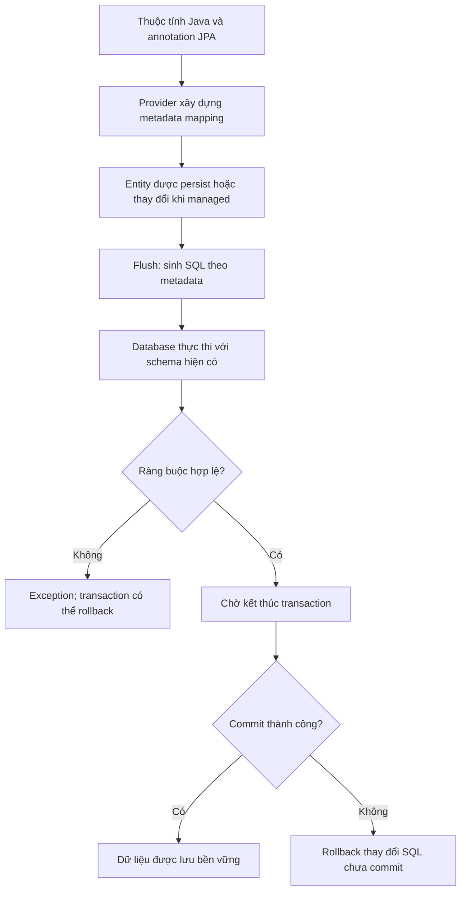

# Khai báo tên cột, tính nullable và các thuộc tính ánh xạ trong JPA

Trong JPA (Jakarta Persistence), một **entity** biểu diễn dữ liệu bằng các thuộc tính Java, còn cơ sở dữ liệu quan hệ lưu dữ liệu qua bảng và cột. Hai cách biểu diễn này không nhất thiết có cùng tên, cùng kiểu dữ liệu hay cùng quy tắc chấp nhận giá trị. Các annotation ánh xạ cho phép lập trình viên diễn đạt rõ: thuộc tính Java tương ứng với cột nào, cột có được chứa `NULL` không, độ dài hoặc độ chính xác của dữ liệu là bao nhiêu, và provider có được đưa cột đó vào câu `INSERT`/`UPDATE` hay không.

Ví dụ, `unitPrice` trong Java có thể ánh xạ tới `unit_price` trong bảng `inventory_items`, với yêu cầu dữ liệu bắt buộc và hai chữ số thập phân:

```java
@Column(name = "unit_price", nullable = false, precision = 19, scale = 2)
private BigDecimal unitPrice;
```

Để sử dụng đúng annotation này, cần phân biệt ba lớp: **quy tắc ánh xạ trong Java/JPA**, **DDL định nghĩa cấu trúc bảng**, và **ràng buộc thật sự đang được database thực thi**. Một thay đổi annotation không mặc nhiên sửa cấu trúc database đã tồn tại.

## 1. Từ thuộc tính Java đến cột trong bảng

Giả sử bảng `customers` được định nghĩa như sau:

```sql
CREATE TABLE customers (
    customer_id BIGINT PRIMARY KEY,
    full_name VARCHAR(150) NOT NULL,
    email_address VARCHAR(254),
    loyalty_points INTEGER NOT NULL
);
```

Ta có thể ánh xạ bằng entity:

```java
import jakarta.persistence.Column;
import jakarta.persistence.Entity;
import jakarta.persistence.Id;
import jakarta.persistence.Table;

@Entity
@Table(name = "customers")
public class Customer {

    @Id
    @Column(name = "customer_id")
    private Long id;

    @Column(name = "full_name", nullable = false, length = 150)
    private String fullName;

    @Column(name = "email_address", length = 254)
    private String email;

    @Column(name = "loyalty_points", nullable = false)
    private Integer loyaltyPoints;

    protected Customer() {} // Constructor không tham số cho JPA
}
```

| Thuộc tính Java | Cột SQL | Quy tắc ánh xạ |
|---|---|---|
| `id` | `customer_id` | Khóa chính, tên cột chỉ định qua `@Column`. |
| `fullName` | `full_name` | Bắt buộc khác `NULL`, giới hạn độ dài 150 ở schema mong muốn. |
| `email` | `email_address` | Có thể `NULL`, độ dài khai báo 254. |
| `loyaltyPoints` | `loyalty_points` | Bắt buộc khác `NULL`. |

**`@Table` chọn bảng; `@Column` cấu hình cột cho thuộc tính cơ bản.** `@Id` đánh dấu khóa chính. Nếu database dùng tên cột khác tên thuộc tính, `name` giúp ánh xạ tường minh. Một entity thường có nhiều thuộc tính ánh xạ đến các cột của cùng bảng, nhưng cũng có các trường hợp khác như embedded object, secondary table hay liên kết nhiều entity.

### Không phải mọi thuộc tính đều cần `@Column`

Với một thuộc tính cơ bản (*basic attribute*), JPA có thể ánh xạ ngay cả khi không ghi `@Column`:

```java
@Entity
public class Notebook {
    @Id
    private Long id;

    private String title; // Basic attribute được ánh xạ mặc định
}
```

Tên cột mặc định được xác định từ tên thuộc tính theo quy tắc của JPA và chiến lược đặt tên mà provider/framework cấu hình. Ví dụ Spring Boot dùng Hibernate có thể áp dụng quy tắc chuyển `createdAt` thành `created_at`; ứng dụng JPA thuần hoặc cấu hình khác có thể cho kết quả khác. Khi cần ánh xạ ổn định với schema có sẵn, nên khai báo tên cột rõ ràng.

## 2. Các tham số quan trọng của `@Column`

`@Column` thuộc package `jakarta.persistence` ở dự án dùng Jakarta Persistence; dự án JPA cũ có thể gặp package `javax.persistence`. Các thuộc tính phổ biến:

| Thuộc tính | Mặc định thường gặp theo JPA | Tác dụng |
|---|---|---|
| `name` | `""` (tên suy ra từ thuộc tính) | Chỉ định tên cột trong bảng. |
| `nullable` | `true` | Khai báo cột có cho phép SQL `NULL` hay không trong thông tin ánh xạ/schema. |
| `unique` | `false` | Khai báo ràng buộc duy nhất trên một cột, chủ yếu dùng khi tạo schema. |
| `length` | `255` | Độ dài cho cột kiểu chuỗi hoặc ký tự thích hợp. |
| `precision` | Không chỉ định rõ (`0` ở các phiên bản API thông dụng) | Tổng số chữ số cho cột số thập phân, khi áp dụng. |
| `scale` | Không chỉ định rõ hoặc giá trị mặc định của API/provider | Số chữ số sau dấu thập phân, khi áp dụng. |
| `insertable` | `true` | Cho phép JPA đưa cột vào `INSERT` do nó sinh. |
| `updatable` | `true` | Cho phép JPA đưa cột vào `UPDATE` do nó sinh. |
| `columnDefinition` | `""` | Cung cấp đoạn DDL SQL cho cột, phụ thuộc hệ quản trị. |
| `table` | `""` (bảng chính) | Xác định bảng chứa cột nếu entity có mapping sang nhiều bảng. |

Một vài phiên bản Jakarta Persistence mới có thể bổ sung tham số phục vụ DDL. Khi cần những tham số đó, hãy đối chiếu API đang dùng; các tham số trong bảng là những nội dung cốt lõi thường gặp trên nhiều phiên bản.

Điểm quan trọng là các thuộc tính trên **không cùng một loại bảo đảm**. `name`, `insertable` và `updatable` trực tiếp ảnh hưởng SQL ánh xạ; `length`, `nullable`, `unique` và `columnDefinition` thường có tác động rõ nhất khi tạo schema hoặc khi đối chiếu với cột đã tồn tại. Database mới là nơi kiểm tra ràng buộc thực tế đối với dữ liệu được ghi.

## 3. Khai báo tên cột với `name`

Đây là nhu cầu phổ biến nhất khi tên thuộc tính Java dùng `camelCase` còn cột SQL dùng `snake_case`:

```java
@Entity
@Table(name = "purchase_orders")
public class PurchaseOrder {

    @Id
    @Column(name = "order_id")
    private Long id;

    @Column(name = "customer_reference")
    private String customerReference;

    @Column(name = "submitted_at")
    private java.time.Instant submittedAt;

    protected PurchaseOrder() {}
}
```

Khi provider sinh SQL, tên cột phía database sẽ dựa trên mapping, chẳng hạn:

```sql
SELECT order_id, customer_reference, submitted_at
FROM purchase_orders
WHERE order_id = ?;
```

Đây là hình dạng SQL minh họa; provider có thể thêm alias, quote identifier hoặc sắp xếp cột khác đi.

### Tên cột trong JPQL và SQL không giống nhau

JPQL truy vấn theo **tên entity và tên thuộc tính Java**:

```java
List<PurchaseOrder> orders = entityManager.createQuery(
        "select p from PurchaseOrder p where p.customerReference = :ref",
        PurchaseOrder.class
    )
    .setParameter("ref", "CUS-2026-01")
    .getResultList();
```

Ngược lại, SQL native truy vấn theo **tên bảng và tên cột thật**:

```java
List<?> rows = entityManager.createNativeQuery(
        "select * from purchase_orders where customer_reference = :ref",
        PurchaseOrder.class
    )
    .setParameter("ref", "CUS-2026-01")
    .getResultList();
```

Viết `p.customer_reference` trong JPQL thường sai vì đó là tên cột, không phải tên thuộc tính. Tương tự, viết `customerReference` trong SQL native sẽ sai nếu database chỉ có cột `customer_reference`.

### Tên mặc định, naming strategy và chữ hoa/chữ thường

Provider có thể áp dụng **implicit naming strategy** khi không khai báo tên và **physical naming strategy** khi chuyển tên logic thành identifier vật lý. Vì vậy ngay cả khi đã ghi `@Column(name = "customerReference")`, cấu hình Hibernate/Spring Boot cụ thể vẫn có thể tác động cách tên được đưa vào SQL. Muốn biết tên thực tế, cần xem configuration và SQL được phát sinh.

Tên có dấu cách, chữ hoa/chữ thường phân biệt hoặc trùng từ khóa SQL có thể đòi hỏi quoting riêng theo database. Ví dụ tên cột `order` dễ va chạm từ khóa; cách tốt hơn khi thiết kế schema mới là đặt tên như `sort_order` hoặc `order_number`. Quoting giải quyết được một số trường hợp nhưng làm mapping phụ thuộc dialect và quy tắc tên hơn.

## 4. `nullable`: có được lưu `NULL` hay không?

Trong SQL, `NULL` biểu thị giá trị không có hoặc chưa biết theo ngữ nghĩa của database. `NULL` khác với chuỗi rỗng `''`, số `0`, `false` hoặc một giá trị mặc định. Trong Java, kiểu tham chiếu như `String`, `Integer`, `BigDecimal` có thể mang `null`; kiểu nguyên thủy như `int`, `long`, `boolean` không mang `null`.

```java
@Column(name = "display_name", nullable = false)
private String displayName;

@Column(name = "middle_name", nullable = true)
private String middleName;

@Column(name = "retry_count", nullable = false)
private Integer retryCount;
```

Nếu schema do JPA tạo ra theo thông tin này, cấu trúc mong muốn thường tương đương:

```sql
display_name VARCHAR(255) NOT NULL,
middle_name VARCHAR(255) NULL,
retry_count INTEGER NOT NULL
```

**`@Column(nullable = false)` không phải một câu lệnh Java tự động từ chối `setter(null)` trong mọi tình huống.** Tác dụng của nó liên quan metadata ánh xạ, DDL và kiểm tra của provider. Khi gửi SQL đến một cột thật sự có `NOT NULL`, database sẽ từ chối `NULL`; lỗi có thể xuất hiện lúc flush hoặc commit. Một số provider cũng có thể phát hiện sớm hơn.

### Bốn tầng thường bị nhầm lẫn

| Cơ chế | Đặt ở đâu? | Ý nghĩa và thời điểm kiểm tra |
|---|---|---|
| `@Column(nullable = false)` | JPA mapping | Khai báo yêu cầu về nullability của cột; phục vụ schema và một số cơ chế của provider. |
| `@Basic(optional = false)` | JPA mapping | Khai báo thuộc tính cơ bản không có giá trị `null` hợp lệ; có thể ảnh hưởng schema và kiểm tra provider. |
| `@NotNull` | Jakarta Bean Validation | Kiểm tra giá trị object khi validation được gọi hoặc được tích hợp vào vòng đời JPA. |
| `NOT NULL` | Cấu trúc bảng database | Chặn `NULL` từ bất kỳ ứng dụng hoặc câu SQL nào ghi vào cột. |

Ví dụ có cả mapping và validation:

```java
import jakarta.persistence.Basic;
import jakarta.persistence.Column;
import jakarta.validation.constraints.NotBlank;

@Basic(optional = false)
@NotBlank
@Column(name = "full_name", nullable = false, length = 150)
private String fullName;
```

`@NotBlank` hữu ích với `String` vì nó yêu cầu chuỗi không `null` và chứa ít nhất một ký tự không phải khoảng trắng. `@NotNull` chỉ kiểm tra không `null`, vẫn có thể chấp nhận `""` hoặc `"   "`. Cần có thư viện/triển khai Bean Validation nếu muốn ràng buộc validation hoạt động; JPA không tự biến mọi annotation Bean Validation thành lỗi khi setter được gọi.

Nói cách khác, có thể phối hợp:

1. **Kiểm tra nghiệp vụ / Bean Validation** để trả lỗi dễ hiểu ở tầng ứng dụng.
2. **Mapping JPA** để tài liệu hóa ý nghĩa của cột và hỗ trợ provider/schema.
3. **Ràng buộc database** để bảo vệ dữ liệu kể cả khi đi vào bằng SQL ngoài JPA.

### Vì sao kiểu Java cũng quan trọng?

```java
@Column(name = "rating")
private int rating;       // Không thể biểu diễn null bằng Java primitive

@Column(name = "review_count")
private Integer reviewCount; // Có thể biểu diễn null
```

Nếu cột SQL có thể chứa `NULL`, hãy cân nhắc kiểu wrapper (`Integer`, `Long`, `Boolean`) cho trường có giá trị thiếu. Dùng primitive cho cột nullable có thể gây lỗi khi đọc hoặc mô hình Java không biểu diễn đúng trạng thái dữ liệu.

Ngược lại, dùng `Integer` với `nullable = false` vẫn cho phép code Java gán `null`; việc khai báo cột bắt buộc không khiến Java tự đổi nó thành primitive.

### `nullable` không quyết định giá trị mặc định

```java
@Column(name = "enabled", nullable = false)
private Boolean enabled;
```

Annotation trên **không tự gán `true` hoặc `false`** cho `enabled`. Nếu entity mới có `enabled == null` và SQL ghi `NULL` vào cột `NOT NULL`, thao tác có thể thất bại. Cách chủ động là khởi tạo giá trị trong constructor, factory hoặc logic nghiệp vụ:

```java
private Boolean enabled = Boolean.TRUE;
```

Giá trị mặc định định nghĩa ở database cũng là một cơ chế khác, được trình bày ở phần `insertable` và `columnDefinition`.

## 5. Độ dài chuỗi với `length`

`length` được dùng chủ yếu để mô tả độ dài cho các cột chuỗi hoặc ký tự khi sinh schema:

```java
@Column(name = "sku", nullable = false, length = 40)
private String sku;

@Column(name = "description", length = 2000)
private String description;
```

DDL trên hệ quản trị thông dụng có thể tương đương:

```sql
sku VARCHAR(40) NOT NULL,
description VARCHAR(2000)
```

Nếu không chỉ định `length`, `@Column` có mặc định phổ biến là `255`. Đây là thông tin cho mapping/schema; nó **không thay thế việc kiểm tra độ dài ở tầng ứng dụng**. Nếu dữ liệu dài hơn giới hạn cột thực tế, database có thể trả lỗi hoặc có hành vi chuyển đổi tùy hệ quản trị và cấu hình.

Ví dụ cần xác thực độ dài chuỗi:

```java
import jakarta.validation.constraints.Size;

@Size(max = 40)
@Column(name = "sku", nullable = false, length = 40)
private String sku;
```

`@Size(max = 40)` áp dụng validation cho độ dài `String` trong Java, còn `VARCHAR(40)` thuộc schema database. Hai cách đo độ dài có thể không tương đương tuyệt đối trong mọi charset/database (ví dụ giới hạn byte, ký tự hoặc quy tắc Unicode), nên cần hiểu cách hệ quản trị đang lưu dữ liệu.

Với nội dung văn bản rất dài, có thể cân nhắc kiểu cột `TEXT` hoặc LOB phù hợp database, chẳng hạn `@Lob`; không nên dùng `length` khổng lồ với giả định mọi database sẽ tạo cùng kiểu cột.

## 6. Số thập phân với `precision` và `scale`

Các giá trị tài chính, số đo hoặc tỷ lệ yêu cầu độ chính xác thường ánh xạ bằng `BigDecimal`:

```java
@Column(name = "unit_price", nullable = false, precision = 19, scale = 2)
private BigDecimal unitPrice;
```

Trong database hỗ trợ kiểu `DECIMAL`/`NUMERIC`, cột tương ứng có thể là:

```sql
unit_price NUMERIC(19, 2) NOT NULL
```

`precision = 19` là **tổng số chữ số thập phân**; `scale = 2` là số chữ số ở bên phải dấu thập phân. Với `NUMERIC(19,2)`, thông thường tối đa 17 chữ số ở phần nguyên và 2 chữ số ở phần thập phân, chưa tính dấu âm. Ví dụ `123456.78` phù hợp về số chữ số, còn một giá trị quá lớn có thể vượt giới hạn.

| Khai báo | Ý nghĩa điển hình | Trường hợp sử dụng |
|---|---|---|
| `precision=19, scale=2` | 19 chữ số tổng, 2 chữ số thập phân | Giá, số dư, tiền. |
| `precision=12, scale=4` | 12 chữ số tổng, 4 chữ số thập phân | Đơn giá có độ chính xác cao. |
| `precision=8, scale=6` | 8 chữ số tổng, 6 chữ số thập phân | Tỷ lệ hoặc giá trị đo chính xác đến 6 chữ số. |

`precision`/`scale` áp dụng khi kiểu cột SQL hỗ trợ khái niệm tương ứng; không nên mong đợi chúng tự biến `double` hoặc `float` thành kiểu tính toán thập phân chính xác. Với tiền, `BigDecimal` thường phù hợp hơn kiểu dấu phẩy động nhị phân. Ngoài giới hạn cột, nghiệp vụ còn phải quy định cách làm tròn:

```java
BigDecimal normalized = amount.setScale(2, java.math.RoundingMode.HALF_UP);
```

Một số database tự làm tròn hoặc từ chối giá trị có scale vượt khai báo, tùy kiểu và quy tắc chuyển đổi. Nếu cách làm tròn quan trọng, hãy xử lý tường minh trước khi ghi để tránh phụ thuộc hành vi ngầm của database.

## 7. `unique`: duy nhất một cột và duy nhất nhiều cột

Một cột có thể được khai báo duy nhất:

```java
@Column(name = "email_address", unique = true, length = 254)
private String email;
```

`unique = true` mang tính mô tả một ràng buộc duy nhất một cột để sử dụng khi tạo schema. Đối với hệ thống thật, ràng buộc `UNIQUE` trong migration/schema database mới là chỗ thực thi cuối cùng. Hai request có thể cùng vượt qua bước “kiểm tra email chưa tồn tại” trong Java nhưng request ghi sau vẫn bị database từ chối tại lúc ghi hoặc commit.

Khi quy tắc duy nhất dựa trên **nhiều cột**, khai báo ở cấp bảng:

```java
@Entity
@Table(
    name = "tenant_customers",
    uniqueConstraints = @UniqueConstraint(
        name = "uk_tenant_customer_email",
        columnNames = {"tenant_id", "email_address"}
    )
)
public class TenantCustomer {

    @Id
    private Long id;

    @Column(name = "tenant_id", nullable = false)
    private Long tenantId;

    @Column(name = "email_address", nullable = false, length = 254)
    private String email;

    protected TenantCustomer() {}
}
```

Ý nghĩa: email chỉ cần duy nhất **trong một tenant**. `columnNames` nhận **tên cột database**, không phải tên Java `tenantId`/`email`. Nếu dùng `@Column(unique = true)` cho `email` ở ví dụ này, ta vô tình yêu cầu email duy nhất trên toàn bộ bảng, không đúng nghiệp vụ đa tenant.

Với cột nullable, cách `UNIQUE` đối xử với nhiều hàng chứa `NULL` khác nhau theo database; không nên tự mặc định chỉ được một giá trị `NULL`. Tính không phân biệt hoa/thường của email cũng không tự đến từ `unique = true`: có thể cần chuẩn hóa giá trị, collation hoặc unique index theo biểu thức tương thích với database.

## 8. `insertable` và `updatable`: JPA có đưa cột vào SQL ghi không?

Mặc định cả hai thuộc tính đều là `true`:

```java
@Column(name = "reference_code", insertable = true, updatable = true)
private String referenceCode;
```

Có thể dùng các giá trị `false` khi cột được quản lý bằng cơ chế khác hoặc có quy tắc chỉ ghi tại thời điểm tạo.

| Khai báo | Ảnh hưởng tới SQL JPA sinh | Trường hợp ví dụ |
|---|---|---|
| `insertable=true, updatable=true` | Cột có thể xuất hiện ở `INSERT` và `UPDATE`. | Giá, tên, trạng thái cập nhật thông thường. |
| `insertable=true, updatable=false` | Có thể ghi lúc tạo, không ghi ở các `UPDATE` tiếp theo. | Mã nguồn dữ liệu hoặc trường bất biến sau khi tạo. |
| `insertable=false, updatable=true` | JPA không ghi cột lúc thêm mới, có thể ghi sau đó. | Trường có cơ chế cấp giá trị ban đầu riêng. |
| `insertable=false, updatable=false` | JPA không đưa cột đó vào SQL `INSERT` hay `UPDATE` do mapping này sinh. | Cột đọc từ DB, giá trị tính toán hoặc mapping trùng cột. |

Ví dụ một mã tham chiếu được tạo khi insert và không được chỉnh sửa:

```java
@Column(name = "external_ref", nullable = false,
        length = 64, updatable = false)
private String externalReference;
```

`updatable = false` **không làm field Java bất biến**; code vẫn có thể gọi setter hoặc gán giá trị. Nó chỉ nói rằng mapping JPA này không dùng cột ấy trong `UPDATE` được sinh. Một truy vấn SQL trực tiếp, trigger hoặc ứng dụng khác vẫn có thể sửa cột, trừ khi có chính sách bảo vệ ở database. Nếu nghiệp vụ yêu cầu bất biến, hãy thiết kế API/domain và quyền database tương ứng.

### Cột do database cấp giá trị mặc định

Giả sử schema được quản lý bằng migration:

```sql
created_at TIMESTAMP DEFAULT CURRENT_TIMESTAMP NOT NULL
```

Mapping có thể là:

```java
@Column(name = "created_at", insertable = false, updatable = false)
private java.time.LocalDateTime createdAt;
```

Khi insert, JPA bỏ qua cột này; database có cơ hội dùng `DEFAULT CURRENT_TIMESTAMP`. Tuy nhiên **entity Java không được bảo đảm tự cập nhật `createdAt` ngay sau `persist()`**. Có thể cần `flush()` rồi `refresh(entity)`, hoặc mapping dành cho giá trị do database sinh theo cách provider hỗ trợ, nếu cần đọc giá trị ngay. Một vài hệ quản trị còn có `RETURNING` hoặc cơ chế riêng để trả về giá trị sinh tự động.

Nếu giữ `insertable=true`, JPA có thể gửi cột với giá trị `NULL`; việc database có default không bảo đảm default được áp dụng khi đã ghi tường minh `NULL`.

Một cách khác để đặt thời gian tại phía ứng dụng là callback:

```java
@PrePersist
void beforeInsert() {
    createdAt = java.time.Instant.now();
}
```

Trường hợp này cần mapping có `insertable=true` và kiểu cột tương thích. Giá trị “thời gian ứng dụng” khác với “thời gian database”; hãy chọn nguồn thời gian phù hợp cho hệ thống và duy trì nhất quán.

### Một cột được ánh xạ theo nhiều đường

Trong entity có quan hệ, có thể vừa muốn đọc khóa ngoại như thuộc tính đơn giản, vừa ánh xạ quan hệ:

```java
@Column(name = "customer_id", insertable = false, updatable = false)
private Long customerId;

@ManyToOne(fetch = FetchType.LAZY)
@JoinColumn(name = "customer_id")
private Customer customer;
```

Ở ví dụ này, `customer` là bên ghi khóa ngoại, còn `customerId` là ánh xạ chỉ đọc từ cột đó. Nếu hai mapping đều cố ghi cùng cột, provider có thể báo lỗi repeated column mapping. Sau khi thay quan hệ trong bộ nhớ, `customerId` không nhất thiết đồng bộ ngay trước khi nạp lại; cần hiểu đâu là thuộc tính sở hữu giá trị được ghi.

## 9. `columnDefinition`: chủ động về DDL nhưng đánh đổi khả năng di chuyển

`columnDefinition` cung cấp một đoạn định nghĩa SQL cho cột khi provider tạo schema, ví dụ:

```java
@Column(name = "notes", columnDefinition = "TEXT")
private String notes;
```

Hoặc với một dialect/database hỗ trợ cú pháp tương ứng:

```java
@Column(
    name = "created_at",
    nullable = false,
    insertable = false,
    updatable = false,
    columnDefinition = "TIMESTAMP DEFAULT CURRENT_TIMESTAMP NOT NULL"
)
private java.time.LocalDateTime createdAt;
```

Điểm cần hiểu:

- Giá trị của `columnDefinition` là SQL phụ thuộc database. Cú pháp `TEXT`, `TIMESTAMP`, `JSONB`, `DEFAULT`, `GENERATED` hay `BOOLEAN` có thể khác nhau giữa PostgreSQL, Oracle, MySQL và các hệ quản trị khác.
- Annotation phục vụ **thông tin ánh xạ và DDL được sinh**; nó không tự chạy một lệnh `ALTER TABLE` để thay đổi database đã tồn tại trong mọi cấu hình.
- `columnDefinition` không thay đổi bản chất kiểu Java và không thay thế JDBC type mapping hoặc converter cần thiết cho dữ liệu đặc biệt.
- Nếu dự án quản lý schema bằng Flyway/Liquibase, hãy đặt ràng buộc thật trong migration và dùng annotation tương thích để JPA hoạt động đúng với schema đó.

Chỉ sử dụng `columnDefinition` khi cần tính năng cụ thể hoặc mapping mặc định không đáp ứng yêu cầu. Với kiểu phổ biến, `length`, `precision`, `scale` và các annotation JPA chuẩn thường dễ bảo trì và ít phụ thuộc vendor hơn.

## 10. `@Basic` và các kiểu thuộc tính cơ bản

`@Column` thường đi cùng những field mà JPA ánh xạ như **basic attribute**: chuỗi, số, boolean, ngày giờ, enum (khi cấu hình), UUID/kiểu thông dụng tùy phiên bản provider, và dữ liệu cần converter.

```java
@Basic(optional = false)
@Column(name = "display_label", nullable = false)
private String displayLabel;
```

`@Basic` có các tham số chính:

- `optional`: thuộc tính cơ bản có cho phép `null` hay không theo mapping.
- `fetch`: `EAGER` hoặc `LAZY`; `LAZY` với basic attribute thường chỉ là gợi ý, không được bảo đảm mọi provider đều trì hoãn đọc trường đó nếu không có enhancement/cơ chế phù hợp.

Nếu không ghi `@Basic`, thuộc tính cơ bản vẫn được ánh xạ theo quy tắc mặc định. `@Basic` không thay thế `@Column`: hai annotation trả lời các câu hỏi khác nhau, một bên về đặc điểm basic attribute và một bên về cột SQL.

### Bảng định hướng kiểu Java và cột SQL

| Kiểu Java | Kiểu SQL thường gặp | Lưu ý |
|---|---|---|
| `String` | `VARCHAR`, `CHAR`, `TEXT` | `length` hữu ích với cột chuỗi có giới hạn độ dài. |
| `Integer`, `Long` | `INTEGER`, `BIGINT` | Dùng wrapper khi cần biểu diễn `NULL`. |
| `BigDecimal` | `DECIMAL`, `NUMERIC` | Cần chọn `precision`, `scale` theo miền giá trị. |
| `Boolean` | `BOOLEAN`, `BIT`, kiểu số/ký tự tùy DB | Kiểu cột thật phụ thuộc dialect. |
| `LocalDate` | `DATE` | Không có phần giờ/múi giờ. |
| `LocalTime` | `TIME` | Không có ngày. |
| `LocalDateTime` | `TIMESTAMP` hoặc tương đương | Không chứa múi giờ gốc. |
| `Instant` | Kiểu timestamp thích hợp theo provider/dialect | Cần thống nhất xử lý múi giờ và JDBC configuration. |
| `byte[]` + `@Lob` | `BLOB` hoặc tương đương | Phục vụ dữ liệu nhị phân lớn. |
| `String` + `@Lob` | `CLOB` hoặc tương đương | Phục vụ văn bản lớn; hỗ trợ thực tế phụ thuộc DB/provider. |

Mapping kiểu Java sang JDBC/SQL còn phụ thuộc phiên bản JPA, Hibernate, dialect và driver. Bảng trên là định hướng thiết kế, không phải bảo đảm DDL chính xác cho mọi hệ quản trị.

## 11. Enum, ngày giờ, LOB và converter

### Enum: chỉ định cách lưu rõ ràng

```java
public enum OrderStatus {
    DRAFT, CONFIRMED, CANCELLED
}

@Enumerated(EnumType.STRING)
@Column(name = "order_status", nullable = false, length = 20)
private OrderStatus status;
```

`EnumType.STRING` lưu tên hằng enum thành giá trị dạng chuỗi, ví dụ `"CONFIRMED"`. `EnumType.ORDINAL` lưu thứ tự số của hằng, có nguy cơ thay đổi ý nghĩa dữ liệu nếu chèn hoặc sắp xếp lại các hằng enum. Khi cần mã ổn định không phụ thuộc tên hằng, có thể dùng `AttributeConverter` để tự ánh xạ mã riêng. Với `STRING`, thay đổi tên hằng cũng là thay đổi có thể cần migration dữ liệu.

### Ngày giờ với `java.time`

```java
@Column(name = "registered_on", nullable = false)
private java.time.LocalDate registeredOn;

@Column(name = "last_seen_at")
private java.time.Instant lastSeenAt;
```

Các kiểu hiện đại thuộc `java.time` thường được provider hỗ trợ trực tiếp; không dùng `@Temporal` cho `LocalDate`, `LocalDateTime` hoặc `Instant`. `@Temporal` chủ yếu dành cho các kiểu ngày giờ kế thừa như `java.util.Date` và `Calendar`. Khi hệ thống làm việc với nhiều múi giờ, cần quyết định dạng timestamp, cách lưu/đọc UTC và quy tắc hiển thị tách biệt với tên cột.

### Dữ liệu lớn với `@Lob`

```java
@Lob
@Column(name = "document_body")
private String body;

@Lob
@Column(name = "file_bytes")
private byte[] content;
```

`@Lob` yêu cầu ánh xạ LOB cho dữ liệu lớn; kiểu SQL được chọn tùy provider/dialect. Với file lớn thực tế, cân nhắc giới hạn transaction, bộ nhớ và thiết kế lưu trữ; không giả định LOB luôn được tải/lưu theo streaming tối ưu.

### `AttributeConverter`: đổi kiểu trong domain thành dạng lưu trữ

Ví dụ muốn giữ `Currency` trong Java nhưng lưu mã ISO 4217 bằng `VARCHAR(3)`:

```java
import jakarta.persistence.AttributeConverter;
import jakarta.persistence.Converter;
import java.util.Currency;

@Converter
public class CurrencyCodeConverter
        implements AttributeConverter<Currency, String> {

    @Override
    public String convertToDatabaseColumn(Currency attribute) {
        return attribute == null ? null : attribute.getCurrencyCode();
    }

    @Override
    public Currency convertToEntityAttribute(String dbData) {
        return dbData == null ? null : Currency.getInstance(dbData);
    }
}
```

Áp dụng vào thuộc tính:

```java
@Convert(converter = CurrencyCodeConverter.class)
@Column(name = "currency_code", nullable = false, length = 3)
private java.util.Currency currency;
```

`@Convert` quyết định **chuyển đổi giá trị** giữa kiểu Java và kiểu database; `@Column` quyết định **thông tin cột**. Trong trường hợp này, kiểu lưu trữ của converter là `String` nên giới hạn 3 ký tự phù hợp. Nếu dùng `@Converter(autoApply = true)`, converter có thể tự áp dụng cho các thuộc tính kiểu tương thích theo quy tắc của JPA; cần cân nhắc phạm vi ảnh hưởng.

## 12. `@Transient`: thuộc tính Java không ánh xạ vào cột

Không phải mọi trường trong entity đều cần lưu database. Với dữ liệu dẫn xuất hoặc trạng thái tạm:

```java
@Transient
private String formattedPrice;

public String getFormattedPrice() {
    return unitPrice == null ? "" : unitPrice.toPlainString() + " VND";
}
```

`@Transient` của JPA (`jakarta.persistence.Transient`) nói provider không persist thuộc tính đó. Từ khóa Java `transient` cũng có thể khiến một field không được persist theo quy tắc mặc định, nhưng nó còn mang ý nghĩa trong Java serialization. Hai khái niệm khác nhau: khi muốn biểu đạt mapping rõ ràng trong entity, `@Transient` là cách quen thuộc.

`static` field cũng không phải thuộc tính persistent thông thường. Nếu một thuộc tính là giá trị tính toán từ các cột đã có, có thể dùng getter dẫn xuất thay vì tạo cột và đồng bộ thủ công.

## 13. Field access và property access: đặt annotation ở đâu?

JPA có hai cách truy cập trạng thái entity:

- **Field access**: annotation định danh, chẳng hạn `@Id`, đặt trên field; provider đọc/ghi field theo cơ chế truy cập của nó.
- **Property access**: annotation định danh đặt trên getter; provider đọc/ghi thông qua thuộc tính JavaBean.

Ví dụ field access:

```java
@Entity
public class Account {
    @Id
    private Long id;

    @Column(name = "account_name", nullable = false)
    private String name;

    protected Account() {}
}
```

Ví dụ property access:

```java
@Entity
public class AccountView {
    private Long id;
    private String name;

    protected AccountView() {}

    @Id
    public Long getId() { return id; }
    public void setId(Long id) { this.id = id; }

    @Column(name = "account_name", nullable = false)
    public String getName() { return name; }
    public void setName(String name) { this.name = name; }
}
```

Không nên tùy ý đặt `@Id` trên field nhưng `@Column` ở getter trong cùng mô hình access mặc định. Annotation có thể không được provider diễn giải như mong đợi. Khi phải kết hợp hai kiểu truy cập, dùng `@Access(AccessType.FIELD)` hoặc `@Access(AccessType.PROPERTY)` để khai báo tường minh theo phạm vi hỗ trợ, đồng thời tránh ánh xạ trùng một dữ liệu.

## 14. Thuộc tính trong `@Embeddable`: đổi tên cột bằng `@AttributeOverride`

Một value object có thể được nhúng vào entity. Ví dụ địa chỉ dùng lại ở nhiều entity:

```java
import jakarta.persistence.Column;
import jakarta.persistence.Embeddable;

@Embeddable
public class Address {
    @Column(name = "street", length = 180)
    private String street;

    @Column(name = "city", length = 100)
    private String city;

    protected Address() {}
}
```

Một khách hàng có hai địa chỉ cùng kiểu Java:

```java
@Entity
@Table(name = "customer_profiles")
public class CustomerProfile {
    @Id
    private Long id;

    @Embedded
    @AttributeOverrides({
        @AttributeOverride(
            name = "street", column = @Column(name = "billing_street", length = 180)),
        @AttributeOverride(
            name = "city", column = @Column(name = "billing_city", length = 100))
    })
    private Address billingAddress;

    @Embedded
    @AttributeOverrides({
        @AttributeOverride(
            name = "street", column = @Column(name = "shipping_street", length = 180)),
        @AttributeOverride(
            name = "city", column = @Column(name = "shipping_city", length = 100))
    })
    private Address shippingAddress;

    protected CustomerProfile() {}
}
```

Nhờ `@AttributeOverride`, cùng `Address.street` được lưu ở `billing_street` và `shipping_street` tùy vị trí nhúng. Nếu không override, hai phần nhúng có thể đụng tên cột. `@AttributeOverride` áp dụng cho basic attribute bên trong object nhúng, còn việc override quan hệ dùng cơ chế tương ứng như `@AssociationOverride`.

### Quan hệ entity dùng `@JoinColumn`, không phải `@Column`

```java
@ManyToOne(fetch = FetchType.LAZY)
@JoinColumn(name = "customer_id", nullable = false)
private Customer customer;
```

Đây là ánh xạ quan hệ, trong đó `customer_id` là cột khóa ngoại. `@JoinColumn` có các thuộc tính như `name`, `nullable`, `insertable` và `updatable` cho khóa ngoại. `@Column` dành cho thuộc tính cơ bản; không nên dùng nó để thay thế `@JoinColumn` trên quan hệ `@ManyToOne` hoặc `@OneToOne`.

## 15. Khi cột nằm trong bảng phụ: `table`

Thông thường tất cả cột cơ bản thuộc bảng chính khai báo bằng `@Table`. Nếu một entity có thêm dữ liệu trong bảng phụ, JPA hỗ trợ `@SecondaryTable`:

```java
@Entity
@Table(name = "user_accounts")
@SecondaryTable(
    name = "user_profiles",
    pkJoinColumns = @PrimaryKeyJoinColumn(name = "user_id")
)
public class UserAccount {
    @Id
    @Column(name = "id")
    private Long id;

    @Column(name = "username", nullable = false)
    private String username;

    @Column(name = "biography", table = "user_profiles", length = 2000)
    private String biography;

    protected UserAccount() {}
}
```

`@Column(table = "user_profiles")` yêu cầu `biography` lấy từ bảng phụ đã được khai báo. Bảng phụ liên kết với bảng chính qua khóa chính theo cấu hình `@SecondaryTable`. Đây là trường hợp chuyên biệt; không nên dùng `table` chỉ để chọn một bảng bất kỳ mà không thiết lập mapping entity phù hợp.

## 16. Ví dụ hoàn chỉnh: mapping một mặt hàng kho

Ví dụ dưới đây kết hợp tên cột, nullability, độ dài, độ chính xác, unique constraint, enum, timestamp và optimistic locking. Nó sử dụng Jakarta Persistence và Jakarta Bean Validation; hệ thống cần các dependency tương ứng.

```java
import jakarta.persistence.*;
import jakarta.validation.constraints.NotBlank;
import jakarta.validation.constraints.NotNull;
import java.math.BigDecimal;
import java.time.Instant;

enum InventoryStatus {
    ACTIVE, INACTIVE, DISCONTINUED
}

@Entity
@Table(
    name = "inventory_items",
    uniqueConstraints = @UniqueConstraint(
        name = "uk_inventory_items_sku",
        columnNames = "sku"
    )
)
public class InventoryItem {

    @Id
    @GeneratedValue(strategy = GenerationType.IDENTITY)
    @Column(name = "id", updatable = false)
    private Long id;

    @NotBlank
    @Column(name = "sku", nullable = false, length = 40, updatable = false)
    private String sku;

    @NotBlank
    @Column(name = "display_name", nullable = false, length = 160)
    private String displayName;

    @Column(name = "description", length = 2000)
    private String description;

    @NotNull
    @Column(name = "unit_price", nullable = false, precision = 19, scale = 2)
    private BigDecimal unitPrice;

    @Column(name = "stock_quantity", nullable = false)
    private int stockQuantity;

    @Enumerated(EnumType.STRING)
    @Column(name = "status", nullable = false, length = 20)
    private InventoryStatus status;

    @Column(name = "created_at", nullable = false, updatable = false)
    private Instant createdAt;

    @Column(name = "updated_at", nullable = false)
    private Instant updatedAt;

    @Version
    @Column(name = "version", nullable = false)
    private Long version;

    protected InventoryItem() {}

    public InventoryItem(String sku, String displayName, BigDecimal unitPrice) {
        this.sku = sku;
        this.displayName = displayName;
        this.unitPrice = unitPrice;
        this.stockQuantity = 0;
        this.status = InventoryStatus.ACTIVE;
    }

    @PrePersist
    void beforeInsert() {
        Instant now = Instant.now();
        createdAt = now;
        updatedAt = now;
    }

    @PreUpdate
    void beforeUpdate() {
        updatedAt = Instant.now();
    }

    public void changePrice(BigDecimal newPrice) {
        if (newPrice == null || newPrice.signum() < 0) {
            throw new IllegalArgumentException("Price must be non-negative");
        }
        unitPrice = newPrice;
    }
}
```

`@PrePersist` và `@PreUpdate` minh họa callback phía ứng dụng. Nếu không có thay đổi nào khiến entity được update, `@PreUpdate` không phải bộ đếm thời gian chạy định kỳ. `@Version` cho phép provider phát hiện nhiều trường hợp sửa đồng thời. Annotation `@NotBlank`/`@NotNull` kiểm tra dữ liệu khi validation được kích hoạt; với yêu cầu nghiệp vụ cao hơn (ví dụ số lượng tồn kho không được âm), vẫn cần logic miền nghiệp vụ và/hoặc constraint database.

Một schema PostgreSQL **minh họa** tương thích về ý tưởng có thể là:

```sql
CREATE TABLE inventory_items (
    id BIGINT GENERATED BY DEFAULT AS IDENTITY PRIMARY KEY,
    sku VARCHAR(40) NOT NULL,
    display_name VARCHAR(160) NOT NULL,
    description VARCHAR(2000),
    unit_price NUMERIC(19, 2) NOT NULL,
    stock_quantity INTEGER NOT NULL,
    status VARCHAR(20) NOT NULL,
    created_at TIMESTAMP WITH TIME ZONE NOT NULL,
    updated_at TIMESTAMP WITH TIME ZONE NOT NULL,
    version BIGINT NOT NULL,
    CONSTRAINT uk_inventory_items_sku UNIQUE (sku)
);
```

Đây là DDL được viết thủ công để giải thích ý nghĩa các cột, **không phải lời cam kết Hibernate sẽ sinh đúng từng dòng**. Kiểu SQL cho `Instant`, cách sinh `IDENTITY`, tên constraint và hành vi phiên bản phụ thuộc dialect/provider/migration.

### Điều gì xảy ra khi persist?

```java
@Transactional
public void createItem(EntityManager entityManager) {
    InventoryItem item = new InventoryItem(
        "SKU-001", "USB-C cable", new BigDecimal("129000.00")
    );
    entityManager.persist(item);
    // Provider sinh INSERT theo metadata ánh xạ và transaction hiện tại.
}
```

Ở một transaction thông thường, JPA quản lý entity mới; khi flush, provider thực hiện `INSERT`. Với `GenerationType.IDENTITY`, provider có thể cần `INSERT` sớm để lấy khóa chính. `nullable = false` không gán giá trị còn thiếu; nếu quên `displayName` hoặc `unitPrice`, validation hoặc database có thể từ chối.

Khi một entity đã managed được thay đổi bằng `changePrice(...)`, JPA có thể tạo `UPDATE inventory_items SET unit_price = ...` và những cột cần thiết khác theo mapping/provider. Nó không ghi lại `sku` vì `updatable = false`; `@Version` được dùng để kiểm tra xung đột cập nhật. SQL đã flush vẫn có thể rollback nếu transaction không commit.

## 17. Annotation ánh xạ có tự tạo hoặc sửa cột database không?

Không có một câu trả lời chung nếu chưa biết cách dự án quản lý schema. Một số chế độ schema generation có thể yêu cầu provider tạo bảng từ annotation; nhiều hệ thống sản xuất sử dụng migration riêng rồi đặt JPA ở chế độ kiểm tra hoặc không can thiệp schema.

Trong ứng dụng Spring Boot sử dụng Hibernate, một ví dụ cấu hình ưu tiên kiểm tra schema hiện có:

```yaml
spring:
  jpa:
    hibernate:
      ddl-auto: validate
```

Các chế độ như `create`, `create-drop`, `update`, `validate`, `none` có ý nghĩa khác nhau; `create`/`create-drop` có nguy cơ tạo lại cấu trúc và mất dữ liệu tùy môi trường, `update` không thay thế migration đáng tin cậy cho mọi thay đổi schema. Với ứng dụng thực tế, Flyway hoặc Liquibase thường được dùng để đưa thay đổi cấu trúc và dữ liệu qua các phiên bản có kiểm soát.

Ví dụ, nếu sửa:

```java
@Column(name = "display_name", nullable = false, length = 160)
private String displayName;
```

thành:

```java
@Column(name = "display_name", nullable = false, length = 240)
private String displayName;
```

thì **không được mặc định** cột `display_name` đang tồn tại đã trở thành `VARCHAR(240)`. Cần migration database tương ứng, đồng thời xét dữ liệu cũ và những ứng dụng khác cùng dùng schema.

Một bản migration có thể chứa lệnh như sau trên PostgreSQL:

```sql
ALTER TABLE inventory_items
ALTER COLUMN display_name TYPE VARCHAR(240);
```

Đối với `nullable = true` chuyển sang `nullable = false`, việc thêm `NOT NULL` có thể thất bại nếu dữ liệu cũ đang chứa `NULL`. Trước khi áp ràng buộc, cần có chính sách xử lý dữ liệu cũ và giá trị bắt buộc hợp lệ; annotation Java không tự giải quyết vấn đề đó.

## 18. Luồng thực tế từ annotation đến câu SQL



Ví dụ một entity có `emailAddress = null` nhưng mapping khai báo `nullable = false`:

1. Java vẫn có thể giữ field `emailAddress` ở giá trị `null`.
2. Khi `persist` và flush, provider có thể phát hiện vi phạm nullability trước khi gửi SQL, hoặc tiếp tục phát sinh SQL.
3. Nếu database có `NOT NULL`, thao tác ghi `NULL` không hợp lệ.
4. Transaction cần xử lý lỗi phù hợp và thường rollback; không thể chỉ nhìn vào việc gọi `persist()` thành công để kết luận dữ liệu đã được ghi bền vững.

Điều ngược lại cũng đáng nhớ: nếu `@Column(nullable = false)` xuất hiện trong code nhưng cột SQL thực tế vẫn cho phép `NULL` và một ứng dụng khác ghi trực tiếp bằng SQL, annotation của JPA **không thể tự bảo vệ dữ liệu được ghi ngoài JPA**.

## 19. Những lỗi phổ biến khi ánh xạ thuộc tính

| Hiện tượng | Nguyên nhân thường gặp | Cách tiếp cận |
|---|---|---|
| SQL báo `column ... does not exist` | Sai `@Column(name)` hoặc naming strategy khác dự kiến. | Đối chiếu tên cột thật, SQL được sinh, dialect và schema/search path. |
| JPQL báo không tìm thấy thuộc tính | Dùng tên cột SQL thay vì tên thuộc tính Java. | Viết JPQL theo entity và property; native SQL theo tên cột thật. |
| Ghi `null` bị lỗi dù Java không báo | Database có `NOT NULL`, hoặc provider/validation kiểm tra khi flush. | Đồng bộ quy tắc required giữa domain, validation, mapping, schema. |
| `@Column(nullable = false)` nhưng bảng vẫn cho `NULL` | Schema đã tồn tại và chưa được migration. | Kiểm tra DDL hiện tại và viết migration phù hợp. |
| Chuỗi bị từ chối vì quá dài | `length` và `VARCHAR(n)` không phù hợp dữ liệu. | Chọn giới hạn hợp lý và kiểm tra đầu vào; migration nếu thay đổi schema. |
| Số tiền bị làm tròn hoặc lỗi phạm vi | `precision`/`scale` không đáp ứng giá trị hoặc làm tròn chưa rõ. | Dùng `BigDecimal`, chọn giới hạn và chính sách rounding tường minh. |
| Đổi thuộc tính nhưng không thấy `UPDATE` cho cột | `updatable=false`, entity detached hoặc mapping không theo dõi field đó. | Kiểm tra state, access type, flags và transaction/flush. |
| Có default ở DB nhưng insert vẫn lỗi `NOT NULL` | JPA gửi `NULL` thay vì bỏ cột khỏi `INSERT`. | Xem `insertable`, giá trị khởi tạo và thiết kế default/returning. |
| Unique constraint không có tác dụng | `unique=true` chỉ ở entity, database hiện tại chưa có constraint. | Tạo constraint/index trong schema bằng migration. |
| Truy vấn trả enum sai hoặc lỗi chuyển đổi | Đổi `ORDINAL`/`STRING`, đổi tên/thứ tự enum hoặc giá trị DB không còn hợp lệ. | Quy định mapping enum rõ ràng và migration dữ liệu khi thay đổi. |
| Một cột bị mapping trùng | Cùng cột xuất hiện qua basic field và relation đều được ghi. | Xác định bên sở hữu giá trị, dùng cờ chỉ đọc khi có ý đồ rõ ràng. |
| Annotation trên getter không được áp dụng | Entity đang dùng field access hoặc trộn vị trí annotation. | Thống nhất vị trí annotation và khai báo `@Access` nếu cần. |

Khi điều tra lỗi mapping, thông tin nên xem là: định nghĩa entity, cấu trúc bảng thực, SQL và bind parameter do provider tạo, thời điểm flush/commit, cùng ngoại lệ gốc từ JDBC/database. Logger SQL trong môi trường phát triển có thể giúp theo dõi câu lệnh; tránh bật log bind values chứa thông tin nhạy cảm ở nơi không kiểm soát.

## 20. Một ví dụ lựa chọn mapping theo yêu cầu nghiệp vụ

Giả sử yêu cầu của `catalog_products` là:

- Mã sản phẩm `code` là chuỗi tối đa 32 ký tự, bắt buộc, không trùng trong bảng, không được sửa sau khi tạo.
- Tên hiển thị `displayName` bắt buộc và dài tối đa 180 ký tự.
- Mô tả ngắn `shortDescription` có thể để trống hoặc `NULL`.
- Giá `listPrice` phải có tối đa 15 chữ số tổng cộng, 2 chữ số thập phân.
- Thời gian tạo do database cấp giá trị và không cho JPA cập nhật.

Mapping có thể viết:

```java
@Entity
@Table(
    name = "catalog_products",
    uniqueConstraints = @UniqueConstraint(
        name = "uk_catalog_product_code", columnNames = "product_code"
    )
)
public class CatalogProduct {

    @Id
    @GeneratedValue(strategy = GenerationType.IDENTITY)
    private Long id;

    @Column(name = "product_code", nullable = false,
            length = 32, updatable = false)
    private String code;

    @Column(name = "display_name", nullable = false, length = 180)
    private String displayName;

    @Column(name = "short_description", length = 500)
    private String shortDescription;

    @Column(name = "list_price", nullable = false, precision = 15, scale = 2)
    private java.math.BigDecimal listPrice;

    @Column(name = "created_at", insertable = false, updatable = false)
    private java.time.LocalDateTime createdAt;

    protected CatalogProduct() {}
}
```

Cùng với mapping, migration database cần khai báo `NOT NULL`, `UNIQUE`, kiểu độ dài, độ chính xác và `DEFAULT` của `created_at` đúng theo yêu cầu. Nếu muốn `created_at` luôn bắt buộc tại database, cần `NOT NULL` trong DDL; khai báo `insertable=false` chỉ điều khiển SQL do JPA sinh chứ không tự tạo giá trị mặc định.

Một dữ liệu đầu vào có `code = "PRD-0001"`, `displayName = "Wireless keyboard"`, `listPrice = 259000.00` và `shortDescription = null` là hợp lệ với quy tắc được nêu về nullable/độ dài; các validation nghiệp vụ bổ sung như giá không âm hoặc SKU đúng định dạng vẫn phải định nghĩa riêng.

## 21. Quy tắc ghi nhớ khi thiết kế thuộc tính entity

Khi gặp một field mới trong JPA, hãy lần lượt xác định:

1. **Cột nằm ở đâu và tên gì?** Xác định bảng chính, tên `@Column(name)` và naming strategy; nếu là quan hệ, dùng `@JoinColumn` hoặc mapping quan hệ phù hợp.
2. **Giá trị có được thiếu không?** Chọn kiểu Java có/không biểu diễn `null`, `nullable`, Bean Validation, và `NOT NULL` trong database theo ngữ nghĩa nghiệp vụ.
3. **Dữ liệu có giới hạn nào?** Sử dụng `length` cho chuỗi, `precision`/`scale` cho số thập phân và kiểu SQL thích hợp; kiểm tra dữ liệu trước khi ghi.
4. **Ai sở hữu việc ghi cột?** Hiểu `insertable`/`updatable`, giá trị default, cột tính toán, enum, converter và quan hệ; không đặt hai mapping cùng ghi một cột khi không có lý do.
5. **Schema thật có khớp mapping không?** Annotation mô tả ý định; migration và constraint database thực thi tính toàn vẹn. Cần xác nhận schema trên môi trường triển khai.

Trục kiến thức quan trọng nhất của bài là: **tên cột** quyết định JPA đọc/ghi ở đâu; **nullable cùng các giới hạn dữ liệu** diễn đạt dữ liệu nào hợp lệ; **các thuộc tính ánh xạ khác** điều khiển cách chuyển đổi và phát sinh SQL. Khi ba phần này thống nhất với schema và luật nghiệp vụ, entity Java trở thành một mô hình dữ liệu dễ đọc, dễ bảo trì và ít lỗi bất ngờ khi persist hoặc cập nhật.
