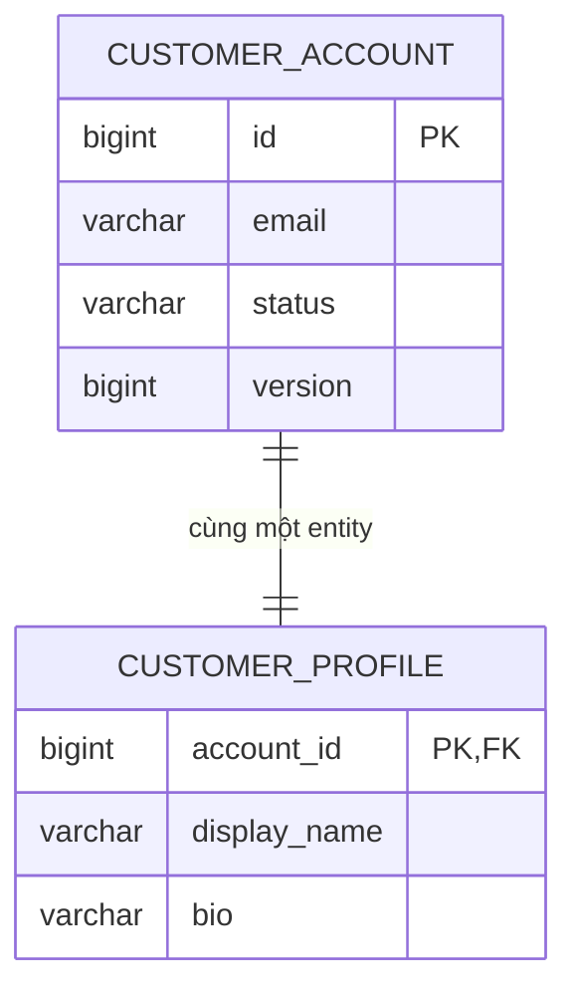

# Ánh xạ một entity vào nhiều bảng bằng `@SecondaryTable`

Trong JPA (Jakarta Persistence), một entity thường được ánh xạ vào một bảng thông qua `@Table`. Tuy nhiên, có những trường hợp **một đối tượng nghiệp vụ thống nhất** cần được lưu vào **hai hoặc nhiều bảng quan hệ**: chẳng hạn thông tin đăng nhập tài khoản ở bảng `customer_account`, còn tên hiển thị và tiểu sử ở bảng `customer_profile`.

Annotation **`@SecondaryTable`** giải quyết nhu cầu này. Nó chỉ định rằng **một entity** có một bảng chính (*primary table*) và một bảng phụ (*secondary table*). Các hàng tương ứng được nối bằng **khóa chính của entity**; các thuộc tính trong entity được gán vào bảng phù hợp qua `@Column(table = "...")`. Nếu có nhiều bảng phụ, dùng `@SecondaryTables`.

Bài học thuộc chương **Ánh xạ thuộc tính** tập trung vào cách khai báo, quy tắc khóa, cách JPA đọc/ghi, các giới hạn và thời điểm nên chọn cách ánh xạ này thay vì quan hệ `@OneToOne`.

## 1. Mô hình dữ liệu cần ánh xạ

Giả sử hệ thống thương mại điện tử lưu một tài khoản khách hàng với hai nhóm thuộc tính:

- **Nhóm tài khoản:** `id`, `email`, `status`, `version` phục vụ đăng nhập, kiểm soát trạng thái và cập nhật đồng thời.
- **Nhóm hồ sơ:** `display_name`, `bio` dùng để hiển thị với khách hàng khác.

Hai nhóm này thuộc **một đối tượng tài khoản** xét từ góc nhìn nghiệp vụ, nhưng được thiết kế thành hai bảng vật lý.



Ở cơ sở dữ liệu, `customer_profile.account_id` phải tham chiếu tới `customer_account.id`, đồng thời là **khóa chính** của bảng phụ. Vì mỗi giá trị `account_id` chỉ xuất hiện tối đa một lần, quan hệ vật lý này tương ứng với một hàng hồ sơ cho một hàng tài khoản. Nếu nghiệp vụ yêu cầu hồ sơ bắt buộc, cần đảm bảo hàng hồ sơ tồn tại cùng tài khoản bằng quy trình ghi dữ liệu và ràng buộc thích hợp.

Khi ánh xạ bằng `@SecondaryTable`, chương trình Java làm việc với **một đối tượng `CustomerAccount`**, không cần tạo lớp `CustomerProfile` chỉ để chứa những cột hồ sơ.

### Ví dụ DDL

Đoạn DDL sau phù hợp về mặt ý tưởng với H2 hoặc PostgreSQL, tùy phiên bản và cú pháp cụ thể của DB:

```sql
CREATE TABLE customer_account (
    id       BIGINT GENERATED BY DEFAULT AS IDENTITY PRIMARY KEY,
    email    VARCHAR(255) NOT NULL UNIQUE,
    status   VARCHAR(30) NOT NULL,
    version  BIGINT NOT NULL
);

CREATE TABLE customer_profile (
    account_id   BIGINT PRIMARY KEY,
    display_name VARCHAR(120) NOT NULL,
    bio          VARCHAR(1000),
    CONSTRAINT fk_profile_account
        FOREIGN KEY (account_id) REFERENCES customer_account(id)
);
```

**Điểm cốt lõi:** `customer_profile.account_id` không dùng cơ chế sinh ID độc lập. Nó nhận giá trị ID từ tài khoản ở bảng chính, giúp ORM ghép hai hàng thành cùng một entity.

## 2. Cấu trúc của `@SecondaryTable`

Các annotation tiêu chuẩn quan trọng:

| Annotation | Vai trò |
|---|---|
| `@Entity` | Đánh dấu lớp được JPA quản lý. |
| `@Table(name = "...")` | Chỉ định bảng chính của entity. |
| `@SecondaryTable(name = "...")` | Khai báo bảng phụ mà entity cùng sử dụng. |
| `@PrimaryKeyJoinColumn` | Ánh xạ cột khóa chính của bảng phụ tới cột khóa chính bên bảng chính. |
| `@Column(table = "...")` | Xác định cột của thuộc tính nằm ở bảng phụ nào. |
| `@SecondaryTables({...})` | Khai báo nhiều bảng phụ cho cùng một entity. |

Ví dụ tối thiểu:

```java
@Entity
@Table(name = "customer_account")
@SecondaryTable(
    name = "customer_profile",
    pkJoinColumns = @PrimaryKeyJoinColumn(
        name = "account_id",
        referencedColumnName = "id"
    )
)
public class CustomerAccount {
    @Id
    private Long id;

    @Column(name = "email") // table không chỉ định => bảng chính.
    private String email;

    @Column(name = "display_name", table = "customer_profile")
    private String displayName;
}
```

Cần phân biệt rõ:

- `@Table` và `@SecondaryTable` dùng ở cấp **entity class**.
- `@Column(table = "customer_profile")` dùng trên **thuộc tính cụ thể** để chọn bảng lưu cột đó.
- `@PrimaryKeyJoinColumn(name = "account_id", referencedColumnName = "id")` diễn đạt **cột `account_id` ở bảng phụ nối tới `id` ở bảng chính**.
- `@SecondaryTable` không tạo thêm entity, không sinh thêm identity độc lập và không mang ý nghĩa `@OneToOne` ở tầng object model.

Nếu bỏ `table` khỏi một `@Column` của thuộc tính hồ sơ, JPA thường mặc định ánh xạ cột đó vào **bảng chính**. Kết quả có thể là lỗi thiếu cột khi khởi tạo schema hoặc truy vấn.

## 3. Một entity hoàn chỉnh với hai bảng

Dùng **Jakarta Persistence 3.1** và Java 17 trở lên. Nếu dự án vẫn sử dụng JPA 2.2 thì package annotation là `javax.persistence`; ví dụ bên dưới sử dụng `jakarta.persistence`.

File `CustomerAccount.java`:

```java
package example.domain;

import jakarta.persistence.Column;
import jakarta.persistence.Entity;
import jakarta.persistence.EnumType;
import jakarta.persistence.Enumerated;
import jakarta.persistence.GeneratedValue;
import jakarta.persistence.GenerationType;
import jakarta.persistence.Id;
import jakarta.persistence.PrimaryKeyJoinColumn;
import jakarta.persistence.SecondaryTable;
import jakarta.persistence.Table;
import jakarta.persistence.Version;

@Entity
@Table(name = "customer_account")
@SecondaryTable(
    name = "customer_profile",
    pkJoinColumns = @PrimaryKeyJoinColumn(
        name = "account_id",
        referencedColumnName = "id"
    )
)
public class CustomerAccount {

    @Id
    @GeneratedValue(strategy = GenerationType.IDENTITY)
    private Long id;

    @Column(name = "email", nullable = false, length = 255, unique = true)
    private String email;

    @Enumerated(EnumType.STRING)
    @Column(name = "status", nullable = false, length = 30)
    private AccountStatus status;

    @Version
    @Column(name = "version", nullable = false)
    private long version;

    @Column(
        name = "display_name",
        table = "customer_profile",
        nullable = false,
        length = 120
    )
    private String displayName;

    @Column(
        name = "bio",
        table = "customer_profile",
        length = 1000
    )
    private String bio;

    protected CustomerAccount() {
        // JPA cần constructor không tham số, tối thiểu protected.
    }

    public CustomerAccount(String email, String displayName) {
        if (email == null || email.isBlank()) {
            throw new IllegalArgumentException("Email is required");
        }
        if (displayName == null || displayName.isBlank()) {
            throw new IllegalArgumentException("Display name is required");
        }
        this.email = email;
        this.displayName = displayName;
        this.status = AccountStatus.ACTIVE;
    }

    public Long getId() {
        return id;
    }

    public String getEmail() {
        return email;
    }

    public String getDisplayName() {
        return displayName;
    }

    public String getBio() {
        return bio;
    }

    public void changeDisplayName(String value) {
        if (value == null || value.isBlank()) {
            throw new IllegalArgumentException("Display name is required");
        }
        this.displayName = value;
    }

    public void changeBio(String value) {
        this.bio = value;
    }
}
```

File `AccountStatus.java`:

```java
package example.domain;

public enum AccountStatus {
    ACTIVE,
    LOCKED
}
```

Ở đây có **một entity Java** với sáu thuộc tính persistent:

| Thuộc tính Java | Cột SQL | Bảng |
|---|---|---|
| `id` | `id` | `customer_account` |
| `email` | `email` | `customer_account` |
| `status` | `status` | `customer_account` |
| `version` | `version` | `customer_account` |
| `displayName` | `display_name` | `customer_profile` |
| `bio` | `bio` | `customer_profile` |

Phần lớn thao tác của Java chỉ thấy `CustomerAccount`; provider JPA chịu trách nhiệm truy cập cả hai bảng theo metadata ánh xạ. `@Version` đặt ở bảng chính hỗ trợ optimistic locking cho thao tác JPA được quản lý, nhưng cũng cần kiểm tra behavior của provider khi có thao tác cập nhật trực tiếp bằng SQL.

### Tại sao constructor và field không có setter tùy ý?

JPA có thể truy cập field khi annotation ánh xạ đặt lên field, như ví dụ này. Lớp entity cần constructor không tham số hợp lệ; phương thức nghiệp vụ như `changeDisplayName` cho phép giới hạn cách sửa trạng thái đối tượng. Mẫu này không bắt buộc dùng setter public cho mọi thuộc tính.

## 4. Cấu hình persistence unit để chạy ví dụ

Ví dụ chạy trong Java SE với Hibernate ORM 6.x và H2. Đặt `persistence.xml` tại `src/main/resources/META-INF/persistence.xml`:

```xml
<?xml version="1.0" encoding="UTF-8"?>
<persistence xmlns="https://jakarta.ee/xml/ns/persistence"
             xmlns:xsi="http://www.w3.org/2001/XMLSchema-instance"
             xsi:schemaLocation="
                https://jakarta.ee/xml/ns/persistence
                https://jakarta.ee/xml/ns/persistence/persistence_3_1.xsd"
             version="3.1">

    <persistence-unit name="customerPU" transaction-type="RESOURCE_LOCAL">
        <provider>org.hibernate.jpa.HibernatePersistenceProvider</provider>

        <class>example.domain.CustomerAccount</class>
        <exclude-unlisted-classes>true</exclude-unlisted-classes>

        <properties>
            <property name="jakarta.persistence.jdbc.driver"
                      value="org.h2.Driver"/>
            <property name="jakarta.persistence.jdbc.url"
                      value="jdbc:h2:mem:customerdb;DB_CLOSE_DELAY=-1"/>
            <property name="jakarta.persistence.jdbc.user"
                      value="sa"/>
            <property name="jakarta.persistence.jdbc.password"
                      value=""/>

            <property name="jakarta.persistence.schema-generation.database.action"
                      value="drop-and-create"/>
        </properties>
    </persistence-unit>
</persistence>
```

Ứng dụng cần dependency phù hợp cho `jakarta.persistence-api`, Hibernate ORM và JDBC driver H2. Hibernate là **provider JPA**, còn H2 là cơ sở dữ liệu và driver JDBC dùng để trình diễn.

Thiết lập `drop-and-create` chỉ dùng cho môi trường thử nghiệm: nó có thể **xóa và tạo lại dữ liệu**. Trong hệ thống thật, cấu trúc hai bảng và khóa ngoại nên do công cụ migration như Flyway hoặc Liquibase quản lý, rồi kiểm tra khớp với ánh xạ ORM.

Nếu muốn dùng schema SQL tự tạo từ phần 1, không nên đồng thời bật cơ chế `drop-and-create` của provider.

## 5. Lưu một entity vào hai bảng

Mặc dù thông tin được phân tán trên hai bảng, API JPA vẫn thao tác với một entity.

```java
package example;

import example.domain.CustomerAccount;
import jakarta.persistence.EntityManager;
import jakarta.persistence.EntityManagerFactory;
import jakarta.persistence.EntityTransaction;
import jakarta.persistence.Persistence;

public class CreateCustomerDemo {

    public static void main(String[] args) {
        EntityManagerFactory emf =
                Persistence.createEntityManagerFactory("customerPU");

        try {
            EntityManager em = emf.createEntityManager();
            try {
                EntityTransaction tx = em.getTransaction();

                try {
                    tx.begin();

                    CustomerAccount customer =
                            new CustomerAccount("lan@example.com", "Lan Nguyen");
                    customer.changeBio("Yeu Java va du lieu quan he.");

                    em.persist(customer);
                    tx.commit();

                    System.out.println("Customer ID = " + customer.getId());
                } catch (RuntimeException ex) {
                    if (tx.isActive()) {
                        tx.rollback();
                    }
                    throw ex;
                }
            } finally {
                em.close();
            }
        } finally {
            emf.close();
        }
    }
}
```

Dưới góc nhìn SQL, provider **có thể** thực thi các câu lệnh tương tự:

```sql
INSERT INTO customer_account (email, status, version)
VALUES ('lan@example.com', 'ACTIVE', 0);

-- Sau khi có ID của bản ghi chính, ví dụ ID = 1:
INSERT INTO customer_profile (account_id, display_name, bio)
VALUES (1, 'Lan Nguyen', 'Yeu Java va du lieu quan he.');
```

Đây là **minh họa ý tưởng**, không phải bản ghi SQL chính xác từ một lần chạy. Thứ tự, số lần gọi JDBC, cột đưa vào `INSERT`, cách lấy ID và cách batch phụ thuộc provider, dialect và chiến lược sinh khóa.

Điều quan trọng về mặt ánh xạ:

1. Chỉ một lần gọi `em.persist(customer)` cho một entity.
2. Provider biết thuộc tính nào thuộc bảng chính và bảng phụ.
3. Khóa chính sinh cho hàng chính được dùng để liên kết hàng phụ.
4. Các thay đổi được thực thi trong cùng transaction của `EntityManager`; nếu có lỗi trước commit, transaction có thể rollback.

Không cần gọi `em.persist(profile)` vì trong mô hình này **không tồn tại entity `profile` riêng**.

## 6. Đọc và cập nhật entity trải trên nhiều bảng

### Đọc theo ID

```java
EntityManager em = emf.createEntityManager();
try {
    CustomerAccount account = em.find(CustomerAccount.class, 1L);

    if (account != null) {
        System.out.println(account.getEmail());
        System.out.println(account.getDisplayName());
        System.out.println(account.getBio());
    }
} finally {
    em.close();
}
```

Provider có thể dùng một truy vấn `JOIN` hoặc nhiều câu truy vấn tùy chiến lược fetch và cách triển khai. Một truy vấn SQL mang tính minh họa:

```sql
SELECT a.id,
       a.email,
       a.status,
       a.version,
       p.display_name,
       p.bio
FROM customer_account a
LEFT JOIN customer_profile p ON p.account_id = a.id
WHERE a.id = ?;
```

Không nên mặc định Hibernate luôn sử dụng đúng `LEFT JOIN`, đúng số câu SQL hoặc đúng thứ tự cột. Quan sát SQL thực tế khi cần tối ưu.

### Đọc bằng JPQL

Trong JPQL, ta truy vấn **tên entity và thuộc tính**, không trực tiếp gọi tên bảng SQL:

```java
List<CustomerAccount> customers = em.createQuery(
    """
    SELECT a
    FROM CustomerAccount a
    WHERE a.displayName LIKE :prefix
    ORDER BY a.email
    """,
    CustomerAccount.class
).setParameter("prefix", "Lan%")
 .getResultList();
```

JPA biết `displayName` nằm ở bảng phụ nên provider sẽ tạo SQL thích hợp để lọc bằng cột `customer_profile.display_name`. Không viết `FROM customer_profile` trong JPQL như thể đó là entity; đây chỉ là bảng vật lý nằm sau ánh xạ.

### Cập nhật một thuộc tính của bảng phụ

```java
EntityManager em = emf.createEntityManager();
try {
    EntityTransaction tx = em.getTransaction();
    try {
        tx.begin();

        CustomerAccount customer =
                em.find(CustomerAccount.class, customerId);

        if (customer == null) {
            throw new IllegalArgumentException("Customer not found");
        }

        customer.changeDisplayName("Lan Tran");
        tx.commit();
    } catch (RuntimeException ex) {
        if (tx.isActive()) {
            tx.rollback();
        }
        throw ex;
    }
} finally {
    em.close();
}
```

Vì `customer` đang **managed**, cơ chế dirty checking có thể ghi thay đổi của cột `display_name` vào bảng phụ tại thời điểm flush/commit. `@Version` giúp phát hiện xung đột theo cơ chế của provider; đừng dựa vào một hình dạng SQL cụ thể khi chưa quan sát.

Nếu entity đã **detached** (sau khi đóng `EntityManager` hoặc `clear()`), việc chỉ gọi `changeDisplayName(...)` không tự cập nhật database. Cần làm việc trong persistence context phù hợp hoặc dùng `merge()` với hiểu biết rõ về trạng thái đối tượng.

## 7. Khóa chính của bảng phụ và các biến thể

### 7.1. Một khóa chính đơn

Với `@Id Long id` ở bảng chính, cách khai báo thường gặp là:

```java
@SecondaryTable(
    name = "customer_profile",
    pkJoinColumns = @PrimaryKeyJoinColumn(
        name = "account_id",
        referencedColumnName = "id"
    )
)
```

Cột `account_id` ở bảng phụ là cột join. Nếu tên cột khóa chính ở cả hai bảng được thiết kế giống nhau, có trường hợp provider suy ra cấu hình join mặc định. Tuy vậy, khai báo tường minh giúp thể hiện rõ lược đồ và giảm nhầm lẫn.

### 7.2. Khóa chính tổng hợp

Khi entity có khóa tổng hợp gồm `tenant_id` và `account_code`, bảng phụ cũng phải cung cấp các thành phần khóa tương ứng.

Ví dụ **phần annotation của secondary table**:

```java
@SecondaryTable(
    name = "tenant_account_profile",
    pkJoinColumns = {
        @PrimaryKeyJoinColumn(
            name = "tenant_id",
            referencedColumnName = "tenant_id"
        ),
        @PrimaryKeyJoinColumn(
            name = "account_code",
            referencedColumnName = "account_code"
        )
    }
)
```

Entity chính phải khai báo khóa tương ứng, thường bằng `@EmbeddedId` hoặc `@IdClass`. Bảng phụ cần khóa chính tổng hợp và khóa ngoại ghép trỏ về đầy đủ các cột khóa chính của bảng chính. Ví dụ annotation trên chỉ minh họa phần join; nó chưa phải entity runnable nếu thiếu khai báo composite ID.

Nếu tên/cột khóa ghép khác nhau, cần ánh xạ đúng **từng cặp cột**; sai một thành phần có thể khiến JPA nối nhầm bản ghi hoặc báo lỗi schema/metadata.

### 7.3. Nhiều bảng phụ bằng `@SecondaryTables`

Một entity có thể trải trên hơn hai bảng:

```java
@Entity
@Table(name = "customer_account")
@SecondaryTables({
    @SecondaryTable(
        name = "customer_profile",
        pkJoinColumns = @PrimaryKeyJoinColumn(
            name = "account_id", referencedColumnName = "id"
        )
    ),
    @SecondaryTable(
        name = "customer_preferences",
        pkJoinColumns = @PrimaryKeyJoinColumn(
            name = "account_id", referencedColumnName = "id"
        )
    )
})
public class CustomerAccount {
    @Id
    private Long id;

    @Column(name = "email")
    private String email;

    @Column(name = "display_name", table = "customer_profile")
    private String displayName;

    @Column(name = "locale", table = "customer_preferences")
    private String locale;
}
```

Đây là ví dụ rút gọn nhằm làm rõ **cú pháp annotation**, không phải lớp hoàn chỉnh thay thế ví dụ trước. Mỗi secondary table có khóa join về khóa chính của cùng entity. Nếu hai bảng phụ trùng tên cột, `@Column(table = "...")` càng cần khai báo rõ ràng.

Mỗi bảng bổ sung có thể làm phát sinh thao tác SQL và join, do đó không nên tách hàng chục bảng phụ chỉ để tổ chức tên cột.

## 8. `@SecondaryTable` khác gì với `@OneToOne`?

Hai cách có thể dùng một thiết kế SQL gồm hai bảng chia sẻ khóa chính, nhưng **mô hình đối tượng và vòng đời khác nhau**.

| Tiêu chí | `@SecondaryTable` | `@OneToOne` với hai entity |
|---|---|---|
| Số entity JPA | Một | Hai |
| Cách truy cập | `account.getDisplayName()` | `account.getProfile().getDisplayName()` |
| Identity trong persistence context | Một identity entity | Hai identity entity |
| Bảng phụ | Chứa thuộc tính của cùng entity | Được ánh xạ thành entity độc lập |
| Query riêng trên bảng hồ sơ | Không query trực tiếp như entity hồ sơ | Có thể query entity `Profile` |
| Vòng đời profile | Gắn với entity chính và metadata ORM | Có thể thiết kế độc lập bằng cascade/orphan removal |
| Hồ sơ tạo muộn hoặc tùy chọn | Cần thận trọng với hàng phụ không tồn tại | Dễ mô hình hóa rõ quan hệ nullable/optional |
| Phù hợp nhất | Tách cột vật lý của **cùng một khái niệm nghiệp vụ** | Hai đối tượng có ranh giới trách nhiệm riêng |

Ví dụ với `@OneToOne` chia sẻ primary key:

```java
@Entity
@Table(name = "customer_profile")
public class CustomerProfile {
    @Id
    private Long id;

    @OneToOne(fetch = FetchType.LAZY)
    @MapsId
    @JoinColumn(name = "account_id")
    private CustomerAccount account;

    @Column(name = "display_name")
    private String displayName;
}
```

Ví dụ `@OneToOne` trên có ý nghĩa **minh họa khác biệt**, yêu cầu sửa thiết kế `CustomerAccount` để bỏ `@SecondaryTable` cho chính bảng này và quản lý liên kết tương ứng. Không nên **đồng thời** ánh xạ toàn bộ cột `customer_profile` thành một entity riêng và thành các field có thể cập nhật của `CustomerAccount` mà không chủ động xử lý xung đột ownership/trạng thái.

Hãy chọn `@OneToOne` khi hồ sơ có identity nghiệp vụ, repository/truy vấn riêng, thời điểm tồn tại riêng hoặc việc tải dữ liệu hồ sơ cần được kiểm soát theo quan hệ entity.

## 9. Phân biệt với những annotation khác

| Công cụ | Mục đích |
|---|---|
| `@SecondaryTable` | Một entity ánh xạ các thuộc tính vào nhiều bảng dựa trên cùng primary key. |
| `@JoinTable` | Khai báo bảng nối cho quan hệ giữa entity, thường gặp ở `@ManyToMany` hoặc một số dạng quan hệ khác. |
| `@OneToOne` + `@JoinColumn` | Quan hệ một-một giữa **hai entity**. |
| `@Inheritance(strategy = InheritanceType.JOINED)` | Chiến lược ánh xạ kế thừa: lớp cơ sở và lớp con có những bảng riêng. |
| `@Embedded` / `@Embeddable` | Nhóm các thuộc tính trong một value object, thường không tạo entity mới; không tự mang ý nghĩa có bảng phụ riêng. |
| Native SQL / JDBC | Truy cập và điều khiển nhiều bảng theo câu SQL do ứng dụng viết. |

Nếu mục tiêu là tách đối tượng nghiệp vụ có trách nhiệm riêng, `@SecondaryTable` có thể khiến entity phình to và khó bảo trì. Nếu mục tiêu là giữ một object model đơn giản nhưng vẫn phải dùng schema tách bảng do yêu cầu dữ liệu, nó lại rất hữu ích.

## 10. Các điểm cần thận trọng trong thực tế

### 10.1. Hàng secondary table có thể không tồn tại

Một số database cho phép tài khoản tồn tại trước rồi mới tạo hồ sơ sau. Với `@SecondaryTable`, **việc có hàng phụ là một chi tiết quan trọng của ánh xạ**, không chỉ đơn giản là gán `null` cho field. Các provider có thể khác nhau về cách xử lý insert/update khi bảng phụ chưa có hàng, nhất là khi mọi trường phụ là `null`.

Annotation `@SecondaryTable` chuẩn không có tham số `optional = true` theo cách `@OneToOne(optional = true)` có. Một số provider cung cấp extension cho secondary row tùy chọn; ví dụ Hibernate có cơ chế cấu hình riêng, nhưng phụ thuộc phiên bản provider và không còn portable.

**Khuyến nghị:** nếu hàng hồ sơ thực sự có thể được tạo hoặc xóa độc lập, cân nhắc `@OneToOne` với shared primary key (`@MapsId`). Nếu dùng `@SecondaryTable`, quy định rõ khi nào hàng phụ được tạo và thử nghiệm bằng DB/provider thực tế.

### 10.2. Đọc entity có thể cần truy cập nhiều bảng

Dù mã Java chỉ gọi `find(CustomerAccount.class, id)`, SQL có thể phải join hoặc truy vấn thêm bảng phụ. Càng nhiều bảng phụ, truy vấn càng có thể phức tạp và kéo theo chi phí I/O, network, mapping.

`@Basic(fetch = FetchType.LAZY)` trên trường thông thường là một **gợi ý fetch** và khả năng tải lazy các basic field phụ thuộc cơ chế provider, ví dụ bytecode enhancement của Hibernate. Không nên coi annotation đó là bảo đảm rằng bảng phụ sẽ không được truy cập. Với màn hình chỉ cần email và status, cân nhắc DTO projection để không tải các trường không dùng:

```java
List<AccountSummary> summaries = em.createQuery(
    """
    SELECT new example.dto.AccountSummary(a.id, a.email, a.status)
    FROM CustomerAccount a
    WHERE a.status = :status
    """,
    AccountSummary.class
).setParameter("status", AccountStatus.ACTIVE)
 .getResultList();
```

DTO tương ứng (Java 17):

```java
package example.dto;

import example.domain.AccountStatus;

public record AccountSummary(
    Long id,
    String email,
    AccountStatus status
) {}
```

Provider có thể tối ưu truy vấn này vì không cần materialize toàn bộ entity; tuy nhiên vẫn phải quan sát SQL để biết có join phụ hay không.

### 10.3. Dirty checking, transaction và cập nhật đồng thời

JPA theo dõi thay đổi của entity managed. Khi sửa các field trên bảng chính và bảng phụ trong một transaction, provider có thể phát SQL cho cả hai bảng. Kiểm soát đồng thời bằng `@Version` vẫn cần được giữ thống nhất; đặc biệt nếu có công cụ khác hoặc JDBC cập nhật trực tiếp bảng phụ mà không kiểm soát version, optimistic locking của JPA có thể bị vượt qua.

Ví dụ nguy cơ:

1. Transaction A tải `CustomerAccount` với `version = 5`.
2. Một script SQL ngoài JPA đổi `customer_profile.display_name` nhưng không thay `customer_account.version`.
3. Transaction A sau đó ghi thay đổi khác. Cơ chế version ở bảng chính có thể không phát hiện script SQL đã sửa hồ sơ.

Nếu có nhiều đường ghi dữ liệu, cần thiết kế chung về ownership, điều kiện `WHERE`, version/audit, transaction và khóa.

### 10.4. Schema generation không thay thế migration

Annotation cho biết metadata ORM, nhưng không tự đảm bảo schema production đúng thiết kế. DBA hoặc migration vẫn cần kiểm soát:

- `customer_profile.account_id` có **PRIMARY KEY** và **FOREIGN KEY** về bảng chính.
- Độ dài/nullable của các cột tương ứng với mapping và yêu cầu nghiệp vụ.
- Giá trị default, index và unique constraint thực sự tồn tại.
- Quy tắc xóa hàng: `ON DELETE CASCADE` hay ứng dụng tự xóa, phù hợp provider và nghiệp vụ.
- Các dữ liệu cũ được backfill trước khi bắt buộc hàng secondary table tồn tại.

Không nên thêm constraint hoặc sửa quyền sở hữu cột mà chưa có kế hoạch migration cho dữ liệu hiện có.

### 10.5. Xóa entity và ràng buộc khóa ngoại

Khi `em.remove(account)`, provider có thể phải xóa các hàng secondary table và hàng chính theo thứ tự phù hợp để không vi phạm FK. Những chi tiết như cascade của DB, lệnh SQL thực tế và khả năng xử lý dữ liệu còn thiếu phụ thuộc provider và schema. Việc xóa entity nên chạy trong transaction và được kiểm thử với ràng buộc FK thật.

### 10.6. Đặt tên bảng, schema và case-sensitive identifier

`name = "customer_profile"` phải khớp tên bảng theo cơ chế đặt tên của provider/database. Nếu bảng thuộc schema khác, có thể dùng `@SecondaryTable(schema = "app", name = "customer_profile", ...)` và đảm bảo tài khoản DB có quyền truy cập. Identifier đặt trong dấu nháy kép có thể nhạy chữ hoa/thường trên một số DB; nên thống nhất quy ước tên từ đầu.

### 10.7. Trường dữ liệu nhạy cảm

Tách thông tin hồ sơ sang bảng khác có thể hỗ trợ tổ chức quyền DB và chiến lược bảo trì, nhưng **không tự tạo ranh giới bảo mật** trong entity. Nếu ứng dụng đọc entity có thể truy cập field nhạy cảm, vẫn cần phân quyền ở tầng service/API, kiểm soát serialization và bảo vệ thông tin trong log.

## 11. Khi nào nên chọn `@SecondaryTable`?

Các tình huống thường hợp lý:

- Schema có từ trước chia thông tin cùng một đối tượng thành bảng chính và bảng mở rộng với **khóa chung**.
- Muốn giữ API domain là một entity duy nhất dù cột vật lý tách ra vì mục đích tổ chức, phân vùng dữ liệu hoặc chính sách vận hành.
- Nhóm cột thuộc cùng vòng đời và được cập nhật dưới cùng quy tắc nghiệp vụ.
- Cả hai bảng tương ứng có quan hệ một-một rõ ràng và không cần query bảng phụ như đối tượng nghiệp vụ độc lập.

Các tình huống nên cân nhắc lựa chọn khác:

- Hồ sơ có thể thiếu lâu dài, được tạo/xóa riêng, có quyền sửa và vòng đời độc lập → cân nhắc `@OneToOne`.
- Một tài khoản có nhiều địa chỉ hoặc nhiều phương thức liên hệ → `@OneToMany`, `@ElementCollection` hoặc entity riêng, không phải secondary table.
- Chỉ muốn nhóm code thuộc tính mà không tách bảng → `@Embeddable`.
- Nhu cầu đọc bảng mở rộng có mật độ truy cập khác hẳn và dữ liệu rất lớn → cân nhắc tách entity, DTO/query chuyên biệt hoặc mô hình đọc riêng.
- Dữ liệu chỉ là kết quả tổng hợp nhiều bảng không có khóa chính chung → JPQL projection, native SQL hoặc JDBC thường tự nhiên hơn.

## 12. Bài tập thực hành

**Bài 1 — Thêm bảng thông tin liên hệ.** Tạo `customer_contact` có `account_id` (PK/FK), `phone` và `city`. Dùng `@SecondaryTables` để ánh xạ cả `customer_profile` lẫn `customer_contact` vào `CustomerAccount`. Đặt `@Column(table = "...")` cho đúng từng field.

**Bài 2 — Quan sát SQL.** Bật log SQL của provider trong môi trường phát triển. Persist một tài khoản, tìm theo ID và đổi `displayName`. Ghi lại những bảng được dùng trong các câu `INSERT`, `SELECT`, `UPDATE`; lý giải vì sao số câu SQL không nhất thiết bằng số lệnh Java.

**Bài 3 — Kiểm tra ràng buộc.** Thử tạo một hàng `customer_profile` có `account_id` không tồn tại, hoặc một hàng thứ hai có cùng `account_id`. Xác định constraint nào ngăn được thao tác.

**Bài 4 — Bản ghi phụ bị thiếu.** Tạo một tài khoản trong bảng chính mà chưa có hàng phụ, rồi thử `find` và cập nhật thuộc tính phụ qua JPA. Quan sát cách provider xử lý trên schema thực tế. So sánh với mô hình `@OneToOne(optional = true)`.

**Bài 5 — So sánh mô hình.** Với tình huống `customer_profile` có quy trình duyệt thông tin, API riêng và có thể được lưu nháp trước tài khoản, giải thích vì sao một entity riêng với `@OneToOne` hoặc mô hình domain khác có thể phù hợp hơn.

## 13. Câu hỏi tự kiểm tra

1. **`@SecondaryTable` tạo bao nhiêu entity?** Vẫn chỉ là một entity; bảng phụ chứa các cột thuộc entity đó.
2. **Làm sao chỉ định `displayName` nằm ở bảng phụ?** Dùng `@Column(name = "display_name", table = "customer_profile")`.
3. **Vì sao cần `@PrimaryKeyJoinColumn`?** Để mô tả cách khóa chính của bảng phụ nối với khóa chính của bảng chính.
4. **Có thể thay bảng phụ bằng `@OneToMany` khi một tài khoản có nhiều hồ sơ không?** Có thể cần quan hệ một-nhiều theo mô hình nghiệp vụ, bởi secondary table không biểu diễn nhiều hàng độc lập cho một entity.
5. **Dùng `@SecondaryTable` có chắc làm giảm số câu SQL không?** Không. Provider vẫn có thể truy cập nhiều bảng, join hoặc thực thi thêm lệnh ghi.
6. **Có nên query `customer_profile` bằng JPQL như một entity?** Không, trừ khi bảng đó còn được ánh xạ thành entity riêng có chủ đích. Với `@SecondaryTable` thông thường, query `CustomerAccount` và các thuộc tính của nó.
7. **Nếu hàng secondary table là tùy chọn, điều gì cần cân nhắc?** Cách provider xử lý hàng vắng mặt, thời điểm tạo hàng phụ, ràng buộc DB và việc liệu `@OneToOne` có biểu đạt vòng đời phù hợp hơn không.

**Ghi nhớ:** `@SecondaryTable` giúp **một entity duy nhất trải trên nhiều bảng quan hệ** có liên kết bằng khóa chính. Khai báo bảng chính bằng `@Table`, bảng phụ bằng `@SecondaryTable`, khóa nối bằng `@PrimaryKeyJoinColumn` và chỉ rõ vị trí mỗi cột phụ bằng `@Column(table = "...")`. Chọn mô hình này khi các cột thực sự thuộc **cùng một đối tượng và vòng đời**, đồng thời quan sát SQL và kiểm soát schema, transaction, khóa ngoại cùng optimistic locking trong thực tế.
