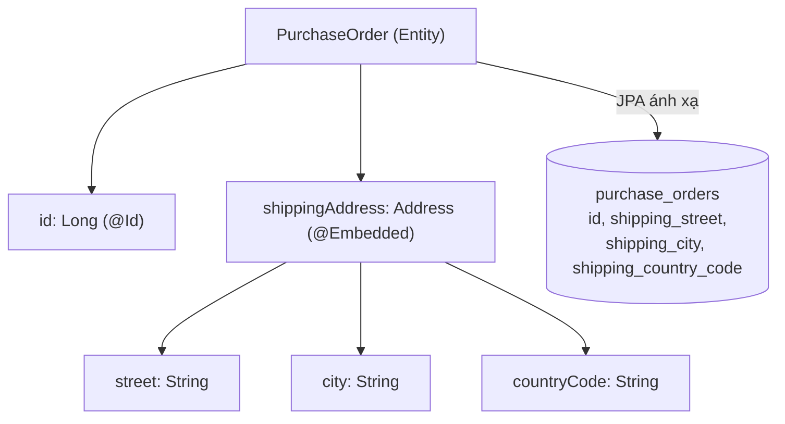

# Nhúng đối tượng giá trị bằng `@Embeddable` và `@Embedded`

Trong thiết kế hướng đối tượng, không phải mọi lớp đều đại diện cho một thực thể có định danh riêng. Một địa chỉ, khoảng thời gian, số tiền hoặc tọa độ địa lý thường được xác định bằng **giá trị của các thuộc tính**, thay vì bằng một khóa chính độc lập. Những đối tượng như vậy được gọi là **value object** (đối tượng giá trị).

JPA cung cấp `@Embeddable` và `@Embedded` để biểu diễn các value object như **một phần trạng thái của entity sở hữu chúng**. Đây là kỹ thuật quan trọng trong ánh xạ quan hệ: ta giữ mô hình Java có cấu trúc, giàu ý nghĩa nghiệp vụ, trong khi các giá trị vẫn được lưu vào những cột của bảng tương ứng.

Ví dụ, thay vì để entity `Customer` có ba field rời rạc `shippingStreet`, `shippingCity` và `shippingCountryCode`, ta tạo lớp `Address` gồm các field `street`, `city` và `countryCode`. `Customer` sở hữu một `Address` và JPA ánh xạ các thuộc tính của địa chỉ vào cột dữ liệu của chính khách hàng.

Điểm trọng tâm:

- **`@Embeddable`** đánh dấu một kiểu giá trị có thể được nhúng.
- **`@Embedded`** đánh dấu thuộc tính sử dụng kiểu giá trị đó trong entity hoặc embeddable khác.
- **Embeddable không phải entity**: nó không có persistence identity riêng, không được quản lý độc lập bằng `EntityManager.persist` hay `find`.
- Với trường hợp nhúng một giá trị đơn lẻ trong entity, các cột của embeddable thường nằm **cùng bảng với entity sở hữu**. Khi dùng embeddable trong `@ElementCollection`, các giá trị có thể được lưu ở **collection table**.
- Khi một entity thay đổi giá trị embedded của nó, provider đồng bộ thay đổi như một phần trạng thái của entity theo quy tắc transaction và dirty checking.

## 1. Từ mô hình phẳng sang đối tượng giá trị

Xét một mô hình lưu đơn hàng với địa chỉ giao hàng.

### Thiết kế phẳng

```java
@Entity
public class PurchaseOrder {
    @Id
    private Long id;

    private String shippingStreet;
    private String shippingCity;
    private String shippingCountryCode;

    // ...
}
```

Cách này có thể hoạt động nhưng làm trộn trách nhiệm của địa chỉ vào entity. Nếu nhiều entity như `Customer`, `Warehouse` và `PurchaseOrder` đều cần địa chỉ, ta dễ lặp lại nhóm field và logic kiểm tra giá trị.

### Thiết kế dùng value object

```java
@Embeddable
public class Address {
    private String street;
    private String city;
    private String countryCode;

    // Constructor, getter và quy tắc hợp lệ...
}

@Entity
public class PurchaseOrder {
    @Id
    private Long id;

    @Embedded
    private Address shippingAddress;

    // ...
}
```

Đây là quan hệ **composition**: `PurchaseOrder` có một `Address` là một phần dữ liệu của chính nó. `Address` không có bản ghi độc lập chỉ để mang định danh và không cần repository riêng.



Một nhầm lẫn phổ biến là cho rằng mỗi lớp Java phải tương ứng một bảng. **JPA không bắt buộc như vậy**: một entity có thể chứa nhiều embeddable, tất cả cùng đóng góp cột vào một bảng.

## 2. Vai trò của `@Embeddable` và `@Embedded`

### 2.1. `@Embeddable` mô tả kiểu có thể nhúng

Annotation `jakarta.persistence.Embeddable` được đặt trên lớp chứa các thuộc tính mà JPA có thể ánh xạ:

```java
package example.domain;

import jakarta.persistence.Column;
import jakarta.persistence.Embeddable;
import java.util.Objects;

@Embeddable
public class Address {
    @Column(name = "street", length = 200, nullable = false)
    private String street;

    @Column(name = "city", length = 100, nullable = false)
    private String city;

    @Column(name = "country_code", length = 2, nullable = false)
    private String countryCode;

    protected Address() {
        // Dành cho JPA provider.
    }

    public Address(String street, String city, String countryCode) {
        if (street == null || street.isBlank()) {
            throw new IllegalArgumentException("Street is required");
        }
        if (city == null || city.isBlank()) {
            throw new IllegalArgumentException("City is required");
        }
        if (countryCode == null || countryCode.length() != 2) {
            throw new IllegalArgumentException("Country code must have 2 letters");
        }
        this.street = street;
        this.city = city;
        this.countryCode = countryCode;
    }

    public String getStreet() {
        return street;
    }

    public String getCity() {
        return city;
    }

    public String getCountryCode() {
        return countryCode;
    }

    @Override
    public boolean equals(Object other) {
        if (this == other) return true;
        if (!(other instanceof Address that)) return false;
        return Objects.equals(street, that.street)
            && Objects.equals(city, that.city)
            && Objects.equals(countryCode, that.countryCode);
    }

    @Override
    public int hashCode() {
        return Objects.hash(street, city, countryCode);
    }
}
```

Lớp này minh họa value object có giao diện hạn chế sửa đổi:

1. Không chứa `@Entity`, `@Id` hoặc `@GeneratedValue`.
2. Có constructor không tham số `protected` và field persistent không `final` để tương thích với kiểu embeddable class thông thường ở các phiên bản JPA.
3. Cung cấp constructor có kiểm tra quy tắc nghiệp vụ.
4. Không công khai setter; ứng dụng thay nguyên đối tượng khi cần đổi địa chỉ.
5. Định nghĩa `equals` và `hashCode` theo **giá trị các thuộc tính**.

Việc không có setter không làm lớp bất biến tuyệt đối theo ngôn ngữ Java: provider vẫn có thể nạp các field. Đối tượng cũng có thể chứa mutable reference nếu lập trình viên đưa vào. Với value object, hãy tránh chia sẻ hoặc thay đổi nội bộ các tham chiếu mutable ngoài ý muốn.

### 2.2. `@Embedded` đánh dấu thuộc tính sử dụng value object

```java
package example.domain;

import jakarta.persistence.Embedded;
import jakarta.persistence.Entity;
import jakarta.persistence.GeneratedValue;
import jakarta.persistence.GenerationType;
import jakarta.persistence.Id;
import jakarta.persistence.Table;

@Entity
@Table(name = "customers")
public class Customer {
    @Id
    @GeneratedValue(strategy = GenerationType.IDENTITY)
    private Long id;

    private String fullName;

    @Embedded
    private Address address;

    protected Customer() {
    }

    public Customer(String fullName, Address address) {
        this.fullName = fullName;
        this.address = address;
    }

    public Long getId() {
        return id;
    }

    public Address getAddress() {
        return address;
    }

    public void changeAddress(Address newAddress) {
        if (newAddress == null) {
            throw new IllegalArgumentException("Address is required");
        }
        this.address = newAddress;
    }
}
```

Trong Java, `Customer` có field kiểu `Address`. Trong cơ sở dữ liệu, JPA có thể lưu ba thuộc tính của `Address` thành cột `street`, `city`, `country_code` trên bảng `customers`.

Một lược đồ SQL minh họa:

```sql
CREATE TABLE customers (
    id           BIGINT GENERATED BY DEFAULT AS IDENTITY PRIMARY KEY,
    full_name    VARCHAR(255),
    street       VARCHAR(200) NOT NULL,
    city         VARCHAR(100) NOT NULL,
    country_code VARCHAR(2)   NOT NULL
);
```

Cú pháp tạo identity column thay đổi tùy hệ quản trị CSDL; đây là ví dụ mang tính mô hình. JPA provider không nhất thiết tạo bảng tự động: các bảng có thể được tạo qua migration như Flyway hoặc Liquibase.

**Điểm quan trọng:** `Address` không có bảng `addresses` riêng. Nó không có khóa chính hay foreign key tới một bảng địa chỉ trong ánh xạ đơn giản này. Các giá trị được lưu trực tiếp trong hàng dữ liệu của khách hàng.

### 2.3. Có cần viết `@Embedded` mọi lúc không?

Với một thuộc tính có kiểu đã được khai báo `@Embeddable`, JPA có thể suy ra mapping embedded theo metadata. Việc viết `@Embedded` rõ ràng vẫn hữu ích vì thể hiện ý đồ ngay trong mã và là vị trí thuận tiện để đặt `@AttributeOverride` hoặc `@AssociationOverride`.

Không nên hiểu `@Embedded` là lệnh “tự tạo bảng phụ”. Nó mô tả việc đưa cấu trúc giá trị vào mapping của chủ sở hữu.

## 3. Bản chất quan hệ sở hữu và vòng đời

Một embeddable có vòng đời phụ thuộc vào nơi nó được nhúng. Nó không được persistence context quản lý như **một entity độc lập**.

| Thao tác | Entity `Customer` | Embeddable `Address` |
|---|---|---|
| Có identity riêng (`@Id`) | Có | Không |
| `EntityManager.persist` | Được gọi trên entity mới | Không gọi trực tiếp |
| `EntityManager.find` | Tìm theo entity class và ID | Không thể tìm bằng ID độc lập |
| `EntityManager.remove` | Có thể xóa entity | Không có thao tác xóa độc lập |
| Trạng thái được lưu | Là trạng thái của entity | Là một phần các trường persistent của owner |
| Đổi một giá trị | Có thể thay state của managed entity | Thường thay bằng instance giá trị mới |

Ví dụ dùng resource-local transaction trong Java SE:

```java
EntityManager em = emf.createEntityManager();
try {
    em.getTransaction().begin();

    Address address = new Address(
        "12 Nguyen Hue", "Ho Chi Minh City", "VN"
    );
    Customer customer = new Customer("Minh Anh", address);

    em.persist(customer);  // Lưu entity và các cột của address.
    em.getTransaction().commit();
} catch (RuntimeException ex) {
    if (em.getTransaction().isActive()) {
        em.getTransaction().rollback();
    }
    throw ex;
} finally {
    em.close();
}
```

Ứng dụng chỉ gọi `em.persist(customer)`. Provider lấy giá trị từ `customer.address` và đồng bộ các cột tương ứng trong bản ghi `customers`.

**Không dùng:**

```java
Address address = new Address("A", "B", "VN");
em.persist(address);            // Không hợp lệ: Address không phải entity.
em.find(Address.class, 10L);    // Không hợp lệ: không có entity identity.
```

Không có cơ chế cascade giữa owner và một embedded value theo kiểu `CascadeType.PERSIST` như quan hệ hai entity; giá trị embedded đã là một phần state được lưu cùng owner. Ngược lại, nếu một embeddable chứa một quan hệ tới entity khác, quan hệ đó vẫn có quy tắc cascade riêng; sẽ xét ở phần mở rộng.

## 4. Điều gì xảy ra khi sửa đối tượng embedded?

Giả sử transaction đã tải một khách hàng:

```java
Customer customer = em.find(Customer.class, customerId);
customer.changeAddress(
    new Address("28 Le Loi", "Da Nang", "VN")
);
```

Nếu `customer` đang **managed**, provider nhận thấy state của entity thay đổi và có thể sinh `UPDATE` khi flush hoặc commit:

```sql
UPDATE customers
SET street = ?, city = ?, country_code = ?
WHERE id = ?;
```

SQL minh họa không cam kết số cột hoặc thời điểm chính xác: provider có thể cập nhật thêm các cột khác, thực hiện optimistic locking hoặc sử dụng cách sinh SQL khác theo cấu hình.

### 4.1. Thay nguyên object so với sửa từng field

Với value object, thường ưu tiên:

```java
customer.changeAddress(
    new Address("5 Tran Phu", "Ha Noi", "VN")
);
```

Thay vì:

```java
customer.getAddress().setStreet("5 Tran Phu");
customer.getAddress().setCity("Ha Noi");
```

Lý do là trạng thái địa chỉ có thể có invariant liên quan giữa các thuộc tính. Tạo value object mới giúp kiểm tra nguyên bộ dữ liệu ngay trong constructor.

JPA cũng có thể theo dõi thay đổi trên các thuộc tính bên trong embeddable mutable. Tuy nhiên, khả năng phát hiện cụ thể và thời điểm đồng bộ là việc của provider. Nếu thiết kế value object bất biến về mặt API, thao tác **thay toàn bộ giá trị** thường dễ hiểu, dễ kiểm soát hơn.

### 4.2. Detached owner không tự ghi thay đổi

```java
Customer customer = em.find(Customer.class, customerId);
em.detach(customer);

customer.changeAddress(new Address("9 Pasteur", "Da Lat", "VN"));
// customer đã detached; việc gán không tự cập nhật database.
```

Muốn cập nhật, có thể tải lại entity trong transaction mới rồi gọi business method, hoặc dùng `merge` với state detached phù hợp:

```java
Customer managed = em.merge(customer);
// managed là đối tượng được trả về và đang được persistence context quản lý.
```

`merge` không làm đối tượng detached ban đầu tự biến thành managed. Cần chú ý rủi ro ghi đè dữ liệu cũ khi đồng bộ state detached, nhất là trong hệ thống có cập nhật đồng thời.

### 4.3. Flush và commit

`em.flush()` yêu cầu đồng bộ state hiện tại vào database trong transaction. `commit()` xác nhận kết quả transaction. SQL cho embedded value có thể được gửi trước commit, nhưng vẫn rollback nếu transaction bị hủy. Không xem việc thay `Address` là một transaction độc lập với entity owner.

## 5. Nhúng nhiều đối tượng cùng một kiểu trong một entity

Một entity `PurchaseOrder` có thể có cả địa chỉ thanh toán và địa chỉ giao hàng:

```java
@Entity
@Table(name = "purchase_orders")
public class PurchaseOrder {
    @Id
    @GeneratedValue(strategy = GenerationType.IDENTITY)
    private Long id;

    @Embedded
    private Address billingAddress;

    @Embedded
    private Address shippingAddress;

    protected PurchaseOrder() {}
}
```

Nếu cả hai embedded value dùng chung mapping cột `street`, `city`, `country_code`, JPA sẽ gặp **xung đột tên cột**. Ta cần xác định cột tương ứng của từng vị trí nhúng.

### 5.1. `@AttributeOverride`

Annotation `@AttributeOverride` ghi đè mapping `@Column` của một thuộc tính basic trong embeddable, tại **nơi sử dụng** value object.

```java
import jakarta.persistence.AttributeOverride;
import jakarta.persistence.AttributeOverrides;
import jakarta.persistence.Column;
import jakarta.persistence.Embedded;
import jakarta.persistence.Entity;
import jakarta.persistence.GeneratedValue;
import jakarta.persistence.GenerationType;
import jakarta.persistence.Id;
import jakarta.persistence.Table;

@Entity
@Table(name = "purchase_orders")
public class PurchaseOrder {
    @Id
    @GeneratedValue(strategy = GenerationType.IDENTITY)
    private Long id;

    @Embedded
    @AttributeOverrides({
        @AttributeOverride(
            name = "street",
            column = @Column(name = "billing_street", length = 200)
        ),
        @AttributeOverride(
            name = "city",
            column = @Column(name = "billing_city", length = 100)
        ),
        @AttributeOverride(
            name = "countryCode",
            column = @Column(name = "billing_country_code", length = 2)
        )
    })
    private Address billingAddress;

    @Embedded
    @AttributeOverrides({
        @AttributeOverride(
            name = "street",
            column = @Column(name = "shipping_street", length = 200)
        ),
        @AttributeOverride(
            name = "city",
            column = @Column(name = "shipping_city", length = 100)
        ),
        @AttributeOverride(
            name = "countryCode",
            column = @Column(name = "shipping_country_code", length = 2)
        )
    })
    private Address shippingAddress;

    protected PurchaseOrder() {}

    public PurchaseOrder(
        Address billingAddress,
        Address shippingAddress
    ) {
        this.billingAddress = billingAddress;
        this.shippingAddress = shippingAddress;
    }

    public void changeShippingAddress(Address address) {
        this.shippingAddress = address;
    }
}
```

Giải thích:

- `name = "street"` trỏ tới **thuộc tính Java** bên trong `Address`, không phải tên cột SQL ban đầu.
- `column = @Column(name = "billing_street")` quyết định tên cột ở **vị trí nhúng này**.
- Thay đổi mapping của `billingAddress` không làm thay đổi mapping của `shippingAddress` hoặc các vị trí khác dùng `Address`.
- `@AttributeOverrides` gom nhiều `@AttributeOverride` thành một nhóm. Với annotation repeatable hiện đại cũng có thể gặp cú pháp khai báo nhiều `@AttributeOverride` trực tiếp.

Bảng `purchase_orders` có thể chứa:

| Cột | Thuộc tính Java |
|---|---|
| `id` | `PurchaseOrder.id` |
| `billing_street` | `billingAddress.street` |
| `billing_city` | `billingAddress.city` |
| `billing_country_code` | `billingAddress.countryCode` |
| `shipping_street` | `shippingAddress.street` |
| `shipping_city` | `shippingAddress.city` |
| `shipping_country_code` | `shippingAddress.countryCode` |

Ở mức database, dữ liệu vẫn nằm trong một hàng của bảng `purchase_orders`. Không có hai bảng địa chỉ độc lập được tạo từ hai trường `@Embedded` này.

### 5.2. Ý nghĩa của các tham số `@Column` khi override

Ngoài `name`, `@Column` có các thuộc tính như `nullable`, `length`, `precision`, `scale`, `insertable` và `updatable`. Nếu cần giữ invariant (ví dụ địa chỉ giao hàng bắt buộc), nên biểu diễn ý định rõ ràng ở mapping và trong code nghiệp vụ.

Ví dụ:

```java
@AttributeOverride(
    name = "street",
    column = @Column(
        name = "shipping_street",
        nullable = false,
        length = 200
    )
)
```

Một `@AttributeOverride` **thay thế khai báo cột của thuộc tính đó** tại vị trí nhúng, vì vậy khi các ràng buộc cột quan trọng, hãy khai báo rõ các thuộc tính cần giữ thay vì mặc định rằng mọi thiết lập ở `@Embeddable` luôn tự được bảo toàn trong override.

Metadata JPA có thể hỗ trợ sinh schema, nhưng việc database thật sự có constraint phù hợp còn phụ thuộc DDL và migration. Validation trong Java và constraint ở database nên bổ sung cho nhau.

## 6. Embedded lồng nhau

Một value object có thể chứa value object khác. Ví dụ địa chỉ có tọa độ địa lý:

```java
import jakarta.persistence.Embeddable;
import jakarta.persistence.Column;

@Embeddable
public class GeoPoint {
    @Column(name = "latitude")
    private Double latitude;

    @Column(name = "longitude")
    private Double longitude;

    protected GeoPoint() {}

    public GeoPoint(Double latitude, Double longitude) {
        if (latitude == null || longitude == null) {
            throw new IllegalArgumentException("Coordinates required");
        }
        if (latitude < -90 || latitude > 90
                || longitude < -180 || longitude > 180) {
            throw new IllegalArgumentException("Coordinates out of range");
        }
        this.latitude = latitude;
        this.longitude = longitude;
    }
}
```

Lớp địa chỉ có thêm field `coordinates`:

```java
@Embeddable
public class LocationAddress {
    private String street;
    private String city;

    @Embedded
    private GeoPoint coordinates;

    protected LocationAddress() {}

    public LocationAddress(
        String street,
        String city,
        GeoPoint coordinates
    ) {
        this.street = street;
        this.city = city;
        this.coordinates = coordinates;
    }
}
```

Khi nhúng `LocationAddress` vào entity:

```java
@Embedded
@AttributeOverrides({
    @AttributeOverride(
        name = "street",
        column = @Column(name = "delivery_street")
    ),
    @AttributeOverride(
        name = "city",
        column = @Column(name = "delivery_city")
    ),
    @AttributeOverride(
        name = "coordinates.latitude",
        column = @Column(name = "delivery_latitude")
    ),
    @AttributeOverride(
        name = "coordinates.longitude",
        column = @Column(name = "delivery_longitude")
    )
})
private LocationAddress deliveryLocation;
```

Ở đây, `"coordinates.latitude"` là **đường dẫn thuộc tính dạng dấu chấm** tới một thuộc tính basic nằm trong embeddable con. JPA dùng đường dẫn này để chọn đúng phần tử cần override.

```text
Entity.deliveryLocation
  ├─ street                    -> delivery_street
  ├─ city                      -> delivery_city
  └─ coordinates (GeoPoint)
       ├─ latitude             -> delivery_latitude
       └─ longitude            -> delivery_longitude
```

Đối với kiểu nhúng đơn lẻ, các cột được trải phẳng vào bảng của entity theo mapping. Nhiều tầng Java object **không bắt buộc** tạo nhiều bảng hoặc nhiều JOIN.

## 7. Embeddable có thể chứa quan hệ tới entity khác

Embeddable chủ yếu biểu diễn giá trị, nhưng JPA cũng cho phép khai báo các association thích hợp trong embeddable, ví dụ một địa chỉ chứa tham chiếu đến entity `Country`.

```java
@Entity
public class Country {
    @Id
    private String code;

    private String name;

    protected Country() {}
}
```

```java
@Embeddable
public class PostalAddress {
    private String street;

    @ManyToOne(fetch = FetchType.LAZY)
    @JoinColumn(name = "country_code")
    private Country country;

    protected PostalAddress() {}
}
```

Khác với `String countryCode` thuần giá trị, field `country` ở trên là một **association tới entity có identity riêng**. Nó có thể cần join, lazy loading hoặc phát sinh truy vấn bổ sung. Embeddable vẫn không trở thành entity; chỉ có `Country` là entity được tham chiếu.

Khi cùng một loại embeddable được dùng ở nhiều vị trí, các join column cũng cần phân biệt. `@AttributeOverride` dùng cho **basic attribute**, còn `@AssociationOverride` dùng để ghi đè **relationship mapping**:

```java
@Embedded
@AssociationOverride(
    name = "country",
    joinColumns = @JoinColumn(name = "billing_country_code")
)
private PostalAddress billingAddress;

@Embedded
@AssociationOverride(
    name = "country",
    joinColumns = @JoinColumn(name = "shipping_country_code")
)
private PostalAddress shippingAddress;
```

Một association bên trong embeddable có thể chịu các quy tắc cascade, fetch và owning side giống các association khác. Không nên giả định rằng mọi embedded object đều chỉ chứa basic field hoặc rằng nhúng đối tượng luôn tránh được JOIN.

## 8. Khác biệt với `@OneToOne` và `@ManyToOne`

Giả sử hai thiết kế:

**Thiết kế A – địa chỉ là một value object:**

```java
@Embedded
private Address shippingAddress;
```

**Thiết kế B – địa chỉ là entity độc lập:**

```java
@OneToOne
@JoinColumn(name = "address_id")
private AddressEntity shippingAddress;
```

Chọn cách nào phụ thuộc vào **ngữ nghĩa dữ liệu**, không phải chỉ kích thước lớp Java.

| Câu hỏi thiết kế | `@Embedded` value object | Quan hệ tới `@Entity` |
|---|---|---|
| Địa chỉ có ID và vòng đời độc lập? | Không | Có thể có |
| Hai chủ sở hữu có chia sẻ một bản ghi địa chỉ? | Không theo nghĩa một entity dùng chung ID | Có thể |
| Muốn truy vấn địa chỉ bằng repository riêng? | Không trực tiếp với `EntityManager.find(Address.class, ...)` | Có thể |
| Cần sửa địa chỉ một lần để nhiều chủ sở hữu cùng thấy? | Không phải semantics của nhúng giá trị | Có thể, nếu cùng trỏ đến entity |
| Cần bảng riêng hoặc khóa ngoại tới địa chỉ? | Thường không với thuộc tính embedded đơn lẻ | Thường có, tùy chiến lược mapping |
| Địa chỉ được xem như thành phần không tách rời owner? | Rất phù hợp | Có thể là mô hình dư thừa |

Ví dụ, **địa chỉ giao hàng được “chụp lại” tại thời điểm đặt hàng** thường phù hợp là value object: thay địa chỉ khách hàng sau này không nên tự sửa lịch sử đơn đã lập. Trong khi đó, một thực thể `Warehouse` có ID, quan hệ và vòng đời riêng thì phù hợp là entity.

Không nên tạo entity riêng chỉ vì một nhóm field có ba hoặc bốn thuộc tính. Ngược lại, đừng dùng `@Embeddable` khi đối tượng thực sự cần identity và được tham chiếu độc lập bởi nhiều aggregate khác.

## 9. Một giá trị embedded đơn lẻ khác với tập hợp giá trị

`@Embedded` thường biểu diễn **một thuộc tính chứa một giá trị**:

```java
@Embedded
private Address primaryAddress;
```

Nếu entity cần **nhiều địa chỉ liên hệ** như một collection of values, JPA cung cấp `@ElementCollection`:

```java
import jakarta.persistence.CollectionTable;
import jakarta.persistence.ElementCollection;
import jakarta.persistence.FetchType;
import jakarta.persistence.JoinColumn;
import jakarta.persistence.OrderColumn;

@ElementCollection(fetch = FetchType.LAZY)
@CollectionTable(
    name = "customer_contact_addresses",
    joinColumns = @JoinColumn(name = "customer_id")
)
@OrderColumn(name = "position")
private List<Address> contactAddresses = new ArrayList<>();
```

Trong trường hợp này:

- `Customer` vẫn là entity có identity.
- Mỗi phần tử `Address` vẫn chỉ là value object, không có `@Id` riêng.
- JPA dùng **collection table** `customer_contact_addresses` để chứa các địa chỉ, gắn với owner bằng `customer_id`.
- `@OrderColumn` lưu vị trí danh sách trong cột `position`; nó không tạo entity identity cho mỗi item.
- Các cột `street`, `city`, `country_code` được ánh xạ trên collection table, không còn nằm chung một hàng `customers` như với `@Embedded` đơn lẻ.

Ví dụ lược đồ:

```sql
CREATE TABLE customer_contact_addresses (
    customer_id  BIGINT NOT NULL,
    position     INTEGER NOT NULL,
    street       VARCHAR(200),
    city         VARCHAR(100),
    country_code VARCHAR(2),
    PRIMARY KEY (customer_id, position),
    FOREIGN KEY (customer_id) REFERENCES customers(id)
);
```

DDL minh họa cách tổ chức quan hệ; primary key và constraint cụ thể tùy nhu cầu cũng như provider và chiến lược migration.

### 9.1. Thao tác trên collection

```java
Customer customer = em.find(Customer.class, customerId);
customer.getContactAddresses().add(
    new Address("14 Ly Tu Trong", "Hue", "VN")
);
```

Đoạn mã giả định entity có collection được khởi tạo và cung cấp API quản lý phù hợp. Nếu entity managed và collection được theo dõi, JPA có thể đồng bộ thành phần collection khi flush. Vì đó là collection of values, thay đổi phần tử thường được mô hình hóa như **thêm, xóa hoặc thay một giá trị**, không phải thao tác lên entity con có identity độc lập.

Với `Set<Address>`, việc định nghĩa `equals` và `hashCode` theo giá trị càng quan trọng vì nó quyết định phần tử trùng lặp trong Java Set. Nếu đối tượng có thể bị sửa các field tham gia `hashCode` sau khi đưa vào Set, cấu trúc băm có thể hoạt động sai; value object không có public setter là lựa chọn phù hợp.

## 10. `@Embedded` và `@EmbeddedId` không cùng mục đích

Hai annotation đều khai thác embeddable nhưng đảm nhiệm vai trò khác nhau.

### `@Embedded`: một phần state thông thường

```java
@Embedded
private Address shippingAddress;
```

Địa chỉ này có thể được thay theo nghiệp vụ; nó không xác định identity của entity.

### `@EmbeddedId`: khóa chính tổng hợp

```java
@Embeddable
public class OrderLineId implements Serializable {
    private Long orderId;
    private Integer lineNumber;

    protected OrderLineId() {}

    public OrderLineId(Long orderId, Integer lineNumber) {
        this.orderId = orderId;
        this.lineNumber = lineNumber;
    }

    // Getter, equals và hashCode theo cả orderId lẫn lineNumber.
}
```

```java
@Entity
public class OrderLine {
    @EmbeddedId
    private OrderLineId id;

    private String sku;

    protected OrderLine() {}
}
```

Ở đây, `OrderLineId` là value object mang **identity tổng hợp của entity `OrderLine`**. Sau khi entity được lưu, không nên sửa `orderId` hoặc `lineNumber` như thể chúng là giá trị thông thường; đổi khóa chính của managed entity không có semantics portable được JPA bảo đảm.

Đối với khóa tổng hợp kiểu class, JPA yêu cầu các thành phần và `equals`/`hashCode` phù hợp, đồng thời lớp khóa phải thỏa quy tắc tương ứng với phiên bản đặc tả. Ví dụ ở trên có `implements Serializable` để tương thích với các thế hệ JPA truyền thống.

| Annotation | Vai trò | Có đóng góp vào entity identity? |
|---|---|---|
| `@Embeddable` | Định nghĩa một kiểu có thể nhúng | Bản thân kiểu không tự xác định điều đó |
| `@Embedded` | Nhúng value object vào state của owner | Thông thường không |
| `@EmbeddedId` | Sử dụng embeddable làm khóa chính tổng hợp | Có |

## 11. So sánh với `AttributeConverter` và basic mapping

Không phải value object nào cũng cần nhiều cột. Nếu giá trị có thể biểu diễn gọn bằng **một cột**, `AttributeConverter` có thể thích hợp.

Ví dụ `EmailAddress` chỉ chứa một chuỗi chuẩn hóa:

```java
public record EmailAddress(String value) {
    public EmailAddress {
        if (value == null || !value.contains("@")) {
            throw new IllegalArgumentException("Invalid email");
        }
    }
}
```

Converter:

```java
import jakarta.persistence.AttributeConverter;
import jakarta.persistence.Converter;

@Converter
public class EmailAddressConverter
        implements AttributeConverter<EmailAddress, String> {

    @Override
    public String convertToDatabaseColumn(EmailAddress value) {
        return value == null ? null : value.value();
    }

    @Override
    public EmailAddress convertToEntityAttribute(String dbValue) {
        return dbValue == null ? null : new EmailAddress(dbValue);
    }
}
```

Trong entity:

```java
@Convert(converter = EmailAddressConverter.class)
@Column(name = "contact_email", length = 255)
private EmailAddress emailAddress;
```

Tại đây, JPA lưu `EmailAddress` vào **một cột** `contact_email`, không trải thành một nhóm cột embeddable.

| Nhu cầu | Cách ánh xạ thường phù hợp |
|---|---|
| Một giá trị Java tương ứng một cột SQL | Basic mapping, `@Convert` khi cần chuyển đổi |
| Value object gồm nhiều phần cần lọc/đánh index riêng | `@Embeddable` + `@Embedded` |
| Nhiều phần tử value object thuộc owner | `@ElementCollection` + `@Embeddable` |
| Đối tượng có identity/lifecycle độc lập | `@Entity` + association |
| Tổ hợp giá trị đóng vai trò khóa chính | `@Embeddable` + `@EmbeddedId` |

Tránh dùng converter để ép toàn bộ địa chỉ vào một chuỗi JSON hoặc một cột văn bản nếu nghiệp vụ thường xuyên cần tìm theo thành phố hoặc đặt index trên mã quốc gia. Ngược lại, không cần tạo ba cột chỉ để biểu diễn một kiểu giá trị đơn giản như `EmailAddress` khi một cột đủ ý nghĩa.

## 12. Thiết kế value object gần bất biến và hỗ trợ Java record theo phiên bản

Về mặt thiết kế miền, value object thường nên có **value equality**, tránh setter công khai và không đổi trạng thái sau khi tạo. Tuy nhiên, khả năng biểu diễn đối tượng bất biến trong mapping JPA phụ thuộc phiên bản.

### 12.1. Embeddable class truyền thống

Ví dụ `Address` ở phần đầu phù hợp với nhiều phiên bản JPA: một class thông thường có constructor không tham số cho provider, persistent fields không final, không công khai setter.

Ứng dụng có thể thay toàn bộ `Address` để hạn chế sửa từng field. Nhưng đó là *bất biến ở giao diện sử dụng*, không phải bất biến tuyệt đối theo cú pháp Java.

### 12.2. Record embeddable từ Jakarta Persistence 3.2

Jakarta Persistence 3.2 chuẩn hóa việc dùng Java `record` làm embeddable:

```java
import jakarta.persistence.Embeddable;

@Embeddable
public record Coordinates(
    Double latitude,
    Double longitude
) {
    public Coordinates {
        if (latitude == null || longitude == null) {
            throw new IllegalArgumentException("Coordinates required");
        }
    }
}
```

Một entity có thể nhúng:

```java
@Embedded
private Coordinates location;

public void relocate(Coordinates newLocation) {
    this.location = newLocation;
}
```

Record tự tạo accessor theo tên thành phần (ví dụ `latitude()`), constructor chuẩn và `equals`/`hashCode` theo giá trị. Field record là final, nên mã không thể sửa từng thành phần sau khi xây dựng object.

**Ranh giới quan trọng:**

- Trong Jakarta Persistence 3.2, `record` có thể là **embeddable**, không phải entity. Không đánh dấu `@Entity` trên một Java record.
- Mã dùng record embeddable chỉ portable khi phiên bản JPA API và provider thực tế đều hỗ trợ đặc tả tương ứng.
- Trên Jakarta Persistence 3.1 hoặc cũ hơn, một số provider đã hỗ trợ record theo cơ chế riêng; đó không phải bảo đảm portable của bản đặc tả cũ.
- Record sử dụng như DTO hoặc constructor projection có bài toán khác với record được ánh xạ trực tiếp bằng `@Embeddable`.

Ngay cả với record, việc thay `location` bằng record mới vẫn là **thay state của entity owner**. Entity phải được quản lý đúng transaction để JPA đồng bộ xuống database.

### 12.3. Không phải mọi value object đều nên là record

Record phù hợp khi:

- Mọi trạng thái có thể mô tả qua các component rõ ràng.
- Không cần identity riêng.
- Có thể xác lập invariant trong constructor.
- Không cần kế thừa class để biểu diễn domain.

Class embeddable thông thường có thể cần thiết khi ứng dụng dùng provider cũ, có logic khởi tạo khác, yêu cầu mapping đặc biệt, hoặc phải tuân giới hạn của hệ thống hiện có.

## 13. Null, tính đầy đủ dữ liệu và quy tắc hợp lệ

Một value object thường biểu diễn một nhóm dữ liệu cần nhất quán. Hãy phân biệt:

1. **Embedded value không tồn tại**: `customer.address == null`.
2. **Embedded value tồn tại nhưng một thuộc tính null**: `new Address("...", null, "...")` nếu constructor cho phép.
3. **Embedded value có các chuỗi rỗng**: `""` không đồng nghĩa `null`.
4. **Database lưu mọi cột embedded bằng NULL**: cách provider tái tạo object có thể phụ thuộc provider, mapping và cấu hình.

Trong ví dụ địa chỉ bắt buộc, có thể tăng độ rõ ràng bằng validation:

```java
import jakarta.validation.Valid;
import jakarta.validation.constraints.NotBlank;
import jakarta.validation.constraints.NotNull;

@Embeddable
public class Address {
    @NotBlank
    private String street;

    @NotBlank
    private String city;

    @NotBlank
    private String countryCode;

    protected Address() {}

    // ...
}
```

Ở owner:

```java
@NotNull
@Valid
@Embedded
private Address address;
```

Bean Validation được tích hợp với JPA trong các môi trường có provider/validation integration phù hợp. `@Valid` cho phép kiểm tra lồng vào object `Address`; `@NotNull` diễn đạt rằng reference bắt buộc có giá trị. Nếu ứng dụng không sử dụng Bean Validation thì các annotation này không tự thay thế logic kiểm tra trong constructor hoặc constraint tại CSDL.

Để có ràng buộc bền vững, đồng bộ cả ba tầng:

- **Domain:** constructor hoặc business method ngăn trạng thái sai.
- **Validation:** kiểm tra dữ liệu đầu vào trước và trong luồng persistence theo hạ tầng sử dụng.
- **Database:** `NOT NULL`, độ dài cột, `CHECK` và những constraint phù hợp.

### 13.1. Trường hợp mọi cột đều NULL

Giả sử bảng cho phép `street`, `city` và `country_code` đều null. Khi đọc một hàng có cả ba cột bằng null, không nên mặc định mọi provider đều tạo `new Address(null, null, null)` hoặc đều trả `address == null`. Việc này có thể khác nhau giữa provider và cấu hình.

Nếu cần phân biệt **không có địa chỉ** với **địa chỉ có ba trường rỗng**, hãy thiết kế ngữ nghĩa lưu trữ rõ ràng, chẳng hạn sử dụng cột hiện diện hoặc trạng thái riêng theo nghiệp vụ. Đừng dựa vào hành vi tình cờ của một provider.

### 13.2. Dữ liệu lịch sử và thay đổi cấu trúc embeddable

Khi thêm một thuộc tính mới vào `Address`, ví dụ `postalCode`, tất cả bảng đang chứa mapping embedded của kiểu đó có thể cần bổ sung cột tương ứng. Nếu `Address` được nhúng ở `Customer`, `PurchaseOrder` và `Warehouse`, các migration cần cân nhắc **từng vị trí nhúng** và các `@AttributeOverride`.

Việc thêm field vào value object không tự nâng cấp schema an toàn. Sử dụng migration có kiểm soát và lên kế hoạch dữ liệu mặc định cho những hàng cũ.

## 14. Query JPQL và Criteria theo thuộc tính embedded

Embeddable không có entity name riêng để truy vấn độc lập, nhưng **thuộc tính của nó có thể xuất hiện trong đường dẫn truy vấn**.

Ví dụ tìm khách hàng theo thành phố:

```java
List<Customer> customers = em.createQuery(
        "select c from Customer c " +
        "where c.address.city = :city " +
        "order by c.id",
        Customer.class
    )
    .setParameter("city", "Da Nang")
    .getResultList();
```

`c.address.city` là **đường dẫn thuộc tính Java**; provider chuyển thành cột tương ứng (ví dụ `city`) dựa trên mapping, không nhất thiết dùng tên field Java làm tên cột SQL.

Với `PurchaseOrder` có hai địa chỉ:

```java
List<PurchaseOrder> orders = em.createQuery(
        "select o from PurchaseOrder o " +
        "where o.shippingAddress.countryCode = :country",
        PurchaseOrder.class
    )
    .setParameter("country", "VN")
    .getResultList();
```

Provider ánh xạ đường dẫn `o.shippingAddress.countryCode` vào cột `shipping_country_code` đã được override.

### Criteria API

```java
CriteriaBuilder cb = em.getCriteriaBuilder();
CriteriaQuery<Customer> cq = cb.createQuery(Customer.class);
Root<Customer> customer = cq.from(Customer.class);

cq.select(customer)
  .where(cb.equal(customer.get("address").get("city"), "Ha Noi"));

List<Customer> results = em.createQuery(cq).getResultList();
```

Các chuỗi `"address"` và `"city"` là tên thuộc tính Java. Trong hệ thống lớn, có thể dùng static metamodel để hỗ trợ kiểm tra kiểu khi biên dịch.

Một giá trị embedded trải trên nhiều cột thường **không cần JOIN chỉ để đọc basic field** trong cùng bảng owner. Tuy nhiên, nếu embeddable có association hoặc nằm trong `@ElementCollection`, provider có thể cần JOIN hoặc truy vấn bổ sung tùy truy vấn.

## 15. Hiệu năng và quản lý schema

Nhúng value object đơn lẻ thường đơn giản và hiệu quả vì:

- Không cần thêm bảng chỉ để lưu giá trị.
- Không cần JOIN tới entity khác khi chỉ dùng các trường basic cùng hàng.
- Truy vấn JPQL có thể diễn đạt theo cấu trúc object mà provider vẫn ánh xạ xuống cột riêng.
- Có thể tạo index trên các cột của giá trị embedded như cột thông thường.

Ví dụ tạo index phục vụ tìm địa chỉ giao hàng theo quốc gia:

```sql
CREATE INDEX idx_orders_shipping_country
    ON purchase_orders (shipping_country_code);
```

Nhưng thiết kế nhúng có một số giới hạn:

- **Bảng có thể rất rộng** nếu nhúng nhiều cấu trúc có nhiều cột.
- **Không có persistence identity riêng** nên không phù hợp khi value object cần được quản lý độc lập.
- **Dữ liệu bị lặp** nếu nhiều owner dùng cùng một tập giá trị; điều này có thể là lựa chọn đúng với immutable snapshot, nhưng không phù hợp với dữ liệu chuẩn hóa phải cập nhật tập trung.
- **Đổi cấu trúc** embeddable có thể ảnh hưởng nhiều bảng sử dụng nó.
- **Nhúng collection** tạo collection table và cần cân nhắc số truy vấn, tải `LAZY`, số lượng phần tử cùng chi phí cập nhật.

Ví dụ, địa chỉ trên đơn hàng thường là **snapshot lịch sử**, còn quốc gia và vùng hành chính có thể là **entity tham chiếu** được tái sử dụng. Hai cách mô hình hóa này có thể cùng tồn tại trong một hệ thống.

## 16. Lỗi thường gặp

### 16.1. Gắn `@Entity` lên lớp chỉ cần value semantics

```java
@Entity
public class AddressEntity {
    @Id
    private Long id;
    private String street;
    // ...
}
```

Nếu địa chỉ không có identity và vòng đời riêng, entity này tạo thêm bảng, quan hệ và logic repository không cần thiết. Dùng `@Embeddable` sẽ diễn đạt đúng hơn việc địa chỉ là thành phần của chủ sở hữu.

### 16.2. Chỉ thêm `@Embedded` nhưng thiếu `@Embeddable`

```java
public class Address {
    private String street;
    private String city;
}

@Embedded
private Address address;
```

Kiểu được nhúng phải được xác định là embeddable bằng annotation hoặc metadata XML tương ứng. Chỉ đặt `@Embedded` ở field owner không tự biến một class Java bất kỳ thành kiểu được provider hiểu trong mọi cấu hình.

### 16.3. Hai field embedded trùng tên cột

```java
@Embedded
private Address billingAddress;

@Embedded
private Address shippingAddress;
```

Nếu mapping ngầm hoặc explicit dẫn đến hai nhóm field cùng ánh xạ cột `street`, `city`, `country_code`, provider có thể báo lỗi duplicate column. Dùng `@AttributeOverride` để đặt tên cột khác nhau cho mỗi vị trí.

### 16.4. Dùng `@AttributeOverride` để đổi khóa ngoại của association

`@AttributeOverride` dành cho thuộc tính basic. Nếu embedded value chứa `@ManyToOne` hoặc `@OneToOne` và cần đổi join column, dùng `@AssociationOverride`.

### 16.5. Tưởng embeddable có thể được lưu/tìm độc lập

`em.persist(address)` và `em.find(Address.class, id)` là sai khi `Address` chỉ là embeddable. Hãy lưu entity owner, sau đó truy vấn theo đường dẫn embedded hoặc thiết kế entity độc lập nếu nghiệp vụ thực sự cần identity.

### 16.6. Đổi embedded value trên detached entity rồi chờ SQL tự chạy

Dirty checking gắn với trạng thái managed. Một entity đã detached không tự được đồng bộ chỉ vì code gán một `Address` mới. Cần transaction và cơ chế quản lý entity phù hợp.

### 16.7. Dùng `record` mà không xét phiên bản JPA/provider

`record` làm embeddable là khả năng chuẩn ở Jakarta Persistence 3.2. Với API/provider chưa hỗ trợ, mapping có thể thất bại khi khởi tạo hoặc tải dữ liệu. Khi cần tính portable với phiên bản cũ, dùng embeddable class thông thường.

### 16.8. Cho rằng mọi thứ trong embeddable đều nằm cùng bảng

Điều này đúng với nhiều **basic attributes** trong một `@Embedded` đơn lẻ. Nhưng association trong embeddable có thể dùng foreign key/target table, và `@ElementCollection` dùng collection table. Phải đọc toàn bộ mapping mới xác định được các bảng thực tế.

### 16.9. Nhầm `@Embedded` với cascade

`@Embedded` biểu diễn việc một value object nằm trong state của entity; nó không phải annotation khai báo cascade cho một entity association. Không cần `cascade = PERSIST` để lưu một value object nhúng như basic state.

## 17. Tình huống thiết kế: đơn hàng có địa chỉ thanh toán và địa chỉ giao hàng

Giả sử cửa hàng cần lưu hai địa chỉ trên mỗi đơn hàng. Địa chỉ đã được xác nhận lúc tạo đơn phải giữ nguyên trong lịch sử, kể cả khi khách hàng sau này đổi địa chỉ hồ sơ.

**Mô hình Java:**

```text
Customer (Entity)
  ├─ id
  ├─ name
  └─ defaultAddress: Address (@Embedded)

PurchaseOrder (Entity)
  ├─ id
  ├─ billingAddress: Address (@Embedded)
  └─ shippingAddress: Address (@Embedded)

Address (@Embeddable)
  ├─ street
  ├─ city
  └─ countryCode
```

**Quy trình:**

1. Khi khách hàng tạo đơn, service lấy địa chỉ mặc định hoặc nhận địa chỉ mới từ yêu cầu.
2. Service tạo **các giá trị `Address`** cho billing và shipping, không tạo `AddressEntity`.
3. `PurchaseOrder` chứa hai giá trị; `@AttributeOverride` phân biệt cột `billing_*` và `shipping_*`.
4. Service lưu `PurchaseOrder` trong transaction; provider đưa các cột địa chỉ vào bản ghi đơn.
5. Khi khách hàng đổi `Customer.defaultAddress`, đơn hàng cũ **không tự cập nhật** vì nó sở hữu các giá trị địa chỉ của chính mình.
6. Nếu nghiệp vụ cho phép sửa địa chỉ giao hàng trước khi giao, service tải `PurchaseOrder` managed rồi thay `shippingAddress` bằng một giá trị mới.

Mô hình này vừa giữ ngôn ngữ miền rõ ràng vừa đáp ứng mục tiêu lưu lịch sử. Nếu muốn trích xuất một danh mục địa chỉ người dùng lưu sẵn và quản lý riêng, có thể bổ sung entity `SavedAddress` hoặc collection giá trị `@ElementCollection`, tùy việc từng địa chỉ có identity và vòng đời riêng hay không.

## 18. Câu hỏi tự kiểm tra

**1. `@Embeddable` khác `@Entity` ở điểm nào?**

`@Embeddable` mô tả một kiểu giá trị không có identity riêng; nó được lưu qua mapping của entity sở hữu. `@Entity` có persistence identity và có thể được quản lý trực tiếp bởi `EntityManager`.

**2. Khi nhúng một `Address` bằng `@Embedded`, JPA có luôn tạo bảng `address` không?**

Không. Basic attributes của một embedded value đơn lẻ thường được lưu trong cùng bảng của owner. Collection of embeddables và association bên trong embeddable có thể liên quan bảng khác.

**3. Vì sao cần `@AttributeOverride` khi có hai `Address`?**

Hai vị trí nhúng cùng kiểu có thể ánh xạ tới cùng tên cột mặc định. Override xác định tên cột riêng cho từng vị trí.

**4. `name = "countryCode"` của `@AttributeOverride` trỏ đến gì?**

Nó trỏ tới tên **thuộc tính Java** của embeddable, không phải tên cột SQL. Với embedded lồng nhau, dùng đường dẫn dấu chấm như `"coordinates.latitude"`.

**5. Khi nào dùng `@AssociationOverride`?**

Khi cần ghi đè mapping relationship được khai báo trong embeddable, ví dụ tên join column của thuộc tính `country` có `@ManyToOne`.

**6. Có thể gọi `em.persist(new Address(...))` không?**

Không nếu `Address` chỉ được khai báo `@Embeddable`. Cần gắn giá trị vào entity owner rồi lưu owner.

**7. Đổi một embedded value của managed entity có được cập nhật tự động không?**

Thông thường có theo cơ chế dirty checking/flush của JPA trong transaction phù hợp. SQL cụ thể và thời điểm cập nhật tùy provider; với detached entity, việc gán giá trị không tự lưu.

**8. `@ElementCollection` khác `@Embedded` ở điểm nào?**

`@Embedded` biểu diễn một giá trị; `@ElementCollection` biểu diễn nhiều giá trị, thường được lưu trong collection table và phụ thuộc vòng đời owner.

**9. Có thể dùng Java record với `@Embeddable` không?**

Jakarta Persistence 3.2 chuẩn hóa cách này; cần provider tương thích. Record vẫn không phải kiểu `@Entity` portable.

**10. Khi nào `AttributeConverter` phù hợp hơn embeddable?**

Khi value object có thể chuyển đổi tự nhiên thành một giá trị cột đơn và không cần nhiều cột riêng để truy vấn/đặt index.

## 19. Tổng kết kiến thức

`@Embeddable` và `@Embedded` giúp JPA ánh xạ **value object vào trạng thái của entity** mà không buộc mỗi lớp Java tương ứng một bảng hay một persistence identity. Lợi ích lớn nhất không chỉ là giảm số bảng: chúng làm cho mã nguồn nói đúng ngôn ngữ nghiệp vụ, tập hợp các thuộc tính liên quan thành một khối có invariant, và khuyến khích so sánh/thay thế theo giá trị.

Khi triển khai, hãy ghi nhớ các ranh giới:

- **Một embedded value đơn lẻ:** basic attributes thường cùng bảng owner.
- **Nhiều embedded value cùng loại:** dùng `@AttributeOverride` để tránh xung đột tên cột.
- **Embedded lồng nhau:** dùng đường dẫn thuộc tính dấu chấm khi override.
- **Association trong embeddable:** có semantics quan hệ riêng; dùng `@AssociationOverride` khi cần đổi mapping quan hệ.
- **Collection of values:** dùng `@ElementCollection` và collection table khi cần nhiều giá trị.
- **Composite ID:** `@EmbeddedId` dùng embeddable cho identity của entity, khác với state thông thường.
- **Đối tượng bất biến:** ưu tiên API thay nguyên giá trị; Java record embeddable cần Jakarta Persistence 3.2 và provider tương thích.
- **Vòng đời:** lưu và cập nhật embedded value thông qua entity owner đang được quản lý và transaction phù hợp.

Nắm được các quy tắc này giúp thiết kế mô hình dữ liệu giàu ý nghĩa hơn, tránh các quan hệ entity không cần thiết và kiểm soát tốt cách đối tượng Java được biểu diễn trong cơ sở dữ liệu quan hệ.
