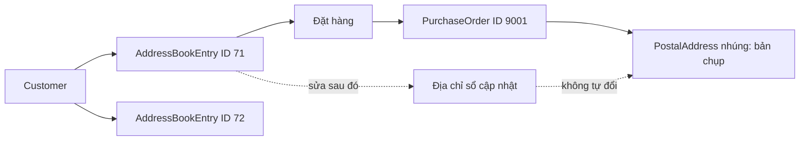
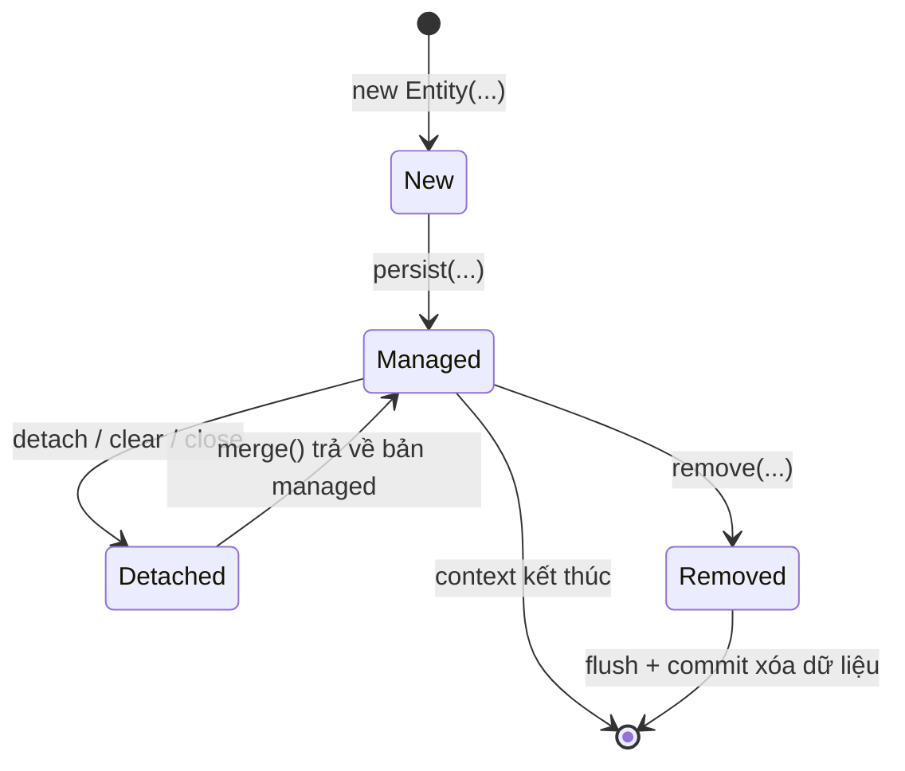
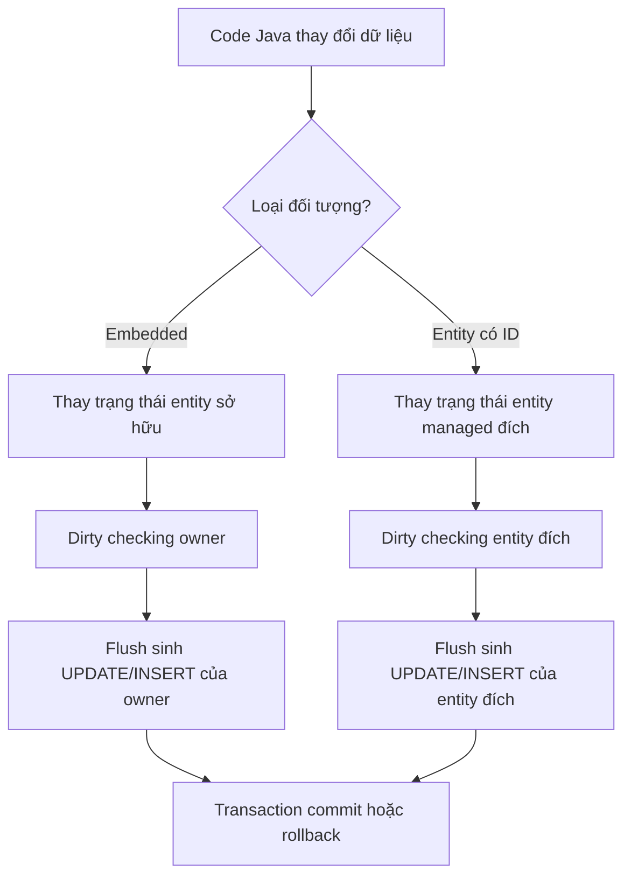

# Phân biệt đối tượng nhúng và entity có định danh riêng trong JPA

Khi thiết kế một mô hình JPA, không phải mọi lớp Java chứa dữ liệu đều nên trở thành một entity. Một **địa chỉ giao hàng**, một **khoảng tiền** hay một **khoảng thời gian** thường có ý nghĩa thông qua giá trị mà chúng chứa và đối tượng đang sử dụng chúng. Trong khi đó, một **khách hàng**, một **đơn hàng**, một **sản phẩm trong danh mục** hoặc một **địa chỉ đã được đăng ký và theo dõi riêng** có thể cần danh tính, vòng đời và quan hệ độc lập.

JPA cung cấp hai hướng ánh xạ quan trọng:

- **Đối tượng nhúng** (*embeddable/embedded object*): khai báo bằng `@Embeddable` và được dùng qua `@Embedded`. Đối tượng này là một phần trạng thái của entity sở hữu, thường lưu trực tiếp trong các cột thuộc bảng của entity đó.
- **Entity có định danh riêng** (*independent entity*): khai báo bằng `@Entity` với `@Id` hoặc `@EmbeddedId`. Đối tượng có danh tính để JPA quản lý, có thể có bảng riêng và được tham chiếu qua các quan hệ như `@ManyToOne` hoặc `@OneToOne`.

Điểm phân biệt không nằm ở số lượng field hay việc hai lớp có dùng lại dữ liệu giống nhau hay không. Câu hỏi quyết định là: **đối tượng có cần tồn tại, được truy cập và được thay đổi như một thực thể riêng, hay nó chỉ mang giá trị thuộc về một thực thể khác?**

> Một địa chỉ nhúng trong đơn hàng thường là *bản chụp thông tin giao hàng tại thời điểm đặt hàng*. Một địa chỉ sổ liên hệ có mã định danh, được nhiều bản ghi tham chiếu và có thể cập nhật độc lập là ứng viên cho entity riêng. Cả hai đều chứa các trường như đường, thành phố và mã bưu chính, nhưng hành vi miền nghiệp vụ hoàn toàn khác.

Tài liệu dùng API **Jakarta Persistence (JPA)**, minh họa với Spring và Hibernate khi cần. Quy tắc cấu trúc và vòng đời là trọng tâm; tên bảng, cú pháp SQL, tối ưu hóa khi flush và chi tiết cài đặt có thể thay đổi theo provider và database.

## 1. Nhìn từ mô hình miền nghiệp vụ: giá trị và danh tính

Hãy xét hai cặp đối tượng:

| Đối tượng | Cách nhận diện tự nhiên | Câu hỏi nghiệp vụ |
|---|---|---|
| `Money(100000, "VND")` | Cùng số tiền và đơn vị tiền tệ thì cùng ý nghĩa giá trị | “Số tiền bao nhiêu?” |
| `Customer(id = 42)` | Là cùng khách hàng khi cùng danh tính, kể cả tên/email đổi | “Đó là khách hàng nào?” |
| `PostalAddress("12 Lê Lợi", "TP.HCM")` trong đơn hàng | Nội dung địa chỉ của đơn hàng | “Lúc đặt hàng, giao tới đâu?” |
| `AddressBookEntry(id = 71)` | Bản ghi địa chỉ được quản lý, có thể thay đổi hoặc ngừng sử dụng | “Đó là bản ghi địa chỉ nào trong sổ?” |

Trong tư duy thiết kế miền (*Domain-Driven Design*):

1. **Value object** được định nghĩa bằng *giá trị* và các bất biến của nó. Hai đối tượng có cùng thành phần thường có cùng ý nghĩa; thay giá trị thường được mô hình hóa bằng cách tạo một đối tượng mới.
2. **Entity** có *danh tính ổn định* xuyên qua các lần thay đổi trạng thái. Hai entity có cùng tên, số tiền hoặc địa chỉ chưa chắc là cùng một entity.
3. **Vòng đời** giúp quyết định cách lưu trữ: value object sống cùng đối tượng sở hữu; entity có thể được tạo, tải, liên kết, thay đổi hoặc xóa theo quy tắc riêng.

**Lưu ý:** DDD value object là khái niệm thiết kế miền; JPA `@Embeddable` là cơ chế ánh xạ. Chúng thường phù hợp với nhau nhưng không đồng nhất tuyệt đối. Một `@Embeddable` có thể được viết mutable để đáp ứng kỹ thuật, còn một value object miền thường hướng đến bất biến và so sánh theo giá trị.

## 2. So sánh nhanh `@Embeddable` và `@Entity`

| Tiêu chí | Đối tượng nhúng `@Embeddable` | Entity `@Entity` có ID |
|---|---|---|
| Danh tính JPA riêng | Không; không có `@Id` riêng như entity | Có `@Id` hoặc `@EmbeddedId` |
| Nơi lưu dữ liệu | Mặc định cột thuộc bảng của entity sở hữu | Thường là bảng riêng của entity |
| Cách sử dụng | `@Embedded`, `@ElementCollection`, hoặc làm ID nhúng | `EntityManager.find`, `persist`, quan hệ `@ManyToOne`/`@OneToOne`... |
| Có thể tìm trực tiếp bằng `EntityManager.find`? | Không như một entity độc lập | Có, theo kiểu và ID |
| Được JPA quản lý như một thực thể riêng? | Không; thay đổi được đồng bộ thông qua entity/collection sở hữu | Có; có trạng thái managed, detached, removed |
| Có thể được nhiều entity tham chiếu cùng một bản ghi? | Không theo khái niệm một identity record chung | Có, nếu mô hình quan hệ cho phép |
| Xóa đối tượng sở hữu | Các cột embedded nằm trong hàng sở hữu; không có entity nhúng để xóa riêng | Entity được tham chiếu có vòng đời theo cascade, orphan removal hoặc thao tác riêng |
| Dirty checking | Thay đổi là một phần trạng thái của owner | JPA theo dõi thay đổi trên chính entity đó |
| Optimistic locking | Thường dùng `@Version` của owner | Có thể có `@Version` riêng |
| Query | Truy cập đường dẫn, ví dụ `o.shippingAddress.city` | Truy vấn theo entity, ID hoặc join quan hệ |
| Phù hợp | Giá tiền, địa chỉ snapshot, cấu hình nhỏ, khoảng thời gian | Khách hàng, sản phẩm, địa chỉ có quản lý riêng, đơn hàng |

Bảng thể hiện trường hợp phổ biến. Một embeddable có thể chứa quan hệ tới entity, được đặt trong collection table, hoặc được dùng làm composite primary key qua `@EmbeddedId`; các trường hợp này không biến chính embeddable thành entity có vòng đời độc lập.

## 3. Một tình huống thực tế: địa chỉ giao hàng

Giả sử hệ thống bán hàng cần lưu địa chỉ giao hàng trong đơn hàng. Có hai yêu cầu khác nhau:

- **Yêu cầu A:** Đơn hàng phải lưu chính xác địa chỉ mà khách đã chọn lúc thanh toán. Nếu khách sửa địa chỉ trong sổ địa chỉ sau đó, đơn hàng cũ vẫn giữ nguyên địa chỉ giao hàng đã xác nhận.
- **Yêu cầu B:** Khách có nhiều địa chỉ được quản lý riêng, mỗi địa chỉ có ID để sửa, đánh dấu mặc định hoặc chọn lại ở lần mua sau.

Yêu cầu A thường hợp với **embedded value object** ở `PurchaseOrder`. Yêu cầu B thường hợp với **entity địa chỉ riêng** như `AddressBookEntry`. Hệ thống thực tế có thể dùng **cả hai**: địa chỉ trong sổ là entity, còn khi đặt hàng sẽ sao chép nội dung thành bản chụp embedded trong đơn hàng.



Điều này tránh nhầm lẫn phổ biến: **dùng lại giá trị** và **chia sẻ cùng danh tính** là hai nhu cầu khác nhau.

## 4. Cách khai báo một đối tượng nhúng

### 4.1. Khai báo `@Embeddable`

```java
import jakarta.persistence.Column;
import jakarta.persistence.Embeddable;
import java.util.Objects;

@Embeddable
public class PostalAddress {

    @Column(name = "street", length = 180)
    private String street;

    @Column(name = "city", length = 100)
    private String city;

    @Column(name = "postal_code", length = 20)
    private String postalCode;

    @Column(name = "country_code", length = 2)
    private String countryCode;

    protected PostalAddress() {
        // Constructor phục vụ JPA.
    }

    public PostalAddress(
            String street, String city, String postalCode, String countryCode) {
        this.street = Objects.requireNonNull(street);
        this.city = Objects.requireNonNull(city);
        this.postalCode = postalCode;
        this.countryCode = Objects.requireNonNull(countryCode);
    }

    public String getStreet() { return street; }
    public String getCity() { return city; }
    public String getPostalCode() { return postalCode; }
    public String getCountryCode() { return countryCode; }

    @Override
    public boolean equals(Object other) {
        if (this == other) return true;
        if (!(other instanceof PostalAddress that)) return false;
        return Objects.equals(street, that.street)
            && Objects.equals(city, that.city)
            && Objects.equals(postalCode, that.postalCode)
            && Objects.equals(countryCode, that.countryCode);
    }

    @Override
    public int hashCode() {
        return Objects.hash(street, city, postalCode, countryCode);
    }
}
```

Ở đây:

- `@Embeddable` xác định kiểu có thể được nhúng vào mapping của entity khác.
- Các `@Column` mô tả cách những trường giá trị được lưu trữ, nhưng không chỉ định bảng độc lập dành cho `PostalAddress`.
- Lớp không có `@Id` và không được gọi `entityManager.persist(address)` như entity.
- Phương thức `equals`/`hashCode` minh họa **so sánh theo tất cả thành phần giá trị**, không theo một ID tự tạo.
- Constructor không tham số giúp JPA tạo đối tượng. Việc cung cấp getter và không cung cấp setter công khai hỗ trợ phong cách sử dụng gần với bất biến, trong khi JPA vẫn có thể phục hồi field theo cơ chế truy cập.

Ví dụ dùng cú pháp Java hiện đại với pattern matching `instanceof`. Nếu dự án dùng Java cũ, viết `instanceof` rồi ép kiểu thông thường. Nếu chọn `BigDecimal` làm thành phần giá trị, cần xác định rõ cách so sánh `1.0` và `1.00`, vì `BigDecimal.equals` quan tâm cả scale.

### 4.2. Nhúng vào entity chủ sở hữu bằng `@Embedded`

```java
import jakarta.persistence.*;

@Entity
@Table(name = "purchase_orders")
public class PurchaseOrder {

    @Id
    @GeneratedValue(strategy = GenerationType.IDENTITY)
    private Long id;

    @Embedded
    @AttributeOverrides({
        @AttributeOverride(name = "street",
            column = @Column(name = "ship_street", nullable = false, length = 180)),
        @AttributeOverride(name = "city",
            column = @Column(name = "ship_city", nullable = false, length = 100)),
        @AttributeOverride(name = "postalCode",
            column = @Column(name = "ship_postal_code", length = 20)),
        @AttributeOverride(name = "countryCode",
            column = @Column(name = "ship_country_code", nullable = false, length = 2))
    })
    private PostalAddress shippingAddress;

    @Version
    private Long version;

    protected PurchaseOrder() {}

    public PurchaseOrder(PostalAddress shippingAddress) {
        this.shippingAddress = shippingAddress;
    }

    public void changeShippingAddress(PostalAddress newAddress) {
        if (newAddress == null) {
            throw new IllegalArgumentException("Shipping address is required");
        }
        this.shippingAddress = newAddress;
    }

    public PostalAddress getShippingAddress() {
        return shippingAddress;
    }
}
```

Lúc này `shippingAddress` không phải một entity con. Các thành phần `street`, `city`, `postalCode` và `countryCode` trở thành cột của **hàng `purchase_orders`**:

```sql
CREATE TABLE purchase_orders (
    id BIGINT GENERATED BY DEFAULT AS IDENTITY PRIMARY KEY,
    ship_street VARCHAR(180) NOT NULL,
    ship_city VARCHAR(100) NOT NULL,
    ship_postal_code VARCHAR(20),
    ship_country_code VARCHAR(2) NOT NULL,
    version BIGINT NOT NULL
);
```

DDL minh họa cú pháp kiểu PostgreSQL; SQL JPA sinh thực tế tùy dialect, cấu hình và provider. `@AttributeOverride` giúp đặt tên từng cột và ghi rõ các giới hạn tại vị trí nhúng. Những ràng buộc `NOT NULL` chỉ thực sự bảo vệ dữ liệu khi có trong schema database đang được dùng.

### 4.3. Thay đổi embedded object và câu SQL

```java
@Transactional
public void changeDeliveryAddress(Long orderId, PostalAddress address) {
    PurchaseOrder order = entityManager.find(PurchaseOrder.class, orderId);
    if (order == null) {
        throw new IllegalArgumentException("Order not found");
    }
    order.changeShippingAddress(address);
    // PurchaseOrder là managed entity; không persist PostalAddress riêng.
}
```

Khi transaction flush, provider kiểm tra trạng thái `PurchaseOrder` và có thể tạo SQL tương đương:

```sql
UPDATE purchase_orders
SET ship_street = ?, ship_city = ?, ship_postal_code = ?,
    ship_country_code = ?, version = ?
WHERE id = ? AND version = ?;
```

Câu lệnh thực tế có thể chứa thêm hoặc bớt cột theo chiến lược update của provider và mapping. **Đơn vị được update là hàng đơn hàng**; không có `UPDATE postal_addresses` cho ví dụ này vì ta không tạo bảng `postal_addresses` độc lập.

### 4.4. Có thể dùng `@Embedded` nhiều lần với cùng một kiểu

Một đơn hàng có địa chỉ thanh toán và địa chỉ giao hàng:

```java
@Embedded
@AttributeOverrides({
    @AttributeOverride(name = "street",
        column = @Column(name = "billing_street", length = 180)),
    @AttributeOverride(name = "city",
        column = @Column(name = "billing_city", length = 100)),
    @AttributeOverride(name = "postalCode",
        column = @Column(name = "billing_postal_code", length = 20)),
    @AttributeOverride(name = "countryCode",
        column = @Column(name = "billing_country_code", length = 2))
})
private PostalAddress billingAddress;
```

Vẫn là một class `PostalAddress` có thể tái sử dụng, nhưng mỗi vị trí nhúng tạo bộ cột khác nhau trong bảng owner. Không nên nhầm **tái sử dụng class Java** với **chia sẻ cùng bản ghi có ID trong database**.

Nếu nhúng hai đối tượng cùng kiểu mà không đặt tên cột phân biệt, các tên cột mặc định có thể trùng nhau. `@AttributeOverride` hoặc chiến lược đặt tên do provider hỗ trợ giải quyết vấn đề đó. Khi override, lưu ý các thuộc tính khác của `@Column` như `nullable`, `length` và `precision`; khai báo override cần phản ánh đầy đủ quy tắc mong muốn.

## 5. Cách khai báo entity có định danh độc lập

Giả sử mỗi địa chỉ trong sổ địa chỉ khách hàng cần một ID, có thể được chọn bởi nhiều bản ghi và có thể được cập nhật độc lập.

```java
import jakarta.persistence.*;

@Entity
@Table(name = "address_book_entries")
public class AddressBookEntry {

    @Id
    @GeneratedValue(strategy = GenerationType.IDENTITY)
    private Long id;

    @Column(name = "street", nullable = false, length = 180)
    private String street;

    @Column(name = "city", nullable = false, length = 100)
    private String city;

    @Column(name = "postal_code", length = 20)
    private String postalCode;

    @Column(name = "country_code", nullable = false, length = 2)
    private String countryCode;

    @Version
    private Long version;

    protected AddressBookEntry() {}

    public AddressBookEntry(
            String street, String city, String postalCode, String countryCode) {
        this.street = street;
        this.city = city;
        this.postalCode = postalCode;
        this.countryCode = countryCode;
    }

    public Long getId() { return id; }

    public void relocate(String street, String city, String postalCode) {
        this.street = street;
        this.city = city;
        this.postalCode = postalCode;
    }
}
```

Khi một đơn hàng muốn **tham chiếu** đến bản ghi địa chỉ có ID riêng, nó dùng quan hệ JPA:

```java
@ManyToOne(fetch = FetchType.LAZY)
@JoinColumn(name = "address_book_entry_id")
private AddressBookEntry selectedAddress;
```

Đoạn trên được đặt trong một `@Entity PurchaseOrder` khi thiết kế cần tham chiếu. Nó là **một cách thiết kế khác** với việc lưu snapshot địa chỉ qua `@Embedded`; có thể cùng tồn tại cả hai thuộc tính nếu nghiệp vụ cần giữ lịch sử và biết địa chỉ nào từng được chọn.

Database thường có hai bảng:

```sql
CREATE TABLE address_book_entries (
    id BIGINT GENERATED BY DEFAULT AS IDENTITY PRIMARY KEY,
    street VARCHAR(180) NOT NULL,
    city VARCHAR(100) NOT NULL,
    postal_code VARCHAR(20),
    country_code VARCHAR(2) NOT NULL,
    version BIGINT NOT NULL
);

-- Nếu PurchaseOrder ánh xạ thuộc tính selectedAddress:
ALTER TABLE purchase_orders
ADD COLUMN address_book_entry_id BIGINT
    REFERENCES address_book_entries(id);
```

Entity `AddressBookEntry` có một định danh JPA là `id`. Chúng ta có thể tìm nó, thay đổi nó và tham chiếu tới nó qua foreign key. Khác với embedded object, nó có thể **được chia sẻ** bởi nhiều entity nếu ràng buộc và nghiệp vụ cho phép.

### Đọc, tạo và sửa một entity độc lập

```java
@Transactional
public Long createAddressBookEntry() {
    AddressBookEntry address = new AddressBookEntry(
        "12 Le Loi", "Ho Chi Minh City", "700000", "VN");
    entityManager.persist(address);
    return address.getId();
}

@Transactional
public void relocateAddress(Long addressId) {
    AddressBookEntry address =
        entityManager.find(AddressBookEntry.class, addressId);
    if (address == null) {
        throw new IllegalArgumentException("Address not found");
    }
    address.relocate("25 Nguyen Hue", "Ho Chi Minh City", "700000");
}
```

Với `GenerationType.IDENTITY`, provider có thể thực thi `INSERT` trước commit để nhận ID. Đoạn `createAddressBookEntry` giả định giao dịch và database hỗ trợ cơ chế cấp ID tương ứng; trả về ID **không tự chứng minh** transaction bên ngoài đã commit. `relocateAddress` thay đổi managed entity; SQL update tương ứng thường nhắm đến bảng `address_book_entries` và có thể dùng `version` để kiểm tra xung đột.

Nếu nhiều đơn hàng cùng tham chiếu `AddressBookEntry(id = 71)`, khi địa chỉ đó được cập nhật, truy vấn qua quan hệ có thể nhìn thấy nội dung mới. Đây chính là hành vi ta mong muốn ở **danh mục địa chỉ đang hoạt động**, nhưng thường **không** mong muốn ở địa chỉ giao hàng lịch sử của đơn hàng.

## 6. Danh tính: khi nào hai đối tượng được xem là “cùng một”?

### Với embedded value object

Hai địa chỉ có cùng thành phần giá trị có thể được xem là bằng nhau theo `equals`:

```java
PostalAddress first = new PostalAddress(
    "12 Le Loi", "Ho Chi Minh City", "700000", "VN");
PostalAddress second = new PostalAddress(
    "12 Le Loi", "Ho Chi Minh City", "700000", "VN");

System.out.println(first == second);      // false: hai Java object
System.out.println(first.equals(second)); // true: cùng giá trị
```

JPA không duy trì identity map riêng cho từng `PostalAddress` vì nó không phải entity độc lập. Hai owner khác nhau có thể chứa hai object có cùng giá trị mà không có khái niệm “cùng một bản ghi PostalAddress trong database”.

### Với entity

Hai entity `AddressBookEntry` có cùng đường, thành phố và mã bưu chính có thể vẫn là **hai bản ghi khác nhau**:

```text
AddressBookEntry(id=71, street="12 Le Loi", city="Ho Chi Minh City")
AddressBookEntry(id=96, street="12 Le Loi", city="Ho Chi Minh City")
```

Trong **cùng persistence context**, khi tải cùng entity type và ID, JPA duy trì một managed instance đại diện cho danh tính đó:

```java
AddressBookEntry a = entityManager.find(AddressBookEntry.class, 71L);
AddressBookEntry b = entityManager.find(AddressBookEntry.class, 71L);

System.out.println(a == b); // true trong cùng persistence context
```

Khi hai entity được tải ở hai transaction hoặc hai persistence context khác nhau, `a == b` không còn là cách kiểm tra danh tính nghiệp vụ đáng tin cậy. Nếu cài `equals`/`hashCode` cho entity, cần tính đến ID được cấp sau `persist`, proxy/lazy loading và việc giữ hash ổn định khi entity nằm trong `HashSet` hoặc `HashMap`.

**Không áp một quy tắc `equals`/`hashCode` duy nhất cho mọi entity chỉ vì các value object thường so sánh theo giá trị.** Cách chọn khóa tự nhiên, khóa sinh và chiến lược so sánh cần phù hợp với mô hình entity và vòng đời của ID.

## 7. Vòng đời: value object đi cùng owner, entity có trạng thái riêng

Entity JPA có các trạng thái vòng đời:



Đối tượng nhúng không có state machine JPA độc lập như vậy. Khi nó là một thuộc tính của managed entity:

```java
PurchaseOrder order = entityManager.find(PurchaseOrder.class, orderId);
PostalAddress address = order.getShippingAddress();
```

JPA theo dõi trạng thái `order`; các field ánh xạ của `address` là một phần trạng thái cần đồng bộ của `order`. Không có lệnh `entityManager.find(PostalAddress.class, someId)` vì không có ID của `PostalAddress`.

| Thao tác | Embedded value object | Entity độc lập |
|---|---|---|
| Tạo object Java | `new PostalAddress(...)` | `new AddressBookEntry(...)` |
| Ghi lần đầu | Gán vào entity sở hữu; persist owner khi cần | `persist(addressEntity)` hoặc cascade thích hợp |
| Đọc từ database | Tải owner hoặc query qua đường dẫn thuộc tính | `find(AddressBookEntry.class, id)`, query hoặc quan hệ |
| Thay đổi | Thay giá trị ở owner; owner được dirty checked | Thay đổi chính managed entity đó |
| Xóa | Gán `null` hoặc thay field của owner; còn phụ thuộc nullability | `remove`, cascade, orphan removal hoặc quy tắc nghiệp vụ riêng |
| Tách khỏi context | Owner detached thì thay đổi embedded không tự flush | Entity có thể detached độc lập |

Với embedded object, thay `shippingAddress` bằng một instance mới thường phản ánh rõ ý tưởng **thay giá trị**. Với entity, thay đối tượng đang tham chiếu có thể có hai ý nghĩa: sửa **đối tượng đích** hoặc đổi **quan hệ** sang một entity đích khác. Hai thao tác tạo SQL khác nhau.

## 8. Khác biệt về SQL và foreign key

Xét hai thiết kế cho đơn hàng số 9001.

### Trường hợp A: địa chỉ được nhúng

```text
purchase_orders
┌──────┬────────────────┬──────────────────┬──────────────────┐
│ id   │ ship_street    │ ship_city        │ ship_country_code│
├──────┼────────────────┼──────────────────┼──────────────────┤
│ 9001 │ 12 Le Loi      │ Ho Chi Minh City │ VN               │
└──────┴────────────────┴──────────────────┴──────────────────┘
```

Đổi địa chỉ giao hàng trên đơn hàng có thể dẫn đến:

```sql
UPDATE purchase_orders
SET ship_street = ?, ship_city = ?, ship_country_code = ?
WHERE id = ?;
```

Không có foreign key cho một entity địa chỉ độc lập vì dữ liệu địa chỉ được lưu trực tiếp trong hàng đơn hàng.

### Trường hợp B: đơn hàng tham chiếu entity địa chỉ

```text
purchase_orders                  address_book_entries
┌──────┬──────────────────────┐   ┌────┬──────────────────┐
│ id   │ address_book_entry_id│   │ id │ street           │
├──────┼──────────────────────┤   ├────┼──────────────────┤
│ 9001 │ 71                   │──▶│ 71 │ 12 Le Loi        │
│ 9002 │ 71                   │──▶│    │ Ho Chi Minh City │
└──────┴──────────────────────┘   └────┴──────────────────┘
```

Nếu chỉ **đổi lựa chọn địa chỉ** từ ID 71 sang ID 96, SQL tương đương:

```sql
UPDATE purchase_orders
SET address_book_entry_id = 96
WHERE id = 9001;
```

Nếu sửa **nội dung địa chỉ ID 71**:

```sql
UPDATE address_book_entries
SET street = ?, city = ?
WHERE id = 71;
```

Khi đó các đơn hàng còn tham chiếu ID 71 sẽ tiếp tục tham chiếu **cùng bản ghi** với nội dung mới. Đó là hệ quả của danh tính và foreign key, không phải cơ chế đặc biệt của Hibernate.

### Hai thiết kế có số cột hoặc số bảng khác nhau

| Tác động | Nhúng vào bảng owner | Entity riêng với foreign key |
|---|---|---|
 Số bảng tối thiểu | Một bảng owner | Bảng owner và bảng entity đích |
 Cột trên bảng owner | Các cột của value object | Thường là cột FK |
 Lấy đầy đủ thuộc tính | Thường có ngay từ row owner | Có thể cần join hoặc SELECT khác |
 Tham chiếu cùng dữ liệu | Lưu lại giá trị ở từng owner | Nhiều FK có thể chỉ một record |
 Cập nhật bản ghi dùng chung | Không có record chung để update | Một `UPDATE` có thể làm thay đổi dữ liệu mà nhiều owner nhìn thấy |

Những khác biệt này ảnh hưởng cả tính đúng đắn nghiệp vụ lẫn hiệu năng. Không nên chọn entity riêng chỉ vì muốn “tránh trùng cột” nếu việc chia sẻ định danh khiến lịch sử nghiệp vụ bị thay đổi sai.

## 9. Dirty checking và transaction đối với hai kiểu

JPA thông thường ghi nhận thay đổi trên **managed entity** và đồng bộ chúng xuống database tại thời điểm flush; transaction commit là bước riêng.



Ví dụ đổi value object:

```java
@Transactional
public void replaceShippingAddress(Long orderId, PostalAddress newValue) {
    PurchaseOrder order =
        entityManager.find(PurchaseOrder.class, orderId);
    order.changeShippingAddress(newValue);
    // Không gọi persist(newValue): newValue không phải entity.
}
```

Ví dụ đổi entity đang được tham chiếu:

```java
@Transactional
public void updateRegisteredAddress(Long addressId) {
    AddressBookEntry address =
        entityManager.find(AddressBookEntry.class, addressId);
    address.relocate("25 Nguyen Hue", "Ho Chi Minh City", "700000");
    // Managed AddressBookEntry tự tham gia dirty checking.
}
```

SQL được sinh ở mỗi trường hợp do mapping và trạng thái thực tế quyết định. Khi câu SQL đã flush, transaction vẫn có thể rollback. Nếu entity owner đang detached, chỉ gán một `PostalAddress` mới vào owner detached **không tự động cập nhật database**. Tương tự, sửa entity `AddressBookEntry` detached không tự động được ghi; phải xử lý vòng đời phù hợp, chẳng hạn lấy lại managed entity hoặc dùng `merge` đúng cách.

## 10. Tính bất biến và `equals` của value object

Với value object, một phong cách rõ nghĩa là **không sửa giá trị cũ tại chỗ** mà tạo giá trị mới:

```java
PostalAddress oldValue = order.getShippingAddress();
PostalAddress newValue = new PostalAddress(
    oldValue.getStreet(),
    "Da Nang",
    oldValue.getPostalCode(),
    "VN"
);
order.changeShippingAddress(newValue);
```

Cách làm này giúp thao tác nghiệp vụ dễ hiểu: “địa chỉ giao hàng của đơn hàng trở thành giá trị mới”. Nó cũng tránh việc cùng một Java object mutable bị đưa vào nhiều owner rồi sửa qua một tham chiếu gây hiệu ứng bên lề trong bộ nhớ.

Tuy nhiên, cần phân biệt hai mức bất biến:

1. **Bất biến ở API miền:** không công khai setter và không thay đổi object sau khi tạo. JPA vẫn có thể cần constructor không tham số và truy cập field để hydrate từ database.
2. **Bất biến tuyệt đối ở runtime:** `final class`, `final field`, Java `record` và các cơ chế chặt hơn. Mức hỗ trợ chúng khác nhau giữa phiên bản JPA/provider; không mặc định một `record` được hỗ trợ như embeddable trên mọi môi trường.

Do đó, code ví dụ dùng class có constructor `protected` và các field không `final`, nhưng không cung cấp setter công khai. Đây là cách giữ tính tương thích rộng với JPA trong khi vẫn bảo vệ một phần quy tắc của value object.

### Cẩn thận khi dùng object mutable trong `Set` hoặc làm key

```java
Set<PostalAddress> addresses = new HashSet<>();
PostalAddress address = new PostalAddress("A", "B", "C", "VN");
addresses.add(address);
```

Nếu một value object dùng các field trong `hashCode` rồi các field đó bị thay đổi sau khi đã thêm vào `HashSet`, thao tác tìm kiếm/xóa có thể cho kết quả sai. Đặc biệt với `@ElementCollection Set<...>`, quan hệ giữa equality và cơ chế theo dõi collection càng cần được cân nhắc. Ưu tiên object có giá trị ổn định, hoặc có chính sách quản lý collection phù hợp.

## 11. Collection của value object: `@ElementCollection`

Embedded object không chỉ được dùng như một field đơn. JPA còn cho phép collection các giá trị nhúng:

```java
import jakarta.persistence.*;
import java.util.ArrayList;
import java.util.List;

@Entity
@Table(name = "customers")
public class Customer {

    @Id
    private Long id;

    @ElementCollection
    @CollectionTable(
        name = "customer_saved_addresses",
        joinColumns = @JoinColumn(name = "customer_id")
    )
    @OrderColumn(name = "address_position")
    private List<PostalAddress> savedAddresses = new ArrayList<>();

    protected Customer() {}

    public void addAddress(PostalAddress address) {
        savedAddresses.add(address);
    }
}
```

Ví dụ này có **bảng riêng** `customer_saved_addresses`, nhưng các hàng của bảng đó **vẫn không đại diện cho entity độc lập**:

```sql
CREATE TABLE customer_saved_addresses (
    customer_id BIGINT NOT NULL REFERENCES customers(id),
    address_position INTEGER NOT NULL,
    street VARCHAR(180),
    city VARCHAR(100),
    postal_code VARCHAR(20),
    country_code VARCHAR(2),
    PRIMARY KEY (customer_id, address_position)
);
```

Với `@ElementCollection`, bảng phụ lưu giá trị thuộc về `Customer`. `customer_id` là khóa ngoại của owner; `address_position` minh họa vị trí trong `List`. Đây là DDL định hướng, và việc provider sinh khóa hoặc ràng buộc cụ thể phụ thuộc cấu hình.

**Điểm dễ nhầm:** “Có bảng riêng” **không đủ** để kết luận một object là entity. Bảng `customer_saved_addresses` chứa các **collection elements không có danh tính entity**, trong khi `address_book_entries` chứa các entity có `id` riêng.

### Khi nào collection value không còn phù hợp?

Giả sử mỗi địa chỉ lưu sổ cần:

- Mã định danh ổn định để API cập nhật bằng `PATCH /addresses/{id}`.
- `createdAt`, `updatedAt`, `status` và `@Version` riêng.
- Quy tắc quyền sở hữu, lịch sử chỉnh sửa và khả năng liên kết từ đơn hàng hoặc tác vụ giao hàng.
- Thay đổi/xóa một địa chỉ cụ thể mà không phụ thuộc vị trí của nó trong danh sách.

Lúc này mô hình `@OneToMany` tới entity `AddressBookEntry` thường diễn đạt nhu cầu tốt hơn:

```java
@OneToMany(
    mappedBy = "customer",
    cascade = CascadeType.ALL,
    orphanRemoval = true
)
private List<AddressBookEntry> addresses = new ArrayList<>();
```

Mapping `mappedBy = "customer"` giả định `AddressBookEntry` có trường `@ManyToOne private Customer customer;` là bên sở hữu quan hệ. `cascade = ALL` và `orphanRemoval = true` chỉ thích hợp nếu entry thực sự do customer sở hữu riêng và không được entity khác chia sẻ. Không sao chép cấu hình xóa này sang quan hệ tham chiếu dùng chung.

### Chi phí SQL có thể khác nhau

Với `@ElementCollection`, provider có thể xóa/chèn lại một hoặc nhiều phần tử trong bảng collection khi danh sách thay đổi, tùy loại collection, khóa và cơ chế theo dõi. Với entity có ID ổn định, provider thường có thể xác định cụ thể hàng cần `UPDATE` hoặc `DELETE`.

Không thể kết luận “collection value luôn chậm” hay “entity luôn tối ưu hơn” nếu chưa xem mapping, khối lượng dữ liệu và SQL thực tế. Nhưng danh tính riêng giúp thao tác theo ID và quản lý cập nhật từng phần tử một cách tự nhiên hơn.

## 12. Embedded object có thể chứa object nhúng khác

Một value object có thể được cấu thành từ nhiều giá trị nhỏ hơn:

```java
@Embeddable
public class GeoPoint {
    @Column(name = "latitude", precision = 10, scale = 7)
    private java.math.BigDecimal latitude;

    @Column(name = "longitude", precision = 10, scale = 7)
    private java.math.BigDecimal longitude;

    protected GeoPoint() {}
}

@Embeddable
public class DeliveryLocation {
    @Embedded
    private GeoPoint coordinates;

    @Column(name = "delivery_note", length = 500)
    private String note;

    protected DeliveryLocation() {}
}
```

Entity owner có thể nhúng `DeliveryLocation` và dùng `@AttributeOverride` cho các đường dẫn thuộc tính lồng nhau:

```java
@Embedded
@AttributeOverrides({
    @AttributeOverride(
        name = "coordinates.latitude",
        column = @Column(name = "dropoff_lat", precision = 10, scale = 7)
    ),
    @AttributeOverride(
        name = "coordinates.longitude",
        column = @Column(name = "dropoff_lon", precision = 10, scale = 7)
    ),
    @AttributeOverride(
        name = "note",
        column = @Column(name = "dropoff_note", length = 500)
    )
})
private DeliveryLocation dropoff;
```

Các field lồng nhau vẫn thuộc trạng thái owner; không vì có nhiều cấp `@Embeddable` mà tạo ra nhiều entity. Với những thuộc tính phức tạp, nên theo dõi tên cột thực tế để tránh đụng nhau hoặc không khớp schema.

## 13. Embeddable có được chứa quan hệ tới entity không?

Có thể. `@Embeddable` không nhất thiết chỉ chứa các trường scalar như `String` và `BigDecimal`. Nó có thể khai báo quan hệ tới entity tùy loại quan hệ và các quy tắc mapping JPA.

Ví dụ một thông tin liên hệ bao gồm giá trị mô tả và một entity quốc gia được quản lý tập trung:

```java
@Embeddable
public class LocalizedContact {
    @Column(name = "contact_name", length = 150)
    private String contactName;

    @ManyToOne(fetch = FetchType.LAZY)
    @JoinColumn(name = "country_id")
    private Country country;

    protected LocalizedContact() {}
}
```

`LocalizedContact` vẫn là embeddable; `Country` là entity có ID. Nếu một owner chứa nhiều `LocalizedContact`, tên cột khóa ngoại có thể cần override qua `@AssociationOverride`:

```java
@Embedded
@AssociationOverride(
    name = "country",
    joinColumns = @JoinColumn(name = "billing_country_id")
)
private LocalizedContact billingContact;
```

Không được suy ra việc `LocalizedContact` có quan hệ sẽ làm `Country` được persist hoặc xóa tự động. Cascade phụ thuộc mapping quan hệ và cấu hình của nó. Ngoài ra, dùng một entity `Country` riêng có thể hợp lý khi có bảng mã quốc gia dùng chung, nhưng đôi khi chỉ cần `countryCode` dạng `String` nếu nghiệp vụ muốn lưu snapshot ổn định.

## 14. `@EmbeddedId`: embeddable có thể biểu diễn khóa chính kép

Một tình huống đặc biệt: một class `@Embeddable` có thể được dùng làm **giá trị khóa chính** của entity.

Ví dụ bảng `order_lines` dùng khóa chính gồm `order_id` và `line_number`:

```java
import jakarta.persistence.*;
import java.io.Serializable;
import java.util.Objects;

@Embeddable
public class OrderLineId implements Serializable {
    @Column(name = "order_id")
    private Long orderId;

    @Column(name = "line_number")
    private Integer lineNumber;

    protected OrderLineId() {}

    public OrderLineId(Long orderId, Integer lineNumber) {
        this.orderId = orderId;
        this.lineNumber = lineNumber;
    }

    @Override
    public boolean equals(Object other) {
        if (this == other) return true;
        if (!(other instanceof OrderLineId that)) return false;
        return Objects.equals(orderId, that.orderId)
            && Objects.equals(lineNumber, that.lineNumber);
    }

    @Override
    public int hashCode() {
        return Objects.hash(orderId, lineNumber);
    }
}
```

Entity sử dụng khóa nhúng:

```java
@Entity
@Table(name = "order_lines")
public class OrderLine {

    @EmbeddedId
    private OrderLineId id;

    @Column(name = "product_code", nullable = false)
    private String productCode;

    @Column(name = "quantity", nullable = false)
    private int quantity;

    protected OrderLine() {}
}
```

`OrderLineId` là **kiểu giá trị biểu diễn danh tính của `OrderLine`**. Entity có định danh là `OrderLine`, còn `OrderLineId` không trở thành entity độc lập chỉ vì nó chứa các cột khóa chính.

```java
OrderLine line = entityManager.find(
    OrderLine.class, new OrderLineId(9001L, 2));
```

Lệnh trên tìm **entity `OrderLine`** thông qua một ID object. Nó không tương đương với `entityManager.find(OrderLineId.class, ...)`. Composite ID có các yêu cầu về `Serializable`, constructor và equality theo chuẩn JPA. Khi thay đổi giá trị khóa chính của một entity đã tồn tại, đừng coi đó là update thuộc tính bình thường; danh tính persistent được kỳ vọng ổn định.

## 15. Cascade và xóa dữ liệu: một khác biệt quan trọng

### Với `@Embedded`

```java
order.changeShippingAddress(new PostalAddress(...));
```

Thao tác này thay giá trị thuộc đơn hàng. Không cần `CascadeType.PERSIST` để “lưu địa chỉ nhúng”, bởi nó không có vòng đời entity riêng. Khi xóa hàng `purchase_orders`, các cột địa chỉ nằm trong hàng đó cũng mất theo.

### Với entity tham chiếu dùng chung

```java
@ManyToOne(fetch = FetchType.LAZY)
@JoinColumn(name = "address_book_entry_id")
private AddressBookEntry selectedAddress;
```

Nếu xóa `PurchaseOrder`, thông thường ta **không** muốn xóa luôn `AddressBookEntry`, vì một khách hàng hoặc nhiều đơn hàng khác vẫn có thể sử dụng địa chỉ đó. Vì vậy không nên tùy tiện thêm `cascade = CascadeType.REMOVE` hoặc `CascadeType.ALL` vào quan hệ `@ManyToOne` được dùng chung.

### Với entity con thuộc sở hữu riêng

Nếu một `OrderLine` chỉ có ý nghĩa khi thuộc về `PurchaseOrder`, có thể cân nhắc:

```java
@OneToMany(
    mappedBy = "order",
    cascade = CascadeType.ALL,
    orphanRemoval = true
)
private List<OrderLine> lines = new ArrayList<>();
```

Khi đó `OrderLine` **vẫn là entity có ID riêng**, dù vòng đời của nó phụ thuộc owner và được cascade/orphan removal quản lý. Vì thế, **phụ thuộc vòng đời không đủ để biến entity thành embeddable**. Đôi khi entity con cần ID để tham chiếu, cập nhật riêng từng dòng hoặc lưu lịch sử, nhưng vẫn thuộc một aggregate.

Phải chọn cascade từ quy tắc **sở hữu dữ liệu** và **được phép xóa hay không**, không chọn theo thói quen.

## 16. Nullability và trạng thái “không có giá trị”

### Embedded object có thể `null` trong Java

```java
@Embedded
private PostalAddress returnAddress;
```

Một `returnAddress == null` có thể thể hiện “chưa có địa chỉ trả hàng”. Nếu toàn bộ cột được phép `NULL`, database có thể lưu tất cả các cột nhúng là `NULL`. Tuy nhiên, cách provider dựng lại một embedded object khi **tất cả các cột đều `NULL`** có thể khác nhau: một số tình huống trả `null`, tình huống khác có instance mà tất cả field đều `null`. Không nên phụ thuộc vào cách phân biệt này nếu miền nghiệp vụ thật sự cần nhận biết “không có địa chỉ” với “địa chỉ rỗng”.

Nếu địa chỉ bắt buộc:

- Đảm bảo logic ứng dụng không cho owner gán `null`.
- Khai báo giới hạn `nullable = false` cho các cột bắt buộc ở mapping/schema phù hợp.
- Dùng validation ở owner hoặc trong giá trị nhúng nếu ứng dụng cần thông báo lỗi sớm.
- Bảo đảm schema database thật có các constraint tương ứng.

Chỉ đặt một annotation `@Embedded` không tự động buộc mọi thành phần của object phải có giá trị.

### Entity reference cũng có thể `null`

```java
@ManyToOne(fetch = FetchType.LAZY, optional = false)
@JoinColumn(name = "customer_id", nullable = false)
private Customer customer;
```

Trường này yêu cầu tham chiếu customer bắt buộc. `optional=false` là metadata của quan hệ trong JPA, còn `nullable=false` của `@JoinColumn` mô tả khóa ngoại. Database `NOT NULL` cùng foreign key thực tế mới bảo vệ điều kiện tham chiếu khi SQL được ghi. Embedded nullable và association nullable đều có thể diễn đạt yêu cầu “bắt buộc”, nhưng chúng áp dụng vào các cột khác nhau.

## 17. Truy vấn JPQL: truy cập thành phần và join quan hệ

Giả sử entity `PurchaseOrder` có `shippingAddress` là `@Embedded` và `selectedAddress` là `@ManyToOne`.

### Truy vấn trên thuộc tính nhúng

```java
List<PurchaseOrder> orders = entityManager.createQuery(
    "select o from PurchaseOrder o " +
    "where o.shippingAddress.city = :city",
    PurchaseOrder.class
)
.setParameter("city", "Ho Chi Minh City")
.getResultList();
```

JPQL đi qua đường dẫn `o.shippingAddress.city`. Provider có thể chuyển thành điều kiện trên cột `ship_city` của bảng `purchase_orders`.

### Truy vấn qua quan hệ entity

```java
List<PurchaseOrder> orders = entityManager.createQuery(
    "select o from PurchaseOrder o " +
    "join o.selectedAddress a " +
    "where a.city = :city",
    PurchaseOrder.class
)
.setParameter("city", "Ho Chi Minh City")
.getResultList();
```

Đây là join theo quan hệ tới entity khác. SQL thông thường có thể cần JOIN giữa `purchase_orders` và `address_book_entries`, tùy hình dạng truy vấn.

### Fetch strategy

Với `@Embedded` chứa các thuộc tính cơ bản, dữ liệu thường được tải cùng hàng owner; không có entity đích độc lập để lazy-load theo quan hệ. Với `@ManyToOne(fetch = FetchType.LAZY)`, việc truy cập entity đích có thể phát sinh SELECT bổ sung hoặc đi theo fetch plan/optimization của provider.

Nếu danh sách đơn hàng lần lượt truy cập một entity địa chỉ cho mỗi order, có thể phát sinh **N+1 queries**. Có thể cân nhắc `join fetch`, entity graph hoặc truy vấn projection thích hợp. Chỉ dựa trên việc “ít bảng hơn” để chọn `@Embeddable` nhằm tối ưu SQL có thể làm sai mô hình miền; cần đánh giá cả nhu cầu chia sẻ dữ liệu và lịch sử.

## 18. Optimistic locking và cập nhật đồng thời

Với embedded object, `@Version` trên **owner entity** bảo vệ các cập nhật thay đổi hàng owner theo cơ chế optimistic locking thông thường:

```java
@Entity
class PurchaseOrder {
    @Id
    private Long id;

    @Embedded
    private PostalAddress shippingAddress;

    @Version
    private Long version;
}
```

Hai transaction cùng đọc `PurchaseOrder(id=9001, version=5)`, rồi cả hai sửa địa chỉ nhúng; khi flush, một transaction có thể thành công và làm version tăng, transaction còn lại gặp xung đột optimistic locking thay vì âm thầm ghi đè giá trị.

Với `AddressBookEntry` là entity riêng, nó có thể có `@Version` độc lập:

```java
@Entity
class AddressBookEntry {
    @Id
    private Long id;

    @Version
    private Long version;
}
```

Khi cập nhật bản ghi địa chỉ riêng, JPA kiểm tra version của chính `AddressBookEntry`. Thay một `@ManyToOne` từ ID này sang ID khác lại là thay đổi ở **entity sở hữu quan hệ**, nên có thể liên quan version của owner.

Không nên hiểu optimistic locking là giải quyết toàn bộ bài toán đồng thời. Nó giúp phát hiện nhiều trường hợp lost update, nhưng còn cần database constraints, isolation, retry phù hợp và quy tắc nghiệp vụ nhất quán.

## 19. Những trường hợp dễ quyết định sai

### Trường hợp 1: dùng entity cho giá trị tiền

Một ứng dụng bán hàng có hàng triệu sản phẩm và mỗi sản phẩm lưu `Money(amount, currency)`. Nếu tạo `MoneyEntity(id, amount, currency)` cho mọi giá chỉ vì lớp có hai field, hệ thống phải quản lý ID, bảng tiền riêng và foreign key mà không có nhu cầu nhận diện số tiền như một bản ghi độc lập.

Thông thường:

```java
@Embeddable
public class Money {
    @Column(name = "amount", precision = 19, scale = 2)
    private BigDecimal amount;

    @Column(name = "currency_code", length = 3)
    private String currencyCode;

    protected Money() {}
}
```

và:

```java
@Embedded
@AttributeOverrides({
    @AttributeOverride(name = "amount",
        column = @Column(name = "price_amount", precision = 19, scale = 2)),
    @AttributeOverride(name = "currencyCode",
        column = @Column(name = "price_currency_code", length = 3))
})
private Money price;
```

diễn đạt đúng hơn. Nếu một **bảng tỷ giá** có mã và lịch sử sử dụng riêng, thì mỗi bản ghi tỷ giá có thể là entity, vì nghiệp vụ của tỷ giá khác với value `Money`.

### Trường hợp 2: nhúng trạng thái có vòng đời độc lập

Một đơn hàng có danh sách `Shipment`; mỗi shipment có tracking number, carrier, trạng thái, lịch sử quét và được bộ phận vận hành truy cập theo ID. Nếu nhúng toàn bộ shipment vào một cột hoặc một embedded collection chỉ để “giảm bảng”, ta mất mô hình danh tính rõ ràng của từng shipment.

Ở đây `Shipment` là ứng viên mạnh cho entity riêng, dù nó có thể chịu quản lý nghiệp vụ từ đơn hàng.

### Trường hợp 3: chia sẻ entity địa chỉ cho lịch sử giao hàng

Một đơn hàng năm ngoái phải giữ địa chỉ đúng như hóa đơn lúc đó. Nếu nó chỉ trỏ tới `CustomerAddress(id=71)` và khách sửa ID 71, việc đọc đơn hàng cũ sẽ có địa chỉ mới. Giải pháp thường là:

```text
CustomerAddress(id=71) -- chọn lúc checkout --> PostalAddress snapshot
                                              nằm trong PurchaseOrder
```

Entity address book vẫn dùng để quản lý địa chỉ hiện hành, còn embedded snapshot thuộc về lịch sử đơn hàng.

### Trường hợp 4: thấy bảng phụ của `@ElementCollection` rồi tưởng là entity

`@ElementCollection List<PostalAddress>` có thể tạo bảng riêng. Nhưng phần tử không có lifecycle/ID entity, nên không thể truy cập bằng `find(PostalAddress.class, id)`. Nếu API phải sửa một phần tử bằng ID ổn định, nên xem lại nhu cầu entity riêng.

### Trường hợp 5: áp dụng `CascadeType.ALL` cho quan hệ tham chiếu dùng chung

Nếu đơn hàng tham chiếu một bản ghi địa chỉ được nhiều entity khác sử dụng, `CascadeType.REMOVE` có thể cố xóa dữ liệu dùng chung khi đơn hàng bị xóa. Hành vi đúng của `@Embedded` không được sao chép thành cascade xóa cho `@ManyToOne`.

### Trường hợp 6: nghĩ entity có ID thì luôn có vòng đời độc lập tuyệt đối

Một `OrderLine` có ID riêng để cập nhật từng dòng nhưng chỉ tồn tại trong đơn hàng; `orphanRemoval` có thể xóa nó khi ra khỏi collection của order. Nó vẫn là entity vì cần danh tính persistent riêng, mặc dù phụ thuộc owner về mặt nghiệp vụ.

## 20. Lựa chọn theo nhu cầu thay đổi, chia sẻ và truy vấn

Đặt các câu hỏi sau trước khi tạo class:

| Câu hỏi | Nếu câu trả lời là “Có” | Hướng cân nhắc |
|---|---|---|
 Hai object có cùng field values có thể thay thế cho nhau về ý nghĩa? | Có | Value object / `@Embeddable` |
 Giá trị chỉ có ý nghĩa trong context của owner? | Có | `@Embedded` |
 Cần giữ snapshot để owner không bị thay đổi bởi cập nhật bên ngoài? | Có | `@Embedded` hoặc bản chụp giá trị khác |
 Cần truy cập/điều chỉnh bản ghi bằng ID ổn định? | Có | Entity |
 Nhiều owner phải tham chiếu đúng cùng một bản ghi? | Có | Entity với quan hệ |
 Cần version, trạng thái, ngày tạo/xóa riêng? | Có | Thường là entity |
 Chỉ cần nhiều giá trị tương đương nhau trong collection của owner? | Có | `@ElementCollection` nếu không cần ID cho từng phần tử |
 Cần phần tử collection có ID, quan hệ riêng hoặc lịch sử cập nhật? | Có | Entity con và `@OneToMany` |
 Lớp được dùng làm composite primary key? | Có | `@Embeddable` + `@EmbeddedId` cho ID object; owner vẫn là entity |

Không có quy tắc “mọi lớp con là embeddable” hoặc “mọi lớp có nhiều field là entity”. Ví dụ `OrderLine` có thể là entity con, còn `Money` là value object; số field không quyết định loại ánh xạ.

### Cây quyết định thiết kế

```mermaid
flowchart TD
    A[Đối tượng cần lưu trong JPA] --> B{Có cần danh tính ổn định riêng?}
    B -->|Có| E[Entity với @Id hoặc @EmbeddedId]
    B -->|Không| C{Một giá trị hay nhiều giá trị?}
    C -->|Một| D[@Embeddable + @Embedded]
    C -->|Nhiều| F{Cần ID cho từng phần tử?}
    F -->|Không| G[@ElementCollection của embeddable]
    F -->|Có| E
    E --> H[Xác định quan hệ và cascade theo quyền sở hữu]
    D --> I[Đồng bộ qua owner; kiểm tra tên cột]
    G --> I
```

Cây trên là định hướng khởi đầu; còn cần xét lịch sử dữ liệu, bảo mật, kích thước collection, hiệu năng truy vấn và ranh giới transaction.

## 21. Chuyển từ embedded object sang entity riêng

Giả sử ban đầu `PurchaseOrder` lưu địa chỉ bằng các cột `ship_street`, `ship_city`, `ship_postal_code`. Sau đó sản phẩm cần quản lý mỗi địa chỉ bằng ID riêng để liên kết với quy trình vận chuyển. Đây không chỉ là việc đổi `@Embeddable` thành `@Entity`:

1. Thiết kế bảng entity mới có khóa chính và những field cần quản lý.
2. Định nghĩa foreign key hoặc bảng liên kết từ owner.
3. Quyết định **mỗi order tạo entity địa chỉ riêng** hay **nhiều order chia sẻ cùng bản ghi**. Đây là thay đổi ý nghĩa dữ liệu rất lớn.
4. Migration dữ liệu cũ từ các cột nhúng sang bảng mới, tạo ID và liên kết đúng.
5. Cập nhật code repository/service, mapping JPA, query JPQL và chính sách cascade.
6. Xử lý giai đoạn triển khai khi mã cũ và mã mới có thể cùng dùng database, nếu kiến trúc hệ thống yêu cầu.

Nếu bỏ snapshot và chỉ dùng foreign key đến địa chỉ có thể sửa, cần chấp nhận hoặc giải quyết rủi ro lịch sử đơn hàng thay đổi. Nhiều hệ thống giữ **cả entity liên kết và các cột snapshot**, thay vì thay toàn bộ dữ liệu cũ bằng một FK.

Chiều ngược lại, khi chuyển entity thành embedded value object, phải giải quyết mọi quan hệ đang tham chiếu entity đó, chính sách xóa và bản ghi dùng chung. Gộp các bản ghi có ID riêng về một nhóm cột owner có thể làm mất khả năng truy cập độc lập vốn đang được ứng dụng sử dụng.

## 22. Bài tập phân loại mô hình

Hãy cân nhắc năm yêu cầu:

**Tình huống A – Giá bán**: Mỗi sản phẩm có số tiền và mã tiền tệ; không cần tìm “bản ghi tiền” theo ID. Gợi ý: `Money` là `@Embeddable` trong `Product`. Nếu có nhiều giá theo thời gian cần truy vấn, chính **lịch sử giá** có thể là entity với ID, còn tiền của mỗi lịch sử vẫn là value object.

**Tình huống B – Danh bạ địa chỉ**: Mỗi địa chỉ có nút sửa/xóa riêng, ID trong API và cờ mặc định. Gợi ý: `AddressBookEntry` là entity, được liên kết với `Customer`.

**Tình huống C – Địa chỉ trên hóa đơn đã phát hành**: Hóa đơn phải giữ thông tin vào thời điểm phát hành. Gợi ý: embedded snapshot `BillingAddress` trong `Invoice`, có thể chứa dữ liệu sao chép từ một địa chỉ đang quản lý.

**Tình huống D – Danh sách các nhãn văn bản trên sản phẩm**: Nhãn là chuỗi ngắn, không có ID hay workflow riêng. Gợi ý: `@ElementCollection Set<String>` hoặc quan hệ khác phù hợp; nếu nhãn là taxonomy quản lý tập trung với ID, đổi thành entity `Tag`.

**Tình huống E – Mỗi đợt giao hàng**: Có tracking ID, trạng thái giao hàng và lịch sử riêng. Gợi ý: `Shipment` là entity; các tọa độ, số điện thoại liên hệ hoặc khoảng thời gian dự kiến bên trong shipment có thể tiếp tục là value object.

Các tình huống cho thấy ranh giới được xác định từ **cách nghiệp vụ nhận diện và thay đổi dữ liệu**, không chỉ từ biểu diễn Java.

## 23. Các câu hỏi thường gặp

### Một `@Embeddable` có cần `@Id` không?

Không có danh tính entity độc lập nên không cần `@Id` riêng. Khi kiểu embeddable được dùng qua `@EmbeddedId`, các trường trong nó biểu diễn **ID của owner entity** chứ không làm embeddable thành entity.

### Có thể dùng `EntityManager.persist` cho embeddable không?

Không theo cách dùng entity thông thường. `persist` nhận entity; với giá trị nhúng, gán nó vào owner và persist/update **entity sở hữu**. Với `@ElementCollection`, quản lý collection qua owner.

### Mọi `@Embeddable` đều phải bất biến tuyệt đối?

Không phải yêu cầu tuyệt đối của JPA. Value object miền thường nên bất biến theo API vì dễ hiểu và tránh trạng thái chia sẻ vô ý; cách xây dựng thực tế cần tương thích constructor, field access và phiên bản provider. Mutable embeddable vẫn tồn tại trong nhiều codebase.

### Một embedded object có thể lưu ở bảng riêng không?

Trường hợp `@Embedded` thông thường, các field nằm trong bảng của owner; có thể có cấu hình nhiều bảng/secondary table. Với `@ElementCollection`, các giá trị thường nằm trong collection table riêng. Dù có bảng phụ, phần tử embedded vẫn không được xem là entity độc lập.

### Nếu muốn tái sử dụng `Address` ở 20 entity thì phải chọn entity?

Không. Ta có thể tái sử dụng **class `@Embeddable`** ở nhiều owner; mỗi owner giữ giá trị của mình. Chỉ chọn entity khi cần **tái sử dụng cùng một bản ghi với một identity**.

### Có nên bật cascade cho mọi entity liên quan để khỏi gọi `persist`?

Không. Cascade diễn đạt chính sách vòng đời và quyền sở hữu. Đặc biệt với tham chiếu dùng chung như `@ManyToOne`, cascade xóa có thể gây mất dữ liệu khác đang tham chiếu. Embedded value object không cần cascade entity.

### Chọn entity riêng thì hiệu năng có luôn kém hơn không?

Không có kết luận tổng quát. Embedded thường giảm nhu cầu join cho các trường nhỏ luôn đọc cùng owner; entity riêng hỗ trợ tham chiếu dùng chung, truy vấn theo ID và cập nhật từng bản ghi. Collection value có thể có hành vi xóa/chèn lại khi thay đổi. Hãy chọn mô hình đúng nghiệp vụ trước, rồi đo SQL và điều chỉnh fetch plan/index khi cần.

### Giá trị embedded có được cập nhật nếu owner detached không?

Không tự động. JPA đồng bộ những thay đổi được theo dõi trong persistence context. Nếu owner detached, thay field embedded chỉ sửa bộ nhớ của object đó; phải làm việc với managed entity hoặc xử lý merge phù hợp để ghi lại trạng thái.

## 24. Ghi nhớ ba lớp quyết định

Khi phân biệt `@Embeddable` và `@Entity`, có thể trả lời ba câu:

1. **Danh tính:** “Có cần nói đến *chính bản ghi này* dù nội dung của nó thay đổi không?” Nếu có, nghiêng về entity với ID. Nếu chỉ quan tâm các thành phần giá trị, nghiêng về embeddable.
2. **Vòng đời:** “Đối tượng được tạo/sửa/xóa cùng owner hay có nghiệp vụ quản lý riêng?” Đối tượng chỉ chứa dữ liệu của owner thường phù hợp embedded; đối tượng cần workflow/truy vấn theo ID là ứng viên entity.
3. **Chia sẻ và lịch sử:** “Thay một bản ghi có nên ảnh hưởng nhiều owner đang tham chiếu không?” Nếu có, quan hệ tới entity chung có thể đúng. Nếu không, hãy lưu snapshot value riêng ở từng owner.

Mô hình thường rõ ràng nhất khi kết hợp cả hai: **entity đại diện cho đối tượng có danh tính; embeddable đại diện cho những giá trị cấu thành trạng thái của entity đó**. Hiểu ranh giới này giúp tránh những bảng và foreign key không cần thiết, đồng thời bảo vệ danh tính, lịch sử dữ liệu và quy tắc cập nhật trong ứng dụng ORM/JPA.
