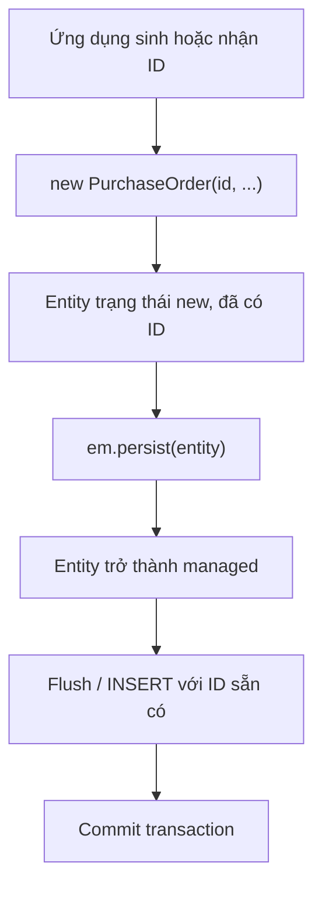

# Dùng khóa do ứng dụng cấp trước khi persist

Trong JPA, mỗi entity cần có một **định danh** để phân biệt các bản ghi. Nhiều ví dụ cơ bản dùng `@GeneratedValue` để database hoặc persistence provider tự sinh khóa. Nhưng có những hệ thống phải **biết ID ngay khi tạo đối tượng Java**, trước khi gọi `EntityManager.persist(...)`: chẳng hạn cần gắn ID vào sự kiện, tạo liên kết giữa các đối tượng chưa lưu hoặc sử dụng ID do hệ thống bên ngoài cấp.

Khi đó, ứng dụng có thể **tự cấp khóa chính (assigned identifier)** và đặt giá trị vào trường `@Id`. Khóa đã tồn tại trước lời gọi `persist`; JPA nhận và dùng giá trị đó để ghi bản ghi. Bài học thuộc chương **Khóa và chiến lược sinh** giải thích cách triển khai, các loại khóa có thể chọn, ý nghĩa của `persist` và `merge`, những rủi ro về trùng khóa, đồng thời đưa ra ví dụ hoàn chỉnh trong Java SE và lưu ý với Spring Data JPA.

## 1. Khóa do ứng dụng cấp là gì?

Với khóa do ứng dụng cấp, **mã Java quyết định và gán giá trị định danh trước khi entity được đưa vào persistence context**.

Ví dụ:

```java
UUID orderId = UUID.randomUUID();               // 1. Ứng dụng tạo ID.
PurchaseOrder order = new PurchaseOrder(
        orderId, "ORD-2026-0001", new BigDecimal("125000")
);                                              // 2. Entity đã có ID.
entityManager.persist(order);                   // 3. JPA quản lý entity.
```

Trong ví dụ, `orderId` có giá trị trước khi `persist` được gọi. JPA không cần chờ một lệnh `INSERT` để hỏi database lấy khóa mới.

Sơ đồ thời điểm cấp ID:



**Có ID không đồng nghĩa đã được lưu.** Trước khi gọi `persist`, entity vẫn là đối tượng mới (*new/transient*), chưa có hàng dữ liệu tương ứng chỉ vì một trường `id` khác `null`.

### So sánh với các cách sinh khóa khác

| Phương án | Ai xác định ID? | Khi nào ứng dụng biết ID? | Ghi chú |
|---|---|---|---|
| `@Id` và không có `@GeneratedValue` | Mã ứng dụng hoặc nguồn ngoài | **Trước `persist`** nếu thiết kế đúng | Assigned identifier: trọng tâm bài học |
| `@GeneratedValue(strategy = IDENTITY)` | Database | Thường khi provider thực thi `INSERT` để lấy ID | Tùy provider và thời điểm flush |
| `@GeneratedValue(strategy = SEQUENCE)` | Database sequence, provider yêu cầu giá trị | Có thể trước `INSERT` | Vẫn là sinh ID do provider quản lý |
| `@GeneratedValue(strategy = UUID)` (Jakarta Persistence 3.1+) | JPA provider | Thường khi provider thực hiện sinh ID | Khác với tự gọi `UUID.randomUUID()` trước `persist` |
| ID từ hệ thống ngoài | Service khác hoặc dữ liệu nhập được kiểm soát | Khi tiếp nhận ID | Cần ràng buộc nguồn gốc và chống trùng |

Việc dùng `UUID` không tự động có nghĩa là “ứng dụng tự cấp khóa”. Khác biệt nằm ở **ai thực hiện sinh giá trị** và **giá trị có được gán trước `persist` hay không**.

## 2. Cú pháp JPA: `@Id` và không đặt `@GeneratedValue`

Một entity có khóa do ứng dụng cấp cần khai báo trường định danh bằng `@Id` nhưng **không khai báo `@GeneratedValue`** cho trường đó.

```java
import jakarta.persistence.Column;
import jakarta.persistence.Entity;
import jakarta.persistence.Id;
import jakarta.persistence.Table;
import java.util.UUID;

@Entity
@Table(name = "customer")
public class Customer {

    @Id
    @Column(name = "id", nullable = false, updatable = false)
    private UUID id;

    @Column(name = "email", nullable = false)
    private String email;

    protected Customer() {
        // Constructor không tham số cho JPA.
    }

    public Customer(UUID id, String email) {
        if (id == null) {
            throw new IllegalArgumentException("id is required");
        }
        this.id = id;
        this.email = email;
    }

    public UUID getId() {
        return id;
    }
}
```

Dòng `@Column(updatable = false)` thể hiện ý định ID không được cập nhật như cột dữ liệu thông thường. Dù có annotation đó, **identity của entity vẫn phải được coi là bất biến sau khi được quản lý**. Thay đổi trực tiếp khóa chính của một entity managed là tình huống không được JPA hỗ trợ như một cập nhật trạng thái bình thường.

Các điều kiện cần duy trì:

- ID phải được gán hợp lệ trước `em.persist(entity)`.
- ID phải **duy nhất trong phạm vi bảng/khóa chính**; database cần ràng buộc `PRIMARY KEY`.
- ID cần ổn định trong toàn bộ vòng đời entity.
- Không cấp lại khóa mới khi entity đã được lưu, tải lại hoặc hợp nhất.
- Khóa tự cấp không làm thay đổi nhu cầu transaction, kiểm tra dữ liệu và xử lý lỗi DB.

JPA nhận giá trị khóa hiện có để ghi xuống database. Nó **không tự kiểm tra toàn bộ hệ thống** xem ID ngẫu nhiên có trùng hay không; xung đột cuối cùng phải được database phát hiện thông qua ràng buộc duy nhất.

## 3. Chọn loại khóa do ứng dụng cấp

### 3.1. UUID ngẫu nhiên (phổ biến khi nhiều nơi cùng tạo dữ liệu)

`UUID.randomUUID()` của Java tạo UUID phiên bản 4 dựa trên số ngẫu nhiên. Dạng văn bản thường có 36 ký tự, ví dụ:

```text
0f8fad5b-d9cb-4c8e-9a27-4d6e8f2f116a
```

Đây chỉ là ví dụ định dạng, không phải ID thực sự vừa được sinh.

Điểm mạnh:

- Có thể tạo ngay trong tiến trình Java, không cần round trip lấy sequence hoặc ID từ DB.
- Nhiều instance ứng dụng có thể sinh ID mà không phải chia sẻ một bộ đếm trung tâm.
- Dễ mang ID sang hàng đợi, log có cấu trúc hoặc yêu cầu liên hệ trước khi transaction lưu dữ liệu.

Điểm cần cân nhắc:

- Xác suất va chạm UUID v4 rất nhỏ trong sử dụng bình thường, nhưng **không thay thế constraint `PRIMARY KEY`**.
- UUID ngẫu nhiên không sắp theo thời gian; với một số cấu trúc index và workload, chèn khóa ngẫu nhiên có thể kém thuận lợi hơn khóa tăng dần.
- UUID có chi phí lưu trữ/index và khả năng đọc bằng mắt khác số `BIGINT` tuần tự.
- UUID **không phải cơ chế phân quyền**; không được bỏ kiểm tra quyền chỉ vì ID khó đoán.

Các họ ID có thứ tự thời gian (ví dụ UUIDv7, ULID) có thể hữu ích với chỉ mục và truy vết. Tuy vậy cần lựa chọn thư viện tin cậy, kiểm tra khả năng sắp xếp thực tế theo kiểu cột/collation, quản lý độ phân giải thời gian và quy tắc uniqueness; JDK `UUID.randomUUID()` không sinh UUIDv7.

### 3.2. Khóa kiểu `String`

Khi một ID đã có dạng chuỗi duy nhất, JPA có thể ánh xạ trực tiếp:

```java
@Id
@Column(name = "product_code", length = 40, nullable = false, updatable = false)
private String productCode;
```

Ví dụ: `SKU-ABC-001` hoặc mã định danh từ hệ thống tích hợp. Lựa chọn này hợp lý khi mã thực sự **ổn định, duy nhất và không bao giờ cần đổi**. Nếu mã sản phẩm có thể đổi do quy tắc kinh doanh, nên cân nhắc một ID kỹ thuật bất biến khác và đặt `productCode` thành cột có unique constraint riêng.

Với mã chuỗi, cần nhất quán về chuẩn hóa Unicode, khoảng trắng, chữ hoa/thường, collation và quy tắc phân biệt khóa. Hai chuỗi Java khác nhau có thể được DB so sánh tương đương tùy collation.

### 3.3. Số nguyên do ứng dụng cấp

Một hệ thống có thể dùng `Long` từ một dịch vụ phát ID tập trung hoặc thuật toán phân tán có tổ chức. Khi đó, entity khai báo `@Id Long id` và nhận số đã cấp trong constructor. Ví dụ minh họa một entity `Invoice` đã được định nghĩa theo cách này:

```java
Long assignedId = identifierService.nextId();
Invoice invoice = new Invoice(assignedId, "INV-2026-0002");
entityManager.persist(invoice);
```

`identifierService` là thành phần giả định do ứng dụng tự triển khai hoặc tích hợp; đoạn mã chỉ minh họa luồng **lấy ID trước rồi mới persist**, không phải ví dụ runnable độc lập. Trong thiết kế phân tán, nguồn phát ID cần đảm bảo các instance không cấp trùng và xử lý việc khởi động lại, hết dải số, lỗi đồng hồ nếu thuật toán phụ thuộc thời gian.

Cơ chế cấp phát số nguyên phải là một phần của thiết kế hệ thống. **Không dùng `SELECT MAX(id) + 1`** để tạo khóa khi nhiều transaction có thể ghi đồng thời; hai transaction dễ đọc cùng một giá trị lớn nhất và sinh cùng ID.

### 3.4. Khóa tổng hợp cấp trước

Nếu định danh thật sự gồm hai hoặc nhiều thành phần (ví dụ `tenantId` và `externalOrderId`), có thể dùng `@EmbeddedId` hoặc `@IdClass`. Các giá trị thành phần được cấp trước `persist`. Đây vẫn là assigned identifier, nhưng làm cho quan hệ FK và thao tác mapping phức tạp hơn, nên chỉ dùng khi mô hình dữ liệu thực sự cần.

## 4. Ví dụ hoàn chỉnh: đơn hàng dùng UUID do ứng dụng sinh

Ví dụ Java SE dưới đây dùng Jakarta Persistence 3.1, Hibernate ORM 6.x và H2 để người học có thể thấy ID trước khi lưu và đọc lại cùng ID sau khi commit.

### 4.1. Cấu trúc dự án

```text
assigned-id-demo/
├── pom.xml
└── src/main/
    ├── java/demo/
    │   ├── PurchaseOrder.java
    │   └── Main.java
    └── resources/
        └── META-INF/
            └── persistence.xml
```

### 4.2. Dependency Maven

Tệp `pom.xml`:

```xml
<project xmlns="http://maven.apache.org/POM/4.0.0"
         xmlns:xsi="http://www.w3.org/2001/XMLSchema-instance"
         xsi:schemaLocation="http://maven.apache.org/POM/4.0.0
                             https://maven.apache.org/xsd/maven-4.0.0.xsd">
    <modelVersion>4.0.0</modelVersion>

    <groupId>demo</groupId>
    <artifactId>assigned-id-demo</artifactId>
    <version>1.0-SNAPSHOT</version>

    <properties>
        <maven.compiler.release>17</maven.compiler.release>
        <project.build.sourceEncoding>UTF-8</project.build.sourceEncoding>
    </properties>

    <dependencies>
        <dependency>
            <groupId>jakarta.persistence</groupId>
            <artifactId>jakarta.persistence-api</artifactId>
            <version>3.1.0</version>
        </dependency>

        <dependency>
            <groupId>org.hibernate.orm</groupId>
            <artifactId>hibernate-core</artifactId>
            <version>6.6.4.Final</version>
        </dependency>

        <dependency>
            <groupId>com.h2database</groupId>
            <artifactId>h2</artifactId>
            <version>2.3.232</version>
        </dependency>
    </dependencies>

    <build>
        <plugins>
            <plugin>
                <groupId>org.apache.maven.plugins</groupId>
                <version>3.13.0</version>
                <artifactId>maven-compiler-plugin</artifactId>
            </plugin>
            <plugin>
                <groupId>org.codehaus.mojo</groupId>
                <artifactId>exec-maven-plugin</artifactId>
                <version>3.4.1</version>
                <configuration>
                    <mainClass>demo.Main</mainClass>
                </configuration>
            </plugin>
        </plugins>
    </build>
</project>
```

Các phiên bản chỉ nhằm minh họa một tập dependency tương thích, không khẳng định là mới nhất. Hibernate cung cấp JPA provider, H2 cung cấp driver JDBC và DB chạy trong bộ nhớ. Ví dụ sử dụng `UUID` theo khả năng mapping của Hibernate 6 trên H2; với provider khác cần kiểm tra kiểu dữ liệu UUID được hỗ trợ hoặc ánh xạ chuyển đổi rõ ràng.

### 4.3. Entity `PurchaseOrder` với ID bất biến

Tệp `src/main/java/demo/PurchaseOrder.java`:

```java
package demo;

import jakarta.persistence.Column;
import jakarta.persistence.Entity;
import jakarta.persistence.Id;
import jakarta.persistence.Table;
import jakarta.persistence.Version;

import java.math.BigDecimal;
import java.util.Objects;
import java.util.UUID;

@Entity
@Table(name = "purchase_orders")
public class PurchaseOrder {

    @Id
    @Column(name = "id", nullable = false, updatable = false)
    private UUID id; // Không có @GeneratedValue.

    @Column(name = "order_number", nullable = false,
            unique = true, updatable = false, length = 64)
    private String orderNumber;

    @Column(name = "total_amount", nullable = false,
            precision = 14, scale = 2)
    private BigDecimal totalAmount;

    @Version
    @Column(name = "version", nullable = false)
    private Long version;

    protected PurchaseOrder() {
        // Constructor không tham số cho JPA.
    }

    public PurchaseOrder(
            UUID id,
            String orderNumber,
            BigDecimal totalAmount) {

        this.id = Objects.requireNonNull(id, "id");
        this.orderNumber = Objects.requireNonNull(
                orderNumber, "orderNumber");
        this.totalAmount = Objects.requireNonNull(
                totalAmount, "totalAmount");

        if (orderNumber.isBlank()) {
            throw new IllegalArgumentException(
                    "orderNumber must not be blank");
        }
        if (totalAmount.signum() < 0) {
            throw new IllegalArgumentException(
                    "totalAmount must not be negative");
        }
    }

    public UUID getId() {
        return id;
    }

    public String getOrderNumber() {
        return orderNumber;
    }

    public BigDecimal getTotalAmount() {
        return totalAmount;
    }

    public void changeTotalAmount(BigDecimal value) {
        Objects.requireNonNull(value, "value");
        if (value.signum() < 0) {
            throw new IllegalArgumentException(
                    "totalAmount must not be negative");
        }
        this.totalAmount = value;
    }
}
```

Trong ví dụ này:

1. `@Id` khai báo định danh; **không dùng `@GeneratedValue`**.
2. Constructor bắt buộc truyền một `UUID` đã có trước thời điểm `persist`.
3. Không có public setter cho `id`, giúp tránh đổi identity sau khi tạo.
4. `@Version` phục vụ optimistic locking khi cập nhật entity; nó **không phải khóa chính**.
5. `orderNumber` là một mã nghiệp vụ riêng với ràng buộc duy nhất. Mã nghiệp vụ không cần trùng với PK kỹ thuật.

Việc đặt `@Column(unique = true)` thể hiện metadata mong muốn. Trong database thật, hãy tạo/kiểm soát unique constraint qua migration, không dựa hoàn toàn vào việc sinh schema lúc khởi động.

### 4.4. Persistence unit

Tạo `src/main/resources/META-INF/persistence.xml`:

```xml
<?xml version="1.0" encoding="UTF-8"?>
<persistence xmlns="https://jakarta.ee/xml/ns/persistence"
             xmlns:xsi="http://www.w3.org/2001/XMLSchema-instance"
             xsi:schemaLocation="
                 https://jakarta.ee/xml/ns/persistence
                 https://jakarta.ee/xml/ns/persistence/persistence_3_1.xsd"
             version="3.1">

    <persistence-unit name="assignedIdPU" transaction-type="RESOURCE_LOCAL">
        <provider>org.hibernate.jpa.HibernatePersistenceProvider</provider>

        <class>demo.PurchaseOrder</class>
        <exclude-unlisted-classes>true</exclude-unlisted-classes>

        <properties>
            <property name="jakarta.persistence.jdbc.driver"
                      value="org.h2.Driver"/>
            <property name="jakarta.persistence.jdbc.url"
                      value="jdbc:h2:mem:ordersdb;DB_CLOSE_DELAY=-1"/>
            <property name="jakarta.persistence.jdbc.user"
                      value="sa"/>
            <property name="jakarta.persistence.jdbc.password"
                      value=""/>

            <property name="jakarta.persistence.schema-generation.database.action"
                      value="drop-and-create"/>
        </properties>
    </persistence-unit>
</persistence>
```

`drop-and-create` **xóa và tạo lại schema** khi bootstrap; chỉ dùng trong ví dụ, test hoặc môi trường có thể bỏ dữ liệu. Trong production, nên dùng migration/schema do ứng dụng hoặc DBA quản lý.

### 4.5. Chương trình tạo ID trước khi persist và đọc lại

Tệp `src/main/java/demo/Main.java`:

```java
package demo;

import jakarta.persistence.EntityManager;
import jakarta.persistence.EntityManagerFactory;
import jakarta.persistence.EntityTransaction;
import jakarta.persistence.Persistence;

import java.math.BigDecimal;
import java.util.UUID;

public class Main {

    public static void main(String[] args) {
        UUID assignedId = UUID.randomUUID();

        PurchaseOrder order = new PurchaseOrder(
                assignedId,
                "ORD-2026-0001",
                new BigDecimal("125000.00")
        );

        System.out.println("ID trước persist: " + order.getId());

        EntityManagerFactory emf =
                Persistence.createEntityManagerFactory("assignedIdPU");

        try {
            persistOrder(emf, order);
            readOrder(emf, assignedId);
        } finally {
            emf.close();
        }
    }

    private static void persistOrder(
            EntityManagerFactory emf,
            PurchaseOrder order) {

        EntityManager em = emf.createEntityManager();
        try {
            EntityTransaction tx = em.getTransaction();
            try {
                tx.begin();
                em.persist(order);
                System.out.println("ID sau persist: " + order.getId());
                tx.commit();
            } catch (RuntimeException ex) {
                if (tx.isActive()) {
                    tx.rollback();
                }
                throw ex;
            }
        } finally {
            em.close();
        }
    }

    private static void readOrder(
            EntityManagerFactory emf,
            UUID id) {

        EntityManager em = emf.createEntityManager();
        try {
            PurchaseOrder loaded =
                    em.find(PurchaseOrder.class, id);

            if (loaded == null) {
                throw new IllegalStateException(
                        "Order not found: " + id);
            }

            System.out.println("ID đọc từ DB: " + loaded.getId());
            System.out.println("Mã đơn: " + loaded.getOrderNumber());
        } finally {
            em.close();
        }
    }
}
```

Chạy:

```bash
mvn compile exec:java
```

Kết quả dự kiến có dạng:

```text
ID trước persist: 3f5e4d8c-55ad-4bd5-a379-4f2a19ba2cb3
ID sau persist: 3f5e4d8c-55ad-4bd5-a379-4f2a19ba2cb3
ID đọc từ DB: 3f5e4d8c-55ad-4bd5-a379-4f2a19ba2cb3
Mã đơn: ORD-2026-0001
```

UUID cụ thể thay đổi mỗi lần chạy. Provider có thể in thêm các dòng log. Điểm phải quan sát là **ID không đổi** giữa trước persist, sau persist và lần đọc từ DB.

Ở mức ý tưởng, câu SQL chèn sẽ mang giá trị ID đã cấp:

```sql
INSERT INTO purchase_orders (
    id, order_number, total_amount, version
) VALUES (?, ?, ?, ?);
```

Thứ tự cột, thời điểm gửi SQL, kiểu JDBC dùng để bind UUID và các câu SQL phụ trợ phụ thuộc provider/dialect. JPA có thể trì hoãn `INSERT` đến flush/commit; vì vậy **ID có trước không chứng minh SQL đã chạy hoặc transaction đã commit**.

## 5. Vòng đời entity và ý nghĩa của `persist`

Đây là phần dễ nhầm nhất khi dùng assigned ID.

| Thời điểm | Trạng thái entity | Giá trị `id` | Hàng DB |
|---|---|---|---|
| Ngay sau `new PurchaseOrder(id, ...)` | New/transient | Đã có | Chưa được tạo bởi đối tượng này |
| Sau `em.persist(order)` | Managed trong persistence context hiện tại | Giữ nguyên | SQL có thể chưa phát |
| Sau flush | Managed | Giữ nguyên | SQL thường đã được gửi trong transaction |
| Sau commit | Managed nếu EM còn mở | Giữ nguyên | Dữ liệu đã được commit nếu không có lỗi |
| Sau `em.close()` | Detached | Giữ nguyên | Vẫn có nếu transaction commit thành công |

Cần phân biệt:

- `new`: một đối tượng có ID **chưa phải** entity managed.
- `persist`: yêu cầu biến entity mới thành managed và ghi dữ liệu theo transaction.
- `flush`: đồng bộ những thay đổi đang chờ xuống DB; không đồng nghĩa commit.
- `commit`: chấp nhận transaction nếu không có lỗi.
- `close`: kết thúc persistence context của EntityManager; entity trở thành detached.

Assigned ID **không thay đổi** các quy tắc transaction hoặc các ranh giới vòng đời này.

### Có thể lấy ID để liên kết entity trước khi lưu?

Có. Ví dụ mã ứng dụng cần tạo khóa ngoại cho một bản ghi con hoặc tạo sự kiện nghiệp vụ trong bộ nhớ:

```java
UUID orderId = UUID.randomUUID();

PurchaseOrder order = new PurchaseOrder(
        orderId,
        "ORD-2026-0003",
        new BigDecimal("50000")
);

// orderId có thể được truyền cho logic tạo entity liên quan,
// hoặc kèm trong message cần lưu cùng giao dịch.
```

Tuy vậy, không nên phát thông báo ra hệ thống ngoài với giả định “đơn đã được lưu” **trước khi transaction commit**. Nếu phải gửi message nhất quán với dữ liệu, cân nhắc transactional outbox: lưu cả order và bản ghi outbox trong cùng transaction, để tiến trình khác gửi message sau commit.

## 6. Phân biệt `persist`, `merge` và sự tồn tại của khóa

### `persist()` dành cho entity mới

`em.persist(order)` biểu thị ý định **tạo một entity mới**. Nếu bảng đã có hàng cùng primary key, giao dịch có thể thất bại bởi khóa trùng; thời điểm báo lỗi có thể là khi persist, flush hoặc commit tùy provider.

```java
UUID id = UUID.randomUUID();

PurchaseOrder first = new PurchaseOrder(
        id, "ORD-2026-A", new BigDecimal("100")
);
em.persist(first);

// Trong một persistence context, tạo thêm một instance khác
// có cùng entity type và ID là xung đột identity.
PurchaseOrder another = new PurchaseOrder(
        id, "ORD-2026-B", new BigDecimal("200")
);
```

JPA bảo đảm mỗi persistence context quản lý tối đa một entity instance cho một identity (kiểu entity + ID). Không cố dùng hai đối tượng khác nhau mang cùng ID như hai hàng độc lập.

### `merge()` dành cho việc hợp nhất trạng thái

`em.merge(detachedEntity)` sao chép trạng thái của đối tượng được truyền vào một managed instance và **trả về managed instance**. Đối tượng tham số thường vẫn detached.

```java
PurchaseOrder managed = em.merge(detachedOrder);
// Dùng managed để tiếp tục cập nhật trong persistence context.
```

Với entity có ID đã gán, provider có thể phải tìm hàng tương ứng để xác định cách xử lý. Cách phản ứng khi hàng không tồn tại còn phụ thuộc đặc tả, provider, version mapping và trạng thái entity. **Không dùng `merge` như một phép “insert nếu chưa tồn tại” phổ quát** nếu yêu cầu nghiệp vụ cần tính duy nhất hoặc chống ghi trùng rõ ràng.

Cũng không dùng `merge` chỉ vì khóa khác `null`; một đối tượng mới có assigned ID vẫn nên được `persist` theo ý định tạo mới.

## 7. Lưu ý quan trọng với Spring Data JPA `save()`

Trong ứng dụng Spring Data JPA, câu lệnh thường gặp là:

```java
repository.save(order);
```

Tuy nhiên, `save()` phải quyết định entity **mới** hay **đã tồn tại** để chọn gọi `EntityManager.persist` hoặc `EntityManager.merge`. Với cấu hình mặc định, Spring Data JPA ưu tiên phát hiện qua thuộc tính `@Version` kiểu object có giá trị `null`; nếu không có version phù hợp, việc phát hiện có thể dựa vào `id == null`.

Với assigned ID, một entity mới **đã có ID khác null**. Khi không có cơ chế phát hiện phù hợp, Spring Data JPA có thể chọn `merge` cho entity mới. Điều này có thể gây truy vấn tồn tại không cần thiết hoặc hành vi khác với ý định tạo mới.

### Cách 1: Khai báo version kiểu nullable

Ví dụ entity ở phần trên có:

```java
@Version
@Column(name = "version", nullable = false)
private Long version;
```

Khi mới tạo, `version == null`. Spring Data JPA có thể dựa vào đó để coi entity là mới và gọi `persist`. Provider sẽ quản lý giá trị version ban đầu khi ghi. **Không tự khởi tạo `version = 0L` trong constructor** nếu đang dựa vào điều kiện null để nhận diện trạng thái mới.

Đây là lựa chọn đơn giản nếu hệ thống cũng cần optimistic locking.

### Cách 2: Triển khai `Persistable<ID>`

Nếu không dùng version hoặc muốn khai báo trạng thái mới một cách tường minh, Spring Data JPA cung cấp `Persistable`:

```java
package demo;

import jakarta.persistence.Entity;
import jakarta.persistence.Id;
import jakarta.persistence.PostLoad;
import jakarta.persistence.PostPersist;
import jakarta.persistence.Transient;
import org.springframework.data.domain.Persistable;

import java.util.UUID;

@Entity
public class ImportedRecord implements Persistable<UUID> {

    @Id
    private UUID id;

    private String source;

    @Transient
    private boolean isNew = true;

    protected ImportedRecord() {}

    public ImportedRecord(UUID id, String source) {
        this.id = java.util.Objects.requireNonNull(id);
        this.source = source;
    }

    @Override
    public UUID getId() {
        return id;
    }

    @Override
    public boolean isNew() {
        return isNew;
    }

    @PostPersist
    @PostLoad
    private void markNotNew() {
        this.isNew = false;
    }
}
```

Spring Data JPA sử dụng `isNew()` để chọn hướng gọi `persist` hay `merge`. `@Transient` ở ví dụ là annotation JPA, tránh ghi cờ `isNew` thành cột DB. Callback `@PostPersist` và `@PostLoad` chuyển cờ sang false khi entity đã được lưu hoặc được tải.

Đoạn này chỉ minh họa **mẫu Spring Data JPA**; nó cần dependency và cấu hình Spring Data JPA tương ứng, khác với chương trình Java SE thuần ở phần 4.

Không dùng cờ `isNew` một cách tùy tiện cho các đối tượng detached được tái tạo bằng DTO/import; khi nạp một entity đã tồn tại từ nguồn ngoài, phải biểu đạt đúng trạng thái để tránh yêu cầu chèn bản ghi trùng.

### Cách 3: Gọi `EntityManager.persist()` khi chắc chắn tạo mới

Trong service có transaction, gọi `persist` tường minh giúp xác định rõ ý định thêm mới:

```java
@Transactional
public void create(PurchaseOrder order) {
    entityManager.persist(order);
}
```

Trong Spring, `@Transactional` và `EntityManager` do container cung cấp; không tự `commit` nếu transaction manager đang sở hữu transaction.

## 8. Khóa nghiệp vụ, khóa kỹ thuật và khả năng thay đổi ID

Một tình huống phổ biến là hệ thống nhận `externalOrderId` từ bên đối tác. Có ba cách tiếp cận:

| Thiết kế | Phù hợp khi | Rủi ro cần cân nhắc |
|---|---|---|
| Dùng `externalOrderId` làm `@Id` | Mã được đảm bảo duy nhất, bất biến và thuộc quyền xác định của hệ thống tích hợp | Đối tác có thể đổi quy tắc hoặc tái sử dụng mã; chuỗi dài làm nặng FK/index |
| Ứng dụng tự cấp `UUID` làm `@Id`, lưu `externalOrderId` như unique business key | Muốn ID nội bộ độc lập với đối tác | Phải kiểm soát unique theo đúng phạm vi đối tác/tenant |
| Dùng ID `Long` cấp bởi dịch vụ phát số, mã đối tác là thuộc tính khác | Hệ thống đã có nền tảng cấp ID phân tán | Phải vận hành dịch vụ cấp ID ổn định, tránh cấp trùng |

Ví dụ yêu cầu duy nhất theo từng đối tác có thể là khóa logic `(partner_id, external_order_id)`, trong khi JPA vẫn dùng `UUID` làm primary key:

```java
@Entity
@Table(
    name = "partner_orders",
    uniqueConstraints = @UniqueConstraint(
        name = "uk_partner_external_order",
        columnNames = {"partner_id", "external_order_id"}
    )
)
public class PartnerOrder {
    @Id
    private UUID id;

    @Column(name = "partner_id", nullable = false)
    private String partnerId;

    @Column(name = "external_order_id", nullable = false)
    private String externalOrderId;

    // Constructor và các thuộc tính khác được lược bớt.
}
```

Ở đây `@UniqueConstraint` mô tả ràng buộc nghiệp vụ khi sinh schema. Để thực thi đáng tin cậy trong production, migration phải tạo unique constraint thật trên bảng DB.

**Một ID ổn định không nhất thiết cần là “mã dễ đọc”.** Nếu mã đơn hiển thị có thể thay đổi, đừng lấy nó làm PK rồi phải sửa toàn bộ foreign key theo sau.

## 9. Khóa tổng hợp được cấp trước với `@EmbeddedId`

Một trường hợp khác là khóa tự nhiên gồm `tenantId` và `documentNo`. Ta có thể tạo một value object làm ID.

```java
package demo;

import jakarta.persistence.Column;
import jakarta.persistence.Embeddable;

import java.io.Serializable;
import java.util.Objects;

@Embeddable
public class DocumentId implements Serializable {

    @Column(name = "tenant_id", length = 40)
    private String tenantId;

    @Column(name = "document_no", length = 40)
    private String documentNo;

    protected DocumentId() {}

    public DocumentId(String tenantId, String documentNo) {
        this.tenantId = Objects.requireNonNull(tenantId);
        this.documentNo = Objects.requireNonNull(documentNo);
    }

    @Override
    public boolean equals(Object obj) {
        if (this == obj) return true;
        if (!(obj instanceof DocumentId other)) return false;
        return Objects.equals(tenantId, other.tenantId)
            && Objects.equals(documentNo, other.documentNo);
    }

    @Override
    public int hashCode() {
        return Objects.hash(tenantId, documentNo);
    }
}
```

Entity sử dụng:

```java
@Entity
@Table(name = "documents")
public class Document {

    @EmbeddedId
    private DocumentId id;

    @Column(name = "title", nullable = false)
    private String title;

    protected Document() {}

    public Document(DocumentId id, String title) {
        this.id = Objects.requireNonNull(id);
        this.title = Objects.requireNonNull(title);
    }
}
```

Cách tạo và lưu:

```java
DocumentId id = new DocumentId("tenant-A", "DOC-042");
Document document = new Document(id, "Invoice draft");

em.persist(document);
```

Khóa tổng hợp phải có **đủ các thành phần từ trước** và cần được coi là bất biến trong suốt vòng đời. Class khóa nên triển khai `Serializable` và có `equals/hashCode` theo các thành phần khóa. Với khóa tổng hợp, các bảng tham chiếu sẽ có nhiều cột FK, nên cần cân nhắc chi phí schema và API.

Đoạn entity phía trên dùng thêm các import `jakarta.persistence.Entity`, `jakarta.persistence.Table`, `jakarta.persistence.EmbeddedId` và `jakarta.persistence.Column`; ví dụ tập trung vào cách biểu diễn khóa.

## 10. Tính duy nhất, đồng thời và tạo dữ liệu an toàn

### 10.1. Kiểm tra trùng trong Java chưa đủ

Đoạn mã sau không bảo vệ hoàn toàn trước ghi đồng thời:

```java
if (em.find(PurchaseOrder.class, candidateId) == null) {
    em.persist(new PurchaseOrder(
            candidateId,
            "ORD-2026-X",
            new BigDecimal("100")
    ));
}
```

Giữa bước kiểm tra và bước chèn, transaction khác vẫn có thể ghi cùng ID. Đây là dạng race condition (*time-of-check/time-of-use*). Database cần `PRIMARY KEY` và unique constraint để thực thi tính duy nhất dưới tải đồng thời.

Khi xảy ra trùng khóa, transaction có thể bị đánh dấu rollback-only hoặc thất bại. Thông thường cần rollback và bắt đầu **transaction mới** để thử lại với ID khác, nếu chiến lược nghiệp vụ cho phép. Không mặc định có thể tiếp tục dùng cùng EntityManager/transaction sau lỗi vi phạm constraint.

### 10.2. Retry phải phân biệt trùng ID và trùng yêu cầu

Hai nguồn xung đột có ý nghĩa khác nhau:

- **Va chạm ID sinh ngẫu nhiên:** nếu thật sự xảy ra và không có xung đột nghiệp vụ, có thể sinh một ID mới rồi thử lại trong transaction khác.
- **Hai lần xử lý cùng một yêu cầu nghiệp vụ:** không nên cứ đổi UUID rồi tạo hai đơn hàng. Cần một **idempotency key** hoặc unique constraint trên mã yêu cầu nghiệp vụ để nhận diện thao tác đã xử lý.

Ví dụ lệnh tạo đơn từ API có `requestId`. Lưu `requestId` dưới unique constraint phù hợp; khi request được gửi lại, hệ thống tra cứu kết quả cũ hoặc xử lý cạnh tranh theo quy tắc nghiệp vụ. Việc tự cấp UUID chỉ giải quyết vấn đề định danh kỹ thuật, **không tự tạo idempotency**.

### 10.3. Đừng dùng ID làm bằng chứng quyền truy cập

UUID khó đoán hơn dãy số tăng dần, nhưng endpoint như `GET /orders/{id}` vẫn phải kiểm tra người dùng có quyền xem đơn đó. Quy tắc bảo mật áp dụng cho mọi kiểu khóa.

### 10.4. Index và phân phối ID

Khóa `BIGINT` tăng dần thường gọn và dễ đọc khi debug; UUID v4 hỗ trợ cấp phát phân tán nhưng ngẫu nhiên trong index. Kết quả hiệu năng phụ thuộc engine DB, kiểu cột, workload ghi, mức độ cache và bố cục index. Hãy đo với dữ liệu và concurrency tương ứng trước khi đổi chiến lược khóa.

Không lưu UUID nhị phân bằng cách mặc định cắt bỏ ký tự hoặc ép thành `Long`: việc biến đổi phải giữ được toàn bộ không gian định danh và nhất quán giữa Java với DB. Với PostgreSQL, kiểu `UUID` chuyên dụng thường thích hợp; với các DB khác cần xác định mapping của provider.

## 11. Assigned ID ảnh hưởng gì đến equals/hashCode và quan hệ?

### 11.1. Identity Java và identity JPA

JPA định danh một entity theo **entity type + primary key** trong persistence context. Hai biến Java có thể cùng giá trị ID nhưng không có nghĩa đều là cùng **instance managed**. Nên tránh tạo hai instance mới có cùng khóa trong một context.

Khi ID được cấp trước `persist`, một ưu điểm là ID ổn định từ khi tạo đối tượng. Điều này đơn giản hóa một số chiến lược `equals/hashCode` so với ID database-generated chỉ xuất hiện sau persist.

Tuy vậy, khi tự triển khai `equals/hashCode` cho JPA entity, cần quan tâm proxy của provider, quan hệ kế thừa, việc so sánh kiểu entity và tính bất biến của khóa. Không tự động dùng mọi field mutable vào `hashCode` rồi đưa entity vào `HashSet`: thay đổi field sẽ gây khó tìm lại phần tử. Mỗi dự án nên chọn và dùng nhất quán một chính sách equality rõ ràng.

### 11.2. Tạo parent và child khi cả hai cần ID trước persist

Giả sử hệ thống có `OrderItem` và `PurchaseOrder`. Vì ID của order đã có trước persist, code có thể tạo mối liên kết sớm:

```java
UUID orderId = UUID.randomUUID();

PurchaseOrder order = new PurchaseOrder(
        orderId, "ORD-2026-0004", new BigDecimal("300000")
);

OrderItem item = new OrderItem(
        UUID.randomUUID(), order, "SKU-001", 2
);
```

`OrderItem` ở đây là lớp minh họa ý tưởng; cần khai báo entity, ánh xạ `@ManyToOne`/`@JoinColumn`, constructor và transaction tương ứng mới là ví dụ runnable. Việc parent có ID không có nghĩa hàng parent đã có trong DB; thứ tự insert, cascade, FK và flush vẫn phải được JPA/provider xử lý theo mapping.

Không gán khóa ngoại bằng cách tự đoán số được sinh. Assigned ID hữu ích chính vì giá trị đã biết trước, nhưng **quy tắc quan hệ và transaction vẫn giữ nguyên**.

## 12. Những lỗi thường gặp

### Lỗi 1: Quên cấp ID trước `persist`

```java
PurchaseOrder order = new PurchaseOrder(
        null, "ORD-ERROR", new BigDecimal("100")
);
```

Constructor trong ví dụ chủ động ném exception. Nếu entity cho phép `id == null` mà không có `@GeneratedValue`, provider có thể báo rằng identifier phải được gán thủ công trước khi gọi `persist`.

Cách sửa: sinh hoặc nhận ID tại điểm tạo entity; bắt buộc giá trị hợp lệ trong constructor/factory.

### Lỗi 2: Gắn cả `@GeneratedValue` nhưng vẫn tự gán ID

```java
@Id
@GeneratedValue(strategy = GenerationType.IDENTITY)
private Long id;
```

Mapping này mô tả khóa do provider/database sinh. Chủ động gán giá trị ID rồi kỳ vọng giá trị luôn được tôn trọng là giả định không an toàn, dễ gây lỗi về trạng thái entity hoặc khác biệt giữa provider.

Cách sửa: **chọn một chiến lược sở hữu khóa rõ ràng**. Assigned ID: khai báo `@Id` và gán thủ công; generated ID: để provider quản lý theo cơ chế đã chọn.

### Lỗi 3: Thấy ID khác null thì tưởng entity đã tồn tại

```java
UUID id = UUID.randomUUID();
PurchaseOrder newOrder = new PurchaseOrder(
        id, "ORD-NEW", new BigDecimal("100")
);

// newOrder vẫn là đối tượng mới, chưa được persist.
```

Cách sửa: phân biệt vòng đời `new`, `managed` và `detached`. Trong Spring Data JPA, cấu hình nhận diện entity mới khi dùng assigned ID.

### Lỗi 4: Thay ID sau khi entity được lưu

Đổi ID có thể làm các FK tham chiếu, cache identity và persistence context không nhất quán. Nếu nghiệp vụ yêu cầu đổi mã hiển thị, hãy lưu mã đó ở field khác. Nếu thật sự cần “đổi PK”, đây là một migration dữ liệu có tính thiết kế, không phải một setter bình thường.

### Lỗi 5: Dùng mã từ bên ngoài không xác thực

Mã từ bên đối tác hoặc user input có thể bị trùng, sai định dạng, quá dài hoặc không đúng tenant. Cần validate, chuẩn hóa, kiểm tra nguồn gốc và ràng buộc uniqueness ở DB. Không lấy ID do client gửi như bằng chứng client được phép cập nhật bản ghi đó.

### Lỗi 6: Tạo lại ID khi retry cùng nghiệp vụ

Nếu giao dịch commit thành công nhưng response bị mất, phía gọi có thể gửi lại request. Mỗi retry sinh UUID mới rồi persist có thể tạo dữ liệu trùng ý nghĩa nghiệp vụ. Dùng idempotency key, deduplication hoặc ràng buộc business key độc lập với UUID.

### Lỗi 7: Nhầm `@PrePersist` với cấp khóa trước `persist`

Callback `@PrePersist` diễn ra trong quá trình provider xử lý việc persist. Dù có thể được dùng trong một số cơ chế gán giá trị trước SQL, nó **không đáp ứng yêu cầu “ID phải có trước khi gọi `persist`”**. Nếu nơi khác cần ID trước lệnh đó, hãy sinh và gán trực tiếp bằng constructor/factory hoặc identifier service.

## 13. Quy trình lựa chọn chiến lược khóa

Hãy lần lượt trả lời:

1. **ID có phải xuất hiện trước khi lưu?** Nếu có, assigned ID là lựa chọn tự nhiên.
2. **ID lấy từ đâu?** UUID do ứng dụng sinh, số từ dịch vụ cấp ID hay khóa nghiệp vụ ổn định?
3. **Có nhiều tiến trình cùng tạo dữ liệu?** Chọn nguồn cấp ID không trùng giữa các tiến trình; DB vẫn phải thực thi constraint.
4. **ID có thay đổi theo nghiệp vụ không?** Nếu có, nên tách ID kỹ thuật bất biến khỏi mã nghiệp vụ.
5. **Có cần sắp xếp theo thời gian hoặc tối ưu index không?** Cân nhắc loại khóa, kiểu DB và workload thực.
6. **Ứng dụng dùng `EntityManager.persist` hay repository `save`?** Đảm bảo cơ chế nhận biết entity mới phù hợp.
7. **Retry có thể tạo lại một yêu cầu không?** Thiết kế idempotency độc lập với khóa kỹ thuật.

Bảng gợi ý:

| Bối cảnh | Hướng tiếp cận |
|---|---|
| Hệ thống nhiều instance, cần ID ngay để liên kết dữ liệu | UUID ứng dụng sinh và gán trước `persist` |
| Mã nghiệp vụ tuyệt đối ổn định, có tính duy nhất toàn cục | Có thể dùng mã đó làm `@Id` nếu chấp nhận ràng buộc dài hạn |
| Mã nghiệp vụ có thể thay đổi | PK kỹ thuật bất biến; mã nghiệp vụ là field riêng |
| Cần `Long` compact, cấp ID trên nhiều node | Dịch vụ/thuật toán cấp số phân tán có kiểm soát |
| Đã dùng DB sequence tốt, không cần ID trước persist | `SEQUENCE` do provider quản lý có thể đơn giản hơn |
| Spring Data JPA với assigned ID | Nullable `@Version` hoặc `Persistable<ID>` để hỗ trợ `isNew` |

## 14. Bài tập thực hành

**Bài 1 — Chứng minh thời điểm có ID.** Chạy ví dụ `PurchaseOrder`, in ID trước `persist`, sau `persist` và sau khi tải lại bằng `em.find`. Giải thích vì sao ba lần in cùng một giá trị, dù SQL có thể chỉ chạy lúc flush/commit.

**Bài 2 — Kiểm tra thiếu khóa.** Bỏ kiểm tra `Objects.requireNonNull(id)` khỏi constructor và truyền `null` trước `persist`. Quan sát exception từ provider; bổ sung lại validation ở constructor.

**Bài 3 — Kiểm tra trùng khóa.** Chèn một đơn thành công, mở một transaction mới rồi tạo một đối tượng khác dùng lại cùng UUID nhưng với mã đơn khác. Quan sát lỗi khóa chính. Giải thích vì sao không nên tự retry trên transaction đang thất bại.

**Bài 4 — Thêm một khóa nghiệp vụ.** Tạo field `externalRequestId` unique để chống xử lý lặp cùng yêu cầu. Thử gửi hai yêu cầu có cùng `externalRequestId` nhưng sinh hai UUID khác nhau. Xác định constraint nào phải ngăn bản ghi thứ hai.

**Bài 5 — Tạo entity với khóa tổng hợp.** Dùng `DocumentId(tenantId, documentNo)`, tạo hai tài liệu có cùng `documentNo` nhưng khác `tenantId`. Viết composite primary key trong schema và giải thích phạm vi uniqueness.

**Bài 6 — Spring Data JPA.** Tạo một repository cho entity có ID UUID được cấp trong constructor. So sánh behavior của `save` khi entity có `@Version Long version` (ban đầu null), khi bỏ version và khi triển khai `Persistable<UUID>`. Quan sát SQL của provider để hiểu lúc nào có truy vấn kiểm tra tồn tại.

## 15. Câu hỏi tự kiểm tra

1. **Assigned ID khác IDENTITY như thế nào?** Assigned ID do ứng dụng gán trước `persist`; IDENTITY thường do DB tạo khi insert.
2. **Chỉ có `@Id` mà thiếu `@GeneratedValue` có hợp lệ không?** Có. Đây là cách khai báo identifier mà ứng dụng chịu trách nhiệm cấp.
3. **Entity có ID trước `persist` đã tồn tại trong DB chưa?** Chưa chắc. Nó vẫn là đối tượng mới cho đến khi được đưa vào persistence context và transaction ghi dữ liệu thành công.
4. **Nếu UUID rất khó trùng, có bỏ primary key constraint không?** Không. DB constraint vẫn là cơ chế bảo vệ cuối cùng.
5. **`merge` có luôn đồng nghĩa với “nếu chưa có thì INSERT” không?** Không. Cần hiểu trạng thái entity và behavior provider; không dùng nó thay cho giao ước tạo mới một cách mơ hồ.
6. **Vì sao Spring Data JPA có thể nhầm entity assigned ID là đã tồn tại?** Vì một số cách phát hiện entity mới dựa vào ID khác null; có thể dùng nullable version hoặc `Persistable`.
7. **Có nên dùng email làm primary key của user không?** Thường không nếu email có thể đổi. Một ID kỹ thuật bất biến và unique constraint cho email sẽ dễ bảo trì hơn.
8. **`@PrePersist` có đáp ứng việc biết ID trước khi gọi `persist` không?** Không; để ID có trước, hãy cấp khi tạo object hoặc bằng service trước lời gọi persist.

**Ghi nhớ:** Muốn **ứng dụng tự cấp khóa trước khi `persist`**, hãy khai báo `@Id` mà không gắn `@GeneratedValue`, tạo ID bằng một cơ chế ổn định/duy nhất và truyền ID vào entity **trước khi** gọi `EntityManager.persist`. ID phải bất biến trong vòng đời entity, database phải có ràng buộc primary key, còn thao tác lưu vẫn tuân thủ các quy tắc transaction, persistence context và phát hiện entity mới của framework.
