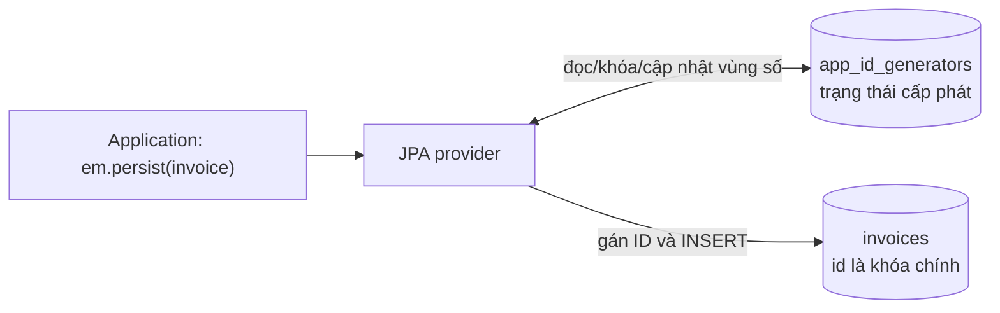

# Sinh khóa bằng `TABLE` và cấu hình `@TableGenerator`

Trong ứng dụng Java sử dụng JPA để truy cập cơ sở dữ liệu quan hệ, mỗi entity thường có một **khóa chính (primary key)** giúp phân biệt nó với những entity khác cùng kiểu. Ta có thể tự gán khóa khi tạo đối tượng, nhưng nhiều hệ thống muốn JPA tự cung cấp khóa số tăng dần để mã nghiệp vụ không phải tự tìm ID chưa sử dụng.

JPA hỗ trợ nhiều chiến lược sinh khóa qua `@GeneratedValue`. Bài học này tập trung vào **`GenerationType.TABLE`**: thay vì dựa trực tiếp vào cột tự tăng hoặc đối tượng sequence đặc thù của cơ sở dữ liệu, JPA provider dùng **một bảng lưu trạng thái cấp phát khóa**. Annotation **`@TableGenerator`** mô tả bảng đó và cách lấy các nhóm giá trị ID.

Đây là cơ chế đặc biệt hữu ích để hiểu ranh giới giữa **định danh entity**, **hạ tầng cấp phát giá trị** và **transaction**. Nó tương đối linh hoạt giữa các hệ quản trị quan hệ, nhưng cũng đặt ra các chi phí về khóa hàng, cạnh tranh truy cập và quản lý bảng generator. Lựa chọn `TABLE` nên dựa trên yêu cầu vận hành, không chỉ dựa vào việc annotation dễ viết.

## 1. Phân biệt khóa chính của entity và bảng cấp phát khóa

Giả sử có entity `Invoice`:

```java
@Entity
public class Invoice {
    @Id
    private Long id;

    private String reference;
}
```

Field `id` là **định danh của từng hóa đơn**. Khi một hóa đơn được lưu vào bảng `invoices`, giá trị này phải đáp ứng ràng buộc khóa chính của bảng. Nếu hai hóa đơn có cùng `id`, cơ sở dữ liệu phải từ chối tạo bản ghi trùng khóa.

Với `GenerationType.TABLE`, JPA dùng **một bảng phụ** để nhớ trạng thái của bộ cấp phát:

```text
app_id_generators
+------------------+---------------+
| generator_key    | generator_val |
+------------------+---------------+
| invoice_ids      | ...           |
| payment_ids      | ...           |
+------------------+---------------+

invoices
+-------+-------------------+
| id    | reference         |
+-------+-------------------+
| 1001  | INV-2026-0001     |
| 1002  | INV-2026-0002     |
+-------+-------------------+
```

Các dòng `invoice_ids`, `payment_ids` trong bảng generator **không phải hóa đơn hay khoản thanh toán**; chúng là các dòng điều phối việc cấp phát số. Một dòng có thể đại diện cho một dãy ID dùng cho một entity hoặc một nhóm entity theo thiết kế.

Sơ đồ logic:



**Cốt lõi:** `@Id` xác định *field nào là khóa chính*, còn `@GeneratedValue` và `@TableGenerator` xác định *provider lấy giá trị khóa ở đâu và theo quy tắc nào*.

## 2. `GenerationType.TABLE` hoạt động như thế nào?

Khi phải cấp một ID mới, provider có thể thực hiện quy trình khái quát:

1. Xác định generator ứng với entity hoặc trường `@Id` đang được lưu.
2. Tìm dòng đại diện cho generator trong bảng cấp phát (ví dụ `generator_key = 'invoice_ids'`).
3. Dùng cơ chế đồng bộ an toàn với nhiều transaction, thường dựa vào khóa hàng hoặc cập nhật có điều kiện, để **dành riêng một giá trị hoặc một vùng giá trị** cho tiến trình hiện tại.
4. Cập nhật trạng thái cấp phát trong bảng generator.
5. Gán ID cho entity mới và gửi `INSERT` vào bảng dữ liệu nghiệp vụ theo chiến lược flush của provider.

Đặc tả JPA định nghĩa **hành vi và cấu hình generator**, nhưng không áp đặt chính xác SQL phải phát ra, thứ tự từng statement hoặc thuật toán lưu giá trị trong cột bộ đếm. Provider có thể dùng thuật toán cấp phát khác nhau.

### Minh họa hai yêu cầu tạo entity

Giả sử provider dùng cách dự trữ một giá trị mỗi lần:

```text
Node A                         Bảng app_id_generators
  |                                     |
  |-- yêu cầu ID cho Invoice ---------->|
  |   khóa/cập nhật dòng invoice_ids    |
  |<-------------- ID mới -------------|
  |-- INSERT invoices(id, ...) --------> bảng invoices
```

Trong hệ thống nhiều node, Node B cũng phải đi qua cơ chế cấp phát an toàn trên cùng bảng, tránh việc hai node cùng nhận một ID. Đó là một lý do bảng generator cần một **khóa duy nhất** trên cột xác định generator.

Khi dùng `allocationSize` lớn hơn 1, provider có thể dự trữ *một nhóm ID* trong một lần truy cập bảng, rồi cấp phát từ nhóm đó cho nhiều lần `persist` sau. Cách này giảm số lần chạm bảng generator nhưng có thể tạo khoảng trống trong dãy khóa nếu nhóm số chưa sử dụng hết.

> **Không nên tự suy ra ý nghĩa số đang nằm trong `generator_val`.** Tùy provider và cơ chế tối ưu, nó có thể là giá trị biên của vùng cấp phát, giá trị kế tiếp hoặc một dạng trạng thái hi/lo. Muốn đọc hoặc sửa dữ liệu generator thủ công, phải dựa vào quy tắc của provider và cấu hình cụ thể.

## 3. Khai báo tối thiểu với `@GeneratedValue` và `@TableGenerator`

Annotation JPA cần dùng:

- `jakarta.persistence.Id`: khai báo khóa chính của entity.
- `jakarta.persistence.GeneratedValue`: yêu cầu JPA tự sinh giá trị cho khóa.
- `jakarta.persistence.GenerationType.TABLE`: chọn cơ chế sinh khóa từ bảng generator.
- `jakarta.persistence.TableGenerator`: cấu hình tên generator, bảng và dòng dùng để cấp phát ID.

Ví dụ đầy đủ:

```java
package example.domain;

import jakarta.persistence.Column;
import jakarta.persistence.Entity;
import jakarta.persistence.GeneratedValue;
import jakarta.persistence.GenerationType;
import jakarta.persistence.Id;
import jakarta.persistence.Table;
import jakarta.persistence.TableGenerator;
import jakarta.persistence.Version;

@Entity
@Table(name = "invoices")
public class Invoice {

    @Id
    @TableGenerator(
        name = "invoiceIdGenerator",
        table = "app_id_generators",
        pkColumnName = "generator_key",
        valueColumnName = "generator_val",
        pkColumnValue = "invoice_ids",
        initialValue = 1000,
        allocationSize = 25
    )
    @GeneratedValue(
        strategy = GenerationType.TABLE,
        generator = "invoiceIdGenerator"
    )
    private Long id;

    @Column(name = "reference", nullable = false, unique = true)
    private String reference;

    @Version
    private long version;

    protected Invoice() {
        // Constructor JPA.
    }

    public Invoice(String reference) {
        if (reference == null || reference.isBlank()) {
            throw new IllegalArgumentException("Reference is required");
        }
        this.reference = reference;
    }

    public Long getId() {
        return id;
    }

    public String getReference() {
        return reference;
    }
}
```

Ở đây có hai tên khác nhau:

- `invoiceIdGenerator` là **tên logic của generator trong metadata JPA**. Giá trị này được tham chiếu ở `@GeneratedValue(generator = "...")`.
- `invoice_ids` là **khóa phân biệt một dòng hoặc phân đoạn** trong bảng `app_id_generators`, được định nghĩa bởi `pkColumnValue`.

Tên `invoiceIdGenerator` **không phải** tên bảng và cũng không phải giá trị ID. `TABLE` trong `GenerationType.TABLE` **không phải** annotation `@Table(name = "invoices")`; chúng có nhiệm vụ khác nhau.

### Vì sao có cả `@GeneratedValue` và `@TableGenerator`?

`@GeneratedValue` nói với provider rằng khóa sẽ được tạo theo chiến lược bảng và chỉ ra generator cần dùng. `@TableGenerator` định nghĩa **cách cấu hình generator được gọi tên đó**. Nếu chỉ khai báo:

```java
@Id
@GeneratedValue(strategy = GenerationType.TABLE)
private Long id;
```

Provider có thể sử dụng generator mặc định và những quy ước tên bảng/cột của nó. Khai báo này hợp lệ ở những môi trường hỗ trợ, nhưng khó kiểm soát cấu trúc schema, tên segment và khả năng phối hợp nhiều ứng dụng hơn so với khi cấu hình rõ ràng.

Ngược lại, đặt `@TableGenerator` mà không kết nối nó với `@GeneratedValue` trên trường khóa chính phù hợp **không tự có nghĩa** entity sẽ sử dụng cấu hình đó.

## 4. Hiểu từng thuộc tính của `@TableGenerator`

| Thuộc tính | Ý nghĩa | Giá trị trong ví dụ |
|---|---|---|
| `name` | Tên logic của generator để `@GeneratedValue(generator=...)` tham chiếu | `invoiceIdGenerator` |
| `table` | Tên bảng lưu trạng thái cấp phát | `app_id_generators` |
| `pkColumnName` | Tên cột xác định dòng/segment generator | `generator_key` |
| `valueColumnName` | Tên cột lưu giá trị điều khiển cấp phát | `generator_val` |
| `pkColumnValue` | Giá trị cột khóa của dòng generator được dùng | `invoice_ids` |
| `initialValue` | Giá trị khởi đầu theo metadata JPA cho generator | `1000` |
| `allocationSize` | Số lượng giá trị có thể được dự trữ trong một lần cấp phát vùng | `25` |
| `catalog` | Tên catalog của bảng generator, nếu cần | Không chỉ rõ |
| `schema` | Tên schema của bảng generator, nếu cần | Không chỉ rõ |
| `uniqueConstraints`, `indexes` | Metadata ràng buộc/index khi công cụ schema generation sử dụng | Không chỉ rõ |

Các giá trị mặc định đáng nhớ của `@TableGenerator` theo JPA là **`initialValue = 0`** và **`allocationSize = 50`**. Các tên bảng/cột mặc định và cách provider triển khai generator có thể phụ thuộc cấu hình; nên chỉ rõ những tên quan trọng nếu cần đồng bộ schema bằng migration.

### 4.1. `name`: tên logic, không phải tên sequence CSDL

```java
@TableGenerator(name = "invoiceIdGenerator", /* ... */)
@GeneratedValue(
    strategy = GenerationType.TABLE,
    generator = "invoiceIdGenerator"
)
```

JPA dùng tên logic để nối `@GeneratedValue` với định nghĩa `@TableGenerator`. Tên generator được định nghĩa trong không gian tên áp dụng cho persistence unit, nên khi sử dụng nhiều entity cần tránh khai báo trùng tên với cấu hình khác nhau. Cùng một generator được cố ý chia sẻ phải có định nghĩa nhất quán.

### 4.2. `table`: bảng riêng phục vụ cấp phát ID

```java
@TableGenerator(
    name = "invoiceIdGenerator",
    table = "app_id_generators",
    /* ... */
)
```

Bảng này là tài nguyên kỹ thuật để generator hoạt động. Nó có thể được nhiều entity chia sẻ, miễn cách phân biệt segment và quy tắc cấp phát được cấu hình chính xác.

Không bắt buộc tạo entity Java tương ứng với bảng `app_id_generators`. Thông thường, provider truy cập bảng trực tiếp qua JDBC/SQL nội bộ trong lúc cấp phát ID.

### 4.3. `pkColumnName` và `pkColumnValue`: chọn dòng cấp phát

```java
pkColumnName = "generator_key",
pkColumnValue = "invoice_ids"
```

Trong bảng generator, `generator_key` thường là một khóa hoặc thành phần khóa duy nhất; giá trị `invoice_ids` xác định dòng dành cho hóa đơn.

Điều này **không phải** khóa chính của entity `Invoice`. Khóa chính của hóa đơn vẫn là cột `invoices.id`; còn khóa `generator_key` xác định các bộ đếm kỹ thuật.

### 4.4. `valueColumnName`: trạng thái cấp phát

```java
valueColumnName = "generator_val"
```

Đây là cột số dùng để ghi trạng thái generator. Không nên đặt trigger hoặc script tự ý cập nhật cột này nếu chưa biết provider diễn giải nó ra sao.

### 4.5. `initialValue`: giá trị khởi tạo

```java
initialValue = 1000
```

Thuộc tính này khai báo điểm khởi đầu được yêu cầu khi generator được khởi tạo. **Không nên hiểu là thay annotation sẽ luôn làm bộ đếm có sẵn trong database quay về 1000.**

Nếu bảng generator đã có dữ liệu từ lần chạy trước, nhiều provider sẽ tiếp tục dựa trên giá trị đã lưu. Nếu schema được tạo mới hoặc generator row chưa tồn tại, cách provider khởi tạo row và cụ thể ID đầu tiên có thể khác nhau theo thuật toán.

Trong ví dụ production, mọi thay đổi `initialValue` phải được đối chiếu với dữ liệu đã tồn tại và cơ chế đồng bộ schema, tránh va chạm với khóa chính đã lưu.

### 4.6. `allocationSize`: kích thước vùng dự trữ

```java
allocationSize = 25
```

Ý nghĩa: provider có thể lấy trước một **nhóm 25 giá trị** trong một chu kỳ cấp phát thay vì đến bảng generator cho từng ID. Nó giúp giảm truy vấn và cạnh tranh khóa, nhất là khi có nhiều lệnh `persist` liên tiếp.

Đổi lại, nếu ứng dụng dừng sau khi mới dùng một phần vùng đã cấp, những ID chưa sử dụng có thể không được cấp lại. Dãy khóa chính có **lỗ hổng**, và đó là điều bình thường đối với surrogate key.

Không nên dùng `allocationSize` để “đảm bảo cứ 25 ID là database tăng đúng 25” ở mọi provider. Thuật toán nội bộ và ý nghĩa giá trị cột bộ đếm có thể khác nhau. Hãy lấy semantics của annotation làm cơ sở, rồi kiểm tra cấu hình provider khi cần dự đoán SQL/hiệu năng.

## 5. Cấu trúc bảng generator ở cơ sở dữ liệu

Một lược đồ có thể dùng chung cho nhiều generator:

```sql
CREATE TABLE app_id_generators (
    generator_key VARCHAR(100) NOT NULL PRIMARY KEY,
    generator_val BIGINT NOT NULL
);
```

Trong lược đồ này:

- `generator_key` là định danh segment, ví dụ `invoice_ids` hoặc `payment_ids`.
- `generator_val` là trường số được provider dùng để lưu trạng thái cấp phát.
- Ràng buộc `PRIMARY KEY` trên `generator_key` ngăn việc tồn tại hai dòng bộ đếm cho cùng segment.
- Loại `BIGINT` phải tương thích với phép toán tăng và phạm vi giá trị mà provider dùng.

Một bảng dữ liệu nghiệp vụ tương ứng:

```sql
CREATE TABLE invoices (
    id        BIGINT PRIMARY KEY,
    reference VARCHAR(100) NOT NULL UNIQUE,
    version   BIGINT NOT NULL
);
```

Ở `TABLE` strategy, cột `invoices.id` có thể là một **cột số bình thường**, không cần định nghĩa database identity/auto-increment. Provider gửi giá trị ID đã được cấp khi `INSERT`. Cách viết DDL cụ thể có thể thay đổi giữa PostgreSQL, MySQL, Oracle, SQL Server và các hệ khác.

### Ai tạo bảng và dòng generator?

Có hai cách tổ chức phổ biến:

1. **Provider/schema generation**: ứng dụng cấu hình JPA để sinh schema trong môi trường thử nghiệm. Provider có thể tạo bảng generator và khởi tạo dữ liệu cần thiết theo cơ chế riêng.
2. **Database migration**: hệ thống dùng Flyway, Liquibase hoặc script SQL được kiểm soát để tạo bảng và chuẩn bị những dòng generator cần thiết.

Trong production, migration được quản lý rõ ràng thường an toàn hơn việc để ORM tự thay đổi schema. Tuy nhiên, **không có một câu lệnh `INSERT` khởi tạo `generator_val` đúng cho mọi provider và mọi chiến lược tối ưu**.

Chẳng hạn, không nên mặc định:

```sql
-- Chỉ minh họa nguy cơ; KHÔNG sao chép làm seed chung cho mọi provider.
INSERT INTO app_id_generators(generator_key, generator_val)
VALUES ('invoice_ids', 1000);
```

Nếu một provider hiểu `generator_val` là *giá trị đã cấp phát đến*, provider khác hiểu là *giá trị giới hạn của vùng*, hoặc hai cấu hình dùng optimizer khác nhau, việc seed cùng một số có thể dẫn đến ID bắt đầu khác nhau. Hãy lấy migration và seed tương thích với provider/phiên bản đang dùng.

## 6. Hai entity chia sẻ cùng bảng cấp phát nhưng có dãy riêng

Một ưu điểm của `@TableGenerator` là có thể dùng **một bảng để chứa nhiều bộ đếm** mà không cần mỗi entity sở hữu một bảng generator.

Ví dụ, hóa đơn:

```java
@Id
@TableGenerator(
    name = "invoiceIdGenerator",
    table = "app_id_generators",
    pkColumnName = "generator_key",
    valueColumnName = "generator_val",
    pkColumnValue = "invoice_ids",
    allocationSize = 25
)
@GeneratedValue(
    strategy = GenerationType.TABLE,
    generator = "invoiceIdGenerator"
)
private Long id;
```

Khoản thanh toán:

```java
@Id
@TableGenerator(
    name = "paymentIdGenerator",
    table = "app_id_generators",
    pkColumnName = "generator_key",
    valueColumnName = "generator_val",
    pkColumnValue = "payment_ids",
    allocationSize = 25
)
@GeneratedValue(
    strategy = GenerationType.TABLE,
    generator = "paymentIdGenerator"
)
private Long id;
```

Khi provider thực hiện cấp phát, có thể tồn tại hai dòng:

| `generator_key` | Vai trò |
|---|---|
| `invoice_ids` | Dãy ID dành cho `Invoice` |
| `payment_ids` | Dãy ID dành cho `Payment` |

Hai dòng có thể được khóa/cập nhật riêng, giảm tranh chấp so với việc mọi entity chia sẻ một segment. Tuy nhiên, hiệu năng thực tế còn phụ thuộc truy cập bảng, index, connection pool và cách provider giữ transaction.

### Dùng chung một generator thật sự

Nếu nhiều entity được cấu hình dùng cùng `pkColumnValue` và cùng định nghĩa generator, chúng có thể lấy số từ một dãy chung. Điều này hữu ích khi yêu cầu **ID không trùng trên toàn một nhóm entity**, nhưng thường không cần thiết nếu mỗi bảng đã có khóa chính độc lập.

Cần lưu ý: khóa chính `Invoice.id = 1` và `Payment.id = 1` **không phải là xung đột database** nếu chúng thuộc hai bảng khác nhau. Chỉ cần dãy chung khi mô hình hoặc API có yêu cầu cụ thể như global identifier dạng số.

## 7. Ví dụ chạy nghiệp vụ với `EntityManager`

Giả sử `Invoice` được khai báo như phần trước và persistence unit đã cấu hình provider, datasource, bảng `invoices` và `app_id_generators`.

Ví dụ Java SE với transaction resource-local:

```java
import jakarta.persistence.EntityManager;
import jakarta.persistence.EntityManagerFactory;
import jakarta.persistence.Persistence;

public class CreateInvoiceDemo {
    public static void main(String[] args) {
        EntityManagerFactory emf =
            Persistence.createEntityManagerFactory("billingPU");

        try {
            EntityManager em = emf.createEntityManager();
            try {
                em.getTransaction().begin();

                Invoice invoice = new Invoice("INV-2026-0091");
                em.persist(invoice);

                // Flush để buộc các thay đổi cần thiết được đồng bộ.
                em.flush();

                System.out.println("Generated invoice ID: " + invoice.getId());

                em.getTransaction().commit();
            } catch (RuntimeException ex) {
                if (em.getTransaction().isActive()) {
                    em.getTransaction().rollback();
                }
                throw ex;
            } finally {
                em.close();
            }
        } finally {
            emf.close();
        }
    }
}
```

Khi `em.persist(invoice)` được gọi, entity mới chuyển thành managed. Provider xác định rằng `Invoice.id` được sinh bởi `TABLE` generator, nhận giá trị ID thích hợp rồi dùng giá trị đó trong câu `INSERT` khi cần. `flush()` giúp bảo đảm những thay đổi đang chờ được đồng bộ trong transaction trước khi in giá trị ra màn hình; nó **không thay thế commit**.

Trong nhiều provider, ID kiểu `TABLE` được cấp ngay khi `persist` để có thể tạo bản ghi sau đó, nhưng thời điểm chính xác SQL cấp phát và `INSERT` xuất hiện không nên xem là bảo đảm cố định cho mọi môi trường.

**Kết quả minh họa:**

```text
Generated invoice ID: 1000
```

Con số `1000` chỉ để minh họa mong muốn khởi tạo. ID đầu tiên thực tế phụ thuộc dữ liệu generator đã tồn tại, `initialValue` và thuật toán của provider; không dùng một giá trị cụ thể làm kỳ vọng tuyệt đối nếu chưa xác lập database state.

### Trong môi trường container-managed

Nếu service chạy với Jakarta EE/Spring, có thể dùng `@PersistenceContext` để nhận `EntityManager`, còn transaction do container/framework quản lý:

```java
@Stateless
public class InvoiceService {

    @PersistenceContext(unitName = "billingPU")
    private EntityManager em;

    public Long create(String reference) {
        Invoice invoice = new Invoice(reference);
        em.persist(invoice);
        return invoice.getId();
    }
}
```

Ví dụ giả định `billingPU` là JTA persistence unit và EJB container quản lý transaction theo mặc định. Đừng tự gọi `em.getTransaction().begin()` hay `em.close()` trên container-managed entity manager. Annotation `@TableGenerator` vẫn được provider sử dụng bình thường bên dưới tầng transaction.

## 8. `allocationSize`, tối ưu hiệu năng và các khoảng trống ID

### 8.1. Vì sao mỗi lần lấy một ID có thể chậm?

Giả sử cần tạo 10.000 invoice. Nếu mỗi ID mới đều đòi hỏi một lần truy cập/cập nhật bảng generator:

```text
10.000 lần persist
        |
        v
10.000 lần cấp phát giá trị
        |
        v
Nhiều thao tác đọc/khóa/cập nhật app_id_generators
```

Bảng generator có thể trở thành **điểm tranh chấp nóng** vì nhiều transaction cùng muốn thay đổi một dòng. Dù các bảng `invoices` và `payments` có index tốt, thao tác cấp phát vẫn có thể bị chậm do phải đợi khóa hàng generator.

Đó là chi phí của việc mô phỏng sequence bằng bảng dữ liệu thông thường. Cơ sở dữ liệu có sequence native thường được tối ưu chuyên biệt cho nhiệm vụ cấp số.

### 8.2. Dự trữ vùng giá trị

Với `allocationSize = 25`, provider có thể dự trữ đủ số cho nhiều entity khi cập nhật generator một lần:

```text
Node A:
    yêu cầu vùng cấp phát
    nhận vùng đủ cấp cho nhiều ID
    persist invoice #1  -> dùng một ID trong vùng
    persist invoice #2  -> dùng ID tiếp theo
    ...
    khi hết vùng -> yêu cầu vùng mới
```

Ý tưởng là **giảm số lần truy cập bảng cấp phát**, chứ không biến `TABLE` thành một giải pháp đảm bảo liên tục tuyệt đối. Những lần tạo entity có thể được xen kẽ giữa nhiều node, mỗi node giữ các vùng đã được cấp riêng.

Ví dụ minh họa việc chèn xen kẽ:

```text
Node A giữ một vùng ID: 1000 .. 1024
Node B giữ một vùng ID: 1025 .. 1049

Thứ tự commit:
    Node B commit invoice 1025
    Node A commit invoice 1000
    Node B commit invoice 1026
    Node A rollback invoice 1001
```

Đây **không phải** dự đoán chính xác về SQL/counter của một provider. Nó chỉ cho thấy ba tính chất của cấp phát vùng: ID có thể xuất hiện không theo thứ tự commit, transaction rollback có thể làm mất số đã cấp, và trạng thái giữ số của node khác nhau.

### 8.3. Các nguyên nhân sinh lỗ hổng ID

Ngay cả khi bảng dữ liệu không có bản ghi bị xóa, dãy ID vẫn có thể có lỗ hổng do:

- Transaction tạo entity rollback sau khi ID đã được cấp.
- Ứng dụng dừng/crash khi một vùng số còn chưa dùng hết.
- Nhiều node đã dự trữ những vùng khác nhau.
- Khóa được cấp rồi đối tượng không được lưu cuối cùng.
- Dữ liệu được xóa sau khi đã lưu.
- Quá trình import/migration hoặc cấu hình generator thay đổi.

**ID dùng để định danh, không phải để đếm số nghiệp vụ đã xử lý.** Không nên yêu cầu `GenerationType.TABLE` tạo một chuỗi không có lỗ hổng. Số hóa đơn pháp lý cần liền mạch, nếu nghiệp vụ hoặc quy định đòi hỏi, nên có một cơ chế đánh số tài liệu riêng với transaction và quy tắc kiểm soát phù hợp; không đồng nhất nó với surrogate primary key của JPA.

### 8.4. Chọn kích thước vùng bao nhiêu?

| Cấu hình | Ưu điểm có thể có | Đánh đổi |
|---|---|---|
| `allocationSize = 1` | Ít vùng dự trữ chưa dùng; dễ quan sát theo từng cấp phát | Truy cập/cạnh tranh generator table nhiều hơn |
| `allocationSize = 20` hoặc `50` | Giảm số lần chạm bảng generator | Có thể bỏ phí phần còn lại của vùng khi node dừng |
| `allocationSize` lớn hơn nhiều | Phù hợp hơn với khối lượng tạo entity cao trong một số hệ thống | Dễ có vùng ID bị bỏ trống lớn; cần quản trị cấu hình đồng nhất |

Không có một con số đúng cho mọi hệ thống. Chọn theo lưu lượng tạo entity, số node, khả năng contention, yêu cầu dự trữ ID và thuật toán của provider. Với surrogate key, lỗ hổng thường được chấp nhận nên hiệu năng và tính an toàn khi cấp phát quan trọng hơn vẻ ngoài liên tục của dãy số.

## 9. Transaction, khóa hàng và ứng dụng nhiều node

### 9.1. Vì sao truy cập bảng generator phải đồng bộ?

Giả sử hai instance ứng dụng đều đọc `generator_val = 500` rồi cùng quyết định cấp ID 501. Nếu không có cơ chế bảo vệ, cả hai có thể sử dụng cùng số và một transaction sẽ gặp lỗi trùng primary key.

Provider phải tổ chức việc cấp phát theo cơ chế an toàn trước cạnh tranh, dựa trên khả năng locking/update của database. Một cách **minh họa** cho việc dành vùng là:

```sql
-- Pseudocode định hướng cơ chế; không phải SQL cố định của JPA provider.
BEGIN;
SELECT generator_val
FROM app_id_generators
WHERE generator_key = 'invoice_ids'
FOR UPDATE;

-- Tính trạng thái mới theo thuật toán provider và allocationSize.
UPDATE app_id_generators
SET generator_val = :new_generator_state
WHERE generator_key = 'invoice_ids';
COMMIT;
```

Một số provider/cơ sở dữ liệu có thể dùng SQL khác, phiên bản row, cơ chế retry hoặc transaction/connection riêng cho việc dự trữ vùng. `SELECT ... FOR UPDATE` cũng không có cùng cú pháp trên mọi hệ quản trị.

### 9.2. Reservation transaction và business transaction có thể khác nhau

Nếu một node đã dành vùng ID rồi transaction tạo invoice bị rollback, vùng số có thể **vẫn được xem là đã cấp** để bảo đảm không bị cấp trùng cho transaction khác. Một số triển khai tổ chức việc dự trữ trong transaction/connection riêng với transaction nghiệp vụ.

Do đó:

- Không suy luận rằng rollback `em.persist` sẽ trả ID về bộ đếm.
- Không dùng số mới cấp để suy đoán invoice chắc chắn đã commit.
- Không dựa vào bảng generator để xác định số bản ghi đã lưu thành công.

### 9.3. Yêu cầu khi chạy nhiều instance

Trong môi trường nhiều node hoặc nhiều ứng dụng dùng chung database:

1. Mọi node phải truy cập **cùng nguồn trạng thái cấp phát** nếu cùng sử dụng một dãy ID.
2. Tên `pkColumnValue` của cùng một dãy phải nhất quán.
3. `allocationSize` và thuật toán/optimizer phải tương thích; dùng các thiết lập khác nhau trên cùng dãy có thể gây cấp phát chồng lấn trong một số cách cấu hình.
4. Bảng generator cần ràng buộc unique/primary key và quyền cập nhật phù hợp.
5. Không cho script ngoài ORM ghi tùy ý vào cột trạng thái.
6. Thay đổi schema hoặc provider phải được triển khai có điều phối, nhất là khi còn node cũ đang chạy.

Sự nhất quán quan trọng hơn việc mọi thành phần tự dùng một chiến lược “nhìn có vẻ tăng dần”. Nếu một ứng dụng dùng `TABLE` và ứng dụng khác chèn ID thủ công vào cùng bảng nghiệp vụ, phải có quy tắc tránh va chạm và đồng bộ bộ cấp phát.

## 10. So sánh `TABLE` với `SEQUENCE`, `IDENTITY` và `AUTO`

JPA định nghĩa nhiều `GenerationType` nhằm hỗ trợ cách tạo khóa khác nhau:

| Chiến lược | Nguồn sinh khóa | Điểm mạnh | Hạn chế cần lưu ý |
|---|---|---|---|
| **`TABLE`** | Bảng generator do provider điều phối | Có thể triển khai trên hệ CSDL quan hệ hỗ trợ bảng và locking thích hợp; dễ tổ chức nhiều dãy trong một bảng | Thêm thao tác cập nhật bảng, cạnh tranh khóa, chi phí contention |
| **`SEQUENCE`** | Đối tượng sequence của database | Thường phù hợp với lưu lượng cấp khóa cao; có thể dùng allocation/caching | Cần database hỗ trợ sequence và cấu hình tương ứng |
| **`IDENTITY`** | Cột identity/auto-increment trong bảng entity | Cấu hình đơn giản khi DB hỗ trợ | ID thường gắn với lúc thực hiện `INSERT`; batching có thể bị hạn chế tùy provider |
| **`AUTO`** | Provider chọn chiến lược phù hợp theo môi trường | Ít chỉ định khi chưa cần kiểm soát | Kết quả triển khai có thể khác nhau giữa provider/DB |

Các ví dụ cú pháp:

```java
// TABLE
@GeneratedValue(
    strategy = GenerationType.TABLE,
    generator = "invoiceIdGenerator"
)

// SEQUENCE
@GeneratedValue(
    strategy = GenerationType.SEQUENCE,
    generator = "invoiceSequence"
)

// IDENTITY
@GeneratedValue(strategy = GenerationType.IDENTITY)

// AUTO
@GeneratedValue(strategy = GenerationType.AUTO)
```

Không thể đổi một dòng annotation từ `TABLE` sang `IDENTITY` mà bỏ qua schema. Với `TABLE`, provider thường **cấp ID trước khi chèn** và gửi giá trị đó đến cột `id`; với `IDENTITY`, database cấp ID dựa trên định nghĩa identity của chính bảng entity.

### Khi nào nên chọn `TABLE`?

`TABLE` có thể phù hợp khi:

- Cần chiến lược dùng được trên nhiều database nhưng không muốn phụ thuộc native sequence.
- Hệ quản trị CSDL không cung cấp sequence theo cách tương thích với provider dự kiến.
- Dự án cũ đã dùng TABLE generator và cần giữ ổn định cơ chế ID.
- Lưu lượng tạo entity ở mức vừa phải, có thể quản lý contention hoặc dùng cấp phát vùng.
- Có yêu cầu lưu trạng thái nhiều generator trong một bảng được quản trị rõ.

### Khi nào nên cân nhắc chiến lược khác?

- Database hỗ trợ native sequence tốt và ứng dụng tạo nhiều entity liên tục: `SEQUENCE` thường có hiệu năng và cơ chế concurrency thuận lợi hơn.
- Hệ thống dùng cột auto-increment/identity và ưu tiên cấu hình đơn giản: `IDENTITY` có thể phù hợp.
- Khóa định danh không cần dạng số tuần tự: có thể cân nhắc UUID theo khả năng của phiên bản JPA và kiến trúc hệ thống.

Khuyến nghị chọn chiến lược dựa trên **database cụ thể, provider, batch insert, số node, throughput** và yêu cầu vận hành. Không xem tính “portable” của `TABLE` là bằng chứng nó luôn có hiệu năng tốt nhất.

## 11. Tên generator, phạm vi cấu hình và tính rõ ràng của mã nguồn

`@TableGenerator` thường được đặt trên:

- Field khóa chính.
- Getter thuộc tính khóa chính nếu dùng property access.
- Lớp entity (định nghĩa generator có thể được tham chiếu từ trường khóa chính).

Ví dụ khai báo ở cấp lớp:

```java
@Entity
@Table(name = "receipts")
@TableGenerator(
    name = "receiptGenerator",
    table = "app_id_generators",
    pkColumnName = "generator_key",
    valueColumnName = "generator_val",
    pkColumnValue = "receipt_ids",
    allocationSize = 20
)
public class Receipt {
    @Id
    @GeneratedValue(
        strategy = GenerationType.TABLE,
        generator = "receiptGenerator"
    )
    private Long id;

    protected Receipt() {}
}
```

Tên `receiptGenerator` chỉ là một tên trong metadata JPA; có thể dùng tên gợi rõ phạm vi để tránh nhầm với `invoiceIdGenerator`.

### Dùng field access hoặc property access

Với field access:

```java
@Id
@GeneratedValue(strategy = GenerationType.TABLE, generator = "idGen")
private Long id;
```

Với property access, metadata thường nằm trên getter tương ứng:

```java
private Long id;

@Id
@GeneratedValue(strategy = GenerationType.TABLE, generator = "idGen")
public Long getId() {
    return id;
}

protected void setId(Long id) {
    this.id = id;
}
```

Nên nhất quán access strategy của entity; đừng đặt `@Id` ở getter và đặt `@GeneratedValue` ở field khác rồi giả định provider sẽ luôn kết hợp như mong muốn.

### Khi nào cần `schema` hoặc `catalog`?

Nếu database tổ chức bảng generator trong một schema cụ thể:

```java
@TableGenerator(
    name = "invoiceIdGenerator",
    schema = "app_meta",
    table = "id_generators",
    pkColumnName = "generator_key",
    valueColumnName = "generator_val",
    pkColumnValue = "invoice_ids",
    allocationSize = 25
)
```

Provider có thể dùng tên bảng được định danh theo schema `app_meta`. Cần bảo đảm schema tồn tại và database user có quyền truy cập. Việc đặt `schema` trên generator không đồng nghĩa tự động đặt cùng schema cho entity: `@Table` của entity có cấu hình schema riêng.

## 12. Dữ liệu đã tồn tại, import và đồng bộ bộ cấp phát

Một tình huống thực tế: bảng `invoices` đã có ID từ 1 đến 8000 do import, nhưng bộ cấp phát mới được cấu hình `initialValue = 1000`. Nếu provider cấp số nằm trong khoảng đã dùng, lệnh `INSERT` sẽ vi phạm khóa chính.

### Cách tư duy khi khởi tạo/migration

1. Xác định các bảng entity đang dùng generator nào và những segment nào.
2. Tìm giá trị khóa lớn nhất đang tồn tại trong từng bảng nghiệp vụ.
3. Xác định **cách provider diễn giải trạng thái trong bảng generator** (next value, upper bound, optimizer, allocationSize).
4. Dùng migration/seed tương thích với provider để bảo đảm những ID được cấp tiếp theo **không trùng khóa đã tồn tại**.
5. Khi triển khai nhiều node, điều phối để node cũ không còn giữ vùng ID gây xung đột với cấu hình mới.

Truy vấn hỗ trợ kiểm tra dữ liệu:

```sql
SELECT MAX(id) AS max_invoice_id FROM invoices;

SELECT generator_key, generator_val
FROM app_id_generators
WHERE generator_key = 'invoice_ids';
```

**Không tự lấy `MAX(id) + 1` rồi ghi trực tiếp vào `generator_val`** mà chưa hiểu thuật toán của provider. Với pooled/hi-lo allocation, giá trị trạng thái không nhất thiết bằng ID kế tiếp. Việc cập nhật sai có thể làm cấp trùng hoặc nhảy số rất xa.

### Khi đổi `allocationSize`

Giả sử bản cũ sử dụng `allocationSize = 1`, bản mới đổi thành `50`. Việc đổi cấu hình có thể thay cách biểu diễn giá trị trong generator table. Một số provider có cơ chế tương thích hoặc migration riêng; một số có thể yêu cầu đồng bộ metadata và dữ liệu.

Đặc biệt khi **rolling deployment**, hai phiên bản ứng dụng đồng thời hoạt động với các cấu hình/optimizer khác nhau có thể gây rủi ro. Cần xác lập kế hoạch nâng cấp và kiểm chứng cơ chế cấp phát theo provider.

### Khôi phục database từ backup

Nếu bảng dữ liệu nghiệp vụ được phục hồi ở một thời điểm nhưng bảng generator lại được phục hồi từ thời điểm khác, bộ cấp phát có thể lùi so với những bản ghi còn tồn tại. Backup/restore cần coi generator table là thành phần của trạng thái dữ liệu hệ thống, không phải bảng kỹ thuật có thể bỏ qua tùy ý.

## 13. Xử lý lỗi thường gặp

| Triệu chứng | Nguyên nhân thường gặp | Hướng kiểm tra |
|---|---|---|
| Không tìm thấy bảng generator | Chưa chạy migration hoặc tên `table`/`schema` không đúng | Kiểm tra DDL, schema mặc định, quyền đọc metadata |
| Không tìm thấy cột khóa hoặc cột giá trị | `pkColumnName`/`valueColumnName` không khớp schema | Đối chiếu annotation với tên cột thực tế |
| Generator row không tồn tại | Chưa seed hoặc provider không tạo segment như kỳ vọng | Xem cách provider khởi tạo segment và migration |
| Lỗi duplicate key trên bảng entity | Bộ cấp phát cấp vào vùng ID đã tồn tại; cấu hình nhiều node không đồng nhất | Xem `MAX(id)`, row generator, optimizer và import |
| Lỗi trùng khóa trong generator table | Hai tiến trình cùng khởi tạo segment hoặc schema thiếu ràng buộc phù hợp | Kiểm tra uniqueness, migration đồng thời và provider |
| Transaction bị treo/chậm khi insert | Nhiều node tranh chấp khóa của generator row | Quan sát DB lock wait, throughput và `allocationSize` |
| ID nhảy nhiều hoặc thiếu số | Cấp phát vùng, rollback, restart, node song song | Xác định đây có phải yêu cầu nghiệp vụ thật sự không |
| Đổi `initialValue` mà ID không reset | Dòng trạng thái đã tồn tại; provider tiếp tục từ trạng thái lưu | Kiểm tra dữ liệu generator và semantics khởi tạo |
| App không có quyền ghi bảng generator | DB user thiếu `INSERT`/`UPDATE`/`SELECT` hoặc schema permission | Cấp quyền tối thiểu cần thiết qua DBA |
| `@GeneratedValue(generator="...")` không tìm thấy định nghĩa | Sai tên logic hoặc phạm vi metadata | Đối chiếu `name` và tham chiếu generator |
| Khác ID giữa môi trường dev/prod | Dữ liệu generator, schema hoặc phiên bản provider khác nhau | So sánh cấu hình và trạng thái DB từng môi trường |

### 13.1. Không đặt giá trị ID thủ công khi generator chịu trách nhiệm

```java
Invoice invoice = new Invoice("INV-2026-0002");
em.persist(invoice);
```

Đây là cách thông thường khi field `id` được provider sinh giá trị. Không nên đưa thêm setter công khai `setId` rồi gán số tùy ý, vì có thể xung đột với cơ chế sinh khóa hoặc khiến provider hiểu trạng thái entity khác đi.

### 13.2. Không dùng ID như số thứ tự giao dịch có ý nghĩa pháp lý

`GenerationType.TABLE` được dùng để cấp **khóa duy nhất**. Nó không cam kết số liên tục, không đảo thứ tự commit và không bảo đảm “hóa đơn được tạo trước có ID nhỏ hơn hóa đơn được duyệt sau”. Nếu cần `invoiceNumber` có quy tắc đặc biệt, hãy thiết kế riêng trường ấy và cơ chế điều phối phù hợp.

### 13.3. Không nhầm `@TableGenerator` với `@SequenceGenerator`

`@SequenceGenerator` định nghĩa generator dựa vào **database sequence**; `@TableGenerator` dựa vào **bảng generator**. Hai annotation có những thuộc tính tương tự như `name`, `initialValue` và `allocationSize`, nhưng nguồn cấp phát và chi phí vận hành khác nhau.

Ví dụ không nhất quán:

```java
@SequenceGenerator(name = "mySeq", sequenceName = "invoice_seq")
@GeneratedValue(
    strategy = GenerationType.TABLE,
    generator = "mySeq"
)
private Long id;
```

Đây là sự pha trộn hai loại generator khác nhau và không phải mẫu cấu hình portable. Nếu dùng `TABLE`, kết nối với định nghĩa `@TableGenerator`; nếu dùng `SEQUENCE`, dùng `@SequenceGenerator`.

## 14. Bài toán thực hành: cấp ID cho hóa đơn và phiếu thu

Một hệ thống kế toán có hai bảng nghiệp vụ:

```text
invoices(
  id BIGINT PRIMARY KEY,
  reference VARCHAR(100)
)

receipts(
  id BIGINT PRIMARY KEY,
  receipt_number VARCHAR(100)
)
```

Yêu cầu: hai loại entity có khóa chính tự sinh; không cần chung một dãy số; database đích cần hỗ trợ `TABLE` generator qua provider đã chọn.

Thiết kế:

1. Tạo bảng kỹ thuật `app_id_generators(generator_key, generator_val)` với unique/primary key trên `generator_key`.
2. Khai báo generator `invoiceIdGenerator` dùng `pkColumnValue = "invoice_ids"`.
3. Khai báo generator `receiptGenerator` dùng `pkColumnValue = "receipt_ids"`.
4. Tùy lưu lượng, bắt đầu với `allocationSize` có chủ đích và thống nhất cấu hình trên mọi node.
5. Tạo bảng nghiệp vụ với khóa `BIGINT` nhận giá trị do JPA cấp, không cấu hình thêm một cơ chế database identity cạnh tranh trên cùng cột.
6. Chuẩn bị dữ liệu generator qua migration phù hợp với provider; nếu đã có dữ liệu nghiệp vụ, xem xét ID lớn nhất trước khi seed.
7. Khi lưu entity trong transaction, gọi `em.persist` và để provider cấp khóa.

Hai bộ đếm:

```text
app_id_generators
  invoice_ids  -> cấp ID cho invoices.id
  receipt_ids  -> cấp ID cho receipts.id
```

Trường `reference` hay `receipt_number` vẫn là **business identifier** riêng. Chúng có thể mang quy tắc định dạng, duy nhất theo năm hoặc theo chi nhánh, khác với surrogate primary key. Bảng generator không tự giải quyết những quy tắc định danh nghiệp vụ đó.

### Mở rộng: nhiều tenant

Nếu hệ thống nhiều tenant dùng chung một database, cần quyết định dãy khóa là **toàn cục** hay **riêng từng tenant**. Ví dụ, có thể tạo segment riêng theo tenant, nhưng khi đó số segment tăng theo số tenant và cần thiết kế thao tác khởi tạo/permission/cleanup tương ứng. Không tự suy ra từ `TABLE` rằng ID sẽ duy nhất giữa các tenant nếu họ đang dùng cơ sở dữ liệu hoặc generator table khác nhau.

Nếu entity dùng khóa chính tổng hợp `(tenant_id, id)`, yêu cầu uniqueness cũng khác so với dùng một ID toàn cục. Cần thiết kế identity và schema trước khi chọn cách chia segment.

## 15. Câu hỏi tự kiểm tra

**1. `GenerationType.TABLE` sinh ID từ đâu?**

Từ một bảng dữ liệu kỹ thuật mà provider sử dụng để quản lý trạng thái cấp phát. Nó không phải là bảng entity và không nhất thiết là đối tượng sequence native của database.

**2. `name` của `@TableGenerator` có giống `pkColumnValue` không?**

Không. `name` là tên logic để JPA tìm generator; `pkColumnValue` chọn một dòng/segment trong generator table.

**3. `pkColumnName` là khóa chính của `Invoice`?**

Không. `pkColumnName` xác định cột dùng để nhận diện segment trong bảng generator. Khóa chính `Invoice.id` được đánh dấu bằng `@Id` và lưu trong bảng `invoices`.

**4. Nếu không khai báo `allocationSize` thì mặc định bao nhiêu?**

Giá trị mặc định của `@TableGenerator` là **50**.

**5. `initialValue` có làm reset generator đang sử dụng không?**

Không nên giả định. Nó là metadata điểm khởi đầu; khi bảng generator đã chứa trạng thái được cấp phát, provider thường tiếp tục dựa trên trạng thái đó. Muốn thay đổi dãy ID cần quy trình migration tương thích với provider.

**6. Vì sao `TABLE` có thể chậm khi nhiều node?**

Các node có thể phải tranh chấp quyền cập nhật cùng một dòng generator. Dự trữ vùng qua `allocationSize` có thể giảm tần suất truy cập, nhưng không xóa hoàn toàn contention.

**7. Tại sao ID có thể bị nhảy sau rollback hoặc restart?**

Vì generator có thể đã dành số hoặc vùng số trước khi dữ liệu nghiệp vụ commit. Những giá trị chưa dùng không nhất thiết được tái cấp.

**8. Có cần tạo entity Java `IdGenerator` ánh xạ vào bảng generator không?**

Không. Provider có thể đọc/cập nhật bảng generator nội bộ; ứng dụng thường chỉ cần annotation và schema tương thích.

**9. Hai entity có thể dùng cùng bảng generator không?**

Có. Mỗi entity có thể sử dụng một `pkColumnValue` riêng trên cùng bảng. Nếu thật sự cần dãy chung, phải cấu hình chia sẻ generator/segment có chủ đích.

**10. Có thể seed `generator_val = MAX(invoices.id) + 1` không?**

Không nên dùng công thức đó làm thao tác tổng quát. Cách provider lưu trạng thái có thể dùng vùng cấp phát, high/low hoặc optimizer khác. Seed phải theo quy tắc của provider và trạng thái dữ liệu hiện tại.

**11. `TABLE` có đảm bảo số tăng theo thứ tự commit?**

Không. Cấp phát số và commit transaction là hai quá trình khác nhau; nhiều node và rollback có thể khiến thứ tự ID khác thứ tự commit.

**12. Khi nào `SEQUENCE` thường phù hợp hơn?**

Khi database hỗ trợ sequence native tốt và hệ thống có nhu cầu cấp ID với lưu lượng cao; so sánh cụ thể còn phụ thuộc provider và database.

## 16. Kết luận

Chiến lược **`GenerationType.TABLE`** cho phép JPA provider sinh khóa bằng một bảng chứa trạng thái cấp phát. **`@TableGenerator`** mô tả bảng đó thông qua `table`, `pkColumnName`, `valueColumnName` và `pkColumnValue`, trong khi `@GeneratedValue` liên kết generator với trường `@Id` của entity. Hai thông số cần hiểu kỹ là **`initialValue`** (điểm khởi đầu theo metadata) và **`allocationSize`** (kích thước vùng giá trị có thể dự trữ).

Trong hệ thống chạy thật, tính đúng đắn của `TABLE` phụ thuộc vào cách provider đồng bộ việc cấp phát, dữ liệu của bảng generator và cấu hình của mọi node dùng chung dãy ID. Khóa chính được sinh **cần duy nhất**, nhưng không được cam kết **liên tục**, **không có lỗ hổng** hoặc **phản ánh thứ tự commit**. Hiểu ranh giới này giúp lựa chọn phù hợp giữa `TABLE`, `SEQUENCE`, `IDENTITY` và những chiến lược khác, đồng thời tránh các lỗi cấp trùng khóa khi import dữ liệu, nâng cấp cấu hình hoặc mở rộng số lượng instance.
