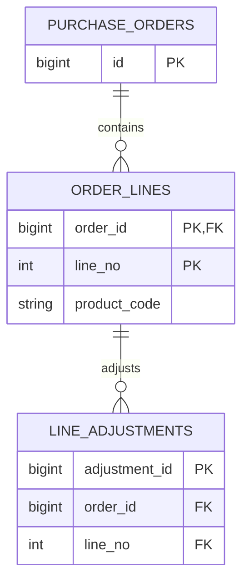

# Khi nào cần khóa chính gồm nhiều thành phần trong JPA?

Trong cơ sở dữ liệu quan hệ, **khóa chính** (*primary key*, PK) xác định duy nhất mỗi hàng của một bảng. Khóa chính có thể chỉ gồm một cột, ví dụ `customers.id`, hoặc gồm **nhiều cột phối hợp**, ví dụ `order_lines(order_id, line_no)`. Trường hợp thứ hai được gọi là **khóa chính ghép**, **khóa chính tổng hợp** hoặc *composite primary key*.

Chọn khóa chính ghép là quyết định **về danh tính của dữ liệu**, không chỉ là lựa chọn cú pháp SQL hay annotation JPA. Khóa ghép phù hợp khi một hàng chỉ có ý nghĩa duy nhất trong phạm vi một đối tượng cha, hoặc bản thân quan hệ nghiệp vụ được định danh bởi sự kết hợp của nhiều thành phần ổn định. Ngược lại, nếu hàng cần một định danh riêng lâu dài, thường được tham chiếu từ nhiều nơi, hoặc thành phần khóa dễ thay đổi, một khóa đơn sinh tự động kèm ràng buộc `UNIQUE` có thể đơn giản hơn.

> Câu hỏi nên đặt trước khi chọn annotation: **“Những thuộc tính nào làm cho đây vẫn là cùng một bản ghi, ngay cả khi những thuộc tính khác thay đổi?”** Nếu câu trả lời bắt buộc phải là một tổ hợp ổn định của nhiều cột, hãy cân nhắc composite PK.

Bài học đặt quyết định này trong ngữ cảnh ORM/JPA: từ quy tắc nghiệp vụ, DDL của database, đến `@EmbeddedId`, `@IdClass`, `@MapsId`, truy vấn và những đánh đổi trong vòng đời entity.

## 1. Khóa chính ghép thực sự là gì?

Giả sử một đơn hàng `order_id = 9001` có ba dòng:

| order_id | line_no | product_code | quantity |
|---:|---:|---|---:|
| 9001 | 1 | KB-01 | 2 |
| 9001 | 2 | MS-02 | 1 |
| 9001 | 3 | HD-03 | 1 |
| 9002 | 1 | KB-01 | 4 |

`line_no = 1` không duy nhất trong toàn bảng, vì mỗi đơn hàng có thể có dòng số 1. `order_id = 9001` cũng không duy nhất vì một đơn hàng có nhiều dòng. Nhưng cặp **`(order_id, line_no)`** xác định chính xác một dòng.

```sql
CREATE TABLE order_lines (
    order_id BIGINT NOT NULL,
    line_no INTEGER NOT NULL,
    product_code VARCHAR(64) NOT NULL,
    quantity INTEGER NOT NULL,
    PRIMARY KEY (order_id, line_no)
);
```

Ở đây:

- `(9001, 1)` và `(9001, 2)` là hai hàng khác nhau.
- `(9001, 1)` và `(9002, 1)` cũng là hai hàng khác nhau.
- Không thể thêm một hàng khác có đúng cặp `(9001, 1)` vì vi phạm PK.
- Trong mô hình SQL chuẩn, mọi thành phần của primary key đều phải khác `NULL`.

Composite PK xác định tính duy nhất **trên cả bộ giá trị**, không bắt buộc từng cột trong bộ là duy nhất.

### Phân biệt khóa chính với khóa ứng viên và ràng buộc duy nhất

Một bảng có thể có nhiều cách xác định duy nhất một hàng:

| Khái niệm | Ý nghĩa |
|---|---|
| **Primary key** | Khóa được chọn làm định danh chính của hàng; một bảng có một khai báo PK, có thể gồm nhiều cột. |
| **Candidate key** | Tập thuộc tính tối thiểu có thể xác định duy nhất hàng về mặt mô hình dữ liệu. |
| **Natural key** | Khóa dựa trên thuộc tính có ý nghĩa nghiệp vụ, như mã quốc gia hoặc `(tenant_id, external_code)`. |
| **Surrogate key** | Khóa kỹ thuật được tạo ra, như `BIGINT IDENTITY` hoặc UUID. |
| **UNIQUE constraint** | Ràng buộc ngăn trùng lặp trên một hoặc nhiều cột, có thể dùng cùng PK khác. |
| **Foreign key** | Cột hoặc nhóm cột tham chiếu một khóa được phép tham chiếu của bảng khác. |

Khóa ghép có thể là khóa tự nhiên hoặc một tổ hợp gồm khóa cha và thành phần cục bộ. **Khóa ghép không đồng nghĩa với khóa tự nhiên**: `(order_id, line_no)` gồm một ID kỹ thuật của cha và thứ tự dòng được đặt trong phạm vi cha.

## 2. Khi nào khóa ghép là lựa chọn hợp lý?

Có một số mô hình thường dẫn đến composite PK tự nhiên.

### 2.1. Định danh chỉ duy nhất trong phạm vi cha

Ví dụ `OrderLine` là dòng thứ 1, thứ 2, thứ 3 **của một đơn hàng**. Nếu nghiệp vụ coi số dòng là một định danh cục bộ ổn định:

```text
Order 9001
├── Line 1  → (9001, 1)
├── Line 2  → (9001, 2)
└── Line 3  → (9001, 3)

Order 9002
└── Line 1  → (9002, 1)
```

Composite PK `(order_id, line_no)` mô tả trực tiếp định danh này. Đối tượng con không cần một ID toàn cục chỉ để phân biệt các dòng trong cùng đơn hàng.

Nhưng phải hỏi thêm: **`line_no` có giữ nguyên khi người dùng đổi thứ tự hiển thị không?** Nếu ứng dụng tự renumber tất cả dòng sau mỗi lần kéo thả, dùng `line_no` làm PK sẽ khiến định danh dễ thay đổi. Khi đó nên có `line_id` bất biến và `display_position` là dữ liệu có thể sửa.

### 2.2. Hàng thể hiện một quan hệ duy nhất giữa hai entity

Một sinh viên chỉ được ghi danh vào một khóa học **một lần**, nhưng cần lưu thêm `enrolled_at` và `status`:

```sql
CREATE TABLE enrollments (
    student_id BIGINT NOT NULL,
    course_id BIGINT NOT NULL,
    enrolled_at TIMESTAMP NOT NULL,
    status VARCHAR(20) NOT NULL,
    PRIMARY KEY (student_id, course_id),
    FOREIGN KEY (student_id) REFERENCES students(id),
    FOREIGN KEY (course_id) REFERENCES courses(id)
);
```

Ở đây cặp `(student_id, course_id)` chính là danh tính của **một lần ghi danh theo quy tắc chỉ một bản ghi cho mỗi cặp**. Đối tượng `Enrollment` có thể là entity riêng để chứa ngày ghi danh, trạng thái và hành vi nghiệp vụ.

Nếu nghiệp vụ cho phép một sinh viên **ghi danh lại nhiều lần** vào cùng khóa học, cặp đó **không còn xác định duy nhất** một lần ghi danh. Cần một thành phần ổn định bổ sung như `attempt_no`, `enrollment_term_id`, hoặc chọn `enrollment_id` riêng và ràng buộc duy nhất phù hợp.

### 2.3. Dữ liệu được định danh trong phạm vi tenant

Trong hệ thống nhiều khách hàng doanh nghiệp (*multi-tenant*), cùng một mã nghiệp vụ có thể lặp lại giữa các tenant:

```text
tenant_id   document_code   title
---------   -------------   ----------------
10          INV-0001        Invoice A
20          INV-0001        Invoice B
10          INV-0002        Invoice C
```

Nếu `document_code` chỉ có ý nghĩa bên trong một tenant, `(tenant_id, document_code)` là một ứng viên cho PK:

```sql
PRIMARY KEY (tenant_id, document_code)
```

Lợi ích là định danh và giới hạn phạm vi tenant được thể hiện ngay trong cấu trúc khóa. Đổi lại, mọi bảng tham chiếu theo khóa đó có thể cần mang cả `tenant_id` và `document_code`.

Một thiết kế khác dùng `document_id` làm PK và:

```sql
UNIQUE (tenant_id, document_code)
```

Vẫn bảo đảm duy nhất theo tenant mà giữ foreign key đơn giản hơn. **Composite PK không tự bảo đảm phân quyền tenant**: ứng dụng/database còn cần kiểm soát truy cập, lọc tenant và thiết kế FK thích hợp.

### 2.4. Bảng liên kết với danh tính theo cặp

Ví dụ `user_roles(user_id, role_id)` hoặc `product_categories(product_id, category_id)`. Nếu mỗi cặp chỉ tồn tại một lần và không có vòng đời riêng đáng kể, composite PK trên hai FK thường rất tự nhiên:

```sql
CREATE TABLE user_roles (
    user_id BIGINT NOT NULL REFERENCES users(id),
    role_id BIGINT NOT NULL REFERENCES roles(id),
    PRIMARY KEY (user_id, role_id)
);
```

Ở JPA, bảng liên kết đơn thuần không có thuộc tính riêng thường có thể được ánh xạ trực tiếp qua `@ManyToMany` và `@JoinTable`, không nhất thiết tạo entity `UserRole`. Nếu cần trạng thái phê duyệt, thời gian cấp quyền, người cấp hoặc một chính sách vòng đời riêng, hãy cân nhắc **association entity** với khóa ghép hoặc khóa đơn tùy quy tắc định danh.

### 2.5. Schema có sẵn đã quy định composite PK

Nhiều hệ thống tích hợp hoặc database lâu đời dùng khóa nhiều cột. Nếu JPA phải làm việc với schema đã có, mapping composite PK giúp phản ánh đúng định danh sẵn có mà không nhất thiết thay đổi database.

Trong tình huống này, đừng thay PK bằng khóa đơn chỉ vì JPA dễ viết hơn: việc thay đổi khóa có thể ảnh hưởng foreign key, truy vấn, dữ liệu lịch sử và hợp đồng tích hợp. Nên đánh giá migration ở cấp hệ thống trước khi quyết định.

## 3. Khi nào không nên dùng khóa ghép?

Không phải cứ có hai cột cần duy nhất là phải đưa cả hai vào PK. Một số dấu hiệu nên cân nhắc **surrogate key kèm UNIQUE constraint**:

- Thành phần nghiệp vụ có thể thay đổi: email, tên đăng nhập, mã sản phẩm có thể được phép đổi, thứ tự dòng có thể được đánh số lại.
- Một bản ghi cần được nhiều bảng và API tham chiếu với định danh ngắn, ổn định, không kéo theo nhiều cột.
- Cần phân biệt **những lần xuất hiện khác nhau** của cùng một cặp, ví dụ nhiều đợt đăng ký học lại hoặc nhiều lần thử thanh toán.
- Khóa tự nhiên gồm chuỗi dài, nhiều trường hoặc các giá trị dễ nhập sai và cần chuẩn hóa.
- Nghiệp vụ chưa xác định rõ tổ hợp nào thật sự là danh tính bất biến.

Ví dụ:

```sql
CREATE TABLE subscriptions (
    id BIGINT GENERATED BY DEFAULT AS IDENTITY PRIMARY KEY,
    tenant_id BIGINT NOT NULL,
    external_code VARCHAR(50) NOT NULL,
    plan_code VARCHAR(30) NOT NULL,
    CONSTRAINT uk_subscriptions_tenant_external
        UNIQUE (tenant_id, external_code)
);
```

`id` là định danh độc lập cho entity. Cặp `(tenant_id, external_code)` vẫn được database bảo vệ khỏi trùng lặp. Sự kết hợp **PK đơn + UNIQUE nhiều cột** là lựa chọn hoàn toàn hợp lệ, thường phù hợp khi khóa nghiệp vụ có thể thay đổi nhưng bản ghi cần tồn tại liên tục.

## 4. Ba phương án cho cùng một nhu cầu

Giả sử mỗi đơn hàng có nhiều dòng và `(order_id, line_no)` không được trùng:

| Phương án | DDL cốt lõi | Khi phù hợp |
|---|---|---|
| **PK ghép** | `PRIMARY KEY (order_id, line_no)` | Cặp khóa là danh tính thật và không đổi. |
| **PK đơn + UNIQUE ghép** | `id PRIMARY KEY, UNIQUE (order_id, line_no)` | Muốn ID độc lập; vẫn cần ngăn hai dòng trùng số trong một đơn hàng. |
| **PK đơn, không UNIQUE ghép** | `id PRIMARY KEY` | Chỉ đúng nếu nghiệp vụ thật sự cho phép nhiều dòng cùng `line_no` trong một đơn. |

Hai phương án đầu thường được cân nhắc trong thực tế. Chúng **không tương đương về danh tính**: một entity có PK `id` vẫn là entity đó khi `line_no` đổi; entity có PK `(order_id, line_no)` coi việc đổi thành phần khóa là đổi danh tính, điều JPA không xem như một thao tác cập nhật entity bình thường.

### Ví dụ thêm cột ID kỹ thuật

```sql
CREATE TABLE order_lines (
    id BIGINT GENERATED BY DEFAULT AS IDENTITY PRIMARY KEY,
    order_id BIGINT NOT NULL,
    line_no INTEGER NOT NULL,
    product_code VARCHAR(64) NOT NULL,
    CONSTRAINT uk_order_lines_order_position UNIQUE (order_id, line_no)
);
```

Trong schema này, `OrderLine` có một `@Id Long id`, còn `orderId`/`lineNo` là các thuộc tính có constraint duy nhất. Nếu `line_no` biểu diễn **vị trí hiển thị** có thể đổi, cách này thường thuận tiện.

## 5. JPA cần biểu diễn tất cả thành phần của ID

Trong JPA, một entity phải có định danh phù hợp. Với khóa gồm nhiều cột, có hai cách ánh xạ chuẩn phổ biến:

1. **`@EmbeddedId`**: đóng gói các thành phần khóa vào một lớp `@Embeddable`; entity có một thuộc tính ID là object đó.
2. **`@IdClass`**: các thành phần khóa được khai báo trực tiếp là những thuộc tính `@Id` trên entity; một class riêng mô tả cấu trúc khóa.

Hai cách đều biểu diễn **cùng một ý nghĩa khóa ghép ở database**, nhưng ảnh hưởng đến cách truy cập ID trong Java/JPQL.

```mermaid
flowchart TD
    A[PK gồm order_id và line_no] --> B{@EmbeddedId}
    A --> C{@IdClass}
    B --> D[Entity có OrderLineId id]
    C --> E[Entity có orderId và lineNo]
    D --> F[Database PRIMARY KEY order_id, line_no]
    E --> F
```

Các ví dụ tiếp theo dùng **Jakarta Persistence** (`jakarta.persistence.*`). Trong dự án cũ, bạn có thể gặp namespace `javax.persistence.*`; cần chọn đúng namespace tương ứng với phiên bản ứng dụng.

## 6. Ví dụ `@EmbeddedId`: dòng đơn hàng

### 6.1. Định nghĩa bảng

```sql
CREATE TABLE purchase_orders (
    id BIGINT PRIMARY KEY,
    order_code VARCHAR(50) NOT NULL
);

CREATE TABLE order_lines (
    order_id BIGINT NOT NULL,
    line_no INTEGER NOT NULL,
    product_code VARCHAR(64) NOT NULL,
    quantity INTEGER NOT NULL,
    unit_price NUMERIC(19, 2) NOT NULL,
    PRIMARY KEY (order_id, line_no),
    FOREIGN KEY (order_id) REFERENCES purchase_orders(id)
);
```

`order_id` đồng thời là **một phần khóa chính** và **khóa ngoại** tới `purchase_orders`. `line_no` phân biệt các dòng bên trong mỗi đơn hàng.

### 6.2. Đóng gói hai thành phần vào `OrderLineId`

```java
import jakarta.persistence.Column;
import jakarta.persistence.Embeddable;
import java.io.Serializable;
import java.util.Objects;

@Embeddable
public class OrderLineId implements Serializable {

    private static final long serialVersionUID = 1L;

    @Column(name = "order_id", nullable = false)
    private Long orderId;

    @Column(name = "line_no", nullable = false)
    private Integer lineNo;

    protected OrderLineId() {
        // JPA cần constructor không tham số.
    }

    public OrderLineId(Long orderId, Integer lineNo) {
        this.orderId = Objects.requireNonNull(orderId);
        this.lineNo = Objects.requireNonNull(lineNo);
    }

    public Long getOrderId() { return orderId; }

    public Integer getLineNo() { return lineNo; }

    @Override
    public boolean equals(Object other) {
        if (this == other) return true;
        if (!(other instanceof OrderLineId that)) return false;
        return Objects.equals(orderId, that.orderId)
            && Objects.equals(lineNo, that.lineNo);
    }

    @Override
    public int hashCode() {
        return Objects.hash(orderId, lineNo);
    }
}
```

Các đặc điểm quan trọng của class khóa:

- Có `@Embeddable` vì nó là **giá trị nhúng** mô tả ID của entity, không phải entity có đời sống riêng.
- Triển khai `Serializable` theo yêu cầu kiểu khóa ghép của JPA.
- Có constructor không tham số và các thành phần có kiểu phù hợp với mapping SQL.
- `equals` và `hashCode` so sánh **mọi thành phần của khóa**. Chỉ so sánh `orderId` sẽ nhầm nhiều dòng của cùng một đơn thành một ID.
- Cố gắng giữ giá trị khóa ổn định. Không cung cấp setter công khai giúp giảm nguy cơ thay đổi khóa trong lúc entity đã được quản lý.

Ví dụ dùng cú pháp `instanceof OrderLineId that` của Java hiện đại. Với Java cũ, có thể dùng `instanceof` rồi ép kiểu.

### 6.3. Entity dùng `@EmbeddedId`

```java
import jakarta.persistence.Column;
import jakarta.persistence.EmbeddedId;
import jakarta.persistence.Entity;
import jakarta.persistence.Table;
import java.math.BigDecimal;

@Entity
@Table(name = "order_lines")
public class OrderLine {

    @EmbeddedId
    private OrderLineId id;

    @Column(name = "product_code", nullable = false, length = 64)
    private String productCode;

    @Column(name = "quantity", nullable = false)
    private int quantity;

    @Column(name = "unit_price", nullable = false, precision = 19, scale = 2)
    private BigDecimal unitPrice;

    protected OrderLine() {}

    public OrderLine(
            OrderLineId id, String productCode, int quantity, BigDecimal unitPrice) {
        this.id = id;
        this.productCode = productCode;
        this.quantity = quantity;
        this.unitPrice = unitPrice;
    }

    public OrderLineId getId() { return id; }

    public void changeQuantity(int newQuantity) {
        if (newQuantity <= 0) {
            throw new IllegalArgumentException("Quantity must be positive");
        }
        this.quantity = newQuantity;
    }
}
```

Đây là entity vì `OrderLine` có một ID persistent (dù ID đó được biểu diễn bằng object `OrderLineId`). Mỗi dòng được quản lý riêng, có thể truy vấn bằng ID, cập nhật thuộc tính và tham gia quan hệ như các entity khác.

### 6.4. Tạo, tìm và cập nhật

```java
@Transactional
public void addLine(EntityManager em) {
    OrderLineId id = new OrderLineId(9001L, 1);
    OrderLine line = new OrderLine(
        id, "KB-01", 2, new BigDecimal("125000.00"));
    em.persist(line);
}
```

Ví dụ trên giả định đơn hàng `id = 9001` đã có trong database và chưa tồn tại dòng `(9001, 1)`. Nếu trùng khóa, database từ chối tại thời điểm thực thi SQL hoặc commit tùy cấu hình.

```java
@Transactional
public void updateLine(EntityManager em) {
    OrderLineId key = new OrderLineId(9001L, 1);
    OrderLine line = em.find(OrderLine.class, key);

    if (line == null) {
        throw new IllegalArgumentException("Order line not found");
    }

    line.changeQuantity(3);
    // Managed entity được đồng bộ khi flush; không phải persist() lại.
}
```

SQL minh họa:

```sql
SELECT order_id, line_no, product_code, quantity, unit_price
FROM order_lines
WHERE order_id = 9001 AND line_no = 1;

UPDATE order_lines
SET quantity = 3
WHERE order_id = 9001 AND line_no = 1;
```

Provider có thể thêm alias, tham số bind và những cột khác tùy chiến lược update. Bản chất vẫn là **điều kiện định danh chứa cả hai thành phần**.

### 6.5. JPQL và Spring Data JPA dùng ID nhúng

Với `@EmbeddedId`, đường dẫn thuộc tính đi **qua object `id`**:

```java
List<OrderLine> lines = em.createQuery(
    "select l from OrderLine l where l.id.orderId = :orderId",
    OrderLine.class
)
.setParameter("orderId", 9001L)
.getResultList();
```

Một repository Spring Data JPA có thể định nghĩa:

```java
public interface OrderLineRepository
        extends JpaRepository<OrderLine, OrderLineId> {

    List<OrderLine> findByIdOrderId(Long orderId);
}
```

Các method nhận ID đầy đủ:

```java
OrderLineId id = new OrderLineId(9001L, 1);
Optional<OrderLine> line = repository.findById(id);
```

Để dùng Spring Data ở đoạn trên, cần dependency Spring Data JPA và import `JpaRepository`, `List`, `Optional` tương ứng. Tên phương thức truy vấn dẫn xuất `findByIdOrderId` giả định thuộc tính trên entity là `id`, còn thành phần bên trong là `orderId`.

## 7. Ví dụ `@IdClass`: cùng khóa, cách biểu diễn khác

`@IdClass` cho phép đặt các thuộc tính khóa trực tiếp trên entity. Đây là **phương án thay thế** cho mapping `OrderLine` bằng `@EmbeddedId` ở phần trên, không phải cấu hình nên đặt đồng thời trên cùng entity.

### 7.1. Class mô tả ID

```java
import java.io.Serializable;
import java.util.Objects;

public class OrderLineKey implements Serializable {
    private static final long serialVersionUID = 1L;

    private Long orderId;
    private Integer lineNo;

    public OrderLineKey() {}

    public OrderLineKey(Long orderId, Integer lineNo) {
        this.orderId = orderId;
        this.lineNo = lineNo;
    }

    @Override
    public boolean equals(Object other) {
        if (this == other) return true;
        if (!(other instanceof OrderLineKey that)) return false;
        return Objects.equals(orderId, that.orderId)
            && Objects.equals(lineNo, that.lineNo);
    }

    @Override
    public int hashCode() {
        return Objects.hash(orderId, lineNo);
    }
}
```

### 7.2. Entity khai báo từng thành phần `@Id`

```java
import jakarta.persistence.*;
import java.math.BigDecimal;

@Entity
@Table(name = "order_lines")
@IdClass(OrderLineKey.class)
public class OrderLineWithIdClass {

    @Id
    @Column(name = "order_id")
    private Long orderId;

    @Id
    @Column(name = "line_no")
    private Integer lineNo;

    @Column(name = "product_code", nullable = false, length = 64)
    private String productCode;

    @Column(name = "quantity", nullable = false)
    private int quantity;

    @Column(name = "unit_price", nullable = false, precision = 19, scale = 2)
    private BigDecimal unitPrice;

    protected OrderLineWithIdClass() {}
}
```

Với trường hợp các thành phần khóa là thuộc tính cơ bản:

- Tên thuộc tính `orderId`, `lineNo` trong `OrderLineKey` phải **tương ứng với tên thuộc tính `@Id` trên entity**.
- Kiểu dữ liệu của các thành phần ID phải tương ứng với entity theo quy tắc JPA.
- `@IdClass` chỉ định class mô tả khóa, bản thân nó không cần `@Entity` hay `@Embeddable`.
- Class ID cần khả năng khởi tạo, serializable và equality/hash phù hợp.

Khi entity dùng quan hệ `@Id @ManyToOne` làm thành phần khóa, quy tắc kiểu thuộc tính trong ID class có các trường hợp đặc biệt về loại ID của entity được tham chiếu; không đơn giản lấy luôn Java type của quan hệ. Vì vậy ví dụ sử dụng scalar IDs trước để làm rõ nguyên lý.

### 7.3. Cách truy vấn với `@IdClass`

Khác `@EmbeddedId`, JPQL truy cập khóa **ngay trên entity**:

```java
List<OrderLineWithIdClass> lines = em.createQuery(
    "select l from OrderLineWithIdClass l where l.orderId = :orderId",
    OrderLineWithIdClass.class
)
.setParameter("orderId", 9001L)
.getResultList();
```

Khi tìm bằng ID đầy đủ:

```java
OrderLineWithIdClass line = em.find(
    OrderLineWithIdClass.class,
    new OrderLineKey(9001L, 1)
);
```

Như vậy `@EmbeddedId` và `@IdClass` có thể ánh xạ cùng cặp cột `(order_id, line_no)`, nhưng cấu trúc Java khác nhau. Trong một ứng dụng thực tế, hãy chọn một phương án nhất quán cho entity, không đăng ký đồng thời hai entity writable khác nhau để quản lý cùng bảng nếu không có nhu cầu và cơ chế kiểm soát rõ ràng.

## 8. Nên chọn `@EmbeddedId` hay `@IdClass`?

| Tiêu chí | `@EmbeddedId` | `@IdClass` |
|---|---|---|
| Tổ chức mã | Có một thuộc tính ID object trong entity | Các field `@Id` nằm trực tiếp trên entity |
| Truy cập Java | `line.getId().getOrderId()` | `line.getOrderId()` |
| Đường dẫn JPQL | `line.id.orderId` | `line.orderId` |
| Giá trị ID dùng qua API | Một object thể hiện toàn bộ khóa | Vẫn có ID class để gọi `find`, nhưng entity lộ các field riêng |
| Tính cô đọng của domain | Hợp khi cặp khóa có ý nghĩa như một value object | Hợp khi muốn truy cập các phần khóa trực tiếp |
| Ánh xạ khóa ngoại tham gia PK | Dễ thể hiện với `@MapsId` | Có thể dùng derived identity, nhưng cần tuân thủ quy tắc `@IdClass` đối với quan hệ |

Không có phương án nào mặc định hiệu quả SQL hơn chỉ nhờ annotation. Hiệu năng chủ yếu phụ thuộc index, query, schema, số lượng join, provider và đặc điểm dữ liệu. Chọn phương án dựa trên mức rõ ràng của mô hình và khả năng bảo trì.

## 9. `@MapsId`: khi một phần khóa là ID của entity cha

Trong nhiều composite PK, một thành phần chính là foreign key của quan hệ. Chẳng hạn `order_lines.order_id` vừa là một phần PK, vừa tham chiếu `purchase_orders.id`.

Nếu entity vừa khai:

```java
@EmbeddedId
private OrderLineId id;
```

vừa muốn truy cập trực tiếp `PurchaseOrder`:

```java
@ManyToOne(fetch = FetchType.LAZY)
private PurchaseOrder order;
```

thì cần diễn đạt rõ **cột `order_id` vừa nằm trong ID object vừa do quan hệ sử dụng**, tránh hai mapping cùng cố ghi một cột. `@MapsId` là cơ chế JPA chuẩn để khai báo **derived identity** (danh tính dẫn xuất từ entity cha).

### 9.1. Mapping minh họa với `@MapsId("orderId")`

Định nghĩa class cha tối thiểu:

```java
@Entity
@Table(name = "purchase_orders")
public class PurchaseOrder {
    @Id
    private Long id;

    @Column(name = "order_code", nullable = false)
    private String orderCode;

    protected PurchaseOrder() {}

    public Long getId() { return id; }
}
```

Khi đó, phiên bản `OrderLine` có quan hệ:

```java
@Entity
@Table(name = "order_lines")
public class OrderLine {

    @EmbeddedId
    private OrderLineId id;

    @MapsId("orderId")
    @ManyToOne(fetch = FetchType.LAZY, optional = false)
    @JoinColumn(name = "order_id", nullable = false)
    private PurchaseOrder order;

    @Column(name = "product_code", nullable = false)
    private String productCode;

    @Column(name = "quantity", nullable = false)
    private int quantity;

    @Column(name = "unit_price", nullable = false, precision = 19, scale = 2)
    private java.math.BigDecimal unitPrice;

    protected OrderLine() {}

    public OrderLine(
            PurchaseOrder order, Integer lineNo, String productCode,
            java.math.BigDecimal unitPrice) {
        this.order = order;
        this.id = new OrderLineId(order.getId(), lineNo);
        this.productCode = productCode;
        this.quantity = 1;
        this.unitPrice = unitPrice;
    }
}
```

Đây là **biến thể thay thế** cho class `OrderLine` ở phần 6. Khi trình bày cùng tài liệu, các class trùng tên là ví dụ thiết kế độc lập; không đặt cả hai phiên bản vào cùng một package và biên dịch đồng thời.

Đoạn constructor trên giả định `PurchaseOrder` cung cấp `getId()` và đã có ID. Với ID cha được database sinh, thứ tự persist/flush hoặc cách provider xử lý `@MapsId` cần phù hợp; không được tự suy ra ID đã có trước khi insert cha.

`@MapsId("orderId")` cho provider biết thuộc tính `orderId` trong `OrderLineId` lấy danh tính từ quan hệ `order`. Nhờ vậy, mô hình không cần hai nguồn ghi độc lập mâu thuẫn nhau cho cột `order_id`. Entity cha phải tồn tại hoặc được persist thích hợp trước khi quan hệ FK có thể được ghi hợp lệ.

### 9.2. `@MapsId` trên bảng liên kết `Enrollment`

Đối với bảng `enrollments(student_id, course_id)`, giả sử đã có entity `Student` và `Course` với `@Id Long id`. Class ID:

```java
@Embeddable
public class EnrollmentId implements Serializable {
    @Column(name = "student_id")
    private Long studentId;

    @Column(name = "course_id")
    private Long courseId;

    protected EnrollmentId() {}

    public EnrollmentId(Long studentId, Long courseId) {
        this.studentId = studentId;
        this.courseId = courseId;
    }

    @Override
    public boolean equals(Object other) {
        if (this == other) return true;
        if (!(other instanceof EnrollmentId that)) return false;
        return Objects.equals(studentId, that.studentId)
            && Objects.equals(courseId, that.courseId);
    }

    @Override
    public int hashCode() {
        return Objects.hash(studentId, courseId);
    }
}
```

Mapping entity liên kết:

```java
@Entity
@Table(name = "enrollments")
public class Enrollment {

    @EmbeddedId
    private EnrollmentId id;

    @MapsId("studentId")
    @ManyToOne(fetch = FetchType.LAZY, optional = false)
    @JoinColumn(name = "student_id", nullable = false)
    private Student student;

    @MapsId("courseId")
    @ManyToOne(fetch = FetchType.LAZY, optional = false)
    @JoinColumn(name = "course_id", nullable = false)
    private Course course;

    @Column(name = "enrolled_at", nullable = false)
    private java.time.Instant enrolledAt;

    @Column(name = "status", nullable = false, length = 20)
    private String status;

    protected Enrollment() {}

    public Enrollment(Student student, Course course) {
        this.student = student;
        this.course = course;
        this.id = new EnrollmentId(student.getId(), course.getId());
        this.enrolledAt = java.time.Instant.now();
        this.status = "ACTIVE";
    }
}
```

Ví dụ `Enrollment` giả định `Student`/`Course` đã có ID và có getter `getId()`. Các import `jakarta.persistence.*`, `Serializable`, `Objects` được lược bỏ trong hai đoạn code để tập trung vào mapping.

Điểm cốt lõi:

- Mỗi cặp `(student_id, course_id)` xác định một entity `Enrollment` duy nhất.
- Cả hai quan hệ tham gia PK thông qua `@MapsId`.
- Không cần tạo `enrollment_id` nếu cặp này thực sự là danh tính nghiệp vụ ổn định.
- Nếu sau này cho phép ghi danh lại nhiều đợt, phải thay đổi quy tắc khóa hoặc tạo bản ghi chu kỳ đăng ký có danh tính riêng.

### Khi nào chỉ cần `@ManyToMany`?

Nếu bảng chỉ chứa cặp FK và không có trạng thái hay nghiệp vụ riêng, `@ManyToMany` với `@JoinTable` có thể đủ để quản lý quan hệ. Khi cần `enrolledAt`, `status`, người duyệt, quyền sửa riêng từng mối quan hệ hoặc quy trình đăng ký, entity liên kết như `Enrollment` rõ nghĩa hơn. Không bắt buộc mọi bảng many-to-many có composite PK phải trở thành entity JPA riêng.

## 10. Tính ổn định của khóa: điều kiện quan trọng nhất

Một nguyên tắc thiết kế khóa chính là **danh tính nên ổn định trong suốt vòng đời hàng**. Thay đổi các cột không thuộc khóa là bình thường; thay đổi PK là thay đổi cách nhận diện hàng và có thể kéo theo nhiều vấn đề.

Ví dụ:

```text
OrderLineId(orderId=9001, lineNo=1)
```

Nếu ứng dụng đổi `lineNo` thành 2, đây không chỉ là cập nhật vị trí. Nó làm thay đổi định danh từ `(9001, 1)` sang `(9001, 2)`, có thể đụng khóa một dòng đã tồn tại và cần cập nhật mọi foreign key tham chiếu.

Trong JPA, **không nên sửa trực tiếp giá trị khóa của managed entity**:

```java
OrderLine line = em.find(
    OrderLine.class, new OrderLineId(9001L, 1));

// Tránh thay thành phần khóa bên trong line.getId().
// Nếu cần thay đổi nghiệp vụ, hãy thiết kế lại danh tính hoặc tạo entity khác.
```

Nếu thứ tự dòng có thể đổi, hãy tách:

```sql
id BIGINT PRIMARY KEY,
order_id BIGINT NOT NULL,
display_position INTEGER NOT NULL
```

và tạo `UNIQUE(order_id, display_position)` nếu mỗi vị trí chỉ dành cho một dòng tại cùng thời điểm. Tránh thiết kế một composite PK dựa trên **thuộc tính không ổn định** chỉ vì cặp đó đang duy nhất ở thời điểm hiện tại.

### Có nên dùng timestamp trong composite PK?

Một số bảng log dùng `(device_id, recorded_at)` làm PK. Điều đó chỉ đúng nếu hệ thống bảo đảm **mỗi thiết bị có tối đa một bản ghi tại mỗi mốc thời gian theo độ chính xác lưu trữ**.

Nếu có thể có hai phép đo cùng timestamp, retry cùng thời điểm hoặc đồng hồ có độ phân giải thấp, cặp đó chưa đủ duy nhất. Có thể thêm `sequence_no`, event ID hoặc một khóa sinh riêng. Thời gian thường còn gặp biến đổi timezone, precision và quy tắc làm tròn; cần định nghĩa rõ định danh trước khi biến timestamp thành một phần PK.

## 11. `NULL`, uniqueness và loại dữ liệu của các thành phần

Mọi cột tham gia primary key phải có giá trị, về nguyên tắc không cho phép `NULL`:

```sql
PRIMARY KEY (tenant_id, business_code)
```

`tenant_id` và `business_code` đều phải có giá trị hợp lệ. Với `@EmbeddedId`, object khóa không nên có thành phần bị bỏ trống khi persist. Việc JPA có phát hiện lỗi trước khi gửi SQL hay không tùy provider, nhưng constraint database là tuyến bảo vệ cuối cùng.

Một số thói quen cần cân nhắc khi chọn thành phần khóa:

- Ưu tiên kiểu giá trị **nhỏ, ổn định, dễ so sánh**, ví dụ `BIGINT`, mã ngắn không thay đổi hoặc một số thứ tự ổn định trong phạm vi cha.
- Tránh chuỗi tên người dùng, email không được chuẩn hóa hoặc text dài làm khóa khi có thể thay đổi.
- Với khóa chuỗi, lưu ý collation, phân biệt chữ hoa/thường, Unicode normalization và khoảng trắng; hai giá trị Java có thể khác nhau nhưng database so sánh là trùng, hoặc ngược lại.
- Với decimal, chú ý scale và chuẩn hóa giá trị; nếu `BigDecimal` dùng làm thành phần khóa, `equals` trong Java có thể phân biệt `1.0` và `1.00` trong khi phép so sánh số ở database coi bằng nhau.
- Không dùng field mutable làm thành phần `hashCode` rồi tiếp tục sửa object khóa khi đang được sử dụng trong `HashMap`, `HashSet` hoặc persistence context.

Composite PK `(tenant_id, code)` có thể rất hợp lý nếu `code` thật sự là một mã bất biến, được chuẩn hóa và duy nhất trong tenant. Nếu không có bảo đảm đó, `id` kỹ thuật kèm `UNIQUE(tenant_id, code)` thường giảm rủi ro.

## 12. Ảnh hưởng tới quan hệ và khóa ngoại

Nếu `OrderLine` có PK `(order_id, line_no)` và một bảng khác cần tham chiếu **một dòng cụ thể**, foreign key thường phải chứa **đủ cả hai thành phần**:

```sql
CREATE TABLE line_adjustments (
    adjustment_id BIGINT PRIMARY KEY,
    order_id BIGINT NOT NULL,
    line_no INTEGER NOT NULL,
    reason VARCHAR(200) NOT NULL,
    FOREIGN KEY (order_id, line_no)
        REFERENCES order_lines(order_id, line_no)
);
```

Chỉ lưu `line_no` không đủ vì có nhiều đơn hàng cùng dòng số 1. Chỉ lưu `order_id` cũng không xác định được dòng cụ thể.



Nếu nhiều bảng tham chiếu `OrderLine`, hai cột khóa sẽ lặp lại ở các bảng con. Với PK đơn `order_line_id`, FK đến dòng chỉ cần một cột. Độ rộng và tính lan truyền của composite PK là một yếu tố khi chọn thiết kế.

### `@JoinColumns` khi liên kết tới khóa ghép

Ví dụ `LineAdjustment` có khóa riêng và quan hệ tới `OrderLine`:

```java
@Entity
@Table(name = "line_adjustments")
public class LineAdjustment {
    @Id
    @Column(name = "adjustment_id")
    private Long id;

    @ManyToOne(fetch = FetchType.LAZY, optional = false)
    @JoinColumns({
        @JoinColumn(
            name = "order_id",
            referencedColumnName = "order_id",
            nullable = false
        ),
        @JoinColumn(
            name = "line_no",
            referencedColumnName = "line_no",
            nullable = false
        )
    })
    private OrderLine orderLine;

    @Column(name = "reason", nullable = false)
    private String reason;
}
```

Ví dụ cần import `jakarta.persistence.*`; class `OrderLine` là phiên bản `@EmbeddedId` trình bày ở phần 6. `@JoinColumns` liệt kê cả hai cột FK, còn `referencedColumnName` trỏ đến tên cột đích, không phải tên thuộc tính Java trong `OrderLineId`.

Không nhất thiết mọi association đến entity có composite PK đều cần viết `@JoinColumns` tường minh nếu provider có thể suy ra theo quy tắc mặc định, nhưng khai báo rõ giúp tránh nhầm tên cột trong schema phức tạp.

## 13. Index và đặc điểm truy vấn: thứ tự cột có ảnh hưởng

Primary key trong nhiều database thường được hỗ trợ bằng một index duy nhất. Composite index có **thứ tự cột**, ví dụ:

```sql
PRIMARY KEY (order_id, line_no)
```

Với nhiều cơ chế B-tree thông dụng, index này rất hữu ích cho:

```sql
WHERE order_id = ?
```

và:

```sql
WHERE order_id = ? AND line_no = ?
```

nhưng không nhất thiết tối ưu như một index `(line_no, ...)` khi truy vấn **chỉ** lọc:

```sql
WHERE line_no = ?
```

Đây thường được gọi là nguyên tắc **leftmost prefix** trong việc tận dụng index nhiều cột; mức độ áp dụng và kế hoạch thực thi phụ thuộc database, thống kê và optimizer. Vì vậy nên chọn thứ tự cột theo quy tắc FK, phân bố dữ liệu và mẫu truy vấn thực tế.

Một số điều cần đánh giá:

| Vấn đề | Composite PK | PK đơn + UNIQUE ghép |
|---|---|---|
| Index chính | Gồm nhiều cột | Thường gồm một cột |
| Bảo đảm `(order_id, line_no)` duy nhất | Do PK | Do UNIQUE riêng |
| FK từ bảng con | Có thể cần nhiều cột | Có thể chỉ tham chiếu `id` |
| Truy vấn tất cả dòng của một order | Có thể tận dụng index PK bắt đầu bằng `order_id` | Thường cần index `order_id` hoặc UNIQUE composite tương ứng |
| Chi phí lưu trữ | PK nhiều cột, có thể giảm nhu cầu ID riêng | Có thêm cột ID và thường thêm index UNIQUE |
| Tính linh hoạt đổi `line_no` | Không nên đổi PK | `line_no` có thể cập nhật nhưng vẫn chịu UNIQUE |

Không thể tuyên bố composite PK luôn dùng ít bộ nhớ hoặc luôn nhanh hơn: kết quả phụ thuộc kích thước cột, số index phụ, kiểu lưu index của hệ quản trị, số foreign key và workload. Ví dụ một số engine đưa khóa chính vào cấu trúc index phụ, khiến **khóa chính rộng** có tác động lan truyền lớn hơn. Cần đo trên database thực tế khi hiệu năng là yếu tố quyết định.

## 14. Tác động tới API, DTO và repository

Với PK đơn:

```text
GET /order-lines/78231
```

Với PK ghép:

```text
GET /orders/9001/lines/2
```

Đường dẫn thứ hai phản ánh rõ “dòng số 2 thuộc đơn hàng 9001”, rất phù hợp khi danh tính cục bộ theo cha. Một API khác có thể dùng query parameters:

```text
GET /order-lines?orderId=9001&lineNo=2
```

Nhưng cách trình bày API **không bắt buộc** phải giống PK database. Hệ thống có thể dùng ID kỹ thuật ở persistence và vẫn công khai `/orders/{orderId}/lines/{lineNo}` nếu kiểm soát uniqueness và quyền truy cập phù hợp.

Nếu chọn composite PK, cần xác định cách đi qua các tầng:

```java
public record OrderLineKeyDto(Long orderId, Integer lineNo) {}
```

DTO có thể làm rõ payload; không cần truyền trực tiếp entity ID class qua mọi ranh giới dịch vụ. Repository nhận ID object, query DTO/mapper cần xử lý cả hai thành phần, và cache key hoặc message/event identifier phải nhất quán.

Trong đa tenant, luôn kết hợp việc kiểm tra tenant từ ngữ cảnh bảo mật với truy vấn, không đơn thuần tin `tenantId` lấy từ URL/client. Một composite PK có tenant ID giúp biểu diễn phạm vi dữ liệu nhưng không thay thế authorization.

## 15. Vòng đời entity và kỹ thuật `equals`/`hashCode`

`@EmbeddedId` thường khiến object ID trở thành một **value object ổn định**. Để tránh lỗi:

1. Chỉ xây dựng ID khi đã biết những thành phần cần thiết.
2. Không đổi thành phần ID sau khi persist hoặc khi entity đã managed.
3. Cài `equals`/`hashCode` dựa trên đầy đủ thành phần khóa và đúng ngữ nghĩa kiểu dữ liệu.
4. Tránh so sánh entity chỉ theo những field có thể thay đổi như tên, trạng thái, số lượng.

Một ID sai `equals` có thể gây lỗi khó tìm ngay trong Java collection:

```java
Set<OrderLineId> keys = new HashSet<>();
keys.add(new OrderLineId(9001L, 1));
keys.add(new OrderLineId(9001L, 2));

System.out.println(keys.size()); // 2
```

Nếu `equals` chỉ so sánh `orderId`, đoạn trên có thể trả `1`, làm hai dòng khác nhau bị xem nhầm thành một ID.

JPA có thể sử dụng identity map trong persistence context để duy trì một managed instance cho cùng entity type và composite ID. Khi query/entity được tải ở những persistence context khác nhau, không nên dựa vào `==` để xác nhận danh tính nghiệp vụ. Với `equals`/`hashCode` của **chính entity**, còn có các vấn đề proxy và trạng thái ID trước khi persist; hãy thiết kế nhất quán với chiến lược định danh đã chọn.

## 16. Khóa ghép, concurrency và version

Composite PK bảo đảm không có hai hàng **cùng bộ khóa** trong bảng; nó không tự ngăn mọi xung đột khi hai transaction sửa **cùng một hàng**.

Ví dụ hai request cùng đọc `OrderLine(9001, 1)` và đổi quantity từ 2 thành 3 hoặc 4. Nếu cần phát hiện cập nhật đồng thời, có thể thêm `@Version` ở **entity**:

```java
@Version
@Column(name = "version", nullable = false)
private Long version;
```

Với database:

```sql
ALTER TABLE order_lines
ADD COLUMN version BIGINT NOT NULL DEFAULT 0;
```

Provider có thể thực thi update với cả điều kiện ID và version:

```sql
UPDATE order_lines
SET quantity = ?, version = ?
WHERE order_id = ?
  AND line_no = ?
  AND version = ?;
```

Khi số hàng cập nhật không như mong đợi vì version bị thay đổi, provider có thể phát hiện optimistic locking conflict. **`@Version` không phải thành phần PK** trong ví dụ; nó được tăng khi cập nhật theo cơ chế của provider, trong khi ID giữ ổn định.

Với nghiệp vụ ghi đồng thời, còn cần xem transaction isolation, ràng buộc duy nhất, khóa ngoại và chính sách retry. Ràng buộc `PRIMARY KEY(order_id, line_no)` giúp tránh hai lần tạo cùng dòng, nhưng việc kiểm tra “chưa có dòng” bằng một câu `SELECT` trước insert không loại bỏ được race condition; database constraint mới xử lý trường hợp tranh chấp cuối cùng.

## 17. Composite PK và khóa sinh tự động

Với entity dùng khóa đơn, các annotation như `@GeneratedValue(strategy = GenerationType.IDENTITY)` hoặc `SEQUENCE` thường được dùng để cấp ID. Composite PK có nhiều thành phần nên **không nên kỳ vọng `@GeneratedValue` sẽ tự cấp toàn bộ bộ khóa theo cách phổ quát**.

Ví dụ `OrderLineId(orderId, lineNo)`:

- `orderId` thường lấy từ đơn hàng cha.
- `lineNo` có thể được sinh bằng quy tắc nghiệp vụ cục bộ.
- Cần bảo đảm hai request tạo dòng đồng thời không cấp trùng `lineNo`, ví dụ bằng khóa, sequence/counter được đồng bộ, hoặc ràng buộc PK và cơ chế retry phù hợp.

Lấy `MAX(line_no) + 1` rồi insert thường **không an toàn khi có nhiều request đồng thời** nếu không có cơ chế serialization/locking thích hợp. Hai transaction có thể cùng đọc cùng `MAX` rồi chọn một số mới giống nhau.

Nếu bài toán cấp `lineNo` phức tạp, hoặc cần tạo dòng độc lập trước khi biết order, một `line_id` kỹ thuật có thể đơn giản hơn; `line_no` chỉ dùng để hiển thị hoặc làm khóa duy nhất theo phạm vi đơn hàng.

### Sự khác biệt với `@EmbeddedId` có `@MapsId`

`@MapsId` giúp một thành phần ID lấy từ quan hệ cha; nó **không đồng nghĩa** với hệ thống cấp tự động tất cả những thành phần còn lại. `lineNo`, `attemptNo` hoặc `termCode` vẫn cần được xác định bởi logic phù hợp trước khi ghi entity.

## 18. Thay đổi schema và migration

Một khi composite PK đã được các bảng con tham chiếu, thay đổi số thành phần khóa hoặc kiểu dữ liệu của chúng là công việc có phạm vi rộng.

Ví dụ hệ thống ban đầu dùng:

```sql
PRIMARY KEY (student_id, course_id)
```

Sau đó cho phép sinh viên học lại cùng khóa học nhiều lần. Cặp trên không còn duy nhất; có ít nhất hai hướng:

**Hướng A – mở rộng danh tính nghiệp vụ**:

```sql
PRIMARY KEY (student_id, course_id, attempt_no)
```

Hướng này hợp lý nếu `attempt_no` ổn định và mọi hệ thống liên quan chấp nhận định danh gồm ba phần.

**Hướng B – thêm ID kỹ thuật**:

```sql
enrollment_id BIGINT PRIMARY KEY
```

và:

```sql
UNIQUE (student_id, course_id, attempt_no)
```

Hướng này thuận tiện khi một lần ghi danh cần được tham chiếu độc lập bằng ID.

Khi migration thực tế, cần lần theo thứ tự hợp lệ:

1. Xác định nghiệp vụ mới và cách nhận diện dữ liệu đã tồn tại.
2. Kiểm tra các hàng cũ, trùng lặp và dữ liệu `NULL` liên quan.
3. Tạo hoặc mở rộng cột khóa, unique constraint và index thích hợp.
4. Cập nhật mọi foreign key, bảng liên kết, stored procedure, query và giao diện tích hợp có dùng khóa cũ.
5. Cập nhật JPA mapping, ID class, repository, service, DTO và các luồng cache/event liên quan.
6. Triển khai migration theo thứ tự tương thích nếu nhiều phiên bản ứng dụng cùng truy cập database trong giai đoạn chuyển đổi.

Việc đổi annotation từ `@EmbeddedId` sang `@Id Long id` **không tự biến database hiện có sang schema mới**. Trong môi trường sản xuất, nên quản lý DDL bằng migration có kiểm soát (chẳng hạn Flyway/Liquibase) và kiểm tra tất cả FK liên quan.

## 19. Những sai lầm thường gặp

| Hiện tượng | Nguyên nhân | Hướng xử lý |
|---|---|---|
| `find` không tìm ra hàng dù có dữ liệu | ID object thiếu/sai một thành phần, hoặc khác kiểu/chưa chuẩn hóa | Kiểm tra toàn bộ giá trị ID và mapping `@Column`. |
| Hai khóa khác nhau bị xem như một trong `Set` | `equals`/`hashCode` của ID class bỏ sót thành phần | So sánh đầy đủ tất cả thành phần khóa. |
| Provider báo sai mapping `@IdClass` | Tên hoặc kiểu thuộc tính ID class không tương ứng entity | Đồng bộ tên/type và quy tắc derived identity. |
| Provider báo cột lặp trong mapping | `@EmbeddedId` và `@ManyToOne` cùng ghi cột FK | Dùng `@MapsId` hoặc mapping chỉ đọc có chủ ý. |
| Gọi `persist` nhưng trùng PK | Nhiều request tạo cùng bộ giá trị khóa | Để database bảo vệ và thiết kế policy xử lý trùng phù hợp. |
| Cố thay `lineNo` của managed entity | Thành phần PK bị dùng làm thứ tự hiển thị mutable | Tách cột vị trí khỏi khóa định danh hoặc dùng ID đơn. |
| FK không thể tham chiếu dòng cụ thể | Bảng con chỉ chứa một phần của composite PK | Lưu đủ cột FK và khai báo `@JoinColumns`. |
| Query JPQL không tìm thấy `orderId` | Dùng đường dẫn `l.orderId` với `@EmbeddedId` | Truy cập `l.id.orderId`. |
| Repository `findById` nhận sai kiểu | Repository khai ID type `Long` thay vì `OrderLineId` | Khai `JpaRepository<OrderLine, OrderLineId>`. |
| Sửa email/code kéo theo xung đột danh tính | Dùng khóa tự nhiên có thể đổi làm một phần PK | Cân nhắc surrogate PK và UNIQUE trên khóa nghiệp vụ. |
| Tạo quá nhiều index tương tự | Có PK composite và lại tạo index trùng lặp hoàn toàn | Xem index đang có và kế hoạch truy vấn của database. |
| Nghiệp vụ cho phép lặp lại quan hệ nhưng PK không cho | `(student_id, course_id)` không còn định danh mỗi enrollment | Thêm thành phần ổn định hoặc cấp `enrollment_id`. |

## 20. Bài tập thiết kế: chọn composite PK hay surrogate PK?

### Tình huống A – Dòng sản phẩm trong giỏ hàng

Mỗi giỏ có tối đa một dòng cho cùng một sản phẩm. Yêu cầu: thay số lượng, không cần tạo thêm dòng khác với cùng sản phẩm.

Một lựa chọn:

```sql
PRIMARY KEY (cart_id, product_id)
```

Cặp khóa mô tả “sản phẩm này trong giỏ này”. Nếu ứng dụng cho phép nhiều cấu hình sản phẩm, cùng một sản phẩm có thể xuất hiện nhiều dòng và cặp này không còn đủ. Khi đó thêm `variant_id` hoặc dùng `cart_line_id` tùy cách nhận diện mỗi dòng.

### Tình huống B – Lịch sử trạng thái đơn hàng

Mỗi lần thay đổi trạng thái sinh một event. Có thể có nhiều event trong một giây và event được tham chiếu từ hệ thống khác.

Một `event_id` riêng thường phù hợp hơn `(order_id, happened_at)`, trừ khi có cơ chế bảo đảm thời gian luôn duy nhất và bất biến trong phạm vi order. `happened_at` thường chỉ là thuộc tính mô tả thời điểm sự kiện.

### Tình huống C – Quyền của user trong workspace

Mỗi `(workspace_id, user_id)` có đúng một bản ghi membership với `role`, `joined_at`.

Composite PK `(workspace_id, user_id)` là lựa chọn hợp lý nếu membership chỉ cần một lần tồn tại cho mỗi cặp. Nếu cần lịch sử ra/vào workspace thành nhiều bản ghi, hãy phân biệt current membership với membership events hoặc cấp ID cho mỗi lần tham gia.

### Tình huống D – Mã hóa đơn theo tenant

Mỗi tenant có mã hóa đơn `INV-001`, `INV-002`, mã không đổi sau khi phát hành. Cặp `(tenant_id, invoice_code)` là khóa ghép có ý nghĩa. Nếu hóa đơn cần UUID toàn cục để liên kết với đối tác, có thể dùng UUID làm PK và `UNIQUE(tenant_id, invoice_code)`; cả hai bảo vệ phạm vi duy nhất theo tenant nếu schema ràng buộc đúng.

### Tình huống E – Quan hệ follower giữa người dùng

Với quy tắc một người có thể follow một người khác tối đa một lần:

```sql
PRIMARY KEY (follower_id, followee_id)
```

là lựa chọn tự nhiên cho bảng quan hệ hiện tại. Nếu cần ghi nhiều lần follow/unfollow theo thời gian, thông tin lịch sử nên có danh tính/sequence riêng, thay vì dùng cùng cặp làm PK cho mọi sự kiện.

## 21. Quy trình ra quyết định trước khi khai báo khóa

Có thể mô tả quyết định ở mức dữ liệu như sau:

```mermaid
flowchart TD
    A[Thiết kế một bảng/entity] --> B{Một cột ổn định đã định danh duy nhất chưa?}
    B -->|Có| C[Ưu tiên PK một cột]
    B -->|Chưa| D{Có tổ hợp nhiều cột tối thiểu và ổn định?}
    D -->|Không| E[Thêm surrogate PK và ràng buộc nghiệp vụ cần thiết]
    D -->|Có| F{Tổ hợp này là danh tính lâu dài của entity?}
    F -->|Không, dễ thay đổi| E
    F -->|Có| G{Nhiều nơi cần tham chiếu bằng khóa ngắn?}
    G -->|Có, ảnh hưởng đáng kể| H[Cân nhắc surrogate PK + UNIQUE tổ hợp]
    G -->|Không hoặc phạm vi cục bộ| I[Cân nhắc composite PK]
    I --> J[@EmbeddedId hoặc @IdClass trong JPA]
    H --> K[@Id đơn + @Table uniqueConstraints]
    E --> K
```

Áp dụng những câu hỏi này:

1. **Tính duy nhất có thật không?** Kiểm chứng bằng quy tắc nghiệp vụ, bao gồm cả các tình huống tương lai như đăng ký lại, tạo phiên bản và retry.
2. **Tính ổn định có thật không?** Nếu mã, vị trí, trạng thái hoặc thời gian có thể đổi, đừng dùng chúng làm danh tính mà không đánh giá rủi ro.
3. **Phạm vi là gì?** Khóa có duy nhất toàn hệ thống, theo tenant, theo order hay theo một thực thể cha?
4. **Có cần tham chiếu từ nơi khác không?** Một PK gồm nhiều cột có thể làm phức tạp foreign key và API.
5. **Sự kết hợp này có mang ý nghĩa miền không?** Nếu chỉ là UNIQUE nghiệp vụ, có thể để PK đơn và thêm constraint riêng.
6. **ORM biểu diễn khóa ra sao?** Khi đã quyết định composite PK, chọn `@EmbeddedId` hoặc `@IdClass`, và `@MapsId` khi khóa phụ thuộc ID của quan hệ.

## 22. Ghi nhớ

Khóa chính gồm nhiều thành phần phù hợp khi **bản thân tổ hợp giá trị là danh tính duy nhất, tối thiểu và ổn định của mỗi bản ghi**. Ba nhóm ví dụ thường gặp là **dòng có ID cục bộ theo cha**, **entity liên kết được định danh bằng cặp quan hệ**, và **dữ liệu được định danh trong phạm vi tenant**.

Trong JPA, `@EmbeddedId` đóng gói khóa trong một value object, `@IdClass` khai báo các thành phần `@Id` trực tiếp trên entity, còn `@MapsId` giúp liên kết một phần khóa với ID của entity được tham chiếu. Database vẫn là nơi thực thi `PRIMARY KEY`, foreign key và uniqueness; annotation JPA phải phản ánh schema thực tế.

Nếu tổ hợp nghiệp vụ **có thể đổi**, hoặc nếu nhiều hệ thống cần một ID đơn ổn định, **khóa đơn sinh tự động cộng ràng buộc `UNIQUE` trên bộ cột nghiệp vụ** thường là lựa chọn đáng cân nhắc. Điều quan trọng là chọn đúng **danh tính của dữ liệu** trước khi chọn cú pháp ánh xạ.
