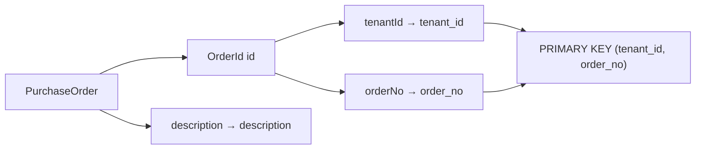

# Thiết kế equals và hashCode cho lớp khóa

Trong JPA, một entity có thể dùng **khóa chính ghép** (*composite primary key*) gồm nhiều cột, ví dụ cặp `(tenant_id, order_no)`: số đơn hàng `PO-001` có thể lặp ở các tenant khác nhau, nhưng **cặp tenant và số đơn** phải duy nhất. Khi ánh xạ khóa ghép bằng `@EmbeddedId` hoặc `@IdClass`, lớp biểu diễn khóa không chỉ chứa các thuộc tính. Nó cần định nghĩa **`equals(Object)` và `hashCode()` phù hợp với ý nghĩa định danh**.

Hai phương thức này cho Java và các thành phần sử dụng khóa biết khi nào hai giá trị khóa chỉ đến **cùng một identity**. Thiết kế sai có thể khiến `HashMap` không tìm được khóa, `HashSet` chứa dữ liệu trùng logic, hoặc hành vi quản lý entity trở nên khó dự đoán.

Bài học thuộc phần **Khóa ghép** của chủ đề *Data Persistence Relational Access ORM JPA* đi từ hợp đồng Java, hai kiểu khai báo khóa ghép chuẩn JPA, ví dụ chạy được, đến cách chọn thành phần equality, bất biến khóa và các lỗi thường gặp.

## 1. Khóa ghép là gì, và vì sao phải so sánh được?

Giả sử ứng dụng SaaS bán hàng có bảng:

```sql
CREATE TABLE purchase_order (
    tenant_id   VARCHAR(40) NOT NULL,
    order_no    VARCHAR(50) NOT NULL,
    description VARCHAR(255) NOT NULL,
    PRIMARY KEY (tenant_id, order_no)
);
```

Dữ liệu ví dụ:

| tenant_id | order_no | description |
|---|---|---|
| `tenant-a` | `PO-001` | Đơn số 1 của A |
| `tenant-b` | `PO-001` | Đơn số 1 của B |
| `tenant-a` | `PO-002` | Đơn số 2 của A |

Ở đây `order_no` không đủ để xác định duy nhất một hàng; phải dùng **cả hai cột**. Trong Java, ta cần biểu diễn định danh:

```java
OrderId first = new OrderId("tenant-a", "PO-001");
OrderId second = new OrderId("tenant-a", "PO-001");
OrderId third = new OrderId("tenant-b", "PO-001");
```

Ba biểu thức `new` tạo ba **object instance** khác nhau, nhưng `first` và `second` đại diện **cùng một khóa logic**. Kết quả mong muốn:

```text
first.equals(second) == true
first.hashCode() == second.hashCode()

first.equals(third) == false
```

Nếu chỉ dùng `Object.equals()` kế thừa, hai object được `new` riêng thường không bằng nhau vì mặc định so sánh identity ở bộ nhớ. Điều này không đúng với một **lớp khóa theo giá trị** (*value object*).

### Identity của entity và giá trị của key

Cần phân biệt hai ý:

- **Khóa JPA:** tập hợp giá trị cột xác định bản ghi, ví dụ `("tenant-a", "PO-001")`.
- **Đối tượng Java:** tham chiếu tới một instance, ví dụ một entity `PurchaseOrder` đang managed hoặc detached.

Trong một persistence context, JPA quản lý một entity theo khóa định danh của nó. Lớp khóa ghép cần biểu đạt đúng giá trị định danh để provider và mã ứng dụng có thể sử dụng nhất quán. Đây không đồng nghĩa việc mọi entity đều phải tự động dùng cùng triển khai `equals/hashCode` như lớp khóa; vấn đề equality của **entity** có thêm yếu tố proxy, vòng đời và khóa được sinh.

## 2. Hợp đồng của equals() và hashCode() trong Java

Hai phương thức được khai báo ở `java.lang.Object`. Khi override cho lớp khóa, cần tuân thủ các quy tắc sau.

### 2.1. Hợp đồng của equals()

Với các tham chiếu khác `null` có ý nghĩa so sánh:

1. **Phản xạ:** `x.equals(x)` là `true`.
2. **Đối xứng:** `x.equals(y)` phải cho cùng kết quả với `y.equals(x)`.
3. **Bắc cầu:** nếu `x.equals(y)` và `y.equals(z)` thì `x.equals(z)`.
4. **Nhất quán:** khi những thành phần tham gia so sánh không đổi, nhiều lần gọi cho cùng một kết quả.
5. **Khác null:** `x.equals(null)` trả `false`.

Với khóa `OrderId`, điều kiện equality tự nhiên là:

```text
tenantId bằng nhau VÀ orderNo bằng nhau
```

Không chỉ so `orderNo`, vì đơn `PO-001` có thể xuất hiện ở nhiều tenant.

### 2.2. Hợp đồng của hashCode()

Quy tắc bắt buộc nhất:

> Nếu `a.equals(b)` là `true`, thì `a.hashCode() == b.hashCode()`.

Chiều ngược lại **không bắt buộc**: hai khóa không bằng nhau vẫn có thể có cùng hash code (*hash collision*). `hashCode()` không phải mã ID duy nhất và không thể thay thế primary key của database.

Trong thời gian các thành phần tham gia equality không đổi, `hashCode()` phải trả về giá trị nhất quán trong quá trình thực thi Java. Không có yêu cầu hash code phải giống nhau giữa những lần chạy chương trình, giữa các JDK hay giữa các cơ sở dữ liệu khác nhau.

Hệ quả quan trọng với các collection:

```java
Map<OrderId, String> cache = new HashMap<>();

cache.put(new OrderId("tenant-a", "PO-001"), "accepted");

String value = cache.get(new OrderId("tenant-a", "PO-001"));
// Mong đợi "accepted" dù đây là object mới.
```

Nếu `equals` trả `true` nhưng `hashCode` khác nhau, `HashMap` có thể tìm ở bucket khác và không lấy được giá trị. Nếu key bị sửa sau khi đưa vào `HashMap`, kết quả cũng có thể sai dù hai phương thức từng được viết đúng.

## 3. Yêu cầu của JPA đối với lớp khóa chính ghép

Jakarta Persistence hỗ trợ hai cách phổ biến:

- **`@EmbeddedId`:** định nghĩa lớp khóa `@Embeddable`, rồi khai báo một trường `@EmbeddedId` trong entity.
- **`@IdClass`:** định nghĩa lớp khóa riêng, dùng `@IdClass(KeyType.class)` trên entity và đánh dấu từng thuộc tính khóa bằng `@Id`.

Với lớp khóa chính ghép theo JPA truyền thống, cần bảo đảm:

| Yêu cầu | Mục đích |
|---|---|
| Có lớp khóa public và constructor không tham số public/protected | Cho phép provider tạo và khôi phục giá trị khóa |
| Có thể serialization, thường khai báo `implements Serializable` | Phù hợp hợp đồng và các trường hợp sử dụng khóa qua boundary/cache |
| Định nghĩa `equals` và `hashCode` | So sánh theo các thành phần khóa, không dựa vào identity của object |
| Kiểu thành phần khóa khớp với ánh xạ entity | Để provider đọc/ghi, tìm theo ID đúng |
| Thành phần khóa tương ứng đầy đủ với primary key DB | Giữ nhất quán identity của Java và database |
| Không đổi giá trị khóa sau khi entity được persist | Tránh thay đổi identity của entity và hash của key |

Các ví dụ dùng **Jakarta Persistence 3.1**, package `jakarta.persistence.*`, Java 17 và kiểu khóa chuỗi đơn giản. Tài liệu hoặc dự án dùng JPA 2.x có thể thấy package cũ `javax.persistence.*`.

### Java record có thay thế hoàn toàn lớp khóa được không?

Không nên mặc định điều đó. `record` là value type rất tiện để so sánh bằng giá trị, nhưng với JPA 3.1 và nhiều provider, primary key class theo cách portable vẫn cần cấu trúc lớp và constructor phù hợp với JPA. Một số phiên bản JPA/provider mới hơn có thể hỗ trợ thêm hình thức mapping, nhưng cần xác nhận phiên bản thực tế. Để minh họa chuẩn phổ biến, bài này dùng **class thường**.

## 4. Ví dụ `@EmbeddedId`: xây lớp khóa OrderId

Đây là ví dụ trọng tâm: **một lớp khóa gồm `tenantId` và `orderNo`**, tương ứng hai cột primary key của `purchase_order`.

File `src/main/java/demo/OrderId.java`:

```java
package demo;

import jakarta.persistence.Column;
import jakarta.persistence.Embeddable;

import java.io.Serializable;
import java.util.Objects;

@Embeddable
public class OrderId implements Serializable {

    private static final long serialVersionUID = 1L;

    @Column(name = "tenant_id", nullable = false, length = 40)
    private String tenantId;

    @Column(name = "order_no", nullable = false, length = 50)
    private String orderNo;

    protected OrderId() {
        // Constructor không tham số cho JPA.
    }

    public OrderId(String tenantId, String orderNo) {
        this.tenantId = requireValue(tenantId, "tenantId");
        this.orderNo = requireValue(orderNo, "orderNo");
    }

    private static String requireValue(String value, String name) {
        Objects.requireNonNull(value, name);
        if (value.isBlank()) {
            throw new IllegalArgumentException(name + " must not be blank");
        }
        return value;
    }

    public String getTenantId() {
        return tenantId;
    }

    public String getOrderNo() {
        return orderNo;
    }

    @Override
    public boolean equals(Object other) {
        if (this == other) {
            return true;
        }
        if (!(other instanceof OrderId that)) {
            return false;
        }
        return Objects.equals(tenantId, that.tenantId)
            && Objects.equals(orderNo, that.orderNo);
    }

    @Override
    public int hashCode() {
        return Objects.hash(tenantId, orderNo);
    }

    @Override
    public String toString() {
        return tenantId + "/" + orderNo;
    }
}
```

### Vì sao triển khai như vậy?

**`@Embeddable`:** cho biết class là kiểu giá trị được nhúng vào entity; khi được dùng ở `@EmbeddedId`, các trường của nó đóng vai trò khóa ghép.

**`Serializable`:** giúp thỏa mãn yêu cầu quen thuộc đối với khóa ghép trong JPA và thuận tiện khi khóa phải đi qua một số cơ chế serialization. `serialVersionUID` cố định chỉ phục vụ cơ chế Java serialization, **không tham gia equals/hashCode**.

**Constructor không tham số:** provider cần khởi tạo lại object khi tải dữ liệu. Constructor public/protected này không gán ID; nó dành cho cơ chế khôi phục, còn constructor đầy đủ dùng ở mã nghiệp vụ.

**Constructor đầy đủ:** yêu cầu hai thành phần được cấp ngay khi tạo một key trong ứng dụng. Vì đây là khóa, ta không cung cấp setter công khai để tránh sửa sau khi key đã được sử dụng.

**`equals`:** so sánh **đủ hai thành phần**, chỉ từ các field là thành phần primary key. Field `description` của entity không nằm trong lớp khóa và không được phép tham gia phép so sánh khóa.

**`hashCode`:** dùng đúng các field tương ứng với `equals`. `Objects.hash` thuận tiện cho ví dụ; với workload cực lớn, có thể dùng phép nhân 31 để giảm một phần overhead, nhưng hợp đồng quan trọng hơn vi tối ưu.

**`toString`:** chỉ để log/debug; nó không quyết định identity và không nên được dùng làm phương thức serialize khóa chính thức cho API nếu định dạng không được đặc tả.

### Cấu trúc thay thế cho hashCode

Cách viết dưới đây cũng hợp lệ:

```java
@Override
public int hashCode() {
    int result = Objects.hashCode(tenantId);
    result = 31 * result + Objects.hashCode(orderNo);
    return result;
}
```

Hai cách không bắt buộc trả về cùng số hash cụ thể; chúng chỉ cần tuân thủ rằng hai khóa bằng nhau phải có cùng hash.

## 5. Dùng OrderId trong entity PurchaseOrder

File `src/main/java/demo/PurchaseOrder.java`:

```java
package demo;

import jakarta.persistence.Column;
import jakarta.persistence.EmbeddedId;
import jakarta.persistence.Entity;
import jakarta.persistence.Table;

import java.util.Objects;

@Entity
@Table(name = "purchase_order")
public class PurchaseOrder {

    @EmbeddedId
    private OrderId id;

    @Column(name = "description", nullable = false, length = 255)
    private String description;

    protected PurchaseOrder() {
        // Constructor không tham số cho JPA.
    }

    public PurchaseOrder(OrderId id, String description) {
        this.id = Objects.requireNonNull(id, "id");
        this.description = Objects.requireNonNull(
                description, "description");
    }

    public OrderId getId() {
        return id;
    }

    public String getDescription() {
        return description;
    }

    public void rename(String newDescription) {
        this.description = Objects.requireNonNull(
                newDescription, "newDescription");
    }
}
```

Trong entity, ta chỉ có **một trường `id` kiểu `OrderId`**. JPA sẽ ánh xạ `id.tenantId` và `id.orderNo` vào hai cột `tenant_id`, `order_no`.



Cách tạo và tìm entity:

```java
OrderId id = new OrderId("tenant-a", "PO-001");
PurchaseOrder order = new PurchaseOrder(id, "First order");

em.getTransaction().begin();
em.persist(order);
em.getTransaction().commit();

PurchaseOrder loaded = em.find(
        PurchaseOrder.class,
        new OrderId("tenant-a", "PO-001")
);
```

Một đối tượng `OrderId` mới có **cùng hai giá trị** vẫn biểu diễn đúng identity để tìm entity.

JPQL dùng đường dẫn vào embeddable:

```java
List<PurchaseOrder> orders = em.createQuery(
        """
        SELECT o
        FROM PurchaseOrder o
        WHERE o.id.tenantId = :tenantId
        ORDER BY o.id.orderNo
        """,
        PurchaseOrder.class
    )
    .setParameter("tenantId", "tenant-a")
    .getResultList();
```

Nhờ `@EmbeddedId`, key là thành phần có cấu trúc rõ ràng trong domain model: `o.id.tenantId` và `o.id.orderNo`.

## 6. Thử hợp đồng equals/hashCode bằng ví dụ đơn giản

Trước khi liên hệ với database, ta có thể chứng minh hai phương thức hoạt động nhất quán bằng Java collection:

```java
package demo;

import java.util.HashMap;
import java.util.HashSet;
import java.util.Map;
import java.util.Set;

public class EqualityDemo {
    public static void main(String[] args) {
        OrderId a = new OrderId("tenant-a", "PO-001");
        OrderId b = new OrderId("tenant-a", "PO-001");
        OrderId c = new OrderId("tenant-b", "PO-001");

        System.out.println(a == b);                // false
        System.out.println(a.equals(b));            // true
        System.out.println(a.hashCode()
                == b.hashCode());                   // true
        System.out.println(a.equals(c));            // false

        Set<OrderId> ids = new HashSet<>();
        ids.add(a);
        ids.add(b);
        ids.add(c);
        System.out.println(ids.size());             // 2

        Map<OrderId, String> descriptions = new HashMap<>();
        descriptions.put(a, "First order");
        System.out.println(descriptions.get(b));    // First order
    }
}
```

Các quan sát:

- `a == b` trả `false` vì hai object khác tham chiếu.
- `a.equals(b)` trả `true` vì cả hai thành phần khóa đều bằng nhau.
- `HashSet` chỉ có hai giá trị khóa logic, không phải ba.
- `HashMap` tìm được giá trị bằng một instance key mới nhưng tương đương.

Ví dụ này kiểm tra **hợp đồng Java của khóa**, không chứng minh mọi thao tác DB hoạt động đúng. Trong ứng dụng thật, JPA mapping, schema PK, transaction và dữ liệu cũng phải nhất quán.

## 7. Cấu hình JPA tối thiểu để lưu và đọc bằng khóa ghép

Để hình dung toàn bộ luồng, có thể dùng Java SE, Hibernate ORM 6.x, H2 và Jakarta Persistence 3.1. Đặt tệp `persistence.xml` ở `src/main/resources/META-INF/persistence.xml`:

```xml
<?xml version="1.0" encoding="UTF-8"?>
<persistence xmlns="https://jakarta.ee/xml/ns/persistence"
             xmlns:xsi="http://www.w3.org/2001/XMLSchema-instance"
             xsi:schemaLocation="
                 https://jakarta.ee/xml/ns/persistence
                 https://jakarta.ee/xml/ns/persistence/persistence_3_1.xsd"
             version="3.1">

    <persistence-unit name="orderPU" transaction-type="RESOURCE_LOCAL">
        <provider>org.hibernate.jpa.HibernatePersistenceProvider</provider>
        <class>demo.PurchaseOrder</class>
        <exclude-unlisted-classes>true</exclude-unlisted-classes>

        <properties>
            <property name="jakarta.persistence.jdbc.driver"
                      value="org.h2.Driver"/>
            <property name="jakarta.persistence.jdbc.url"
                      value="jdbc:h2:mem:ordersdb;DB_CLOSE_DELAY=-1"/>
            <property name="jakarta.persistence.jdbc.user" value="sa"/>
            <property name="jakarta.persistence.jdbc.password" value=""/>
            <property name="jakarta.persistence.schema-generation.database.action"
                      value="drop-and-create"/>
        </properties>
    </persistence-unit>
</persistence>
```

Các dependency cần thiết gồm `jakarta.persistence:jakarta.persistence-api:3.1.0`, một Hibernate ORM 6.x tương thích và `com.h2database:h2`. Tùy cấu hình provider, API có thể được kéo vào transitively, nhưng nêu tường minh giúp phân biệt **đặc tả**, **provider** và **driver DB**.

`drop-and-create` chỉ dành cho ví dụ học tập vì **có thể xóa dữ liệu**. Với môi trường thật, cần migration và ràng buộc khóa chính rõ ràng trên DB.

File `src/main/java/demo/Main.java`:

```java
package demo;

import jakarta.persistence.EntityManager;
import jakarta.persistence.EntityManagerFactory;
import jakarta.persistence.EntityTransaction;
import jakarta.persistence.Persistence;

public class Main {
    public static void main(String[] args) {
        EntityManagerFactory emf =
                Persistence.createEntityManagerFactory("orderPU");

        try {
            EntityManager em = emf.createEntityManager();

            try {
                EntityTransaction tx = em.getTransaction();
                try {
                    tx.begin();

                    OrderId id = new OrderId("tenant-a", "PO-001");
                    em.persist(new PurchaseOrder(id, "First order"));

                    tx.commit();
                } catch (RuntimeException ex) {
                    if (tx.isActive()) {
                        tx.rollback();
                    }
                    throw ex;
                }

                em.clear();

                PurchaseOrder found = em.find(
                        PurchaseOrder.class,
                        new OrderId("tenant-a", "PO-001")
                );

                System.out.println(
                        found == null ? "Not found"
                                      : found.getDescription());
            } finally {
                em.close();
            }
        } finally {
            emf.close();
        }
    }
}
```

Đoạn code tạo khóa trước khi persist, commit rồi dùng một **instance khóa khác nhưng bằng nhau** để tìm lại dữ liệu. `em.clear()` giúp loại bỏ các entity managed khỏi persistence context hiện tại để việc đọc diễn ra sau khi context được làm trống. Provider có thể dùng cache ở cấp khác, nên `clear()` không tự bảo đảm mọi truy vấn phải truy cập database vật lý.

Điều đáng lưu ý: `equals/hashCode` được viết đúng là điều kiện cần cho lớp khóa, nhưng database vẫn phải có **PRIMARY KEY (tenant_id, order_no)** để ngăn hai hàng trùng khóa. JPA không thay thế việc thực thi uniqueness ở DB.

## 8. Cách thứ hai: thiết kế khóa cho @IdClass

Với `@IdClass`, các thành phần khóa nằm trực tiếp trên entity; lớp khóa phản ánh cùng những field đó.

### 8.1. Lớp ShipmentKey

File `ShipmentKey.java`:

```java
package demo;

import java.io.Serializable;
import java.util.Objects;

public class ShipmentKey implements Serializable {

    private static final long serialVersionUID = 1L;

    private String warehouseCode;
    private String shipmentNo;

    public ShipmentKey() {
        // Public no-arg constructor.
    }

    public ShipmentKey(String warehouseCode, String shipmentNo) {
        this.warehouseCode = Objects.requireNonNull(warehouseCode);
        this.shipmentNo = Objects.requireNonNull(shipmentNo);
    }

    public String getWarehouseCode() {
        return warehouseCode;
    }

    public String getShipmentNo() {
        return shipmentNo;
    }

    @Override
    public boolean equals(Object other) {
        if (this == other) return true;
        if (!(other instanceof ShipmentKey that)) return false;
        return Objects.equals(warehouseCode, that.warehouseCode)
            && Objects.equals(shipmentNo, that.shipmentNo);
    }

    @Override
    public int hashCode() {
        return Objects.hash(warehouseCode, shipmentNo);
    }
}
```

Khác `OrderId`, lớp `ShipmentKey` **không cần `@Embeddable`**. JPA sử dụng class này thông qua annotation `@IdClass` trên entity.

### 8.2. Entity Shipment

```java
package demo;

import jakarta.persistence.Column;
import jakarta.persistence.Entity;
import jakarta.persistence.Id;
import jakarta.persistence.IdClass;
import jakarta.persistence.Table;

@Entity
@Table(name = "shipment")
@IdClass(ShipmentKey.class)
public class Shipment {

    @Id
    @Column(name = "warehouse_code", length = 40)
    private String warehouseCode;

    @Id
    @Column(name = "shipment_no", length = 50)
    private String shipmentNo;

    @Column(name = "destination")
    private String destination;

    protected Shipment() {}

    public Shipment(
            String warehouseCode,
            String shipmentNo,
            String destination) {
        this.warehouseCode = warehouseCode;
        this.shipmentNo = shipmentNo;
        this.destination = destination;
    }
}
```

Điều kiện ánh xạ cho `@IdClass`: **tên và kiểu của các thành phần khóa trong `ShipmentKey` phải tương ứng với các thuộc tính `@Id` trên `Shipment`**. Ví dụ trên có cặp `warehouseCode : String` và `shipmentNo : String` ở cả hai lớp. Tên cột SQL (`warehouse_code`, `shipment_no`) có thể khác tên field Java, miễn là mapping được khai báo đúng.

Đọc bằng key object:

```java
Shipment shipment = em.find(
        Shipment.class,
        new ShipmentKey("WH-HCM", "SHIP-001")
);
```

JPQL với `@IdClass` thường truy cập các thuộc tính trực tiếp:

```java
List<Shipment> shipments = em.createQuery(
        """
        SELECT s
        FROM Shipment s
        WHERE s.warehouseCode = :warehouse
        """,
        Shipment.class
    )
    .setParameter("warehouse", "WH-HCM")
    .getResultList();
```

### 8.3. So sánh hai cách ánh xạ

| Tiêu chí | `@EmbeddedId` | `@IdClass` |
|---|---|---|
| Field trên entity | Một field `id` có kiểu key | Nhiều field `@Id` trực tiếp |
| Metadata lớp key | `@Embeddable` | Class key thuần, liên kết qua `@IdClass` |
| JPQL truy cập thành phần | `o.id.tenantId` | `s.warehouseCode` |
| Cách truyền khóa khi `find` | Instance của embedded key | Instance của ID class |
| `equals/hashCode` trong key | Cần có | Cần có |
| Khả năng gom identity thành value object | Tự nhiên | Key class vẫn tồn tại, nhưng các field trên entity tách riêng |

Cả hai cách đều yêu cầu **bình đẳng theo giá trị các thành phần khóa**, cho nên cách viết `equals/hashCode` về bản chất giống nhau.

## 9. Tại sao khóa phải được coi là bất biến?

Ví dụ sai: key có setter thay `orderNo` sau khi đã được đưa vào `HashSet`.

```java
Set<OrderId> keys = new HashSet<>();

OrderId id = new OrderId("tenant-a", "PO-001");
keys.add(id);

// Nếu tồn tại setter và thực hiện:
// id.setOrderNo("PO-999");
//
// Hash của id có thể đổi trong khi HashSet
// vẫn đặt object trong bucket theo hash cũ.
```

Vấn đề không chỉ giới hạn trong Java collection. Khi JPA đã quản lý một entity theo primary key, việc sửa thành phần ID có thể làm persistence context và khóa DB không còn tương ứng. **Thay đổi primary key sau persist không phải một thao tác cập nhật entity thông thường được JPA hỗ trợ.**

Biện pháp thiết kế:

1. Truyền đầy đủ giá trị khóa qua constructor hoặc factory lúc tạo entity.
2. Để các field khóa `private`, không công bố setter nghiệp vụ.
3. Không thêm setter vào embedded key chỉ để phục vụ cập nhật khóa.
4. Nếu cần đổi “mã đơn” hiển thị, cân nhắc một primary key kỹ thuật ổn định và tách mã nghiệp vụ thành cột có unique constraint.
5. Không dùng dữ liệu mutable như `List`, `Map`, entity liên kết hoặc đối tượng có trạng thái thay đổi làm thành phần equality của khóa.

Trong ví dụ, các field không được khai báo `final` nhằm phù hợp mô hình JPA với constructor không tham số và field access. **Bất biến ở đây là quy tắc sử dụng và API của lớp**, không phải cam kết rằng Java reflection/provider không bao giờ thay đổi field khi khôi phục dữ liệu.

## 10. Chỉ so sánh các thành phần thật sự thuộc primary key

Một lỗi dễ xảy ra là đưa thêm thuộc tính ngoài khóa vào `equals/hashCode`:

```java
// Sai nếu mô hình primary key chỉ gồm tenantId + orderNo:
@Override
public boolean equals(Object other) {
    if (!(other instanceof OrderId that)) return false;
    return Objects.equals(tenantId, that.tenantId)
        && Objects.equals(orderNo, that.orderNo)
        && Objects.equals(displayLabel, that.displayLabel);
}
```

Giả sử `displayLabel` chỉ là nhãn hiển thị, có thể thay đổi. Hai key với cùng PK DB nhưng nhãn khác nhau sẽ trở thành **không bằng nhau trong Java**. Đây là mâu thuẫn giữa identity phía ứng dụng và database.

Quy tắc chọn field:

- Bao gồm **tất cả** thành phần định danh được mapping vào primary key.
- Không bỏ sót thành phần `tenantId` chỉ vì `orderNo` thường duy nhất trong dữ liệu thử nghiệm.
- Không đưa field mô tả, trạng thái, timestamp cập nhật, version hoặc quan hệ entity vào phép so sánh khóa.
- `equals` và `hashCode` phải dùng **cùng tập thành phần**, theo cách cho kết quả nhất quán.

`@Version` thuộc entity để phục vụ optimistic locking; **không** phải thành phần khóa và không tham gia `OrderId.equals/hashCode`.

## 11. Chọn cách so sánh theo kiểu dữ liệu và ngữ nghĩa database

Hợp đồng Java là cần thiết, nhưng đối với JPA còn phải bảo đảm phép so sánh **phù hợp với các cột primary key ở DB**.

### 11.1. String: chữ hoa, chữ thường và collation

Java so sánh chuỗi bằng `String.equals` phân biệt chữ hoa/thường:

```java
"ABC".equals("abc") // false
```

Một database hoặc collation lại có thể coi hai chuỗi đó tương đương khi áp dụng ràng buộc unique. Nếu Java coi hai khóa khác nhau nhưng DB coi là cùng primary key, dữ liệu và hành vi truy xuất có thể mâu thuẫn.

Nên định nghĩa **quy tắc chuẩn hóa ổn định** nếu nghiệp vụ cho phép, ví dụ tenant code luôn viết thường và order number luôn viết hoa:

```java
private static String normalizeTenant(String value) {
    Objects.requireNonNull(value, "tenant");
    String normalized = value.strip().toLowerCase(Locale.ROOT);
    if (normalized.isEmpty()) {
        throw new IllegalArgumentException("tenant is required");
    }
    return normalized;
}
```

Nếu dùng chuẩn hóa này, cần áp dụng nhất quán khi **tạo dữ liệu, truy vấn theo khóa và đọc dữ liệu cũ**, đồng thời dùng constraint/collation/check constraint phía DB phù hợp. Không tùy tiện chuyển chữ hoa/thường cho một mã mà đặc tả nghiệp vụ coi `ABC` và `abc` là khác nhau.

### 11.2. BigDecimal: equals khác compareTo

```java
new BigDecimal("10.0").equals(new BigDecimal("10.00"))
// false: scale khác nhau.

new BigDecimal("10.0").compareTo(new BigDecimal("10.00"))
// 0: cùng giá trị số học.
```

Một database kiểu `DECIMAL` có thể coi chúng là cùng giá trị số. Nếu buộc phải đưa decimal vào khóa, cần **quy tắc canonicalization** (chẳng hạn cố định scale) phù hợp với kiểu cột và thiết kế dữ liệu. Không override `equals` bằng `compareTo() == 0` trong khi `hashCode` vẫn dùng `BigDecimal.hashCode()`, vì khi đó hai object có thể bằng nhau nhưng khác hash.

Khi có thể, chọn thành phần khóa kiểu `String`, số nguyên hoặc `UUID` với quy tắc equality rõ ràng, thay vì một số thập phân có nhiều cách biểu diễn.

### 11.3. Ngày giờ và độ chính xác

Nếu một thành phần khóa là timestamp, phải để ý múi giờ, độ chính xác microsecond/nanosecond và cách DB lưu/đọc. Java `Instant` có thể giữ độ chính xác khác cột SQL. ID được so sánh trước khi lưu có thể khác ID sau khi đọc về nếu DB làm tròn.

Tốt nhất tránh timestamp biến động hoặc dữ liệu phụ thuộc định dạng hiển thị trong primary key. Nếu phải sử dụng, định nghĩa độ chính xác/kiểu SQL và canonicalization thống nhất.

### 11.4. Array hoặc byte[] trong khóa

`Objects.equals(byte[], byte[])` so sánh **tham chiếu của array** thay vì nội dung. Nếu khóa chứa array, cần dùng `Arrays.equals` và `Arrays.hashCode` tương ứng; đồng thời phải sao chép phòng vệ để array không bị sửa sau khi dùng làm khóa.

Ví dụ cặp phương thức về mặt Java:

```java
return Arrays.equals(this.digest, that.digest);

// Và:
return Arrays.hashCode(digest);
```

Tuy vậy, không phải mọi loại field tùy ý đều là loại thành phần primary key portable trong JPA. Nên đánh giá khả năng mapping trước khi chọn kiểu phức tạp.

## 12. Khi nào dùng instanceof, khi nào dùng getClass()?

Trong ví dụ `OrderId.equals`, ta dùng:

```java
if (!(other instanceof OrderId that)) return false;
```

Với **lớp khóa value object không có phân cấp kế thừa nghiệp vụ**, cách này dễ đọc và phù hợp. Nếu một lớp khóa được kế thừa và subclass thêm thành phần equality, dùng `instanceof` không cẩn thận có thể vi phạm đối xứng hoặc bắc cầu.

Một lựa chọn khác là kiểm tra kiểu chính xác:

```java
if (other == null || getClass() != other.getClass()) {
    return false;
}
OrderId that = (OrderId) other;
```

Đối với **PK class**, nên tránh thiết kế phân cấp kế thừa phức tạp ngay từ đầu; nó là một tập giá trị định danh cố định. Lựa chọn `instanceof` hay `getClass()` cần được áp dụng nhất quán và tôn trọng hợp đồng đối xứng.

Lưu ý: tranh luận về `getClass()` và proxy Hibernate của **entity** là vấn đề khác. Không nên sao chép nguyên mẫu `equals/hashCode` cho entity vào lớp khóa, hoặc ngược lại, mà bỏ qua mô hình object thực tế.

## 13. Các lỗi triển khai thường gặp

### Lỗi 1: Chỉ override equals, bỏ quên hashCode

```java
@Override
public boolean equals(Object other) {
    if (!(other instanceof OrderId that)) return false;
    return Objects.equals(tenantId, that.tenantId)
        && Objects.equals(orderNo, that.orderNo);
}
// Thiếu hashCode()!
```

Hai instance khác nhau có thể `equals == true` nhưng vẫn sử dụng `Object.hashCode()` dựa vào identity, phá vỡ hợp đồng hash. **Luôn triển khai cả hai**.

### Lỗi 2: Hash chỉ dùng một phần khóa

```java
@Override
public int hashCode() {
    return Objects.hash(orderNo); // Bỏ tenantId.
}
```

Chỉ dùng một thành phần không nhất thiết **vi phạm** hợp đồng nếu các khóa bằng nhau vẫn có cùng hash, nhưng thường làm tăng collision khi nhiều tenant dùng cùng số đơn và giảm hiệu quả collection. Thiết kế hợp lý là hash dựa trên **tất cả** thành phần khóa.

### Lỗi 3: Equals chỉ dùng một phần khóa

```java
@Override
public boolean equals(Object other) {
    if (!(other instanceof OrderId that)) return false;
    return Objects.equals(orderNo, that.orderNo);
}
```

Đây là lỗi **định danh**: `("tenant-a", "PO-001")` bị coi bằng `("tenant-b", "PO-001")` dù là hai hàng DB khác nhau.

### Lỗi 4: Dùng == để so sánh String

```java
return tenantId == that.tenantId
    && orderNo == that.orderNo;
```

`==` so sánh **tham chiếu object**, không phải nội dung chuỗi. Hãy dùng `Objects.equals` hoặc `String.equals` sau khi xử lý null hợp lệ.

### Lỗi 5: Phụ thuộc một field có thể thay đổi

```java
// Ví dụ không phù hợp:
private String tenantId;
private String orderNo;
private String displayName; // Field thay đổi theo UI.
```

Nếu `displayName` tham gia `equals/hashCode`, việc đổi tên hiển thị sẽ đổi identity hoặc hash một cách sai lệch. Chỉ dùng thành phần primary key.

### Lỗi 6: Dùng Lombok @Data thiếu cân nhắc

`@Data` sinh `equals/hashCode` dựa trên những field phù hợp với quy tắc Lombok, đồng thời thường sinh setter và nhiều method khác. Trong PK class, điều này có thể vô tình đưa **field ngoài khóa** vào equality, hoặc mở đường sửa key.

Có thể dùng Lombok có chọn lọc như `@EqualsAndHashCode(onlyExplicitlyIncluded = true)`, chỉ annotate field thuộc khóa bằng `@EqualsAndHashCode.Include` và tránh setter công khai. Tuy nhiên, phải hiểu mã được sinh và không để Lombok quyết định identity thay cho thiết kế schema.

### Lỗi 7: Dùng entity liên kết trong equals/hashCode của PK

Một khóa như `(order, lineNo)` có thể được ánh xạ bằng khóa ngoại tới order, nhưng không nên đưa cả một **entity có lazy relationship và vòng đời riêng** vào phép equality của key value object. Theo hướng thông thường, dùng scalar ID của parent và số dòng, kết hợp `@MapsId`/derived identity ở entity khi cần.

Đưa entity vào equality có thể gây truy vấn ngoài ý muốn, vòng lặp quan hệ, vấn đề proxy hoặc so sánh không ổn định.

### Lỗi 8: Không xử lý constructor không tham số và Serializable

PK class không đáp ứng hình dạng provider/JPA mong đợi có thể báo lỗi bootstrap hoặc khi load entity. Dùng public class, constructor không tham số public/protected, `implements Serializable` và `equals/hashCode` chuẩn là hướng portable trong bài học.

## 14. Khóa ghép và quan hệ entity

Khóa ghép thường xuất hiện ở bảng nhiều tenant, các dòng chi tiết của đơn, association entity, bảng đối chiếu. Ví dụ `order_line` có khóa `(tenant_id, order_no, line_no)` và khóa ngoại `(tenant_id, order_no)` trỏ đến `purchase_order`.

Một lớp khóa cho line có thể có ba giá trị vô hướng:

```java
@Embeddable
public class OrderLineId implements Serializable {
    private String tenantId;
    private String orderNo;
    private Integer lineNo;

    protected OrderLineId() {}

    public OrderLineId(String tenantId, String orderNo, Integer lineNo) {
        this.tenantId = Objects.requireNonNull(tenantId);
        this.orderNo = Objects.requireNonNull(orderNo);
        this.lineNo = Objects.requireNonNull(lineNo);
    }

    @Override
    public boolean equals(Object other) {
        if (this == other) return true;
        if (!(other instanceof OrderLineId that)) return false;
        return Objects.equals(tenantId, that.tenantId)
            && Objects.equals(orderNo, that.orderNo)
            && Objects.equals(lineNo, that.lineNo);
    }

    @Override
    public int hashCode() {
        return Objects.hash(tenantId, orderNo, lineNo);
    }
}
```

Đây là trích đoạn minh họa, cần bổ sung imports tương ứng (`Serializable`, `Objects`, annotation) và lớp entity dùng `@EmbeddedId` để chạy. Khi ánh xạ relation của line tới order, có thể dùng `@ManyToOne`, `@JoinColumns` và các kỹ thuật derived identity phù hợp; không nhất thiết đặt tham chiếu `PurchaseOrder` trực tiếp vào `OrderLineId`.

Nếu dùng `@MapsId`, cần hiểu cách những cột liên kết từ parent được phản chiếu vào ID của child. **Hợp đồng equality vẫn là so sánh các giá trị của khóa**, không phải so toàn bộ đồ thị object.

## 15. Kiểm chứng hợp đồng bằng test tập trung

Một số bài test đơn vị nên có cho lớp khóa ghép, đặc biệt khi nó được dùng trong `Map`, cache, repository và `em.find`.

Ví dụ với JUnit Jupiter 5 (đặt trong dự án đã có dependency JUnit):

```java
package demo;

import org.junit.jupiter.api.Test;

import java.util.HashMap;
import java.util.HashSet;

import static org.junit.jupiter.api.Assertions.*;

class OrderIdTest {

    @Test
    void sameColumnsProduceEqualKeysAndHashCodes() {
        OrderId a = new OrderId("tenant-a", "PO-001");
        OrderId b = new OrderId("tenant-a", "PO-001");

        assertNotSame(a, b);
        assertEquals(a, b);
        assertEquals(b, a);
        assertEquals(a.hashCode(), b.hashCode());
    }

    @Test
    void eachComponentAffectsEquality() {
        OrderId original = new OrderId("tenant-a", "PO-001");

        assertNotEquals(
                original, new OrderId("tenant-b", "PO-001"));
        assertNotEquals(
                original, new OrderId("tenant-a", "PO-002"));
        assertNotEquals(original, null);
    }

    @Test
    void equalInstanceCanBeLookedUpInHashCollections() {
        OrderId a = new OrderId("tenant-a", "PO-001");
        OrderId b = new OrderId("tenant-a", "PO-001");

        HashSet<OrderId> set = new HashSet<>();
        set.add(a);
        set.add(b);
        assertEquals(1, set.size());

        HashMap<OrderId, String> map = new HashMap<>();
        map.put(a, "saved");
        assertEquals("saved", map.get(b));
    }

    @Test
    void equalityIsTransitive() {
        OrderId a = new OrderId("tenant-a", "PO-001");
        OrderId b = new OrderId("tenant-a", "PO-001");
        OrderId c = new OrderId("tenant-a", "PO-001");

        assertTrue(a.equals(b));
        assertTrue(b.equals(c));
        assertTrue(a.equals(c));
    }
}
```

Các test trên xác minh cơ chế equality ở **Java level**. Để xác nhận JPA mapping, thêm integration test dùng một DB thực sự tạo bảng composite primary key: persist một entity, commit, tạo `OrderId` mới với cùng giá trị, dùng `em.find` và xác nhận tải được hàng tương ứng. Đó là hai loại kiểm chứng bổ trợ nhau.

## 16. Bảng quyết định thiết kế

| Câu hỏi | Hướng thực hiện |
|---|---|
| Bao nhiêu cột tạo nên PK? | Đưa **đủ tất cả** vào key class và `equals/hashCode` |
| Chọn `@EmbeddedId` hay `@IdClass`? | Chọn theo API domain và mapping; hợp đồng equality của key đều bắt buộc |
| Key có setter không? | Hạn chế setter, gán đầy đủ trước khi persist và không thay đổi sau đó |
| Có field mô tả hoặc version không? | Không đưa vào equality của key |
| String có thể khác chữ hoa/thường nhưng DB coi tương đương? | Chuẩn hóa rõ ràng và nhất quán với DB |
| Dùng BigDecimal hoặc timestamp làm thành phần PK? | Cân nhắc chuẩn biểu diễn/độ chính xác, ưu tiên kiểu ổn định khi có thể |
| Dùng HashMap/HashSet với key? | Hai key bằng nhau phải cùng hash; hash phải ổn định |
| Có lớp quan hệ ở trong ID? | Ưu tiên scalar key và derived identity/association mapping riêng |
| Có thể đơn giản hóa bằng một ID kỹ thuật không? | Cân nhắc nếu khóa nghiệp vụ có nguy cơ thay đổi hoặc quá nhiều thành phần |

## 17. Bài tập áp dụng

### Bài 1 — Phát hiện lỗi so sánh thiếu tenant

Cho khóa `InvoiceId(tenantId, invoiceNo)` nhưng phương thức `equals` chỉ so `invoiceNo`. Tạo hai đối tượng:

```java
InvoiceId a = new InvoiceId("north", "INV-001");
InvoiceId b = new InvoiceId("south", "INV-001");
```

Yêu cầu: giải thích tại sao `a.equals(b)` phải trả `false`, sửa `equals/hashCode` dùng đủ hai thành phần và quan sát hành vi của `HashSet`.

### Bài 2 — Xử lý chữ hoa/thường

Một database có unique constraint không phân biệt hoa/thường với `tenant_code`. Thiết kế quy tắc canonicalization và bổ sung test cho các input `"TENANT-A"`, `"tenant-a"`, `" Tenant-A "`. Giải thích vì sao cần cùng quy tắc giữa Java, dữ liệu đã lưu và DB.

### Bài 3 — So sánh với khóa `@IdClass`

Tạo entity `WarehouseBin` có PK `(warehouseCode, binCode)`. Viết `WarehouseBinKey` với constructor không tham số, `Serializable`, `equals/hashCode`; khai báo `@IdClass` và dùng `em.find` với key object mới.

### Bài 4 — Phân tích rủi ro mutable key

Thiết kế sai cho phép `orderId.setOrderNo(...)`. Thêm key vào `HashMap` trước khi sửa, rồi thử lookup lại. Giải thích vì sao phải tạo entity/key mới hoặc xử lý migration nếu thực sự cần đổi primary key DB.

### Bài 5 — Ánh xạ khóa ghép của dòng đơn

Tạo `OrderLineId(tenantId, orderNo, lineNo)`, lớp `OrderLine` có `@EmbeddedId` và quan hệ đến `PurchaseOrder`. Đảm bảo schema có PK ba cột và composite FK hai cột tới bảng parent. Kiểm tra rằng hai line có cùng số thứ tự nhưng thuộc hai order khác nhau không bằng nhau.

## 18. Câu hỏi tự kiểm tra

1. **Vì sao JPA yêu cầu equals/hashCode cho khóa ghép?** Để lớp khóa biểu diễn identity theo giá trị các thành phần, nhất quán giữa các instance Java.
2. **Hai khóa cùng hash code có bắt buộc bằng nhau không?** Không. Hash collision được phép; `equals` vẫn quyết định equality.
3. **Hai khóa bằng nhau có được khác hash code không?** Không. Điều đó phá hợp đồng Java và hoạt động của hash collection.
4. **Có cần đưa `@Version` vào equals/hashCode của khóa không?** Không. Version không thuộc primary key.
5. **Lớp key có thể đổi trường ID sau persist không?** Không nên; identity của entity phải được giữ ổn định.
6. **`@EmbeddedId` và `@IdClass` có dùng chung một cú pháp truy vấn JPQL không?** Không hoàn toàn: `@EmbeddedId` thường đi qua `entity.id.field`, còn `@IdClass` truy cập field ID trực tiếp trên entity.
7. **Vì sao so sánh Java phải phù hợp với DB?** Vì nếu DB coi hai composite key bằng nhau nhưng Java coi khác nhau, unique constraint, lookup và identity có thể không nhất quán.
8. **Có nên tái sử dụng equals/hashCode của entity cho lớp key không?** Không tự động; lớp key là value object biểu diễn PK, còn entity có thêm vòng đời và proxy của provider.

**Ghi nhớ:** Với khóa chính ghép của JPA, `equals` phải so sánh **đầy đủ và đúng các thành phần khóa**, còn `hashCode` phải sử dụng thông tin tương ứng để **mọi khóa bằng nhau đều có cùng hash**. Thiết kế khóa như một value object ổn định, cung cấp constructor không tham số cho JPA, `Serializable` khi áp dụng hình thức portable truyền thống, và đảm bảo cách so sánh trong Java nhất quán với ràng buộc primary key ở database.
