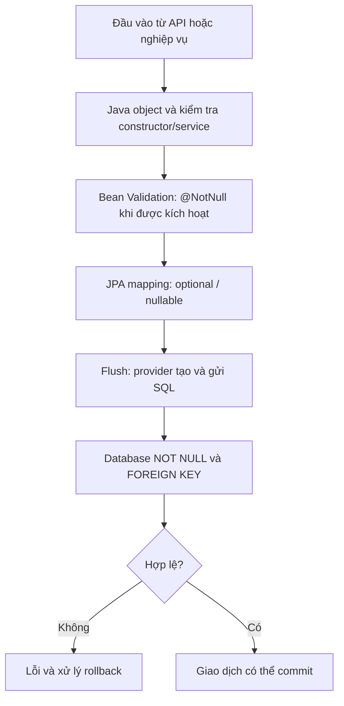
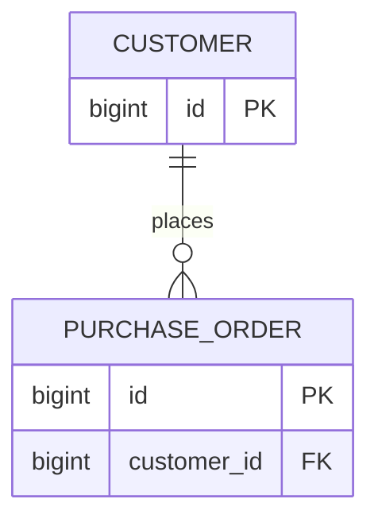
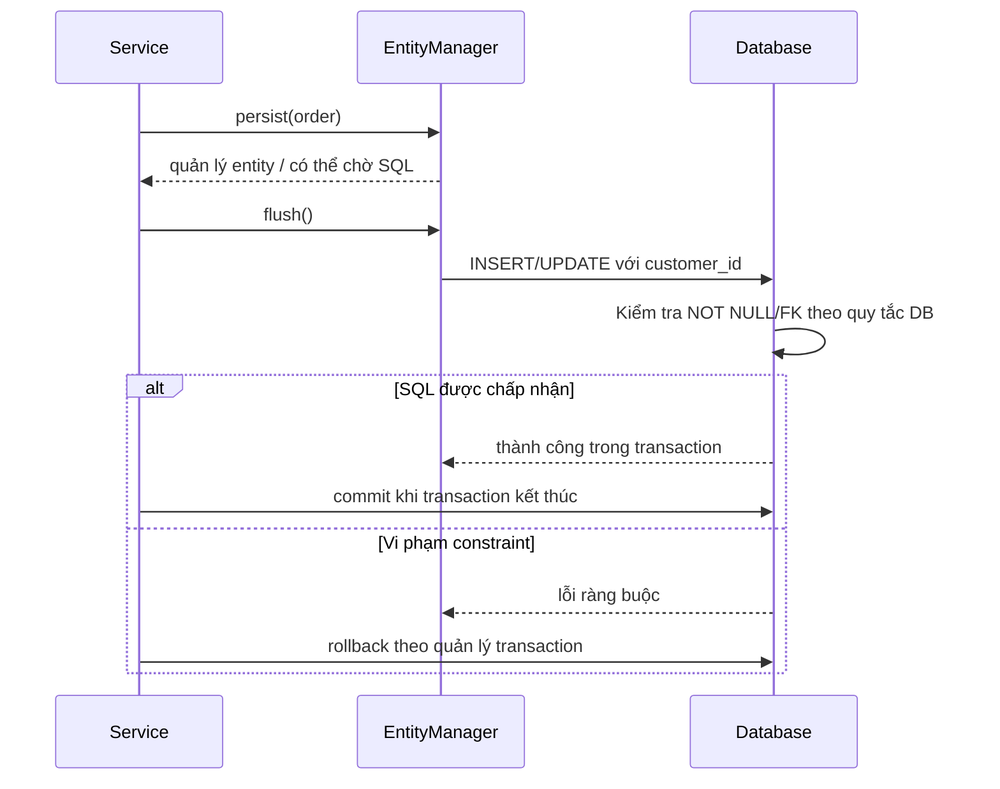

# Phân biệt tính bắt buộc của quan hệ và ràng buộc NOT NULL trong JPA

Khi ánh xạ quan hệ giữa các entity bằng JPA, lập trình viên thường thấy hai khai báo rất giống nhau:

```java
@ManyToOne(optional = false)
@JoinColumn(name = "customer_id", nullable = false)
private Customer customer;
```

`optional = false` và `nullable = false` cùng thể hiện ý tưởng “đơn hàng phải có khách hàng”, nhưng **chúng không kiểm tra cùng một đối tượng và không thuộc cùng một tầng**. Thêm vào đó, database có ràng buộc `NOT NULL` và `FOREIGN KEY`, còn Jakarta Bean Validation có `@NotNull`. Nếu nhầm các cơ chế này, ứng dụng có thể gặp những tình huống khó hiểu: entity vẫn nhận `null` khi gọi setter, `persist()` chưa báo lỗi, database ghi lỗi tại `flush()`, hoặc một quan hệ luôn có giá trị trong Java nhưng schema thực tế vẫn cho phép khóa ngoại rỗng.

**Ý chính của bài học:** “Quan hệ bắt buộc” là quy tắc mô hình đối tượng; “cột không được `NULL`” là ràng buộc về dữ liệu cột; “khóa ngoại hợp lệ” là ràng buộc tham chiếu. Ba điều liên quan chặt chẽ nhưng **không thể thay thế cho nhau**.

Bài này dùng Jakarta Persistence (JPA), mô hình Spring Data JPA/Hibernate thường gặp và SQL quan hệ để giải thích sự khác nhau, cách phối hợp và các trường hợp ngoại lệ trong quan hệ thực thể.

## 1. Bắt đầu từ một quy tắc nghiệp vụ cụ thể

Giả sử hệ thống bán hàng có `Customer` và `PurchaseOrder`:

- Mỗi đơn hàng phải thuộc về **đúng một** khách hàng.
- Một khách hàng có thể chưa có đơn hàng nào hoặc có nhiều đơn hàng.
- Khi lưu đơn hàng, `customer_id` không được rỗng và phải tham chiếu một khách hàng tồn tại.

Đó là ba cách diễn đạt bổ sung cho nhau:

| Tầng | Điều muốn bảo đảm | Công cụ |
|---|---|---|
| Miền nghiệp vụ | Mỗi `PurchaseOrder` cần một `Customer` | Constructor, phương thức nghiệp vụ, kiểm tra đầu vào |
| JPA | Thuộc tính quan hệ `customer` không được thiếu | `@ManyToOne(optional = false)` |
| Ánh xạ cột | Cột tham chiếu `customer_id` được thiết kế không nullable | `@JoinColumn(nullable = false)` |
| Database | Không có hàng `purchase_orders` nào có `customer_id IS NULL` | `customer_id BIGINT NOT NULL` |
| Database | Mọi `customer_id` khác `NULL` đều chỉ tới khóa được phép tham chiếu | `FOREIGN KEY (customer_id) REFERENCES customers(id)` |
| Validation | Đối tượng nhận từ ứng dụng bị từ chối khi `customer == null` | `@NotNull` và lời gọi validation phù hợp |

Một mô hình JPA có thể viết:

```java
import jakarta.persistence.*;
import jakarta.validation.constraints.NotNull;

@Entity
@Table(name = "purchase_orders")
public class PurchaseOrder {

    @Id
    @GeneratedValue(strategy = GenerationType.IDENTITY)
    private Long id;

    @NotNull
    @ManyToOne(fetch = FetchType.LAZY, optional = false)
    @JoinColumn(name = "customer_id", nullable = false)
    private Customer customer;

    @Column(name = "order_code", nullable = false, length = 50)
    private String orderCode;

    protected PurchaseOrder() {}

    public PurchaseOrder(Customer customer, String orderCode) {
        if (customer == null) {
            throw new IllegalArgumentException("Customer is required");
        }
        if (orderCode == null || orderCode.isBlank()) {
            throw new IllegalArgumentException("Order code is required");
        }
        this.customer = customer;
        this.orderCode = orderCode;
    }
}
```

Giả sử entity `Customer` có `@Id Long id` và ánh xạ bảng `customers`. Database mong muốn:

```sql
CREATE TABLE customers (
    id BIGINT PRIMARY KEY,
    display_name VARCHAR(150) NOT NULL
);

CREATE TABLE purchase_orders (
    id BIGINT GENERATED BY DEFAULT AS IDENTITY PRIMARY KEY,
    customer_id BIGINT NOT NULL,
    order_code VARCHAR(50) NOT NULL,
    CONSTRAINT fk_purchase_order_customer
        FOREIGN KEY (customer_id) REFERENCES customers(id)
);
```

Đây là SQL minh họa theo cú pháp PostgreSQL. Hibernate/JPA có thể sinh DDL khác tùy dialect, phiên bản và cấu hình; cấu trúc thật ở database phải được kiểm tra độc lập.

## 2. Đọc đúng ý nghĩa của `@ManyToOne(optional = false)`

`@ManyToOne` định nghĩa quan hệ nhiều-về-một: nhiều đơn hàng có thể tham chiếu cùng một khách hàng. Thuộc tính `optional` của annotation này diễn tả liệu **giá trị của association** có thể không tồn tại hay không.

```java
@ManyToOne(optional = false)
private Customer customer;
```

Ý nghĩa mô hình: với một `PurchaseOrder` hợp lệ, quan hệ tới `Customer` là bắt buộc.

Điểm cần nhớ:

1. `optional = false` là thông tin của **association mapping** trong JPA.
2. Nó **không** biến field Java thành kiểu không-null ở cấp ngôn ngữ. Code vẫn có thể gán `null` nếu API của class cho phép.
3. Provider có thể dùng thông tin này để kiểm tra trạng thái lúc đồng bộ entity, suy ra nullability trong schema generation hoặc tối ưu hóa một số cách tải/truy vấn.
4. Mức độ provider kiểm tra ngay trước SQL và cách sử dụng thông tin này trong query không phải cơ chế thay thế cho ràng buộc database.
5. Giá trị mặc định của `optional` đối với `@ManyToOne` là `true`.

Ví dụ quan hệ không bắt buộc:

```java
@ManyToOne(fetch = FetchType.LAZY, optional = true)
@JoinColumn(name = "sales_agent_id", nullable = true)
private SalesAgent salesAgent;
```

Đơn hàng có thể chưa được phân công cho nhân viên bán hàng. Trạng thái `salesAgent == null` là hợp lệ theo nghiệp vụ, nên cho phép khóa ngoại `sales_agent_id` là `NULL` sẽ phù hợp.

Cũng có thể bỏ `optional = true` vì đó là mặc định; việc ghi tường minh đôi khi giúp người đọc hiểu ý đồ.

## 3. Đọc đúng `@JoinColumn(nullable = false)`

Với quan hệ sở hữu khóa ngoại, `@JoinColumn` định nghĩa cột dùng để liên kết:

```java
@ManyToOne(optional = false)
@JoinColumn(name = "customer_id", nullable = false)
private Customer customer;
```

`name = "customer_id"` chọn tên cột khóa ngoại trong bảng của entity sở hữu. `nullable = false` nói rằng **cột join này được mô tả là không chấp nhận `NULL`**, đặc biệt hữu ích khi provider tạo hoặc kiểm tra schema.

Khác với `optional`, đây là thuộc tính **của cột**, không phải một quy tắc riêng về trạng thái object Java. Nó không biến entity tham chiếu thành hợp lệ nếu `customer_id` trỏ tới một ID không tồn tại.

Cách sử dụng hợp lý là bảo đảm schema thực sự có:

```sql
customer_id BIGINT NOT NULL
```

Để kiểm tra tính tồn tại của entity được tham chiếu, cần thêm:

```sql
FOREIGN KEY (customer_id) REFERENCES customers(id)
```

**`NOT NULL` không kiểm tra khóa ngoại có tồn tại.** Nó chỉ chặn giá trị SQL `NULL`. Một khóa ngoại với `customer_id = 999999` vẫn có thể thỏa `NOT NULL` nhưng vi phạm `FOREIGN KEY` nếu không có khách hàng 999999.

### `@JoinColumn` khác `@Column`

Ánh xạ thuộc tính cơ bản:

```java
@Column(name = "order_code", nullable = false)
private String orderCode;
```

Ánh xạ association:

```java
@ManyToOne(optional = false)
@JoinColumn(name = "customer_id", nullable = false)
private Customer customer;
```

Dùng `@JoinColumn` cho cột tham chiếu của quan hệ; dùng `@Column` cho thuộc tính cơ bản. Hai annotation có thuộc tính `nullable` nhưng phục vụ hai loại mapping khác nhau.

## 4. Database `NOT NULL` khác database `FOREIGN KEY`

Xét bảng:

```sql
CREATE TABLE purchase_orders (
    id BIGINT PRIMARY KEY,
    customer_id BIGINT NOT NULL,
    FOREIGN KEY (customer_id) REFERENCES customers(id)
);
```

Hai ràng buộc này độc lập:

| Dữ liệu muốn ghi | `NOT NULL` | `FOREIGN KEY` | Kết quả |
|---|---|---|---|
| `customer_id = NULL` | Không đạt | Khóa ngoại thông thường không cấm `NULL` | Bị `NOT NULL` từ chối |
| `customer_id = 42`, tồn tại khách hàng 42 | Đạt | Đạt | Có thể ghi nếu các ràng buộc khác cũng đạt |
| `customer_id = 999`, không tồn tại khách hàng 999 | Đạt | Không đạt | Bị `FOREIGN KEY` từ chối |
| `customer_id = NULL` với cột nullable | Không có ràng buộc cấm `NULL` | FK một cột thường cho phép `NULL` | Có thể ghi nếu nghiệp vụ cho phép |

Một cột khóa ngoại nullable vẫn có thể có foreign key hợp lệ:

```sql
CREATE TABLE purchase_orders (
    id BIGINT PRIMARY KEY,
    sales_agent_id BIGINT NULL,
    CONSTRAINT fk_order_sales_agent
        FOREIGN KEY (sales_agent_id) REFERENCES sales_agents(id)
);
```

Trạng thái này có nghĩa “chưa phân công nhân viên” được phép, còn **nếu đã có ID nhân viên**, nó phải trỏ tới bản ghi được tham chiếu hợp lệ.

### Ba tình huống thường bị đánh đồng

- **Quan hệ thiếu**: `order.getCustomer() == null`.
- **Cột liên kết trống**: `purchase_orders.customer_id IS NULL`.
- **Tham chiếu mồ côi**: `customer_id` có giá trị nhưng bảng `customers` không có bản ghi tương ứng.

Dữ liệu tham chiếu mồ côi có thể xuất hiện nếu schema chưa có foreign key thật, constraint bị vô hiệu hóa hoặc dữ liệu được nhập bằng cách bỏ qua kiểm tra. `optional = false` không tự chữa các bản ghi đó.

## 5. So sánh tất cả cơ chế thường gặp

| Cơ chế | Áp dụng ở đâu? | Trả lời câu hỏi nào? |
|---|---|---|
| `@ManyToOne(optional = false)` | Association JPA | Mối quan hệ nhiều-về-một có bắt buộc theo mapping không? |
| `@OneToOne(optional = false)` | Association JPA | Mối quan hệ một-về-một ở phía này có bắt buộc theo mapping không? |
| `@Basic(optional = false)` | Thuộc tính cơ bản của JPA | Giá trị basic có thể thiếu không? |
| `@JoinColumn(nullable = false)` | Cột join/FK trong JPA | Cột dùng để join có cho phép SQL `NULL` trong schema mong muốn không? |
| `@Column(nullable = false)` | Cột của thuộc tính basic trong JPA | Cột dữ liệu thường có cho phép SQL `NULL` không? |
| `@NotNull` | Jakarta Bean Validation | Giá trị Java có khác `null` khi validation chạy không? |
| `NOT NULL` | Schema database | SQL có được ghi `NULL` vào cột không? |
| `FOREIGN KEY` | Schema database | Giá trị FK khác `NULL` có tham chiếu khóa hợp lệ không? |
| `UNIQUE` | Schema database | Nhiều hàng có được dùng cùng giá trị hoặc tổ hợp cột không? |
| `CHECK` | Schema database | Giá trị có thỏa một biểu thức bất biến không? |

Có thể hình dung mỗi cơ chế ở một điểm khác nhau trong luồng xử lý:



Thứ tự kiểm tra thực tế phụ thuộc cách gọi validation, provider, thời điểm flush và database. Sơ đồ nhằm cho thấy **các tầng bảo vệ**, không hứa mỗi thao tác đều đi đúng một lượt theo các hộp.

## 6. Nếu `optional` và `nullable` khai báo khác nhau thì sao?

JPA cho phép viết những cấu hình không thống nhất về ý đồ:

```java
@ManyToOne(optional = false)
@JoinColumn(name = "customer_id", nullable = true)
private Customer customer;
```

Hoặc:

```java
@ManyToOne(optional = true)
@JoinColumn(name = "customer_id", nullable = false)
private Customer customer;
```

Chúng thường khiến hành vi khó suy luận và cần phân biệt rõ:

| `optional` | `nullable` trên join column | Diễn giải về ý đồ | Hệ quả cần xem |
|---|---|---|---|
| `false` | `false` | Quan hệ bắt buộc; cột FK không nullable | Khai báo nhất quán cho quan hệ yêu cầu luôn có đối tượng đích |
| `true` | `true` | Quan hệ không bắt buộc; cột FK có thể nullable | Khai báo nhất quán cho quan hệ tùy chọn |
| `false` | `true` | JPA coi quan hệ bắt buộc nhưng cột được mô tả cho phép `NULL` | Có thể phát sinh lệch metadata, kiểm tra provider và DDL thực tế |
| `true` | `false` | JPA cho phép quan hệ vắng mặt nhưng cột bị thiết kế `NOT NULL` | Entity có thể được tạo với `null` trong Java rồi bị database từ chối khi ghi |

**Không có bảng chân lý “giá trị nào thắng” áp dụng cho mọi provider và mọi schema**. Một phần metadata có thể được provider dùng để suy ra DDL hay kiểm tra runtime; schema database đang triển khai mới quyết định constraint thật khi thực thi SQL.

Với yêu cầu bắt buộc ổn định, cách khai báo rõ ràng là:

```java
@ManyToOne(fetch = FetchType.LAZY, optional = false)
@JoinColumn(name = "customer_id", nullable = false)
private Customer customer;
```

và có `NOT NULL`, `FOREIGN KEY` tương ứng trong migration database.

Khi nghiệp vụ cho phép không có tham chiếu:

```java
@ManyToOne(fetch = FetchType.LAZY, optional = true)
@JoinColumn(name = "sales_agent_id", nullable = true)
private SalesAgent salesAgent;
```

và cột `sales_agent_id` được phép `NULL` trong schema.

## 7. `@NotNull` là Bean Validation, không phải foreign key

`@NotNull` đến từ `jakarta.validation.constraints.NotNull`:

```java
import jakarta.validation.constraints.NotNull;

@NotNull
@ManyToOne(optional = false, fetch = FetchType.LAZY)
@JoinColumn(name = "customer_id", nullable = false)
private Customer customer;
```

Khi validation chạy, `@NotNull` kiểm tra tham chiếu Java `customer` khác `null`. Nó **không tự kiểm tra** rằng `customer.getId()` có tồn tại ở database, entity đang managed hay bản ghi đích vẫn còn hiệu lực nghiệp vụ.

Nếu dùng một Bean Validation provider như Hibernate Validator với tích hợp JPA phù hợp, validation có thể được gọi ở các sự kiện lifecycle như trước insert hoặc update theo cấu hình. Với API, Spring MVC có thể kích hoạt validation DTO qua `@Valid` khi cấu hình thích hợp. Không nên giả định cứ khai báo `@NotNull` là mọi setter sẽ ném exception ngay tức thì.

Ví dụ kiểm tra đầu vào trước khi tạo order:

```java
public record CreateOrderRequest(
    @NotNull Long customerId,
    @NotBlank String orderCode
) {}
```

Ở tầng service:

```java
@Transactional
public void createOrder(CreateOrderRequest request) {
    Customer customer = entityManager.find(
        Customer.class, request.customerId());

    if (customer == null) {
        throw new IllegalArgumentException("Customer does not exist");
    }

    entityManager.persist(
        new PurchaseOrder(customer, request.orderCode())
    );
}
```

Lớp DTO có thể bị từ chối khi `customerId == null`; service kiểm tra **sự tồn tại**, constructor bảo vệ **quy tắc miền**, JPA mô tả **quan hệ bắt buộc**, còn database bảo vệ **NOT NULL và FOREIGN KEY**. Sự phối hợp đó giúp trả thông báo nghiệp vụ dễ hiểu đồng thời giữ tính toàn vẹn dữ liệu khi có ghi đồng thời hoặc có ứng dụng khác truy cập database.

### `@NotNull` khác `@NotBlank`, `@NotEmpty` và `@Valid`

- `@NotNull` dùng để kiểm tra tham chiếu khác `null`, thích hợp cho ID hay association.
- `@NotBlank` phù hợp với chuỗi bắt buộc có ký tự không phải khoảng trắng; không phải annotation để kiểm tra entity relation.
- `@NotEmpty` kiểm tra collection, chuỗi hoặc dữ liệu hỗ trợ khác không rỗng; một collection `@OneToMany` có thể cần `@NotEmpty` theo nghiệp vụ, nhưng nó vẫn không tự tạo database constraint “owner phải có ít nhất một child”.
- `@Valid` yêu cầu validation lồng sâu trên object có liên quan, không thay thế `@NotNull` của chính reference và không bảo đảm foreign key tồn tại.

Ví dụ validation cho collection:

```java
@NotEmpty
@OneToMany(mappedBy = "purchaseOrder")
private List<OrderLine> lines = new ArrayList<>();
```

Một danh sách Java không rỗng khi validation chạy không đồng nghĩa với việc transaction đã commit đủ các hàng `order_lines` hay database ngăn được việc xóa hết child về sau. Quy tắc “phải có ít nhất một dòng” thường cần thiết kế transaction/nghiệp vụ riêng.

## 8. Chú ý phía **sở hữu** quan hệ

Để biết `@JoinColumn(nullable = false)` ảnh hưởng đến cột nào, trước tiên phải tìm **owning side**: phía chịu trách nhiệm quản lý foreign key trong mapping.

Quan hệ hai chiều điển hình:

```java
// PurchaseOrder.java — owning side
@Entity
@Table(name = "purchase_orders")
public class PurchaseOrder {

    @Id
    private Long id;

    @ManyToOne(fetch = FetchType.LAZY, optional = false)
    @JoinColumn(name = "customer_id", nullable = false)
    private Customer customer;

    protected PurchaseOrder() {}

    public void assignCustomer(Customer customer) {
        this.customer = Objects.requireNonNull(customer);
    }
}
```

```java
// Customer.java — inverse side
@Entity
@Table(name = "customers")
public class Customer {

    @Id
    private Long id;

    @OneToMany(mappedBy = "customer")
    private List<PurchaseOrder> orders = new ArrayList<>();

    protected Customer() {}
}
```

Trong quan hệ này:

- `PurchaseOrder.customer` là **owning side** vì nó giữ `customer_id`.
- `Customer.orders` là phía **inverse** nhờ `mappedBy = "customer"`.
- Chính `@JoinColumn(name = "customer_id", nullable = false)` ở phía owning quy định mapping cột FK.
- `@OneToMany(mappedBy = "customer")` không có thuộc tính `optional`. Không thể dùng `@OneToMany(optional = false)` vì API đó không có tham số này.
- Một khách hàng có **0 đơn hàng** là tình huống khác hoàn toàn với một đơn hàng có **0 khách hàng**.

Sơ đồ cardinality:



**Bắt buộc ở phía many-to-one không đồng nghĩa với bắt buộc ở phía one-to-many.** Mỗi order phải có customer; customer không nhất thiết đã có order nào.

### Đồng bộ hai phía trong Java

Với quan hệ hai chiều, nên có phương thức nghiệp vụ giữ trạng thái object graph nhất quán:

```java
// Trong Customer
public void addOrder(PurchaseOrder order) {
    Objects.requireNonNull(order);
    orders.add(order);
    order.assignCustomer(this);
}
```

Việc chỉ gọi `orders.add(order)` trên inverse collection mà không gán `order.customer` có thể không cập nhật FK như mong đợi. Nếu dùng helper, cần thiết kế thêm cách gỡ/đổi quan hệ, kiểm tra owner cũ và tránh vòng gọi đệ quy. **Database ghi FK dựa trên owning side**, chứ không dựa vào việc object xuất hiện trong Java collection ở phía inverse.

## 9. “Phải có ít nhất một con” không phải `NOT NULL` của khóa ngoại

Giả sử một `PurchaseOrder` buộc phải có ít nhất một `OrderLine` trước khi được xác nhận. Dòng đơn hàng bắt buộc thuộc một đơn hàng:

```java
// OrderLine.java
@ManyToOne(fetch = FetchType.LAZY, optional = false)
@JoinColumn(name = "order_id", nullable = false)
private PurchaseOrder purchaseOrder;
```

và:

```java
// PurchaseOrder.java
@OneToMany(mappedBy = "purchaseOrder")
private List<OrderLine> lines = new ArrayList<>();
```

`order_lines.order_id NOT NULL` bảo đảm **mỗi dòng** có ID order. Nó **không** bảo đảm **mỗi order** có ít nhất một dòng.

Ta có thể diễn đạt:

- Ràng buộc `NOT NULL` trên FK: “Mỗi child phải có parent”.
- Ràng buộc collection không rỗng: “Mỗi parent phải có ít nhất một child”.

Hai phát biểu khác hướng. Một khóa ngoại với `NOT NULL` kiểm soát hàng ở bảng **child**; việc parent phải tồn tại cùng ít nhất một child là ràng buộc **tồn tại bản ghi ngược chiều**, thường không thể biểu diễn chỉ bằng `NOT NULL` trên cột child.

Một phương án miền nghiệp vụ là cho phép order ở trạng thái `DRAFT` chưa có dòng, rồi kiểm tra collection trước khi chuyển `CONFIRMED`:

```java
public void confirm() {
    if (lines.isEmpty()) {
        throw new IllegalStateException(
            "Order must contain at least one line");
    }
    this.status = OrderStatus.CONFIRMED;
}
```

Nếu cần database bảo vệ tuyệt đối quy tắc tồn tại ít nhất một child dưới mọi đường ghi, có thể cần ràng buộc bổ sung, trigger hoặc thiết kế schema khác tùy database và yêu cầu tính nhất quán. Không nên cho rằng `@NotEmpty` trên collection tự tạo được constraint đó trong SQL.

## 10. `@OneToOne(optional = false)`: còn cần xem phía lưu FK

Quan hệ một-về-một cũng có `optional`:

```java
@OneToOne(fetch = FetchType.LAZY, optional = false)
@JoinColumn(name = "profile_id", nullable = false, unique = true)
private UserProfile profile;
```

Ở đây một entity sở hữu FK `profile_id` và mapping yêu cầu reference không rỗng. Để database bảo đảm one-to-one theo chiều FK, thường cần cả **FOREIGN KEY** và **UNIQUE**:

```sql
profile_id BIGINT NOT NULL UNIQUE,
FOREIGN KEY (profile_id) REFERENCES user_profiles(id)
```

Phân biệt:

- `NOT NULL`: mỗi hàng owner có FK.
- `FOREIGN KEY`: FK trỏ đến hàng profile hợp lệ.
- `UNIQUE`: không có hai owner cùng trỏ đến một profile.
- Các ràng buộc trên **không bắt buộc mọi profile phải được một owner tham chiếu**.

Nếu không có `UNIQUE`, nhiều owner có thể trỏ cùng profile, khi đó schema cho phép hành vi nhiều-về-một dù code JPA khai `@OneToOne`.

### Trường hợp inverse side của one-to-one

Giả sử khóa ngoại được lưu ở `user_profiles.user_id`:

```java
// UserProfile — phía sở hữu FK
@OneToOne(fetch = FetchType.LAZY, optional = false)
@JoinColumn(name = "user_id", nullable = false, unique = true)
private UserAccount user;
```

```java
// UserAccount — phía inverse
@OneToOne(mappedBy = "user", optional = false)
private UserProfile profile;
```

`optional = false` trên `UserAccount.profile` thể hiện kỳ vọng mô hình rằng user có profile. Nhưng FK thực tế nằm trong **bảng `user_profiles`**. Một constraint `user_profiles.user_id NOT NULL UNIQUE` chỉ nói rằng mỗi profile phải thuộc về một user và không có hai profile trỏ tới cùng một user; nó **không tự bảo đảm mọi user đều có profile**.

Đây là ví dụ điển hình cho việc **tính bắt buộc của quan hệ ở một phía không thể luôn được diễn đạt bằng `NOT NULL` trên FK ở phía còn lại**.

Nếu nghiệp vụ yêu cầu “mọi tài khoản luôn có profile”, có thể tạo cả hai trong một transaction và kiểm soát nghiệp vụ. Nếu cần bảo đảm ở tầng database ngay cả với SQL bên ngoài, phải thiết kế ràng buộc bổ sung hoặc chiến lược lưu trữ phù hợp. Shared primary key là một lựa chọn thường gặp, nhưng vẫn không giải quyết tự động mọi yêu cầu tồn tại ngược chiều.

## 11. Shared primary key one-to-one với `@MapsId`

Một thiết kế one-to-one khác là để bảng phụ dùng cùng khóa chính với bảng cha:

```sql
CREATE TABLE user_accounts (
    id BIGINT PRIMARY KEY,
    username VARCHAR(100) NOT NULL
);

CREATE TABLE user_profiles (
    user_id BIGINT PRIMARY KEY,
    display_name VARCHAR(150) NOT NULL,
    FOREIGN KEY (user_id) REFERENCES user_accounts(id)
);
```

JPA:

```java
@Entity
@Table(name = "user_profiles")
public class UserProfile {

    @Id
    @Column(name = "user_id")
    private Long id;

    @MapsId
    @OneToOne(optional = false, fetch = FetchType.LAZY)
    @JoinColumn(name = "user_id", nullable = false)
    private UserAccount user;

    @Column(name = "display_name", nullable = false)
    private String displayName;

    protected UserProfile() {}

    public UserProfile(UserAccount user, String displayName) {
        this.user = Objects.requireNonNull(user);
        this.displayName = displayName;
    }
}
```

Giả sử `UserAccount` có `@Id Long id` và được quản lý hợp lệ. `@MapsId` cho biết ID của profile dẫn xuất từ ID của user được tham chiếu.

Cột `user_profiles.user_id` là PK nên đương nhiên không thể `NULL`; đồng thời FK bảo đảm một profile không thể tham chiếu user không tồn tại. Cơ chế này đảm bảo profile có user, và mỗi user có **tối đa một** profile, nhưng **không** tự đảm bảo mọi hàng `user_accounts` đã có hàng `user_profiles`.

Đây là giới hạn logic quan trọng của khóa ngoại một chiều: từ “mỗi profile thuộc một account” không thể suy ra “mỗi account có một profile”.

## 12. `@ManyToMany` không có `optional = false`

Quan hệ nhiều-về-nhiều thường có bảng nối:

```java
@ManyToMany
@JoinTable(
    name = "student_courses",
    joinColumns = @JoinColumn(name = "student_id"),
    inverseJoinColumns = @JoinColumn(name = "course_id")
)
private Set<Course> courses = new HashSet<>();
```

Một bảng nối có thể khai:

```sql
CREATE TABLE student_courses (
    student_id BIGINT NOT NULL REFERENCES students(id),
    course_id BIGINT NOT NULL REFERENCES courses(id),
    PRIMARY KEY (student_id, course_id)
);
```

`NOT NULL` trên `student_id` và `course_id` chỉ đảm bảo **mỗi hàng trong bảng nối** có đủ cả hai đầu liên kết. Nó **không** bắt buộc mỗi student phải có ít nhất một course, hoặc mỗi course phải có student.

`@ManyToMany` không có thuộc tính `optional` như `@ManyToOne`. Quy tắc “sinh viên phải đăng ký ít nhất một môn” là quy tắc collection/nghiệp vụ cần kiểm tra ở đúng thời điểm, thường trước một trạng thái hoàn tất đăng ký.

Điều tương tự áp dụng với `@OneToMany`: collection rỗng là một trạng thái khác với foreign key NULL trên một hàng liên kết hiện có.

## 13. Quan hệ qua `@JoinTable`: không phải lúc nào cũng có FK trên bảng owner

`@OneToOne` hoặc `@ManyToOne` cũng có thể dùng bảng liên kết trong một số mô hình. Khi dùng `@JoinTable`, các FK tồn tại ở **bảng join**, không nằm trong một cột FK trực tiếp trên bảng owner:

```java
@OneToOne(optional = true)
@JoinTable(
    name = "employee_parking",
    joinColumns = @JoinColumn(name = "employee_id"),
    inverseJoinColumns = @JoinColumn(name = "parking_space_id")
)
private ParkingSpace parkingSpace;
```

Trong mô hình này, nếu nhân viên chưa có chỗ đỗ xe thì có thể **không có hàng liên kết** tương ứng trong `employee_parking`. Ràng buộc `NOT NULL` trên hai cột của **những hàng join đang tồn tại** không đồng nghĩa với “mọi nhân viên phải có một hàng join”.

Nếu muốn thể hiện quan hệ bắt buộc ở mức database khi dùng join table, phải kiểm tra liệu cấu trúc bảng và constraint hiện tại có diễn đạt được sự tồn tại của hàng liên kết cho mọi owner hay không. Thông thường `NOT NULL` đơn thuần không đủ.

## 14. Mapping khóa ngoại nhiều cột

Một relation có thể tham chiếu composite primary key hoặc một unique key được phép tham chiếu. Khi đó có nhiều join columns:

```java
@ManyToOne(fetch = FetchType.LAZY, optional = false)
@JoinColumns({
    @JoinColumn(
        name = "tenant_id",
        referencedColumnName = "tenant_id",
        nullable = false
    ),
    @JoinColumn(
        name = "customer_code",
        referencedColumnName = "customer_code",
        nullable = false
    )
})
private TenantCustomer customer;
```

Ví dụ này giả định `TenantCustomer` có khóa ghép tương ứng. Schema có thể là:

```sql
FOREIGN KEY (tenant_id, customer_code)
    REFERENCES tenant_customers(tenant_id, customer_code)
```

Khi một association được yêu cầu có đủ cả hai thành phần, nên xem xét **nullability của toàn bộ bộ khóa**. Với một số database, ràng buộc FK nhiều cột có quy tắc `MATCH SIMPLE` mặc định: chỉ cần một thành phần NULL có thể khiến kiểm tra khóa ngoại được bỏ qua cho hàng đó. Nếu nghiệp vụ đòi hỏi association bắt buộc hoàn toàn, đặt `NOT NULL` trên từng thành phần cần thiết và khai báo constraint phù hợp.

Nếu có cặp `(tenant_id, customer_code)` nhưng chỉ `customer_code` được phép null, phải định nghĩa rõ ngữ nghĩa “không tham chiếu khách hàng” và bảo vệ tính nhất quán của các thành phần còn lại. Không suy luận rằng `@ManyToOne(optional = false)` sẽ tự làm từng cột trong composite FK của schema có sẵn thành `NOT NULL`.

## 15. Primitive, wrapper và Basic optionality

Với thuộc tính basic, JPA có `@Basic(optional = false)`:

```java
@Basic(optional = false)
@Column(name = "quantity", nullable = false)
private Integer quantity;
```

`@Basic.optional` đề cập tới tính có thể thiếu của **basic attribute**; `@Column.nullable` đề cập metadata cột. Chúng tương tự về cách phân lớp so với `@ManyToOne.optional` và `@JoinColumn.nullable`, nhưng áp dụng cho dữ liệu thường thay vì association.

Java primitive không biểu diễn `null`:

```java
private int quantity;     // không thể là null
private Integer stock;    // có thể là null
```

Dù `int` không thể null, vẫn cần xem xét cột `NOT NULL` ở database để bảo vệ dữ liệu ghi từ các nguồn khác. Ngược lại, `Integer` với `nullable = false` vẫn có thể được gán `null` trong code Java trước khi validation hoặc database phát hiện.

**Đừng dùng `@Column(nullable = false)` trên một scalar field để thay cho `@JoinColumn(nullable = false)` của một association.**

## 16. Điều gì xảy ra khi lưu một quan hệ bắt buộc nhưng thiếu target?

Giả sử:

```java
@ManyToOne(optional = false)
@JoinColumn(name = "customer_id", nullable = false)
private Customer customer;
```

nhưng code tạo order không gán `customer`:

```java
PurchaseOrder order = new PurchaseOrder();
// order.customer vẫn null
entityManager.persist(order);
```

Đoạn minh họa cần constructor phù hợp trong entity; không nhất thiết là API public mà ứng dụng nên cung cấp. Có vài khả năng phụ thuộc cấu hình:

1. Code nghiệp vụ hoặc constructor chặn trước khi gọi JPA.
2. Bean Validation được kích hoạt và phát hiện `@NotNull` không hợp lệ khi validate.
3. JPA provider kiểm tra nullability hoặc transient association và ném exception khi persist/flush.
4. SQL `INSERT` được gửi với `customer_id = NULL` và database từ chối vì `NOT NULL`.

Không nên dựa vào một **thời điểm exception duy nhất** như hợp đồng chung cho mọi chiến lược sinh ID và provider. Với `GenerationType.IDENTITY`, provider có thể phải thực hiện `INSERT` sớm để lấy khóa, nên lỗi có thể xuất hiện trước thời điểm commit; với trường hợp khác, SQL có thể chờ đến flush.

### Khác với tham chiếu tới entity chưa được lưu

```java
Customer customer = new Customer(); // chưa persist, chưa có ID hợp lệ
order.assignCustomer(customer);
entityManager.persist(order);
```

Lúc này `order.customer != null` nên quy tắc “không null” về Java có thể đã đạt, nhưng entity đích vẫn là **transient**. Nếu không có cascade persist phù hợp và target chưa được lưu, provider có thể báo lỗi unsaved transient reference hoặc database từ chối FK.

**`@NotNull` không xác minh trạng thái persistent của đối tượng đích.** Muốn tạo cả customer và order trong cùng transaction, phải thiết kế thao tác lưu đúng thứ tự/quan hệ hoặc cascade theo quyền sở hữu nghiệp vụ. Không nên bật cascade tùy tiện chỉ để che lỗi tham chiếu.

### Dùng proxy/reference không đồng nghĩa với dữ liệu đã được kiểm chứng

```java
Customer customer = entityManager.getReference(Customer.class, customerId);
order.assignCustomer(customer);
```

`getReference` có thể trả proxy/reference mà không truy vấn ngay database. Nếu ID không tồn tại, lỗi có thể xuất hiện khi truy cập target hoặc khi FK được thực thi. Khi cần báo lỗi “Customer not found” trước khi tạo đơn hàng, truy vấn `find` hoặc cách kiểm chứng phù hợp thường dễ giải thích hơn; dù vậy transaction và FK vẫn cần bảo vệ trường hợp dữ liệu bị thay đổi đồng thời.

## 17. Flush khác commit: khi nào constraint thực sự được kiểm tra?

JPA thực thi thay đổi trong transaction theo cơ chế persistence context:



Điểm phân biệt:

- **`persist`**: đưa entity mới vào trạng thái được quản lý; không phải cam kết rằng hàng đã được ghi bền vững.
- **`flush`**: đồng bộ các thao tác pending xuống database; có thể phát sinh lỗi `NOT NULL`, FK hoặc kiểm tra của provider.
- **`commit`**: kết thúc transaction thành công; SQL đã flush có thể vẫn rollback nếu commit thất bại.
- **`rollback`**: hoàn tác thay đổi database chưa được commit trong transaction. Nó không tự hoàn nguyên mọi object Java đang giữ trong bộ nhớ.

Một số cơ sở dữ liệu hỗ trợ **deferrable constraints**, nên việc kiểm tra một số FK có thể được hoãn đến cuối transaction theo cấu hình; `NOT NULL` thường không được hoãn theo cùng cách. Vì vậy flush thành công không phải bảo đảm mọi constraint liên quan chắc chắn qua được commit.

Với Spring `@Transactional`, nên đặt ranh giới quanh một đơn vị nghiệp vụ:

```java
@Transactional
public void placeOrder(Long customerId, String orderCode) {
    Customer customer = entityManager.find(Customer.class, customerId);
    if (customer == null) {
        throw new IllegalArgumentException("Unknown customer");
    }

    entityManager.persist(new PurchaseOrder(customer, orderCode));
    // Transaction manager flush/commit khi hoàn tất thích hợp.
}
```

Nếu transaction rollback do exception, database không giữ hàng order mới. Việc thêm `@JoinColumn(nullable = false)` không thay thế transaction.

## 18. Bắt buộc lúc nào? Quy tắc trạng thái nghiệp vụ

Không phải mọi quan hệ đều bắt buộc **ngay từ lúc tạo object**. Đôi khi bắt buộc chỉ khi entity đạt một trạng thái nhất định.

Ví dụ: ticket có thể chưa có nhân viên xử lý ở trạng thái `NEW`, nhưng muốn chuyển sang `IN_PROGRESS` thì phải có người phụ trách.

Nếu khai:

```java
@ManyToOne(optional = false)
@JoinColumn(name = "assignee_id", nullable = false)
private Employee assignee;
```

thì schema không cho phép ticket ở trạng thái `NEW` mà không có assignee. Cách khai báo này **mạnh hơn yêu cầu nghiệp vụ thực tế**.

Thiết kế phù hợp hơn có thể là:

```java
@ManyToOne(fetch = FetchType.LAZY, optional = true)
@JoinColumn(name = "assignee_id", nullable = true)
private Employee assignee;

@Enumerated(EnumType.STRING)
@Column(name = "status", nullable = false)
private TicketStatus status;

public void startWork() {
    if (assignee == null) {
        throw new IllegalStateException("Assignee required to start work");
    }
    status = TicketStatus.IN_PROGRESS;
}
```

Ở đây relation có thể null về mặt lưu trữ, nhưng bị ràng buộc bởi trạng thái nghiệp vụ.

Một database hỗ trợ `CHECK` có thể thêm constraint:

```sql
ALTER TABLE tickets
ADD CONSTRAINT ck_ticket_assignee_for_progress
CHECK (status <> 'IN_PROGRESS' OR assignee_id IS NOT NULL);
```

Đây là ví dụ kiểm tra liên hệ giữa hai cột **trên cùng hàng**. Nếu quy tắc cần kiểm tra sự tồn tại của nhiều hàng khác hoặc trạng thái entity đích, `CHECK` đơn giản không đủ và phải dùng giải pháp phù hợp database.

**Hãy đặt `optional = false` khi association bắt buộc đối với mọi trạng thái persistent hợp lệ**. Nếu chỉ bắt buộc theo một giai đoạn workflow, cần mô hình hóa quy tắc theo trạng thái, thay vì ép mọi hàng luôn có FK.

## 19. Xóa parent: `ON DELETE` không phải tính bắt buộc

Giả sử một khách hàng đang có đơn hàng. Nếu `purchase_orders.customer_id NOT NULL` và có FK, xóa khách hàng có thể gặp ràng buộc tham chiếu. Điều này dẫn đến câu hỏi **chính sách xóa**, khác với câu hỏi “FK có được null hay không”.

Database có thể cấu hình các hành vi như:

- **RESTRICT/NO ACTION**: không cho xóa parent khi còn child tham chiếu, tùy cơ chế kiểm tra của database.
- **ON DELETE CASCADE**: xóa các hàng child liên quan khi parent bị xóa.
- **ON DELETE SET NULL**: đặt khóa ngoại child thành `NULL` khi parent bị xóa; chỉ hợp lý nếu cột child cho phép `NULL` và nghiệp vụ cho phép mất liên kết.

Với cột `customer_id NOT NULL`, `ON DELETE SET NULL` mâu thuẫn với mục tiêu giữ cột bắt buộc: thao tác xóa parent có thể thất bại khi database cố đặt `NULL`.

Ở tầng JPA:

```java
@ManyToOne(optional = false)
@JoinColumn(name = "customer_id", nullable = false)
private Customer customer;
```

không có nghĩa xóa `Customer` sẽ tự động xóa `PurchaseOrder`. Tương tự, `CascadeType.REMOVE` hoặc `orphanRemoval` có ý nghĩa vòng đời entity khác hẳn `NOT NULL`. Không nên bật cascade xóa ở quan hệ dùng chung (đặc biệt `@ManyToOne`) khi nghiệp vụ cần giữ child hoặc giữ lịch sử giao dịch.

Với đơn hàng, thường cần cân nhắc chính sách lưu lịch sử, vô hiệu hóa khách hàng thay vì hard delete, hoặc phương pháp ẩn danh hóa tuân theo yêu cầu dữ liệu, trước khi quyết định cách xử lý FK.

## 20. Quan hệ bắt buộc hai chiều và vòng phụ thuộc khi insert

Giả sử thiết kế:

```text
Employee.department_id NOT NULL → Department.id
Department.manager_id NOT NULL  → Employee.id
```

Mỗi employee buộc có department; mỗi department buộc có manager là employee. Nếu cả hai ID đều được sinh từ database và FK được kiểm tra ngay, việc tạo department đầu tiên và manager đầu tiên có thể gây **vòng phụ thuộc**: insert employee đòi department đã có; insert department đòi manager đã có.

Đây là vấn đề schema/transaction, **không thể giải quyết đơn thuần bằng việc ghi `optional = false` ở cả hai phía**.

Các giải pháp tùy nghiệp vụ/database gồm:

1. Cho phép quan hệ manager nullable trong giai đoạn khởi tạo, rồi yêu cầu manager trước khi kích hoạt department.
2. Thiết kế một bước khởi tạo rõ ràng với constraint phù hợp và transaction xử lý theo giai đoạn.
3. Nếu database hỗ trợ, xem xét deferred FK constraints cho trường hợp thật sự cần vòng tham chiếu, sau khi đánh giá tính khả thi và rủi ro.
4. Điều chỉnh mô hình miền để loại bỏ vòng bắt buộc không cần thiết.

Tránh giải pháp “tắt toàn bộ foreign key” chỉ để insert được dữ liệu; điều đó có thể tạo bản ghi mồ côi và làm giảm tính toàn vẹn của toàn hệ thống.

## 21. Ràng buộc `NOT NULL` với khóa ngoại có nhiều mapping

Một số entity vừa cần property scalar `customerId` vừa có relation `Customer customer`:

```java
@Column(name = "customer_id", insertable = false, updatable = false)
private Long customerId;

@ManyToOne(fetch = FetchType.LAZY, optional = false)
@JoinColumn(name = "customer_id", nullable = false)
private Customer customer;
```

Trong cách này, relation `customer` **sở hữu việc ghi** cột `customer_id`, còn `customerId` là ánh xạ chỉ đọc. Nếu hai mapping cùng được phép ghi cột, provider có thể báo lỗi duplicated column mapping.

Khi đổi `customer` trong bộ nhớ, `customerId` chưa chắc được cập nhật ngay nếu provider chưa làm mới field. Không được suy ra tính bất biến hoặc nullability từ việc cả hai property cùng xuất hiện. Nguồn sự thật về FK vẫn là mapping sở hữu và schema database.

Một lựa chọn khác là dùng scalar FK mà không ánh xạ entity association, nhưng khi đó code phải tự truy vấn đích và không có tiện ích navigation object của JPA. Quyết định dựa trên nhu cầu truy cập và mức rõ ràng của mô hình.

## 22. Bảo vệ dữ liệu khi nhiều request đồng thời

Một tình huống:

1. Request A kiểm tra customer 42 tồn tại.
2. Request B xóa customer 42 hoặc thay đổi quan hệ trong transaction khác.
3. Request A tiếp tục insert order tham chiếu customer 42.

Một lời gọi `find` thành công ở bước 1 **không bảo đảm** customer vẫn tồn tại ở mọi thời điểm về sau. Foreign key database là tuyến bảo vệ cuối cùng cho toàn vẹn tham chiếu khi dữ liệu có thể bị thay đổi đồng thời; isolation và lock còn ảnh hưởng thứ tự hoàn tất các giao dịch.

Tương tự, nếu code kiểm tra `customer != null` nhưng database không có FK, một lỗi cạnh tranh vẫn có thể sinh ra `customer_id` mồ côi. Đây là lý do cần đồng thời:

- Mô hình domain rõ ràng.
- Kiểm tra/validation có thông báo tốt.
- Transaction đúng ranh giới.
- `NOT NULL` và `FOREIGN KEY` thật trong database.

Không cần cố gắng chặn tất cả race condition chỉ bằng thêm nhiều truy vấn SELECT ở ứng dụng. Các constraint mang tính nguyên tử của database xử lý một phần quan trọng của bài toán này.

## 23. Migration: từ quan hệ tùy chọn sang bắt buộc

Giả sử hệ thống từng cho phép đơn hàng không có customer:

```sql
CREATE TABLE purchase_orders (
    id BIGINT PRIMARY KEY,
    customer_id BIGINT NULL
);
```

Nghiệp vụ mới yêu cầu mọi đơn hàng đều có customer. Chỉ sửa Java:

```java
@ManyToOne(optional = false)
@JoinColumn(name = "customer_id", nullable = false)
private Customer customer;
```

**không tự bảo đảm** cột SQL hiện tại đã là `NOT NULL` nếu schema được quản lý bằng migration hoặc ứng dụng không cho Hibernate cập nhật DDL. Cần giải quyết dữ liệu cũ.

### Bước 1: Kiểm tra dữ liệu đang thiếu

```sql
SELECT COUNT(*) AS orders_without_customer
FROM purchase_orders
WHERE customer_id IS NULL;
```

### Bước 2: Kiểm tra tham chiếu không hợp lệ

```sql
SELECT o.id, o.customer_id
FROM purchase_orders o
LEFT JOIN customers c ON c.id = o.customer_id
WHERE o.customer_id IS NOT NULL
  AND c.id IS NULL;
```

Nếu schema trước đó không có FK, có thể có orphan references. Không nên thêm ràng buộc mới mà không có chính sách xử lý.

### Bước 3: Xử lý dữ liệu cũ theo quy tắc nghiệp vụ

Ví dụ có thể liên kết đơn hàng cũ với customer phù hợp lấy từ lịch sử giao dịch, hoặc xử lý ngoại lệ theo quy trình dữ liệu. Không tự ý gán tất cả order thiếu customer cho một “khách hàng mặc định” nếu điều đó làm sai lịch sử, thống kê hoặc quy định lưu trữ.

Sau khi dữ liệu hợp lệ, trên PostgreSQL có thể tạo constraint:

```sql
ALTER TABLE purchase_orders
ALTER COLUMN customer_id SET NOT NULL;

ALTER TABLE purchase_orders
ADD CONSTRAINT fk_purchase_order_customer
FOREIGN KEY (customer_id) REFERENCES customers(id);
```

Đây là ví dụ DDL; cách triển khai trên database lớn có thể cần phân giai đoạn, tạo constraint theo phương thức giảm lock hoặc kiểm tra dữ liệu theo đợt. Cú pháp và hỗ trợ online migration khác nhau giữa các database.

### Bước 4: Đồng bộ mapping và luồng ghi

Cập nhật:

- Association mapping với `optional = false` và `nullable = false`.
- Validation/constructor/service để không tạo order không có customer.
- API/DTO để yêu cầu customer khi cần.
- Quy trình import/batch và các integration có thể ghi dữ liệu.
- Các thao tác xóa customer, đảm bảo không phá lịch sử order.

Trong hệ thống có nhiều phiên bản dịch vụ cùng chạy, cần cân nhắc thứ tự rollout để mã cũ không tiếp tục ghi `NULL` ngay khi constraint đã bật.

## 24. Khi thay đổi từ bắt buộc sang tùy chọn

Chiều ngược lại cũng đòi hỏi đồng bộ các tầng.

Nếu order có thể bỏ gán nhân viên bán hàng, nhưng schema đang là:

```sql
sales_agent_id BIGINT NOT NULL
```

thì chỉ sửa:

```java
@ManyToOne(optional = true)
@JoinColumn(name = "sales_agent_id", nullable = true)
private SalesAgent salesAgent;
```

vẫn không cho phép SQL ghi `NULL`, vì database chưa thay đổi.

Migration PostgreSQL minh họa:

```sql
ALTER TABLE purchase_orders
ALTER COLUMN sales_agent_id DROP NOT NULL;
```

Foreign key vẫn nên được giữ nếu quan hệ tùy chọn **nhưng khi có giá trị vẫn phải trỏ đúng nhân viên**:

```sql
FOREIGN KEY (sales_agent_id) REFERENCES sales_agents(id)
```

Đừng vô tình xóa FK chỉ vì muốn cho phép giá trị `NULL`. Đây là hai ràng buộc riêng.

## 25. Gợi ý cách quan sát lỗi trong JPA/Hibernate

Khi debug vấn đề “quan hệ này đã đặt bắt buộc mà vẫn null” hoặc “Java không lỗi nhưng database báo lỗi”, cần xác định **lỗi thuộc tầng nào**.

| Triệu chứng | Khả năng | Điều cần tìm hiểu |
|---|---|---|
| `setter(null)` chạy bình thường | Annotation JPA không phải kiểm tra của setter | Constructor, method domain, Bean Validation |
| `persist` chưa lỗi, `flush` mới lỗi | SQL hoặc provider kiểm tra lúc flush | Transaction boundary, SQL, exception gốc |
| Database báo vi phạm `NOT NULL` | Cột thật không chấp nhận SQL `NULL` | Giá trị FK, migration và mapping sở hữu |
| Database báo vi phạm FK | Giá trị FK khác null nhưng không có target hợp lệ | Tồn tại target, thứ tự insert, transaction, cascade |
| `@NotNull` không gây lỗi | Chưa gọi validation hoặc thiếu cấu hình tích hợp | Dependency, validation mode, DTO/Entity validation |
| `optional = false` nhưng database vẫn có NULL | Schema thực tế không phản ánh annotation | DDL thật, dữ liệu cũ, cách nhập dữ liệu |
| `nullable = true` nhưng vẫn lỗi NULL | Cột DB đang `NOT NULL` hoặc có rule khác | Migration và constraint hiện hành |
| `@OneToMany` có thể rỗng dù child FK NOT NULL | FK chặn child không có parent; không yêu cầu parent có child | Kiểm tra cardinality hai chiều |
| `@OneToOne` có `optional=false` nhưng thiếu profile | FK ở phía profile không bắt buộc mọi user có profile | Owning side, chiến lược shared PK, quy tắc tạo object |
| Xóa customer gặp lỗi FK | Có order còn tham chiếu | Chính sách xóa và giữ lịch sử |
| Cập nhật association nhưng FK không đổi | Đổi inverse side, không đổi owning side | `mappedBy`, helper đồng bộ hai phía |
| Thêm entity target mới rồi bị lỗi transient | Reference khác null nhưng target chưa persisted | Transaction, persist/cascade, ID |

Có thể quan sát SQL trong môi trường phát triển với Hibernate 6 và Spring Boot:

```yaml
logging:
  level:
    org.hibernate.SQL: DEBUG
    org.hibernate.orm.jdbc.bind: TRACE
```

Log bind parameter có thể chứa dữ liệu nhạy cảm nên chỉ bật trong môi trường và thời điểm phù hợp. SQL log cho thấy câu lệnh được chuẩn bị/thực thi, nhưng không tự chứng minh transaction đã commit.

### Cách tìm schema thực tế

Tham khảo công cụ catalog và DDL introspection của hệ quản trị. Trên PostgreSQL, có thể kiểm tra schema qua `information_schema.columns` và `information_schema.table_constraints` hoặc công cụ `psql`:

```sql
SELECT column_name, is_nullable, data_type
FROM information_schema.columns
WHERE table_name = 'purchase_orders';

SELECT constraint_name, constraint_type
FROM information_schema.table_constraints
WHERE table_name = 'purchase_orders';
```

Các query này chỉ liệt kê thông tin cấp cột và constraint; để biết **constraint áp dụng lên cột nào**, cần join thêm `key_column_usage` / `constraint_column_usage` hoặc xem DDL đầy đủ bằng công cụ database. Đừng kết luận một FK cụ thể có tồn tại chỉ từ danh sách tên constraint.

## 26. Tình huống thực hành: chọn mapping đúng theo nghiệp vụ

### Tình huống A: đơn hàng bắt buộc có khách hàng

Yêu cầu: mọi order phải thuộc một customer hợp lệ.

```java
@ManyToOne(fetch = FetchType.LAZY, optional = false)
@JoinColumn(name = "customer_id", nullable = false)
private Customer customer;
```

Schema: `customer_id NOT NULL` và `FOREIGN KEY`. Có thể bổ sung `@NotNull` và kiểm tra nghiệp vụ.

### Tình huống B: đơn hàng có thể chưa phân công nhân viên

```java
@ManyToOne(fetch = FetchType.LAZY, optional = true)
@JoinColumn(name = "sales_agent_id", nullable = true)
private SalesAgent salesAgent;
```

Schema cho phép `sales_agent_id NULL`, giữ `FOREIGN KEY` với trường hợp khác null.

### Tình huống C: mỗi khoản thanh toán phải thuộc một đơn hàng

```java
@ManyToOne(fetch = FetchType.LAZY, optional = false)
@JoinColumn(name = "order_id", nullable = false)
private PurchaseOrder purchaseOrder;
```

Mỗi payment có order; ngược lại một order có thể chưa có payment. Không suy ra `PurchaseOrder.payments` phải khác rỗng chỉ từ `payment.order_id NOT NULL`.

### Tình huống D: tài khoản có thể chưa có profile

Trên phía profile owning:

```java
@OneToOne(optional = false)
@JoinColumn(name = "account_id", nullable = false, unique = true)
private UserAccount account;
```

Mỗi profile thuộc một account; account không nhất thiết đã có profile. Nếu nghiệp vụ muốn mọi account có profile, cần thêm logic tạo cùng transaction hoặc ràng buộc thích hợp, vì FK một chiều không đủ.

### Tình huống E: ticket bắt buộc có assignee sau khi bắt đầu

Dùng association nullable trong schema, kiểm tra trạng thái khi chuyển sang `IN_PROGRESS` và có thể thêm `CHECK` trên cùng hàng. Khai báo `optional = false` ngay từ lúc tạo ticket sẽ khiến bản ghi `NEW` thiếu assignee trở thành không hợp lệ, trái nghiệp vụ.

### Tình huống F: nhóm bắt buộc có thành viên

`@OneToMany` hoặc `@ManyToMany` không có `optional = false` để bắt buộc ít nhất một phần tử. Cần quy tắc tạo/xác nhận nhóm và có thể thêm cơ chế database nếu yêu cầu toàn vẹn dưới mọi đường ghi.

### Tình huống G: FK ghép bắt buộc

```java
@ManyToOne(optional = false)
@JoinColumns({
    @JoinColumn(name = "tenant_id", nullable = false),
    @JoinColumn(name = "customer_code", nullable = false)
})
private TenantCustomer customer;
```

Schema phải có đầy đủ các cột `NOT NULL` và composite FK trỏ đến candidate key hợp lệ. Cần chú ý `referencedColumnName` nếu tên cột đích không được suy ra như mong đợi.

## 27. Một ví dụ tổng hợp: vòng đời đơn hàng có quan hệ bắt buộc và tùy chọn

Giả sử order:

- **Bắt buộc** có customer khi tạo.
- **Có thể chưa có** sales agent.
- **Có thể chưa có** payment khi mới tạo.
- Khi order ở trạng thái `PAID`, cần một bản ghi payment thành công.
- Khi xóa customer, các order lịch sử phải được bảo vệ khỏi mất liên kết trái quy định.

Entity:

```java
@Entity
@Table(name = "purchase_orders")
public class PurchaseOrder {

    @Id
    @GeneratedValue(strategy = GenerationType.IDENTITY)
    private Long id;

    @ManyToOne(fetch = FetchType.LAZY, optional = false)
    @JoinColumn(name = "customer_id", nullable = false)
    private Customer customer;

    @ManyToOne(fetch = FetchType.LAZY, optional = true)
    @JoinColumn(name = "sales_agent_id", nullable = true)
    private SalesAgent salesAgent;

    @OneToMany(mappedBy = "purchaseOrder")
    private List<Payment> payments = new ArrayList<>();

    @Enumerated(EnumType.STRING)
    @Column(name = "status", nullable = false, length = 20)
    private OrderStatus status = OrderStatus.NEW;

    protected PurchaseOrder() {}

    public PurchaseOrder(Customer customer) {
        this.customer = Objects.requireNonNull(customer);
    }

    public void markPaid() {
        boolean hasSuccess = payments.stream()
            .anyMatch(payment -> payment.isSuccessful());
        if (!hasSuccess) {
            throw new IllegalStateException("Successful payment required");
        }
        status = OrderStatus.PAID;
    }
}
```

Phía Payment:

```java
@Entity
@Table(name = "payments")
public class Payment {

    @Id
    private Long id;

    @ManyToOne(fetch = FetchType.LAZY, optional = false)
    @JoinColumn(name = "order_id", nullable = false)
    private PurchaseOrder purchaseOrder;

    @Column(name = "successful", nullable = false)
    private boolean successful;

    protected Payment() {}

    public boolean isSuccessful() {
        return successful;
    }
}
```

Đoạn code nêu cấu trúc và logic cốt lõi, lược bớt import/getter và quy tắc đồng bộ collection giữa hai chiều. Để code nghiệp vụ tin được vào `payments` khi `markPaid()` chạy, phương thức tạo payment phải cập nhật đúng cả owning side và trạng thái collection, hoặc lấy dữ liệu đáng tin từ truy vấn trong transaction phù hợp. Trạng thái thanh toán đồng thời còn cần thiết kế idempotency, concurrency và chính sách xác thực thanh toán thực tế.

**Ánh xạ tổng hợp thể hiện ba cấp độ khác nhau:**

1. `customer` bắt buộc mọi lúc: dùng `optional = false` và `customer_id NOT NULL REFERENCES ...`.
2. `salesAgent` tùy chọn: dùng `optional = true`, cột FK nullable nhưng vẫn có FK.
3. `payments` có thể rỗng khi `NEW`, nhưng trước khi `PAID` phải có payment thành công: không thể bảo đảm bằng `NOT NULL` của `payments.order_id`. Đây là bất biến gắn với trạng thái nghiệp vụ và các hàng con.

## 28. Quy tắc suy luận khi đọc một association JPA

Khi thấy:

```java
@ManyToOne(optional = false)
@JoinColumn(name = "department_id", nullable = false)
private Department department;
```

hãy lần lượt trả lời:

1. **Loại quan hệ?** `@ManyToOne` nghĩa là nhiều entity nguồn có thể tham chiếu một entity đích.
2. **Quan hệ có bắt buộc?** `optional = false` diễn tả association không được thiếu theo mapping.
3. **Bảng nào sở hữu FK?** Field `department` với `@JoinColumn` ở owning side; `department_id` thuộc bảng entity nguồn.
4. **Cột có được NULL?** `nullable = false` diễn đạt schema mong muốn. Kiểm tra database thực tế có `NOT NULL`.
5. **ID tham chiếu có hợp lệ?** Kiểm tra foreign key constraint của database; `NOT NULL` tự nó không đủ.
6. **Validation chạy khi nào?** Kiểm tra constructor, API/service và tích hợp Bean Validation.
7. **Tình trạng xóa và vòng đời?** Quyết định có cho xóa/đổi department hay không; cascade và `ON DELETE` là chính sách khác.
8. **Có cần ít nhất một entity nguồn ở phía đích?** `optional = false` không trả lời câu này; nó ràng buộc từ nguồn sang đích, không ràng buộc số lượng từ đích về nguồn.

Một quan hệ không bắt buộc có thể đơn giản đổi `optional`/`nullable` theo nghiệp vụ, nhưng mọi thay đổi cần đi cùng schema migration và xử lý dữ liệu cũ nếu database đang áp ràng buộc khác.

## 29. Tổng kết kiến thức cần giữ riêng biệt

Cần nhớ bốn phát biểu không tương đương:

- **`@ManyToOne(optional = false)` hoặc `@OneToOne(optional = false)`:** JPA coi association ở phía được khai báo là bắt buộc.
- **`@JoinColumn(nullable = false)`:** mapping mô tả cột liên kết không cho phép SQL `NULL`, nhất là phục vụ schema generation.
- **`NOT NULL` ở database:** SQL không được ghi `NULL` vào cột thật.
- **`FOREIGN KEY` ở database:** giá trị khóa tham chiếu phải liên kết tới hàng hợp lệ theo quy tắc FK.

`@NotNull` là lớp kiểm tra giá trị Java khi Bean Validation được kích hoạt, rất hữu ích cho thông báo lỗi sớm nhưng không thay thế các constraint database.

Đối với quan hệ bắt buộc đơn giản ở phía sở hữu FK, nên diễn đạt nhất quán: **quy tắc miền + `optional = false` + `@JoinColumn(nullable = false)` + `NOT NULL` + `FOREIGN KEY`**. Với quan hệ hai chiều, collection hoặc yêu cầu “bắt buộc ở phía inverse”, phải xác định lại phía sở hữu và hướng ràng buộc; một FK không nullable ở child **không** có nghĩa parent bắt buộc có child.

Cách tách bạch này giúp hiểu vì sao JPA cho phép viết `null` ở một thời điểm nhưng database từ chối ở thời điểm khác, vì sao khóa ngoại không được `NULL` vẫn có thể bị tham chiếu sai nếu thiếu FK, và vì sao “quan hệ bắt buộc” luôn phải được đọc cùng hướng của quan hệ, trạng thái nghiệp vụ và schema thật.
