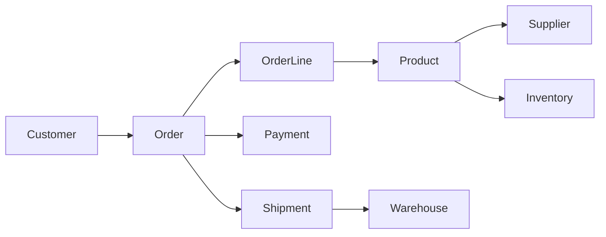
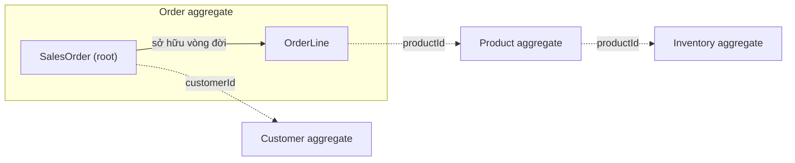
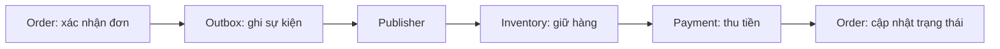

# Thiết kế ranh giới đối tượng nghiệp vụ thay vì nối mọi bảng thành đồ thị

Một cơ sở dữ liệu quan hệ thường có nhiều bảng liên kết bằng khóa ngoại. Khi chuyển schema sang JPA, cách làm dễ gặp là khai báo `@OneToMany`, `@ManyToOne`, `@OneToOne` hoặc `@ManyToMany` cho **mọi khóa ngoại**, rồi để mỗi entity có thể điều hướng sang hàng loạt entity khác. Kết quả là một đồ thị đối tượng ngày càng lớn: từ khách hàng sang đơn hàng, từ đơn hàng sang sản phẩm, nhà cung cấp, kho, thanh toán và ngược trở lại.

JPA **không bắt buộc** mô hình đối tượng phải chứa một mối liên kết ở cả hai chiều cho mọi quan hệ trong database. Thiết kế tốt bắt đầu từ câu hỏi nghiệp vụ: **những dữ liệu nào phải được kiểm soát và thay đổi cùng nhau để giữ đúng một quy tắc nhất quán?** Câu trả lời giúp xác định **ranh giới aggregate (cụm đối tượng nghiệp vụ)**, trách nhiệm của từng entity và cách tham chiếu tới những aggregate khác.

Bài học thuộc phần **Quan hệ thực thể** này hướng dẫn cách giữ quan hệ JPA ở nơi thực sự cần, dùng định danh để liên kết các phần nghiệp vụ độc lập, và tổ chức truy vấn đọc mà không cần biến toàn bộ schema thành một đồ thị entity.

## 1. Vì sao không nên ánh xạ mọi foreign key thành quan hệ JPA?

Giả sử hệ thống bán hàng có schema liên kết như sau:



Sơ đồ trên **hợp lý ở mức dữ liệu quan hệ**: nó thể hiện các bảng cần tham chiếu nhau. Nhưng nếu tất cả cạnh đều trở thành trường object trong entity, thậm chí nhiều cạnh được khai báo hai chiều, một dòng code như `customer.getOrders().get(0).getLines().get(0).getProduct().getSupplier()` có thể kéo một chuỗi truy vấn và kết nối các phần nghiệp vụ vốn cần phát triển độc lập.

Các hệ quả thường gặp:

- **Đồ thị object phình to:** việc tải một entity vô tình đi qua nhiều quan hệ và materialize dữ liệu không cần thiết.
- **N+1 query:** duyệt collection và lazy association trong vòng lặp có thể phát thêm nhiều SQL.
- **Khó kiểm soát transaction:** một luồng cập nhật phải hiểu các entity và vòng đời ở nhiều chức năng khác nhau.
- **Cascade nguy hiểm:** dùng `CascadeType.ALL` bừa bãi khiến thao tác xóa hoặc lưu một entity ảnh hưởng sang dữ liệu được quản lý bởi nghiệp vụ khác.
- **Ràng buộc mã nguồn chặt:** sửa bảng/model của catalog có thể buộc thay đổi entity của đơn hàng dù nghiệp vụ đơn hàng chỉ cần mã sản phẩm.
- **Vấn đề JSON serialization:** API trả entity trực tiếp dễ kích hoạt lazy loading, đệ quy quan hệ hai chiều hoặc rò dữ liệu ngoài ý muốn.
- **Khó diễn đạt quy tắc nghiệp vụ:** các setter và collection công khai khiến mã ở bất kỳ đâu cũng có thể sửa một phần đồ thị mà không đi qua quy tắc nhất quán.

Điểm cần phân biệt: **khóa ngoại trong database biểu diễn toàn vẹn tham chiếu; quan hệ object trong JPA biểu diễn cách mô hình Java điều hướng và quản lý vòng đời**. Hai vai trò liên quan nhưng không bắt buộc có ánh xạ một-một.

## 2. Ba lớp khái niệm cần tách biệt

| Khái niệm | Trả lời câu hỏi gì? | Ví dụ |
|---|---|---|
| **Quan hệ trong DB** | Bản ghi nào có thể tham chiếu bản ghi nào và cần constraint nào? | `orders.customer_id` có thể có FK tới `customers.id` |
| **Quan hệ trong JPA** | Từ object này cần điều hướng sang object nào, fetch/cascade ra sao? | `Order.lines` là `@OneToMany` tới `OrderLine` |
| **Ranh giới aggregate** | Những object nào phải được thay đổi nhất quán trong một đơn vị nghiệp vụ? | `Order` cùng `OrderLine` tạo thành một aggregate |

### 2.1. Entity

Một **entity** có identity và vòng đời. Ví dụ `Order` tồn tại với một ID ổn định dù tên trạng thái, địa chỉ giao hàng hoặc các dòng hàng thay đổi. Trong JPA, entity thường được khai báo `@Entity` và có `@Id`.

### 2.2. Value object

Một **value object** được xác định chủ yếu bằng giá trị, ví dụ `Money` hoặc `ShippingAddress`. Nếu không có identity và vòng đời riêng, nó có thể là lớp `@Embeddable` hoặc một kiểu Java phù hợp, thay vì entity độc lập.

### 2.3. Aggregate và aggregate root

**Aggregate** là một nhóm entity/value object được đối xử như **một ranh giới nhất quán nghiệp vụ**. **Aggregate root** là điểm vào để thay đổi các thành viên trong nhóm.

Ví dụ:

- `Order` là root.
- `OrderLine` là entity con thuộc đơn hàng; không nên bị tạo hoặc xóa bởi chức năng khác mà không thông qua `Order`.
- `Customer` có identity và vòng đời riêng; đơn hàng chỉ cần biết `customerId` và có thể lưu snapshot thông tin tại lúc đặt.
- `Product` thuộc catalog; đơn hàng cần `productId`, số lượng và đơn giá tại thời điểm đặt, không cần sở hữu vòng đời product.

**Aggregate không đồng nghĩa với một bảng**, và cũng không đồng nghĩa với một object graph khổng lồ. Một aggregate có thể ánh xạ nhiều bảng; một chức năng nghiệp vụ cũng có thể phải phối hợp nhiều aggregate.

### 2.4. Bounded context

**Bounded context** là phạm vi mà một mô hình và ngôn ngữ nghiệp vụ có ý nghĩa nhất quán, ví dụ Ordering, Catalog, Inventory, Payments. Đây là ranh giới khái niệm rộng hơn một aggregate; một bounded context có thể chứa nhiều aggregate.

Không nên nhầm: aggregate là **ranh giới nhất quán trong mô hình nghiệp vụ**, bounded context là **ranh giới của mô hình và ngôn ngữ**. Không thể cứ một bảng là một aggregate hoặc một module Java là một bounded context.

## 3. Xác định ranh giới bằng bất biến nghiệp vụ

Một **bất biến (invariant)** là quy tắc phải luôn đúng ở thời điểm nghiệp vụ yêu cầu. Hãy liệt kê quy tắc trước khi vẽ quan hệ JPA.

Với hệ thống bán hàng:

| Quy tắc | Dữ liệu cần kiểm soát cùng nhau | Gợi ý ranh giới |
|---|---|---|
| Đơn hàng được xác nhận phải có ít nhất một dòng | `Order` và `OrderLine` | Cùng aggregate |
| Số lượng từng dòng phải lớn hơn 0 | `OrderLine` thuộc một đơn hàng | Kiểm soát qua root |
| Tổng tiền phải phản ánh các dòng và giá chốt | Dòng hàng và tổng trong cùng đơn | Cùng aggregate hoặc tính theo dòng |
| Sản phẩm có thể đổi tên/giá sau khi đơn đã đặt | `Product` và `Order` có vòng đời khác nhau | Hai aggregate độc lập; snapshot giá trong đơn |
| Khách hàng đổi địa chỉ tài khoản không được sửa địa chỉ của đơn cũ | `Customer` và `Order` khác thời điểm hiệu lực | Hai aggregate; snapshot địa chỉ giao |
| Một sản phẩm được dùng trong nhiều đơn | Product tồn tại độc lập với bất kỳ đơn nào | Không cascade `REMOVE` từ Order sang Product |
| Trừ tồn kho phải tránh bán vượt số lượng | Inventory cần kiểm soát đồng thời riêng | Aggregate tồn kho hoặc dịch vụ đặt giữ hàng riêng |

**Câu hỏi then chốt:** khi một nghiệp vụ thay đổi một object, đối tượng nào **bắt buộc phải cùng thay đổi trong cùng transaction nhất quán**?

Nếu một đối tượng có thể được thay đổi, tra cứu và quản lý độc lập mà không vi phạm bất biến của đối tượng kia, nó thường không cần nằm trong cùng aggregate.

### Không gộp quá nhiều để có “transaction lớn”

Một giao dịch đặt hàng có thể liên quan đến khách hàng, giá bán, số lượng tồn, thanh toán, vận chuyển. Điều đó không có nghĩa tất cả dữ liệu ấy thuộc một aggregate. Nhiều quy tắc có thể được thực hiện qua quy trình ứng dụng hoặc phối hợp sự kiện; các transaction cần được thiết kế cho từng ranh giới dữ liệu.

Ngược lại, nếu một bất biến **thực sự** cần cập nhật đồng thời nhiều entity, tách chúng tùy tiện có thể tạo lỗi nhất quán. Ranh giới phải xuất phát từ quy tắc nghiệp vụ, không phải sở thích dùng ít `@OneToMany`.

## 4. Thiết kế ví dụ: Order là aggregate, Customer và Product là tham chiếu ngoài

Mô hình đề xuất:



Các mũi tên nét liền biểu diễn quan hệ object được quản lý trong aggregate. Mũi tên nét đứt diễn đạt **tham chiếu bằng định danh**, không buộc khai báo JPA association.

Đối với một đơn hàng, ta cần:

- `SalesOrder.id`: định danh đơn.
- `SalesOrder.customerId`: định danh khách hàng; có thể có FK nếu cùng database.
- `SalesOrder.lines`: các `OrderLine` thuộc vòng đời của đơn.
- `OrderLine.productId`: định danh sản phẩm độc lập.
- `OrderLine.unitPrice`: **đơn giá đã chốt** tại lúc đặt hàng; không phụ thuộc product.price thay đổi về sau.
- `Order.status`: trạng thái được thay đổi qua phương thức nghiệp vụ của root.
- `@Version`: cơ sở kiểm soát đồng thời khi cập nhật root bằng JPA.

Thiết kế này cho phép vẫn có schema quan hệ với nhiều FK. Điều thay đổi là **API object và trách nhiệm quản lý**, không phải xóa các ràng buộc dữ liệu.

## 5. Ánh xạ JPA trong ranh giới Order aggregate

Ví dụ dùng Java 17+, Jakarta Persistence 3.1 và provider hỗ trợ `GenerationType.UUID` (chẳng hạn Hibernate 6). Phần code minh họa quan hệ entity và tính nhất quán; repository/service Spring Data JPA được nêu riêng ở phần sau.

### 5.1. Lớp aggregate root `SalesOrder`

```java
package demo.order;

import jakarta.persistence.*;
import java.math.BigDecimal;
import java.time.Instant;
import java.util.ArrayList;
import java.util.List;
import java.util.Objects;
import java.util.UUID;

@Entity
@Table(name = "orders")
public class SalesOrder {

    @Id
    @GeneratedValue(strategy = GenerationType.UUID)
    private UUID id;

    @Version
    private long version;

    @Column(name = "customer_id", nullable = false, updatable = false)
    private UUID customerId;

    @Enumerated(EnumType.STRING)
    @Column(nullable = false, length = 24)
    private OrderStatus status;

    @Column(name = "created_at", nullable = false, updatable = false)
    private Instant createdAt;

    @OneToMany(
        mappedBy = "order",
        cascade = CascadeType.ALL,
        orphanRemoval = true
    )
    private List<OrderLine> lines = new ArrayList<>();

    protected SalesOrder() {
        // JPA constructor.
    }

    public SalesOrder(UUID customerId) {
        this.customerId = Objects.requireNonNull(customerId);
        this.status = OrderStatus.DRAFT;
        this.createdAt = Instant.now();
    }

    public UUID getId() {
        return id;
    }

    public UUID getCustomerId() {
        return customerId;
    }

    public OrderStatus getStatus() {
        return status;
    }

    public List<OrderLine> getLines() {
        return List.copyOf(lines);
    }

    public void addLine(
            UUID productId, int quantity, BigDecimal unitPrice) {
        requireDraft();
        lines.add(new OrderLine(this, productId, quantity, unitPrice));
    }

    public BigDecimal total() {
        return lines.stream()
                .map(OrderLine::lineTotal)
                .reduce(BigDecimal.ZERO, BigDecimal::add);
    }

    public void confirm() {
        requireDraft();
        if (lines.isEmpty()) {
            throw new IllegalStateException(
                    "Cannot confirm an order without lines");
        }
        status = OrderStatus.CONFIRMED;
    }

    private void requireDraft() {
        if (status != OrderStatus.DRAFT) {
            throw new IllegalStateException(
                    "Only a draft order can be modified");
        }
    }
}
```

```java
package demo.order;

public enum OrderStatus {
    DRAFT,
    CONFIRMED,
    CANCELLED
}
```

Những quyết định đáng chú ý:

- **`customerId` là `UUID`, không phải `Customer customer`.** Root không sở hữu vòng đời khách hàng.
- **`lines` là quan hệ JPA** vì dòng hàng thuộc vòng đời đơn hàng và quy tắc xác nhận đơn.
- **`cascade = ALL` chỉ nằm trong aggregate**: tạo/xóa đơn ảnh hưởng các dòng thuộc đơn. Không đặt cascade tương tự lên Customer hoặc Product.
- **`getLines()` trả danh sách không cho chỉnh sửa trực tiếp**. Thay đổi phải qua hành vi của root, chẳng hạn `addLine`.
- **`@Version` đặt trên root** để hỗ trợ optimistic locking khi root bị cập nhật. Việc chỉ sửa entity con có luôn làm version root thay đổi hay không phụ thuộc cách quản lý/SQL của provider; không mặc định đây là cơ chế khóa thay cho một chiến lược concurrency đã kiểm chứng.
- **`total()` được tính từ các dòng**, tránh biến tổng và chi tiết thành hai nguồn dữ liệu trái ngược trong ví dụ. Nếu hệ thống lưu tổng để tối ưu, phải quản lý cập nhật cả hai trong cùng invariant.

### 5.2. Entity con `OrderLine`

```java
package demo.order;

import jakarta.persistence.*;
import java.math.BigDecimal;
import java.util.Objects;
import java.util.UUID;

@Entity
@Table(name = "order_lines")
public class OrderLine {

    @Id
    @GeneratedValue(strategy = GenerationType.UUID)
    private UUID id;

    @ManyToOne(fetch = FetchType.LAZY, optional = false)
    @JoinColumn(name = "order_id", nullable = false)
    private SalesOrder order;

    @Column(name = "product_id", nullable = false, updatable = false)
    private UUID productId;

    @Column(nullable = false)
    private int quantity;

    @Column(name = "unit_price", nullable = false,
            precision = 14, scale = 2)
    private BigDecimal unitPrice;

    protected OrderLine() {
        // JPA constructor.
    }

    OrderLine(
            SalesOrder order,
            UUID productId,
            int quantity,
            BigDecimal unitPrice) {
        if (quantity <= 0) {
            throw new IllegalArgumentException("quantity must be positive");
        }
        Objects.requireNonNull(unitPrice, "unitPrice");
        if (unitPrice.signum() < 0) {
            throw new IllegalArgumentException(
                    "unitPrice must not be negative");
        }

        this.order = Objects.requireNonNull(order);
        this.productId = Objects.requireNonNull(productId);
        this.quantity = quantity;
        this.unitPrice = unitPrice;
    }

    public UUID getProductId() {
        return productId;
    }

    public int getQuantity() {
        return quantity;
    }

    public BigDecimal getUnitPrice() {
        return unitPrice;
    }

    public BigDecimal lineTotal() {
        return unitPrice.multiply(BigDecimal.valueOf(quantity));
    }
}
```

Quan hệ `@ManyToOne` từ `OrderLine` tới `SalesOrder` là **liên kết nội bộ aggregate**, có vai trò thực tế trong ánh xạ FK `order_id`. Field `productId` vẫn là khóa vô hướng vì dòng đơn không chịu trách nhiệm cập nhật vòng đời của sản phẩm.

`@ManyToOne(fetch = LAZY)` nói với provider tránh tải order ngay khi đọc line trong các tình huống có thể hỗ trợ lazy; nhưng đây vẫn là hint theo đặc tả. Đừng dựa vào việc annotation chắc chắn triệt tiêu mọi SQL. Ngược lại, nếu không cấu hình fetch, nhiều association `@ManyToOne` có mặc định `EAGER` theo JPA, dễ gây tải ngoài ý muốn.

Một vấn đề thực tế: lớp `OrderLine` nên chỉ được tạo qua root hoặc factory kiểm soát invariant. Constructor được để package-private nhằm biểu đạt ý đó; giới hạn truy cập Java **không phải biện pháp bảo mật DB**, mà là cách tổ chức mã theo sở hữu nghiệp vụ.

### 5.3. Tại sao có quan hệ hai chiều bên trong aggregate?

`SalesOrder.lines` giúp root nắm tập dòng, còn `OrderLine.order` giúp provider quản lý khóa ngoại. Với mapping `mappedBy = "order"`, phía `OrderLine.order` là **owning side** của quan hệ trong JPA. Vì vậy phương thức `addLine` phải tạo line với `order = this`; chỉ thêm một object child có trường order rỗng vào collection sẽ khiến mapping không nhất quán.

Không có quy tắc mọi `@OneToMany` phải hai chiều. Nếu bài toán đơn giản hơn với ánh xạ một chiều hoặc value objects, có thể chọn giải pháp đó. Mục tiêu là giữ biểu diễn nhỏ và phục vụ invariant, chứ không tạo cặp getter trên mọi bảng.

## 6. Schema quan hệ vẫn có foreign key

Một thiết kế hướng aggregate có thể giữ nguyên constraint để DB bảo vệ dữ liệu. DDL minh họa cho hệ quản trị có kiểu `UUID` như PostgreSQL:

```sql
-- Giả sử bảng customers và products đã tồn tại
-- với id kiểu UUID, nếu được quản lý trong cùng DB.

CREATE TABLE orders (
    id         UUID PRIMARY KEY,
    version    BIGINT NOT NULL,
    customer_id UUID NOT NULL,
    status     VARCHAR(24) NOT NULL,
    created_at TIMESTAMP WITH TIME ZONE NOT NULL,
    CONSTRAINT fk_orders_customer
        FOREIGN KEY (customer_id) REFERENCES customers(id)
);

CREATE TABLE order_lines (
    id         UUID PRIMARY KEY,
    order_id   UUID NOT NULL,
    product_id UUID NOT NULL,
    quantity   INTEGER NOT NULL CHECK (quantity > 0),
    unit_price NUMERIC(14, 2) NOT NULL CHECK (unit_price >= 0),
    CONSTRAINT fk_lines_order
        FOREIGN KEY (order_id) REFERENCES orders(id)
);

CREATE INDEX ix_orders_customer_created
    ON orders (customer_id, created_at DESC);

CREATE INDEX ix_order_lines_order
    ON order_lines (order_id);
```

**Không khai báo `@ManyToOne Customer` không đồng nghĩa phải xóa FK `orders.customer_id`.** Nếu hai bảng thuộc cùng database và quyền vận hành cho phép, DB có thể kiểm tra tham chiếu ngay cả khi JPA chỉ ánh xạ `customerId` như thuộc tính đơn giản.

Nếu Customer và Order thuộc **hai database hoặc hai dịch vụ độc lập**, một FK vật lý xuyên database thường không có hoặc không phù hợp; lúc đó cần quy trình xác thực tham chiếu, sự kiện và xử lý nhất quán theo kiến trúc. Đừng ngầm giả định ràng buộc DB luôn tồn tại.

Cũng cần quyết định rõ liệu `order_lines.product_id` nên FK tới `products.id` hay không. Nếu Product cùng DB nhưng Catalog có chính sách xóa/sửa đặc biệt, FK có thể phù hợp. Nếu Catalog do dịch vụ riêng sở hữu, ID tham chiếu cần được xử lý bằng contract giữa các dịch vụ.

## 7. Đặt giao dịch và hành vi tại aggregate root

Tầng application service điều phối các nguồn thông tin rồi yêu cầu aggregate thực hiện hành vi. Không để controller trực tiếp sửa `order.getLines()` hay gán `order.status` tùy ý.

Ví dụ với Spring Data JPA:

```java
package demo.order;

import org.springframework.data.jpa.repository.JpaRepository;
import java.util.UUID;

public interface SalesOrderRepository
        extends JpaRepository<SalesOrder, UUID> {
}
```

Giả sử một thành phần đáng tin cậy đã xác minh giá bán và quyền đặt hàng, nó chuyển thông tin vào command:

```java
package demo.order;

import java.math.BigDecimal;
import java.util.UUID;

public record PricedLine(
        UUID productId,
        int quantity,
        BigDecimal approvedUnitPrice
) {}
```

Service:

```java
package demo.order;

import org.springframework.stereotype.Service;
import org.springframework.transaction.annotation.Transactional;
import java.util.List;
import java.util.UUID;

@Service
public class PlaceOrderService {

    private final SalesOrderRepository orders;

    public PlaceOrderService(SalesOrderRepository orders) {
        this.orders = orders;
    }

    @Transactional
    public UUID placeOrder(UUID customerId, List<PricedLine> approved) {
        SalesOrder order = new SalesOrder(customerId);

        for (PricedLine line : approved) {
            order.addLine(
                    line.productId(),
                    line.quantity(),
                    line.approvedUnitPrice());
        }

        order.confirm();
        return orders.save(order).getId();
    }
}
```

Mỗi `PricedLine` trong ví dụ phải xuất phát từ **quy trình định giá và kiểm tra quyền đáng tin cậy**, không nhận nguyên vẹn giá từ HTTP request của người dùng. Trường hợp giá/chiết khấu có hiệu lực theo thời gian cần lưu snapshot hoặc mã báo giá và chính sách kiểm tra tương ứng.

Service làm ba việc: tạo root, gọi hành vi trong ranh giới root, rồi lưu qua repository. Không có dòng nào sửa Product hoặc Customer khi tạo đơn.

Với một entity mới, `save()` thường đi tới `persist()` theo cơ chế nhận diện mới của Spring Data JPA; quan hệ con được lưu nhờ cascade của aggregate. Các chi tiết SQL có thể phát tại `flush/commit`. `@Transactional` quản lý transaction của nguồn dữ liệu được cấu hình; nó **không tự biến lời gọi tới hệ thống ngoài thành một transaction nguyên tử**.

### Kiểm tra tham chiếu đến aggregate khác

Ví dụ muốn bảo đảm khách hàng được phép đặt hàng:

- Tầng application service hỏi `CustomerPolicy` hoặc repository của Customer để xác thực.
- Nếu dữ liệu cùng DB và yêu cầu toàn vẹn tham chiếu, FK vẫn bảo vệ trường hợp khách hàng không tồn tại.
- Nếu trạng thái khách hàng có thể thay đổi đồng thời, cần quy định **thời điểm** hiệu lực của quyết định: chấp nhận trạng thái ở lúc bắt đầu yêu cầu, hoặc yêu cầu khóa/điều kiện kiểm tra chặt hơn.
- Với hệ thống phân tán, kết quả kiểm tra có thể trở nên cũ ngay sau khi gọi. Đó là vấn đề nhất quán và workflow, không giải quyết được chỉ bằng cách khai báo `@ManyToOne`.

Một getter `order.getCustomer().isActive()` có vẻ thuận tiện nhưng không tự đảm bảo ràng buộc giao dịch ở hai aggregate hoặc hai dịch vụ.

## 8. Đọc dữ liệu xuyên ranh giới mà không xây đồ thị entity

**Ranh giới ghi và cách đọc không bắt buộc trùng nhau.** Để ghi, ta cần bảo vệ invariant. Để hiển thị, ta có thể cần gộp thông tin từ nhiều bảng/aggregate dưới dạng một **DTO (Data Transfer Object)**.

Ví dụ màn hình lịch sử đơn cần:

- Mã đơn, trạng thái, thời điểm đặt.
- Số tiền và số dòng.
- Tên khách hàng hiển thị, có thể lấy từ read model hoặc nguồn dữ liệu phù hợp.

Không nên làm theo chuỗi:

```java
List<Customer> customers = customerRepository.findAll();

for (Customer customer : customers) {
    for (SalesOrder order : customer.getOrders()) {
        for (OrderLine line : order.getLines()) {
            System.out.println(line.getProduct().getName());
        }
    }
}
```

Đây là **phản ví dụ**, giả định có một đồ thị entity xuyên nghiệp vụ. Ngoài việc tải dữ liệu không cần thiết, nó dễ gây N+1 và khiến màn hình đọc phụ thuộc vào toàn bộ mapping.

### 8.1. JPQL projection chỉ lấy dữ liệu cần hiển thị

Định nghĩa một record:

```java
package demo.order.read;

import demo.order.OrderStatus;
import java.time.Instant;
import java.util.UUID;

public record OrderOverview(
        UUID id,
        UUID customerId,
        OrderStatus status,
        Instant createdAt
) {}
```

Truy vấn:

```java
List<OrderOverview> rows = em.createQuery(
        """
        SELECT new demo.order.read.OrderOverview(
            o.id, o.customerId, o.status, o.createdAt
        )
        FROM SalesOrder o
        WHERE o.customerId = :customerId
        ORDER BY o.createdAt DESC
        """,
        OrderOverview.class
    )
    .setParameter("customerId", customerId)
    .setMaxResults(50)
    .getResultList();
```

Query trả DTO, không yêu cầu tải collection `lines` và không bắt buộc có field `Customer customer`. Khi cần tổng tiền hoặc số dòng, có thể xây một projection truy vấn tập hợp tương ứng hoặc dùng read model được duy trì sẵn.

### 8.2. SQL hoặc JDBC join nhiều bảng để dựng read model

Một câu SQL phục vụ danh sách đơn có thể join theo khóa mà **không cần object association trong JPA**:

```sql
SELECT
    o.id,
    o.customer_id,
    o.status,
    o.created_at,
    COUNT(l.id) AS line_count,
    COALESCE(SUM(l.quantity * l.unit_price), 0) AS total_amount
FROM orders o
LEFT JOIN order_lines l ON l.order_id = o.id
WHERE o.customer_id = ?
GROUP BY o.id, o.customer_id, o.status, o.created_at
ORDER BY o.created_at DESC
LIMIT ? OFFSET ?;
```

Ví dụ dùng cú pháp phân trang tương thích PostgreSQL. Đây là **truy vấn đọc dữ liệu**, không phải lý do cần tạo trường object `Order.customer`, `Order.lines.product` hay `Product.supplier`. Với tập dữ liệu lớn, hãy theo dõi query plan, index và tránh OFFSET quá sâu khi cần phân trang keyset.

Sự độc lập của object model không cấm dùng join SQL. Nó giúp lựa chọn SQL theo nhu cầu đọc thay vì bị giới hạn bởi cách điều hướng entity.

### 8.3. Dùng truy vấn riêng hoặc batch lookup giữa context

Nếu màn hình cần tên sản phẩm từ Catalog, có thể lấy danh sách `productId` từ các dòng đơn, gọi API/batch query Catalog một lần, rồi ghép vào DTO. Cách này giảm nguy cơ gọi một request cho mỗi dòng.

Trong hệ thống nhiều dịch vụ, API composition, read replica hoặc projection cập nhật qua sự kiện có thể phù hợp hơn join xuyên DB. Cần nói rõ dữ liệu trên màn hình có thể **nhất quán cuối cùng (eventual consistency)** hay phải cập nhật ngay.

## 9. Fetch strategy cũng phải theo nhu cầu nghiệp vụ

Giữ aggregate nhỏ không tự động giải quyết mọi vấn đề hiệu năng. Trong phạm vi aggregate, vẫn phải thiết kế fetch theo luồng xử lý.

### 9.1. LAZY là điểm xuất phát, không phải bảo đảm

`@OneToMany` mặc định `LAZY`, còn `@ManyToOne` và `@OneToOne` thường mặc định `EAGER` theo JPA. Nên khai báo chiến lược rõ ràng khi có lý do, quan sát SQL thực tế và nhớ rằng `LAZY` ở một số loại association là gợi ý tùy khả năng provider.

Không nên chữa mọi lỗi lazy loading bằng cách chuyển toàn bộ quan hệ sang `EAGER`. Điều đó thường chỉ dời vấn đề hiệu năng từ chỗ truy cập field sang chỗ tải entity ban đầu.

### 9.2. Chỉ fetch join collection khi cần

Ví dụ đọc **chi tiết một đơn** cùng dòng hàng trong Spring Data JPA:

```java
public interface SalesOrderRepository
        extends JpaRepository<SalesOrder, UUID> {

    @Query("""
           SELECT DISTINCT o
           FROM SalesOrder o
           LEFT JOIN FETCH o.lines
           WHERE o.id = :id
           """)
    Optional<SalesOrder> findWithLines(@Param("id") UUID id);
}
```

Cần import thêm `Query`, `Param` và `Optional`. Phương thức này có mục đích rõ ràng: tải một order với các dòng của nó. `DISTINCT` diễn đạt ý định tránh lặp aggregate root khi join ra nhiều dòng.

**Không lấy cùng kiểu query fetch collection rồi phân trang danh sách hàng nghìn order** mà mặc định kết quả vẫn hiệu quả. Collection fetch join với pagination có thể tạo nhân bản hàng và buộc provider xử lý giới hạn trong bộ nhớ hoặc báo lỗi/cảnh báo tùy cấu hình. Với trang danh sách, ưu tiên projection hoặc quy trình hai bước: phân trang ID order trước rồi lấy chi tiết cần thiết cho những ID đó.

### 9.3. Tránh giữ entity managed chỉ để render JSON

Nếu controller trả thẳng `SalesOrder`, serializer có thể truy cập `lines` khi transaction đã đóng, dẫn đến `LazyInitializationException`, hoặc tự kích hoạt truy vấn nếu phiên còn mở. Với hai chiều `Order`–`OrderLine`, serializer còn có thể lặp vô hạn nếu chưa cấu hình.

Hướng dễ kiểm soát hơn là **chuyển sang DTO trong tầng service/query**, quyết định rõ cột/trường cần trả, rồi serialize DTO. Không để hợp đồng API phụ thuộc trực tiếp vào đồ thị JPA.

## 10. Cascade và orphanRemoval phải dừng đúng ranh giới

Các tùy chọn cascade là cơ chế **lan truyền thao tác persistence**, không phải phép xác nhận “các bảng có quan hệ với nhau”.

| Liên kết | Cascade hợp lý khi nào? | Cảnh báo |
|---|---|---|
| `Order → OrderLine` | Dòng hàng thuộc vòng đời đơn, được tạo/xóa qua root | Có thể dùng `PERSIST` / `REMOVE`, `orphanRemoval` |
| `Order → Customer` | Thường không cascade | Xóa Order không được xóa Customer |
| `OrderLine → Product` | Thường không cascade | Xóa dòng đơn không được xóa Product |
| `Product → Supplier` | Không tự động cascade theo FK | Supplier có lifecycle riêng |
| `Order → Payment` | Phải phân tích ownership và quy tắc giao dịch | Payment thường có xử lý, audit và trạng thái riêng |

Ví dụ sai nguy hiểm:

```java
@ManyToOne(cascade = CascadeType.ALL)
private Customer customer;
```

Khi cascade `REMOVE` phát sinh qua quan hệ này, ứng dụng có thể cố xóa cả Customer dù customer còn được nhiều đơn tham chiếu. Database có thể chặn bằng FK, nhưng không nên dựa vào lỗi DB để sửa thiết kế cascade không đúng.

`orphanRemoval = true` có nghĩa child bị tách khỏi quan hệ sở hữu có thể bị xóa khi flush. Chỉ dùng khi child **thực sự không có ý nghĩa tồn tại riêng**. Nếu một entity có thể chuyển chủ hoặc được lưu trữ độc lập, cần xem lại.

## 11. Transaction là ranh giới nhất quán, không phải ranh giới toàn bộ object graph

Aggregate thường được thiết kế để bảo vệ các bất biến quan trọng trong một transaction. Với Order và các dòng:

```text
Begin transaction
  ├─ Tạo Order
  ├─ Thêm OrderLine, kiểm tra quantity và giá
  ├─ Xác nhận Order khi có ít nhất một dòng
  └─ Ghi Order + OrderLine
Commit
```

Nếu một transaction thất bại, cả Order và OrderLine được rollback theo transaction database, với điều kiện chúng được ghi qua cùng tài nguyên và transaction manager phù hợp.

Nhưng một quy trình đầy đủ hơn có thể là:



Ở đây **Order, Inventory, Payment** có thể là ba aggregate/context khác nhau. Nếu chúng nằm ở các dịch vụ hoặc nguồn DB độc lập, `@Transactional` trên một service JPA **không bao trùm** toàn bộ quá trình. Một thiết kế sử dụng event, outbox, saga/process manager hoặc thao tác bù có thể cần thiết.

### Khi nào có thể cập nhật nhiều aggregate trong một transaction?

Nếu các aggregate cùng database và một use case có nhu cầu cập nhật chúng nguyên tử, application service **có thể** dùng transaction DB cho nhiều repository. Tuy nhiên, việc đó không bắt buộc sáp nhập chúng thành một object graph; vẫn cần rõ thành phần nào sở hữu từng invariant.

Trong một hệ thống phân tán, quy tắc nhất quán phải được thiết kế minh bạch. Không thể thay thế transaction phân tán bằng association JPA.

### Optimistic locking và thay đổi child

`@Version` trên `SalesOrder` hữu ích khi nhiều request cạnh tranh cập nhật root, nhưng một số thao tác chỉ thay đổi `OrderLine` có thể không tạo `UPDATE` lên row root theo cách developer tưởng tượng. Nếu bất biến tính tổng, số dòng, hạn mức hoặc trạng thái phụ thuộc vào concurrency:

- Tập trung hành vi sửa child qua root.
- Xác định chính xác SQL cập nhật version và điều kiện cạnh tranh của provider.
- Khi cần, dùng chiến lược `OPTIMISTIC_FORCE_INCREMENT` hoặc khóa/điều kiện DB thích hợp trên root, sau khi đánh giá tác động hiệu năng.
- Với invariant chịu tải đồng thời cao (ví dụ tồn kho), dùng cơ chế concurrency được thiết kế riêng cho aggregate tương ứng.

Đừng giả định “đã có `@Version` đâu đó trong graph” là mọi thay đổi giữa các bảng tự động tuần tự hóa.

## 12. Khi nào vẫn nên có quan hệ JPA tới aggregate khác?

**Tham chiếu ID** là cách rõ ràng để giảm coupling khi không cần điều hướng object. Tuy nhiên, không có quy tắc tuyệt đối rằng mọi quan hệ xuyên aggregate đều cấm ánh xạ JPA.

Trong một monolith với cùng database, mapping chỉ đọc hoặc một liên kết `@ManyToOne(fetch = LAZY)` tới aggregate khác có thể giúp đơn giản hóa truy vấn và loại bỏ mã mapping lặp, nếu đội ngũ hiểu rõ fetch/transaction và ownership.

Ví dụ:

```java
@ManyToOne(fetch = FetchType.LAZY, optional = false)
@JoinColumn(
    name = "customer_id",
    nullable = false,
    insertable = false,
    updatable = false
)
private Customer customerView;
```

Khi đã có field `UUID customerId` cùng ánh xạ tới `customer_id`, liên kết đọc kiểu này phải đặt `insertable = false, updatable = false` để tránh hai mapping đều ghi cùng một cột. Đoạn ví dụ chỉ minh họa **một lựa chọn kỹ thuật có chủ đích**, chưa gồm entity/constructor đầy đủ.

Nếu chọn, cần quy ước:

- Dùng `customerId` làm tham chiếu/ghi chính.
- Không đặt `CascadeType.REMOVE`, `CascadeType.ALL` giữa các aggregate độc lập.
- Không cho domain method của Order sửa state của Customer.
- Không serialize trực tiếp association ra API.
- Tránh dereference liên kết ở những luồng đọc danh sách không cần thiết.
- Kiểm soát quyền truy cập dữ liệu và transaction tại service.

Lợi ích khi có liên kết phải đủ rõ để đổi lấy chi phí coupling và khả năng phát sinh SQL. Không thêm association chỉ vì schema có foreign key.

## 13. Một aggregate quá lớn và quá nhỏ đều gây vấn đề

### 13.1. Aggregate quá lớn

Ví dụ coi `Customer` và toàn bộ Order, Payment, Shipment, Inventory thành một aggregate:

- Một transaction cập nhật địa chỉ Customer có thể vô tình tải hoặc tác động dữ liệu không liên quan.
- Nhiều chức năng cùng tranh chấp một root/version.
- Object graph nhiều cấp khó quan sát và dễ phát sinh N+1.
- Quy tắc xóa, lưu và audit trở nên mơ hồ.
- Khó chia module hoặc thay đổi phần Catalog/Inventory độc lập.

Không có lợi ích nhất quán rõ ràng để biện minh cho việc gộp toàn bộ.

### 13.2. Aggregate quá nhỏ

Ví dụ biến **mỗi OrderLine thành aggregate root độc lập**, có service cho phép sửa số lượng bất kỳ lúc nào, trong khi Order phải luôn có tổng tiền và trạng thái hợp lệ. Khi đó, cập nhật một dòng có thể vượt qua quy tắc của Order, làm tổng không khớp hoặc thay đổi đơn đã xác nhận.

Có thể vẫn thiết kế OrderLine độc lập trong các hệ thống có quy trình riêng cho từng dòng, nhưng phải chuyển invariant tương ứng sang một mô hình phù hợp (ví dụ event, kiểm tra nhất quán, tính toán tổng lại). Đừng tách khi không có lý do nghiệp vụ.

### 13.3. Kích thước aggregate thường nhỏ, nhưng không đếm bằng số entity

Ranh giới được đánh giá qua **bất biến, vòng đời, tần suất cập nhật và concurrency**, không phải quy tắc “tối đa năm bảng” hay “phải có đúng một entity”.

Một aggregate có vài chục nghìn children cần xem xét kỹ vì việc tải/sửa toàn bộ root có thể không phù hợp. Ngược lại, một aggregate với hai entity vẫn có thể khó vận hành nếu chúng tranh chấp cập nhật liên tục. Thiết kế phải dựa trên workload và quy tắc thật.

## 14. Phân biệt object graph với kế hoạch truy vấn

| Mục tiêu | Cách làm phù hợp |
|---|---|
| Bảo vệ invariant cùng vòng đời | Aggregate root và hành vi nghiệp vụ |
| Biểu diễn child thuộc root | Quan hệ JPA có ownership và cascade có chủ đích |
| Liên kết aggregate độc lập | ID hoặc mapping chỉ đọc có quy ước rõ |
| Bảo đảm bản ghi tham chiếu hợp lệ cùng DB | Foreign key, unique/check constraint |
| Liệt kê dữ liệu từ nhiều bảng | DTO projection, JPQL, JDBC/SQL, read model |
| Tải một aggregate chi tiết | Fetch plan có kiểm soát, query theo ID |
| Tải danh sách phân trang | Projection/page ID; tránh collection fetch join tràn lan |
| Tích hợp nhiều dịch vụ | API, event, outbox, saga và consistency policy |
| Ngăn ghi đè đồng thời | Version/lock/condition trong transaction tương ứng |

**Không nên thiết kế object model chỉ để một màn hình báo cáo viết được `order.getCustomer().getRegion()`.** Nhu cầu báo cáo có thể được đáp ứng bằng một truy vấn đọc phù hợp mà không làm domain model chịu mọi ràng buộc của báo cáo.

## 15. Cách chuyển dần từ mô hình “mọi bảng đều liên kết”

Trong dự án đã có sẵn một đồ thị JPA lớn, nên cải thiện theo use case thay vì xóa đồng loạt mọi quan hệ.

### Bước 1 — Vẽ các luồng cập nhật thực tế

Với từng lệnh nghiệp vụ: tạo đơn, hủy đơn, đổi giá sản phẩm, khóa khách hàng, hoàn tiền... ghi lại entity nào được đọc, entity nào được sửa và bất biến nào phải giữ.

### Bước 2 — Xác định điểm sở hữu

Chọn root chịu trách nhiệm thay đổi nhóm dữ liệu. Chẳng hạn Order sở hữu OrderLine, Product sở hữu thông tin Catalog, Payment sở hữu giao dịch và trạng thái thu tiền. Viết các phương thức domain thay cho setter tùy ý.

### Bước 3 — Tìm các cạnh object không cần thiết

Kiểm tra các liên kết `EAGER`, collection hiếm khi dùng, association hai chiều không có use case, cascade xuyên vòng đời độc lập. Những liên kết chỉ phục vụ lookup hoặc hiển thị có thể thay bằng ID và query method.

### Bước 4 — Tách API đọc khỏi entity graph

Thêm DTO cho các endpoint danh sách và báo cáo. Đo số truy vấn, lượng hàng đọc, memory và thời gian phản hồi trước/sau để xác định lợi ích. Tránh truy xuất collection khi không cần.

### Bước 5 — Giữ nguyên toàn vẹn dữ liệu

Khi bỏ một association JPA, **không xóa FK trong database theo quán tính**. Kiểm tra mapping cột ID còn tồn tại, migration/schema đúng và các luồng tạo/xóa không phụ thuộc cascade cũ.

### Bước 6 — Bổ sung kiểm soát concurrency và transaction

Khi chuyển hành vi sửa vào root, kiểm tra version, lock, ranh giới transaction và các thao tác SQL/JDBC ngoài JPA có làm hỏng invariant hay không.

### Bước 7 — Cắt dần coupling

Để Catalog hoặc Payments không import entity Order chỉ để lấy ID, có thể dùng kiểu ID (`UUID`) hoặc một value object định danh tối giản ở contract chung. Tránh tạo dependency vòng giữa package/module.

Một quá trình cải thiện có thể bắt đầu từ **một màn hình bị N+1 hoặc một cascade không an toàn**, sau đó mở rộng khi đã có bằng chứng và ranh giới được hiểu rõ.

## 16. Những hiểu lầm thường gặp

**“Có FK nghĩa là phải có `@ManyToOne`.”** Không. JPA cho phép ánh xạ cột FK thành trường ID thông thường. Database vẫn có thể duy trì FK.

**“Aggregate là tất cả những gì có thể đi tới được qua getter.”** Không. Aggregate là ranh giới quy tắc nhất quán và sở hữu vòng đời, không phải hình dạng đồ thị điều hướng.

**“Không có association thì không join được.”** Không. JPQL có nhiều cách truy vấn theo điều kiện; SQL/JDBC có thể join trên các cột FK mà không cần quan hệ object.

**“LAZY giải quyết mọi vấn đề của graph lớn.”** Không. Nó có thể trì hoãn truy vấn nhưng không giải quyết coupling, cascade sai hoặc invariant không có owner. Truy cập lặp còn có thể gây N+1.

**“Mọi cập nhật liên quan phải nằm trong một transaction JPA duy nhất.”** Không nhất thiết. Có invariant cần transaction nguyên tử; có workflow có thể phối hợp nhiều aggregate qua các bước/sự kiện với nhất quán cuối cùng. Chọn dựa trên yêu cầu nghiệp vụ.

**“Để controller gọi setter của entity cho nhanh.”** Điều đó dễ vượt qua invariant, đặc biệt nếu child được sửa trực tiếp. Service/aggregate root nên là nơi điều khiển các thay đổi có ý nghĩa nghiệp vụ.

**“Không nên có hai chiều JPA association trong mọi trường hợp.”** Không tuyệt đối. Trong cùng aggregate, quan hệ hai chiều có thể hữu ích cho ORM và hành vi. Điều quan trọng là giới hạn nó ở ranh giới đúng và đồng bộ owning side.

## 17. Bài tập tình huống

### Bài 1 — Xác định aggregate

Cho sơ đồ gồm `Customer`, `Cart`, `CartItem`, `Product`, `StockBalance`, `Order`, `OrderLine` và `Payment`. Hãy đề xuất root và giải thích vì sao:

1. Giỏ hàng không được có dòng số lượng bằng 0.
2. Giá sản phẩm hôm nay thay đổi không được sửa lại đơn đã xác nhận.
3. Thanh toán có thể hoàn tiền sau khi đơn đã giao.
4. Kho có thể được cập nhật bởi nhiều đơn đồng thời.

**Gợi ý:** Cart/CartItem, Order/OrderLine, Product, Inventory, Payment là những ứng viên aggregate riêng; ranh giới cuối cùng phụ thuộc invariant và quy trình thật.

### Bài 2 — Tìm cascade nguy hiểm

Đánh giá:

```java
@Entity
class SalesOrder {
    @ManyToOne(cascade = CascadeType.ALL)
    Customer customer;

    @OneToMany(cascade = CascadeType.ALL, orphanRemoval = true)
    List<OrderLine> lines;
}
```

Hãy giải thích vì sao cascade sang Customer thường không hợp lý, còn cascade sang OrderLine có thể phù hợp nếu line thuộc vòng đời đơn. Xác định owning side và method cần đồng bộ hai phía quan hệ.

### Bài 3 — Tách màn hình danh sách khỏi entity graph

Một endpoint hiển thị 50 đơn gồm `id`, `status`, `createdAt`, `total` đang gọi `findAll()` và duyệt các dòng hàng cùng product để tính tổng.

Hãy thiết kế DTO, truy vấn tổng hợp theo `orders`/`order_lines`, chiến lược phân trang và số SQL hợp lý. Giải thích tại sao không cần `OrderLine.product` để tính tổng nếu đơn đã lưu `unitPrice` tại lúc mua.

### Bài 4 — Tính nhất quán giữa Order và Inventory

Giả sử đặt đơn mới cần giảm số lượng tồn. Có hai phương án:

- Cả Order và Inventory nằm trong cùng database.
- Inventory được quản lý bởi dịch vụ riêng.

Với mỗi phương án, xác định cách kiểm tra và cập nhật tồn, rủi ro race condition, ranh giới transaction và cơ chế tránh bán vượt. Giải thích tại sao một field `@ManyToOne Inventory` không giải quyết vấn đề concurrency.

### Bài 5 — Cải thiện một graph cũ

Giả sử `Customer` có `@OneToMany(mappedBy = "customer", fetch = EAGER) List<Order>`, Order có EAGER tới Product và Supplier. Viết kế hoạch cải tiến từng bước:

- Liệt kê use case thật sự cần danh sách order của customer.
- Chuyển endpoint danh sách sang projection theo `customerId`.
- Giữ DB constraint trên `orders.customer_id` nếu phù hợp.
- Bỏ association/cascade không cần thiết sau khi cập nhật callers.
- Quan sát SQL và hành vi nghiệp vụ sau thay đổi.

## 18. Câu hỏi tự kiểm tra

1. **Vì sao database có foreign key nhưng entity JPA có thể chỉ giữ ID?** Vì FK kiểm tra toàn vẹn tham chiếu, còn association JPA quyết định cách Java điều hướng và quản lý persistence.
2. **Aggregate root làm gì?** Đóng vai trò điểm vào cho các thay đổi cần bảo vệ invariant của một nhóm entity/value object.
3. **OrderLine có nên sửa trực tiếp qua repository độc lập không?** Không nên mặc định, nếu thay đổi của line phải tuân thủ trạng thái và quy tắc của Order.
4. **Có nên cascade `REMOVE` từ Order sang Product?** Thông thường không; Product có vòng đời độc lập và được nhiều đơn tham chiếu.
5. **Không có `Customer customer` thì lấy tên khách hàng ở màn hình báo cáo bằng cách nào?** Dùng truy vấn đọc theo ID, join SQL, batch lookup hoặc read model phù hợp.
6. **Vì sao fetch join collection khi phân trang có thể gây vấn đề?** Join nhân số hàng theo children, làm khó áp dụng limit/offset đúng trên các root.
7. **`@Version` trên root có bảo đảm mọi chỉnh sửa child đều tăng version?** Không nên giả định; cần kiểm tra hành vi provider và thiết kế concurrency cho invariant.
8. **Bounded context có giống aggregate không?** Không. Context là phạm vi mô hình/ngôn ngữ; bên trong có thể có nhiều aggregate.
9. **Bỏ object association có đồng nghĩa bỏ FK database?** Không. Có thể giữ ràng buộc dữ liệu trên cột ID.
10. **Khi nào dùng eventual consistency?** Khi một workflow phối hợp những ranh giới có thể tiến triển độc lập và yêu cầu nghiệp vụ chấp nhận sự đồng bộ qua các bước, thường gặp ở hệ thống nhiều dịch vụ.

**Ghi nhớ:** **Hãy vẽ ranh giới theo nghiệp vụ trước, rồi mới chọn quan hệ JPA.** Dùng association và cascade khi các đối tượng có cùng vòng đời, cần bảo vệ bất biến trong một aggregate. Dùng ID để tham chiếu aggregate độc lập, giữ FK ở database khi thích hợp và xây DTO/query đọc cho nhu cầu hiển thị. Cách này giúp mô hình JPA dễ hiểu, tránh đồ thị đối tượng không kiểm soát và giữ transaction cùng trách nhiệm cập nhật ở đúng nơi.
