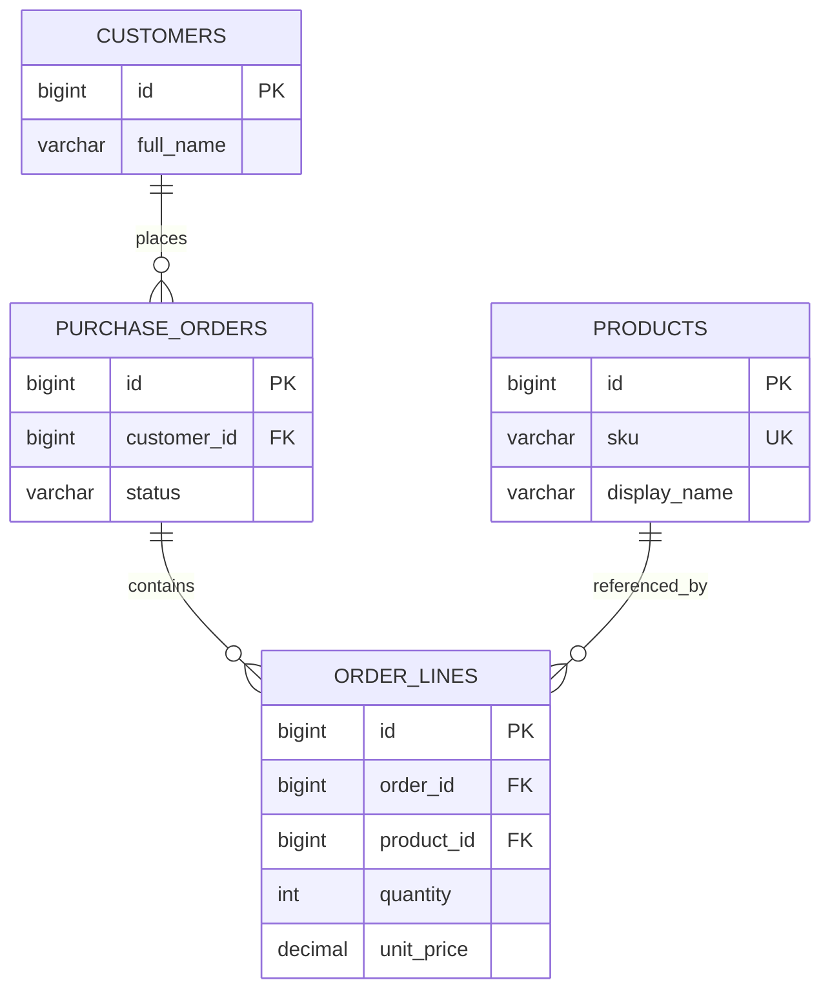

# Kiểm chứng mô hình quan hệ qua SQL và dữ liệu thực tế

> **Chủ đề:** Data Persistence Relational Access ORM JPA  
> **Chương:** Quan hệ thực thể

Một mô hình JPA có thể trông hợp lý khi đọc các annotation như `@ManyToOne`, `@OneToMany` và `@JoinColumn`, nhưng chỉ có thể khẳng định nó hoạt động đúng khi đối chiếu với **schema thực tế**, **các hàng dữ liệu được ghi**, **SQL provider thực thi** và **hành vi trong transaction**. Ví dụ, khai báo “một đơn hàng thuộc một khách hàng” chưa đủ để biết cột khóa ngoại có được ghi đúng hay không, database có bắt buộc khách hàng tồn tại hay không, hoặc truy vấn có vô tình làm nhân bản đơn hàng hay không.

Bài này xây một mô hình khách hàng – đơn hàng – dòng đơn – sản phẩm, rồi đi từ annotation JPA tới DDL, dữ liệu mẫu, truy vấn JOIN, constraint, cập nhật quan hệ, cascade và kiểm thử tích hợp. Mục đích là hình thành phương pháp **kiểm chứng bằng bằng chứng có thể quan sát**, thay vì chỉ dự đoán từ tên annotation.

## 1. Mục tiêu học tập

Sau bài học, bạn có thể:

- Chuyển một quan hệ giữa các entity thành **cột khóa ngoại, khóa chính, unique constraint và bảng liên kết** tương ứng.
- Phân biệt **cardinality** (1–1, 1–N, N–N), **optionality**, **owning side**, **cascade** và **fetch strategy**.
- Chuẩn bị dữ liệu mẫu có cả trường hợp thông thường, không có quan hệ con và nhiều bản ghi con.
- Dùng SQL `JOIN`, `LEFT JOIN`, `COUNT`, `GROUP BY` và điều kiện khóa ngoại để kiểm tra quan hệ.
- Kiểm tra entity được persist đã tạo đúng giá trị FK, và thay đổi quan hệ có cập nhật FK như dự kiến.
- Tái hiện và lý giải lỗi FK, `NOT NULL`, `UNIQUE`, xóa bản ghi được tham chiếu và orphan removal.
- Nhận biết truy vấn thừa, N+1, nhân bản hàng và khác biệt giữa số hàng SQL với số entity trong persistence context.
- Viết integration test kiểm tra **database thật**, tránh kết luận chỉ từ object graph trong bộ nhớ.
- Phân biệt điều JPA mô tả với điều ràng buộc database đang thực thi.

## 2. Bắt đầu từ ba lớp cần đối chiếu

Khi kiểm chứng một association, hãy nhìn ba lớp cùng lúc:

```text
LỚP 1 — MÔ HÌNH JAVA / JPA
Customer  1 ------ * PurchaseOrder
                     1 ------ * OrderLine
                                  * ------ 1 Product

    @OneToMany / @ManyToOne / @JoinColumn
                 |
                 v
LỚP 2 — SCHEMA DATABASE
customers(id PK)
purchase_orders(id PK, customer_id FK)
order_lines(id PK, order_id FK, product_id FK)
products(id PK)
                 |
                 v
LỚP 3 — DỮ LIỆU VÀ SQL THỰC THI
purchase_orders.customer_id = customers.id
order_lines.order_id = purchase_orders.id
order_lines.product_id = products.id

INSERT / UPDATE / DELETE / SELECT / JOIN
```

Lớp thứ nhất là **ý định mapping**. Lớp thứ hai quyết định những quy tắc mà database bảo vệ. Lớp thứ ba cho thấy thực tế những row nào được tạo, truy vấn nào chạy và kết quả có đúng nghiệp vụ hay không.

Một lỗi có thể xuất hiện ở bất kỳ lớp nào: Java tham chiếu sai object, mapping viết sai cột FK, schema thiếu constraint, dữ liệu nhập từ công cụ khác không hợp lệ, hoặc query tự viết nối nhầm khóa.

### 2.1. Đọc quan hệ bằng câu hỏi cụ thể

| Câu hỏi | Phải xem ở đâu? |
|---|---|
| Một order có bắt buộc thuộc một customer? | `optional` trên association, `NOT NULL` của FK, validation và dữ liệu thực tế |
| Bên nào quyết định giá trị `customer_id`? | `@JoinColumn`/owning side, SQL `INSERT/UPDATE` thực tế |
| Xóa customer có xóa các order? | Cascade ở JPA, hành vi `remove` và FK `ON DELETE` trong schema |
| Lấy 100 order có tải customer không? | Fetch strategy, JPQL, log SQL/metrics, persistence context |
| Có thể tồn tại hai order cùng customer? | Cardinality, dữ liệu mẫu và constraint; FK đơn không tự mang tính unique |
| Có thể tồn tại một order không có dòng hàng? | Optionality của collection, nghiệp vụ và dữ liệu thử |
| Hai entity Java là cùng một bản ghi? | PK, persistence context và kết quả truy vấn từ context mới |

**Một annotation không trả lời được tất cả câu hỏi.** Ví dụ `@ManyToOne(optional = false)` mô tả association bắt buộc tại tầng JPA, nhưng muốn bảo vệ dữ liệu ngay cả khi có ứng dụng khác ghi SQL trực tiếp thì phải có `NOT NULL` và `FOREIGN KEY` ở database.

## 3. Mô hình xuyên suốt: khách hàng, đơn hàng, sản phẩm

Xét một hệ thống bán hàng đơn giản:

- Một `Customer` có thể tạo **nhiều** `PurchaseOrder`.
- Một `PurchaseOrder` thuộc **đúng một** `Customer`.
- Một `PurchaseOrder` có thể có **nhiều** `OrderLine`, kể cả chưa có dòng hàng trong trạng thái bản nháp.
- Mỗi `OrderLine` thuộc **đúng một** `PurchaseOrder` và tham chiếu **đúng một** `Product`.
- Một `Product` có thể xuất hiện trong nhiều `OrderLine`.

### 3.1. Sơ đồ ER rút gọn



Ký hiệu `||--o{` thể hiện một phía có đúng một đối tượng được tham chiếu, phía còn lại có thể có 0 hoặc nhiều đối tượng. Sơ đồ là mô hình ngữ nghĩa; **cấu trúc SQL thực tế** ở phần tiếp theo sẽ xác định constraint cụ thể.

### 3.2. DDL để kiểm chứng

Ví dụ SQL gần với H2/PostgreSQL, dùng ID cấp tường minh trong bài học để dữ liệu mẫu có số cố định dễ kiểm tra. Hệ thống production có thể thay bằng `IDENTITY`, `SEQUENCE` hoặc một generator phù hợp.

```sql
CREATE TABLE customers (
    id BIGINT PRIMARY KEY,
    full_name VARCHAR(150) NOT NULL
);

CREATE TABLE products (
    id BIGINT PRIMARY KEY,
    sku VARCHAR(32) NOT NULL UNIQUE,
    display_name VARCHAR(150) NOT NULL
);

CREATE TABLE purchase_orders (
    id BIGINT PRIMARY KEY,
    customer_id BIGINT NOT NULL,
    status VARCHAR(20) NOT NULL,
    CONSTRAINT fk_order_customer
        FOREIGN KEY (customer_id) REFERENCES customers(id)
);

CREATE TABLE order_lines (
    id BIGINT PRIMARY KEY,
    order_id BIGINT NOT NULL,
    product_id BIGINT NOT NULL,
    quantity INTEGER NOT NULL,
    unit_price DECIMAL(12, 2) NOT NULL,
    CONSTRAINT chk_order_lines_quantity CHECK (quantity > 0),
    CONSTRAINT chk_order_lines_price CHECK (unit_price >= 0),
    CONSTRAINT fk_line_order
        FOREIGN KEY (order_id) REFERENCES purchase_orders(id),
    CONSTRAINT fk_line_product
        FOREIGN KEY (product_id) REFERENCES products(id)
);
```

Trong ví dụ này:

- PK bảo đảm mỗi hàng có định danh duy nhất.
- FK bảo đảm một đơn hàng không tham chiếu đến customer không tồn tại; tương tự cho order line.
- `NOT NULL` bảo đảm association bắt buộc ở mức cột.
- `UNIQUE` bảo đảm không có hai product cùng SKU.
- `CHECK` bảo vệ các giá trị cơ bản của dòng hàng, kể cả khi có SQL ghi ngoài JPA.
- Không có `UNIQUE (customer_id)` trong `purchase_orders` vì một customer được phép có nhiều order.
- Không có `ON DELETE CASCADE` ở FK; vì vậy database thông thường từ chối xóa parent còn child tham chiếu. Đây là **quyết định schema**, độc lập với cascade của JPA.

Để kiểm chứng hệ thống đang chạy, hãy xem DDL hoặc metadata của **database thật**, không chỉ nhìn file migration trong repository. Một migration chưa được áp dụng hoặc schema đã bị chỉnh ngoài quy trình có thể khiến trạng thái database khác nguồn code.

## 4. Dữ liệu mẫu đủ để phát hiện lỗi

Chọn dữ liệu có những “góc cạnh” quan trọng: hai khách hàng, một khách có hai đơn, một đơn có nhiều dòng, một đơn không có dòng, và một sản phẩm được dùng trong nhiều đơn.

### 4.1. SQL tạo dữ liệu

```sql
INSERT INTO customers (id, full_name) VALUES
    (1, 'An'),
    (2, 'Binh');

INSERT INTO products (id, sku, display_name) VALUES
    (10, 'PEN-001',  'But'),
    (11, 'NOTE-01',  'So tay'),
    (12, 'BAG-001',  'Tui');

INSERT INTO purchase_orders (id, customer_id, status) VALUES
    (100, 1, 'NEW'),
    (101, 1, 'DRAFT'),
    (102, 2, 'NEW');

INSERT INTO order_lines
    (id, order_id, product_id, quantity, unit_price)
VALUES
    (1000, 100, 10, 2, 15.00),
    (1001, 100, 11, 1, 40.00),
    (1002, 102, 10, 3, 15.00);
```

Nếu database không hỗ trợ cú pháp multi-row `INSERT ... VALUES (...), (...)`, hãy tách thành các câu INSERT riêng. Nên thực hiện dữ liệu mẫu trong **database test độc lập** và xóa/tái tạo giữa các kịch bản để kết quả có thể lặp lại.

### 4.2. Dự kiến quan hệ

| Bản ghi | Quan hệ mong đợi |
|---|---|
| `Customer 1 (An)` | Có 2 order: 100 và 101 |
| `Customer 2 (Binh)` | Có 1 order: 102 |
| `Order 100` | Thuộc customer 1, có 2 line: 1000 và 1001 |
| `Order 101` | Thuộc customer 1, **không có line** |
| `Order 102` | Thuộc customer 2, có 1 line: 1002 |
| `Product 10 (PEN-001)` | Có mặt ở hai order line: 1000 và 1002 |
| `Product 11 (NOTE-01)` | Có mặt ở line 1001 |
| `Product 12 (BAG-001)` | Chưa được tham chiếu ở line nào |

Bộ dữ liệu này cho phép kiểm chứng không chỉ trường hợp có quan hệ, mà cả trường hợp **không có con**, **nhiều con**, **tái sử dụng cùng product** và **cần LEFT JOIN để giữ đủ bản ghi**.

### 4.3. Truy vấn kiểm tra ban đầu

```sql
SELECT id, customer_id, status
FROM purchase_orders
ORDER BY id;

SELECT id, order_id, product_id, quantity, unit_price
FROM order_lines
ORDER BY id;
```

Kết quả phải khớp các giá trị vừa INSERT. Nếu không, cần tìm nguyên nhân tại transaction, schema, test fixture hoặc database đang kết nối trước khi đánh giá mapping JPA.

## 5. Mapping JPA: phía nào sở hữu khóa ngoại?

Trong JPA, **owning side** của quan hệ quyết định cách association được ánh xạ để ghi vào database. Với quan hệ một-nhiều hai chiều, phía `@ManyToOne` thường giữ FK.

### 5.1. Customer

```java
package demo.jpa;

import jakarta.persistence.*;
import java.util.ArrayList;
import java.util.List;
import java.util.Objects;

@Entity
@Table(name = "customers")
public class Customer {

    @Id
    private Long id;

    @Column(name = "full_name", nullable = false, length = 150)
    private String fullName;

    @OneToMany(mappedBy = "customer")
    private List<PurchaseOrder> orders = new ArrayList<>();

    protected Customer() {}

    public Customer(Long id, String fullName) {
        this.id = Objects.requireNonNull(id);
        this.fullName = Objects.requireNonNull(fullName);
    }

    public Long getId() {
        return id;
    }

    public String getFullName() {
        return fullName;
    }

    public List<PurchaseOrder> getOrders() {
        return orders;
    }
}
```

`mappedBy = "customer"` chỉ **tên thuộc tính Java `customer`** ở class `PurchaseOrder`. Nó không chỉ tên cột `customer_id` trong database. Phía `Customer.orders` là inverse side trong mapping hai chiều này.

### 5.2. PurchaseOrder

```java
package demo.jpa;

import jakarta.persistence.*;
import java.util.ArrayList;
import java.util.List;
import java.util.Objects;

@Entity
@Table(name = "purchase_orders")
public class PurchaseOrder {

    @Id
    private Long id;

    @ManyToOne(fetch = FetchType.LAZY, optional = false)
    @JoinColumn(name = "customer_id", nullable = false)
    private Customer customer;

    @Column(name = "status", nullable = false, length = 20)
    private String status;

    @OneToMany(
        mappedBy = "order",
        cascade = CascadeType.PERSIST,
        orphanRemoval = true
    )
    private List<OrderLine> lines = new ArrayList<>();

    protected PurchaseOrder() {}

    public PurchaseOrder(Long id, Customer customer, String status) {
        this.id = Objects.requireNonNull(id);
        this.customer = Objects.requireNonNull(customer);
        this.status = Objects.requireNonNull(status);
    }

    public Long getId() {
        return id;
    }

    public Customer getCustomer() {
        return customer;
    }

    public void assignCustomer(Customer replacement) {
        this.customer = Objects.requireNonNull(replacement);
    }

    public List<OrderLine> getLines() {
        return lines;
    }

    public void addLine(OrderLine line) {
        Objects.requireNonNull(line);
        line.assignOrder(this);
        lines.add(line);
    }

    public void removeLine(OrderLine line) {
        if (lines.remove(line)) {
            line.assignOrder(null);
        }
    }
}
```

Trong ví dụ:

- `PurchaseOrder.customer` là owning side của FK `purchase_orders.customer_id`.
- `PurchaseOrder.lines` là inverse side của FK `order_lines.order_id`.
- `CascadeType.PERSIST` từ order xuống line giúp persist line mới khi persist order; **không** nói rằng database FK tự tạo cascade.
- `orphanRemoval = true` biểu thị rằng một line bị bỏ khỏi quan hệ sở hữu vòng đời sẽ được xóa theo cơ chế JPA trong ngữ cảnh phù hợp.
- `removeLine()` gỡ line khỏi collection và xóa tham chiếu Java để giữ object graph nhất quán. Với line đã managed, orphan removal sẽ lên lịch xóa; không nên tiếp tục sửa/gắn lại chính entity đã đánh dấu xóa như thể nó còn nguyên vòng đời.
- Với danh sách đơn hàng trong `Customer`, code ví dụ chưa có helper đồng bộ hai phía; nếu cần cập nhật `Customer.orders` trong bộ nhớ, phải thiết kế helper cho cả hai phía. **Đổi riêng `PurchaseOrder.customer` chỉ thay FK qua owning side**, collection đã load trong context có thể vẫn chưa phản ánh thay đổi đó cho đến khi được quản lý/refresh thích hợp.

### 5.3. Product và OrderLine

```java
package demo.jpa;

import jakarta.persistence.*;
import java.util.Objects;

@Entity
@Table(name = "products")
public class Product {

    @Id
    private Long id;

    @Column(name = "sku", nullable = false, unique = true, length = 32)
    private String sku;

    @Column(name = "display_name", nullable = false, length = 150)
    private String displayName;

    protected Product() {}

    public Product(Long id, String sku, String displayName) {
        this.id = Objects.requireNonNull(id);
        this.sku = Objects.requireNonNull(sku);
        this.displayName = Objects.requireNonNull(displayName);
    }

    public Long getId() {
        return id;
    }
}
```

```java
package demo.jpa;

import jakarta.persistence.*;
import java.math.BigDecimal;
import java.util.Objects;

@Entity
@Table(name = "order_lines")
public class OrderLine {

    @Id
    private Long id;

    @ManyToOne(fetch = FetchType.LAZY, optional = false)
    @JoinColumn(name = "order_id", nullable = false)
    private PurchaseOrder order;

    @ManyToOne(fetch = FetchType.LAZY, optional = false)
    @JoinColumn(name = "product_id", nullable = false)
    private Product product;

    @Column(name = "quantity", nullable = false)
    private int quantity;

    @Column(
        name = "unit_price",
        nullable = false,
        precision = 12,
        scale = 2
    )
    private BigDecimal unitPrice;

    protected OrderLine() {}

    public OrderLine(Long id, Product product,
                     int quantity, BigDecimal unitPrice) {
        this.id = Objects.requireNonNull(id);
        this.product = Objects.requireNonNull(product);
        if (quantity <= 0) {
            throw new IllegalArgumentException("Quantity must be positive");
        }
        this.quantity = quantity;
        this.unitPrice = Objects.requireNonNull(unitPrice);
        if (unitPrice.signum() < 0) {
            throw new IllegalArgumentException("Price must be non-negative");
        }
    }

    void assignOrder(PurchaseOrder order) {
        this.order = order;
    }

    public Long getId() {
        return id;
    }

    public PurchaseOrder getOrder() {
        return order;
    }

    public Product getProduct() {
        return product;
    }
}
```

Với quan hệ từ line tới product, phía `OrderLine.product` ghi cột `order_lines.product_id`. Một product có thể tham gia nhiều line; vì vậy không đặt `UNIQUE (product_id)` ở bảng line.

**Chú ý về ví dụ:** bốn class ở trên dùng ID cấp sẵn để khớp DDL và bộ dữ liệu mẫu, nên **không** gắn `@GeneratedValue`. Trong dự án dùng khóa sinh tự động, cần khai báo generator tương thích schema; không trộn hai chiến lược định danh trong cùng bảng một cách tùy tiện.

## 6. Kiểm chứng từng loại quan hệ qua SQL JOIN

### 6.1. Nhiều đơn hàng thuộc một khách hàng

```sql
SELECT
    o.id AS order_id,
    c.id AS customer_id,
    c.full_name
FROM purchase_orders o
JOIN customers c ON c.id = o.customer_id
ORDER BY o.id;
```

Kết quả mong đợi:

| order_id | customer_id | full_name |
|---:|---:|---|
| 100 | 1 | An |
| 101 | 1 | An |
| 102 | 2 | Binh |

Bài kiểm chứng: **mỗi order khớp đúng một customer**. Nếu join ra nhiều customer cho một order, rất có thể khóa hoặc điều kiện join đã sai. Nếu order biến mất khi inner join, có thể có dữ liệu mồ côi, FK nullable hoặc constraint chưa được áp dụng.

### 6.2. Kiểm tra một-nhiều bằng COUNT

```sql
SELECT
    c.id AS customer_id,
    c.full_name,
    COUNT(o.id) AS order_count
FROM customers c
LEFT JOIN purchase_orders o ON o.customer_id = c.id
GROUP BY c.id, c.full_name
ORDER BY c.id;
```

Kết quả:

| customer_id | full_name | order_count |
|---:|---|---:|
| 1 | An | 2 |
| 2 | Binh | 1 |

`COUNT(o.id)` đếm các order thực sự khớp. `COUNT(*)` với `LEFT JOIN` có thể trả `1` cho một customer **không có order**, do vẫn tồn tại một hàng kết quả với các cột `o` là null. Vì vậy chọn cột đếm phù hợp với ý định.

### 6.3. Đơn hàng có thể không có line

```sql
SELECT
    o.id AS order_id,
    COUNT(ol.id) AS line_count
FROM purchase_orders o
LEFT JOIN order_lines ol ON ol.order_id = o.id
GROUP BY o.id
ORDER BY o.id;
```

Kết quả:

| order_id | line_count |
|---:|---:|
| 100 | 2 |
| 101 | 0 |
| 102 | 1 |

`LEFT JOIN` giữ order 101, dù không có line nào. Nếu dùng `INNER JOIN`, order 101 sẽ không xuất hiện. **Đây là khác biệt quan trọng giữa “không có con” và “không có bản ghi cha”.**

### 6.4. Kiểm tra line nối đến đúng product

```sql
SELECT
    ol.id AS line_id,
    ol.order_id,
    p.sku,
    ol.quantity,
    ol.unit_price,
    ol.quantity * ol.unit_price AS line_total
FROM order_lines ol
JOIN products p ON p.id = ol.product_id
ORDER BY ol.id;
```

Kết quả mong đợi:

| line_id | order_id | sku | quantity | unit_price | line_total |
|---:|---:|---|---:|---:|---:|
| 1000 | 100 | PEN-001 | 2 | 15.00 | 30.00 |
| 1001 | 100 | NOTE-01 | 1 | 40.00 | 40.00 |
| 1002 | 102 | PEN-001 | 3 | 15.00 | 45.00 |

Với hệ thống thật, dùng kiểu số học thập phân phù hợp cho tiền và xác định quy tắc currency, rounding ở domain. Bảng trên chỉ kiểm tra phép nhân số lượng × đơn giá theo dữ liệu minh họa.

### 6.5. Tổng đơn hàng và trường hợp không có line

```sql
SELECT
    o.id AS order_id,
    COALESCE(SUM(ol.quantity * ol.unit_price), 0) AS total
FROM purchase_orders o
LEFT JOIN order_lines ol ON ol.order_id = o.id
GROUP BY o.id
ORDER BY o.id;
```

Kết quả:

| order_id | total |
|---:|---:|
| 100 | 70.00 |
| 101 | 0.00 |
| 102 | 45.00 |

Khi không có line, `SUM(...)` trả `NULL`, nên dùng `COALESCE` để hiện `0` nếu đó là quy tắc hiển thị phù hợp. Không nhầm `NULL` của aggregate với việc hàng order không tồn tại.

## 7. Đọc đúng kết quả JOIN: vấn đề nhân bản hàng

Một lỗi rất phổ biến là cho rằng số hàng SQL sau khi JOIN bằng số entity cha.

Với dữ liệu mẫu:

```sql
SELECT o.id AS order_id, ol.id AS line_id
FROM purchase_orders o
LEFT JOIN order_lines ol ON ol.order_id = o.id
ORDER BY o.id, ol.id;
```

Kết quả:

| order_id | line_id |
|---:|---:|
| 100 | 1000 |
| 100 | 1001 |
| 101 | `NULL` |
| 102 | 1002 |

**Có 4 hàng SQL nhưng chỉ có 3 order.** Order 100 bị lặp trên hai hàng vì có hai line.

### 7.1. Đếm sai sau khi nối collection

Ví dụ:

```sql
SELECT
    c.id AS customer_id,
    COUNT(o.id) AS count_maybe_wrong
FROM customers c
JOIN purchase_orders o ON o.customer_id = c.id
LEFT JOIN order_lines ol ON ol.order_id = o.id
GROUP BY c.id
ORDER BY c.id;
```

Với customer 1, giá trị `COUNT(o.id)` có thể bằng **3** vì order 100 xuất hiện 2 lần, order 101 xuất hiện 1 lần. Nhưng customer 1 chỉ có **2 order**.

Nếu ý định là đếm order duy nhất:

```sql
SELECT
    c.id AS customer_id,
    COUNT(DISTINCT o.id) AS order_count
FROM customers c
JOIN purchase_orders o ON o.customer_id = c.id
LEFT JOIN order_lines ol ON ol.order_id = o.id
GROUP BY c.id
ORDER BY c.id;
```

`COUNT(DISTINCT o.id)` trả 2 cho customer 1 và 1 cho customer 2.

### 7.2. JPQL và entity identity

JPQL có thể dùng `DISTINCT` khi truy vấn entity qua collection:

```java
List<PurchaseOrder> orders = em.createQuery(
    "select distinct o from PurchaseOrder o " +
    "left join fetch o.lines",
    PurchaseOrder.class
).getResultList();
```

Mục đích là tránh trả nhiều tham chiếu cùng entity root theo semantics phù hợp. Tuy nhiên, provider/phiên bản có thể xử lý loại trùng ở SQL hoặc Java khác nhau. Ngay cả khi danh sách Java chỉ có 3 entity, SQL JOIN vẫn có thể trả 4 hàng trước khi ORM ghép object graph.

**Không lấy `DISTINCT` làm giải pháp mặc định cho mọi vấn đề hiệu năng.** Với nhiều collection, JOIN có thể nhân số hàng rất lớn; với pagination, fetch join collection có thể khiến provider không thể phân trang SQL như mong muốn. Khi cần một trang order, thường nên phân trang order IDs trước rồi tải association theo nhu cầu, hoặc dùng DTO projection.

## 8. WHERE và ON có thể thay đổi ý nghĩa LEFT JOIN

Giả sử muốn liệt kê **mọi order**, đồng thời cho biết line nào chứa product 10.

Câu truy vấn:

```sql
SELECT o.id, ol.id AS matching_line_id
FROM purchase_orders o
LEFT JOIN order_lines ol
    ON ol.order_id = o.id
   AND ol.product_id = 10
ORDER BY o.id, ol.id;
```

Giữ cả ba order, kể cả order không có line sản phẩm 10. Ngược lại:

```sql
SELECT o.id, ol.id AS matching_line_id
FROM purchase_orders o
LEFT JOIN order_lines ol ON ol.order_id = o.id
WHERE ol.product_id = 10
ORDER BY o.id, ol.id;
```

Điều kiện trong `WHERE` loại bỏ hàng có `ol` là null, khiến kết quả tương tự một inner join đối với điều kiện đó. Chỉ các order có line chứa product 10 xuất hiện.

Đây là một kỹ năng kiểm chứng quan trọng: khi thấy “mất order” trong kết quả, đừng vội kết luận mapping `@OneToMany` sai. Hãy xem điều kiện lọc nằm ở `ON` hay `WHERE` và có vô tình loại các bản ghi không có con không.

## 9. Kiểm chứng persistence: Java thay đổi FK ra sao?

Một object graph mới **chưa phải dữ liệu đã commit**. Muốn biết association được ghi đúng, cần tạo trong transaction, commit rồi đọc lại từ database hoặc một persistence context mới.

### 9.1. Persist order và line mới

Ví dụ sử dụng `EntityManager` với persistence unit `RESOURCE_LOCAL` và hai bản ghi customer/product đã có trong database:

```java
EntityManager em = emf.createEntityManager();
EntityTransaction tx = em.getTransaction();

try {
    tx.begin();

    Customer customer = em.find(Customer.class, 1L);
    Product product = em.find(Product.class, 10L);

    if (customer == null || product == null) {
        throw new IllegalStateException("Missing reference data");
    }

    PurchaseOrder order =
        new PurchaseOrder(103L, customer, "NEW");

    OrderLine line =
        new OrderLine(
            1003L,
            product,
            1,
            new BigDecimal("15.00")
        );

    order.addLine(line);
    em.persist(order);  // CascadeType.PERSIST đăng ký line mới.

    tx.commit();
} catch (RuntimeException failure) {
    if (tx.isActive()) {
        tx.rollback();
    }
    throw failure;
} finally {
    em.close();
}
```

Đoạn trên giả định đã có `emf`, import `jakarta.persistence.*` và `java.math.BigDecimal`. Quan hệ được thiết lập ở phía `OrderLine.order` bằng `order.addLine(line)`. Sau commit, có thể kiểm tra trực tiếp:

```sql
SELECT id, customer_id, status
FROM purchase_orders
WHERE id = 103;

SELECT id, order_id, product_id, quantity, unit_price
FROM order_lines
WHERE id = 1003;
```

Kết quả mong đợi:

```text
purchase_orders:
    id = 103, customer_id = 1, status = 'NEW'

order_lines:
    id = 1003, order_id = 103, product_id = 10,
    quantity = 1, unit_price = 15.00
```

Việc nhìn thấy `order.getLines().size() == 1` **trước commit** chỉ xác nhận collection Java đã chứa phần tử. Nó chưa chứng minh FK được ghi, transaction thành công hay row tồn tại trong database.

### 9.2. Vì sao chỉ cập nhật inverse side chưa đủ?

Trong quan hệ hai chiều:

```java
@OneToMany(mappedBy = "order")
private List<OrderLine> lines;
```

`mappedBy` chỉ phía inverse. Giá trị `order_lines.order_id` được biểu diễn bởi:

```java
@ManyToOne
@JoinColumn(name = "order_id")
private PurchaseOrder order;
```

Ví dụ sai về ý nghĩa mô hình:

```java
PurchaseOrder order = em.find(PurchaseOrder.class, 100L);
OrderLine line = new OrderLine(
    1004L, product, 2, new BigDecimal("15.00")
);

// Chỉ thêm collection, chưa gán line.order:
order.getLines().add(line);
```

Nếu mã sau đó persist line, cột `order_id` có thể bị thiếu và vi phạm `NOT NULL`, hoặc provider không xác lập association như lập trình viên kỳ vọng. Cách đúng là thao tác qua helper cập nhật owning side:

```java
order.addLine(line);
```

Trong bộ dữ liệu thật, hãy xem trực tiếp `order_lines.order_id` sau commit. Bảng là nguồn chứng cứ cuối cùng của quan hệ được lưu.

### 9.3. Đổi customer của một order

Khi muốn chuyển order 100 từ customer 1 sang customer 2:

```java
tx.begin();

PurchaseOrder order =
    em.find(PurchaseOrder.class, 100L);

Customer newCustomer =
    em.find(Customer.class, 2L);

order.assignCustomer(newCustomer);
tx.commit();
```

Vì `PurchaseOrder.customer` là owning side, provider có thể phát SQL về bản chất như:

```sql
UPDATE purchase_orders
SET customer_id = 2
WHERE id = 100;
```

Sau commit, chạy:

```sql
SELECT id, customer_id
FROM purchase_orders
WHERE id = 100;
```

để xác nhận `customer_id = 2`. Nếu `Customer.orders` đã được load trong persistence context, collection phía inverse không nhất thiết tự được cập nhật trong bộ nhớ chỉ vì `assignCustomer` đổi FK; cần helper đồng bộ hai chiều hoặc nạp lại trạng thái trong ngữ cảnh kiểm tra phù hợp.

**Chú ý:** đây là biến thể thí nghiệm; nếu chạy trên dữ liệu mẫu và còn các bài test khác, hãy rollback hoặc tái tạo dữ liệu test sau đó.

## 10. Cách chứng minh constraint database thực sự hoạt động

JPA annotation có thể cung cấp metadata; database constraint mới kiểm tra tính hợp lệ của các thao tác được gửi qua JDBC hoặc SQL khác. Các truy vấn lỗi sau nên chạy **trong database test**, mỗi trường hợp ở một transaction riêng để không làm nhiễu kết quả.

### 10.1. Foreign key không tồn tại

```sql
INSERT INTO purchase_orders (id, customer_id, status)
VALUES (200, 999, 'NEW');
```

Nếu FK `fk_order_customer` được tạo và thực thi đúng, database từ chối vì customer ID 999 không tồn tại.

Tương tự:

```sql
INSERT INTO order_lines
    (id, order_id, product_id, quantity, unit_price)
VALUES
    (2000, 100, 999, 1, 10.00);
```

phải bị từ chối vì product 999 không tồn tại.

### 10.2. NOT NULL bảo vệ association bắt buộc

```sql
INSERT INTO purchase_orders (id, customer_id, status)
VALUES (201, NULL, 'NEW');
```

Phải bị từ chối vì `customer_id NOT NULL`. Nếu DB chấp nhận, schema đang chạy có thể khác DDL dự kiến hoặc constraint đã bị vô hiệu hóa.

### 10.3. Unique bảo vệ mã nghiệp vụ

```sql
INSERT INTO products (id, sku, display_name)
VALUES (20, 'PEN-001', 'But khac');
```

Phải bị từ chối vì đã có product SKU `PEN-001`. Nếu chỉ kiểm tra SKU qua service trước khi insert, hai transaction đồng thời vẫn có thể cùng đọc “chưa tồn tại”. Unique constraint tại database là thành phần bắt buộc để bảo vệ dữ liệu khi có cạnh tranh.

### 10.4. CHECK bảo vệ số lượng và đơn giá

```sql
INSERT INTO order_lines
    (id, order_id, product_id, quantity, unit_price)
VALUES
    (2001, 100, 10, 0, 15.00);
```

Phải vi phạm `CHECK (quantity > 0)`. Tương tự một giá âm sẽ vi phạm `chk_order_lines_price`.

### 10.5. Xóa parent đang được tham chiếu

```sql
DELETE FROM customers WHERE id = 1;
```

Với dữ liệu mẫu, customer 1 có hai order. Vì DDL **không** khai báo `ON DELETE CASCADE`, database thường từ chối xóa do còn FK từ `purchase_orders`.

Nếu ứng dụng dùng `em.remove(customer)` với cascade phù hợp, JPA có thể chủ động xóa các child trước parent. Đó là **cơ chế cascade ở tầng ORM**; không đồng nhất với `ON DELETE CASCADE` của database. Cần xác định chính sách vòng đời trước khi bật một trong hai.

### 10.6. Bảng kiểm chứng ràng buộc

| Thao tác thử | Ràng buộc đang được kiểm tra | Kết quả kỳ vọng |
|---|---|---|
| Order tham chiếu customer 999 | FK `purchase_orders.customer_id` | Bị từ chối |
| Order có `customer_id = NULL` | `NOT NULL` | Bị từ chối |
| Line tham chiếu product 999 | FK `order_lines.product_id` | Bị từ chối |
| Product có SKU trùng | `UNIQUE(products.sku)` | Bị từ chối |
| Line có `quantity = 0` | `CHECK(quantity > 0)` | Bị từ chối |
| Xóa customer còn order | FK từ order sang customer | Bị từ chối nếu không có cơ chế xóa child hợp lệ |
| Order 101 không có line | Không ràng buộc bắt buộc tối thiểu một line trong schema này | Được phép |

Không nên viết test chỉ khớp một loại exception cụ thể từ provider cho tất cả DB. Với lỗi SQL, thời điểm phát lỗi có thể là `persist()`, `flush()` hoặc `commit()`; cách exception được wrap cũng phụ thuộc JPA provider và transaction manager.

## 11. Cascade, orphanRemoval và ON DELETE là ba vấn đề khác nhau

Khi nhìn thấy một association giữa parent và child, nhiều người suy ra xóa parent sẽ tự xóa child. Điều này chỉ đúng khi **vòng đời được cấu hình phù hợp**.

### 11.1. Cascade của JPA

```java
@OneToMany(
    mappedBy = "order",
    cascade = CascadeType.PERSIST
)
private List<OrderLine> lines;
```

`CascadeType.PERSIST` cho phép persist lan từ order mới sang line mới trong trường hợp được quản lý đúng; nó **không** có nghĩa `remove(order)` sẽ xóa line. Với cascade đầy đủ `CascadeType.ALL`, các thao tác như persist/remove/merge có thể lan sang child theo đặc tả và cấu hình cụ thể. Chỉ dùng loại cascade hợp với quyền sở hữu vòng đời của domain.

### 11.2. Orphan removal

```java
@OneToMany(
    mappedBy = "order",
    orphanRemoval = true
)
private List<OrderLine> lines;
```

Nếu `OrderLine` là phần tử được `PurchaseOrder` sở hữu vòng đời và bị loại khỏi association một cách hợp lệ, provider có thể lên lịch `DELETE` cho dòng con. Điều này khác với việc “đặt order_id thành NULL”: trong schema mẫu, cột FK là `NOT NULL` nên để line mồ côi không có nghĩa nghiệp vụ.

Kiểm chứng bằng hai ảnh chụp dữ liệu:

```sql
-- Trước khi thao tác:
SELECT id, order_id FROM order_lines WHERE id = 1000;

-- Sau khi removeLine(...) và commit:
SELECT id, order_id FROM order_lines WHERE id = 1000;
```

Nếu orphan removal đã thực thi, bản ghi line tương ứng không còn tồn tại. Nếu chỉ có thay đổi collection trong Java nhưng row vẫn còn, hãy kiểm tra phía owning side, transaction, flush và trạng thái entity.

### 11.3. ON DELETE CASCADE của database

```sql
FOREIGN KEY (order_id)
REFERENCES purchase_orders(id)
ON DELETE CASCADE
```

Đây là chỉ dẫn cho **database** xóa dòng con khi hàng cha bị xóa bằng SQL phù hợp. Nó khác cascade/remove của JPA: các entity đang managed trong persistence context có thể không tự cập nhật theo thao tác xóa do DB trực tiếp thực hiện. Nếu dùng DB cascade, cần hiểu tương tác với cache và persistence context.

| Cơ chế | Ai thực thi? | Tình huống |
|---|---|---|
| `CascadeType.PERSIST` | JPA provider | Persist parent và đăng ký persist child |
| `CascadeType.REMOVE` | JPA provider | Xóa parent, lan thao tác remove đến child |
| `orphanRemoval = true` | JPA provider | Child bị bỏ khỏi quan hệ sở hữu vòng đời |
| `ON DELETE CASCADE` | Database | DELETE parent khiến database xóa các row FK liên quan |
| FK mặc định không cascade | Database | Ngăn xóa parent nếu vẫn còn child tham chiếu |

Không bật tất cả chỉ vì chúng đều liên quan đến xóa. Một domain có thể yêu cầu giữ order lịch sử ngay cả khi customer không hoạt động; khi đó không nên dùng cascade xóa vô điều kiện từ customer tới order.

## 12. Kiểm chứng quan hệ OneToOne và ManyToMany

Mô hình chính dùng `@ManyToOne`/`@OneToMany`. Hai loại quan hệ còn lại cần đối chiếu riêng với constraint/schema.

### 12.1. OneToOne: FK thôi chưa đủ

Giả sử mỗi order có tối đa một bộ thông tin giao hàng:

```sql
CREATE TABLE order_delivery_details (
    order_id BIGINT PRIMARY KEY,
    recipient_name VARCHAR(150) NOT NULL,
    CONSTRAINT fk_delivery_order
        FOREIGN KEY (order_id) REFERENCES purchase_orders(id)
);
```

`order_id` vừa là PK của `order_delivery_details`, vừa là FK sang `purchase_orders`. Vì `order_id` là PK, **không thể có hai delivery detail cho cùng một order**.

Mapping minh họa:

```java
@Entity
@Table(name = "order_delivery_details")
public class OrderDeliveryDetail {

    @Id
    private Long orderId;

    @MapsId
    @OneToOne(fetch = FetchType.LAZY, optional = false)
    @JoinColumn(name = "order_id")
    private PurchaseOrder order;

    @Column(name = "recipient_name", nullable = false)
    private String recipientName;

    protected OrderDeliveryDetail() {}

    public OrderDeliveryDetail(PurchaseOrder order, String name) {
        this.order = java.util.Objects.requireNonNull(order);
        this.recipientName = java.util.Objects.requireNonNull(name);
    }
}
```

`@MapsId` thể hiện rằng ID của detail được dẫn xuất từ ID của order. Ở phía inverse, `PurchaseOrder` có thể có `@OneToOne(mappedBy = "order")` nếu cần điều hướng ngược.

Nếu dùng một cột FK riêng `order_id` và không đặt unique constraint, database có thể chứa **nhiều** detail cùng tham chiếu một order dù Java viết `@OneToOne`. Hãy kiểm tra bằng:

```sql
SELECT order_id, COUNT(*) AS detail_count
FROM order_delivery_details
GROUP BY order_id
HAVING COUNT(*) > 1;
```

Với schema có `order_id` là PK, kết quả phải rỗng. Một-to-one cần được bảo vệ bằng **PK hoặc UNIQUE tương ứng** ở database.

### 12.2. ManyToMany: bảng nối là dữ liệu thật

Giả sử product có nhiều tag dùng chung, mỗi tag có thể thuộc nhiều product:

```sql
CREATE TABLE tags (
    code VARCHAR(32) PRIMARY KEY,
    label VARCHAR(100) NOT NULL
);

CREATE TABLE product_tags (
    product_id BIGINT NOT NULL,
    tag_code VARCHAR(32) NOT NULL,
    PRIMARY KEY (product_id, tag_code),
    FOREIGN KEY (product_id) REFERENCES products(id),
    FOREIGN KEY (tag_code) REFERENCES tags(code)
);
```

Mapping trên phía owning side `Product`:

```java
@ManyToMany
@JoinTable(
    name = "product_tags",
    joinColumns = @JoinColumn(name = "product_id"),
    inverseJoinColumns = @JoinColumn(name = "tag_code")
)
private Set<Tag> tags = new HashSet<>();
```

Phía `Tag` nếu cần điều hướng ngược có thể dùng:

```java
@ManyToMany(mappedBy = "tags")
private Set<Product> products = new HashSet<>();
```

Cần có entity `Tag` với `@Id` ánh xạ `code`, import `jakarta.persistence.*`, `java.util.Set` và `java.util.HashSet` trong class thực tế.

Kiểm chứng qua SQL:

```sql
INSERT INTO tags (code, label) VALUES
    ('OFFICE', 'Van phong'),
    ('POPULAR', 'Pho bien');

INSERT INTO product_tags (product_id, tag_code) VALUES
    (10, 'OFFICE'),
    (10, 'POPULAR'),
    (11, 'OFFICE');

SELECT p.sku, t.code
FROM products p
JOIN product_tags pt ON pt.product_id = p.id
JOIN tags t ON t.code = pt.tag_code
ORDER BY p.id, t.code;
```

Kết quả phải chứa ba cặp liên kết. **Bảng nối mới là nơi thể hiện membership**, không phải bảng `products` hoặc `tags` tự mang một cột FK đơn. `PRIMARY KEY (product_id, tag_code)` ngăn liên kết trùng trong database; `Set` trong Java ngăn trùng theo `equals()/hashCode()` của phần tử trong bộ nhớ.

Không mặc định dùng `CascadeType.REMOVE` từ product sang tag dùng chung: xóa một product không nên xóa luôn tag mà các product khác còn sử dụng. Khi bảng nối có thuộc tính riêng như ngày gắn tag hoặc người gắn, nên cân nhắc biến quan hệ thành một entity trung gian.

### 12.3. Bảng nhận diện đúng cấu trúc

| Quan hệ JPA | Cấu trúc database thường gặp | Điều phải kiểm chứng |
|---|---|---|
| `@ManyToOne` | FK tại bảng nguồn | Cột FK đúng, parent tồn tại, optionality |
| `@OneToMany(mappedBy=...)` | Cùng FK phía many, không thêm FK mới ở parent | Owning side ghi đúng FK; collection nạp đủ con |
| `@OneToOne` | FK có unique constraint hoặc shared PK | Một owner không trỏ đến nhiều detail |
| `@ManyToMany` | Join table có hai FK | Cặp liên kết đúng, không nhân bản ngoài ý muốn |
| `@ElementCollection` | Bảng collection hoặc các cột giá trị tùy mapping | Phần tử không có entity identity độc lập |

## 13. Kiểm tra schema đang chạy, không chỉ nhìn annotation

Để xác nhận database thực sự có FK, PK, unique và not-null, trước tiên kiểm tra metadata của bảng. Nhiều database hỗ trợ một phần chuẩn `INFORMATION_SCHEMA`:

```sql
SELECT
    table_name,
    constraint_name,
    constraint_type
FROM information_schema.table_constraints
WHERE table_name IN (
    'customers',
    'products',
    'purchase_orders',
    'order_lines'
)
ORDER BY table_name, constraint_type, constraint_name;
```

Tên/cách tổ chức schema, chữ hoa chữ thường và độ đầy đủ của metadata tùy database. Khi cần danh sách cột của từng constraint, tra thêm `information_schema.key_column_usage`, `referential_constraints` hoặc catalog chuyên dụng của database.

Ví dụ, với PostgreSQL có thể xem mô tả bảng bằng công cụ `psql` (`\d purchase_orders`) hoặc xem DDL/migration đã áp dụng. Với MySQL/MariaDB có `SHOW CREATE TABLE purchase_orders`; với Oracle/SQL Server cần tra catalog tương ứng.

**Điều cần xác minh không chỉ là tên constraint.** Phải xác định nó trỏ từ **đúng cột nguồn** đến **đúng cột đích**, có `NOT NULL`/`UNIQUE` theo ý định và đang được bật/thực thi.

### 13.1. Kiểm tra mồ côi bằng truy vấn dữ liệu

Nếu dữ liệu được nhập trước khi tạo FK hoặc database từng tắt constraint, có thể tìm các hàng đang mồ côi:

```sql
SELECT
    o.id,
    o.customer_id
FROM purchase_orders o
LEFT JOIN customers c ON c.id = o.customer_id
WHERE c.id IS NULL;
```

Với schema mẫu có FK và NOT NULL đang thực thi, kết quả phải rỗng.

Tương tự cho line:

```sql
SELECT
    ol.id,
    ol.order_id,
    ol.product_id
FROM order_lines ol
LEFT JOIN purchase_orders o ON o.id = ol.order_id
LEFT JOIN products p ON p.id = ol.product_id
WHERE o.id IS NULL OR p.id IS NULL;
```

Nếu có hàng trả về, dữ liệu hoặc constraint hiện tại không phù hợp mô hình giả định. Đừng chỉ sửa mapping JPA rồi bỏ qua dữ liệu cũ; cần kế hoạch backfill/cleanup/migration nhất quán.

### 13.2. Cần xem cả null và uniqueness

```sql
SELECT *
FROM purchase_orders
WHERE customer_id IS NULL;
```

Và:

```sql
SELECT sku, COUNT(*) AS n
FROM products
GROUP BY sku
HAVING COUNT(*) > 1;
```

Nếu database thiếu constraint nhưng dữ liệu hiện tại tình cờ sạch, những truy vấn trên có thể vẫn trả rỗng. Vì vậy phải **kết hợp kiểm tra schema và dữ liệu**; chỉ một trong hai chưa đủ để khẳng định mô hình được bảo vệ.

## 14. Mối liên hệ giữa SQL log và kết quả thực tế

JPA provider có thể sinh SQL đúng mapping nhưng không nhất thiết giống điều người đọc dự đoán từ code Java.

Ví dụ truy cập:

```java
PurchaseOrder order = em.find(PurchaseOrder.class, 100L);
Customer customer = order.getCustomer();
String name = customer.getFullName();
```

Với `fetch = FetchType.LAZY`, provider có thể tải order trước rồi tải customer khi truy cập thuộc tính; nếu customer đã có trong persistence context, có thể không cần SQL bổ sung. Nếu association được fetch eager, provider có thể dùng join hoặc nhiều query, tùy provider và truy vấn.

### 14.1. Bật log Hibernate trong môi trường học tập

Ví dụ properties:

```properties
hibernate.show_sql=true
hibernate.format_sql=true
hibernate.generate_statistics=true
```

Với hệ thống logging Hibernate 6, các category thường dùng là:

```properties
# Cú pháp key cụ thể tùy framework logging:
org.hibernate.SQL=DEBUG
org.hibernate.orm.jdbc.bind=TRACE
```

Cấu hình thực tế của Spring Boot/Logback/Log4j có tiền tố và dạng cấu hình riêng. Bật log tham số bind chỉ trong môi trường test/dev khi phù hợp, vì query có thể chứa dữ liệu nhạy cảm và log có thể rất lớn.

Quan sát cả:

1. SQL thực thi gồm những bảng/cột/điều kiện JOIN nào.
2. Giá trị tham số bind nào được gửi nếu cần xác định FK.
3. Số câu SQL và số lần gọi JDBC.
4. Dữ liệu thật sau commit từ một context/connection mới.
5. Constraint lỗi xuất hiện tại `persist()`, `flush()` hay `commit()`.

**Log SQL là bằng chứng về lệnh được gửi; SELECT sau commit là bằng chứng về trạng thái đã lưu.** Hai loại bằng chứng bổ sung nhau.

### 14.2. N+1 xảy ra thế nào?

```java
List<PurchaseOrder> orders = em.createQuery(
    "select o from PurchaseOrder o order by o.id",
    PurchaseOrder.class
).getResultList();

for (PurchaseOrder o : orders) {
    System.out.println(o.getCustomer().getFullName());
}
```

Một query tải danh sách order, sau đó có thể phát thêm query tải các customer chưa nằm trong persistence context. Với dữ liệu mẫu, vì 3 order chỉ tham chiếu 2 customer, các lần tải customer có thể được tái sử dụng và số truy vấn thêm không nhất thiết bằng đúng số order. Với bộ dữ liệu lớn, đây là nguồn N+1 phổ biến.

Khi use case cần customer cho mọi order, có thể dùng:

```java
List<PurchaseOrder> orders = em.createQuery(
    "select o from PurchaseOrder o " +
    "join fetch o.customer " +
    "order by o.id",
    PurchaseOrder.class
).getResultList();
```

So sánh log SQL và kết quả của hai phiên bản. `JOIN FETCH` không làm thay đổi cardinality nghiệp vụ; nó chỉ yêu cầu tải dữ liệu association trong truy vấn tương ứng.

### 14.3. Quan sát N+1 mà không bị first-level cache che khuất

Nếu trong cùng context trước đó đã `find` toàn bộ customer, vòng lặp trên có thể không phát thêm SELECT. Điều đó không chứng minh query không có nguy cơ N+1.

Để thí nghiệm dễ đọc:

- Tạo dataset độc lập và **EntityManager mới** cho mỗi kịch bản.
- Không tải trước customer trong cùng context.
- Chạy một thao tác, ghi số SQL/metrics.
- Đóng context, tạo context mới cho kịch bản khác.
- So sánh cùng dataset và điều kiện truy vấn.

Bộ nhớ cấp persistence context, cache cấp hai, batch fetching và cấu hình provider có thể thay đổi số query. Khi đo, ghi rõ các cơ chế cache/batch đang bật.

## 15. Persistence context có thể làm lệch kết luận khi kiểm chứng

JPA quản lý entity thông qua persistence context và first-level cache. Điều đó hữu ích khi thực thi nghiệp vụ, nhưng có thể làm sai cách diễn giải kết quả kiểm thử.

### 15.1. Object trong bộ nhớ khác dữ liệu trong DB

```java
PurchaseOrder order = em.find(PurchaseOrder.class, 100L);
Customer customer2 = em.find(Customer.class, 2L);

order.assignCustomer(customer2);

// Tại đây object Java đã trỏ sang customer2,
// nhưng transaction có thể chưa flush/commit.
```

Ngay lúc này, `order.getCustomer().getId()` bằng `2` chưa đủ để khẳng định database đã có `customer_id = 2`. Muốn kiểm chứng commit, cần kết thúc transaction thành công rồi đọc từ context mới.

### 15.2. Flush khác commit

```java
tx.begin();

PurchaseOrder order = em.find(PurchaseOrder.class, 100L);
order.assignCustomer(em.find(Customer.class, 2L));

em.flush();    // SQL UPDATE có thể đã chạy trong transaction.
tx.rollback(); // Thay đổi bị hủy.
```

Một truy vấn thực hiện bên trong cùng transaction sau flush có thể nhìn thấy cập nhật chưa commit. Nhưng database ở transaction khác có thể chưa nhìn thấy theo isolation level. **Dữ liệu sau rollback mới là kết quả bền vững cần dùng để đánh giá transaction thất bại.**

### 15.3. SQL ghi trực tiếp có thể làm entity đang managed bị stale

Giả sử em đã load order 100, rồi một công cụ khác cập nhật `purchase_orders.customer_id` trực tiếp. Object managed có thể vẫn giữ trạng thái đã đọc trước đó.

Trong môi trường kiểm chứng, có thể dùng `em.refresh(order)` khi phù hợp hoặc đóng context rồi mở mới, để lấy trạng thái thực tế. Không nên dùng mã `em.find()` nhiều lần trong cùng persistence context để chứng minh database đã thay đổi; lần thứ hai có thể lấy ngay object đang managed.

### 15.4. Transaction isolation và dữ liệu cạnh tranh

Với nhiều transaction đồng thời, một SELECT có thể nhìn thấy dữ liệu khác nhau tùy `READ COMMITTED`, `REPEATABLE READ`, `SERIALIZABLE` hoặc cấu hình database. Nếu integration test kiểm tra dữ liệu “sau commit”, đảm bảo transaction ghi đã commit thành công và transaction đọc mới có phạm vi/isolation phù hợp.

## 16. Kiểm thử tích hợp: xác nhận relation ở tầng database

Unit test gọi `order.addLine(line)` có thể kiểm tra helper Java, nhưng muốn chứng minh FK đúng cần **integration test thực sự persist và đọc lại**.

### 16.1. Kịch bản kiểm thử mẫu

Cho model ở phần 5, các kịch bản có giá trị gồm:

| Kịch bản | Thao tác | Điều cần xác nhận ở database |
|---|---|---|
| Tạo order | Persist order gắn Customer 1 | Row `purchase_orders.customer_id = 1` |
| Tạo line qua cascade | Persist order có 2 line | Hai row có `order_id` đúng |
| Đổi customer | Đổi owning side rồi commit | Cột `customer_id` được cập nhật |
| Bỏ line với orphan removal | Gỡ child khỏi collection, commit | Row line bị xóa |
| Customer không có order | Tạo customer độc lập | `LEFT JOIN + COUNT(o.id) = 0` |
| FK không hợp lệ | Tham chiếu ID không tồn tại | Database từ chối |
| One-to-one | Thử tạo hai detail cho cùng order | PK/UNIQUE từ chối bản ghi thứ hai |
| Many-to-many | Thêm/xóa tag của product | Bảng nối phản ánh các cặp liên kết |
| Fetching | Tải danh sách order và customer | SQL/metrics phù hợp kế hoạch tải |

### 16.2. Ví dụ JUnit minh họa kiểm tra dữ liệu sau commit

Giả sử test fixture có `EntityManagerFactory emf` và đã seed customer 1 cùng product 10. Mã dùng Java/JUnit 5 theo cấu trúc:

```java
@Test
void persistingOrderWritesForeignKeys() {
    EntityManager em = emf.createEntityManager();

    try {
        em.getTransaction().begin();

        Customer customer = em.find(Customer.class, 1L);
        Product product = em.find(Product.class, 10L);

        PurchaseOrder order =
            new PurchaseOrder(300L, customer, "NEW");
        order.addLine(new OrderLine(
            3000L, product, 2, new BigDecimal("15.00")
        ));

        em.persist(order);
        em.getTransaction().commit();
    } catch (RuntimeException error) {
        if (em.getTransaction().isActive()) {
            em.getTransaction().rollback();
        }
        throw error;
    } finally {
        em.close();
    }

    // Dùng EM mới để tránh chỉ đọc object graph trong context cũ.
    EntityManager verify = emf.createEntityManager();
    try {
        Object[] row = (Object[]) verify.createNativeQuery(
            "SELECT o.customer_id, l.product_id " +
            "FROM purchase_orders o " +
            "JOIN order_lines l ON l.order_id = o.id " +
            "WHERE o.id = :orderId"
        )
        .setParameter("orderId", 300L)
        .getSingleResult();

        assertEquals(1L, ((Number) row[0]).longValue());
        assertEquals(10L, ((Number) row[1]).longValue());
    } finally {
        verify.close();
    }
}
```

Ví dụ giả định import JUnit `@Test`, `assertEquals`, JPA và `BigDecimal`. Vì test fixture có thể chạy nhiều lần, cần tạo database riêng hoặc reset dữ liệu để tránh trùng ID 300/3000; cũng cần tự tạo `emf` theo persistence unit phù hợp và đóng sau suite.

Đây là một **mẫu kiểm thử đề xuất**, không phải kết quả test đã chạy. Với ứng dụng Spring Data JPA, transaction test có thể tự rollback mặc định; muốn kiểm chứng dữ liệu **đã commit** từ context/transaction mới, cần cấu hình ranh giới test phù hợp để transaction ghi thực sự commit trước bước xác nhận.

### 16.3. Thử constraint violation trong transaction riêng

Để kiểm tra FK, nên chạy một transaction mới và rollback khi lỗi:

```java
EntityManager em = emf.createEntityManager();

try {
    em.getTransaction().begin();

    em.createNativeQuery(
        "INSERT INTO purchase_orders (id, customer_id, status) " +
        "VALUES (:id, :customerId, :status)"
    )
    .setParameter("id", 301L)
    .setParameter("customerId", 999L)
    .setParameter("status", "NEW")
    .executeUpdate();

    em.getTransaction().commit();

    throw new AssertionError(
        "Expected foreign-key violation was not raised");
} catch (jakarta.persistence.PersistenceException expected) {
    if (em.getTransaction().isActive()) {
        em.getTransaction().rollback();
    }
    // Trong test thực, kiểm tra nguyên nhân SQL/constraint cụ thể.
} finally {
    em.close();
}
```

Ví dụ này chỉ diễn đạt một hướng thử, không phải harness kiểm tra exception đầy đủ. Tùy database/provider, exception có thể được wrap hoặc xuất hiện ở commit, do đó test thực tế nên dùng công cụ assertion phù hợp, cô lập transaction và bảo đảm không nuốt những lỗi ngoài dự kiến. Nếu constraint có thể kiểm tra muộn (deferred), phải đẩy transaction đến mốc nó thực sự được kiểm tra.

**Một integration test tốt phải trả lời “SQL đã ghi điều gì?”** thay vì chỉ “Java object trả về điều gì?”.

## 17. Cách xây bộ dữ liệu kiểm chứng có giá trị

Bộ dữ liệu gồm một parent và một child quá đơn giản. Rất nhiều lỗi mapping vẫn qua được test:

- `INNER JOIN` không lộ lỗi nếu parent nào cũng có child.
- Khóa ghép thiếu một thành phần không lộ lỗi nếu giá trị còn lại tình cờ luôn unique.
- `@OneToOne` thiếu UNIQUE không lộ lỗi nếu chưa thử hai child cùng tham chiếu một parent.
- N+1 khó nhận diện nếu chỉ truy vấn một entity.
- Cascade remove sai khó phát hiện nếu chưa có dữ liệu dùng chung hoặc child lịch sử.

Nên tổ chức dataset theo những trường hợp:

| Kiểu dữ liệu | Mục đích |
|---|---|
| Parent không có child | Kiểm tra optionality và LEFT JOIN |
| Parent có một child | Kiểm tra mapping cơ bản |
| Parent có nhiều child | Kiểm tra 1–N và nhân bản hàng JOIN |
| Hai parent tham chiếu cùng entity dùng chung | Kiểm tra N–1, quan hệ product/tag và cascade nguy hiểm |
| Child tham chiếu ID không tồn tại | Kiểm tra FK |
| Hai row trùng business key | Kiểm tra UNIQUE |
| Field FK bị NULL | Kiểm tra NOT NULL |
| Dữ liệu nhiều tenant/khóa ghép (nếu có) | Kiểm tra đủ thành phần khóa và phạm vi truy cập |
| Dữ liệu đủ lớn | Kiểm tra query plan, index, N+1 và pagination |

Mỗi bộ test nên có dữ liệu khởi tạo, expected rows và cleanup rõ ràng. Nếu thử các tình huống phá constraint, nên chạy trên database test có thể reset, không thực hiện trên dữ liệu production.

## 18. Lược đồ quan hệ và migration: giới hạn của annotation

JPA có khả năng tạo/điều chỉnh schema trong một số provider, nhưng với hệ thống có dữ liệu thật, schema nên được quản lý bằng migration. Ví dụ, một annotation được sửa từ:

```java
@JoinColumn(name = "customer_id")
```

sang:

```java
@JoinColumn(name = "buyer_id")
```

không tự bảo đảm cột `customer_id` cũ đã được migrate, dữ liệu đã copy sang `buyer_id`, FK/index cũ được thay bằng constraint mới và ứng dụng đã tương thích.

Quy trình kiểm chứng một thay đổi quan hệ nên gồm:

1. Đọc mô hình nghiệp vụ: cardinality, optionality, ownership và lifecycle.
2. Cập nhật mapping JPA.
3. Viết migration DDL tương ứng.
4. Xác định cách chuyển/backfill dữ liệu hiện có.
5. Chạy migration trên database test có dữ liệu đại diện.
6. Kiểm tra metadata/constraints thực tế.
7. Chạy truy vấn SQL kiểm chứng các giá trị FK và số hàng quan hệ.
8. Chạy integration test CRUD, cascade, xóa và truy vấn.
9. Quan sát SQL/EXPLAIN nếu thay đổi ảnh hưởng hiệu năng.

**Đổi tên field Java không nhất thiết đổi tên cột SQL**, và ngược lại. Mapping và migration phải cùng diễn đạt một mô hình nhất quán.

### 18.1. Chỉ nhìn `show_sql` chưa đủ

Một câu `INSERT` thành công trên database test đang thiếu FK vẫn có thể tạo hàng tham chiếu sai. Vì vậy trong pipeline nên xác minh **constraint tồn tại** và **test cố ý vi phạm constraint phải bị từ chối**.

### 18.2. Trình tự thay đổi khi quan hệ trở nên bắt buộc

Giả sử `purchase_orders.customer_id` trước đây nullable, nay nghiệp vụ yêu cầu NOT NULL. Một migration an toàn về mặt dữ liệu cần:

- Tìm các row hiện có có `customer_id IS NULL`.
- Có quy tắc sửa/backfill dữ liệu sai.
- Thêm `NOT NULL` và FK phù hợp khi dữ liệu đã hợp lệ.
- Cập nhật `optional=false`/`nullable=false` và validation.
- Kiểm chứng trường hợp tạo order thiếu customer bị từ chối.

Không nên chỉ đổi annotation rồi hy vọng database tự làm sạch dữ liệu đã lưu.

## 19. Kiểm chứng hiệu năng quan hệ bằng SQL thực tế

Một mô hình **đúng dữ liệu** vẫn có thể chưa phù hợp về hiệu năng. Khi đánh giá, bắt đầu từ SQL phát ra và số hàng được xử lý.

### 19.1. Index cho FK

Trong nhiều hệ quản trị, PK của bảng đích có index, nhưng **index trên cột FK của bảng nguồn không luôn được tạo tự động**. Với truy vấn thường lấy order theo customer hoặc line theo order, có thể cân nhắc:

```sql
CREATE INDEX idx_orders_customer_id
    ON purchase_orders(customer_id);

CREATE INDEX idx_order_lines_order_id
    ON order_lines(order_id);

CREATE INDEX idx_order_lines_product_id
    ON order_lines(product_id);
```

Index cải thiện một số truy vấn/kiểm tra FK nhưng có chi phí lưu trữ và ghi dữ liệu. Phải đo trên workload và data volume thực tế, không thêm index chỉ vì một cột là FK.

### 19.2. EXPLAIN kế hoạch JOIN

Ví dụ:

```sql
EXPLAIN
SELECT o.id, c.full_name
FROM purchase_orders o
JOIN customers c ON c.id = o.customer_id
WHERE c.id = 1;
```

Cú pháp `EXPLAIN` và các chỉ số kế hoạch phụ thuộc database. Ở dữ liệu mẫu chỉ ba order, database có thể chọn sequential/table scan dù có index, và điều đó không nhất thiết là sai. Cần chạy với dữ liệu đại diện để đánh giá.

### 19.3. Đo số SQL của một use case

Một màn hình “20 đơn hàng mới nhất kèm customer và tổng tiền” có thể được triển khai bằng nhiều cách:

- Query lấy order rồi truy cập lazy customer/lines.
- `JOIN FETCH` customer và lines.
- Hai query: phân trang order, sau đó lấy line và tính tổng.
- DTO projection hoặc aggregate SQL trực tiếp.

Mỗi cách có số query, số hàng JOIN và chi phí mapping khác nhau. Nên ghi ít nhất: số SQL, tổng thời gian, số row đọc, số entity tạo trong persistence context và số lần truy vấn bổ sung. Không suy ra hiệu năng từ một annotation `fetch = LAZY` hay `EAGER`.

### 19.4. Phân trang khi join một-nhiều

Nếu query:

```java
"select o from PurchaseOrder o left join fetch o.lines"
```

được phân trang bằng `setMaxResults(20)`, một số provider có thể cần áp dụng phân trang ở bộ nhớ hoặc đưa ra cảnh báo vì JOIN collection tạo nhiều hàng SQL cho mỗi order. Để đảm bảo phân trang chính xác và hiệu quả, thường cần phân trang theo order ID trước rồi tải dữ liệu liên quan, hoặc dùng aggregate/projection phù hợp.

Không kết luận cách phân trang nào đúng nếu chưa kiểm tra số order, thứ tự ổn định và SQL thực tế.

## 20. Quy trình chẩn đoán khi kết quả JPA không khớp mong đợi

Khi gặp lỗi “đơn hàng không có khách hàng”, “danh sách bị trùng”, “xóa không hết child” hay “N+1”, hãy thực hiện theo luồng sau:

```text
1. Xác định kỳ vọng nghiệp vụ
   |
   v
2. Vẽ PK, FK, cardinality, optionality
   |
   v
3. Xem schema thực tế: cột, FK, UNIQUE, NOT NULL
   |
   v
4. SELECT trực tiếp các row liên quan
   |
   v
5. JOIN bằng SQL để xác định số hàng đúng
   |
   v
6. Đối chiếu mapping @JoinColumn / mappedBy / @JoinTable
   |
   v
7. Xác định transaction và trạng thái EntityManager
   |
   v
8. Xem SQL provider phát ra, bind values, số truy vấn
   |
   v
9. Tái hiện với dữ liệu test tối thiểu
   |
   v
10. Sửa đúng tầng, rồi kiểm chứng lại DB và object graph
```

### 20.1. Ví dụ: “Order có line trong Java nhưng DB không có”

Kiểm tra tuần tự:

- `order.getLines()` có chứa line trước persist không?
- `line.getOrder()` có trỏ về order không, hay chỉ inverse collection được sửa?
- Có `CascadeType.PERSIST` phù hợp nếu muốn persist line thông qua order không?
- Transaction có commit thành công không?
- Log có `INSERT INTO order_lines` không?
- `order_lines.order_id` trong DB có đúng PK của order không?
- Query kiểm tra có mở EM mới sau commit không?

### 20.2. Ví dụ: “Lấy ba order nhưng query trả bốn hàng”

Kiểm tra:

- Có JOIN đến `order_lines` không?
- Order 100 có hai line không?
- Kết quả đang nói tới **SQL rows** hay **distinct entity root**?
- Có `COUNT(o.id)` bị nhân bản bởi JOIN collection không?
- Dùng `COUNT(DISTINCT o.id)` hoặc query aggregate/phân trang phù hợp với nhu cầu không?

### 20.3. Ví dụ: “Xóa order bị lỗi khóa ngoại”

Kiểm tra:

- Database có `order_lines.order_id` FK không?
- Đã chọn chính sách lifecycle cho line chưa?
- `CascadeType.REMOVE`, `orphanRemoval` hoặc `ON DELETE CASCADE` có được dùng theo đúng quy tắc không?
- Ứng dụng có quên xóa line còn tham chiếu order không?
- Có transaction/flush nào chưa hoàn thành không?
- Nếu dùng DB cascade, persistence context/cache hiện tại có còn các managed line cũ không?

Mỗi bước đưa ra bằng chứng cụ thể, giúp khoanh vùng **mapping**, **schema**, **lifecycle** hoặc **truy vấn**, thay vì sửa annotation theo cảm tính.

## 21. Bài thực hành tổng hợp

Xây một ứng dụng Java với bốn entity ở phần 5 và database test chứa dataset phần 4. Dùng Jakarta Persistence API và một provider phù hợp. Bắt đầu từ DDL do migration tạo, sau đó thực hiện các phần:

### Phần A — Xác minh mô hình tĩnh

1. Vẽ sơ đồ ER từ các class JPA.
2. Đối chiếu từng `@JoinColumn` với tên FK ở schema.
3. Chỉ rõ owning side/inverse side cho mỗi quan hệ.
4. Kiểm tra cột nào là `NOT NULL`, `UNIQUE` và bảng nào giữ FK.
5. Chạy truy vấn metadata để chắc chắn constraint thực sự tồn tại.

### Phần B — Xác minh dữ liệu

1. Seed khách hàng, sản phẩm, order và line.
2. Chạy `JOIN` để lấy order cùng customer; ghi lại 3 hàng dự kiến.
3. Chạy `LEFT JOIN` và `COUNT(ol.id)`; quan sát order 101 có 0 line.
4. Tính tổng tiền từng order; kiểm tra 70.00, 0.00, 45.00.
5. Thử join order–line và giải thích vì sao có 4 hàng SQL cho 3 order.

### Phần C — Xác minh cập nhật và lifecycle

1. Persist order mới và hai line trong cùng transaction.
2. Commit, mở context mới rồi SELECT FK thực tế.
3. Đổi customer của order qua owning side, commit và đọc lại.
4. Gỡ một line khỏi collection được cấu hình orphan removal; xác nhận row bị xóa.
5. Thử xóa customer còn order; quan sát FK constraint.
6. Thử rollback sau `flush`; dùng context mới xác nhận dữ liệu không được commit.

### Phần D — Xác minh hiệu năng

1. Tải danh sách order và truy cập customer trong vòng lặp.
2. Ghi số query và so với `JOIN FETCH`.
3. Thử JOIN tới collection lines rồi đếm distinct order.
4. Kiểm tra query plan khi lọc theo customer ID.
5. Quan sát ảnh hưởng của index khi dataset tăng quy mô.

### Phần E — Mở rộng loại quan hệ

1. Tạo bảng `order_delivery_details` có shared PK và FK tới order; kiểm tra tính một-một.
2. Tạo `tags` và `product_tags`; kiểm tra liên kết nhiều-nhiều và unique cặp khóa.
3. Thử một cập nhật association chỉ trên inverse side và giải thích vì sao chưa đủ.
4. So sánh cascade JPA với `ON DELETE CASCADE` trong database test.

Bảng ghi nhận kết quả:

| Kịch bản | Kỳ vọng | SQL/row/constraint cần quan sát |
|---|---|---|
| Đọc order–customer | Mỗi order có đúng một customer | FK `customer_id` và JOIN |
| Đọc order–line | Order 101 có 0 line | `LEFT JOIN` |
| Persist order mới | FK đúng sau commit | `INSERT` và SELECT từ context mới |
| Đổi customer | FK thay đổi | `UPDATE purchase_orders` |
| Remove orphan line | Line biến mất | `DELETE order_lines` |
| Trùng SKU | Không tạo thêm product | UNIQUE |
| Xóa parent còn child | Tùy chính sách xóa | FK / cascade |
| Tải 100 order với association | Không phát truy vấn ngoài ý muốn | SQL count/metrics |
| Phân trang qua collection JOIN | Số order và thứ tự đúng | SQL và kết quả phân trang |

Không cần thuộc từng câu SQL mà provider sinh ra. Cần hiểu **ngữ nghĩa database** của từng quan hệ, biết kiểm chứng bằng dữ liệu cụ thể và giải thích được những khác biệt quan sát thấy.

## 22. Những hiểu nhầm thường gặp

| Nhận định dễ nhầm | Cách hiểu đúng |
|---|---|
| “Có `@OneToMany` nghĩa là bảng cha có cột FK.” | Với `mappedBy` hai chiều, FK thường ở bảng phía many. |
| “`mappedBy` chỉ tên cột database.” | `mappedBy` chỉ tên thuộc tính association Java của owning side. |
| “Thêm child vào collection là chắc chắn DB ghi FK.” | Cần cập nhật owning side và thao tác persistence/transaction phù hợp. |
| “`optional=false` tự bảo vệ mọi dữ liệu trong DB.” | Cần constraint `NOT NULL`/FK thực tế và validation. |
| “`@OneToOne` tự chặn hai row cùng tham chiếu một parent ở DB.” | Database cần UNIQUE hoặc shared PK tương ứng. |
| “`@ManyToMany` không cần bảng liên kết.” | Quan hệ nhiều-nhiều trong RDBMS thường cần join table với hai FK. |
| “Hai entity giống nhau trong Java chứng minh dữ liệu đã lưu.” | Phải commit và kiểm tra từ context/transaction mới. |
| “`flush()` nghĩa là dữ liệu đã commit.” | Flush gửi thay đổi trong transaction; rollback vẫn có thể hủy. |
| “Có 4 hàng JOIN thì có 4 order.” | Một order có nhiều line có thể xuất hiện trên nhiều hàng SQL. |
| “`COUNT(*)` sau LEFT JOIN luôn là số child.” | Parent không có child vẫn có thể tạo một hàng; nên đếm cột child không null. |
| “LEFT JOIN luôn giữ parent dù WHERE lọc child.” | Điều kiện WHERE trên child có thể loại row null và làm mất parent. |
| “`CascadeType.REMOVE` và `ON DELETE CASCADE` như nhau.” | Một cơ chế ở ORM, một ở database; tác động lên persistence context khác nhau. |
| “`LAZY` bảo đảm không có N+1.” | Lazy có thể dẫn tới nhiều SELECT khi truy cập relation trong vòng lặp. |
| “H2 chạy tốt thì chắc chắn production DB giống hệt.” | Dialect, constraint, isolation, index và execution plan có thể khác. |
| “Đúng annotation là đủ.” | Cần đúng schema, dữ liệu, SQL, transaction và nghiệp vụ. |

## 23. Câu hỏi tự kiểm tra

1. Trong quan hệ `Customer`–`PurchaseOrder`, cột FK nằm ở bảng nào và field Java nào là owning side?
2. Nếu `Customer.orders` chứa một order nhưng `PurchaseOrder.customer` chưa được gán, vì sao SQL có thể không lưu quan hệ?
3. Vì sao `LEFT JOIN` với `COUNT(ol.id)` hiển thị order không có dòng hàng, còn `INNER JOIN` thì không?
4. Tại sao một đơn có hai dòng hàng có thể làm `COUNT(o.id)` sai khi join và group?
5. Để chứng minh `@OneToOne` ở database, FK cần thêm tính chất nào?
6. Nếu muốn tag được dùng chung bởi nhiều product, bảng nối nên có những FK và constraint nào?
7. `orphanRemoval=true` khác `ON DELETE CASCADE` ở đâu?
8. Khi test vừa gọi `persist` và `flush`, vì sao cần commit hoặc rollback rõ ràng?
9. Khi đọc lại entity trong cùng persistence context, tại sao không thể chắc chắn SQL SELECT đã chạy?
10. Vì sao N+1 có thể không xuất hiện trong test một order nhưng lại xuất hiện ở màn hình 100 order?
11. Nếu query JOIN đúng nhưng dữ liệu có FK mồ côi, cần xem tầng nào?
12. Khi thay đổi field mapping từ `customer_id` sang `buyer_id`, những việc nào ngoài sửa annotation cần được thực hiện?

## 24. Ghi nhớ trọng tâm

```text
Ý định JPA:
    @ManyToOne / @OneToMany / @OneToOne / @ManyToMany
    @JoinColumn / @JoinTable / mappedBy
             |
             v
Bằng chứng schema:
    PRIMARY KEY
    FOREIGN KEY
    NOT NULL
    UNIQUE
    CHECK
             |
             v
Bằng chứng dữ liệu:
    SELECT các FK đã ghi
    JOIN đúng cột
    COUNT(DISTINCT ...) khi cần
    LEFT JOIN cho parent không có child
             |
             v
Bằng chứng vòng đời:
    persist / dirty checking / remove
    flush / commit / rollback
    context mới sau commit
             |
             v
Bằng chứng vận hành:
    log SQL, bind parameters, query count
    execution plan, index, pagination
```

**Nguyên tắc cốt lõi:** một quan hệ JPA chỉ được kiểm chứng đầy đủ khi mô hình đối tượng, ràng buộc schema và dữ liệu sau transaction cùng thể hiện đúng một quy tắc nghiệp vụ. Hãy bắt đầu bằng PK/FK và dataset nhỏ có trường hợp biên, viết SQL độc lập để xác nhận cardinality, sau đó mới đánh giá object graph, cascade, fetching và hiệu năng mà provider JPA tạo ra.

