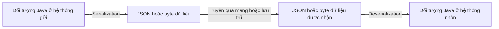

# Phân biệt tuần tự hóa và giải tuần tự hóa dữ liệu

Trong một chương trình Java, dữ liệu thường tồn tại dưới dạng đối tượng, danh sách hoặc các cấu trúc đang được lưu trong bộ nhớ. Khi cần gửi dữ liệu qua HTTP, ghi vào tệp, lưu vào cache hoặc trao đổi với một hệ thống khác, chương trình thường phải chuyển dữ liệu đó sang một định dạng mà hệ thống bên ngoài có thể đọc hoặc truyền đi. Khi nhận dữ liệu, chương trình thực hiện quá trình ngược lại để khôi phục cấu trúc Java có thể sử dụng.

Hai quá trình này được gọi là **tuần tự hóa (serialization)** và **giải tuần tự hóa (deserialization)**. Với Jackson, định dạng trao đổi thường gặp nhất là JSON. Tuần tự hóa chuyển dữ liệu Java thành JSON; giải tuần tự hóa đọc JSON và tạo ra đối tượng Java tương ứng.

## 1. Dữ liệu trong bộ nhớ và dữ liệu được trao đổi

Một đối tượng Java là một cấu trúc tồn tại trong bộ nhớ của tiến trình. Nó có kiểu dữ liệu, các trường, phương thức và có thể tham chiếu đến những đối tượng khác. Ví dụ, một đối tượng `User` có thể chứa mã người dùng, tên và trạng thái hoạt động.

```java
public class User {
    private long id;
    private String name;
    private boolean active;

    public User() {
    }

    public User(long id, String name, boolean active) {
        this.id = id;
        this.name = name;
        this.active = active;
    }

    public long getId() {
        return id;
    }

    public void setId(long id) {
        this.id = id;
    }

    public String getName() {
        return name;
    }

    public void setName(String name) {
        this.name = name;
    }

    public boolean isActive() {
        return active;
    }

    public void setActive(boolean active) {
        this.active = active;
    }
}
```

Khi chương trình cần gửi đối tượng này cho một dịch vụ khác, nó không thể gửi trực tiếp tham chiếu Java trong bộ nhớ. Hai tiến trình có không gian bộ nhớ riêng và không chia sẻ địa chỉ đối tượng. Chương trình cần một biểu diễn dữ liệu có quy ước chung, chẳng hạn JSON:

```json
{
  "id": 42,
  "name": "An",
  "active": true
}
```

JSON là văn bản mô tả các giá trị và cấu trúc dữ liệu. Hệ thống nhận có thể phân tích văn bản này mà không cần biết địa chỉ bộ nhớ hoặc cách JVM tổ chức đối tượng ban đầu.

## 2. Tuần tự hóa (Serialization)

**Tuần tự hóa** là quá trình chuyển trạng thái dữ liệu trong chương trình thành một biểu diễn có thể lưu trữ hoặc truyền đi. Với Jackson Databind, đầu vào thường là một đối tượng Java và đầu ra có thể là chuỗi JSON, mảng byte hoặc dữ liệu được ghi vào một luồng.

Ví dụ, tạo một đối tượng và chuyển nó thành chuỗi JSON:

```java
import com.fasterxml.jackson.core.JsonProcessingException;
import com.fasterxml.jackson.databind.ObjectMapper;

public class SerializationExample {
    public static void main(String[] args) throws JsonProcessingException {
        ObjectMapper objectMapper = new ObjectMapper();

        User user = new User(42L, "An", true);

        String json = objectMapper.writeValueAsString(user);

        System.out.println(json);
    }
}
```

Kết quả JSON tương ứng có dạng:

```json
{"id":42,"name":"An","active":true}
```

Jackson kiểm tra các thuộc tính mà cấu hình và quy tắc truy cập của nó cho phép tuần tự hóa, sau đó tạo ra biểu diễn JSON. Trong ví dụ JavaBean ở trên, các getter như `getId()`, `getName()` và `isActive()` cung cấp các thuộc tính để Jackson ghi vào JSON.

Một số phương thức thường dùng của `ObjectMapper`:

| Phương thức | Vai trò |
|---|---|
| `writeValueAsString(value)` | Tuần tự hóa thành chuỗi JSON. |
| `writeValueAsBytes(value)` | Tuần tự hóa thành mảng byte UTF-8. |
| `writeValue(file, value)` | Tuần tự hóa và ghi kết quả vào tệp. |
| `writeValue(outputStream, value)` | Tuần tự hóa và ghi vào một `OutputStream`. |

Ví dụ ghi trực tiếp vào tệp:

```java
import com.fasterxml.jackson.databind.ObjectMapper;
import java.io.File;
import java.io.IOException;

public class WriteJsonFileExample {
    public static void main(String[] args) throws IOException {
        ObjectMapper objectMapper = new ObjectMapper();
        User user = new User(42L, "An", true);

        objectMapper.writeValue(new File("user.json"), user);
    }
}
```

Trong trường hợp này, chương trình không cần tự tạo chuỗi JSON rồi gọi API ghi tệp. Jackson thực hiện việc chuyển đổi và ghi dữ liệu vào đích được cung cấp.

## 3. Giải tuần tự hóa (Deserialization)

**Giải tuần tự hóa** là quá trình đọc một biểu diễn dữ liệu đã được tuần tự hóa và chuyển nó thành cấu trúc mà chương trình có thể thao tác. Với Jackson, đầu vào có thể là chuỗi JSON, tệp, mảng byte hoặc luồng; đầu ra thường là một đối tượng Java thuộc kiểu được yêu cầu.

Ví dụ đọc chuỗi JSON thành đối tượng `User`:

```java
import com.fasterxml.jackson.core.JsonProcessingException;
import com.fasterxml.jackson.databind.ObjectMapper;

public class DeserializationExample {
    public static void main(String[] args) throws JsonProcessingException {
        ObjectMapper objectMapper = new ObjectMapper();

        String json = """
                {
                  "id": 42,
                  "name": "An",
                  "active": true
                }
                """;

        User user = objectMapper.readValue(json, User.class);

        System.out.println(user.getId());
        System.out.println(user.getName());
        System.out.println(user.isActive());
    }
}
```

Ở lời gọi `readValue(json, User.class)`, đối số `User.class` cho Jackson biết kiểu đối tượng cần tạo. Với JavaBean trong ví dụ, Jackson có thể sử dụng constructor không tham số và các setter để gán giá trị cho thuộc tính. Nếu kiểu đích dùng constructor có tham số, record hoặc một mô hình bất biến, Jackson cần cách tạo đối tượng phù hợp với kiểu đó; khả năng hỗ trợ còn phụ thuộc phiên bản và cấu hình.

Một số phương thức giải tuần tự hóa thường dùng:

| Phương thức | Vai trò |
|---|---|
| `readValue(json, User.class)` | Đọc chuỗi JSON thành một đối tượng có kiểu cụ thể. |
| `readValue(file, User.class)` | Đọc JSON từ tệp. |
| `readValue(inputStream, User.class)` | Đọc JSON từ luồng đầu vào. |
| `readValue(bytes, User.class)` | Đọc JSON từ mảng byte. |

Ví dụ đọc từ tệp:

```java
import com.fasterxml.jackson.databind.ObjectMapper;
import java.io.File;
import java.io.IOException;

public class ReadJsonFileExample {
    public static void main(String[] args) throws IOException {
        ObjectMapper objectMapper = new ObjectMapper();

        User user = objectMapper.readValue(
                new File("user.json"),
                User.class
        );

        System.out.println(user.getName());
    }
}
```

Jackson phân tích JSON, xác định các trường hoặc thuộc tính tương ứng và tạo đối tượng theo kiểu đích. Nếu JSON sai cú pháp, kiểu giá trị không tương thích hoặc Jackson không thể tạo kiểu đích, thao tác có thể phát sinh ngoại lệ xử lý JSON.

## 4. So sánh hai quá trình

Hai quá trình có hướng chuyển đổi ngược nhau, nhưng mỗi quá trình giải quyết một nhiệm vụ riêng.

| Tiêu chí | Tuần tự hóa (Serialization) | Giải tuần tự hóa (Deserialization) |
|---|---|---|
| Hướng chuyển đổi | Đối tượng/cấu trúc Java → JSON hoặc dữ liệu đầu ra | JSON hoặc dữ liệu đầu vào → đối tượng/cấu trúc Java |
| Đầu vào thường gặp | Object, collection, array hoặc giá trị Java | Chuỗi JSON, tệp, byte array hoặc input stream |
| Đầu ra thường gặp | JSON string, byte array hoặc dữ liệu được ghi ra đích | Object, collection, array hoặc giá trị Java |
| Mục đích | Chuẩn bị dữ liệu để truyền, lưu hoặc trao đổi | Đưa dữ liệu nhận được vào dạng chương trình có thể sử dụng |
| API Jackson tiêu biểu | `writeValueAsString`, `writeValue`, `writeValueAsBytes` | `readValue` |
| Lỗi thường gặp | Không thể chuyển một giá trị hoặc cấu trúc theo cấu hình hiện tại | JSON sai cú pháp, kiểu không khớp hoặc không tạo được đối tượng đích |

Có thể hình dung luồng trao đổi dữ liệu như sau:



Ví dụ trong một REST API:

1. Ứng dụng gửi tạo một đối tượng `User` chứa thông tin cần trả về.
2. Jackson tuần tự hóa đối tượng thành JSON trong response body.
3. Dữ liệu JSON được gửi qua HTTP.
4. Ứng dụng nhận đọc JSON từ request body.
5. Jackson giải tuần tự hóa JSON thành DTO mà controller hoặc service có thể xử lý.

Trong Spring Boot, các HTTP message converter thường tích hợp Jackson để thực hiện các bước chuyển đổi này. Vì vậy, khi controller trả về một DTO hoặc nhận DTO từ request body, ứng dụng thường không cần gọi `ObjectMapper` trực tiếp trong từng endpoint.

## 5. Ví dụ thực hiện một vòng chuyển đổi

Một vòng chuyển đổi thường gồm hai bước: tuần tự hóa một đối tượng thành JSON, sau đó giải tuần tự hóa JSON thành một đối tượng mới.

```java
import com.fasterxml.jackson.core.JsonProcessingException;
import com.fasterxml.jackson.databind.ObjectMapper;

public class RoundTripExample {
    public static void main(String[] args) throws JsonProcessingException {
        ObjectMapper objectMapper = new ObjectMapper();

        User original = new User(42L, "An", true);

        // Bước 1: Java object -> JSON
        String json = objectMapper.writeValueAsString(original);

        // Bước 2: JSON -> Java object
        User restored = objectMapper.readValue(json, User.class);

        System.out.println(json);
        System.out.println(restored.getName());
    }
}
```

`original` và `restored` là hai đối tượng riêng biệt trong bộ nhớ. Chúng có thể chứa các giá trị thuộc tính tương đương, nhưng không phải cùng một đối tượng và không có cùng địa chỉ tham chiếu. Có thể kiểm tra điều này bằng `original == restored`, kết quả là `false` trong ví dụ trên.

Một vòng chuyển đổi cũng không đảm bảo giữ nguyên mọi chi tiết nội bộ của đối tượng. Jackson chuyển đổi các thuộc tính theo quy tắc hiển thị, annotation và cấu hình hiện hành. Những thông tin không được đưa vào JSON sẽ không thể tự xuất hiện trở lại khi giải tuần tự hóa.

## 6. Jackson quyết định thuộc tính nào được chuyển đổi như thế nào?

Jackson không sao chép toàn bộ vùng nhớ của một đối tượng. Nó ánh xạ các thuộc tính Java sang các giá trị JSON dựa trên quy tắc truy cập, tên thuộc tính, annotation và cấu hình.

### 6.1. Tên thuộc tính

Theo quy ước JavaBean, getter có thể được dùng để nhận diện thuộc tính khi tuần tự hóa và setter có thể được dùng khi giải tuần tự hóa. Có thể đổi tên thuộc tính JSON bằng `@JsonProperty`:

```java
import com.fasterxml.jackson.annotation.JsonProperty;

public class Account {
    @JsonProperty("account_id")
    private long id;

    public Account() {
    }

    public Account(long id) {
        this.id = id;
    }

    public long getId() {
        return id;
    }

    public void setId(long id) {
        this.id = id;
    }
}
```

Khi tuần tự hóa, thuộc tính `id` được biểu diễn bằng tên `account_id`. Khi giải tuần tự hóa, Jackson cũng dùng tên JSON đã khai báo để ánh xạ về thuộc tính tương ứng.

### 6.2. Bỏ qua thuộc tính

`@JsonIgnore` có thể đánh dấu một thuộc tính cần được Jackson bỏ qua trong quá trình ánh xạ thông thường:

```java
import com.fasterxml.jackson.annotation.JsonIgnore;

public class LoginResponse {
    private String username;

    @JsonIgnore
    private String internalToken;

    public LoginResponse() {
    }

    public String getUsername() {
        return username;
    }

    public void setUsername(String username) {
        this.username = username;
    }

    public String getInternalToken() {
        return internalToken;
    }

    public void setInternalToken(String internalToken) {
        this.internalToken = internalToken;
    }
}
```

Với cấu hình mặc định và cách sử dụng thông thường, `internalToken` sẽ không được ghi vào JSON. Khi thiết kế DTO, cần chủ động chọn những dữ liệu thực sự được phép trao đổi; annotation chỉ là một phần của quy tắc ánh xạ.

### 6.3. Thuộc tính không có trong JSON và giá trị không khớp kiểu

Giả sử JSON chỉ chứa `id` và `name`, trong khi lớp Java có thêm `active`. Kết quả của thuộc tính bị thiếu phụ thuộc vào constructor, kiểu dữ liệu, giá trị mặc định và cấu hình của Jackson. Với JavaBean thông thường, thuộc tính không được gán thường giữ giá trị mặc định của Java, chẳng hạn `false` đối với `boolean` hoặc `0` đối với `int`.

Ngược lại, nếu JSON cung cấp một chuỗi cho thuộc tính cần số nguyên, Jackson có thể chuyển đổi trong một số trường hợp theo quy tắc coercion, hoặc phát sinh lỗi nếu không thể ánh xạ. Không nên dựa vào việc tự chuyển đổi ngầm để thay thế kiểm tra dữ liệu đầu vào.

Các thuộc tính JSON không có thuộc tính tương ứng trong lớp đích cũng chịu ảnh hưởng của cấu hình xử lý thuộc tính không xác định. Nếu cấu hình yêu cầu từ chối thuộc tính không xác định, quá trình giải tuần tự hóa có thể thất bại. Nếu cấu hình bỏ qua chúng, dữ liệu đó sẽ không được lưu vào đối tượng đích.

## 7. Tuần tự hóa collection và kiểu generic

Jackson cũng có thể tuần tự hóa danh sách, mảng và các cấu trúc lồng nhau. Ví dụ:

```java
import com.fasterxml.jackson.databind.ObjectMapper;
import java.util.List;

public class CollectionSerializationExample {
    public static void main(String[] args) throws Exception {
        ObjectMapper objectMapper = new ObjectMapper();

        List<User> users = List.of(
                new User(1L, "An", true),
                new User(2L, "Bình", false)
        );

        String json = objectMapper.writeValueAsString(users);
        System.out.println(json);
    }
}
```

Kết quả là một JSON array chứa hai JSON object.

Khi giải tuần tự hóa collection generic như `List<User>`, chỉ truyền `List.class` sẽ làm mất thông tin kiểu phần tử do type erasure của Java. Jackson cung cấp `TypeReference` để giữ thông tin kiểu generic tại vị trí gọi:

```java
import com.fasterxml.jackson.core.type.TypeReference;
import com.fasterxml.jackson.databind.ObjectMapper;
import java.util.List;

public class CollectionDeserializationExample {
    public static void main(String[] args) throws Exception {
        ObjectMapper objectMapper = new ObjectMapper();

        String json = """
                [
                  {"id": 1, "name": "An", "active": true},
                  {"id": 2, "name": "Bình", "active": false}
                ]
                """;

        List<User> users = objectMapper.readValue(
                json,
                new TypeReference<List<User>>() {}
        );

        users.forEach(user -> System.out.println(user.getName()));
    }
}
```

`TypeReference<List<User>>` cung cấp cho Jackson thông tin về kiểu phần tử cần tạo. Cách này cũng áp dụng cho các kiểu lồng nhau, chẳng hạn `Map<String, List<User>>`.

## 8. Phân biệt JSON serialization của Jackson với Java native serialization

Từ serialization còn được dùng cho cơ chế tuần tự hóa nhị phân có sẵn trong Java. Hai cơ chế có mục tiêu tổng quát giống nhau là biểu diễn trạng thái đối tượng để lưu hoặc truyền, nhưng cách hoạt động và định dạng khác nhau.

| Tiêu chí | Jackson với JSON | Java native serialization |
|---|---|---|
| Biểu diễn | Thường là JSON dạng văn bản hoặc byte mã hóa JSON | Luồng nhị phân theo định dạng serialization của Java |
| Cách sử dụng phổ biến | API, tích hợp dịch vụ, tệp cấu hình hoặc dữ liệu trao đổi | Một số tình huống Java-to-Java cần cơ chế native |
| Khả năng đọc bằng công cụ khác | JSON có thể được nhiều ngôn ngữ và công cụ xử lý | Gắn chặt với cơ chế và kiểu dữ liệu Java |
| Cơ chế chính | Ánh xạ thuộc tính Java sang cấu trúc JSON | Các lớp tham gia cơ chế `Serializable` và object stream |
| API tiêu biểu | `ObjectMapper.writeValue...` / `readValue...` | `ObjectOutputStream` / `ObjectInputStream` |

Sử dụng Jackson để chuyển một đối tượng thành JSON **không yêu cầu** lớp đó phải `implements Serializable`. Ngược lại, việc một lớp triển khai `Serializable` không tự động khiến Jackson chọn một biểu diễn JSON cụ thể. Đây là hai cơ chế riêng biệt.

## 9. Những lỗi và nhầm lẫn thường gặp

### 9.1. Truyền sai kiểu đích cho `readValue`

Nếu dùng `String.class` làm kiểu đích, Jackson sẽ cố tạo một giá trị chuỗi từ JSON theo quy tắc dành cho chuỗi. Muốn tạo `User`, cần truyền `User.class`; muốn tạo collection generic, cần cung cấp `TypeReference` tương ứng.

### 9.2. Lớp Java không thể được tạo theo cấu hình hiện tại

Với JavaBean thông thường, một constructor không tham số cùng setter là cách tiếp cận dễ hiểu. Nếu lớp chỉ có constructor có tham số hoặc được thiết kế bất biến, cần khai báo cách Jackson sử dụng constructor/creator phù hợp, chẳng hạn bằng các annotation như `@JsonCreator` và `@JsonProperty`, hoặc dùng kiểu dữ liệu mà phiên bản Jackson đang sử dụng hỗ trợ trực tiếp.

### 9.3. Nhầm lẫn giữa đối tượng và chuỗi JSON

`writeValueAsString(user)` trả về một chuỗi chứa JSON. Bản thân biến `json` vẫn là một đối tượng `String` trong Java. Tương tự, `readValue(json, User.class)` tạo một đối tượng `User`; nó không chỉ đổi kiểu tham chiếu của chuỗi thành `User`.

### 9.4. Không xử lý lỗi chuyển đổi

Các phương thức của Jackson có thể phát sinh `JsonProcessingException` hoặc `IOException`, tùy overload được gọi. Trong ứng dụng thực tế, cần xử lý lỗi ở ranh giới phù hợp: ví dụ trả lỗi request không hợp lệ từ API, ghi nhận lỗi đọc tệp hoặc xử lý thông điệp không đúng định dạng.

### 9.5. Cấu hình `ObjectMapper` nhiều lần trong lúc đang sử dụng

`ObjectMapper` thường được cấu hình một lần rồi tái sử dụng. Hãy hoàn tất việc đăng ký module và cấu hình trước khi chia sẻ mapper cho các thao tác đồng thời. Nếu mỗi nơi cần quy tắc ánh xạ riêng, có thể tạo cấu hình/mapper riêng hoặc dùng `ObjectReader` và `ObjectWriter` phù hợp thay vì thay đổi cấu hình toàn cục trong khi ứng dụng đang xử lý dữ liệu.

## 10. Lựa chọn và sử dụng đúng hai quá trình

Hãy xác định hướng dữ liệu trước khi chọn API:

- Khi đang có đối tượng Java và cần tạo nội dung để gửi hoặc lưu, sử dụng **tuần tự hóa**, thường là `writeValueAsString`, `writeValueAsBytes` hoặc `writeValue`.
- Khi đang có JSON nhận từ request, tệp hoặc dịch vụ khác và cần làm việc với kiểu Java, sử dụng **giải tuần tự hóa** bằng `readValue`.
- Khi làm việc với collection generic, cung cấp đầy đủ kiểu phần tử bằng `TypeReference`.
- Khi cấu trúc Java và JSON không trùng tên hoặc không cùng hình dạng, dùng annotation, cấu hình hoặc DTO phù hợp để định nghĩa ánh xạ.
- Khi dữ liệu đến từ bên ngoài, kiểm tra tính hợp lệ và quy tắc nghiệp vụ sau khi phân tích; việc Jackson tạo được đối tượng không đồng nghĩa dữ liệu đã hợp lệ về mặt nghiệp vụ.

Hai quá trình thường xuất hiện liền nhau trong giao tiếp giữa các hệ thống. Tuần tự hóa tạo ra biểu diễn dữ liệu có thể trao đổi; giải tuần tự hóa đưa biểu diễn đó trở lại thành cấu trúc mà chương trình nhận có thể sử dụng. Hiểu rõ hướng chuyển đổi, kiểu đầu vào/đầu ra và quy tắc ánh xạ của Jackson giúp lựa chọn API đúng, xử lý lỗi phù hợp và tránh nhầm lẫn giữa JSON với đối tượng Java trong bộ nhớ.
