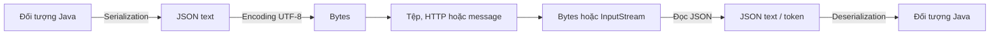

# Những kiến thức Java, JSON và I/O cần có

Jackson giúp chương trình Java chuyển đổi dữ liệu giữa đối tượng trong bộ nhớ và định dạng JSON. Để sử dụng Jackson đúng cách, trước hết cần hiểu ba nền tảng: cách Java biểu diễn dữ liệu bằng kiểu và đối tượng, cách JSON biểu diễn dữ liệu bằng văn bản, và cách Java đọc hoặc ghi dữ liệu qua tệp, luồng hay bộ nhớ. Khi nắm được ba phần này, ta có thể hiểu vì sao một thuộc tính được ghi thành một khóa JSON, vì sao một giá trị không đọc được vào trường Java, hoặc vì sao cùng một nội dung JSON có thể được đọc từ chuỗi, tệp và mạng.

## 1. Jackson nằm ở đâu trong quá trình xử lý dữ liệu?

Một ứng dụng thường làm việc với đối tượng Java. Khi cần lưu trữ hoặc trao đổi dữ liệu, ứng dụng chuyển đối tượng đó thành JSON. Ở chiều ngược lại, ứng dụng nhận JSON rồi chuyển nó thành đối tượng để xử lý nghiệp vụ.



Hai chiều chuyển đổi có tên gọi riêng:

- **Serialization**: chuyển dữ liệu Java thành JSON. Ví dụ, một đối tượng `Customer` được ghi thành `{"name":"An","age":25}`.
- **Deserialization**: đọc JSON và tạo lại dữ liệu Java. Ví dụ, JSON trên được ánh xạ thành một đối tượng `Customer`.

Jackson đảm nhiệm việc phân tích cú pháp JSON và ánh xạ dữ liệu. Java I/O đảm nhiệm việc đưa dữ liệu đến hoặc đi từ nguồn lưu trữ. Hai trách nhiệm này liên quan với nhau nhưng không đồng nhất: Jackson có thể đọc JSON từ một `InputStream`, còn `InputStream` không hiểu cấu trúc đối tượng JSON.

Ví dụ API cơ bản:

```java
ObjectMapper mapper = new ObjectMapper();

// Đối tượng Java -> chuỗi JSON
String json = mapper.writeValueAsString(customer);

// Chuỗi JSON -> đối tượng Java
Customer restored = mapper.readValue(json, Customer.class);
```

`ObjectMapper` thuộc Jackson Databind. Nó phối hợp bộ phân tích JSON của Jackson Core với cơ chế ánh xạ kiểu dữ liệu Java.

## 2. Nền tảng Java cần biết

### 2.1. Kiểu dữ liệu và giá trị null

Java có hai nhóm kiểu cơ bản:

- **Primitive types**: `int`, `long`, `double`, `boolean`, `char` và các kiểu số nguyên, số thực còn lại. Biến primitive luôn có một giá trị thuộc kiểu đó; trường instance chưa được gán có giá trị mặc định như `0`, `false` hoặc `\u0000`.
- **Reference types**: lớp, interface, mảng, enum, record và các kiểu đối tượng khác. Biến reference có thể trỏ đến một đối tượng hoặc mang giá trị `null`.

Các lớp bao như `Integer`, `Long`, `Double` và `Boolean` là reference types. Vì vậy, `int` và `Integer` có hành vi khác nhau khi dữ liệu vắng mặt hoặc mang `null`.

```java
public class Account {
    private int retryCount;
    private Integer limit;
    private String displayName;
}
```

Nếu JSON không cung cấp `retryCount`, trường primitive thường giữ giá trị mặc định `0`. Nếu JSON không cung cấp `limit`, trường reference thường giữ `null`. Khi JSON ghi rõ `"limit": null`, Jackson cũng cần ánh xạ giá trị null vào trường đó. Cách xử lý null đối với primitive và các cấu hình ép kiểu có thể làm thay đổi kết quả, vì vậy không nên xem `0`, `null` và thuộc tính không xuất hiện là cùng một trạng thái.

Khi một thuộc tính có thể thực sự chưa biết hoặc không có giá trị, kiểu bao như `Integer` thường diễn đạt ý nghĩa đó rõ hơn `int`. Khi thuộc tính bắt buộc phải có, ứng dụng nên kiểm tra dữ liệu sau khi ánh xạ thay vì dựa vào giá trị mặc định.

### 2.2. Lớp, trường và JavaBean property

Một lớp Java mô tả cấu trúc đối tượng. Trường (`field`) là nơi lưu trạng thái; constructor tạo đối tượng; getter và setter cung cấp cách đọc, cập nhật thuộc tính.

```java
public class Customer {
    private String name;
    private int age;

    public Customer() {
    }

    public Customer(String name, int age) {
        this.name = name;
        this.age = age;
    }

    public String getName() {
        return name;
    }

    public void setName(String name) {
        this.name = name;
    }

    public int getAge() {
        return age;
    }

    public void setAge(int age) {
        this.age = age;
    }
}
```

Theo quy ước JavaBean, `getName()` và `setName(...)` mô tả property `name`; `getAge()` và `setAge(...)` mô tả property `age`. Jackson thường dựa vào getter, setter, constructor và field theo quy tắc introspection cùng cấu hình visibility để tìm thuộc tính cần ghi hoặc đọc. Do đó:

- Một field `private` không tự động đồng nghĩa với việc Jackson luôn đọc hoặc ghi được field đó trong mọi cấu hình.
- Getter có thể làm thuộc tính xuất hiện trong JSON dù tên field khác.
- Setter hoặc constructor phù hợp giúp Jackson đưa giá trị JSON vào đối tượng.
- Tên property JSON có thể khác tên field Java khi dùng annotation hoặc naming strategy.

Khi một thuộc tính không xuất hiện như mong đợi, hãy xác định Jackson đang nhìn thấy getter, setter, field hay tham số constructor nào trước khi thay đổi cấu hình visibility.

### 2.3. Constructor, đối tượng bất biến và record

Đối với một JavaBean thông thường, cách dễ hiểu nhất là có constructor không tham số và setter cho các thuộc tính có thể thay đổi. Jackson tạo đối tượng rồi gán từng thuộc tính.

Đối tượng bất biến thường không cung cấp setter. Dữ liệu được truyền vào constructor và các trường chỉ đọc sau khi tạo. Jackson có thể dùng constructor hoặc factory method được nhận diện để tạo đối tượng; annotation như `@JsonCreator` và `@JsonProperty` giúp chỉ rõ cách ánh xạ khi cần.

```java
public class Money {
    private final String currency;
    private final long amount;

    @JsonCreator
    public Money(
            @JsonProperty("currency") String currency,
            @JsonProperty("amount") long amount) {
        this.currency = currency;
        this.amount = amount;
    }

    public String getCurrency() {
        return currency;
    }

    public long getAmount() {
        return amount;
    }
}
```

Record biểu diễn dữ liệu theo dạng ngắn gọn và bất biến:

```java
public record CustomerView(String name, int age) {
}
```

Các phiên bản Jackson hiện đại hỗ trợ Java record. Tuy nhiên, khả năng ánh xạ constructor, module và kiểu Java mới vẫn phụ thuộc phiên bản Jackson đang dùng. Khi làm việc trong dự án, cần đối chiếu phiên bản thư viện thực tế thay vì giả định mọi phiên bản đều có cùng khả năng.

### 2.4. Collection, Map, mảng và kiểu lồng nhau

Dữ liệu thực tế thường gồm nhiều đối tượng hoặc cấu trúc lồng nhau. Java cung cấp các kiểu phổ biến sau:

| Kiểu Java | Ý nghĩa | Dạng JSON thường gặp |
|---|---|---|
| `List<T>` | Danh sách có thứ tự | Array `[...]` |
| `Set<T>` | Tập hợp phần tử duy nhất | Array `[...]` |
| `T[]` | Mảng | Array `[...]` |
| `Map<String, T>` | Các cặp khóa và giá trị | Object `{...}` |
| Một class hoặc record | Một cấu trúc dữ liệu | Object `{...}` |

Ví dụ:

```java
public class Order {
    private String orderId;
    private CustomerView customer;
    private List<String> tags;
    private Map<String, Integer> itemQuantities;

    // Constructor, getter và setter được lược bỏ.
}
```

Đối tượng `Order` có thể được biểu diễn bằng JSON lồng nhau:

```json
{
  "orderId": "ORD-1001",
  "customer": {
    "name": "An",
    "age": 25
  },
  "tags": ["new", "priority"],
  "itemQuantities": {
    "BOOK": 2,
    "PEN": 5
  }
}
```

Trong JSON, tên khóa của object luôn là chuỗi. Vì thế, `Map<String, Integer>` là lựa chọn tự nhiên cho object JSON có các khóa văn bản. Map dùng khóa kiểu khác có thể cần cơ chế chuyển đổi khóa riêng và không phải cấu trúc JSON nào cũng biểu diễn được một cách trực tiếp.

### 2.5. Generic và type erasure

Generic giúp Java giữ thông tin kiểu ở thời điểm biên dịch. Ví dụ, `List<CustomerView>` cho biết danh sách chứa `CustomerView`. Tuy nhiên, Java sử dụng type erasure nên một số thông tin generic không còn đầy đủ ở runtime. Khi gọi:

```java
List<CustomerView> customers = mapper.readValue(json, List.class);
```

Jackson chỉ được cung cấp `List.class`, không biết phần tử cần tạo là `CustomerView`. Kết quả có thể là danh sách các map thay vì danh sách `CustomerView`.

Để giữ thông tin generic, dùng `TypeReference`:

```java
List<CustomerView> customers = mapper.readValue(
        json,
        new TypeReference<List<CustomerView>>() {}
);
```

Với cấu trúc generic phức tạp hoặc kiểu được xây dựng động, Jackson còn cung cấp `JavaType` thông qua `TypeFactory`. Điểm cốt lõi là phải truyền đủ kiểu đích cho Jackson; `List.class` một mình không mô tả được kiểu phần tử.

### 2.6. Enum, ngày giờ và kiểu số

Enum thường đại diện cho một tập giá trị có giới hạn:

```java
public enum OrderStatus {
    NEW,
    PAID,
    CANCELLED
}
```

JSON có thể biểu diễn enum bằng chuỗi như `"PAID"`. Tên enum trong Java và giá trị trao đổi bên ngoài cần ổn định; nếu API dùng mã khác tên hằng Java, có thể khai báo quy tắc ánh xạ bằng annotation.

Các kiểu ngày giờ như `LocalDate`, `LocalDateTime`, `Instant` thuộc Java Time API. Chúng thường được biểu diễn bằng chuỗi theo định dạng đã thống nhất, chẳng hạn ISO-8601. Để ánh xạ các kiểu này, dự án thường cần module `jackson-datatype-jsr310` và đăng ký `JavaTimeModule` hoặc cơ chế tìm module phù hợp. Định dạng ngày giờ, múi giờ và ý nghĩa của thời điểm phải được thống nhất giữa bên gửi và bên nhận.

Với dữ liệu tiền tệ hoặc số thập phân cần giữ độ chính xác, nên cân nhắc `BigDecimal`. `float` và `double` dùng biểu diễn dấu phẩy động nhị phân nên có thể không giữ chính xác mọi số thập phân. Chẳng hạn, phép tính với `0.1` và `0.2` bằng `double` có thể cho kết quả hiển thị không đúng như phép tính thập phân thông thường.

### 2.7. Annotation và reflection ở mức khái niệm

Annotation gắn metadata vào class, field, method hoặc tham số. Jackson dùng annotation để điều khiển cách ánh xạ, ví dụ:

- `@JsonProperty`: chỉ định tên property trong JSON.
- `@JsonIgnore`: bỏ qua một property trong quá trình ánh xạ theo phạm vi áp dụng.
- `@JsonCreator`: chỉ định constructor hoặc factory method dùng để tạo đối tượng.
- `@JsonFormat`: chỉ định định dạng cho một số kiểu dữ liệu.
- `@JsonInclude`: điều khiển điều kiện đưa property vào JSON khi ghi.

Reflection là khả năng kiểm tra metadata và cấu trúc class trong runtime. Jackson dùng cơ chế introspection/reflection để tìm thuộc tính và cách tạo đối tượng. Người dùng Jackson không cần tự viết reflection cho thao tác thông thường, nhưng hiểu khái niệm này giúp giải thích vì sao visibility, constructor, getter, setter và annotation ảnh hưởng đến kết quả.

## 3. Nền tảng JSON cần biết

### 3.1. JSON là định dạng văn bản có cấu trúc

JSON (JavaScript Object Notation) là định dạng trao đổi dữ liệu dạng văn bản. JSON không phải object Java, cũng không phải byte stream. Một JSON document có cú pháp và các kiểu giá trị xác định.

JSON có sáu nhóm giá trị:

| Kiểu JSON | Ví dụ | Ý nghĩa |
|---|---|---|
| Object | `{"name":"An"}` | Tập hợp cặp khóa và giá trị |
| Array | `[1, 2, 3]` | Danh sách giá trị có thứ tự |
| String | `"hello"` | Văn bản nằm trong dấu ngoặc kép |
| Number | `25`, `-3.5` | Số nguyên hoặc số thập phân |
| Boolean | `true`, `false` | Giá trị logic |
| Null | `null` | Không có giá trị |

Object và array có thể lồng nhau tùy ý:

```json
{
  "id": 10,
  "active": true,
  "profile": {
    "name": "An",
    "skills": ["Java", "SQL"]
  },
  "note": null
}
```

Trong object, mỗi khóa phải là string và được đặt trong dấu ngoặc kép. Cặp khóa và giá trị được phân tách bằng dấu hai chấm; các cặp được phân tách bằng dấu phẩy. Array dùng dấu ngoặc vuông và dấu phẩy để phân tách phần tử. JSON chuẩn không cho phép dấu phẩy thừa ở cuối, comment hoặc khóa không có dấu ngoặc kép.

### 3.2. Quy tắc của string và escape

String JSON luôn dùng dấu ngoặc kép. Các ký tự điều khiển hoặc ký tự đặc biệt phải được escape. Một số dạng thường gặp:

| Ký hiệu | Ý nghĩa |
|---|---|
| `\"` | Dấu ngoặc kép nằm trong string |
| `\\` | Dấu gạch chéo ngược |
| `\n` | Xuống dòng |
| `\r` | Về đầu dòng |
| `\t` | Tab |
| `\uXXXX` | Ký tự Unicode theo mã hex |

Ví dụ:

```json
{
  "message": "Dòng thứ nhất\nDòng thứ hai",
  "quote": "Bạn ấy nói: \"Xin chào\""
}
```

Không nên tự nối chuỗi để tạo JSON. Nếu giá trị chứa dấu ngoặc kép, dấu gạch chéo hoặc ký tự điều khiển, việc nối chuỗi thủ công dễ tạo ra JSON sai cú pháp hoặc làm thay đổi dữ liệu. Hãy để Jackson tạo JSON và escape đúng quy tắc.

### 3.3. Number trong JSON không mang kiểu Java

JSON có một kiểu number về mặt cú pháp. JSON không ghi rõ một giá trị là `int`, `long`, `double` hay `BigDecimal`. Kiểu Java cuối cùng phụ thuộc kiểu đích mà ứng dụng yêu cầu và quy tắc chuyển đổi của Jackson.

Ví dụ, `123` có thể được ánh xạ vào `int`, `long` hoặc `BigInteger`; `12.50` có thể được ánh xạ vào `double` hoặc `BigDecimal`. Nếu cần độ chính xác thập phân, hãy chọn kiểu Java phù hợp và kiểm soát cách chuyển đổi. JSON chuẩn cũng không định nghĩa `NaN`, `Infinity` hoặc `-Infinity` là number hợp lệ.

### 3.4. Phân biệt thuộc tính vắng mặt, null và giá trị rỗng

Ba trạng thái sau khác nhau:

```json
{}
```

```json
{"nickname": null}
```

```json
{"nickname": ""}
```

- **Vắng mặt**: document không có khóa `nickname`.
- **Null**: khóa có mặt và giá trị là `null`.
- **Chuỗi rỗng**: khóa có mặt và giá trị là string có độ dài bằng 0.

Tương tự, array rỗng `[]` khác `null`, và object rỗng `{}` khác thuộc tính không xuất hiện. Sự khác biệt này có ý nghĩa trong API cập nhật dữ liệu: vắng mặt có thể mang nghĩa giữ nguyên giá trị cũ, trong khi null có thể mang nghĩa xóa giá trị. Ý nghĩa cụ thể do hợp đồng API quyết định.

Khi đọc JSON bằng tree model, có thể dùng `JsonNode` để kiểm tra cấu trúc và phân biệt node thiếu với node null. Khi ánh xạ thẳng vào POJO, cần thiết kế kiểu và quy tắc cập nhật sao cho không làm mất thông tin mà nghiệp vụ cần.

### 3.5. JSON không định nghĩa class, method hoặc quan hệ đối tượng Java

JSON chỉ mô tả dữ liệu. Nó không mang constructor Java, method, access modifier, generic declaration hay logic nghiệp vụ. Ví dụ, JSON:

```json
{"name":"An","age":25}
```

không tự nói rằng dữ liệu này phải trở thành `Customer`, `CustomerView` hay `Map<String, Object>`. Ứng dụng cung cấp kiểu đích khi deserialization. Cùng một JSON có thể được đọc thành nhiều kiểu Java khác nhau nếu cấu trúc tương thích.

JSON cũng không tự biểu diễn được mọi đặc tính của object graph. Chẳng hạn, hai field Java cùng tham chiếu một object có thể được ghi thành hai object JSON độc lập; quan hệ tham chiếu dùng chung không tự được giữ lại. Quan hệ vòng (object A tham chiếu B, B lại tham chiếu A) cần thiết kế xử lý riêng, nếu không quá trình ghi có thể gặp lỗi hoặc đệ quy không kết thúc. Các annotation về identity/reference của Jackson có thể giải quyết một số mô hình, nhưng phải lựa chọn theo hợp đồng dữ liệu.

## 4. Nền tảng Java I/O cần biết

### 4.1. Byte và character là hai khái niệm khác nhau

Máy tính lưu trữ và truyền dữ liệu dưới dạng byte. Khi xử lý văn bản, chương trình cần một bảng mã để chuyển giữa byte và character. UTF-8 là encoding phổ biến cho JSON.

Java phân biệt hai nhóm API I/O:

| Nhóm | Kiểu tiêu biểu | Làm việc với |
|---|---|---|
| Byte stream | `InputStream`, `OutputStream` | Byte thô |
| Character stream | `Reader`, `Writer` | Ký tự văn bản |

`FileInputStream` và `FileOutputStream` là các ví dụ byte stream. `InputStreamReader` chuyển byte thành character theo một charset; `OutputStreamWriter` chuyển character thành byte theo charset.

JSON là văn bản, nhưng khi lưu trong tệp hoặc truyền qua mạng, JSON thường được mã hóa thành byte. Vì vậy cần phân biệt:

1. Nội dung JSON, ví dụ `{"name":"An"}`.
2. Các ký tự của nội dung JSON.
3. Byte được tạo ra khi mã hóa các ký tự bằng UTF-8.

Một chuỗi Java (`String`) chứa văn bản theo mô hình ký tự của Java, không phải một mảng byte UTF-8. Khi cần byte, phải encode; khi nhận byte, phải decode bằng đúng charset.

### 4.2. InputStream và OutputStream

`InputStream` đọc byte từ nguồn. Nguồn có thể là tệp, kết nối mạng, bộ nhớ hoặc một nguồn dữ liệu khác. `OutputStream` ghi byte đến đích.

```java
Path inputPath = Path.of("data", "customer.json");

try (InputStream input = Files.newInputStream(inputPath)) {
    Customer customer = mapper.readValue(input, Customer.class);
}

Path outputPath = Path.of("data", "customer-copy.json");

try (OutputStream output = Files.newOutputStream(outputPath)) {
    mapper.writeValue(output, customer);
}
```

Trong ví dụ, `Files.newInputStream(...)` mở nguồn byte, còn `ObjectMapper.readValue(...)` phân tích JSON và tạo `Customer`. Ở chiều ghi, `ObjectMapper.writeValue(...)` tạo JSON và ghi byte ra output stream.

Đọc từ `InputStream` hữu ích khi dữ liệu đến từ HTTP request, message broker hoặc tệp. Ghi vào `OutputStream` hữu ích khi tạo HTTP response, ghi tệp hoặc gửi dữ liệu đến một thành phần khác. Luồng là nguồn/đích dữ liệu; nó không tự biết schema Java.

### 4.3. Reader và Writer

`Reader` đọc character, còn `Writer` ghi character. Khi nguồn đã là văn bản, hoặc ứng dụng muốn tự kiểm soát bước decode/encode, có thể dùng nhóm API này.

```java
Path path = Path.of("data", "customer.json");

try (Reader reader = Files.newBufferedReader(path, StandardCharsets.UTF_8)) {
    Customer customer = mapper.readValue(reader, Customer.class);
}

try (Writer writer = Files.newBufferedWriter(path, StandardCharsets.UTF_8)) {
    mapper.writeValue(writer, customer);
}
```

Ở đây charset UTF-8 được chỉ định rõ tại bước mở reader/writer. Nếu đọc byte bằng một charset khác với charset đã dùng để ghi, ký tự có dấu hoặc ký tự ngoài ASCII có thể bị sai.

### 4.4. Path, Files và thao tác với tệp

Trong Java hiện đại, `Path` mô tả đường dẫn và `Files` cung cấp các thao tác phổ biến trên tệp, thư mục và stream:

- `Path.of(...)`: tạo đường dẫn.
- `Files.newInputStream(...)`: mở luồng đọc byte.
- `Files.newOutputStream(...)`: mở luồng ghi byte.
- `Files.newBufferedReader(...)`: mở reader có buffering.
- `Files.newBufferedWriter(...)`: mở writer có buffering.
- `Files.readString(...)`: đọc nội dung tệp thành `String`.
- `Files.writeString(...)`: ghi `String` vào tệp.

Đọc toàn bộ tệp thành `String` thuận tiện với JSON nhỏ. Với dữ liệu lớn, dùng stream giúp tránh giữ toàn bộ nội dung JSON trong bộ nhớ cùng lúc. Cần chọn API theo kích thước dữ liệu và nhu cầu xử lý.

### 4.5. try-with-resources và quyền sở hữu tài nguyên

Stream, reader và writer thường giữ tài nguyên hệ thống như file descriptor hoặc socket. Chúng cần được đóng sau khi dùng. `try-with-resources` tự gọi `close()` kể cả khi có exception:

```java
try (InputStream input = Files.newInputStream(path)) {
    return mapper.readValue(input, Customer.class);
}
```

Khi dùng Jackson với stream, hãy xác định rõ thành phần nào chịu trách nhiệm mở và đóng stream. Một số cấu hình mặc định của Jackson generator/parser có thể đóng nguồn hoặc đích khi hoàn tất. Nếu stream được chia sẻ hoặc cần tiếp tục sử dụng sau thao tác ánh xạ, hãy kiểm tra hành vi và cấu hình auto-close tương ứng của phiên bản đang dùng.

Không nên bỏ qua việc đóng stream. Rò rỉ tài nguyên có thể khiến ứng dụng cạn file descriptor, giữ kết nối lâu hơn cần thiết hoặc làm khó việc thay thế/xóa tệp trên một số hệ điều hành.

### 4.6. Exception trong I/O

Các thao tác I/O có thể thất bại do tệp không tồn tại, không đủ quyền, ổ đĩa gặp sự cố, kết nối bị ngắt hoặc dữ liệu không hợp lệ. Java biểu diễn nhiều lỗi I/O bằng `IOException` và các lớp con.

Jackson cũng có thể ném exception khi JSON sai cú pháp hoặc không ánh xạ được vào kiểu đích. `JsonProcessingException` là một nhánh exception quen thuộc trong API Jackson; lỗi đọc/ghi stream cũng có thể liên quan đến `IOException`.

```java
try {
    Customer customer = mapper.readValue(json, Customer.class);
    // Tiếp tục xử lý customer sau khi đã kiểm tra dữ liệu cần thiết.
} catch (JsonProcessingException e) {
    // JSON sai cú pháp hoặc không phù hợp với kiểu đích.
    throw new IllegalArgumentException("Customer JSON không hợp lệ", e);
} catch (IOException e) {
    // Lỗi khi đọc nguồn I/O.
    throw new UncheckedIOException("Không thể đọc dữ liệu", e);
}
```

Ví dụ minh họa cách phân loại lỗi; kiểu exception cụ thể phụ thuộc overload đang gọi. Trong ứng dụng thực tế, nên giữ nguyên nguyên nhân (`cause`), bổ sung ngữ cảnh hữu ích và quyết định rõ lỗi nào có thể phục hồi. Không nên bắt exception rồi bỏ qua, vì chương trình có thể tiếp tục với dữ liệu thiếu hoặc trạng thái sai.

## 5. Ghép Java, JSON và I/O khi dùng Jackson

### 5.1. Dùng chuỗi khi dữ liệu đã ở trong bộ nhớ

Nếu JSON đã có trong `String`, có thể dùng trực tiếp:

```java
String json = """
        {
          "name": "An",
          "age": 25
        }
        """;

Customer customer = mapper.readValue(json, Customer.class);
String output = mapper.writeValueAsString(customer);
```

Đây là cách thuận tiện cho ví dụ nhỏ, unit test hoặc khi một thành phần khác đã tạo sẵn chuỗi JSON. Tuy nhiên, nếu dữ liệu đến từ tệp hoặc mạng, không nhất thiết phải đọc toàn bộ thành chuỗi trước; có thể truyền stream trực tiếp cho Jackson.

### 5.2. Chọn kiểu đích khi deserialization

Jackson cần biết kiểu Java muốn tạo. Với một class cụ thể, truyền `Customer.class`. Với collection generic, truyền `TypeReference` hoặc `JavaType`.

```java
Customer customer = mapper.readValue(json, Customer.class);

List<Customer> customers = mapper.readValue(
        customersJson,
        new TypeReference<List<Customer>>() {}
);
```

Với JSON có cấu trúc thay đổi hoặc chưa biết kiểu đích, có thể dùng tree model:

```java
JsonNode root = mapper.readTree(json);
String name = root.path("name").asText();
int age = root.path("age").asInt();
```

Tree model biểu diễn JSON bằng các node như object, array, text, number, boolean và null. Nó hữu ích khi cần kiểm tra một vài trường, xử lý dữ liệu động hoặc chuyển đổi có điều kiện mà chưa muốn định nghĩa POJO. Nếu schema đã rõ và ổn định, ánh xạ vào class/record thường giúp code có kiểu rõ ràng hơn.

### 5.3. Ba cách làm việc với JSON trong Jackson

Jackson cung cấp các mức trừu tượng khác nhau:

| Cách làm | Thành phần thường dùng | Khi phù hợp |
|---|---|---|
| Data Binding | `ObjectMapper`, POJO, record | Schema đã biết, muốn chuyển trực tiếp giữa JSON và kiểu Java |
| Tree Model | `JsonNode`, `ObjectNode`, `ArrayNode` | Cần duyệt hoặc sửa cấu trúc JSON linh hoạt |
| Streaming API | `JsonParser`, `JsonGenerator` | Dữ liệu lớn hoặc cần kiểm soát từng token để tiết kiệm bộ nhớ |

Data Binding là điểm bắt đầu phổ biến. Tree Model hữu ích khi cấu trúc đầu vào không cố định. Streaming API phù hợp với dữ liệu rất lớn hoặc pipeline cần xử lý tuần tự; nó đòi hỏi người viết quản lý token và trạng thái parser/generator rõ hơn.

### 5.4. Cấu hình ObjectMapper

`ObjectMapper` điều khiển nhiều quy tắc ánh xạ: tên property, cách xử lý null, unknown property, ngày giờ, enum, kiểu polymorphic và module mở rộng. Cấu hình cần phản ánh hợp đồng dữ liệu của ứng dụng.

Ví dụ, annotation có thể đặt tên JSON khác tên Java:

```java
public class Customer {
    @JsonProperty("full_name")
    private String name;

    // Constructor, getter và setter.
}
```

Khi đó, JSON dùng khóa `full_name`, còn code Java vẫn dùng tên `name`. Cách đặt tên cần nhất quán để tránh một chiều ghi dùng tên này nhưng chiều đọc lại mong đợi tên khác.

Thông thường, ứng dụng nên tạo và cấu hình `ObjectMapper` một lần rồi tái sử dụng. Hãy hoàn tất cấu hình trước khi mapper được nhiều luồng sử dụng; tránh thay đổi cấu hình trong lúc các thao tác ánh xạ đang diễn ra. Các module cần thiết, chẳng hạn module Java Time, phải có trên classpath và được đăng ký theo cách dự án lựa chọn.

## 6. Những tình huống dễ gây nhầm lẫn

### 6.1. JSON hợp lệ nhưng không khớp kiểu Java

Một JSON document có thể đúng cú pháp nhưng không phù hợp với class đích. Ví dụ, trường `age` có thể chứa string trong khi class khai báo `int`. Đây là lỗi ánh xạ kiểu, khác với lỗi cú pháp JSON. Khi xử lý lỗi, cần phân biệt hai nguyên nhân để tìm đúng chỗ cần sửa: dữ liệu đầu vào hay mô hình Java/hợp đồng API.

### 6.2. Tên JSON và tên property Java không trùng nhau

JSON có `full_name` nhưng class chỉ có property `name`. Nếu không có annotation hoặc naming strategy phù hợp, Jackson có thể không ánh xạ theo ý muốn. Hãy kiểm tra tên property mà Jackson nhận diện, naming strategy đang cấu hình và annotation trên class.

### 6.3. Thiếu constructor hoặc creator phù hợp

Một class chỉ có constructor nhận tham số, không có setter và không có creator mà Jackson nhận diện được có thể không được tạo theo cách mong muốn. Với class bất biến, hãy khai báo rõ constructor/factory method và tên tham số bằng cơ chế được phiên bản Jackson hỗ trợ.

### 6.4. Mất thông tin generic

Đọc `List.class` không đủ để nói rằng phần tử phải là `Customer`. Dùng `TypeReference<List<Customer>>` hoặc `JavaType` để giữ kiểu phần tử. Vấn đề này thường xuất hiện khi dữ liệu JSON là một collection hoặc map lồng nhau.

### 6.5. Nhầm byte với ký tự

JSON có thể trông đúng khi chỉ chứa ASCII nhưng bị lỗi khi có tiếng Việt hoặc ký tự Unicode nếu encode/decode không cùng charset. Hãy dùng UTF-8 nhất quán và chỉ định charset rõ khi tự chuyển đổi giữa byte và text.

### 6.6. Dùng double cho dữ liệu cần độ chính xác

`double` phù hợp với nhiều phép tính khoa học nhưng không phải lựa chọn mặc định tốt cho tiền tệ. Nếu giá trị thập phân phải được giữ chính xác, hãy cân nhắc `BigDecimal`, quy định scale/rounding và kiểm tra cách JSON được ánh xạ.

### 6.7. Vòng tham chiếu và dữ liệu lồng quá sâu

Object graph Java có thể chứa vòng tham chiếu hoặc độ sâu lớn. JSON là cấu trúc cây nên không tự thể hiện được tham chiếu vòng như object graph. Cần thiết kế DTO phù hợp, dùng cơ chế identity/reference khi thật sự cần, và giới hạn kích thước/độ sâu đầu vào theo yêu cầu ứng dụng.

### 6.8. Deserialization dữ liệu không đáng tin cậy

Khi nhận JSON từ bên ngoài, cần xác định rõ kiểu đích, validate dữ liệu và giới hạn kích thước đầu vào. Không bật cơ chế polymorphic/default typing rộng một cách tùy tiện cho dữ liệu không đáng tin cậy; cấu hình kiểu quá rộng có thể tạo rủi ro bảo mật. Chỉ cho phép các kiểu con đã được kiểm soát khi nghiệp vụ thực sự cần polymorphism.

## 7. Ví dụ tổng hợp

Ví dụ dưới đây minh họa một DTO đơn giản, ghi thành JSON và đọc lại từ tệp. Các import Jackson cần thiết gồm `ObjectMapper`, `JsonProperty` nếu dùng annotation, cùng `java.nio.file` và `java.io`.

```java
import com.fasterxml.jackson.databind.ObjectMapper;
import java.io.InputStream;
import java.io.OutputStream;
import java.nio.file.Files;
import java.nio.file.Path;

public class CustomerFileExample {

    public record Customer(String name, int age) {
    }

    public static void main(String[] args) throws Exception {
        ObjectMapper mapper = new ObjectMapper();
        Customer customer = new Customer("An", 25);

        Path path = Path.of("customer.json");

        // Serialization: Java object -> JSON bytes trong tệp.
        try (OutputStream output = Files.newOutputStream(path)) {
            mapper.writeValue(output, customer);
        }

        // Deserialization: JSON bytes từ tệp -> Java object.
        try (InputStream input = Files.newInputStream(path)) {
            Customer restored = mapper.readValue(input, Customer.class);
            System.out.println(restored.name());
            System.out.println(restored.age());
        }
    }
}
```

Luồng xử lý có thể đọc theo từng bước:

1. `Customer` là kiểu Java mô tả dữ liệu cần trao đổi.
2. `ObjectMapper.writeValue(...)` đọc các thuộc tính của đối tượng và tạo JSON.
3. JSON được ghi ra `OutputStream`; tệp lưu byte chứ không lưu trực tiếp object Java.
4. `Files.newInputStream(...)` mở lại tệp dưới dạng byte stream.
5. `ObjectMapper.readValue(..., Customer.class)` phân tích JSON, dùng kiểu đích `Customer` và tạo đối tượng mới.
6. `try-with-resources` đảm bảo stream được đóng khi kết thúc phạm vi.

Trong ứng dụng thật, cần xử lý riêng lỗi I/O và lỗi ánh xạ, kiểm tra dữ liệu sau khi đọc, cấu hình module cho các kiểu đặc biệt và đặt đường dẫn theo môi trường triển khai. Ví dụ trên tập trung vào mối liên hệ giữa kiểu Java, JSON và I/O.

## 8. Kiến thức nên nắm trước khi học sâu về Jackson

Trước khi đi vào annotation, custom serializer/deserializer hoặc cấu hình nâng cao, hãy chắc rằng mình có thể giải thích và thực hiện các việc sau:

- Phân biệt primitive với wrapper, đặc biệt là `int` với `Integer` và giá trị `null`.
- Đọc một class Java và nhận ra field, constructor, getter, setter, enum, record và collection.
- Giải thích vì sao `List<Customer>` cần giữ thông tin generic khi deserialization.
- Nhận diện object, array, string, number, boolean và null trong JSON.
- Phân biệt property không xuất hiện, property có giá trị null và property có giá trị rỗng.
- Giải thích vì sao JSON đúng cú pháp vẫn có thể không ánh xạ được vào một class Java.
- Phân biệt byte stream với character stream; biết khi nào dùng `InputStream`/`OutputStream` và `Reader`/`Writer`.
- Chỉ định UTF-8 khi chuyển giữa byte và văn bản, đặc biệt với dữ liệu tiếng Việt.
- Dùng `Path`, `Files` và `try-with-resources` để đọc/ghi tệp an toàn.
- Phân biệt lỗi cú pháp/ánh xạ JSON với lỗi I/O và không bỏ qua exception.
- Hiểu sự khác nhau giữa Data Binding, Tree Model và Streaming API ở mức mục đích sử dụng.

Khi các nền tảng này đã rõ, những tính năng của Jackson như `@JsonProperty`, `@JsonCreator`, `@JsonIgnore`, `@JsonFormat`, `JsonNode`, `TypeReference`, custom serializer và custom deserializer sẽ dễ hiểu hơn: mỗi tính năng đều giải quyết một vấn đề cụ thể trong việc chuyển đổi giữa mô hình dữ liệu Java, cấu trúc JSON và nguồn/đích I/O.
