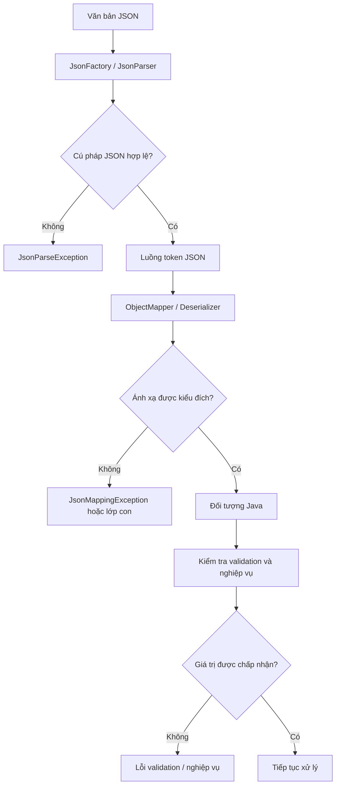

# Phân biệt JSON đúng cú pháp và dữ liệu đúng kiểu đích

Một chuỗi JSON có thể hoàn toàn đúng cú pháp nhưng vẫn không thể chuyển thành kiểu Java mà ứng dụng yêu cầu. Đây là hai bước khác nhau trong quá trình đọc dữ liệu bằng Jackson:

1. **Phân tích cú pháp (parsing):** kiểm tra văn bản đầu vào có tuân theo ngữ pháp JSON hay không, rồi tạo các token như object, array, string, number, boolean và null.
2. **Ánh xạ dữ liệu (data binding):** diễn giải các token theo kiểu Java đích, tìm property tương ứng, chuyển đổi giá trị và tạo đối tượng.

Ví dụ, `{"age": "hai mươi"}` là JSON đúng cú pháp vì `age` có giá trị chuỗi hợp lệ. Nhưng nếu kiểu Java khai báo `age` là `int`, Jackson không thể chuyển chuỗi `"hai mươi"` thành số nguyên theo quy tắc thông thường. Lỗi xảy ra ở bước ánh xạ, không phải vì JSON sai cú pháp.

Trong chương **Chuyển kiểu đầu vào** của Data Serialization Jackson, cần tách biệt tính hợp lệ của văn bản, khả năng ánh xạ sang kiểu đích và tính hợp lệ theo nghiệp vụ. Ba lớp kiểm tra này giúp xác định đúng nguyên nhân lỗi và chọn chính sách chuyển đổi phù hợp.

## 1. Ba tầng hợp lệ của dữ liệu đầu vào

Một request JSON nên được xem xét ở ba tầng:

| Tầng | Câu hỏi cần trả lời | Ví dụ lỗi |
|---|---|---|
| Cú pháp JSON | Văn bản có phải JSON hợp lệ không? | Thiếu dấu ngoặc kép, dấu phẩy sai vị trí, chuỗi chưa đóng. |
| Ánh xạ kiểu Java | JSON có thể được chuyển thành kiểu đích không? | Gửi object vào field `int`, gửi chuỗi không chuyển được vào số, tên property không được nhận diện. |
| Quy tắc dữ liệu/nghiệp vụ | Giá trị sau khi ánh xạ có được phép không? | Tuổi âm, email sai định dạng, số lượng bằng 0 khi phải lớn hơn 0. |

Ví dụ với lớp đích:

```java
public class UserRequest {
    private String name;
    private int age;

    public UserRequest() {
    }

    public String getName() {
        return name;
    }

    public void setName(String name) {
        this.name = name;
    }

    public int getAge() {
        return age;
    }

    public void setAge(int age) {
        this.age = age;
    }
}
```

Các đầu vào sau thể hiện những tình huống khác nhau:

```json
{"name":"An","age":20}
```

JSON đúng cú pháp và có thể ánh xạ thành `UserRequest`.

```json
{"name":"An","age":"hai mươi"}
```

JSON đúng cú pháp, nhưng giá trị `age` không chuyển được thành `int`.

```json
{"name":"An","age":-5}
```

JSON đúng cú pháp và có thể ánh xạ thành `UserRequest`, nhưng có thể vi phạm quy tắc nghiệp vụ nếu tuổi phải không âm.

```json
{"name":"An","age":20
```

JSON sai cú pháp vì object chưa được đóng bằng `}`. Jackson không thể hoàn tất bước parsing.

## 2. Parsing JSON và data binding trong Jackson

Jackson Core đọc văn bản JSON và tạo token. Jackson Databind sử dụng các token đó cùng kiểu đích để tạo object Java.



Ở bước parsing, Jackson chưa cần biết `age` trong ví dụ phải là `int` hay `String`; parser chỉ xác định token là một chuỗi. Kiểu đích chỉ được áp dụng khi databinding xử lý property `age`.

Đọc JSON bằng `ObjectMapper`:

```java
ObjectMapper mapper = new ObjectMapper();

UserRequest request = mapper.readValue(
        "{\"name\":\"An\",\"age\":20}",
        UserRequest.class
);
```

`readValue()` thường thực hiện cả parsing và databinding trong một lời gọi. Khi có lỗi, loại ngoại lệ và thông tin path giúp xác định lỗi thuộc tầng nào.

## 3. JSON đúng cú pháp nhưng không khớp kiểu Java

JSON có một số nhóm giá trị cơ bản: object, array, string, number, boolean và null. Kiểu Java đích có thể yêu cầu một hình dạng cụ thể. Nếu token có hình dạng không phù hợp, Jackson thường phát sinh lỗi ánh xạ.

### 3.1. Object và array không thể thay thế tùy ý

Giả sử kiểu đích là `UserRequest`:

```json
{"name":"An","age":20}
```

Đây là object phù hợp với một POJO. Nhưng JSON sau là array:

```json
["An", 20]
```

Nó vẫn đúng cú pháp JSON, nhưng không có hình dạng object-property thông thường mà `UserRequest` mong đợi. Nếu không có creator dạng delegating hoặc deserializer tùy chỉnh tương ứng, Jackson không thể ánh xạ array này thành `UserRequest`.

Ngược lại, nếu kiểu đích là `List<UserRequest>`, một JSON object đơn lẻ cũng không tự trở thành danh sách:

```json
{"name":"An","age":20}
```

Để tạo danh sách, JSON cần có array, ví dụ:

```json
[
  {"name":"An","age":20},
  {"name":"Bình","age":25}
]
```

### 3.2. Scalar không đúng kiểu

Các ví dụ sau đều có thể đúng cú pháp JSON nhưng có thể không ánh xạ được vào kiểu đích tương ứng:

| Giá trị JSON | Kiểu Java đích | Vấn đề có thể gặp |
|---|---|---|
| `"hello"` | `Integer` | Chuỗi không biểu diễn được số nguyên. |
| `{}` | `String` | Object không phải giá trị chuỗi. |
| `[]` | `User` | Array không phải object theo cấu trúc POJO thông thường. |
| `true` | `LocalDate` | Boolean không phải biểu diễn ngày hợp lệ. |
| `null` | `int` | Primitive không thể chứa null; hành vi mặc định có thể chuyển thành giá trị mặc định nếu không bật feature từ chối. |

Một số trường hợp Jackson có thể coercion, tức chuyển đổi giữa các dạng scalar. Vì vậy, không nên khẳng định mọi khác biệt giữa string và number đều chắc chắn phát sinh lỗi. Kết quả còn phụ thuộc kiểu đích, phiên bản Jackson, cấu hình coercion và deserializer cụ thể.

### 3.3. Chuỗi số và số JSON là hai token khác nhau

Hai JSON sau đều hợp lệ:

```json
{"age": 20}
```

```json
{"age": "20"}
```

Token thứ nhất là number; token thứ hai là string. Jackson có thể chuyển chuỗi số thành số nguyên theo cấu hình coercion hiện tại. Tuy nhiên, hợp đồng API nên quy định rõ kiểu dữ liệu được gửi. Nếu field được định nghĩa là number, client nên gửi number thay vì dựa vào chuyển đổi ngầm từ string.

## 4. Các loại lỗi thường gặp khi đọc JSON

Jackson cung cấp các ngoại lệ cụ thể để phân biệt lỗi cú pháp và lỗi ánh xạ. Một số loại thường thấy:

| Ngoại lệ | Tầng lỗi | Ví dụ |
|---|---|---|
| `JsonParseException` | Parsing | JSON thiếu dấu ngoặc, chuỗi không đóng, token không hợp lệ. |
| `MismatchedInputException` | Databinding | Object/array/scalar không phù hợp với kiểu đích. |
| `InvalidFormatException` | Databinding | Giá trị có hình dạng scalar nhưng không thể chuyển sang định dạng kiểu đích, ví dụ chuỗi `"abc"` cho số nguyên. |
| `UnrecognizedPropertyException` | Databinding | JSON chứa property mà lớp đích không nhận diện và cấu hình đang từ chối field lạ. |
| `JsonMappingException` | Databinding tổng quát | Lỗi ánh xạ khác, thường kèm đường dẫn tới property hoặc phần tử gây lỗi. |

`JsonProcessingException` là lớp ngoại lệ cấp cao thường gặp khi xử lý JSON; `JsonParseException` và các ngoại lệ ánh xạ nằm trong hệ thống ngoại lệ của Jackson. Khi xử lý lỗi, nên giữ thông tin loại lỗi và path thay vì chỉ ghi một thông báo chung như “JSON không hợp lệ”.

Ví dụ bắt lỗi:

```java
try {
    UserRequest request = mapper.readValue(json, UserRequest.class);
} catch (JsonParseException ex) {
    // Văn bản JSON sai cú pháp.
    System.err.println("Invalid JSON syntax: " + ex.getOriginalMessage());
} catch (MismatchedInputException ex) {
    // Token hoặc hình dạng dữ liệu không khớp kiểu đích.
    System.err.println("Input shape mismatch: " + ex.getOriginalMessage());
} catch (JsonMappingException ex) {
    // Lỗi ánh xạ khác.
    System.err.println("JSON mapping failed: " + ex.getOriginalMessage());
}
```

Trong ứng dụng thực tế, không nên trả nguyên thông báo nội bộ hoặc stack trace cho client. Hãy chuyển lỗi thành thông báo API phù hợp và ghi log chi tiết ở phía server theo chính sách bảo mật.

## 5. Property không tồn tại trong kiểu đích

Một JSON object có thể chứa property hợp lệ về cú pháp nhưng lớp Java không có property tương ứng.

Ví dụ JSON:

```json
{
  "name": "An",
  "age": 20,
  "isAdmin": true
}
```

Nếu `UserRequest` không có property `isAdmin`, Jackson thường xem đây là unknown property. Với `FAIL_ON_UNKNOWN_PROPERTIES` bật, thao tác giải tuần tự hóa phát sinh `UnrecognizedPropertyException`.

Có thể giữ chế độ nghiêm ngặt:

```java
mapper.enable(DeserializationFeature.FAIL_ON_UNKNOWN_PROPERTIES);
```

Hoặc bỏ qua field không biết:

```java
mapper.disable(DeserializationFeature.FAIL_ON_UNKNOWN_PROPERTIES);
```

Một lựa chọn giới hạn ở lớp cụ thể là:

```java
@JsonIgnoreProperties(ignoreUnknown = true)
public class UserRequest {
    // Các property được hỗ trợ
}
```

Việc bỏ qua unknown property có thể hữu ích khi cần tương thích với client gửi thêm field mới. Tuy nhiên, nó cũng có thể che giấu lỗi đánh máy trong tên property, ví dụ client gửi `usernmae` thay vì `username`. Với API nội bộ hoặc hợp đồng cần chặt chẽ, chế độ strict giúp phát hiện lỗi sớm hơn.

## 6. Chuyển đổi giá trị phụ thuộc cấu hình coercion

Jackson có các quy tắc coercion cho một số chuyển đổi giữa token JSON và kiểu Java. Các quy tắc này có thể cho phép hoặc từ chối chuyển đổi như:

- String thành integer/float.
- Number thành string.
- Empty string thành null hoặc giá trị mặc định cho một số kiểu.
- Scalar thành collection đơn phần tử trong một số cấu hình.

Không nên dựa vào các coercion ngầm nếu hợp đồng dữ liệu cần rõ ràng. Với Jackson 2.12 trở lên, `CoercionConfig` cho phép điều khiển theo nhóm kiểu và hình dạng đầu vào.

Ví dụ từ chối chuỗi khi cần một kiểu số nguyên:

```java
import com.fasterxml.jackson.databind.ObjectMapper;
import com.fasterxml.jackson.databind.cfg.CoercionAction;
import com.fasterxml.jackson.databind.cfg.CoercionInputShape;
import com.fasterxml.jackson.databind.type.LogicalType;

ObjectMapper mapper = new ObjectMapper();
mapper.coercionConfigFor(LogicalType.Integer)
        .setCoercion(CoercionInputShape.String, CoercionAction.Fail);
```

Với cấu hình này, giá trị chuỗi như `"20"` không được coercion thành integer cho nhóm kiểu số nguyên. Number JSON `20` vẫn là đầu vào phù hợp. API coercion có nhiều tùy chọn hơn, nên cần đọc tài liệu đúng phiên bản Jackson và kiểm tra tác động trên các kiểu đang sử dụng.

## 7. Kiểu ngày giờ, enum và các kiểu đặc biệt

Không phải mọi giá trị scalar đúng cú pháp đều có thể chuyển thành kiểu Java đặc biệt.

### 7.1. Ngày giờ

Ví dụ JSON:

```json
{"createdAt":"not-a-date"}
```

Đây là JSON đúng cú pháp vì giá trị là một chuỗi. Nhưng nếu `createdAt` là `LocalDateTime`, chuỗi đó không theo định dạng ngày giờ mà deserializer chấp nhận. Jackson có thể phát sinh lỗi ánh xạ/định dạng.

Để hỗ trợ Java Time API, ứng dụng thường đăng ký `JavaTimeModule` tương thích với phiên bản Jackson:

```java
ObjectMapper mapper = new ObjectMapper();
mapper.registerModule(new JavaTimeModule());
mapper.disable(SerializationFeature.WRITE_DATES_AS_TIMESTAMPS);
```

Chuỗi như `"2026-11-12T09:30:00"` có thể được đọc thành `LocalDateTime` theo serializer/deserializer tương ứng. Định dạng cụ thể phụ thuộc kiểu ngày giờ và cấu hình. `LocalDateTime` không chứa timezone; `Instant` biểu diễn thời điểm theo UTC. Hãy chọn kiểu đích theo ý nghĩa thực tế của dữ liệu.

### 7.2. Enum

Giả sử enum:

```java
public enum Status {
    NEW,
    ACTIVE,
    DISABLED
}
```

JSON `{"status":"ACTIVE"}` có thể ánh xạ thành `Status.ACTIVE`. JSON `{"status":"RUNNING"}` vẫn đúng cú pháp nhưng không khớp hằng enum nào; Jackson thường báo lỗi không thể chuyển đổi giá trị.

Nếu API cần chấp nhận chữ hoa/chữ thường không phân biệt, có thể bật feature phù hợp:

```java
mapper.enable(MapperFeature.ACCEPT_CASE_INSENSITIVE_ENUMS);
```

Đừng tự động bỏ qua enum không biết nếu giá trị đó có ý nghĩa quyết định trong nghiệp vụ. Khi API thay đổi enum, cần có chiến lược tương thích rõ ràng, chẳng hạn enum `UNKNOWN` với custom deserializer nếu hợp đồng cho phép.

## 8. Kiểm tra token thừa sau một JSON document

Một trường hợp khác là văn bản đầu vào chứa một JSON document hợp lệ rồi tiếp tục có token hoặc nội dung khác:

```text
{"name":"An","age":20} {"name":"Bình","age":25}
```

Mỗi object riêng lẻ đều là JSON hợp lệ, nhưng toàn bộ chuỗi không phải một JSON document đơn lẻ theo hợp đồng thông thường. Theo cấu hình mặc định, một số overload đọc giá trị có thể dừng sau document đầu tiên và không từ chối token phía sau.

Nếu API yêu cầu đúng một document và phải từ chối dữ liệu thừa, bật:

```java
mapper.enable(DeserializationFeature.FAIL_ON_TRAILING_TOKENS);
```

Feature này yêu cầu Jackson kiểm tra không còn token JSON nào sau giá trị gốc đã đọc. Điều này giúp phát hiện trường hợp client nối thêm một document hoặc token không được mong đợi. Với giao thức streaming có nhiều document liên tiếp, cần dùng API streaming phù hợp thay vì bật quy tắc chỉ chấp nhận một document.

## 9. Kiểm tra cấu trúc JSON bằng `JsonNode` trước khi chuyển DTO

Khi cần kiểm tra hình dạng dữ liệu trước khi databinding, có thể đọc JSON thành cây bằng `readTree()`:

```java
JsonNode root = mapper.readTree(json);

if (!root.isObject()) {
    throw new IllegalArgumentException("Expected a JSON object");
}

JsonNode ageNode = root.get("age");
if (ageNode == null || !ageNode.isIntegralNumber()) {
    throw new IllegalArgumentException("age must be an integer JSON number");
}

UserRequest request = mapper.treeToValue(root, UserRequest.class);
```

`JsonNode` giúp kiểm tra rõ token và cấu trúc trước khi chuyển thành DTO. Phương pháp này hữu ích khi API cần thông báo lỗi theo field hoặc chấp nhận nhiều dạng đầu vào có quy tắc riêng. Tuy nhiên, nếu chỉ cần ánh xạ DTO thông thường, đọc tree rồi chuyển tiếp sẽ tạo thêm bước và cấu trúc trung gian; có thể dùng `readValue()` trực tiếp.

Một số phương thức kiểm tra thường dùng:

| Phương thức | Kiểm tra |
|---|---|
| `isObject()` | Node là JSON object. |
| `isArray()` | Node là JSON array. |
| `isTextual()` | Node là JSON string. |
| `isNumber()` | Node là giá trị số. |
| `isIntegralNumber()` | Node là số nguyên JSON. |
| `isBoolean()` | Node là JSON boolean. |
| `isNull()` | Node là JSON null. |
| `has("field")` | Object có tên field hay không. |
| `hasNonNull("field")` | Field tồn tại và không có giá trị null. |

`get("field")` trả về null khi field không tồn tại, còn node JSON null là một `NullNode`. Có thể dùng sự khác biệt này để phân biệt field bị thiếu với field hiện diện nhưng null.

## 10. Ánh xạ thành công không có nghĩa dữ liệu hợp lệ về nghiệp vụ

Giả sử JSON sau:

```json
{
  "name": "An",
  "age": -10
}
```

Jackson có thể tạo `UserRequest` thành công vì `name` là chuỗi và `age` là số nguyên. Nhưng nếu hệ thống yêu cầu tuổi không âm, dữ liệu vẫn không hợp lệ.

Dùng Bean Validation để biểu diễn ràng buộc:

```java
import jakarta.validation.constraints.Min;
import jakarta.validation.constraints.NotBlank;

public record UserRequest(
        @NotBlank String name,
        @Min(0) int age
) {
}
```

Trong Spring MVC:

```java
@PostMapping("/users")
public UserResponse create(@Valid @RequestBody UserRequest request) {
    return userService.create(request);
}
```

Jackson đảm nhiệm việc parsing và binding. Bean Validation kiểm tra ràng buộc trên object sau khi tạo. Service/domain tiếp tục kiểm tra quyền và quy tắc phụ thuộc trạng thái hệ thống. Ví dụ, tuổi có thể không âm nhưng ngày sinh vẫn không phù hợp với một chính sách cụ thể; hoặc mã khách hàng có định dạng đúng nhưng không tồn tại.

## 11. Xử lý lỗi ở ranh giới API

Với REST API, có thể chuẩn hóa các lỗi đầu vào thành `400 Bad Request`, nhưng thông báo nên phản ánh đúng vấn đề:

- JSON sai cú pháp: yêu cầu client gửi văn bản JSON hợp lệ.
- Sai hình dạng hoặc kiểu: nêu field và kiểu mong đợi, ví dụ `age` phải là số nguyên.
- Unknown property: nêu tên field không được hỗ trợ nếu chính sách API strict.
- Validation: trả danh sách field và ràng buộc bị vi phạm.

Không nên trả stack trace, tên lớp nội bộ, đường dẫn tệp hoặc nội dung nhạy cảm từ exception. Ở phía server, log có thể ghi loại exception, property path, request id và thông tin cần thiết để điều tra; tránh ghi toàn bộ body nếu body có mật khẩu, token hoặc dữ liệu cá nhân.

## 12. Cách chọn công cụ theo vấn đề

| Vấn đề | Công cụ hoặc cách xử lý |
|---|---|
| Văn bản JSON sai cú pháp | `JsonParser`/`ObjectMapper`; xử lý `JsonParseException`. |
| Object/array/scalar không đúng kiểu đích | Xác định `JavaType`/`Class` đúng; xử lý lỗi mapping. |
| Chuỗi số hoặc coercion không mong muốn | Cấu hình coercion rõ ràng; yêu cầu client gửi đúng kiểu JSON. |
| Field JSON không tồn tại trong DTO | Chọn strict hoặc `FAIL_ON_UNKNOWN_PROPERTIES`/`@JsonIgnoreProperties` theo hợp đồng. |
| Chuỗi ngày giờ hoặc enum không chuyển được | Dùng module/format và giá trị enum được hỗ trợ. |
| Có token sau JSON document | `FAIL_ON_TRAILING_TOKENS` nếu chỉ cho phép một document. |
| Cần kiểm tra cấu trúc trước khi binding | `JsonNode` với `readTree()`. |
| Giá trị đúng kiểu nhưng sai miền cho phép | Bean Validation và kiểm tra nghiệp vụ. |

JSON đúng cú pháp chỉ chứng minh văn bản tuân theo ngữ pháp JSON. Nó chưa chứng minh dữ liệu phù hợp với kiểu Java đích, và càng chưa chứng minh dữ liệu thỏa quy tắc nghiệp vụ. Khi đọc dữ liệu bằng Jackson, hãy xác định lỗi xảy ra ở parsing, databinding hay validation; cung cấp kiểu đích rõ ràng, cấu hình coercion có chủ đích và chuyển lỗi thành phản hồi API an toàn, dễ hiểu.
