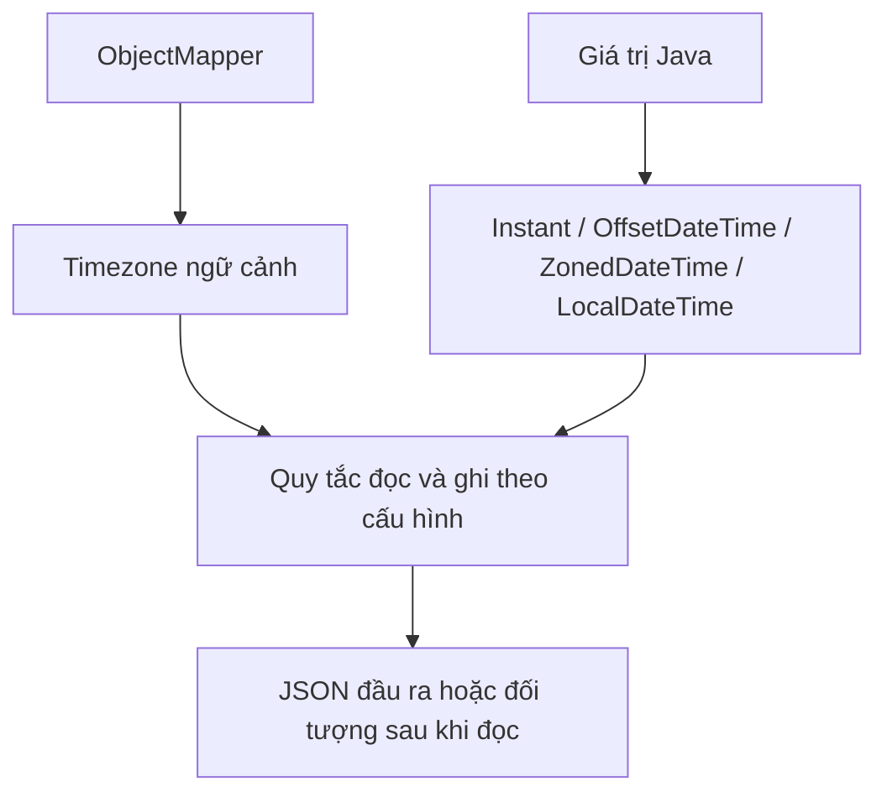

# Phân biệt cấu hình múi giờ của mapper và thông tin trong giá trị

Khi Jackson đọc hoặc ghi ngày giờ, cần phân biệt **múi giờ ngữ cảnh của `ObjectMapper`** với **offset hoặc múi giờ được mang trực tiếp trong giá trị Java**. Hai thông tin này có thể tương tác, nhưng không giống nhau.

Ví dụ, `ObjectMapper` có thể được cấu hình dùng `UTC` làm timezone mặc định. Điều đó không có nghĩa mọi giá trị `LocalDateTime` trong chương trình tự động trở thành UTC. `LocalDateTime` không chứa timezone hay offset. Ngược lại, `OffsetDateTime` mang offset như `+07:00`, còn `ZonedDateTime` mang cả thời điểm địa phương và `ZoneId` như `Asia/Ho_Chi_Minh` hoặc `America/New_York`.

Jackson có các feature điều khiển việc điều chỉnh giá trị ngày giờ theo timezone ngữ cảnh khi đọc và ghi. Nếu không phân biệt rõ các feature này với thông tin nằm trong chính giá trị, ứng dụng có thể vô tình đổi offset, đổi vùng timezone hoặc làm mất thông tin cần thiết khi round-trip JSON.

## 1. Hai nguồn thông tin thời gian khác nhau

Trong một ứng dụng dùng Jackson, thông tin liên quan đến múi giờ có thể đến từ hai nơi:

- **Cấu hình mapper:** timezone ngữ cảnh, ví dụ `UTC` hoặc `Asia/Ho_Chi_Minh`. Nó là chính sách mặc định/điều chỉnh mà Jackson sử dụng cho các kiểu ngày giờ có hỗ trợ timezone.
- **Giá trị Java:** thông tin thời gian cụ thể đã được lưu trong đối tượng, ví dụ một `Instant`, một `OffsetDateTime` với offset `+07:00`, hoặc một `ZonedDateTime` với zone `Asia/Ho_Chi_Minh`.

Sơ đồ sau minh họa hai nguồn thông tin:



Timezone của mapper không phải một thuộc tính được tự động gắn vào mọi object ngày giờ. Nó chỉ tham gia vào những thao tác và kiểu dữ liệu mà Jackson quy định có sử dụng timezone ngữ cảnh.

## 2. Phân biệt các kiểu ngày giờ của Java

Trước khi cấu hình Jackson, cần chọn đúng kiểu Java theo ý nghĩa dữ liệu.

| Kiểu Java | Có ngày? | Có giờ? | Mang offset/zone? | Ý nghĩa chính |
|---|---:|---:|---:|---|
| `Instant` | Có, trên trục thời gian | Có | Không lưu zone địa phương | Một thời điểm tuyệt đối trên timeline, chuẩn hóa theo UTC. |
| `LocalDate` | Có | Không | Không | Một ngày trên lịch, ví dụ ngày sinh. |
| `LocalTime` | Không | Có | Không | Giờ trên đồng hồ, không gắn với ngày hoặc múi giờ. |
| `LocalDateTime` | Có | Có | Không | Ngày giờ địa phương, chưa xác định được thời điểm tuyệt đối. |
| `OffsetTime` | Không | Có | Có offset | Giờ địa phương cùng độ lệch UTC. |
| `OffsetDateTime` | Có | Có | Có offset | Ngày giờ cùng độ lệch UTC, ví dụ `+07:00`. |
| `ZonedDateTime` | Có | Có | Có `ZoneId` | Ngày giờ gắn với vùng timezone và quy tắc lịch sử/DST của vùng đó. |
| `java.util.Date` | Có, dưới dạng thời điểm | Có | Không lưu zone | Một thời điểm tính bằng milliseconds kể từ epoch; timezone chỉ tham gia khi hiển thị hoặc phân tích văn bản. |
| `Calendar` | Có | Có | Có timezone | Một thời điểm cùng timezone/lịch được cấu hình trong đối tượng. |

Một offset như `+07:00` chỉ cho biết độ lệch so với UTC tại giá trị đó. Một `ZoneId` như `Asia/Ho_Chi_Minh` hoặc `Europe/Paris` còn đại diện cho quy tắc của một vùng, bao gồm các thay đổi lịch sử và quy tắc daylight saving time nếu có.

Ví dụ:

```java
Instant instant = Instant.parse("2026-11-12T09:00:00Z");

OffsetDateTime offsetDateTime = OffsetDateTime.parse(
        "2026-11-12T16:00:00+07:00"
);

ZonedDateTime zonedDateTime = ZonedDateTime.parse(
        "2026-11-12T16:00:00+07:00[Asia/Ho_Chi_Minh]"
);

LocalDateTime localDateTime = LocalDateTime.parse(
        "2026-11-12T16:00:00"
);
```

`instant`, `offsetDateTime` và `zonedDateTime` trong ví dụ mô tả cùng một thời điểm. `localDateTime` chỉ là các thành phần ngày và giờ; nó chưa nói thời điểm đó thuộc UTC+7, UTC hay một vùng timezone nào.

## 3. Cấu hình timezone ngữ cảnh của ObjectMapper

Với Jackson Databind, có thể thiết lập timezone ngữ cảnh bằng `ObjectMapper.setTimeZone()`:

```java
import com.fasterxml.jackson.databind.ObjectMapper;

import java.util.TimeZone;

ObjectMapper mapper = new ObjectMapper();
mapper.setTimeZone(TimeZone.getTimeZone("Asia/Ho_Chi_Minh"));
```

Timezone này được sử dụng làm ngữ cảnh cho những serializer/deserializer ngày giờ có hỗ trợ. Nó đặc biệt quan trọng với các kiểu legacy như `Date` và `Calendar`, cũng như những kiểu `java.time` có offset/zone khi các feature điều chỉnh theo context được bật.

Với ứng dụng dùng Java Time API, cần có module `jackson-datatype-jsr310` cùng phiên bản phù hợp với các artifact Jackson khác và đăng ký `JavaTimeModule`:

```java
import com.fasterxml.jackson.databind.ObjectMapper;
import com.fasterxml.jackson.databind.SerializationFeature;
import com.fasterxml.jackson.datatype.jsr310.JavaTimeModule;
import java.util.TimeZone;

ObjectMapper mapper = new ObjectMapper();
mapper.registerModule(new JavaTimeModule());
mapper.setTimeZone(TimeZone.getTimeZone("Asia/Ho_Chi_Minh"));
mapper.disable(SerializationFeature.WRITE_DATES_AS_TIMESTAMPS);
```

Tắt `WRITE_DATES_AS_TIMESTAMPS` thường giúp ngày giờ được ghi dưới dạng chuỗi ISO thay vì timestamp hoặc cấu trúc số/array. Feature này quyết định hình thức đầu ra; nó không tự quyết định có bảo toàn zone gốc hay điều chỉnh theo timezone ngữ cảnh.

### 3.1. Mapper timezone không thay đổi mọi kiểu theo cùng một cách

`setTimeZone()` không có nghĩa mọi giá trị ngày giờ được cộng hoặc trừ một số giờ ngay khi gán vào object. Tác động phụ thuộc kiểu dữ liệu và feature:

- Với `Instant`, bản thân giá trị đã là thời điểm tuyệt đối trên timeline. Serializer Java Time thường ghi nó theo biểu diễn ISO UTC; mapper timezone không làm thay đổi thời điểm đó.
- Với `Date`, giá trị cũng là một thời điểm tuyệt đối. Timezone ảnh hưởng cách biểu diễn thành chuỗi, không thay đổi số milliseconds mà `Date` đang lưu.
- Với `LocalDateTime`, không có offset hay zone để điều chỉnh. Mapper không thể tự biết giờ địa phương đó thuộc múi giờ nào.
- Với `OffsetDateTime` và `ZonedDateTime`, Jackson có thể điều chỉnh offset/zone theo timezone ngữ cảnh khi feature tương ứng được bật.

Vì vậy, khi gặp một thời điểm bị đổi giờ sau khi đọc hoặc ghi, hãy xác định kiểu Java và feature điều chỉnh đang hoạt động thay vì chỉ nhìn vào `setTimeZone()`.

## 4. Điều chỉnh theo timezone ngữ cảnh khi giải tuần tự hóa

Jackson có feature:

```java
DeserializationFeature.ADJUST_DATES_TO_CONTEXT_TIME_ZONE
```

Feature này điều khiển việc điều chỉnh giá trị ngày giờ về timezone ngữ cảnh của mapper trong quá trình deserialization, đối với những kiểu và deserializer hỗ trợ hành vi đó. Trong Jackson Databind, feature này thường được bật mặc định.

Ví dụ, mapper có context timezone `UTC` và nhận JSON:

```json
{
  "scheduledAt": "2026-11-12T16:00:00+07:00"
}
```

Nếu `scheduledAt` là `OffsetDateTime` và việc điều chỉnh theo context được bật, Jackson có thể chuyển giá trị sang offset của context, tức cùng thời điểm nhưng biểu diễn theo UTC (`2026-11-12T09:00:00Z`). Thời điểm trên timeline không đổi; phần offset và giờ địa phương của biểu diễn có thể đổi.

Nếu cần giữ nguyên offset có trong JSON, có thể tắt feature:

```java
mapper.disable(DeserializationFeature.ADJUST_DATES_TO_CONTEXT_TIME_ZONE);
```

Khi đó, deserializer Java Time có thể giữ offset ban đầu của `OffsetDateTime`, thay vì chuẩn hóa nó theo context timezone. Với `ZonedDateTime`, việc giữ zone gốc còn phụ thuộc JSON có chứa zone ID và cách serializer/deserializer được cấu hình.

### 4.1. Cùng thời điểm nhưng khác biểu diễn

Hai giá trị sau biểu diễn cùng một thời điểm:

```java
OffsetDateTime a = OffsetDateTime.parse("2026-11-12T16:00:00+07:00");
OffsetDateTime b = OffsetDateTime.parse("2026-11-12T09:00:00Z");

System.out.println(a.toInstant().equals(b.toInstant())); // true
System.out.println(a.equals(b)); // false: offset và local representation khác nhau
```

Đây là khác biệt quan trọng khi so sánh dữ liệu. Nếu nghiệp vụ chỉ quan tâm thời điểm, hãy so sánh `toInstant()`. Nếu offset ban đầu là một phần của hợp đồng hoặc cần hiển thị đúng như người dùng nhập, phải giữ thông tin offset và không chuẩn hóa một cách vô tình.

## 5. Điều chỉnh theo timezone ngữ cảnh khi tuần tự hóa

Ở chiều ghi, Jackson 2.13 trở lên có feature:

```java
SerializationFeature.WRITE_DATES_WITH_CONTEXT_TIME_ZONE
```

Feature này điều khiển việc điều chỉnh các giá trị ngày giờ `java.time` có hỗ trợ theo timezone ngữ cảnh của mapper trước khi ghi. Mặc định của feature này thường là bật. Khi bật, một `OffsetDateTime` hoặc `ZonedDateTime` có thể được biểu diễn theo context timezone thay vì offset/zone đang mang trong giá trị.

Nếu muốn serializer giữ thông tin offset/zone nằm trong giá trị Java, có thể tắt feature:

```java
mapper.disable(SerializationFeature.WRITE_DATES_WITH_CONTEXT_TIME_ZONE);
```

Ví dụ với `OffsetDateTime`:

```java
OffsetDateTime appointment = OffsetDateTime.parse(
        "2026-11-12T16:00:00+07:00"
);

mapper.disable(SerializationFeature.WRITE_DATES_WITH_CONTEXT_TIME_ZONE);
mapper.disable(SerializationFeature.WRITE_DATES_AS_TIMESTAMPS);

String json = mapper.writeValueAsString(appointment);
System.out.println(json);
```

Với cấu hình không điều chỉnh theo context, đầu ra giữ offset `+07:00` trong giá trị. Nếu bật điều chỉnh theo context timezone `UTC`, đầu ra có thể biểu diễn cùng thời điểm bằng `Z`.

`WRITE_DATES_WITH_CONTEXT_TIME_ZONE` không giống `WRITE_DATES_AS_TIMESTAMPS`: một feature quyết định điều chỉnh theo context timezone; feature còn lại quyết định dạng biểu diễn timestamp hay chuỗi/cấu trúc ngày giờ.

## 6. Bảo toàn ZoneId của ZonedDateTime

`ZonedDateTime` có thể chứa zone vùng như `Asia/Ho_Chi_Minh`, trong khi `OffsetDateTime` chỉ giữ offset tại thời điểm cụ thể. Nếu cần bảo toàn chính vùng timezone, không chỉ offset, cần quan tâm đến feature:

```java
SerializationFeature.WRITE_DATES_WITH_ZONE_ID
```

Khi được bật cùng chế độ ghi ngày giờ dạng chuỗi, Jackson Java Time serializer có thể ghi zone ID của `ZonedDateTime` trong biểu diễn ISO, ví dụ:

```text
2026-11-12T16:00:00+07:00[Asia/Ho_Chi_Minh]
```

Nếu chỉ ghi:

```text
2026-11-12T16:00:00+07:00
```

thì bên nhận biết offset `+07:00`, nhưng không thể suy ra chắc chắn zone gốc là `Asia/Ho_Chi_Minh`. Nhiều vùng timezone có thể có cùng offset tại một thời điểm, và quy tắc lịch sử/DST của chúng có thể khác nhau.

Ví dụ cấu hình hướng tới việc giữ zone gốc của `ZonedDateTime`:

```java
ObjectMapper mapper = new ObjectMapper();
mapper.registerModule(new JavaTimeModule());
mapper.disable(SerializationFeature.WRITE_DATES_AS_TIMESTAMPS);

// Không chuẩn hóa giá trị theo timezone ngữ cảnh khi đọc/ghi.
mapper.disable(DeserializationFeature.ADJUST_DATES_TO_CONTEXT_TIME_ZONE);
mapper.disable(SerializationFeature.WRITE_DATES_WITH_CONTEXT_TIME_ZONE);

// Ghi zone ID vùng trong biểu diễn ZonedDateTime.
mapper.enable(SerializationFeature.WRITE_DATES_WITH_ZONE_ID);
```

Các feature trên áp dụng cho những kiểu Java Time tương ứng. Cần dùng phiên bản Jackson có hỗ trợ feature được nêu và bảo đảm `jackson-databind`, `jackson-core` và `jackson-datatype-jsr310` tương thích cùng phiên bản.

### 6.1. Zone ID có ý nghĩa với quy tắc tương lai

Giả sử một cuộc hẹn được lưu lúc 09:00 theo `Europe/Paris`. Nếu chỉ lưu offset hiện tại, ứng dụng không có đủ thông tin để áp dụng quy tắc của Paris khi luật timezone thay đổi trong tương lai. Nếu nghiệp vụ cần giữ ý định “09:00 giờ Paris”, hãy lưu `LocalDateTime` cùng `ZoneId` hoặc dùng `ZonedDateTime` và bảo toàn zone ID.

Ngược lại, nếu chỉ cần ghi lại một sự kiện đã xảy ra tại một thời điểm tuyệt đối, `Instant` thường là mô hình đơn giản và ổn định hơn. Có thể chuyển `Instant` sang timezone của người xem khi hiển thị.

## 7. LocalDateTime không tự mang múi giờ

Một lỗi thiết kế thường gặp là cho rằng cấu hình mapper timezone sẽ biến `LocalDateTime` thành giờ của timezone đó. Điều này không đúng vì `LocalDateTime` không chứa thông tin offset hoặc zone.

Ví dụ:

```java
LocalDateTime local = LocalDateTime.parse("2026-11-12T16:00:00");
```

Giá trị trên chỉ có nghĩa ngày 12/11/2026 lúc 16:00 trên một đồng hồ địa phương chưa xác định vùng. Muốn diễn giải nó là 16:00 tại Thành phố Hồ Chí Minh, cần gắn zone rõ ràng:

```java
ZonedDateTime hoChiMinhTime = local.atZone(
        ZoneId.of("Asia/Ho_Chi_Minh")
);
```

Muốn lấy thời điểm tuyệt đối:

```java
Instant instant = hoChiMinhTime.toInstant();
```

Đừng dùng `LocalDateTime` cho một sự kiện cần xác định chính xác thời điểm toàn cầu nếu ứng dụng không lưu kèm zone/offset ở nơi khác. Với ngày sinh, ngày nghỉ hoặc ngày thanh toán theo lịch địa phương, `LocalDate` có thể phù hợp hơn vì các dữ liệu đó không nhất thiết cần thời điểm UTC.

## 8. Phân biệt timezone của mapper với `@JsonFormat`

`ObjectMapper` đặt chính sách ở phạm vi mapper. `@JsonFormat` có thể khai báo định dạng và một số thuộc tính như timezone ở phạm vi property:

```java
public class EventDto {
    @JsonFormat(
            shape = JsonFormat.Shape.STRING,
            pattern = "yyyy-MM-dd'T'HH:mm:ssXXX",
            timezone = "Asia/Ho_Chi_Minh"
    )
    private Date occurredAt;

    public Date getOccurredAt() {
        return occurredAt;
    }

    public void setOccurredAt(Date occurredAt) {
        this.occurredAt = occurredAt;
    }
}
```

Với `Date`, timezone trong annotation có thể điều khiển cách parse/format giá trị theo property đó, tùy serializer/deserializer được sử dụng. Nó không thay đổi bản chất `Date` là một thời điểm epoch.

Không nên mặc định rằng `timezone` trong `@JsonFormat` có thể gắn zone cho mọi kiểu `java.time`. `LocalDateTime` vẫn không chứa timezone; annotation không thể làm cho một giá trị local trở thành một thời điểm tuyệt đối nếu JSON không cung cấp offset/zone và hợp đồng không quy định cách diễn giải.

Hãy dùng annotation ở cấp property khi một field có định dạng riêng biệt được xác định rõ. Nếu mọi ngày giờ của một tích hợp cần cùng chính sách, cấu hình mapper chuyên biệt thường dễ quản lý hơn. Tránh để `@JsonFormat`, timezone của mapper và feature điều chỉnh context tạo ra những quy tắc chồng chéo khó dự đoán.

## 9. Ví dụ hai chính sách mapper khác nhau

Một hệ thống có thể cần hai chính sách:

1. **Chuẩn hóa về UTC:** thích hợp khi hợp đồng trao đổi chỉ quan tâm thời điểm tuyệt đối.
2. **Giữ offset/zone của giá trị:** thích hợp khi offset hoặc vùng timezone gốc là một phần của dữ liệu nghiệp vụ.

### 9.1. Mapper chuẩn hóa về UTC

```java
ObjectMapper utcMapper = new ObjectMapper();
utcMapper.registerModule(new JavaTimeModule());
utcMapper.setTimeZone(TimeZone.getTimeZone("UTC"));
utcMapper.disable(SerializationFeature.WRITE_DATES_AS_TIMESTAMPS);

// Điều chỉnh kiểu ngày giờ có offset/zone theo timezone ngữ cảnh.
utcMapper.enable(DeserializationFeature.ADJUST_DATES_TO_CONTEXT_TIME_ZONE);
utcMapper.enable(SerializationFeature.WRITE_DATES_WITH_CONTEXT_TIME_ZONE);
```

Với `OffsetDateTime` hoặc `ZonedDateTime` mà deserializer/serializer hỗ trợ context adjustment, giá trị có thể được chuẩn hóa về UTC khi đọc/ghi. Đối với `Instant`, thời điểm vẫn là một điểm trên timeline; khi ghi dạng ISO, biểu diễn thông thường dùng `Z`.

### 9.2. Mapper giữ thông tin trong giá trị

```java
ObjectMapper preserveMapper = new ObjectMapper();
preserveMapper.registerModule(new JavaTimeModule());
preserveMapper.setTimeZone(TimeZone.getTimeZone("UTC"));
preserveMapper.disable(SerializationFeature.WRITE_DATES_AS_TIMESTAMPS);

preserveMapper.disable(DeserializationFeature.ADJUST_DATES_TO_CONTEXT_TIME_ZONE);
preserveMapper.disable(SerializationFeature.WRITE_DATES_WITH_CONTEXT_TIME_ZONE);
preserveMapper.enable(SerializationFeature.WRITE_DATES_WITH_ZONE_ID);
```

Ở đây, context timezone vẫn được đặt cho các kiểu cần nó, nhưng các feature điều chỉnh Java Time theo context được tắt. `OffsetDateTime` có thể giữ offset ban đầu; `ZonedDateTime` có thể giữ zone ID khi JSON chứa zone ID và serializer ghi nó.

Hai mapper có hợp đồng khác nhau nên cần được đặt tên và inject theo mục đích. Không thay đổi timezone hoặc feature của mapper dùng chung trong lúc các request khác đang xử lý.

## 10. Những lỗi thường gặp khi cấu hình timezone

### 10.1. Nghĩ rằng `setTimeZone()` thay đổi giá trị Java

`setTimeZone()` cấu hình context của mapper. Nó không trực tiếp sửa object đã tồn tại trong bộ nhớ. Việc chuyển đổi xảy ra trong serializer/deserializer theo kiểu và feature tương ứng.

### 10.2. Nhầm offset với ZoneId

`+07:00` không tương đương với tên vùng `Asia/Ho_Chi_Minh`. Offset không chứa quy tắc lịch sử hoặc DST. Nếu cần giữ vùng timezone, dùng `ZonedDateTime` và cấu hình ghi zone ID phù hợp.

### 10.3. Dùng LocalDateTime cho thời điểm toàn cầu

`LocalDateTime` không xác định được một thời điểm duy nhất nếu thiếu zone/offset. Khi chuyển giữa các hệ thống ở nhiều vùng, dữ liệu có thể bị diễn giải khác nhau.

### 10.4. Chỉ tắt `WRITE_DATES_AS_TIMESTAMPS` rồi cho rằng đã giữ zone

Feature này chỉ thay đổi dạng đầu ra. Muốn giữ offset/zone gốc, còn phải xem `WRITE_DATES_WITH_CONTEXT_TIME_ZONE`, `ADJUST_DATES_TO_CONTEXT_TIME_ZONE` và `WRITE_DATES_WITH_ZONE_ID`.

### 10.5. Không đồng bộ phiên bản Jackson

Các feature và hành vi Java Time có thể khác giữa các phiên bản. Hãy quản lý `jackson-core`, `jackson-databind` và `jackson-datatype-jsr310` theo cùng một phiên bản/BOM. Không sao chép cấu hình từ tài liệu phiên bản mới vào dự án đang dùng phiên bản cũ mà chưa kiểm tra API.

## 11. Kiểm tra round-trip để hiểu chính sách timezone

Khi cấu hình ngày giờ, nên kiểm tra cả JSON và giá trị sau khi đọc lại. Ví dụ với `ZonedDateTime`:

```java
ZonedDateTime original = ZonedDateTime.of(
        2026, 11, 12,
        16, 0, 0, 0,
        ZoneId.of("Asia/Ho_Chi_Minh")
);

String json = preserveMapper.writeValueAsString(original);
ZonedDateTime restored = preserveMapper.readValue(
        json,
        ZonedDateTime.class
);

System.out.println(json);
System.out.println(original.getZone());
System.out.println(restored.getZone());
System.out.println(original.toInstant().equals(restored.toInstant()));
```

Với mapper giữ zone, mục tiêu là kiểm tra cả hai điều:

- Thời điểm tuyệt đối có còn giống nhau không (`toInstant()`).
- Zone ID hoặc offset có được giữ theo hợp đồng không (`getZone()` hoặc `getOffset()`).

Nếu ứng dụng chỉ quan tâm thời điểm tuyệt đối, kiểm tra `Instant` có thể là đủ. Nếu cần tái hiện giờ địa phương theo vùng, phải kiểm tra zone ID. Chỉ so sánh chuỗi JSON đôi khi không đủ vì hai chuỗi khác nhau vẫn có thể biểu diễn cùng một thời điểm.

## 12. Chọn mô hình và cấu hình theo yêu cầu

| Yêu cầu dữ liệu | Kiểu Java nên cân nhắc | Chính sách Jackson |
|---|---|---|
| Ghi lại thời điểm sự kiện đã xảy ra | `Instant` | Chuỗi ISO UTC hoặc quy ước timestamp thống nhất. |
| Ngày sinh hoặc ngày trên lịch | `LocalDate` | Chuỗi ngày, không gắn timezone. |
| Giờ địa phương chưa gắn vùng | `LocalDateTime` | Không tự thêm timezone; quy định zone ở tầng nghiệp vụ nếu cần. |
| Thời điểm cùng offset do client gửi | `OffsetDateTime` | Tắt adjustment nếu cần giữ offset gốc. |
| Lịch hẹn theo vùng timezone cụ thể | `ZonedDateTime` | Bảo toàn zone ID, tắt context adjustment và bật ghi zone ID khi phù hợp. |
| Dữ liệu legacy `Date`/`Calendar` | `Date` hoặc `Calendar` | Cấu hình context timezone và định dạng rõ ràng. |
| Mọi tích hợp phải chuẩn hóa theo UTC | `Instant` hoặc kiểu có offset/zone được chuẩn hóa | Đặt context UTC và bật các feature điều chỉnh tương ứng. |

Timezone của mapper là chính sách ngữ cảnh; offset hoặc zone trong giá trị Java là dữ liệu cụ thể. `Instant` biểu diễn thời điểm tuyệt đối, `OffsetDateTime` giữ độ lệch UTC, `ZonedDateTime` giữ vùng timezone, còn `LocalDateTime` không mang thông tin nào trong số đó. Khi cấu hình Jackson, hãy quyết định rõ muốn chuẩn hóa mọi biểu diễn về một timezone hay giữ thông tin gốc trong giá trị. Kết hợp đúng `setTimeZone()`, `ADJUST_DATES_TO_CONTEXT_TIME_ZONE`, `WRITE_DATES_WITH_CONTEXT_TIME_ZONE`, `WRITE_DATES_WITH_ZONE_ID` và kiểu Java phù hợp sẽ giúp dữ liệu ngày giờ nhất quán khi trao đổi giữa các hệ thống.
