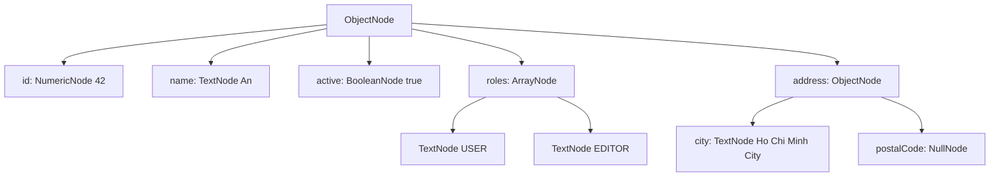

# Chuyển đổi giữa cây JSON và đối tượng Java

Jackson không chỉ đọc JSON thành POJO hoặc ghi POJO thành chuỗi JSON. Nó còn cung cấp **Tree Model** để biểu diễn JSON thành một cây node trong bộ nhớ. Từ cây này, ứng dụng có thể đọc một vài thuộc tính, kiểm tra cấu trúc, thêm hoặc xóa field, biến đổi dữ liệu rồi chuyển kết quả thành đối tượng Java.

Trong Jackson, lớp cơ sở của Tree Model là `JsonNode`. Object JSON thường được biểu diễn bằng `ObjectNode`, array bằng `ArrayNode`, còn string, number, boolean và null được biểu diễn bằng các node giá trị tương ứng. `ObjectMapper` cung cấp những API quan trọng để đi qua lại giữa cây JSON và object Java:

- `readTree(...)`: đọc JSON thành cây `JsonNode`.
- `valueToTree(...)`: chuyển một object Java thành cây JSON.
- `treeToValue(...)`: chuyển một cây JSON thành kiểu Java cụ thể.
- `convertValue(...)`: chuyển một giá trị Java hoặc node sang kiểu đích thông qua cơ chế ánh xạ của Jackson.

Tree Model hữu ích khi cấu trúc JSON thay đổi, khi chỉ cần xử lý một phần dữ liệu hoặc khi cần biến đổi JSON trước khi tạo DTO. Nếu schema đã biết và chỉ cần chuyển toàn bộ dữ liệu, Data Binding trực tiếp thường ngắn gọn hơn.

## 1. Cây JSON và đối tượng Java là hai mô hình khác nhau

Một đối tượng Java có kiểu cụ thể, field, method, constructor và các quy tắc truy cập. JSON chỉ mô tả cấu trúc dữ liệu gồm object, array và các giá trị scalar. Tree Model biểu diễn cấu trúc JSON thành các node có thể duyệt và thao tác trong bộ nhớ.

Ví dụ JSON:

```json
{
  "id": 42,
  "name": "An",
  "active": true,
  "roles": ["USER", "EDITOR"],
  "address": {
    "city": "Ho Chi Minh City",
    "postalCode": null
  }
}
```

Cây tương ứng có thể hình dung như sau:



Tree Model không tự biết node `id` là `long`, `name` là thuộc tính của lớp `User` hay `roles` là `List<String>`. Nó chỉ giữ kiểu dữ liệu JSON và cấu trúc lồng nhau. Khi chuyển cây thành POJO, ứng dụng phải cung cấp kiểu Java đích để Jackson thực hiện ánh xạ.

## 2. Đọc JSON thành cây bằng `readTree()`

Khi JSON đã có trong một `String`, có thể đọc trực tiếp:

```java
import com.fasterxml.jackson.databind.JsonNode;
import com.fasterxml.jackson.databind.ObjectMapper;

ObjectMapper mapper = new ObjectMapper();

String json = """
        {
          "id": 42,
          "name": "An",
          "active": true,
          "roles": ["USER", "EDITOR"]
        }
        """;

JsonNode root = mapper.readTree(json);
```

`root` là node gốc. Trong ví dụ này, nó là `ObjectNode` vì JSON gốc là object. `readTree()` cũng có overload đọc từ `InputStream`, `Reader`, `byte[]` và các nguồn dữ liệu khác mà Jackson hỗ trợ.

Nếu nguồn JSON là tệp, không cần đọc toàn bộ tệp thành chuỗi trước:

```java
import java.io.InputStream;
import java.nio.file.Files;
import java.nio.file.Path;

try (InputStream input = Files.newInputStream(Path.of("user.json"))) {
    JsonNode root = mapper.readTree(input);
    // Tiếp tục xử lý root trong phạm vi này.
}
```

`readTree()` vẫn xây dựng cây trong bộ nhớ. Với JSON rất lớn, cây có thể chiếm nhiều bộ nhớ; khi cần xử lý từng token mà không giữ toàn bộ cấu trúc, hãy cân nhắc Streaming API (`JsonParser`).

## 3. Truy cập thuộc tính trong `JsonNode`

`JsonNode` cung cấp nhiều cách lấy node con. Hai phương thức thường dùng là `get()` và `path()`.

### 3.1. Dùng `get()`

```java
JsonNode nameNode = root.get("name");

if (nameNode != null) {
    String name = nameNode.asText();
}
```

`get("name")` trả về `null` nếu object không có field đó. Nếu field tồn tại và giá trị JSON là `null`, phương thức trả về một `NullNode`, không phải Java `null`.

### 3.2. Dùng `path()`

```java
String city = root.path("address").path("city").asText("Unknown");
```

`path()` trả về `MissingNode` khi field không tồn tại. Vì vậy, có thể nối nhiều lần `path()` mà không cần kiểm tra Java `null` sau mỗi cấp. `asText("Unknown")` dùng giá trị mặc định nếu node không thể cung cấp giá trị text phù hợp.

### 3.3. Phân biệt field thiếu và field null

Khi xử lý dữ liệu đầu vào, cần phân biệt:

- Field không tồn tại: `get()` trả về Java `null`, còn `path()` trả về `MissingNode`.
- Field có giá trị JSON null: node là `NullNode`.
- Field có giá trị rỗng: ví dụ `TextNode` chứa `""`, `ArrayNode` rỗng hoặc `ObjectNode` rỗng.

Ví dụ:

```java
JsonNode missing = root.path("unknownField");
JsonNode postalCode = root.path("address").path("postalCode");

System.out.println(missing.isMissingNode()); // true nếu không có field
System.out.println(postalCode.isNull());     // true nếu JSON ghi null
```

Các phương thức `has()` và `hasNonNull()` cũng hữu ích:

```java
boolean fieldExists = root.has("name");
boolean fieldHasValue = root.hasNonNull("name");
```

`has()` trả về true khi field tồn tại kể cả khi giá trị là JSON null. `hasNonNull()` chỉ trả về true nếu field tồn tại và không phải `NullNode`.

### 3.4. Đọc giá trị theo kiểu

Một số phương thức thường dùng:

| Phương thức | Công dụng |
|---|---|
| `asText()` | Lấy giá trị dưới dạng text khi node hỗ trợ chuyển đổi. |
| `asInt()` / `asInt(defaultValue)` | Lấy giá trị integer hoặc giá trị mặc định. |
| `asLong()` | Lấy giá trị long. |
| `asDouble()` | Lấy giá trị double. |
| `asBoolean()` | Lấy giá trị boolean. |
| `isTextual()` | Kiểm tra node là string. |
| `isIntegralNumber()` | Kiểm tra node là số nguyên. |
| `isNumber()` | Kiểm tra node là số. |
| `isBoolean()` | Kiểm tra node là boolean. |
| `isObject()` / `isArray()` | Kiểm tra cấu trúc object hoặc array. |
| `isNull()` / `isMissingNode()` | Phân biệt JSON null và field không tồn tại. |

Các phương thức `asXxx()` thường cố gắng chuyển đổi và có thể trả giá trị mặc định nếu node không phù hợp. Nếu kiểu dữ liệu chính xác là điều kiện bắt buộc, hãy kiểm tra `isTextual()`, `isIntegralNumber()` hoặc loại node tương ứng trước khi đọc.

```java
JsonNode ageNode = root.path("age");
if (!ageNode.isIntegralNumber()) {
    throw new IllegalArgumentException("age must be an integer JSON number");
}
int age = ageNode.intValue();
```

## 4. Duyệt object và array

Với object, có thể duyệt từng cặp tên field và node:

```java
Iterator<Map.Entry<String, JsonNode>> fields = root.fields();

while (fields.hasNext()) {
    Map.Entry<String, JsonNode> field = fields.next();
    System.out.println(field.getKey() + " = " + field.getValue());
}
```

Một số API duyệt khác:

- `fieldNames()` trả về iterator tên field.
- `fields()` trả về iterator các cặp tên và node.
- `elements()` trả về iterator các node con.
- `size()` trả số phần tử trực tiếp của object hoặc array.

Với array, có thể truy cập theo index:

```java
JsonNode roles = root.path("roles");

if (roles.isArray()) {
    for (JsonNode role : roles) {
        System.out.println(role.asText());
    }
}
```

Hoặc truy cập phần tử cụ thể bằng `get(index)`/`path(index)`. Cần kiểm tra `isArray()` và giới hạn index nếu index đến từ dữ liệu bên ngoài.

## 5. Chuyển đối tượng Java thành cây JSON bằng `valueToTree()`

Khi đã có object Java và muốn thao tác với cấu trúc JSON, có thể dùng `valueToTree()`:

```java
User user = new User(42L, "An", true);

ObjectNode userNode = mapper.valueToTree(user);
```

Jackson sử dụng quy tắc serialization hiện hành để tạo cây node. Các annotation như `@JsonProperty`, `@JsonIgnore`, naming strategy, serializer tùy chỉnh và module đã đăng ký có thể ảnh hưởng đến kết quả giống như khi ghi JSON.

Ví dụ lớp Java:

```java
public class User {
    private long id;
    private String name;
    private boolean active;

    public User() {
    }

    public User(long id, String name, boolean active) {
        this.id = id;
        this.name = name;
        this.active = active;
    }

    public long getId() {
        return id;
    }

    public String getName() {
        return name;
    }

    public boolean isActive() {
        return active;
    }
}
```

`valueToTree()` trả về node JSON, không phải chuỗi JSON. Nếu cần gửi nội dung ra HTTP hoặc ghi tệp, có thể tiếp tục dùng `writeValueAsString()` hoặc `writeValue()` trên node.

```java
JsonNode tree = mapper.valueToTree(user);
String json = mapper.writeValueAsString(tree);
```

Không cần tuần tự hóa object thành chuỗi rồi gọi `readTree()` chỉ để tạo cây:

```java
// Vòng chuyển đổi không cần thiết:
String json = mapper.writeValueAsString(user);
JsonNode tree = mapper.readTree(json);

// Trực tiếp hơn:
JsonNode tree = mapper.valueToTree(user);
```

`valueToTree()` sử dụng cơ chế chuyển đổi nội bộ của Jackson và tránh tạo chuỗi JSON trung gian.

## 6. Chuyển cây JSON thành POJO bằng `treeToValue()`

Khi cây JSON có cấu trúc phù hợp với một lớp Java, dùng `treeToValue()`:

```java
JsonNode root = mapper.readTree(json);
User user = mapper.treeToValue(root, User.class);
```

Jackson sử dụng deserializer của kiểu `User` để ánh xạ các property trong cây. Các quy tắc như `@JsonProperty`, `@JsonCreator`, module và cấu hình unknown property vẫn có tác dụng theo mapper đang dùng.

Ví dụ, nếu `root` chứa:

```json
{
  "id": 42,
  "name": "An",
  "active": true
}
```

thì `treeToValue(root, User.class)` tạo một `User` với các giá trị tương ứng. Nếu node không phù hợp với kiểu đích, chẳng hạn node gốc là array nhưng kiểu đích là POJO thông thường, Jackson có thể ném lỗi ánh xạ.

### 6.1. Kiểu generic khi chuyển cây

`treeToValue()` với `Class<T>` thuận tiện cho kiểu cụ thể. Với `List<User>` hoặc wrapper generic, cần giữ đầy đủ thông tin kiểu bằng `JavaType`, `TypeReference` hoặc `ObjectReader`.

Có thể dùng `convertValue()` với `TypeReference`:

```java
JsonNode root = mapper.readTree(json);

List<User> users = mapper.convertValue(
        root,
        new TypeReference<List<User>>() {}
);
```

Hoặc tạo `JavaType`:

```java
JavaType userListType = mapper.getTypeFactory()
        .constructCollectionType(List.class, User.class);

List<User> users = mapper.convertValue(root, userListType);
```

Điểm quan trọng là không dùng `List.class` nếu cần Jackson tạo từng phần tử thành `User`; phải truyền kiểu generic đầy đủ.

## 7. Phân biệt `treeToValue()`, `convertValue()` và `readValue()`

Ba API này có mục đích gần nhau nhưng đầu vào khác nhau:

| API | Đầu vào | Mục tiêu |
|---|---|---|
| `readValue(json, User.class)` | Chuỗi JSON, byte hoặc stream | Parse JSON và tạo đối tượng Java. |
| `treeToValue(node, User.class)` | `TreeNode`/`JsonNode` đã được tạo | Chuyển cây JSON thành đối tượng Java. |
| `convertValue(source, User.class)` | Một giá trị Java bất kỳ được Jackson hỗ trợ hoặc node | Ánh xạ giá trị nguồn sang kiểu đích qua cơ chế chuyển đổi của Jackson. |
| `valueToTree(user)` | Đối tượng Java | Tạo cây JSON từ object. |

`convertValue()` không phải parser chuỗi JSON. Ví dụ, nếu biến `source` là một `String` chứa văn bản JSON, lời gọi `convertValue(source, User.class)` coi `source` là một giá trị Java kiểu `String`, không tự phân tích nội dung string thành object JSON. Khi đầu vào là JSON text, hãy dùng `readValue()` hoặc `readTree()`.

```java
// Đúng: parse JSON text thành User.
User user = mapper.readValue(jsonText, User.class);

// Đúng: parse thành cây rồi chuyển cây thành User.
JsonNode node = mapper.readTree(jsonText);
User fromTree = mapper.treeToValue(node, User.class);

// Không dùng convertValue để parse nội dung của String JSON.
// User wrong = mapper.convertValue(jsonText, User.class);
```

`convertValue()` dùng cơ chế ánh xạ nội bộ của Jackson và thường đi qua một biểu diễn trung gian dạng token, không cần tạo chuỗi JSON văn bản. Nó hữu ích khi chuyển giữa DTO, map, node và kiểu Java khác. Tuy nhiên, không nên xem nó là phép cast hoặc bảo đảm mọi chuyển đổi giữa hai lớp đều hợp lệ; kiểu nguồn và kiểu đích vẫn phải có quy tắc ánh xạ tương thích.

## 8. Chỉnh sửa cây JSON

`JsonNode` là kiểu cơ sở để đọc cây. Khi cần thay đổi cấu trúc, thường thao tác qua `ObjectNode` và `ArrayNode`.

### 8.1. Thêm hoặc cập nhật field

```java
ObjectNode object = (ObjectNode) mapper.readTree(json);

object.put("verified", true);
object.put("displayName", "An Nguyen");
object.putNull("temporaryCode");
object.set("metadata", mapper.createObjectNode().put("source", "import"));
```

Các phương thức `put()` có overload cho string, boolean và các kiểu số. `putNull()` gán JSON null. `set()` nhận một node con và gắn nó vào object.

### 8.2. Xóa field

```java
object.remove("temporaryCode");
```

Nếu cần xóa nhiều field:

```java
object.remove(List.of("internalNote", "debugInfo"));
```

Xóa field khác với đặt field thành null. Sau `remove()`, property không còn tồn tại; sau `putNull()`, property vẫn tồn tại với giá trị JSON null.

### 8.3. Thao tác với array

```java
JsonNode rolesNode = object.path("roles");
if (rolesNode.isArray()) {
    ArrayNode roles = (ArrayNode) rolesNode;
    roles.add("AUDITOR");
    roles.remove(0);
}
```

Trước khi ép kiểu, cần chắc chắn node thực sự là array. Có thể tạo array mới qua `mapper.createArrayNode()` và thêm các giá trị bằng `add()`.

### 8.4. Tạo cây mới

```java
ObjectNode event = mapper.createObjectNode();
event.put("eventType", "USER_CREATED");
event.put("userId", 42L);

ArrayNode tags = mapper.createArrayNode();
tags.add("audit");
tags.add("account");

event.set("tags", tags);
```

`ObjectMapper.createObjectNode()` và `createArrayNode()` giúp tạo cây JSON mà không cần parse chuỗi JSON thủ công.

## 9. Sao chép cây và tránh sửa dữ liệu ngoài ý muốn

Các node object và array có thể thay đổi. Nếu nhiều phần của chương trình cùng giữ tham chiếu đến một cây, chỉnh sửa một node có thể ảnh hưởng tới nơi khác đang dùng cùng node đó.

Khi cần tạo bản sao độc lập trước khi chỉnh sửa, dùng `deepCopy()`:

```java
ObjectNode original = (ObjectNode) mapper.readTree(json);
ObjectNode workingCopy = original.deepCopy();

workingCopy.put("status", "PROCESSED");
workingCopy.remove("internalNote");
```

`deepCopy()` sao chép cả các node con có thể thay đổi. Với scalar node bất biến, Jackson có thể tái sử dụng node tương ứng. Điều cần quan tâm là bản sao object/array không chia sẻ cấu trúc mutable theo cách khiến chỉnh sửa lan ngược vào cây gốc.

Không nên ép mọi node thành `ObjectNode` hoặc `ArrayNode` nếu chưa kiểm tra kiểu. Một node gốc có thể là string, number, boolean hoặc null. Ép kiểu sai sẽ gây `ClassCastException`.

## 10. Ví dụ biến đổi JSON rồi tạo DTO

Giả sử hệ thống nhận dữ liệu từ một dịch vụ cũ, trong đó tên field là `user_name`, còn DTO nội bộ dùng `username`. Ta có thể đọc thành cây, kiểm tra và chuẩn hóa tên field trước khi chuyển thành DTO.

```java
String incomingJson = """
        {
          "user_name": "An",
          "age": 25,
          "legacy_code": "OLD-42"
        }
        """;

JsonNode parsed = mapper.readTree(incomingJson);
if (!parsed.isObject()) {
    throw new IllegalArgumentException("Expected a JSON object");
}

ObjectNode normalized = ((ObjectNode) parsed).deepCopy();
JsonNode legacyName = normalized.remove("user_name");
if (legacyName != null) {
    normalized.set("username", legacyName);
}
normalized.remove("legacy_code");

UserImportRequest request = mapper.treeToValue(
        normalized,
        UserImportRequest.class
);
```

Quá trình gồm ba phần rõ ràng:

1. `readTree()` phân tích JSON và tạo cây.
2. `ObjectNode` được chỉnh sửa để đổi tên field và loại dữ liệu cũ.
3. `treeToValue()` ánh xạ cây đã chuẩn hóa vào DTO đích.

Cách làm này hữu ích khi tích hợp nhiều phiên bản schema hoặc dữ liệu đầu vào có cấu trúc thay đổi. Nếu chỉ cần đổi tên một field cố định và schema không thay đổi, `@JsonAlias`, `@JsonProperty` hoặc naming strategy có thể đơn giản hơn.

## 11. Chuyển đổi cây với kiểu generic và `ObjectReader`

Khi một loại cây thường xuyên được chuyển thành cùng một kiểu, có thể tạo `ObjectReader` gắn với kiểu đích:

```java
JavaType userListType = mapper.getTypeFactory()
        .constructCollectionType(List.class, User.class);

ObjectReader userListReader = mapper.readerFor(userListType);

JsonNode root = mapper.readTree(json);
List<User> users = userListReader.readValue(root.traverse(mapper));
```

`JsonNode.traverse(mapper)` tạo một parser duyệt qua các token của cây. `ObjectReader` đọc các token đó theo kiểu `List<User>`. Cách này hữu ích khi cần tái sử dụng reader hoặc khi muốn dùng API streaming/databinding trên cây đã có.

Với một lần chuyển đổi đơn giản, `convertValue(root, userListType)` thường ngắn hơn. Hãy chọn API phù hợp với nhu cầu và bảo đảm kiểu generic được cung cấp đầy đủ.

## 12. Ảnh hưởng của annotation và cấu hình mapper

Chuyển đổi qua Tree Model vẫn sử dụng quy tắc serialization/deserialization của mapper. Ví dụ:

- `@JsonProperty` ảnh hưởng tên field được ghi vào cây hoặc đọc từ cây.
- `@JsonIgnore` có thể làm property không xuất hiện khi object được chuyển thành tree.
- `@JsonCreator` quyết định cách tạo đối tượng khi chuyển tree thành POJO.
- `@JsonInclude` ảnh hưởng property nào được đưa vào cây khi tuần tự hóa.
- Naming strategy, module ngày giờ và custom serializer/deserializer vẫn có tác dụng.

Do đó, `valueToTree(user)` không nhất thiết tạo một bản sao từng field của object Java. Nó tạo cây theo **hợp đồng JSON** mà Jackson đang áp dụng. Những field bị ignore hoặc không được nhận diện có thể không xuất hiện. Nếu cần clone object Java để giữ trạng thái nội bộ, Tree Model không phải công cụ clone tổng quát.

## 13. Những giới hạn cần biết của Tree Model

Tree Model biểu diễn cấu trúc JSON về mặt dữ liệu, không giữ nguyên mọi chi tiết của văn bản gốc.

- Khoảng trắng, xuống dòng và cách thụt lề không được giữ như trong JSON nguồn.
- Cách viết số ban đầu có thể được chuẩn hóa theo kiểu node và serializer khi ghi lại.
- Tree Model không lưu method, constructor hoặc quan hệ tham chiếu Java.
- Việc chuyển cây sang POJO vẫn có thể thất bại nếu kiểu đích không tương thích.
- Cây lớn có thể tiêu tốn nhiều bộ nhớ hơn xử lý token tuần tự.
- Một số node có thể là mutable; cần `deepCopy()` nếu muốn chỉnh sửa độc lập.

Tree Model cũng không thay thế validation. Một cây có field `age` là số nguyên vẫn có thể chứa giá trị âm; sau khi ánh xạ thành DTO, ứng dụng vẫn phải kiểm tra quy tắc nghiệp vụ.

## 14. Chọn giữa Data Binding, Tree Model và Streaming API

| Nhu cầu | Cách tiếp cận phù hợp |
|---|---|
| JSON có schema ổn định, muốn tạo POJO trực tiếp | Data Binding với `readValue()` |
| Chỉ cần lấy vài field hoặc kiểm tra cấu trúc linh hoạt | Tree Model với `readTree()` |
| Cần đổi tên, thêm, xóa hoặc biến đổi node trước khi tạo DTO | Tree Model với `ObjectNode`/`ArrayNode` |
| Muốn chuyển POJO thành cấu trúc JSON để thao tác | `valueToTree()` |
| Muốn chuyển cây đã có thành POJO | `treeToValue()` hoặc `convertValue()` |
| Cần chuyển đổi giá trị Java sang kiểu khác mà không có JSON text | `convertValue()` |
| Dữ liệu rất lớn, cần xử lý từng token và hạn chế bộ nhớ | Streaming API với `JsonParser`/`JsonGenerator` |
| Kiểu đích là collection hoặc wrapper generic | `TypeReference`, `JavaType` hoặc `ObjectReader` |

## 15. Ví dụ tổng hợp: đọc JSON, sửa cây và chuyển thành Java object

Ví dụ sau kết hợp các thao tác thường gặp:

```java
import com.fasterxml.jackson.databind.JsonNode;
import com.fasterxml.jackson.databind.ObjectMapper;
import com.fasterxml.jackson.databind.node.ObjectNode;

public class JsonTreeConversionExample {
    public static void main(String[] args) throws Exception {
        ObjectMapper mapper = new ObjectMapper();

        String json = """
                {
                  "user_name": "An",
                  "age": 25,
                  "internal_note": "imported from legacy system"
                }
                """;

        // 1. JSON text -> JsonNode tree.
        JsonNode parsed = mapper.readTree(json);
        if (!parsed.isObject()) {
            throw new IllegalArgumentException("Expected object JSON");
        }

        // 2. Sao chép để không sửa cây gốc.
        ObjectNode normalized = ((ObjectNode) parsed).deepCopy();

        // 3. Đổi tên field và loại field nội bộ.
        JsonNode username = normalized.remove("user_name");
        if (username != null) {
            normalized.set("username", username);
        }
        normalized.remove("internal_note");

        // 4. Tree -> DTO Java.
        UserImportRequest request = mapper.treeToValue(
                normalized,
                UserImportRequest.class
        );

        // 5. Java DTO -> tree -> JSON text.
        JsonNode outputTree = mapper.valueToTree(request);
        String outputJson = mapper.writeValueAsString(outputTree);

        System.out.println(outputJson);
    }
}
```

Trong ví dụ, `UserImportRequest` là DTO có các property `username` và `age`. Kết quả JSON được tạo lại theo quy tắc serialization của lớp DTO và mapper. Dữ liệu `internal_note` đã bị loại trước khi ánh xạ; các field khác chỉ được giữ nếu chúng phù hợp với kiểu đích và cấu hình hiện hành.

## 16. Các lỗi thường gặp

### 16.1. Gọi `convertValue()` để parse chuỗi JSON

`convertValue()` coi chuỗi đầu vào là một giá trị Java `String`. Muốn phân tích nội dung JSON text, dùng `readValue()` hoặc `readTree()`.

### 16.2. Ép kiểu node khi chưa kiểm tra

Ép `JsonNode` thành `ObjectNode` trong khi node gốc là array hoặc scalar sẽ gây `ClassCastException`. Hãy kiểm tra `isObject()` hoặc `isArray()` trước khi ép kiểu.

### 16.3. Nhầm field thiếu với field null

`get()` trả Java null khi thiếu field, còn giá trị JSON null là `NullNode`. `has()` và `hasNonNull()` có ý nghĩa khác nhau. Cần giữ sự phân biệt này nếu logic cập nhật phụ thuộc vào việc client có gửi field hay không.

### 16.4. Dùng `asInt()` mà không kiểm tra kiểu

`asInt()` có thể trả giá trị mặc định khi node không thể chuyển thành số nguyên. Nếu field bắt buộc phải là integer JSON, kiểm tra `isIntegralNumber()` trước khi gọi `intValue()`.

### 16.5. Dùng Tree Model cho dữ liệu quá lớn

`readTree()` xây dựng toàn bộ cây trong bộ nhớ. Với tệp rất lớn hoặc stream dài, hãy dùng Streaming API để xử lý từng token hoặc từng phần tử.

### 16.6. Coi `valueToTree()` là clone object

`valueToTree()` tạo biểu diễn JSON theo serializer và cấu hình. Những field nội bộ bị ignore hoặc không thuộc hợp đồng JSON sẽ không được giữ. Muốn clone domain object, hãy dùng constructor/copy method hoặc cơ chế chuyên biệt của mô hình dữ liệu.

### 16.7. Bỏ qua lỗi ánh xạ sau khi đã có cây

Một cây JSON hợp lệ vẫn có thể không phù hợp với DTO. `treeToValue()` và `convertValue()` vẫn có thể ném lỗi nếu field sai kiểu, thiếu creator property hoặc vi phạm cấu hình. Cần xử lý lỗi ở ranh giới chuyển đổi và kiểm tra nghiệp vụ sau đó.

Chuyển đổi giữa cây JSON và đối tượng Java giúp ứng dụng kết hợp tính linh hoạt của Tree Model với kiểu dữ liệu rõ ràng của POJO. `readTree()` tạo cây từ JSON; `valueToTree()` tạo cây từ object; `treeToValue()` hoặc `convertValue()` đưa cây trở lại kiểu Java. Khi thao tác trên cây, hãy kiểm tra loại node, phân biệt field thiếu với null, sao chép trước khi chỉnh sửa nếu cần giữ bản gốc, và cung cấp đầy đủ kiểu generic cho collection hoặc wrapper. Chọn Tree Model khi cần kiểm tra hoặc biến đổi cấu trúc; chọn Data Binding trực tiếp khi schema đã rõ; và dùng Streaming API khi dữ liệu lớn cần xử lý tuần tự.
