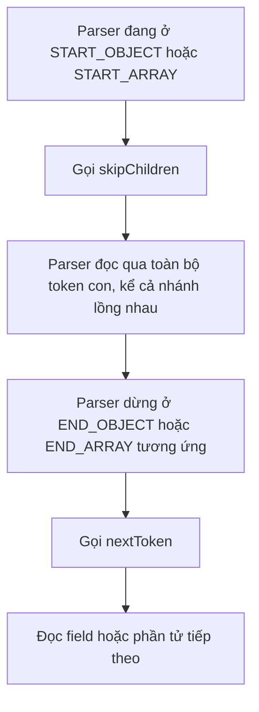

# Bỏ qua nhánh không cần xử lý bằng skipChildren

Khi đọc JSON bằng Jackson Streaming API, `JsonParser` di chuyển lần lượt qua từng token. Có những document chứa các nhánh dữ liệu rất lớn nhưng ứng dụng chỉ cần một vài field. Ví dụ, service chỉ cần `id` và `status` nhưng JSON còn có `debug`, `history`, `attachments` hoặc một object `metadata` lồng sâu.

Nếu không cần sử dụng một nhánh object hoặc array, ta có thể gọi **`JsonParser.skipChildren()`** để bỏ qua toàn bộ nội dung bên trong nhánh đó. Parser sẽ tiến đến token kết thúc tương ứng của object hoặc array, sau đó ứng dụng tiếp tục đọc field kế tiếp.

`skipChildren()` là một thao tác quan trọng khi xử lý JSON theo luồng: nó giúp tránh tạo `JsonNode`, `Map`, `List` hoặc POJO cho phần dữ liệu không cần dùng. Nhờ đó, ứng dụng có thể giữ mức sử dụng bộ nhớ thấp hơn so với việc đọc toàn bộ document thành cây rồi mới loại bỏ nhánh thừa.

## 1. Vị trí của parser trong luồng token

Jackson Core phân tích JSON thành chuỗi token. Với JSON:

```json
{
  "id": 42,
  "debug": {
    "trace": {
      "steps": ["validate", "load", "calculate"]
    },
    "details": [1, 2, 3]
  },
  "status": "READY"
}
```

Parser lần lượt nhìn thấy các token như sau:

```text
START_OBJECT
FIELD_NAME: id
VALUE_NUMBER_INT: 42
FIELD_NAME: debug
START_OBJECT
  FIELD_NAME: trace
  START_OBJECT
    FIELD_NAME: steps
    START_ARRAY
      VALUE_STRING: validate
      VALUE_STRING: load
      VALUE_STRING: calculate
    END_ARRAY
  END_OBJECT
  FIELD_NAME: details
  START_ARRAY
    VALUE_NUMBER_INT: 1
    VALUE_NUMBER_INT: 2
    VALUE_NUMBER_INT: 3
  END_ARRAY
END_OBJECT
FIELD_NAME: status
VALUE_STRING: READY
END_OBJECT
```

Nếu ứng dụng không cần `debug`, không cần tự viết vòng lặp để đọc `trace`, `steps`, `details` và từng phần tử. Khi parser đang đứng ở token `START_OBJECT` của giá trị `debug`, gọi `skipChildren()` sẽ đưa parser đến `END_OBJECT` tương ứng với `debug`. Lần gọi `nextToken()` tiếp theo sẽ đi đến `FIELD_NAME: status`.

## 2. `skipChildren()` hoạt động như thế nào?

API có dạng:

```java
JsonParser skipChildren() throws IOException;
```

Phương thức kiểm tra token hiện tại:

- Nếu token hiện tại là `START_OBJECT`, parser đọc tiếp cho đến `END_OBJECT` tương ứng, bao gồm cả các object/array lồng bên trong.
- Nếu token hiện tại là `START_ARRAY`, parser đọc tiếp cho đến `END_ARRAY` tương ứng.
- Nếu token hiện tại là scalar như string, number, boolean hoặc null, không có nhánh con để bỏ qua nên phương thức không làm gì.
- Nếu token hiện tại không phải token bắt đầu object/array, phương thức cũng không tự tìm value kế tiếp.

Sau khi bỏ qua một object hoặc array thành công, **token hiện tại là token kết thúc tương ứng** (`END_OBJECT` hoặc `END_ARRAY`). Parser vẫn mở và có thể tiếp tục đọc.



`skipChildren()` chỉ bỏ qua nội dung của cấu trúc hiện tại. Nó không đóng parser, không bỏ qua toàn bộ document và không tự di chuyển đến field có tên cụ thể.

## 3. Ví dụ cơ bản: bỏ qua một object lồng nhau

Giả sử ứng dụng chỉ cần đọc `id` và `status`, còn `debug` có thể rất lớn.

```java
import com.fasterxml.jackson.core.JsonFactory;
import com.fasterxml.jackson.core.JsonParser;
import com.fasterxml.jackson.core.JsonToken;

import java.io.IOException;

public class SkipChildrenExample {
    public static void main(String[] args) throws IOException {
        String json = """
                {
                  "id": 42,
                  "debug": {
                    "trace": {
                      "steps": ["validate", "load", "calculate"]
                    },
                    "details": [1, 2, 3]
                  },
                  "status": "READY"
                }
                """;

        JsonFactory factory = new JsonFactory();
        try (JsonParser parser = factory.createParser(json)) {
            if (parser.nextToken() != JsonToken.START_OBJECT) {
                throw new IOException("Expected a JSON object");
            }

            Long id = null;
            String status = null;

            JsonToken token;
            while ((token = parser.nextToken()) != JsonToken.END_OBJECT) {
                if (token == null) {
                    throw new IOException("Unexpected end of JSON object");
                }
                if (token != JsonToken.FIELD_NAME) {
                    throw new IOException("Expected a field name");
                }

                String fieldName = parser.currentName();
                JsonToken valueToken = parser.nextToken();
                if (valueToken == null) {
                    throw new IOException("Missing value for " + fieldName);
                }

                switch (fieldName) {
                    case "id":
                        if (valueToken == JsonToken.VALUE_NUMBER_INT) {
                            id = parser.getLongValue();
                        } else {
                            parser.skipChildren();
                        }
                        break;
                    case "status":
                        if (valueToken == JsonToken.VALUE_STRING) {
                            status = parser.getText();
                        } else {
                            parser.skipChildren();
                        }
                        break;
                    default:
                        // Bao gồm debug và mọi field không cần dùng.
                        parser.skipChildren();
                        break;
                }
            }

            System.out.println("id=" + id);
            System.out.println("status=" + status);
        }
    }
}
```

Khi parser đọc đến field `debug`, lần gọi `nextToken()` đã đưa parser vào `START_OBJECT` của giá trị đó. `skipChildren()` bỏ qua cả `trace`, `steps`, `details` và mọi token lồng nhau, rồi dừng tại `END_OBJECT` của `debug`. Vòng lặp tiếp tục với `nextToken()` và đọc được `status`.

Trong ví dụ, `skipChildren()` cũng được gọi nếu `id` hoặc `status` có kiểu token không như mong đợi. Với scalar, lời gọi là no-op; với object/array sai kiểu, nó bỏ qua cấu trúc đó để parser vẫn ở đúng vị trí cho vòng lặp tiếp tục. Ứng dụng có thể chọn ném lỗi ngay thay vì bỏ qua nếu hợp đồng yêu cầu field phải đúng kiểu.

## 4. Phải gọi `skipChildren()` tại đúng vị trí

Một lỗi thường gặp là gọi `skipChildren()` khi parser vẫn đang đứng ở `FIELD_NAME`, thay vì token bắt đầu của giá trị.

Ví dụ thứ tự đúng:

```java
JsonToken token = parser.nextToken(); // FIELD_NAME: metadata
String fieldName = parser.currentName();

JsonToken valueToken = parser.nextToken(); // START_OBJECT
if ("metadata".equals(fieldName)) {
    parser.skipChildren();
}
```

Thứ tự token là:

1. `nextToken()` đưa parser tới `FIELD_NAME`.
2. `currentName()` lấy tên field.
3. `nextToken()` đưa parser tới token của value.
4. Nếu value là object/array không cần xử lý, gọi `skipChildren()`.

Nếu gọi `skipChildren()` ngay khi parser đang ở `FIELD_NAME`, phương thức không bỏ qua value phía sau vì `FIELD_NAME` không phải `START_OBJECT` hoặc `START_ARRAY`. Vòng lặp sau đó có thể đọc nhầm các token con như field độc lập, làm hỏng logic duyệt.

## 5. Bỏ qua một array lớn

`skipChildren()` hoạt động giống nhau với object và array. Ví dụ, một response chứa danh sách lịch sử rất lớn nhưng ứng dụng chỉ cần `summary`:

```json
{
  "summary": "processed",
  "history": [
    {"time": "2026-11-10T10:00:00Z", "action": "CREATED"},
    {"time": "2026-11-11T10:00:00Z", "action": "UPDATED"},
    {"time": "2026-11-12T10:00:00Z", "action": "APPROVED"}
  ]
}
```

Khi parser đang ở `START_ARRAY` của `history`, chỉ cần:

```java
if ("history".equals(fieldName)) {
    parser.skipChildren();
}
```

Jackson đi qua toàn bộ các object trong array và dừng ở `END_ARRAY` tương ứng. Không cần tạo từng `HistoryEntry`, `List<HistoryEntry>` hoặc `JsonNode` cho nhánh này.

Điều này đặc biệt hữu ích với payload chứa ảnh mã hóa Base64, lịch sử sự kiện, danh sách log, metadata lồng sâu hoặc các phần mở rộng mà service hiện tại không sử dụng.

## 6. Bỏ qua field không xác định trong object

Khi đọc dữ liệu từ một API có thể mở rộng, một object có thể chứa các field mới mà ứng dụng hiện tại chưa hỗ trợ. Trong một vòng lặp streaming, nhánh `default` có thể bỏ qua mọi field không cần xử lý:

```java
switch (fieldName) {
    case "id":
        id = parser.getLongValue();
        break;
    case "name":
        name = parser.getValueAsString();
        break;
    default:
        parser.skipChildren();
        break;
}
```

Đối với field scalar, `skipChildren()` không làm gì; parser đã ở value token và vòng lặp kế tiếp sẽ di chuyển tiếp. Với field object hoặc array, toàn bộ nhánh được tiêu thụ. Nhờ vậy, cùng một đoạn xử lý có thể bỏ qua cả scalar và cấu trúc lồng nhau.

Tuy nhiên, bỏ qua field không xác định là một quyết định về hợp đồng dữ liệu. Nếu API cần phát hiện client gửi sai tên field hoặc phiên bản schema không tương thích, hãy báo lỗi thay vì âm thầm bỏ qua. `skipChildren()` là cơ chế di chuyển parser; nó không quyết định chính sách tương thích của ứng dụng.

## 7. Chỉ đọc một số nhánh, vẫn giữ nhánh cần thiết

Một document có thể chứa nhiều nhánh, trong đó chỉ một nhánh cần chuyển thành POJO. Ta có thể dùng streaming để tìm đúng field rồi giao phần value đó cho databinding.

Ví dụ JSON:

```json
{
  "requestId": "req-100",
  "debug": {"trace": [1, 2, 3]},
  "payload": {
    "userId": 42,
    "displayName": "An"
  },
  "attachments": ["large-1", "large-2"]
}
```

Nếu chỉ cần `payload`, có thể bỏ qua `debug` và `attachments`, rồi đọc payload thành DTO:

```java
public class UserPayload {
    private long userId;
    private String displayName;

    public long getUserId() {
        return userId;
    }

    public void setUserId(long userId) {
        this.userId = userId;
    }

    public String getDisplayName() {
        return displayName;
    }

    public void setDisplayName(String displayName) {
        this.displayName = displayName;
    }
}
```

```java
ObjectMapper mapper = new ObjectMapper();
try (JsonParser parser = mapper.getFactory().createParser(json)) {
    if (parser.nextToken() != JsonToken.START_OBJECT) {
        throw new IOException("Expected an object");
    }

    UserPayload payload = null;
    JsonToken token;
    while ((token = parser.nextToken()) != JsonToken.END_OBJECT) {
        if (token == null) {
            throw new IOException("Unexpected end of input");
        }
        if (token != JsonToken.FIELD_NAME) {
            throw new IOException("Expected a field name");
        }

        String fieldName = parser.currentName();
        JsonToken valueToken = parser.nextToken();
        if (valueToken == null) {
            throw new IOException("Missing value for " + fieldName);
        }

        if ("payload".equals(fieldName)) {
            if (valueToken != JsonToken.START_OBJECT) {
                throw new IOException("payload must be an object");
            }
            payload = mapper.readValue(parser, UserPayload.class);
        } else {
            parser.skipChildren();
        }
    }

    if (payload == null) {
        throw new IOException("Missing payload");
    }
}
```

`mapper.readValue(parser, UserPayload.class)` sử dụng parser đang đứng ở `START_OBJECT` của `payload` để đọc đúng một giá trị thành DTO. Sau khi databinding đọc xong object đó, parser ở vị trí kết thúc value; vòng lặp ngoài có thể tiếp tục bằng `nextToken()`. Những nhánh khác được tiêu thụ bằng `skipChildren()`.

Đây là cách kết hợp Streaming API với Data Binding: streaming chọn phần cần đọc, databinding tạo kiểu Java cho phần đó. Nếu payload có thể là array hoặc một kiểu generic, hãy cung cấp `JavaType` hoặc `TypeReference` phù hợp thay vì chỉ dùng `Class`.

## 8. Bỏ qua nhánh lồng nhau nhiều cấp

Không cần gọi `skipChildren()` đệ quy cho từng cấp con. Một lời gọi tại token bắt đầu của nhánh ngoài cùng sẽ đi qua toàn bộ cấu trúc con.

Ví dụ:

```json
{
  "payload": {
    "metadata": {
      "source": {
        "system": "legacy",
        "attributes": [
          {"name": "a", "value": 1},
          {"name": "b", "value": 2}
        ]
      }
    }
  },
  "status": "OK"
}
```

Nếu parser đang ở `START_OBJECT` của `payload` và không cần toàn bộ nhánh, một lời gọi `skipChildren()` sẽ đưa parser đến `END_OBJECT` của `payload`, không dừng ở object `metadata` hay `source` đầu tiên.

Tương tự, nếu parser đang ở `START_ARRAY` của một array chứa các object lồng nhau, nó sẽ bỏ qua đến `END_ARRAY` khớp với array đó. Jackson xử lý độ sâu lồng nhau dựa trên cấu trúc token.

## 9. Bỏ qua nhánh không có nghĩa là không đọc dữ liệu

`skipChildren()` giúp tránh xây dựng đối tượng cho nhánh không cần dùng, nhưng parser vẫn phải tiêu thụ input để tìm token đóng tương ứng.

Điều đó có nghĩa:

- Dữ liệu vẫn phải được đọc từ nguồn `InputStream`/`Reader`.
- Parser vẫn phải nhận diện cấu trúc JSON và đi qua token con.
- Với input nén, các byte vẫn phải được giải nén khi parser đi qua nhánh.
- Một lỗi cú pháp nằm trong nhánh đang bỏ qua vẫn có thể làm parsing thất bại.
- Nội dung không được ánh xạ thành POJO hoặc cây node, nên thường giảm cấp phát object và bộ nhớ.

Vì vậy, `skipChildren()` không phải thao tác seek để nhảy qua một vùng byte trong O(1), cũng không phải cách bỏ qua hoàn toàn chi phí I/O. Lợi ích chính là tránh tạo cấu trúc dữ liệu trong bộ nhớ cho nhánh không cần xử lý.

## 10. So sánh skipChildren với Tree Model và Data Binding

Giả sử JSON có một object `audit` rất lớn nhưng ứng dụng chỉ cần `id` và `status`.

| Cách xử lý | Điều xảy ra với nhánh `audit` | Đặc điểm |
|---|---|---|
| `readTree()` toàn bộ document | Tạo các node cho toàn bộ `audit` | Dễ truy cập linh hoạt nhưng dùng bộ nhớ theo kích thước cây. |
| `readValue()` thành DTO có field `audit` | Jackson tạo object/collection tương ứng nếu DTO nhận field đó | Tiện khi schema được mô hình hóa đầy đủ. |
| Streaming + `skipChildren()` | Parser đi qua token nhưng không tạo object/node cho `audit` | Phù hợp khi chỉ cần một phần document và muốn kiểm soát cấp phát. |
| Streaming + `readValue(parser, Type.class)` | Chỉ nhánh được chọn được databind thành kiểu Java; nhánh khác có thể skip | Kết hợp chọn lọc với DTO có kiểu. |

Nếu toàn bộ JSON nhỏ và schema ổn định, Data Binding trực tiếp thường đơn giản nhất. Nếu cần sửa hoặc truy cập nhiều nhánh linh hoạt, Tree Model dễ dùng hơn. Nếu document lớn và chỉ cần một phần, Streaming API cùng `skipChildren()` thường tiết kiệm bộ nhớ.

## 11. Những lỗi thường gặp khi dùng `skipChildren()`

### 11.1. Gọi trước khi đọc value token

Parser đang ở `FIELD_NAME`, nên `skipChildren()` không bỏ qua object/array của field. Phải gọi `nextToken()` để đến value trước.

### 11.2. Gọi `nextToken()` thêm một lần sau khi skip mà không hiểu vị trí

Sau `skipChildren()`, parser đã ở `END_OBJECT` hoặc `END_ARRAY` của nhánh bị bỏ qua. Vòng lặp ngoài thường gọi `nextToken()` để đi đến field kế tiếp. Nếu code tự gọi thêm nhiều lần, có thể bỏ mất field kế tiếp.

### 11.3. Cho rằng skipChildren bỏ qua scalar theo cùng cách

Scalar không có children. `skipChildren()` là no-op nếu token hiện tại không phải `START_OBJECT` hoặc `START_ARRAY`. Vòng lặp vẫn cần gọi `nextToken()` ở bước tiếp theo.

### 11.4. Dùng skipChildren để che lỗi cú pháp

Nhánh bị bỏ qua vẫn phải là JSON có cấu trúc hợp lệ. Nếu một object thiếu dấu `}` hoặc string có escape sai, parser vẫn có thể ném `JsonParseException` khi đi qua nhánh.

### 11.5. Bỏ qua field bắt buộc mà không kiểm tra

Việc parser bỏ qua thành công không có nghĩa document thỏa hợp đồng nghiệp vụ. Nếu `id`, `payload` hoặc `status` là bắt buộc, cần kiểm tra đã đọc được chúng trước khi trả kết quả.

### 11.6. Không xử lý EOF bất ngờ

Trong vòng lặp token, `nextToken()` có thể trả `null` nếu input kết thúc trước token đóng mong đợi. Cần phát hiện trường hợp này thay vì tiếp tục xử lý như thể đã đọc xong object/array.

## 12. Xử lý root array và bỏ qua từng phần tử

Một document có thể bắt đầu bằng array thay vì object. Nếu ứng dụng chỉ cần xử lý một số phần tử dựa trên cấu trúc đơn giản, có thể duyệt từng phần tử và bỏ qua phần tử không cần.

Ví dụ array chứa các object, ứng dụng chỉ cần đọc các phần tử có `type` phù hợp. Một cách triển khai là đọc từng object thành cây/DTO khi cần; với phần tử không cần, parser phải biết token hiện tại đang ở `START_OBJECT` để skip toàn bộ phần tử. Cấu trúc khung:

```java
if (parser.nextToken() != JsonToken.START_ARRAY) {
    throw new IOException("Expected a JSON array");
}

JsonToken token;
while ((token = parser.nextToken()) != JsonToken.END_ARRAY) {
    if (token == null) {
        throw new IOException("Unexpected end of array");
    }

    if (token == JsonToken.START_OBJECT) {
        // Đọc discriminator hoặc quyết định xử lý phần tử.
        // Nếu không cần phần tử, gọi parser.skipChildren().
    } else {
        parser.skipChildren();
    }
}
```

Nếu cần kiểm tra một field bên trong object rồi mới quyết định bỏ phần còn lại, cần viết vòng lặp cho object con và giữ đúng trạng thái token. Không thể quay ngược parser sau khi đã đi qua token. Khi phải đọc discriminator nằm ở cuối object, có thể cần lưu một phần dữ liệu, dùng Tree Model cho từng phần tử hoặc thiết kế schema để discriminator xuất hiện sớm.

## 13. Giới hạn tài nguyên và dữ liệu không tin cậy

Không nên xem `skipChildren()` là cơ chế bảo vệ đầy đủ trước JSON độc hại hoặc quá lớn. Dù không tạo node cho nhánh bị bỏ qua, parser vẫn phải đọc qua toàn bộ nội dung. Một array chứa hàng triệu phần tử scalar hoặc một string cực dài vẫn tiêu tốn I/O, thời gian CPU và có thể ảnh hưởng đến giới hạn parser.

Với dữ liệu từ bên ngoài, cần cân nhắc:

- Giới hạn kích thước request ở HTTP server hoặc tầng nhận dữ liệu.
- Giới hạn độ sâu lồng nhau và độ dài string/number theo `StreamReadConstraints` ở các phiên bản Jackson hỗ trợ.
- Timeout và giới hạn tốc độ đọc khi xử lý stream.
- Xác thực rằng các field cần thiết có mặt và đúng kiểu.
- Không ghi toàn bộ payload nhạy cảm vào log khi báo lỗi.

`skipChildren()` giúp bỏ qua nhánh về mặt ánh xạ dữ liệu; nó không làm parser bỏ qua các giới hạn cấu trúc hoặc chi phí đọc input.

## 14. Khi nào nên dùng `skipChildren()`?

| Tình huống | Có nên dùng? | Lý do |
|---|---|---|
| JSON có object metadata lớn nhưng chỉ cần vài field cấp cao | Có | Tránh tạo object/node cho metadata. |
| API thêm field lồng nhau mà client hiện tại chưa dùng | Có, nếu hợp đồng cho phép bỏ qua | Giữ parser đồng bộ để đọc field kế tiếp. |
| Cần xử lý một payload cụ thể và bỏ qua attachments | Có | Chỉ databind nhánh cần thiết. |
| JSON nhỏ, schema ổn định và cần toàn bộ object | Thường không cần | `readValue()` đơn giản hơn. |
| Cần tìm kiếm/chỉnh sửa nhiều field tùy ý trong toàn document | Tree Model có thể phù hợp hơn | Cây giúp truy cập ngẫu nhiên và biến đổi dễ dàng. |
| Cần bỏ qua dữ liệu cực lớn nhưng nguồn có thể không giới hạn | Cần thêm kiểm soát | Skip vẫn phải đọc toàn bộ token và tiêu thụ tài nguyên. |
| Muốn bỏ qua lỗi cú pháp trong nhánh không dùng | Không | Parser vẫn phải phân tích cấu trúc JSON. |

`JsonParser.skipChildren()` là công cụ nhỏ nhưng hữu ích trong xử lý JSON theo luồng. Hãy gọi nó khi parser đang ở token `START_OBJECT` hoặc `START_ARRAY` của một value không cần dùng. Parser sẽ đi qua toàn bộ nhánh lồng nhau và dừng ở token đóng tương ứng; lần gọi `nextToken()` tiếp theo sẽ tiếp tục tại sibling. Cách làm này tránh tạo POJO hoặc node cho dữ liệu thừa, giảm áp lực bộ nhớ, đồng thời giữ được luồng đọc tuần tự. Cần nhớ rằng dữ liệu vẫn phải được đọc và kiểm tra cú pháp, nên skip không thay thế giới hạn tài nguyên, kiểm tra hợp đồng hoặc xử lý lỗi đầu vào.
