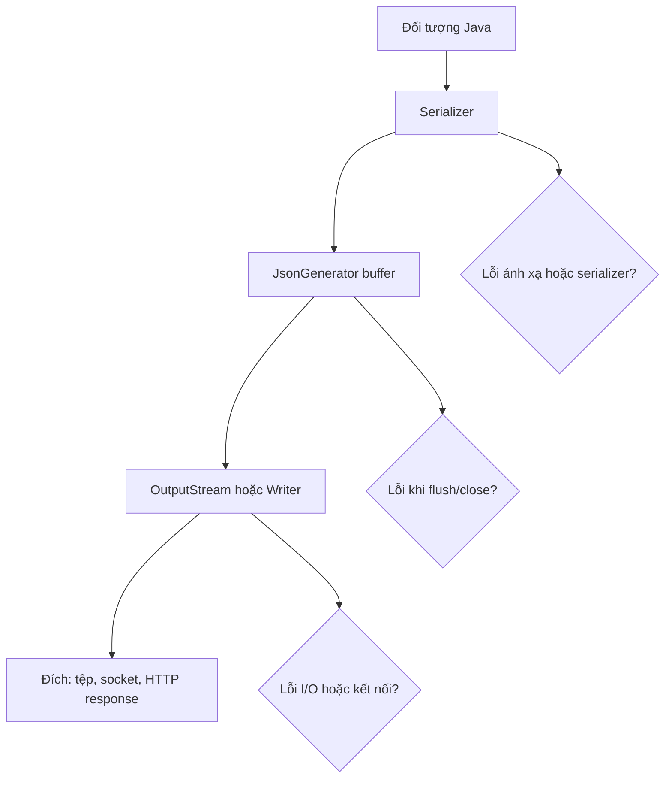
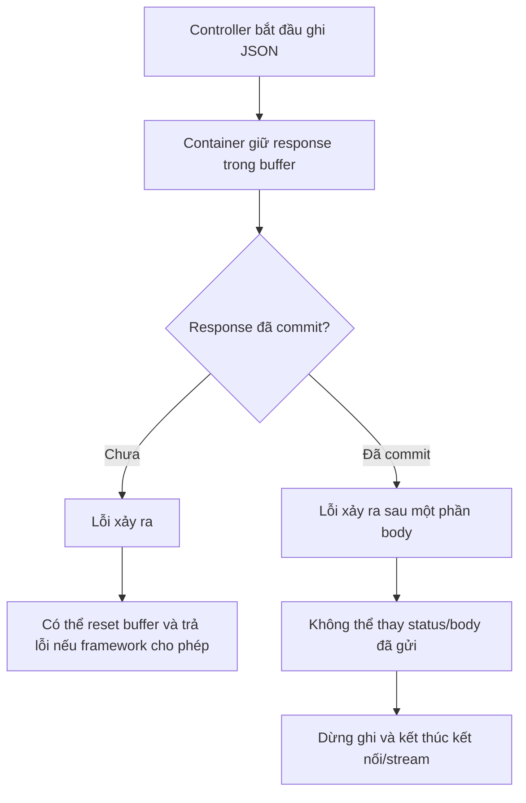

# Xử lý lỗi khi đã ghi một phần đầu ra

Khi ghi JSON bằng Jackson Streaming API hoặc `ObjectMapper`, thao tác xuất dữ liệu không phải lúc nào cũng thành công trọn vẹn. Serializer có thể phát hiện lỗi sau khi đã ghi một số field; `OutputStream` có thể ném `IOException` giữa lúc ghi; kết nối HTTP có thể bị ngắt; hoặc lỗi chỉ xuất hiện khi generator flush hay close.

Điểm quan trọng là **một khi một phần byte đã rời khỏi buffer và được ghi vào đích, ứng dụng không thể mặc định hoàn tác chúng**. Nếu đang ghi một JSON document duy nhất, phần đầu ra còn lại có thể không tạo thành JSON hoàn chỉnh. Cách xử lý phụ thuộc loại đích:

- Với tệp, ghi vào tệp tạm rồi thay thế tệp đích sau khi hoàn tất.
- Với HTTP response, kiểm tra response đã commit hay chưa; sau khi đã gửi một phần body, thường không thể đổi status hoặc thay body thành JSON lỗi khác.
- Với luồng sự kiện hoặc log, dùng framing như NDJSON để mỗi record hoàn chỉnh có thể được xử lý độc lập.
- Với mọi đích, xác định rõ quyền sở hữu tài nguyên, xử lý lỗi ở `write`, `flush` và `close`, đồng thời thiết kế retry để không tạo dữ liệu trùng.

## 1. Một lần ghi JSON có thể thất bại ở nhiều thời điểm

Jackson thường chuyển object Java thành các token JSON thông qua serializer và `JsonGenerator`. Generator ghi token vào buffer nội bộ, sau đó chuyển byte hoặc ký tự xuống `OutputStream`/`Writer`. Target có thể tiếp tục có buffer riêng hoặc là một kết nối mạng do framework quản lý.



Các điểm thất bại thường gặp:

1. **Trước khi ghi:** kiểm tra dữ liệu hoặc khởi tạo serializer thất bại trước khi có byte nào được phát ra.
2. **Trong lúc serialize:** custom serializer ném exception khi xử lý một thuộc tính; các field trước đó có thể đã được ghi.
3. **Trong lúc ghi target:** `OutputStream.write()` hoặc `Writer.write()` ném `IOException`, có thể sau khi một phần dữ liệu đã được chấp nhận.
4. **Khi flush:** buffer của generator hoặc buffer phía dưới không thể đẩy tiếp dữ liệu.
5. **Khi close:** generator hoàn tất cấu trúc JSON và flush dữ liệu còn lại; lỗi I/O vẫn có thể xảy ra ở bước cuối.

Do buffer, lỗi không nhất thiết xuất hiện đúng tại lời gọi ghi field gây ra vấn đề. Một lời gọi `writeStringField()` có thể chỉ ghi vào buffer; lỗi mạng hoặc lỗi đĩa chỉ xuất hiện ở lần flush tiếp theo.

## 2. Vì sao không thể giả định đầu ra đã được hoàn tác?

Giả sử serializer ghi object:

```json
{
  "id": 42,
  "name": "An",
  "details": {
    "address": "..."
  }
}
```

Sau khi ghi `id` và `name`, serializer của `details` phát sinh lỗi. Tùy buffer và target, một phần hoặc toàn bộ prefix của JSON có thể đã được gửi đi. Jackson không có cơ chế tổng quát để thu hồi byte đã ghi vào socket hoặc tệp.

Ngay cả khi generator còn giữ một phần token trong buffer nội bộ, ứng dụng không nên dựa vào việc có thể khôi phục chính xác trạng thái trước lỗi. Một lỗi serializer hoặc I/O có thể khiến cấu trúc document chưa hoàn chỉnh và target có thể đã nhận một phần nội dung.

Ví dụ, tệp có thể kết thúc ở:

```text
{"id":42,"name":"An","details":{
```

Đây là prefix của JSON object, chưa phải một JSON document hoàn chỉnh. Nếu ứng dụng tiếp tục ghi một object lỗi khác vào cùng stream, kết quả thường là nội dung hỏng hoặc hai document nối liền không đúng giao thức.

**Quy tắc thực hành:** khi việc ghi một document thất bại sau khi bắt đầu phát dữ liệu, hãy xem document đó là không hoàn chỉnh. Dừng ghi document hiện tại, giải phóng tài nguyên và áp dụng chiến lược phục hồi theo loại target.

## 3. Phân biệt lỗi ánh xạ và lỗi I/O

Lỗi trong quá trình ghi JSON thường xuất hiện dưới dạng ngoại lệ thuộc nhánh `IOException`, nhưng nguyên nhân có thể khác nhau.

| Nhóm lỗi | Ví dụ | Hướng xử lý |
|---|---|---|
| Lỗi dữ liệu/ánh xạ | Custom serializer không xử lý được một kiểu hoặc giá trị | Sửa dữ liệu, serializer hoặc hợp đồng JSON; không retry y nguyên vô hạn. |
| Lỗi I/O | Tệp hết dung lượng, quyền ghi bị từ chối, socket đóng | Kiểm tra target và hạ tầng; xác định có thể retry hay không. |
| Lỗi khi flush/close | Buffer không ghi được phần cuối | Xem lần xuất là thất bại; không đánh dấu file/record hoàn tất. |
| Client ngắt kết nối | HTTP response hoặc socket bị đóng giữa body | Dừng ghi, giải phóng tài nguyên; không cố gửi thêm response trên kết nối đó. |
| Lỗi khi thay thế tệp | Atomic move không được hỗ trợ hoặc tệp đích bị khóa | Giữ tệp cũ nếu có thể, xử lý tệp tạm và báo lỗi. |

Jackson mapping exception và lỗi I/O có thể cùng được khai báo qua API `IOException`. Hãy bắt ngoại lệ ở ranh giới phù hợp, giữ nguyên nguyên nhân và tránh nuốt lỗi rồi trả về kết quả thành công giả.

## 4. Quản lý generator khi có lỗi

`JsonGenerator` là tài nguyên có trạng thái. Khi đã ghi một phần object hoặc array, không nên tiếp tục sử dụng generator sau một lỗi không được thiết kế để phục hồi. Hãy đóng generator trong `try-with-resources` để giải phóng buffer và target theo chính sách sở hữu đã chọn.

```java
try (JsonGenerator generator = mapper.getFactory().createGenerator(output)) {
    mapper.writeValue(generator, value);
}
```

Nếu serialize thất bại, try-with-resources vẫn gọi `close()`. Tuy nhiên, close không thể bảo đảm sửa một document đã ghi dở. Feature `AUTO_CLOSE_JSON_CONTENT` có thể tự ghi token đóng object/array còn mở khi close, nhưng điều đó không khôi phục field bị thiếu hoặc bảo đảm dữ liệu đúng nghiệp vụ. Nếu lỗi đã xảy ra giữa quá trình ghi, không nên xem việc close thành công là bằng chứng document hợp lệ.

### 4.1. Ai sở hữu target?

Mặc định, `JsonGenerator` có thể đóng target khi generator được đóng thông qua feature `AUTO_CLOSE_TARGET`. Nếu stream do caller hoặc framework quản lý, có thể tắt feature này:

```java
JsonGenerator generator = mapper.getFactory().createGenerator(output);
generator.disable(JsonGenerator.Feature.AUTO_CLOSE_TARGET);

try (generator) {
    mapper.writeValue(generator, value);
}
// Caller vẫn chịu trách nhiệm đóng output.
```

Hãy chọn một nơi chịu trách nhiệm đóng `OutputStream`/`Writer`. Nếu generator không sở hữu target, tắt `AUTO_CLOSE_TARGET` và để caller đóng stream. Nếu generator được tạo cùng target trong cùng một phạm vi và được giao quyền sở hữu, có thể giữ mặc định.

### 4.2. Lỗi trong lúc close

`close()` có thể flush buffer còn lại và do đó cũng có thể ném `IOException`. Với try-with-resources, nếu thân `try` đã ném một exception rồi close cũng thất bại, lỗi close thường được gắn vào exception ban đầu dưới dạng *suppressed exception*.

Khi log lỗi, cần giữ cả exception chính và các suppressed exception để không mất thông tin về việc cleanup cũng thất bại. Không nên bắt lỗi rồi bỏ qua chỉ vì nó xuất hiện khi đóng tài nguyên.

## 5. Ghi tệp an toàn bằng tệp tạm và thay thế sau khi hoàn tất

Với tệp JSON cần giữ phiên bản cũ cho đến khi bản mới được ghi hoàn chỉnh, không nên ghi đè trực tiếp lên tệp đích. Nếu serialize thất bại giữa chừng, tệp cũ có thể đã bị truncate hoặc chứa JSON dở dang.

Một mẫu phổ biến là:

1. Tạo tệp tạm trong cùng thư mục với tệp đích.
2. Ghi toàn bộ JSON vào tệp tạm.
3. Đóng generator và stream thành công.
4. Thay thế tệp đích bằng tệp tạm thông qua `Files.move()` với `ATOMIC_MOVE` nếu hệ thống tệp hỗ trợ.
5. Nếu bất kỳ bước nào thất bại trước khi thay thế, xóa tệp tạm và giữ nguyên tệp đích hiện tại.

```java
import com.fasterxml.jackson.core.JsonGenerator;
import com.fasterxml.jackson.databind.ObjectMapper;

import java.io.IOException;
import java.io.OutputStream;
import java.nio.file.AtomicMoveNotSupportedException;
import java.nio.file.Files;
import java.nio.file.Path;
import java.nio.file.StandardCopyOption;
import java.nio.file.StandardOpenOption;

public final class SafeJsonFileWriter {
    private SafeJsonFileWriter() {
    }

    public static void writeAtomically(
            ObjectMapper mapper,
            Path target,
            Object value
    ) throws IOException {
        Path absoluteTarget = target.toAbsolutePath();
        Path directory = absoluteTarget.getParent();
        if (directory == null || !Files.isDirectory(directory)) {
            throw new IOException("Target directory does not exist");
        }

        Path temporary = Files.createTempFile(
                directory,
                "json-write-",
                ".tmp"
        );
        boolean moved = false;

        try {
            try (OutputStream output = Files.newOutputStream(
                    temporary,
                    StandardOpenOption.WRITE,
                    StandardOpenOption.TRUNCATE_EXISTING
            ); JsonGenerator generator = mapper.getFactory().createGenerator(output)) {
                // OutputStream do phương thức quản lý; generator chỉ quản lý buffer JSON.
                generator.disable(JsonGenerator.Feature.AUTO_CLOSE_TARGET);
                mapper.writeValue(generator, value);
            }

            try {
                Files.move(
                        temporary,
                        absoluteTarget,
                        StandardCopyOption.ATOMIC_MOVE,
                        StandardCopyOption.REPLACE_EXISTING
                );
                moved = true;
            } catch (AtomicMoveNotSupportedException ex) {
                throw new IOException(
                        "File system does not support atomic replacement",
                        ex
                );
            }
        } finally {
            if (!moved) {
                Files.deleteIfExists(temporary);
            }
        }
    }
}
```

Trong ví dụ, generator được đóng trước output stream vì thứ tự đóng của try-with-resources là ngược thứ tự khai báo. `AUTO_CLOSE_TARGET` bị tắt để generator không đóng stream mà phương thức đang quản lý. Chỉ sau khi cả generator và stream đóng thành công, chương trình mới thay thế tệp đích.

`ATOMIC_MOVE` phụ thuộc hệ thống tệp và vị trí tệp. Đặt tệp tạm trong cùng thư mục giúp tăng khả năng thao tác thay thế nguyên tử. Theo hợp đồng Java NIO, khi yêu cầu `ATOMIC_MOVE`, các tùy chọn move khác có thể bị bỏ qua; nếu tệp đích đã tồn tại, provider quyết định việc thay thế hay báo lỗi. Vì vậy, cần kiểm tra hành vi trên hệ thống tệp triển khai thực tế. Nếu hệ thống không hỗ trợ atomic move, ví dụ chủ động báo lỗi thay vì âm thầm fallback sang move thông thường. Nếu ứng dụng cho phép fallback, cần ghi rõ rằng tính nguyên tử không còn được bảo đảm.

### 5.1. Atomic move khác với durability

Thay thế nguyên tử giúp người đọc quan sát tệp cũ hoặc tệp mới hoàn chỉnh, thay vì thấy một tệp đang được ghi dở. Nhưng atomic move không tự động bảo đảm byte đã được đồng bộ bền vững xuống thiết bị lưu trữ sau mất điện.

Nếu yêu cầu độ bền cao, cần thiết kế thêm việc đồng bộ nội dung tệp, ví dụ dùng `FileChannel.force(true)` sau khi ghi và trước khi thay thế, đồng thời cân nhắc đồng bộ metadata thư mục theo khả năng của nền tảng. Mức bảo đảm cuối cùng vẫn phụ thuộc hệ điều hành, hệ thống tệp và thiết bị.

## 6. Vì sao không nên ghi JSON trực tiếp vào tệp đích?

Giả sử `data.json` đang chứa một bản dữ liệu hợp lệ. Nếu mở tệp bằng `TRUNCATE_EXISTING`, tệp cũ bị xóa nội dung ngay khi mở. Nếu serializer sau đó ném exception, ứng dụng có thể để lại một tệp rỗng hoặc JSON dở dang.

```java
try (OutputStream output = Files.newOutputStream(
        path,
        StandardOpenOption.CREATE,
        StandardOpenOption.TRUNCATE_EXISTING,
        StandardOpenOption.WRITE
)) {
    mapper.writeValue(output, value);
}
```

Đoạn code này phù hợp khi không cần giữ bản cũ và có thể chấp nhận tệp hỏng nếu ghi thất bại. Với cấu hình lưu trữ quan trọng, hãy ghi tệp tạm rồi thay thế. Nếu tệp đích có thể được nhiều tiến trình cập nhật, cần thêm cơ chế khóa hoặc kiểm soát phiên bản để tránh hai lần ghi đồng thời thay thế kết quả của nhau.

## 7. Xử lý lỗi khi ghi HTTP response

HTTP response có vòng đời khác với tệp. Server có thể thiết lập status/header và ghi body vào buffer của servlet container. Trước khi response được commit, container vẫn có thể cho phép reset buffer hoặc thay đổi response. Sau khi header/body đã được gửi xuống client, response đã commit và server không thể đổi status hoặc thay thế body đã gửi.

Một luồng ghi JSON có thể diễn ra như sau:



### 7.1. Trước khi response commit

Nếu chưa có byte nào được commit, framework có thể xử lý exception và tạo response lỗi khác. Trong Servlet API, `HttpServletResponse.isCommitted()` cho biết response đã commit hay chưa. `resetBuffer()` có thể xóa body đang được buffer nhưng giữ status/header; `reset()` đặt lại cả buffer, status và header theo hợp đồng Servlet.

Việc reset phải được thực hiện trước commit và theo đúng quyền sở hữu response của framework. Trong Spring MVC, nên để exception handler hoặc cơ chế xử lý lỗi của framework quản lý response; không tự reset response ở nhiều tầng khác nhau.

### 7.2. Sau khi response commit

Nếu một phần JSON đã được gửi cho client, không thể đổi status thành `500` rồi gửi một JSON lỗi mới trên cùng response. Việc nối thêm:

```json
{"error":"serialization failed"}
```

vào cuối prefix JSON trước đó thường tạo body không hợp lệ. Hãy dừng ghi, giải phóng tài nguyên và để client nhận biết response bị cắt cụt thông qua lỗi đọc/parse hoặc kết nối bị đóng.

Với response streaming, cần xác định giao thức có cho phép từng phần dữ liệu độc lập hay không. Nếu chỉ là một JSON array/document duy nhất, client thường không thể coi toàn bộ document là hoàn tất cho đến khi nhận được token đóng cuối cùng.

### 7.3. Không tự đóng stream do container sở hữu

Output stream của HTTP response thường do servlet container quản lý. Controller hoặc serializer không nên đóng stream đó tùy tiện. Hãy để framework điều phối vòng đời response; nếu tạo `JsonGenerator` trực tiếp, cấu hình `AUTO_CLOSE_TARGET` phù hợp hoặc dùng API/framework abstraction đã quản lý stream.

`flush()` có thể khiến container commit response sớm hơn. Vì vậy, chỉ flush giữa chừng khi giao thức streaming thật sự cần client nhận dữ liệu ngay. Flush thường xuyên làm giảm khả năng thay thế response trước commit và có thể tăng overhead truyền tải.

## 8. Thiết kế giao thức để một phần đầu ra vẫn có ý nghĩa

Nếu ứng dụng cần truyền nhiều bản ghi liên tiếp, một JSON document duy nhất có thể không phải framing phù hợp. NDJSON (Newline Delimited JSON) là một lựa chọn: mỗi dòng là một JSON document độc lập.

Ví dụ:

```text
{"sequence":1,"event":"STARTED"}
{"sequence":2,"event":"PROGRESS","percent":40}
{"sequence":3,"event":"COMPLETED"}
```

Nếu lỗi xảy ra khi đang ghi dòng thứ ba, hai dòng đầu vẫn là các record JSON hoàn chỉnh. Consumer có thể xử lý các dòng hoàn chỉnh và bỏ dòng cuối bị cắt cụt. Điều này không tự động giải quyết việc retry hoặc trùng lặp, nhưng ranh giới record rõ ràng hơn một array JSON lớn chưa đóng.

### 8.1. Ghi từng record và flush theo lô

```java
public static void writeEvents(
        ObjectMapper mapper,
        OutputStream output,
        Iterable<Event> events
) throws IOException {
    for (Event event : events) {
        byte[] line = mapper.writeValueAsBytes(event);
        output.write(line);
        output.write('\n');
    }
    output.flush();
}
```

Ở đây mỗi event được serialize thành byte array trước khi ghi, nên lỗi serializer của event đó xảy ra trước khi bắt đầu ghi dòng. Tuy vậy, `output.write(line)` hoặc ghi newline vẫn có thể thất bại giữa chừng; dòng hiện tại có thể bị cắt cụt. Consumer cần xử lý dòng cuối chưa hoàn chỉnh.

Với số lượng record lớn, có thể flush theo lô hoặc theo thời điểm mà consumer cần dữ liệu. Flush sau từng record giảm độ trễ nhưng có thể làm tăng số lần I/O; flush theo lô thường cải thiện throughput. Quyết định này phụ thuộc yêu cầu độ trễ và khả năng buffer của giao thức.

### 8.2. Thêm sequence ID và idempotency key

Khi truyền theo luồng, có thể xảy ra tình huống server đã gửi record nhưng không nhận được xác nhận từ client. Nếu server retry, client có thể nhận record trùng. Hãy cân nhắc:

- Mỗi record có `eventId` duy nhất.
- Mỗi luồng có số thứ tự tăng dần (`sequence`).
- Client lưu checkpoint của record cuối đã xử lý thành công.
- Client xử lý idempotent dựa trên `eventId` hoặc khóa nghiệp vụ.
- Server chỉ đánh dấu hoàn tất sau khi đạt điều kiện xác nhận của giao thức.

Không thể suy ra client đã xử lý dữ liệu chỉ vì server gọi `flush()` thành công. Flush chỉ đẩy dữ liệu qua buffer của server/target theo hợp đồng API; xác nhận nghiệp vụ cần giao thức riêng.

## 9. Serialize vào bộ nhớ trước khi gửi khi payload có giới hạn

Với payload nhỏ hoặc vừa và có giới hạn kích thước rõ ràng, có thể serialize hoàn chỉnh vào `byte[]` trước khi ghi target:

```java
byte[] jsonBytes = mapper.writeValueAsBytes(value);

try (OutputStream output = Files.newOutputStream(target)) {
    output.write(jsonBytes);
}
```

Ưu điểm là lỗi mapping/serializer xuất hiện trước khi mở hoặc ghi target. Khi byte array đã tạo thành công, ứng dụng có một JSON document hoàn chỉnh trong bộ nhớ.

Tuy nhiên, việc ghi `byte[]` xuống target vẫn có thể thất bại một phần do lỗi I/O. Cách này cũng cần bộ nhớ tỷ lệ với kích thước JSON, có thể gây áp lực heap hoặc tăng độ trễ nếu payload lớn. Với file cần bảo vệ bản cũ, vẫn nên kết hợp tệp tạm và atomic move. Với HTTP, việc tạo byte array trước có thể giảm khả năng lỗi serializer sau khi response commit, nhưng không thể bảo đảm mạng không bị ngắt giữa body.

## 10. Không tiếp tục dùng generator sau lỗi như thể chưa có gì xảy ra

Khi serializer hoặc target ném exception, generator có thể đang ở giữa một object/array. Việc bắt lỗi rồi tiếp tục ghi field khác thường không an toàn:

```java
try {
    generator.writeObjectField("payload", value);
} catch (IOException ex) {
    // Không nên giả định generator vẫn ở trạng thái có thể tiếp tục.
    generator.writeStringField("status", "ERROR");
}
```

Nếu `payload` đã ghi được một phần, field `status` có thể được ghi vào giữa một cấu trúc chưa hoàn chỉnh. Nếu target đã lỗi, lần ghi tiếp theo có thể tiếp tục thất bại hoặc tạo ra output không thể phân tích.

Một mô hình an toàn hơn là để exception thoát khỏi phạm vi ghi document, đóng generator và xử lý lỗi ở tầng sở hữu target:

```java
try (JsonGenerator generator = mapper.getFactory().createGenerator(output)) {
    mapper.writeValue(generator, value);
} catch (IOException ex) {
    // Đánh dấu lần ghi thất bại và xử lý target theo loại tài nguyên.
    throw ex;
}
```

Nếu cần ghi một thông báo lỗi, hãy ghi nó vào một target/response mới hoặc theo một framing độc lập được thiết kế từ trước. Không ghép một JSON error object vào giữa document đã bắt đầu.

## 11. Retry phải xét loại lỗi và tính idempotent

Không phải lỗi ghi nào cũng nên retry ngay.

| Tình huống | Có nên retry? | Điều kiện |
|---|---|---|
| Serializer không hỗ trợ kiểu hoặc dữ liệu không hợp lệ | Không retry y nguyên | Sửa dữ liệu hoặc serializer trước. |
| Tệp tạm ghi thất bại do dung lượng/quyền | Chỉ sau khi khắc phục nguyên nhân | Xóa tệp tạm dở dang; giữ tệp đích cũ. |
| Kết nối HTTP bị ngắt giữa body | Có thể gửi lại request ở lần kết nối mới | Endpoint và thao tác phải an toàn khi lặp hoặc có idempotency key. |
| Consumer không xác nhận đã xử lý record | Có thể phát lại từ checkpoint | Consumer phải nhận diện record trùng. |
| Lỗi chỉ xảy ra khi close/flush | Xem lần ghi là thất bại | Không đánh dấu dữ liệu hoàn tất chỉ vì phần lớn body đã được ghi. |

Với HTTP POST tạo giao dịch, retry có thể tạo bản ghi trùng nếu server đã xử lý nghiệp vụ nhưng response bị đứt giữa chừng. Hãy dùng idempotency key hoặc cơ chế tra cứu trạng thái trước khi thực hiện lại. Đối với tải tệp, client có thể tải lại toàn bộ nếu server hỗ trợ; với upload lớn, cần giao thức resumable có offset/chunk ID rõ ràng.

## 12. Ghi log và quan sát lỗi một phần

Khi một lần ghi thất bại, log nên cung cấp đủ ngữ cảnh để điều tra mà không làm lộ nội dung nhạy cảm.

Thông tin hữu ích có thể gồm:

- Loại target: file, HTTP response, socket, message stream.
- Mã request, event hoặc batch.
- Tên thao tác và kiểu dữ liệu đang serialize.
- Giai đoạn lỗi: serialize, write, flush, close hay move.
- Loại exception và nguyên nhân gốc (`cause`).
- Số record đã hoàn tất nếu dùng framing record.
- Trạng thái response đã commit hay chưa, nếu có.
- Đường dẫn tệp tạm hoặc mã giao dịch lưu trữ, nếu cần theo dõi cleanup.

Không ghi toàn bộ JSON body vào log theo mặc định. Payload có thể chứa mật khẩu, token, dữ liệu cá nhân hoặc thông tin nghiệp vụ nhạy cảm. Nếu cần chẩn đoán, hãy log metadata đã lọc hoặc một checksum/ID tương quan.

## 13. Checklist thiết kế theo loại target

| Target | Cách giảm rủi ro | Hành động khi ghi thất bại |
|---|---|---|
| Tệp cấu hình/dữ liệu cần giữ bản cũ | Ghi tệp tạm cùng thư mục, đóng thành công, atomic move | Xóa tệp tạm; giữ tệp đích cũ; báo lỗi. |
| Tệp tạm hoặc dữ liệu có thể tái tạo | Có thể ghi trực tiếp nếu chấp nhận mất nội dung dở dang | Xóa hoặc đánh dấu file không hoàn chỉnh. |
| HTTP JSON response thông thường | Validate trước, tránh flush sớm, để framework quản lý response | Trước commit: framework có thể trả lỗi; sau commit: dừng body và kết thúc stream. |
| HTTP streaming | Dùng framing rõ ràng như NDJSON/SSE và ID record | Kết thúc stream; client bỏ record cuối dở dang và resume theo checkpoint. |
| Message broker/socket | Dùng message boundary, sequence và acknowledgement | Retry theo chính sách delivery; consumer xử lý idempotent. |
| Ghi vào kho dữ liệu có transaction | Serialize và ghi trong ranh giới transaction phù hợp | Rollback transaction nếu hệ thống hỗ trợ; không báo thành công trước commit. |

## 14. Chọn chiến lược theo yêu cầu

- **Cần bảo toàn tệp hiện tại:** serialize vào tệp tạm, đóng thành công rồi thay thế bằng atomic move. Không ghi trực tiếp đè lên tệp đang dùng.
- **Cần response JSON thông thường:** kiểm tra dữ liệu trước khi bắt đầu ghi, hạn chế flush sớm và để framework quản lý vòng đời response.
- **Đã commit HTTP response rồi mới phát sinh lỗi:** không cố thay status/body; dừng ghi, giải phóng tài nguyên và để client nhận biết body bị cắt cụt.
- **Cần truyền nhiều record độc lập:** dùng NDJSON hoặc framing tương đương, thêm event ID/sequence và quy tắc resume.
- **Payload nhỏ, serializer phức tạp:** cân nhắc serialize vào byte array trước khi ghi target để phát hiện lỗi ánh xạ sớm; vẫn xử lý khả năng I/O thất bại một phần.
- **Cần retry:** phân biệt lỗi dữ liệu với lỗi hạ tầng và bảo đảm thao tác có tính idempotent hoặc có idempotency key.
- **Cần bảo đảm dữ liệu bền vững:** phân biệt flush, close, atomic replacement và cơ chế đồng bộ storage như `FileChannel.force()`; chúng giải quyết các tầng khác nhau.

Khi Jackson đã ghi một phần đầu ra, không có một thao tác rollback chung cho mọi `OutputStream`, file hoặc HTTP response. Hãy xem document hiện tại là không hoàn chỉnh nếu serialize/flush/close thất bại, đóng generator đúng quyền sở hữu, và phục hồi theo đặc tính của target. Tệp cần được bảo vệ bằng ghi tạm và thay thế sau khi hoàn tất; HTTP response đã commit không thể đổi nội dung; luồng nhiều record nên có framing và cơ chế xác nhận riêng. Thiết kế ranh giới ghi, cleanup và retry ngay từ đầu sẽ giúp ứng dụng không nhầm một lần ghi dở dang với dữ liệu đã được lưu hoặc gửi thành công.
