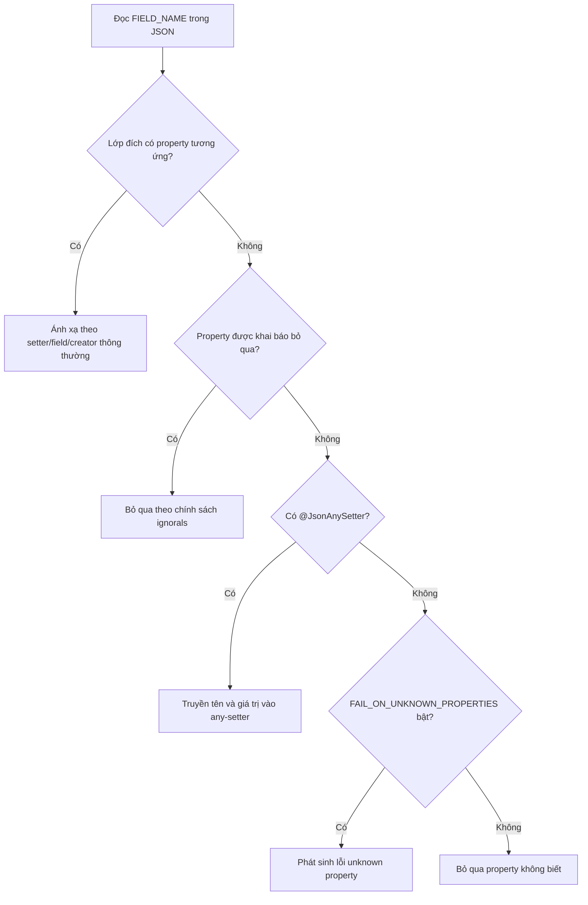

# Thu thập thuộc tính mở rộng bằng JsonAnySetter

Trong một hệ thống trao đổi JSON, đôi khi một lớp Java chỉ biết trước các field cốt lõi nhưng vẫn cần tiếp nhận những field bổ sung mà client hoặc phiên bản dịch vụ khác gửi tới. Ví dụ, một sự kiện có các thuộc tính cố định như `eventId`, `eventType` và `occurredAt`, đồng thời có thể mang thêm metadata tùy theo loại sự kiện. Một cấu hình thiết bị có thể có các thuộc tính chung như `deviceId`, `name`, nhưng mỗi loại thiết bị lại gửi các tùy chọn riêng.

Jackson cung cấp annotation **`@JsonAnySetter`** để thu thập những thuộc tính JSON mà lớp đích không nhận diện thành các giá trị mở rộng. Annotation này thường được đặt trên một phương thức nhận tên property và giá trị, hoặc trên một field `Map`. Khi Jackson gặp một property không khớp với property thông thường, any-setter có thể tiếp nhận nó thay vì để thao tác giải tuần tự hóa thất bại vì unknown property.

`@JsonAnySetter` hữu ích khi schema có một phần cố định và một phần mở rộng. Nó cho phép giữ lại dữ liệu mà phiên bản hiện tại chưa hiểu, hỗ trợ tích hợp tiến hóa theo thời gian và tránh phải thêm một field Java mới mỗi khi JSON xuất hiện một thuộc tính phụ. Tuy nhiên, cần chọn kiểu dữ liệu lưu trữ, giới hạn tên/value được chấp nhận và xác định cách xuất lại các thuộc tính đó.

## 1. Vấn đề: JSON có thuộc tính mà lớp Java chưa biết

Giả sử ứng dụng nhận một cấu hình thiết bị:

```json
{
  "deviceId": "sensor-42",
  "name": "Temperature sensor",
  "samplingInterval": 10,
  "calibrationMode": "AUTO",
  "vendorOptions": {
    "precision": 3,
    "sendDiagnostics": true
  }
}
```

Lớp Java hiện tại có thể chỉ khai báo hai thuộc tính:

```java
public class DeviceConfig {
    private String deviceId;
    private String name;

    public String getDeviceId() {
        return deviceId;
    }

    public void setDeviceId(String deviceId) {
        this.deviceId = deviceId;
    }

    public String getName() {
        return name;
    }

    public void setName(String name) {
        this.name = name;
    }
}
```

Nếu mapper bật `DeserializationFeature.FAIL_ON_UNKNOWN_PROPERTIES` (mặc định thường bật), Jackson có thể ném `UnrecognizedPropertyException` khi gặp `samplingInterval`, `calibrationMode` hoặc `vendorOptions`. Nếu tắt feature này, các thuộc tính không biết thường bị bỏ qua; ứng dụng không giữ được dữ liệu mở rộng để xử lý hoặc ghi lại sau đó.

Khi muốn giữ các thuộc tính chưa được mô hình hóa, ta có thể thêm một vùng lưu trữ mở rộng và đánh dấu phương thức tiếp nhận bằng `@JsonAnySetter`.

## 2. Dùng `@JsonAnySetter` trên phương thức

Phương thức any-setter thường có hai tham số:

- Tham số thứ nhất là tên JSON property (`String`).
- Tham số thứ hai là giá trị của property, với kiểu do ứng dụng lựa chọn.

Ví dụ, dùng `JsonNode` để giữ nguyên cấu trúc dữ liệu JSON:

```java
import com.fasterxml.jackson.annotation.JsonAnySetter;
import com.fasterxml.jackson.databind.JsonNode;

import java.util.LinkedHashMap;
import java.util.Map;

public class DeviceConfig {
    private String deviceId;
    private String name;
    private final Map<String, JsonNode> extensions = new LinkedHashMap<>();

    public String getDeviceId() {
        return deviceId;
    }

    public void setDeviceId(String deviceId) {
        this.deviceId = deviceId;
    }

    public String getName() {
        return name;
    }

    public void setName(String name) {
        this.name = name;
    }

    @JsonAnySetter
    public void addExtension(String name, JsonNode value) {
        extensions.put(name, value);
    }

    public Map<String, JsonNode> getExtensions() {
        return extensions;
    }
}
```

Đọc JSON:

```java
ObjectMapper mapper = new ObjectMapper();
DeviceConfig config = mapper.readValue(json, DeviceConfig.class);

JsonNode interval = config.getExtensions().get("samplingInterval");
JsonNode vendorOptions = config.getExtensions().get("vendorOptions");

System.out.println(interval.intValue());
System.out.println(vendorOptions.path("precision").intValue());
```

Jackson ánh xạ `deviceId` và `name` bằng setter thông thường. Các property chưa được nhận diện sẽ được chuyển đến `addExtension(name, value)`. Với kiểu tham số `JsonNode`, giá trị có thể là node number, string, boolean, null, object hoặc array; cấu trúc lồng nhau được giữ trong cây node.

`LinkedHashMap` giữ thứ tự chèn của các thuộc tính mở rộng. Điều này hữu ích khi cần đầu ra dễ đọc hoặc cần thứ tự ổn định trong các tình huống kiểm thử. JSON object về mặt chuẩn không nên được xem là một cấu trúc mà thứ tự property mang ý nghĩa nghiệp vụ; consumer không nên phụ thuộc vào thứ tự đó.

## 3. Jackson gọi any-setter vào thời điểm nào?

Khi giải tuần tự hóa một JSON object, Jackson trước tiên tìm property thông thường mà lớp đích có thể nhận diện thông qua field, setter, getter có thể ghi, creator hoặc annotation. Nếu tên property không khớp property đã biết và cũng không bị cấu hình bỏ qua, Jackson có thể chuyển giá trị tới any-setter.



Any-setter là cơ chế dự phòng cho property chưa được nhận diện. Nó không thay thế setter thông thường và không tự động thu thập mọi property. Các field đã khai báo như `deviceId` vẫn được gán vào thuộc tính tương ứng.

Nếu một tên property được đánh dấu rõ ràng là bị bỏ qua bằng cấu hình ignorals, nó được xử lý theo chính sách bỏ qua tương ứng, không nên dựa vào any-setter để thu thập lại. Khi cần lưu một field mở rộng, hãy tránh đồng thời khai báo field đó là ignored.

## 4. Chọn kiểu cho giá trị mở rộng

Kiểu của tham số thứ hai quyết định cách Jackson biểu diễn các giá trị không biết. Đây là quyết định quan trọng vì nó ảnh hưởng tới khả năng xử lý, độ chính xác số và việc ghi lại JSON sau này.

### 4.1. Dùng `JsonNode` khi cần giữ cấu trúc JSON

```java
@JsonAnySetter
public void addExtension(String name, JsonNode value) {
    extensions.put(name, value);
}
```

`JsonNode` phù hợp khi giá trị mở rộng có thể là bất kỳ loại JSON nào:

```json
{
  "retryLimit": 5,
  "displayMode": "compact",
  "enabled": true,
  "thresholds": [10, 20, 30],
  "metadata": {
    "source": "partner",
    "labels": ["edge", "temperature"]
  },
  "optionalValue": null
}
```

Mỗi value được lưu dưới dạng node phù hợp. Có thể kiểm tra `isNumber()`, `isTextual()`, `isArray()`, `isObject()` hoặc `isNull()` trước khi sử dụng. Kiểu này giúp giữ sự khác biệt giữa JSON number, string, boolean, object, array và null.

### 4.2. Dùng `Object` khi muốn cấu trúc Java động

Có thể khai báo vùng mở rộng là `Map<String, Object>`:

```java
private final Map<String, Object> extensions = new LinkedHashMap<>();

@JsonAnySetter
public void addExtension(String name, Object value) {
    extensions.put(name, value);
}
```

Jackson sử dụng untyped deserializer để tạo các giá trị Java thông dụng. Tùy loại JSON và cấu hình, kết quả thường là:

| JSON | Giá trị Java thường gặp |
|---|---|
| string | `String` |
| boolean | `Boolean` |
| integer | `Integer`, `Long` hoặc kiểu số nguyên phù hợp với kích thước/cấu hình |
| floating-point number | Thường là `Double` |
| object | `Map` |
| array | `List` |
| null | Java `null` |

Ưu điểm của `Object` là thuận tiện khi ứng dụng muốn thao tác bằng collection và kiểu Java thông thường. Nhược điểm là kiểu cụ thể có thể không rõ ràng, đặc biệt với số thập phân. Nếu cần giữ độ chính xác thập phân trong dữ liệu không định kiểu, có thể cấu hình `DeserializationFeature.USE_BIG_DECIMAL_FOR_FLOATS` hoặc chọn `JsonNode`.

### 4.3. Dùng kiểu cụ thể nếu mọi extension có cùng cấu trúc

Nếu mỗi giá trị mở rộng luôn là chuỗi, có thể dùng `String`. Nếu tất cả extension là một kiểu cấu hình đã định nghĩa, dùng lớp cụ thể có thể giúp kiểm tra kiểu tốt hơn. Tuy nhiên, nếu JSON có thể chứa nhiều loại giá trị khác nhau, kiểu tham số quá hẹp sẽ khiến databinding thất bại.

Chọn kiểu theo hợp đồng thực tế. Đừng chọn `String` chỉ vì dễ lưu nếu client có thể gửi object hoặc number; đừng chọn `Object` nếu ứng dụng cần một schema extension được kiểm soát và có kiểu rõ ràng.

## 5. Dùng `@JsonAnySetter` trên field Map

Jackson cũng hỗ trợ đặt `@JsonAnySetter` trực tiếp trên một field `Map` trong các phiên bản có hỗ trợ field any-setter:

```java
import com.fasterxml.jackson.annotation.JsonAnySetter;
import com.fasterxml.jackson.databind.JsonNode;

import java.util.LinkedHashMap;
import java.util.Map;

public class PartnerMessage {
    private String messageId;

    @JsonAnySetter
    private final Map<String, JsonNode> extra = new LinkedHashMap<>();

    public String getMessageId() {
        return messageId;
    }

    public void setMessageId(String messageId) {
        this.messageId = messageId;
    }

    public Map<String, JsonNode> getExtra() {
        return extra;
    }
}
```

Jackson đưa các property không được nhận diện vào map được đánh dấu. Cách này ít mã hơn nếu chỉ cần lưu trữ. Dùng phương thức any-setter khi cần thêm logic cho từng giá trị, ví dụ kiểm tra tên, từ chối key không cho phép, chuẩn hóa tên hoặc ghi nhận metadata.

Lưu ý rằng field được đánh dấu phải có thể được Jackson sử dụng làm nơi lưu trữ phù hợp; kiểu `Map` là lựa chọn điển hình. Nếu cần hỗ trợ nhiều phiên bản Jackson hoặc muốn code dễ đọc, phương thức hai tham số là cách thể hiện rõ ràng và phổ biến.

## 6. Kết hợp thuộc tính cố định và thuộc tính mở rộng

Một lớp thường có hai vùng dữ liệu:

- **Core properties:** các field đã biết, có kiểu và validation rõ ràng.
- **Extension properties:** các field bổ sung được lưu theo tên và giá trị động.

Ví dụ:

```java
public class IntegrationEvent {
    private String eventId;
    private String eventType;
    private Instant occurredAt;
    private final Map<String, JsonNode> extensions = new LinkedHashMap<>();

    // Getter/setter cho các thuộc tính cố định.

    @JsonAnySetter
    public void addExtension(String name, JsonNode value) {
        extensions.put(name, value);
    }

    public Map<String, JsonNode> getExtensions() {
        return extensions;
    }
}
```

JSON:

```json
{
  "eventId": "evt-100",
  "eventType": "DEVICE_REPORTED",
  "occurredAt": "2026-11-12T09:00:00Z",
  "firmwareVersion": "3.2.1",
  "signalStrength": -61,
  "vendorPayload": {
    "region": "north",
    "flags": ["A", "C"]
  }
}
```

Jackson ánh xạ ba field cốt lõi vào các thuộc tính cố định, còn `firmwareVersion`, `signalStrength` và `vendorPayload` được đưa vào map extensions. Ứng dụng có thể xử lý field cốt lõi theo kiểu an toàn và chỉ truy cập extension khi hiểu ý nghĩa của key đó.

Trong ví dụ rút gọn trên, cần bổ sung constructor và getter/setter phù hợp với cách tạo object của dự án, đồng thời đăng ký module Java Time nếu sử dụng `Instant` với Jackson Databind.

## 7. `@JsonAnySetter` không tự động ghi extension ra JSON

`@JsonAnySetter` chỉ xác định cách **đọc** các property không biết khi giải tuần tự hóa. Nếu muốn các giá trị đã thu thập được xuất trở lại thành property cấp cao nhất, Jackson có annotation đi kèm là **`@JsonAnyGetter`**.

```java
import com.fasterxml.jackson.annotation.JsonAnyGetter;
import com.fasterxml.jackson.annotation.JsonAnySetter;
import com.fasterxml.jackson.databind.JsonNode;

public class DeviceConfig {
    private String deviceId;
    private final Map<String, JsonNode> extensions = new LinkedHashMap<>();

    public String getDeviceId() {
        return deviceId;
    }

    public void setDeviceId(String deviceId) {
        this.deviceId = deviceId;
    }

    @JsonAnySetter
    public void addExtension(String name, JsonNode value) {
        extensions.put(name, value);
    }

    @JsonAnyGetter
    public Map<String, JsonNode> any() {
        return extensions;
    }
}
```

Khi serialize, các entry trong map được đưa vào cùng cấp với property thông thường:

```json
{
  "deviceId": "sensor-42",
  "samplingInterval": 10,
  "calibrationMode": "AUTO",
  "vendorOptions": {
    "precision": 3,
    "sendDiagnostics": true
  }
}
```

Nếu không có `@JsonAnyGetter`, map `extensions` có thể được serialize như một property bình thường tên `extensions` (tùy getter/visibility và annotation), thay vì trải các entry thành field cấp cao nhất. Vì vậy, cần phân biệt rõ hai mục tiêu:

- Muốn giữ extension trong một object lồng nhau có tên `extensions`: dùng getter thông thường cho map.
- Muốn trải từng entry ra cùng cấp với core properties: dùng `@JsonAnyGetter`.

## 8. Xử lý xung đột tên property

Khi `@JsonAnyGetter` trải các entry ra cấp cao nhất, tên key trong map có thể xung đột với tên property cố định. Ví dụ map extension chứa key `deviceId`, trong khi lớp cũng có field `deviceId`.

Không nên dựa vào thứ tự serialize để giải quyết xung đột. JSON object có thể chứa tên trùng lặp về mặt cú pháp ở một số parser, nhưng hành vi của consumer khi gặp key trùng không thống nhất; nhiều parser chỉ giữ một giá trị. Điều đó làm dữ liệu mơ hồ và có thể tạo rủi ro bảo mật.

Hãy dành một namespace cho extension, ví dụ:

```json
{
  "deviceId": "sensor-42",
  "extensions": {
    "vendorOptions": {
      "precision": 3
    }
  }
}
```

Nếu hợp đồng yêu cầu trải extension ở cấp cao nhất, hãy từ chối những key trùng với tên core property và các tên dành riêng như `id`, `type`, `version`. Có thể kiểm tra ngay trong any-setter:

```java
private static final Set<String> RESERVED_NAMES = Set.of(
        "deviceId", "eventId", "eventType", "occurredAt"
);

@JsonAnySetter
public void addExtension(String name, JsonNode value) {
    if (RESERVED_NAMES.contains(name)) {
        throw new IllegalArgumentException(
                "Reserved property cannot be stored as an extension: " + name
        );
    }
    extensions.put(name, value);
}
```

Danh sách reserved phải phản ánh hợp đồng thật của lớp. Nếu naming strategy hoặc `@JsonProperty` đổi tên JSON, hãy kiểm tra key theo tên JSON công khai tương ứng, không chỉ tên field Java.

## 9. Xử lý key trùng lặp trong JSON

JSON text có thể chứa cùng một property name nhiều lần, ví dụ:

```json
{
  "deviceId": "sensor-42",
  "vendorMode": "SAFE",
  "vendorMode": "FAST"
}
```

Với map thông thường, nếu any-setter được gọi nhiều lần cho cùng key, thao tác `put()` sau thường ghi đè giá trị trước. Nếu dữ liệu đầu vào không được phép có duplicate keys, hãy bật cơ chế phát hiện duplicate property ở parser phù hợp với phiên bản Jackson, chẳng hạn `StreamReadFeature.STRICT_DUPLICATE_DETECTION` khi xây dựng `JsonFactory`.

```java
JsonFactory factory = JsonFactory.builder()
        .enable(StreamReadFeature.STRICT_DUPLICATE_DETECTION)
        .build();

ObjectMapper mapper = new ObjectMapper(factory);
```

Kiểm tra duplicate keys có thể tăng chi phí parsing, nên lựa chọn theo yêu cầu hợp đồng và nguồn dữ liệu. Với dữ liệu nhạy cảm hoặc cấu hình điều khiển hành vi, từ chối key trùng thường dễ dự đoán hơn việc phụ thuộc vào quy tắc “giá trị cuối thắng”.

## 10. Khác biệt giữa `@JsonAnySetter` và bỏ qua unknown properties

Hai cơ chế này giải quyết hai nhu cầu khác nhau:

| Cơ chế | Hành vi với property không biết | Có giữ dữ liệu không? |
|---|---|---:|
| `@JsonAnySetter` | Chuyển tên và value tới phương thức/map mở rộng | Có |
| `FAIL_ON_UNKNOWN_PROPERTIES` bật, không có any-setter | Phát sinh lỗi unknown property | Không |
| `FAIL_ON_UNKNOWN_PROPERTIES` tắt, không có any-setter | Bỏ qua property không biết | Không |
| `@JsonIgnoreProperties(ignoreUnknown = true)` | Bỏ qua property không được nhận diện | Không |
| `@JsonIgnoreProperties({"legacyField"})` | Bỏ qua property được chỉ định | Không |

Nếu mục tiêu là **tương thích bằng cách giữ lại dữ liệu mới**, dùng any-setter. Nếu mục tiêu là **chấp nhận và bỏ qua dữ liệu ngoài schema**, dùng ignore unknown. Nếu mục tiêu là **từ chối schema ngoài dự kiến**, giữ `FAIL_ON_UNKNOWN_PROPERTIES` và không khai báo any-setter cho kiểu đó.

Không nên bật `ignoreUnknown = true` rồi kỳ vọng các field đó vẫn được any-setter thu thập. Khi đã chủ động đánh dấu property cần bỏ qua, Jackson xử lý theo chính sách ignorals; hãy chọn một chính sách rõ ràng cho từng lớp.

## 11. Kiểm tra và giới hạn dữ liệu mở rộng

Thu thập mọi property không biết rất linh hoạt, nhưng cũng có nghĩa input có thể mở rộng phạm vi dữ liệu mà ứng dụng lưu trong bộ nhớ hoặc phát lại. Không nên coi mọi extension là đáng tin cậy chỉ vì parser đọc được nó.

Các kiểm soát hữu ích:

- **Allowlist key:** chỉ nhận các extension prefix hoặc key đã được đăng ký, ví dụ `vendor_` hoặc các key trong catalog tích hợp.
- **Giới hạn kích thước:** giới hạn tổng kích thước request, độ sâu lồng nhau, độ dài chuỗi và số phần tử trong collection theo khả năng của parser và tầng HTTP.
- **Kiểm tra kiểu:** nếu `samplingInterval` phải là số nguyên, kiểm tra node bằng `isIntegralNumber()` trước khi sử dụng.
- **Không bind extension thành hành động tùy ý:** không dùng key do client gửi để chọn class cần khởi tạo, tên method cần gọi hoặc đường dẫn file.
- **Không ghi secret:** lọc token, password, credential và dữ liệu cá nhân khỏi extension trước khi log hoặc phát lại.
- **Xác định chính sách lưu trữ:** extension có được giữ nguyên qua lần cập nhật hay chỉ tồn tại trong lần request hiện tại?

Ví dụ kiểm tra một extension:

```java
JsonNode interval = extensions.get("samplingInterval");
if (interval != null) {
    if (!interval.isIntegralNumber() || !interval.canConvertToInt()) {
        throw new IllegalArgumentException(
                "samplingInterval must be a 32-bit integer"
        );
    }

    int seconds = interval.intValue();
    if (seconds < 1 || seconds > 3600) {
        throw new IllegalArgumentException(
                "samplingInterval must be between 1 and 3600"
        );
    }
}
```

Việc thu thập bằng `@JsonAnySetter` chỉ là bước binding. Validation cấu trúc và nghiệp vụ vẫn cần được thực hiện sau đó.

## 12. Dùng `@JsonAnySetter` khi schema tiến hóa

Một lợi ích của any-setter là giúp phiên bản consumer cũ tiếp nhận field mới mà không phải thay đổi lớp mỗi lần schema mở rộng.

Ví dụ phiên bản đầu của message:

```json
{
  "eventId": "evt-100",
  "eventType": "DEVICE_REPORTED",
  "temperature": 24.5
}
```

Phiên bản sau bổ sung:

```json
{
  "eventId": "evt-101",
  "eventType": "DEVICE_REPORTED",
  "temperature": 24.5,
  "humidity": 61.2,
  "firmware": {
    "version": "3.2.1",
    "channel": "stable"
  }
}
```

Consumer cũ có thể tiếp tục đọc các field cốt lõi và lưu `humidity`, `firmware` trong extension map. Nếu sau này consumer cần xử lý `humidity` như dữ liệu cốt lõi, có thể thêm property có kiểu rõ ràng. Khi đó, field `humidity` sẽ được ánh xạ vào property thông thường thay vì any-setter.

Any-setter hỗ trợ khả năng tương thích về mặt kỹ thuật, nhưng không tự giải quyết mọi vấn đề versioning. Nếu field mới thay đổi ý nghĩa của field cũ, thay đổi semantics của enum hoặc yêu cầu hành vi bắt buộc mới, consumer cũ vẫn có thể xử lý sai dù parser không báo lỗi. Hợp đồng event/API vẫn cần quy tắc version và tài liệu hóa.

## 13. Tái phát JSON với `@JsonAnyGetter`

Khi hệ thống đóng vai trò gateway hoặc proxy, có thể cần đọc một message, thay đổi field cốt lõi rồi ghi lại toàn bộ extension chưa biết. Kết hợp `@JsonAnySetter` và `@JsonAnyGetter` giúp thực hiện điều đó:

```java
DeviceConfig config = mapper.readValue(incomingJson, DeviceConfig.class);

config.setName("Normalized device name");

String outgoingJson = mapper.writeValueAsString(config);
```

Các field mở rộng được xuất lại cùng cấp nếu map được expose bằng `@JsonAnyGetter`. Dù vậy, round-trip không đảm bảo giữ nguyên văn bản nguồn:

- Khoảng trắng và format ban đầu không được giữ.
- Cách biểu diễn số có thể được chuẩn hóa.
- Thứ tự field có thể khác.
- Các field bị ignore hoặc đã được chuyển vào property thông thường có thể có cách xuất khác.
- Duplicate key có thể đã bị gộp nếu map lưu theo key.

Nếu yêu cầu là giữ nguyên byte JSON gốc, Tree Model hoặc POJO có any-setter không phải giải pháp lưu trữ raw document; cần lưu nguyên byte/string hoặc thiết kế một tầng proxy không parse phần body.

## 14. Khi nào nên dùng `@JsonAnySetter` và khi nào nên chọn cách khác?

| Tình huống | Cách tiếp cận phù hợp |
|---|---|
| Có core fields ổn định và một số field mở rộng không biết trước | `@JsonAnySetter` với `Map<String, JsonNode>` |
| Cần lưu extension thành kiểu Java động | `Map<String, Object>` và cân nhắc coercion số |
| Cần bỏ qua mọi field ngoài schema | `FAIL_ON_UNKNOWN_PROPERTIES` tắt hoặc `@JsonIgnoreProperties(ignoreUnknown = true)` |
| Cần từ chối field ngoài schema | Giữ `FAIL_ON_UNKNOWN_PROPERTIES` bật và không dùng any-setter |
| Extension có schema cố định, quan trọng với nghiệp vụ | Tạo property/DTO có kiểu rõ ràng hoặc lớp extension riêng |
| Cần ghi extension ra cùng cấp với core properties | Kết hợp `@JsonAnyGetter` |
| Cần giữ nguyên JSON text/byte | Lưu raw input; không dựa vào round-trip qua object/tree |
| Cần xử lý cấu trúc động lớn theo luồng | Dùng Streaming API và xử lý token có chọn lọc |

## 15. Ví dụ hoàn chỉnh: thu thập và ghi lại extension

Ví dụ sau dùng `JsonNode` để giữ kiểu JSON, `@JsonAnySetter` để nhận field lạ và `@JsonAnyGetter` để ghi chúng trở lại cùng cấp:

```java
import com.fasterxml.jackson.annotation.JsonAnyGetter;
import com.fasterxml.jackson.annotation.JsonAnySetter;
import com.fasterxml.jackson.databind.JsonNode;
import com.fasterxml.jackson.databind.ObjectMapper;

import java.util.LinkedHashMap;
import java.util.Map;

public class ExtensibleMessage {
    private String id;
    private String type;
    private final Map<String, JsonNode> extensions = new LinkedHashMap<>();

    public String getId() {
        return id;
    }

    public void setId(String id) {
        this.id = id;
    }

    public String getType() {
        return type;
    }

    public void setType(String type) {
        this.type = type;
    }

    @JsonAnySetter
    public void addExtension(String name, JsonNode value) {
        if ("id".equals(name) || "type".equals(name)) {
            throw new IllegalArgumentException("Reserved property: " + name);
        }
        extensions.put(name, value);
    }

    @JsonAnyGetter
    public Map<String, JsonNode> any() {
        return extensions;
    }
}

class Example {
    public static void main(String[] args) throws Exception {
        ObjectMapper mapper = new ObjectMapper();
        String json = """
                {
                  "id": "msg-42",
                  "type": "DEVICE_STATUS",
                  "batteryPercent": 87,
                  "capabilities": ["BLE", "WIFI"],
                  "vendor": {"region": "north", "revision": 2}
                }
                """;

        ExtensibleMessage message = mapper.readValue(
                json,
                ExtensibleMessage.class
        );

        JsonNode battery = message.any().get("batteryPercent");
        if (battery != null && battery.isIntegralNumber()) {
            System.out.println("Battery: " + battery.intValue());
        }

        String roundTrip = mapper.writeValueAsString(message);
        System.out.println(roundTrip);
    }
}
```

Trong code thực tế, nên đặt `ExtensibleMessage` và lớp chạy ví dụ ở các file riêng; đoạn trên ghép chúng lại để minh họa. Nếu dùng Java module hoặc package riêng, bổ sung import và visibility phù hợp. Có thể thêm validation cho `id`, `type` và các extension được phép trước khi xử lý hoặc phát lại message.

## 16. Các lỗi thường gặp

### 16.1. Mong đợi any-setter được gọi cho property đã biết

Các property thông thường được ánh xạ theo setter/field/creator. Any-setter chỉ là đường dự phòng cho property chưa được nhận diện. Nếu muốn thay đổi cách xử lý field đã khai báo, hãy dùng setter, custom deserializer hoặc cơ chế phù hợp với property đó.

### 16.2. Dùng `Map<String, Object>` rồi giả định mọi số là `BigDecimal`

Giá trị floating-point trong untyped binding thường thành `Double`. Nếu cần decimal chính xác, bật `USE_BIG_DECIMAL_FOR_FLOATS` hoặc dùng `JsonNode` và lấy `decimalValue()` khi node là số.

### 16.3. Quên `@JsonAnyGetter` khi muốn ghi extension ở cấp cao nhất

Any-setter chỉ thu thập dữ liệu khi đọc. Muốn trải map thành các property JSON cùng cấp, cần `@JsonAnyGetter`. Nếu không, map có thể được ghi như một field lồng nhau tùy getter và visibility.

### 16.4. Để key extension ghi đè hoặc trùng core property

Tên field trùng có thể tạo JSON mơ hồ hoặc khiến consumer chọn giá trị khác nhau. Hãy dành namespace, kiểm tra reserved names và tránh duplicate keys.

### 16.5. Thu thập dữ liệu không giới hạn

Một client có thể gửi rất nhiều key hoặc object lồng sâu. Giới hạn kích thước request, độ sâu, số phần tử và danh sách key được phép; không lưu mọi dữ liệu tùy ý vào database hoặc log.

### 16.6. Nhầm thu thập extension với xác thực extension

Jackson chỉ chuyển dữ liệu vào map. Nó không biết `samplingInterval` có nằm trong khoảng cho phép hay `vendorOptions` có cấu trúc hợp lệ theo hợp đồng đối tác hay không. Hãy kiểm tra kiểu và quy tắc nghiệp vụ sau binding.

### 16.7. Nghĩ rằng round-trip giữ nguyên văn bản JSON

Any-setter lưu cấu trúc giá trị, không lưu nguyên văn bản. Nếu cần giữ chính xác khoảng trắng, thứ tự, duplicate key hoặc cách viết số, cần lưu raw JSON riêng.

`@JsonAnySetter` tạo một điểm tiếp nhận có kiểm soát cho những property mà mô hình Java hiện tại chưa biết. Kết hợp một vùng lưu trữ như `Map<String, JsonNode>` giúp giữ cấu trúc JSON linh hoạt; dùng `Map<String, Object>` khi muốn kiểu Java động và chấp nhận các quy tắc untyped binding. Nếu cần xuất lại các entry thành property cấp cao nhất, kết hợp `@JsonAnyGetter`. Hãy giữ các field cốt lõi có kiểu rõ ràng, bảo vệ tên reserved, giới hạn key/value mở rộng và xác thực dữ liệu trước khi dùng. Any-setter giúp schema tiến hóa dễ hơn, nhưng không thay thế việc thiết kế version, authorization và validation cho hợp đồng JSON.
