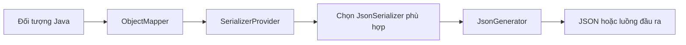
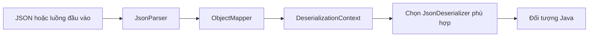

# Vai trò của serializer và deserializer

Trong kiến trúc Jackson, **serializer** và **deserializer** là hai thành phần trực tiếp thực hiện việc ánh xạ giữa dữ liệu Java và cấu trúc JSON. Serializer đọc giá trị Java rồi ghi biểu diễn của nó ra luồng dữ liệu. Deserializer đọc các token từ luồng dữ liệu rồi tạo ra giá trị Java tương ứng.

Hai thành phần này nằm ở tầng **Databind** của Jackson. Chúng phối hợp với các API streaming ở tầng Core: `JsonGenerator` phát ra dữ liệu, còn `JsonParser` đọc dữ liệu. `ObjectMapper` kết nối các thành phần đó để ứng dụng có thể gọi những phương thức cấp cao như `writeValueAsString()` và `readValue()`.

## 1. Vị trí của serializer và deserializer trong kiến trúc Jackson

Jackson có thể được nhìn theo hai lớp trách nhiệm liên quan trực tiếp đến quá trình ánh xạ:

- **Streaming/Core:** cung cấp `JsonFactory`, `JsonGenerator`, `JsonParser` và các token. Lớp này làm việc với luồng dữ liệu mà không cần biết cấu trúc lớp nghiệp vụ cụ thể.
- **Databind:** hiểu kiểu Java, thuộc tính, annotation và quy tắc ánh xạ. Serializer và deserializer thuộc lớp này.

Luồng tuần tự hóa:



Luồng giải tuần tự hóa đi theo chiều ngược lại:



`ObjectMapper` điều phối việc chuyển đổi. Nó không tự viết riêng logic đọc hoặc ghi cho mọi lớp trong ứng dụng. Thay vào đó, Jackson tìm serializer hoặc deserializer phù hợp với kiểu dữ liệu và cấu hình hiện tại, sau đó giao phần ánh xạ cho thành phần đó.

## 2. Serializer chịu trách nhiệm ghi giá trị Java

Serializer là thành phần chuyển một giá trị Java thành các token của định dạng đầu ra. Trong trường hợp JSON, các token có thể là bắt đầu object, tên field, giá trị chuỗi, số, boolean, null, bắt đầu array và kết thúc cấu trúc.

Kiểu API nền tảng là `JsonSerializer<T>`:

```java
public abstract class JsonSerializer<T> {
    public abstract void serialize(
            T value,
            JsonGenerator gen,
            SerializerProvider serializers
    ) throws IOException;
}
```

Ba tham số thể hiện rõ trách nhiệm của serializer:

- `value`: đối tượng hoặc giá trị Java cần chuyển đổi.
- `gen`: bộ ghi token. Serializer gọi các phương thức như `writeStartObject()`, `writeStringField()` và `writeEndObject()` để tạo cấu trúc đầu ra.
- `serializers`: `SerializerProvider`, cung cấp dịch vụ hỗ trợ như tìm serializer cho kiểu lồng nhau, ghi giá trị mặc định và xử lý cấu hình tuần tự hóa.

Trong ứng dụng, ta thường kế thừa `StdSerializer<T>` thay vì triển khai trực tiếp `JsonSerializer<T>`. `StdSerializer` là lớp tiện ích của Jackson giúp đơn giản hóa một số phần khai báo.

### 2.1. Serializer mặc định

Jackson đã có serializer cho nhiều nhóm kiểu dữ liệu phổ biến, chẳng hạn:

- Kiểu nguyên thủy và wrapper như `int`, `long`, `Integer`, `Boolean`.
- `String`, enum và các kiểu số.
- Array, collection và `Map`.
- Các POJO được Jackson nhận diện thông qua thuộc tính, getter, field và annotation. Constructor/creator chủ yếu tham gia vào việc tạo đối tượng ở chiều giải tuần tự hóa.
- Các kiểu ngày giờ hoặc kiểu mở rộng khi module tương ứng được đăng ký.

Ví dụ, với lớp:

```java
public class Customer {
    private long id;
    private String name;

    public Customer() {
    }

    public Customer(long id, String name) {
        this.id = id;
        this.name = name;
    }

    public long getId() {
        return id;
    }

    public String getName() {
        return name;
    }
}
```

Jackson có thể dùng thông tin thuộc tính để tạo JSON tương ứng:

```json
{
  "id": 7,
  "name": "Lan"
}
```

Ta không cần viết một serializer riêng cho mỗi POJO thông thường. Serializer tùy chỉnh chỉ cần thiết khi biểu diễn JSON cần khác với quy tắc ánh xạ mặc định, hoặc khi cần kiểm soát đặc biệt cách ghi dữ liệu.

### 2.2. Ví dụ serializer tùy chỉnh

Giả sử ứng dụng có lớp `Product` và muốn biểu diễn thuộc tính Java `id`, `name`, `price` bằng các tên JSON `product_id`, `label`, `price`.

```java
import java.math.BigDecimal;

public final class Product {
    private final long id;
    private final String name;
    private final BigDecimal price;

    public Product(long id, String name, BigDecimal price) {
        this.id = id;
        this.name = name;
        this.price = price;
    }

    public long getId() {
        return id;
    }

    public String getName() {
        return name;
    }

    public BigDecimal getPrice() {
        return price;
    }
}
```

Serializer tùy chỉnh:

```java
import com.fasterxml.jackson.core.JsonGenerator;
import com.fasterxml.jackson.databind.SerializerProvider;
import com.fasterxml.jackson.databind.ser.std.StdSerializer;

import java.io.IOException;

public final class ProductSerializer extends StdSerializer<Product> {
    public ProductSerializer() {
        super(Product.class);
    }

    @Override
    public void serialize(
            Product value,
            JsonGenerator gen,
            SerializerProvider serializers
    ) throws IOException {
        gen.writeStartObject();
        gen.writeNumberField("product_id", value.getId());
        gen.writeStringField("label", value.getName());
        gen.writeNumberField("price", value.getPrice());
        gen.writeEndObject();
    }
}
```

Trong phương thức `serialize()`:

1. `writeStartObject()` bắt đầu một JSON object.
2. `writeNumberField()` ghi một field có giá trị số.
3. `writeStringField()` ghi một field có giá trị chuỗi.
4. `writeEndObject()` kết thúc JSON object.

Với `new Product(12L, "Keyboard", new BigDecimal("1250000.00"))`, serializer tạo biểu diễn tương đương:

```json
{
  "product_id": 12,
  "label": "Keyboard",
  "price": 1250000.00
}
```

Serializer nên ghi dữ liệu bằng `JsonGenerator`, thay vì tự nối chuỗi JSON. Generator đảm nhiệm việc escape chuỗi, dấu ngoặc, dấu phân cách và cách ghi giá trị theo định dạng đang sử dụng. Khi cần ghi một đối tượng lồng nhau, có thể nhờ `SerializerProvider` tuần tự hóa giá trị đó để tiếp tục sử dụng serializer phù hợp của Jackson.

## 3. Deserializer chịu trách nhiệm tạo giá trị Java

Deserializer thực hiện chiều chuyển đổi ngược lại: đọc các token từ `JsonParser`, diễn giải tên field và giá trị, rồi tạo đối tượng hoặc giá trị Java.

Kiểu API nền tảng là `JsonDeserializer<T>`:

```java
public abstract class JsonDeserializer<T> {
    public abstract T deserialize(
            JsonParser p,
            DeserializationContext ctxt
    ) throws IOException;
}
```

Hai tham số có vai trò khác nhau:

- `p`: `JsonParser` đang trỏ tới token cần đọc. Deserializer dùng nó để đọc tên field, kiểu token và giá trị tương ứng.
- `ctxt`: `DeserializationContext`, cung cấp thông tin kiểu đích, cấu hình, dịch vụ xử lý lỗi, injectable values và khả năng tìm deserializer cho giá trị lồng nhau.

Trong thực tế, ta thường kế thừa `StdDeserializer<T>`, lớp tiện ích triển khai một số hành vi chung của deserializer.

### 3.1. Deserializer mặc định

Jackson có deserializer cho các kiểu cơ bản, collection, map, array, enum và POJO. Khi đọc JSON thành một lớp Java, Jackson dựa vào kiểu đích để xác định cách tạo đối tượng và gán giá trị.

Ví dụ, nếu JSON là:

```json
{
  "id": 7,
  "name": "Lan"
}
```

và kiểu đích là `Customer.class`, Jackson có thể tạo `Customer` rồi gán dữ liệu vào các thuộc tính phù hợp theo constructor, setter, field và cấu hình hiện hành. Nếu lớp có cấu trúc đặc biệt, constructor không rõ cách gọi hoặc quy tắc ánh xạ riêng, ta có thể cần annotation hoặc deserializer tùy chỉnh.

### 3.2. Ví dụ deserializer tùy chỉnh

Deserializer cho `Product` cần đọc các tên JSON đã được serializer ở phần trước tạo ra:

```java
import com.fasterxml.jackson.core.JsonParser;
import com.fasterxml.jackson.core.JsonToken;
import com.fasterxml.jackson.databind.DeserializationContext;
import com.fasterxml.jackson.databind.JsonMappingException;
import com.fasterxml.jackson.databind.deser.std.StdDeserializer;

import java.io.IOException;
import java.math.BigDecimal;

public final class ProductDeserializer extends StdDeserializer<Product> {
    public ProductDeserializer() {
        super(Product.class);
    }

    @Override
    public Product deserialize(
            JsonParser p,
            DeserializationContext ctxt
    ) throws IOException {
        if (!p.isExpectedStartObjectToken()) {
            throw JsonMappingException.from(
                    p,
                    "Expected a JSON object for Product"
            );
        }

        Long id = null;
        String name = null;
        BigDecimal price = null;

        JsonToken token = p.nextToken();
        while (token != JsonToken.END_OBJECT) {
            if (token == null) {
                throw JsonMappingException.from(
                        p,
                        "Unexpected end of JSON while reading Product"
                );
            }

            String fieldName = p.getCurrentName();
            JsonToken valueToken = p.nextToken();
            if (valueToken == null) {
                throw JsonMappingException.from(
                        p,
                        "Missing value for field " + fieldName
                );
            }

            switch (fieldName) {
                case "product_id" -> {
                    if (valueToken == JsonToken.VALUE_NULL) {
                        id = null;
                    } else if (valueToken == JsonToken.VALUE_NUMBER_INT) {
                        id = p.getLongValue();
                    } else {
                        throw JsonMappingException.from(
                                p,
                                "Field 'product_id' must be an integer"
                        );
                    }
                }
                case "label" -> {
                    if (valueToken == JsonToken.VALUE_NULL) {
                        name = null;
                    } else if (valueToken == JsonToken.VALUE_STRING) {
                        name = p.getText();
                    } else {
                        throw JsonMappingException.from(
                                p,
                                "Field 'label' must be a string"
                        );
                    }
                }
                case "price" -> {
                    if (valueToken == JsonToken.VALUE_NULL) {
                        price = null;
                    } else if (valueToken == JsonToken.VALUE_NUMBER_INT
                            || valueToken == JsonToken.VALUE_NUMBER_FLOAT) {
                        price = p.getDecimalValue();
                    } else {
                        throw JsonMappingException.from(
                                p,
                                "Field 'price' must be a number"
                        );
                    }
                }
                default -> p.skipChildren();
            }

            token = p.nextToken();
        }

        if (id == null || name == null || price == null) {
            throw JsonMappingException.from(
                    p,
                    "Product requires product_id, label and price"
            );
        }

        return new Product(id, name, price);
    }
}
```

Deserializer này minh họa các trách nhiệm quan trọng:

- Kiểm tra token bắt đầu có phải JSON object hay không.
- Đọc lần lượt tên field và token chứa giá trị.
- Kiểm tra kiểu token trước khi lấy giá trị để tránh diễn giải sai cấu trúc.
- Bỏ qua field chưa biết bằng `skipChildren()`. Lệnh này cũng bỏ qua nội dung lồng nhau nếu field chứa object hoặc array.
- Kiểm tra các field bắt buộc trước khi gọi constructor tạo `Product`.

Nếu dữ liệu không đúng cấu trúc, deserializer ném `JsonMappingException` để Jackson báo lỗi ánh xạ. Trong ứng dụng thực tế, nội dung thông báo và chính sách field bắt buộc cần phù hợp với hợp đồng dữ liệu của API.

## 4. Jackson tìm và sử dụng serializer/deserializer như thế nào?

Ứng dụng thường chỉ gọi `ObjectMapper`; Jackson đảm nhiệm việc tìm thành phần ánh xạ phù hợp.

Khi tuần tự hóa, `SerializerProvider` phối hợp với cơ chế tạo serializer và cache để tìm `JsonSerializer` cho kiểu dữ liệu. Serializer có thể được xác định từ kiểu khai báo, kiểu runtime, annotation, module đã đăng ký và cấu hình. Sau khi chọn được serializer, Jackson gọi nó với giá trị cần ghi, `JsonGenerator` và `SerializerProvider`.

Khi giải tuần tự hóa, `DeserializationContext` phối hợp với cơ chế tạo deserializer và cache để tìm `JsonDeserializer` theo kiểu đích. Jackson chuyển `JsonParser` đang đọc dữ liệu cho deserializer, sau đó nhận về giá trị Java đã tạo.

| Thành phần | Vai trò trong tuần tự hóa | Vai trò trong giải tuần tự hóa |
|---|---|---|
| `ObjectMapper` | Điều phối thao tác ghi và tạo đầu ra | Điều phối thao tác đọc theo kiểu đích |
| `JsonGenerator` / `JsonParser` | Ghi token ra luồng | Đọc token từ luồng |
| `SerializerProvider` / `DeserializationContext` | Cung cấp cấu hình, tra cứu và dịch vụ hỗ trợ | Cung cấp cấu hình, tra cứu và dịch vụ hỗ trợ |
| `JsonSerializer<T>` / `JsonDeserializer<T>` | Chuyển giá trị Java thành token | Chuyển token thành giá trị Java |

Việc tra cứu và cache giúp Jackson tái sử dụng serializer/deserializer đã được xây dựng, thay vì phải phân tích lại toàn bộ quy tắc cho mỗi lần ghi hoặc đọc. Vì vậy, thông thường ứng dụng cấu hình `ObjectMapper` một lần rồi tái sử dụng nó.

## 5. Đăng ký serializer và deserializer tùy chỉnh

Có hai cách phổ biến để chỉ định thành phần ánh xạ tùy chỉnh: đăng ký qua module hoặc khai báo annotation trên kiểu dữ liệu.

### 5.1. Đăng ký bằng `SimpleModule`

Module là cách phù hợp khi muốn gom các quy tắc ánh xạ thành một đơn vị cấu hình, hoặc muốn giữ lớp model không phụ thuộc trực tiếp vào lớp serializer/deserializer.

```java
import com.fasterxml.jackson.databind.ObjectMapper;
import com.fasterxml.jackson.databind.module.SimpleModule;
import java.math.BigDecimal;

public class ProductMapperExample {
    public static void main(String[] args) throws Exception {
        SimpleModule productModule = new SimpleModule("product-module");
        productModule.addSerializer(Product.class, new ProductSerializer());
        productModule.addDeserializer(Product.class, new ProductDeserializer());

        ObjectMapper mapper = new ObjectMapper();
        mapper.registerModule(productModule);

        Product product = new Product(
                12L,
                "Keyboard",
                new BigDecimal("1250000.00")
        );

        String json = mapper.writeValueAsString(product);
        Product restored = mapper.readValue(json, Product.class);

        System.out.println(json);
        System.out.println(restored.getName());
    }
}
```

Trong ví dụ, `addSerializer()` đăng ký serializer cho `Product.class`, còn `addDeserializer()` đăng ký deserializer cho cùng kiểu. Khi gọi `writeValueAsString(product)`, Jackson dùng `ProductSerializer`; khi gọi `readValue(json, Product.class)`, Jackson dùng `ProductDeserializer` theo cấu hình đã đăng ký.

Hãy đăng ký module trước khi dùng mapper để xử lý dữ liệu. Sau khi cấu hình hoàn tất, nên tái sử dụng mapper thay vì liên tục thay đổi cấu hình trong lúc ứng dụng đang chạy.

### 5.2. Khai báo bằng annotation

Nếu quy tắc tùy chỉnh thuộc trực tiếp về một kiểu model, có thể khai báo trên lớp:

```java
import com.fasterxml.jackson.databind.annotation.JsonDeserialize;
import com.fasterxml.jackson.databind.annotation.JsonSerialize;

@JsonSerialize(using = ProductSerializer.class)
@JsonDeserialize(using = ProductDeserializer.class)
public final class Product {
    // Các thuộc tính và constructor của Product
}
```

Khi Jackson xử lý `Product`, annotation cung cấp thông tin về serializer và deserializer cần dùng. Cách này làm mối liên hệ giữa model và quy tắc ánh xạ trở nên rõ ràng, nhưng cũng khiến model phụ thuộc vào Jackson annotation.

Nên chọn một nơi cấu hình có chủ đích cho từng kiểu. Nếu cùng một kiểu được cấu hình ở nhiều nơi, cần hiểu quy tắc kết hợp và ưu tiên của cấu hình Jackson đang dùng để tránh khó dự đoán serializer nào thực sự được chọn.

## 6. Những trường hợp serializer/deserializer cần phối hợp thêm

Các lớp cơ sở `JsonSerializer` và `JsonDeserializer` đáp ứng phần lớn trường hợp ánh xạ. Jackson còn cung cấp một số cơ chế mở rộng cho những kiểu dữ liệu có ngữ cảnh phức tạp.

### 6.1. Giá trị lồng nhau

Một đối tượng có thể chứa object, collection hoặc map khác. Serializer tùy chỉnh không cần tự viết toàn bộ logic cho mọi kiểu con. Có thể gọi `SerializerProvider.defaultSerializeValue(value, gen)` để nhờ Jackson chọn serializer thích hợp cho giá trị lồng nhau.

Ở chiều đọc, deserializer có thể nhờ `DeserializationContext` tìm deserializer theo kiểu cần đọc, hoặc dùng `JsonParser` để chuyển phần cấu trúc con sang kiểu phù hợp. Cách làm này giúp tái sử dụng module, annotation và serializer/deserializer mặc định của Jackson.

### 6.2. Ngữ cảnh thuộc tính

Đôi khi cùng một kiểu Java cần được biểu diễn khác nhau tùy thuộc vào thuộc tính đang chứa nó. Ví dụ, một kiểu `Money` có thể được ghi theo đơn vị tiền tệ ở thuộc tính này nhưng theo quy tắc khác ở thuộc tính khác.

Jackson hỗ trợ `ContextualSerializer` và `ContextualDeserializer` để thành phần ánh xạ nhận thông tin về thuộc tính chứa giá trị. Chúng có thể tạo phiên bản serializer/deserializer phù hợp với ngữ cảnh đó. Đây là lựa chọn hữu ích khi quy tắc phụ thuộc vào annotation hoặc metadata của từng property, thay vì chỉ phụ thuộc vào kiểu Java.

### 6.3. Giá trị null

Giá trị `null` được Jackson xử lý qua cơ chế null-value riêng. Không nên giả định phương thức `serialize()` hoặc `deserialize()` thông thường luôn được gọi cho một giá trị null. Serializer có thể cấu hình null serializer; deserializer có thể tùy chỉnh `getNullValue()` nếu kiểu đích cần cách biểu diễn null đặc biệt.

Đối với thuộc tính bị thiếu trong JSON, hành vi còn liên quan đến constructor, giá trị mặc định, cấu hình và cơ chế xử lý giá trị vắng mặt. Thuộc tính bị thiếu và thuộc tính hiện diện với giá trị JSON `null` là hai tình huống khác nhau.

### 6.4. Kiểu đa hình và thông tin kiểu

Khi một thuộc tính khai báo bằng kiểu cha nhưng giá trị thực tế thuộc một lớp con, Jackson có thể cần metadata để biết kiểu cụ thể khi đọc lại. Cơ chế type information và các API như `serializeWithType()` hỗ trợ trường hợp đa hình. Đây là trách nhiệm bổ sung quanh quá trình tuần tự hóa/giải tuần tự hóa, không đồng nghĩa serializer/deserializer có thể tùy ý tạo lớp từ mọi tên kiểu trong dữ liệu.

## 7. Ranh giới trách nhiệm và các lỗi thường gặp

Serializer và deserializer chịu trách nhiệm chuyển đổi cấu trúc dữ liệu. Chúng không nên trở thành nơi thực hiện nghiệp vụ của ứng dụng.

- **Không tự nối chuỗi JSON:** dùng `JsonGenerator` để tránh lỗi escape và sai cấu trúc.
- **Không giả định thứ tự field:** JSON object là tập hợp các cặp tên/giá trị; deserializer nên dựa vào tên field, không dựa vào vị trí cố định.
- **Không bỏ qua kiểm tra kiểu:** đọc số, chuỗi, boolean và cấu trúc lồng nhau theo token phù hợp.
- **Không tạo `ObjectMapper` mới trong từng lần ánh xạ:** dùng mapper đã cấu hình và tái sử dụng.
- **Không đặt truy vấn cơ sở dữ liệu hoặc gọi dịch vụ ngoài trong serializer/deserializer:** thao tác chuyển đổi nên có thể dự đoán, dễ kiểm thử và không phát sinh side effect ngoài ý muốn.
- **Không coi chuyển đổi thành công là dữ liệu hợp lệ về nghiệp vụ:** sau khi deserializer tạo DTO, ứng dụng vẫn cần kiểm tra ràng buộc dữ liệu và quy tắc nghiệp vụ ở tầng phù hợp.
- **Không quên kiểu generic:** khi đọc `List<Product>` hoặc kiểu lồng nhau, cung cấp đủ thông tin kiểu bằng `TypeReference` hoặc `JavaType` để Jackson biết phần tử cần tạo.

Khi Jackson không thể ánh xạ dữ liệu, lỗi thường xuất hiện dưới dạng `JsonMappingException` hoặc lớp con, kèm thông tin vị trí/path khi có thể. Serializer/deserializer tùy chỉnh nên phát sinh lỗi ánh xạ có ý nghĩa để lớp gọi có thể xử lý thống nhất.

## 8. Khi nào nên viết serializer hoặc deserializer riêng?

Hãy bắt đầu bằng serializer/deserializer mặc định của Jackson. Chỉ mở rộng khi có yêu cầu biểu diễn rõ ràng mà cấu hình mặc định không đáp ứng thuận tiện.

| Nhu cầu | Cách tiếp cận thường phù hợp |
|---|---|
| Đổi tên field JSON | `@JsonProperty` |
| Bỏ qua field | `@JsonIgnore` hoặc cấu hình visibility phù hợp |
| Định dạng ngày giờ theo quy tắc chuẩn | Module hoặc cấu hình datatype tương ứng; annotation định dạng nếu phù hợp |
| Chuyển một kiểu thành cấu trúc JSON đặc biệt | Custom `JsonSerializer` |
| Đọc cấu trúc JSON khác biệt thành model | Custom `JsonDeserializer` |
| Cùng kiểu nhưng quy tắc thay đổi theo thuộc tính | `ContextualSerializer` / `ContextualDeserializer` |
| Nhiều kiểu cần chung bộ quy tắc | Đóng gói và đăng ký `Module` |

Serializer chịu trách nhiệm quyết định giá trị Java được ghi thành token nào; deserializer chịu trách nhiệm diễn giải token và tạo giá trị Java nào. `SerializerProvider` và `DeserializationContext` cung cấp môi trường để hai thành phần làm việc nhất quán với cấu hình, kiểu dữ liệu và các thành phần khác của Jackson. Hiểu rõ ranh giới này giúp ta biết khi nào nên dùng ánh xạ mặc định, khi nào cần annotation, và khi nào thực sự cần viết serializer hoặc deserializer tùy chỉnh.
