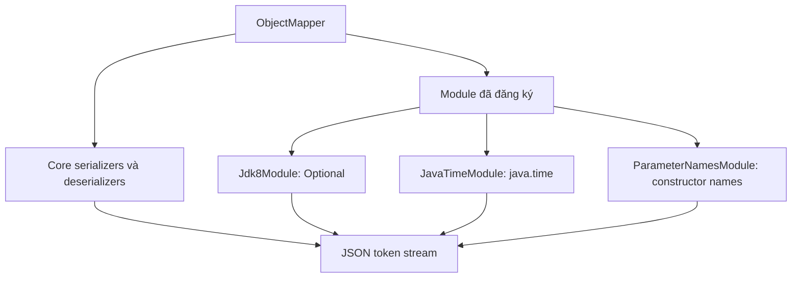

# Vai trò của module hỗ trợ Optional và kiểu dữ liệu Java bổ sung

Jackson Data Binding có thể ánh xạ trực tiếp nhiều kiểu Java cơ bản như `String`, số nguyên, boolean, array, collection và POJO. Tuy nhiên, Java còn có những kiểu biểu diễn dữ liệu chuyên biệt như `Optional<T>`, `OptionalInt`, `Instant`, `LocalDate`, `Path` hoặc các kiểu đến từ thư viện bên ngoài. Những kiểu này không phải lúc nào cũng có thể được xử lý đúng chỉ bằng serializer/deserializer mặc định của core databind.

Jackson giải quyết phần lớn nhu cầu đó thông qua **module**: các gói mở rộng đăng ký serializer, deserializer, type resolver, bộ xử lý annotation hoặc cơ chế tạo object bổ sung cho `ObjectMapper`. Ví dụ, `Jdk8Module` hỗ trợ các kiểu `Optional` của Java 8; `JavaTimeModule` hỗ trợ các kiểu ngày giờ trong `java.time`; `ParameterNamesModule` giúp Jackson sử dụng tên tham số constructor được lưu trong bytecode.

Module giúp Jackson hiểu cách chuyển đổi các kiểu dữ liệu mà ứng dụng đang dùng. Việc thêm dependency vào build chỉ cung cấp module trên classpath; mapper thực tế còn phải được cấu hình để sử dụng module đó, thông qua đăng ký tường minh, cơ chế auto-discovery hoặc cấu hình framework. Cần thống nhất phiên bản module với Jackson Core và Databind, đồng thời kiểm tra hợp đồng JSON mà module tạo ra.

## 1. Module là gì trong hệ sinh thái Jackson?

`ObjectMapper` là điểm trung tâm của quá trình serialization và deserialization. Mapper sử dụng serializer để ghi object thành JSON và deserializer để tạo object từ token JSON. Các kiểu Java đặc biệt có thể cần logic riêng để xử lý đúng semantics của chúng.

Một Jackson module là gói mở rộng đăng ký các thành phần đó vào mapper. Module có thể cung cấp:

- Serializer cho kiểu Java đặc biệt.
- Deserializer cho kiểu Java đặc biệt.
- Key serializer/deserializer cho key của `Map`.
- Type modifier hoặc type resolver để Jackson hiểu cấu trúc kiểu.
- Annotation introspector hoặc các thành phần mở rộng khác.
- Bộ xử lý hỗ trợ cách tạo object hoặc diễn giải metadata.

Ví dụ, `Optional<String>` không phải một JSON object có field `value`. Nó là một wrapper có thể chứa một giá trị hoặc biểu diễn trạng thái vắng mặt. `Jdk8Module` cung cấp quy tắc để Jackson xử lý wrapper đó và chuyển giá trị bên trong thành JSON theo cách phù hợp.



Module là phần mở rộng của mapper. Nó không phải một annotation gắn trên từng field, cũng không phải một kiểu dữ liệu thay thế cho domain model.

## 2. Vì sao `Optional` cần hỗ trợ riêng?

`Optional<T>` biểu diễn một giá trị có thể có hoặc không có. Trong Java, có thể tạo:

```java
Optional<String> present = Optional.of("An");
Optional<String> absent = Optional.empty();
Optional<String> fromNullable = Optional.ofNullable(null);
```

`present` chứa chuỗi `"An"`; `absent` và `fromNullable` không chứa giá trị. JSON không có kiểu wrapper `Optional`. Khi trao đổi dữ liệu, wrapper cần được chuyển thành một representation JSON phù hợp.

Ví dụ DTO:

```java
public record ProfileResponse(
        String username,
        Optional<String> nickname
) {
}
```

Với `nickname = Optional.of("An")`, JSON nên chứa giá trị bên trong:

```json
{
  "username": "an",
  "nickname": "An"
}
```

Với `nickname = Optional.empty()`, chính sách mặc định của Jdk8Module thường ghi property thành JSON null:

```json
{
  "username": "an",
  "nickname": null
}
```

Jackson cần biết cách mở wrapper `Optional`, serialize phần tử bên trong và xử lý trường hợp không có giá trị. `Jdk8Module` đăng ký serializer/deserializer cho các kiểu Optional của JDK để thực hiện công việc này.

## 3. Thêm dependency cho Jdk8Module

Module hỗ trợ Optional nằm trong artifact `jackson-datatype-jdk8`.

Với Maven, nên quản lý phiên bản Jackson tập trung bằng BOM:

```xml
<dependencyManagement>
    <dependencies>
        <dependency>
            <groupId>com.fasterxml.jackson</groupId>
            <artifactId>jackson-bom</artifactId>
            <version>${jackson.version}</version>
            <type>pom</type>
            <scope>import</scope>
        </dependency>
    </dependencies>
</dependencyManagement>

<dependencies>
    <dependency>
        <groupId>com.fasterxml.jackson.datatype</groupId>
        <artifactId>jackson-datatype-jdk8</artifactId>
    </dependency>
</dependencies>
```

Với Gradle:

```kotlin
dependencies {
    implementation(platform("com.fasterxml.jackson:jackson-bom:$jacksonVersion"))
    implementation("com.fasterxml.jackson.datatype:jackson-datatype-jdk8")
}
```

BOM giúp các artifact Jackson dùng cùng một phiên bản tương thích. Không nên để `jackson-datatype-jdk8` ở một phiên bản khác xa `jackson-databind` hoặc `jackson-core`, vì API nội bộ và SPI module có thể thay đổi giữa các phiên bản.

Các ví dụ trong bài sử dụng namespace `com.fasterxml.jackson.*` của Jackson 2.x. Nếu dự án sử dụng major version khác, cần dùng artifact, package và tài liệu đúng major đó; không trộn module giữa các major version.

## 4. Đăng ký Jdk8Module với ObjectMapper

Sau khi dependency có trên classpath, có thể đăng ký module trực tiếp:

```java
import com.fasterxml.jackson.databind.ObjectMapper;
import com.fasterxml.jackson.datatype.jdk8.Jdk8Module;

ObjectMapper mapper = new ObjectMapper();
mapper.registerModule(new Jdk8Module());
```

Sau khi đăng ký, mapper có thể đọc và ghi các kiểu Optional được module hỗ trợ.

Ví dụ đầy đủ:

```java
import com.fasterxml.jackson.databind.ObjectMapper;
import com.fasterxml.jackson.datatype.jdk8.Jdk8Module;

import java.util.Optional;

public class OptionalExample {
    public record Profile(String username, Optional<String> nickname) {
    }

    public static void main(String[] args) throws Exception {
        ObjectMapper mapper = new ObjectMapper()
                .registerModule(new Jdk8Module());

        Profile profile = new Profile("an", Optional.of("An"));
        String json = mapper.writeValueAsString(profile);
        System.out.println(json);

        Profile restored = mapper.readValue(json, Profile.class);
        System.out.println(restored.nickname().orElse("No nickname"));
    }
}
```

Kết quả JSON chứa giá trị `"An"`, không chứa một object lồng kiểu `{"present":true,"value":"An"}`. Khi đọc lại, module tạo `Optional` có giá trị tương ứng.

### 4.1. Cấu hình mapper bằng builder

Với các phiên bản Jackson hỗ trợ `JsonMapper.builder()`, có thể đăng ký module khi xây dựng mapper:

```java
import com.fasterxml.jackson.databind.json.JsonMapper;
import com.fasterxml.jackson.datatype.jdk8.Jdk8Module;

ObjectMapper mapper = JsonMapper.builder()
        .addModule(new Jdk8Module())
        .build();
```

Builder giúp gom cấu hình trước khi mapper được sử dụng. Dù dùng `registerModule()` hay builder, hãy hoàn tất cấu hình trước khi chia sẻ mapper cho nhiều request/thread.

## 5. Các kiểu Optional mà Jdk8Module hỗ trợ

Jdk8Module không chỉ hỗ trợ `Optional<T>` mà còn cung cấp hỗ trợ cho các wrapper primitive:

| Kiểu Java | Ý nghĩa | JSON khi có giá trị | JSON khi rỗng |
|---|---|---|---|
| `Optional<T>` | Có hoặc không có một object/value | Giá trị JSON của `T` | `null` theo chính sách mặc định |
| `OptionalInt` | Có hoặc không có `int` | JSON number nguyên | `null` theo chính sách mặc định |
| `OptionalLong` | Có hoặc không có `long` | JSON number nguyên | `null` theo chính sách mặc định |
| `OptionalDouble` | Có hoặc không có `double` | JSON number | `null` theo chính sách mặc định |

Ví dụ:

```java
public record SensorSummary(
        Optional<String> label,
        OptionalInt sampleCount,
        OptionalLong lastSequence,
        OptionalDouble average
) {
}
```

Khi các wrapper có giá trị, Jackson ghi giá trị bên trong theo kiểu JSON tương ứng. Khi wrapper rỗng, mặc định thường ghi null. Việc có chấp nhận NaN/Infinity cho `OptionalDouble` hay không vẫn phụ thuộc chính sách số dấu phẩy động của Jackson; Optional module không làm các giá trị đó trở thành JSON number chuẩn.

Wrapper primitive tránh boxing trong một số tình huống Java, nhưng không phải lúc nào cũng cần dùng trong DTO. Chọn kiểu theo nhu cầu code và hợp đồng JSON; không tạo nhiều lớp wrapper nếu một `Optional<T>` hoặc field nullable đã đủ rõ.

## 6. Optional và chính sách field null/absent khi serialize

Một điểm dễ nhầm là `Optional.empty()` không giống Java `null` ở cấp field. Sau khi module được đăng ký, object field có thể chứa một instance Optional không rỗng về mặt reference nhưng không có giá trị bên trong.

Ví dụ:

```java
ProfileResponse response = new ProfileResponse(
        "an",
        Optional.empty()
);

String json = mapper.writeValueAsString(response);
```

Theo chính sách mặc định, property `nickname` thường được ghi thành JSON null. Nếu muốn bỏ hẳn property khi Optional không có giá trị, dùng inclusion `NON_ABSENT`:

```java
import com.fasterxml.jackson.annotation.JsonInclude;

@JsonInclude(JsonInclude.Include.NON_ABSENT)
public record ProfileResponse(
        String username,
        Optional<String> nickname
) {
}
```

Khi `nickname` là `Optional.empty()`, output có thể là:

```json
{
  "username": "an"
}
```

`NON_ABSENT` được thiết kế để loại các giá trị absent của kiểu tham chiếu như `Optional` khi module cung cấp semantics đó. Nó khác `NON_NULL`: field `Optional.empty()` bản thân vẫn là một object Java khác null, nên `NON_NULL` không diễn đạt chính xác ý định bỏ wrapper absent.

Có thể đặt inclusion ở cấp property:

```java
public record ProfileResponse(
        String username,
        @JsonInclude(JsonInclude.Include.NON_ABSENT)
        Optional<String> nickname
) {
}
```

Hoặc cấu hình trên mapper cho kiểu DTO phù hợp. Hãy xác định rõ API muốn ghi null hay bỏ field; client có thể diễn giải hai representation đó khác nhau.

## 7. Phân biệt Optional rỗng, JSON null và field bị thiếu

Ba tình huống sau không đồng nghĩa:

```json
{"nickname": "An"}
```

```json
{"nickname": null}
```

```json
{}
```

Tình huống đầu cung cấp giá trị. Tình huống thứ hai gửi property với giá trị null. Tình huống thứ ba không gửi property.

Với Jdk8Module, explicit JSON null cho property `Optional<T>` thường được chuyển thành `Optional.empty()`. Field bị thiếu không nhất thiết gọi setter/deserializer của property. Với mutable bean, nếu field được khởi tạo sẵn là `Optional.empty()`, nó có thể vẫn rỗng khi JSON không có property. Nếu field không được khởi tạo, giá trị mặc định Java có thể vẫn là null. Với constructor/record creator, kết quả phụ thuộc cách Jackson xử lý absent creator property và cấu hình liên quan; hãy kiểm thử theo kiểu DTO thực tế.

Ví dụ mutable bean đặt default rõ ràng:

```java
public class ProfileRequest {
    private Optional<String> nickname = Optional.empty();

    public Optional<String> getNickname() {
        return nickname;
    }

    public void setNickname(Optional<String> nickname) {
        this.nickname = nickname;
    }
}
```

Khi JSON không có `nickname`, giá trị khởi tạo có thể được giữ lại. Khi JSON có `"nickname": null`, deserializer của Optional cung cấp giá trị rỗng cho setter.

### 7.1. Optional không phải mô hình ba trạng thái PATCH

Một số API PATCH cần phân biệt:

1. Field bị thiếu: giữ nguyên giá trị hiện tại.
2. Field có JSON null: xóa giá trị hiện tại.
3. Field có giá trị: cập nhật sang giá trị mới.

Chỉ dùng `Optional<T>` có thể làm mất sự phân biệt giữa thiếu và null tùy cách binding. Nếu hợp đồng cần ba trạng thái, hãy dùng DTO có cơ chế presence riêng, wrapper chuyên dụng như `JsonNullable<T>` từ thư viện hỗ trợ phù hợp, hoặc đọc `JsonNode` để kiểm tra `has()`/`hasNonNull()` trước khi cập nhật.

Ví dụ kiểm tra presence bằng Tree Model:

```java
JsonNode root = mapper.readTree(json);

if (!root.has("nickname")) {
    // Field thiếu: không thay đổi nickname hiện tại.
} else if (root.get("nickname").isNull()) {
    // Field hiện diện và null: xóa nickname theo hợp đồng PATCH.
} else {
    // Field có giá trị: đọc và cập nhật nickname.
    String nickname = root.get("nickname").asText();
}
```

Optional mô tả một giá trị có thể vắng mặt trong mô hình Java. Nó không tự động cung cấp semantics patch ba trạng thái cho mọi kiểu request.

## 8. Optional lồng với kiểu Java khác cần nhiều module

Một DTO có thể chứa `Optional<Instant>`, `Optional<LocalDate>` hoặc `Optional<OffsetDateTime>`. Trong trường hợp đó, hai module có trách nhiệm khác nhau:

- `Jdk8Module` xử lý wrapper `Optional`.
- `JavaTimeModule` xử lý giá trị ngày giờ nằm bên trong Optional.

Ví dụ:

```java
import java.time.Instant;
import java.util.Optional;

public record AuditSummary(
        String eventId,
        Optional<Instant> processedAt
) {
}
```

Đăng ký cả hai module:

```java
import com.fasterxml.jackson.databind.ObjectMapper;
import com.fasterxml.jackson.datatype.jdk8.Jdk8Module;
import com.fasterxml.jackson.datatype.jsr310.JavaTimeModule;

ObjectMapper mapper = new ObjectMapper()
        .registerModule(new Jdk8Module())
        .registerModule(new JavaTimeModule());
```

JSON có thể là:

```json
{
  "eventId": "evt-42",
  "processedAt": "2026-11-12T09:30:00Z"
}
```

Khi `processedAt` là Optional.empty, property sẽ theo chính sách null/absent đã cấu hình. Chỉ đăng ký JavaTimeModule không tự xử lý wrapper Optional; chỉ đăng ký Jdk8Module cũng không thay thế serializer/deserializer của `Instant`.

## 9. JavaTimeModule cho các kiểu trong java.time

Java Time API có nhiều kiểu biểu diễn ngày giờ với semantics khác nhau. `JavaTimeModule` nằm trong artifact `jackson-datatype-jsr310` và cung cấp serializer/deserializer cho các kiểu thường dùng như:

- `Instant` — thời điểm tuyệt đối trên timeline.
- `LocalDate` — ngày trên lịch, không có giờ hoặc timezone.
- `LocalTime` — giờ địa phương, không có ngày hoặc timezone.
- `LocalDateTime` — ngày giờ địa phương, không có offset/zone.
- `OffsetDateTime` — ngày giờ có offset UTC.
- `ZonedDateTime` — ngày giờ gắn với `ZoneId`.
- `Duration`, `Period`, `Year`, `YearMonth` và một số kiểu Java Time khác.

Dependency Maven:

```xml
<dependency>
    <groupId>com.fasterxml.jackson.datatype</groupId>
    <artifactId>jackson-datatype-jsr310</artifactId>
</dependency>
```

Đăng ký:

```java
ObjectMapper mapper = new ObjectMapper()
        .registerModule(new JavaTimeModule());
```

Với API JSON, thường nên xác định rõ dạng string ISO-8601 thay vì để mặc định timestamp/array ở các cấu hình có thể ghi ngày giờ dưới dạng số:

```java
mapper.disable(SerializationFeature.WRITE_DATES_AS_TIMESTAMPS);
```

Ví dụ:

```java
public record EventResponse(
        Instant occurredAt,
        LocalDate businessDate,
        LocalDateTime localAppointment
) {
}
```

JSON có thể chứa:

```json
{
  "occurredAt": "2026-11-12T09:30:00Z",
  "businessDate": "2026-11-12",
  "localAppointment": "2026-11-12T16:30:00"
}
```

`LocalDateTime` không chứa timezone, vì vậy không thể suy ra thời điểm tuyệt đối chỉ từ chuỗi đó. Hãy chọn kiểu Java theo semantics nghiệp vụ, không chỉ theo format JSON mong muốn.

## 10. ParameterNamesModule cho constructor-based deserialization

Một số lớp immutable chỉ có constructor, không có setter hoặc constructor không tham số. Jackson cần biết tham số constructor tương ứng với JSON property nào.

Ví dụ:

```java
public class Money {
    private final BigDecimal amount;
    private final String currency;

    public Money(BigDecimal amount, String currency) {
        this.amount = amount;
        this.currency = currency;
    }

    public BigDecimal getAmount() {
        return amount;
    }

    public String getCurrency() {
        return currency;
    }
}
```

`ParameterNamesModule` có thể giúp Jackson đọc tên tham số constructor từ metadata được compiler lưu trong bytecode. Module nằm trong artifact `jackson-module-parameter-names`:

```xml
<dependency>
    <groupId>com.fasterxml.jackson.module</groupId>
    <artifactId>jackson-module-parameter-names</artifactId>
</dependency>
```

Đăng ký:

```java
ObjectMapper mapper = new ObjectMapper()
        .registerModule(new ParameterNamesModule());
```

Để tên tham số được giữ trong bytecode, build Java cần bật tùy chọn compiler `-parameters`. Nếu thiếu metadata, module không thể tự đoán tên biến đã bị compiler loại bỏ. Với Jackson, có thể khai báo tường minh bằng `@JsonCreator` và `@JsonProperty`:

```java
public class Money {
    private final BigDecimal amount;
    private final String currency;

    @JsonCreator
    public Money(
            @JsonProperty("amount") BigDecimal amount,
            @JsonProperty("currency") String currency
    ) {
        this.amount = amount;
        this.currency = currency;
    }
}
```

Trong trường hợp đã dùng `@JsonCreator` và `@JsonProperty` đầy đủ, module parameter names có thể không cần thiết cho constructor đó.

### 10.1. Java record trong Jackson hiện đại

Record có component name rõ ràng trong metadata và được Jackson hỗ trợ trực tiếp từ các phiên bản Jackson 2 hiện đại (record support được bổ sung từ 2.12). Với record, thường không cần `ParameterNamesModule` chỉ để nhận diện tên component. Tuy nhiên, cần dùng phiên bản Jackson phù hợp và đồng bộ các artifact.

```java
public record Money(BigDecimal amount, String currency) {
}
```

Nếu dự án đang dùng phiên bản cũ hoặc có constructor/class đặc biệt, hãy kiểm tra khả năng hỗ trợ thực tế và dùng annotation tường minh khi cần.

## 11. Một số module hỗ trợ kiểu Java và thư viện bổ sung khác

Jackson có hệ sinh thái module cho nhiều kiểu dữ liệu ngoài core. Các module thường gặp gồm:

| Module/artifact | Nhóm kiểu hoặc nhu cầu | Ghi chú |
|---|---|---|
| `jackson-datatype-jdk8` / `Jdk8Module` | `Optional`, `OptionalInt`, `OptionalLong`, `OptionalDouble` | Hỗ trợ wrapper Optional của JDK. |
| `jackson-datatype-jsr310` / `JavaTimeModule` | `java.time` | Ngày giờ hiện đại, cần quy định format và timezone. |
| `jackson-module-parameter-names` | Tên tham số constructor | Cần metadata compiler `-parameters` khi dựa vào tên tham số. |
| `jackson-datatype-jdk7` / `Jdk7Module` | Một số kiểu JDK 7 như `java.nio.file.Path` | Dùng khi hợp đồng thực sự cần biểu diễn kiểu file-system. |
| `jackson-datatype-guava` / `GuavaModule` | Kiểu collection/value của Guava | Cần khi domain/API sử dụng các kiểu Guava được module hỗ trợ. |
| `jackson-datatype-joda` / `JodaModule` | Joda-Time | Hữu ích với hệ thống legacy chưa chuyển sang `java.time`. |
| `jackson-datatype-hibernate` | Hibernate proxy và collection | Tích hợp ORM theo phiên bản Hibernate; không thay thế DTO/fetch plan. |
| `jackson-module-kotlin` | Kotlin data class, constructor và nullability | Dùng trong ứng dụng Kotlin; phải đồng bộ phiên bản Kotlin/Jackson phù hợp. |

Không cần cài tất cả module. Chỉ thêm module khi kiểu dữ liệu của ứng dụng hoặc hợp đồng tích hợp yêu cầu nó. Mỗi dependency bổ sung cần được quản lý phiên bản và kiểm tra hành vi serialize/deserialize thực tế.

## 12. Tự động phát hiện module bằng ServiceLoader

Ngoài đăng ký tường minh, `ObjectMapper` có phương thức:

```java
ObjectMapper mapper = new ObjectMapper()
        .findAndRegisterModules();
```

Phương thức này tìm các module có thể phát hiện thông qua cơ chế Java `ServiceLoader` trên classpath và đăng ký chúng. Nó thuận tiện khi ứng dụng có một tập module đã được khai báo đầy đủ trong dependency.

Tuy nhiên, auto-discovery cũng có nghĩa hành vi mapper phụ thuộc vào module nào có mặt trên runtime classpath. Khi một dependency mới được thêm, mapper có thể nhận thêm serializer/deserializer mà code cấu hình không thể hiện trực tiếp. Với hệ thống cần cấu hình xác định và dễ audit, đăng ký tường minh giúp biết rõ module nào đang được sử dụng.

Không cần gọi `findAndRegisterModules()` sau mỗi request. Hãy tạo và cấu hình mapper một lần ở composition root, rồi tái sử dụng.

## 13. Dependency có mặt chưa chắc mapper đang dùng module đó

Một lỗi cấu hình phổ biến là thêm dependency nhưng vẫn tạo mapper mới bằng:

```java
ObjectMapper mapper = new ObjectMapper();
```

Mapper được tạo thủ công như trên không tự động có mọi module chỉ vì dependency nằm trên classpath. Cần đăng ký module hoặc dùng cơ chế discovery:

```java
ObjectMapper mapper = new ObjectMapper()
        .registerModule(new Jdk8Module())
        .registerModule(new JavaTimeModule());
```

Trong ứng dụng dùng Spring Boot hoặc framework khác, framework có thể tự cấu hình mapper và đăng ký các `Module` bean theo phiên bản/cấu hình đang sử dụng. Khi đó, nên dùng mapper do framework cung cấp hoặc kiểm tra builder/customizer thực tế. Nếu tự tạo một `new ObjectMapper()` riêng bên trong service, mapper đó có thể bỏ qua toàn bộ cấu hình module của framework.

Hãy tránh tạo nhiều mapper không đồng nhất trong cùng ứng dụng. Tập trung cấu hình tại một nơi giúp API, message producer, consumer và test có cùng quy tắc JSON khi cần.

## 14. Thứ tự và phạm vi cấu hình module

Các module có thể đăng ký serializer/deserializer cho kiểu cụ thể. Nếu nhiều module hoặc custom module cùng xử lý một kiểu, cấu hình và thứ tự đăng ký có thể ảnh hưởng thành phần được chọn. Vì vậy:

- Tránh đăng ký hai module có trách nhiệm chồng lấn nếu không hiểu rõ ưu tiên.
- Đăng ký custom serializer/deserializer có chủ đích khi muốn thay hành vi mặc định.
- Dùng mapper riêng cho các integration có hợp đồng khác nhau nếu cần.
- Hoàn tất cấu hình trước khi mapper được sử dụng đồng thời.
- Không thay đổi module hoặc feature của singleton mapper theo từng request.

`ObjectMapper` được thiết kế để tái sử dụng an toàn khi cấu hình đã hoàn tất trước khi dùng. Nếu cần một biến thể cho một lần ghi, có thể dùng `ObjectWriter`; nếu cần mapper với tập module khác, tạo và cấu hình instance riêng trước khi chia sẻ.

## 15. Optional bên trong collection, Map và generic wrapper

Jdk8Module xử lý Optional không chỉ ở property trực tiếp mà còn khi Optional là phần tử của container, miễn là Jackson có đủ thông tin kiểu.

Ví dụ danh sách Optional:

```java
List<Optional<String>> aliases = List.of(
        Optional.of("An"),
        Optional.empty(),
        Optional.of("Nguyen")
);
```

Đọc JSON thành kiểu generic:

```java
List<Optional<String>> aliases = mapper.readValue(
        json,
        new TypeReference<List<Optional<String>>>() {}
);
```

Map có value Optional:

```java
Map<String, Optional<Instant>> timestamps = mapper.readValue(
        json,
        new TypeReference<Map<String, Optional<Instant>>>() {}
);
```

Trường hợp `Optional<Instant>` cần cả `Jdk8Module` và `JavaTimeModule`. `TypeReference` giữ cấu trúc generic; các module cung cấp quy tắc chuyển đổi cho từng kiểu nằm trong cấu trúc đó.

Nếu chỉ dùng `List.class` hoặc `Map.class`, tham số generic bị mất và Jackson có thể tạo `List<Object>`/`Map<String,Object>` với kiểu giá trị động. Hãy dùng `TypeReference` hoặc `JavaType` khi kiểu phần tử quan trọng.

## 16. Module và mix-in giải quyết hai vấn đề khác nhau

Module và mix-in đều mở rộng hành vi Jackson nhưng vai trò khác nhau:

| Cơ chế | Vai trò chính | Ví dụ |
|---|---|---|
| Module chuyên biệt | Đăng ký hỗ trợ cho nhóm kiểu Java hoặc thư viện | `Jdk8Module` xử lý Optional; `JavaTimeModule` xử lý java.time. |
| `SimpleModule` | Đăng ký serializer/deserializer/key handler do ứng dụng tự viết | Serializer cho `Money`, deserializer cho `GeoPoint`. |
| Mix-in annotation | Bổ sung annotation Jackson cho lớp không thể sửa mã nguồn | Áp dụng `@JsonIgnore` hoặc `@JsonProperty` cho thư viện bên ngoài. |

Mix-in không tự cung cấp logic chuyển đổi cho một kiểu phức tạp. Nếu một thư viện định nghĩa kiểu không được Jackson hỗ trợ, chỉ thêm mix-in không nhất thiết đủ; có thể cần module với serializer/deserializer. Ngược lại, nếu kiểu đã được module hỗ trợ nhưng ứng dụng muốn đổi tên hoặc bỏ một property, mix-in có thể là công cụ phù hợp.

Ví dụ mix-in chỉ điều chỉnh annotation:

```java
abstract class ExternalUserMixin {
    @JsonIgnore
    abstract String getInternalToken();
}

mapper.addMixIn(ExternalUser.class, ExternalUserMixin.class);
```

Ví dụ này không thay serializer của Optional hay Java Time; nó chỉ bổ sung metadata annotation cho một kiểu bên ngoài.

## 17. Kiểm thử hành vi của module

Không nên chỉ xác nhận module đã đăng ký mà cần kiểm tra JSON thực tế. Một test nhỏ có thể xác nhận Optional có giá trị được ghi thành value bên trong và Optional rỗng theo đúng inclusion policy.

```java
import com.fasterxml.jackson.annotation.JsonInclude;
import com.fasterxml.jackson.databind.JsonNode;
import com.fasterxml.jackson.databind.ObjectMapper;
import com.fasterxml.jackson.datatype.jdk8.Jdk8Module;
import org.junit.jupiter.api.Test;

import java.util.Optional;

import static org.junit.jupiter.api.Assertions.*;

class Jdk8ModuleTest {
    @JsonInclude(JsonInclude.Include.NON_ABSENT)
    record Profile(String username, Optional<String> nickname) {
    }

    private final ObjectMapper mapper = new ObjectMapper()
            .registerModule(new Jdk8Module());

    @Test
    void serializesPresentOptionalAsItsValue() throws Exception {
        String json = mapper.writeValueAsString(
                new Profile("an", Optional.of("An"))
        );

        JsonNode tree = mapper.readTree(json);
        assertEquals("An", tree.path("nickname").asText());
    }

    @Test
    void omitsAbsentOptionalWithNonAbsentInclusion() throws Exception {
        String json = mapper.writeValueAsString(
                new Profile("an", Optional.empty())
        );

        JsonNode tree = mapper.readTree(json);
        assertFalse(tree.has("nickname"));
    }

    @Test
    void readsPresentOptional() throws Exception {
        Profile profile = mapper.readValue(
                "{\"username\":\"an\",\"nickname\":\"An\"}",
                Profile.class
        );

        assertEquals(Optional.of("An"), profile.nickname());
    }
}
```

Nếu hợp đồng muốn Optional.empty được ghi thành null, bỏ `NON_ABSENT` và viết test xác nhận node là null. Nếu muốn field biến mất, giữ inclusion `NON_ABSENT`. Test nên thể hiện chính sách mà client được phép dựa vào.

### 17.1. Kiểm thử Optional<Instant>

```java
import com.fasterxml.jackson.databind.ObjectMapper;
import com.fasterxml.jackson.databind.SerializationFeature;
import com.fasterxml.jackson.datatype.jdk8.Jdk8Module;
import com.fasterxml.jackson.datatype.jsr310.JavaTimeModule;

ObjectMapper mapper = new ObjectMapper()
        .registerModule(new Jdk8Module())
        .registerModule(new JavaTimeModule())
        .disable(SerializationFeature.WRITE_DATES_AS_TIMESTAMPS);
```

Kiểm thử nên xác nhận `Optional<Instant>` được ghi thành chuỗi ISO và đọc lại thành Optional có giá trị. Nếu chỉ đăng ký một trong hai module, test sẽ phát hiện phần kiểu còn thiếu.

## 18. Những lỗi thường gặp khi sử dụng module

### 18.1. Thêm dependency nhưng quên đăng ký module

Class có trên classpath không có nghĩa mọi `ObjectMapper` đều đã sử dụng module. Kiểm tra mapper được inject hoặc đăng ký module rõ ràng.

### 18.2. Chỉ đăng ký Jdk8Module cho Optional<LocalDate>

Jdk8Module xử lý wrapper Optional; `LocalDate` bên trong cần JavaTimeModule. Một kiểu lồng nhau có thể cần nhiều module với trách nhiệm bổ sung.

### 18.3. Dùng `NON_NULL` để bỏ Optional.empty

Optional.empty vẫn là một object Optional không null. Nếu muốn loại absent value, dùng `JsonInclude.Include.NON_ABSENT` và kiểm tra hành vi trên phiên bản Jackson đang dùng.

### 18.4. Coi Optional là cách phân biệt mọi trạng thái request

Optional biểu diễn có/không có value trong Java, nhưng không tự đảm bảo phân biệt field thiếu với explicit JSON null trong mọi kiểu DTO. Với PATCH cần ba trạng thái, dùng presence-aware model hoặc kiểm tra JSON tree.

### 18.5. Tạo mapper thủ công trong khi framework đã cấu hình mapper

Mapper mới có thể bỏ qua module, naming strategy, date format hoặc custom serializer mà ứng dụng đã cấu hình. Hãy tái sử dụng mapper do framework quản lý hoặc cấu hình đầy đủ instance riêng.

### 18.6. Trộn phiên bản module và databind

Các module Jackson cần tương thích với phiên bản Core/Databind. Dùng BOM hoặc dependency management để tránh xung đột phiên bản transitive.

### 18.7. Dùng module để thay thế thiết kế DTO

Module giúp Jackson hiểu kiểu dữ liệu; nó không quyết định field nào được phép công bố, ai có quyền xem hoặc JSON contract nên có hình dạng nào. Những quyết định đó thuộc thiết kế API và tầng ứng dụng.

## 19. Quy trình cấu hình module cho một ứng dụng

Khi dự án cần thêm hỗ trợ cho kiểu Java mới, có thể thực hiện theo trình tự:

1. **Xác định kiểu cần hỗ trợ:** Optional, Java Time, Path, Guava, Kotlin hay kiểu thư viện khác.
2. **Chọn artifact tương ứng:** chỉ thêm module cần thiết.
3. **Đồng bộ phiên bản:** dùng Jackson BOM hoặc dependency management hiện có.
4. **Xác định mapper thực tế:** mapper do framework tạo hay mapper thủ công.
5. **Đăng ký module:** explicit registration hoặc auto-discovery có kiểm soát.
6. **Quy định JSON contract:** null/absent, format ngày giờ, precision số và generic type.
7. **Kiểm thử hai chiều:** serialize và deserialize các trường hợp có giá trị, rỗng, null và thiếu field.
8. **Kiểm tra phạm vi:** bảo đảm module được áp dụng cho đúng mapper và integration.
9. **Không thay đổi mapper đang chạy:** cấu hình hoàn tất trước khi chia sẻ mapper đồng thời.

## 20. Chọn module theo nhu cầu

| Nhu cầu | Module/cách làm |
|---|---|
| Đọc/ghi `Optional<T>` và Optional primitive | `Jdk8Module` từ `jackson-datatype-jdk8` |
| Đọc/ghi `Instant`, `LocalDate`, `LocalDateTime`, `ZonedDateTime` | `JavaTimeModule` từ `jackson-datatype-jsr310` |
| Constructor immutable dựa trên tên tham số bytecode | `ParameterNamesModule` và compiler `-parameters`, hoặc annotation creator/property tường minh |
| Hỗ trợ kiểu `Path` trong hợp đồng JSON | Xem xét `Jdk7Module` và kiểm tra representation mong muốn |
| Hỗ trợ kiểu Guava | `GuavaModule` |
| Hỗ trợ Joda-Time legacy | `JodaModule` |
| Hỗ trợ proxy/collection Hibernate | Module Hibernate tương ứng phiên bản ORM, kết hợp DTO/fetch plan |
| Bổ sung annotation cho kiểu không thể sửa | Mix-in |
| Serializer/deserializer riêng cho domain value object | `SimpleModule` hoặc annotation `@JsonSerialize`/`@JsonDeserialize` |

Module giúp Jackson hiểu các kiểu dữ liệu Java nằm ngoài tập kiểu cơ bản mà databind xử lý sẵn. `Jdk8Module` cung cấp quy tắc cho `Optional` và các wrapper primitive; `JavaTimeModule` xử lý `java.time`; `ParameterNamesModule` hỗ trợ tên tham số constructor khi bytecode có metadata phù hợp. Các module khác có thể hỗ trợ kiểu JDK hoặc thư viện bổ sung. Hãy thêm đúng dependency, đồng bộ phiên bản với Jackson Core/Databind, đăng ký vào mapper thực tế và kiểm thử representation JSON. Đặc biệt, cần định nghĩa rõ Optional.empty được ghi thành null hay bị bỏ qua, phân biệt null với field thiếu theo nhu cầu API, và dùng đồng thời các module cần thiết cho kiểu lồng nhau như `Optional<Instant>`. Module mở rộng khả năng chuyển đổi; hợp đồng dữ liệu, quyền truy cập và validation vẫn phải được thiết kế ở tầng ứng dụng.
