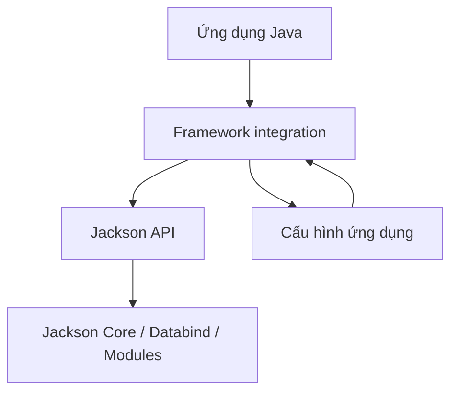

# Phân biệt API thư viện và cấu hình mặc định do framework áp dụng

Khi dùng Jackson trong một ứng dụng Java, kết quả chuyển đổi JSON chịu ảnh hưởng của nhiều lớp: API của chính thư viện Jackson, cấu hình mà ứng dụng đặt lên các API đó, và cấu hình tích hợp mà framework như Spring Boot tự động áp dụng. Nếu không phân biệt các lớp này, ta dễ kết luận nhầm rằng một hành vi là mặc định của Jackson trong mọi môi trường, trong khi nó chỉ xuất hiện vì ứng dụng đang chạy dưới Spring Boot hoặc vì một cấu hình riêng đã được nạp.

Điểm cần nhớ là **API mô tả những thao tác và khả năng thư viện cung cấp; cấu hình mặc định quyết định cách các khả năng đó hoạt động khi ứng dụng chưa ghi đè; framework có thể tạo và cấu hình đối tượng thư viện trước khi ứng dụng sử dụng**. Cùng một lệnh `ObjectMapper.readValue(...)` có thể cho kết quả khác nhau nếu hai `ObjectMapper` được tạo từ hai nguồn cấu hình khác nhau.

## 1. Ba lớp cần phân biệt

Trong một ứng dụng dùng Jackson, có thể nhìn theo ba lớp:



### 1.1. API của thư viện

API (Application Programming Interface) là tập hợp class, interface, method, annotation và quy ước mà thư viện công khai để chương trình sử dụng. Với Jackson, những API quen thuộc gồm:

- `ObjectMapper`: chuyển đổi giữa JSON và đối tượng Java, tree model hoặc các kiểu dữ liệu khác.
- `ObjectReader` và `ObjectWriter`: thực hiện thao tác đọc/ghi với kiểu và cấu hình đã được chuẩn bị.
- `JsonParser` và `JsonGenerator`: đọc/ghi JSON ở mức token.
- `JsonNode`, `ObjectNode` và `ArrayNode`: thao tác với cây JSON.
- `JsonProperty`, `JsonIgnore`, `JsonCreator`, `JsonFormat`: annotation mô tả quy tắc ánh xạ.
- `Module`, `SimpleModule`: mở rộng khả năng xử lý kiểu dữ liệu, serializer và deserializer.

API trả lời câu hỏi: **chương trình có thể gọi gì và gọi bằng cách nào?** API không đồng nghĩa với một bộ cấu hình cụ thể. Ví dụ, `DeserializationFeature.FAIL_ON_UNKNOWN_PROPERTIES` là một lựa chọn cấu hình có trong API Jackson; việc bật hay tắt nó là quyết định về hành vi của mapper.

### 1.2. Cấu hình mặc định của thư viện

Default configuration là trạng thái cấu hình ban đầu khi tạo và sử dụng một thành phần mà chưa áp dụng cấu hình bổ sung. Mặc định có thể gồm:

- Feature nào đang bật hoặc tắt.
- Cách nhận diện property Java.
- Quy tắc xử lý kiểu ngày giờ, enum, số và null.
- Module nào đã được đăng ký.
- Cách xử lý property JSON không có trong class đích.
- Cách xử lý lỗi cú pháp hoặc lỗi ánh xạ.

Mặc định là một phần của hành vi thư viện hoặc bộ tích hợp cụ thể, không phải lúc nào cũng là cam kết bất biến giữa các phiên bản. Khi nâng phiên bản Jackson hoặc framework, một số mặc định có thể thay đổi. Vì vậy, cần đọc tài liệu đúng phiên bản đang chạy nếu hành vi đó ảnh hưởng đến hợp đồng dữ liệu.

### 1.3. Cấu hình do framework áp dụng

Framework thường cung cấp lớp tích hợp để giảm thao tác cấu hình lặp lại. Với Spring Boot, auto-configuration có thể:

- Tạo một `ObjectMapper` dùng chung nếu ứng dụng chưa khai báo mapper riêng.
- Tạo mapper thông qua `Jackson2ObjectMapperBuilder`.
- Áp dụng các thuộc tính `spring.jackson.*` trong cấu hình ứng dụng.
- Đăng ký các module Jackson có trên classpath hoặc được khai báo thành bean theo cơ chế hỗ trợ.
- Kết nối mapper với các thành phần web như HTTP message converter.
- Cho phép ứng dụng bổ sung tùy chỉnh thông qua builder customizer hoặc module bean.

Đây là hành vi của lớp tích hợp Spring, không phải tất cả đều là hành vi của một `new ObjectMapper()` thuần túy. Framework có thể chọn một số giá trị mặc định để phù hợp với cách xây dựng ứng dụng của nó.

## 2. Jackson API không phải là cấu hình Spring Boot

Ví dụ sau sử dụng trực tiếp Jackson trong Java:

```java
ObjectMapper mapper = new ObjectMapper();

String json = mapper.writeValueAsString(customer);
Customer restored = mapper.readValue(json, Customer.class);
```

`ObjectMapper`, `writeValueAsString(...)` và `readValue(...)` là API của Jackson. Ứng dụng tự tạo mapper bằng constructor. Mapper này nhận cấu hình khởi tạo của Jackson và các module/feature mà ứng dụng chủ động đăng ký.

Trong Spring Boot, ứng dụng thường nhận mapper qua dependency injection:

```java
@Service
public class CustomerJsonService {

    private final ObjectMapper mapper;

    public CustomerJsonService(ObjectMapper mapper) {
        this.mapper = mapper;
    }

    public String toJson(Customer customer) throws JsonProcessingException {
        return mapper.writeValueAsString(customer);
    }

    public Customer fromJson(String json) throws JsonProcessingException {
        return mapper.readValue(json, Customer.class);
    }
}
```

Các method được gọi vẫn là API Jackson. Điểm khác biệt nằm ở nguồn tạo mapper: Spring quản lý bean và có thể đã áp dụng cấu hình framework trước khi inject vào service.

Nếu trong cùng một ứng dụng vừa inject mapper từ Spring, vừa tự gọi `new ObjectMapper()`, ta đang sử dụng hai đối tượng có thể mang cấu hình khác nhau:

```java
@Service
public class MixedMapperService {

    private final ObjectMapper springMapper;
    private final ObjectMapper plainMapper = new ObjectMapper();

    public MixedMapperService(ObjectMapper springMapper) {
        this.springMapper = springMapper;
    }
}
```

`springMapper` nhận cấu hình của bean do Spring quản lý. `plainMapper` được tạo trực tiếp trong class nên không tự nhận các thuộc tính `spring.jackson.*`, builder customizer hay module bean mà Spring áp dụng cho mapper được quản lý. Đây là nguyên nhân thường gặp khi endpoint HTTP và một đoạn code tự serialize trong service tạo ra JSON khác nhau.

## 3. Các nhóm API Jackson thường gặp

### 3.1. ObjectMapper và các thao tác data binding

`ObjectMapper` là API trung tâm khi dùng Jackson Databind. Một số method phổ biến:

| Method | Mục đích |
|---|---|
| `writeValueAsString(value)` | Ghi đối tượng thành JSON string |
| `writeValue(output, value)` | Ghi JSON ra file hoặc output stream |
| `readValue(json, Type.class)` | Đọc JSON thành một kiểu Java cụ thể |
| `readValue(json, TypeReference<T>)` | Đọc JSON khi cần giữ thông tin generic |
| `readTree(json)` | Đọc JSON thành cây `JsonNode` |
| `convertValue(source, Target.class)` | Chuyển đổi giữa các kiểu thông qua cơ chế databinding |
| `registerModule(module)` | Đăng ký module mở rộng |
| `configure(feature, state)` | Thay đổi trạng thái feature |

Ví dụ cấu hình mapper thuần Jackson 2.x:

```java
ObjectMapper mapper = new ObjectMapper();
mapper.disable(DeserializationFeature.FAIL_ON_UNKNOWN_PROPERTIES);
mapper.enable(SerializationFeature.INDENT_OUTPUT);
```

Hai lệnh `disable(...)` và `enable(...)` là method của API. Chúng thay đổi cấu hình của chính đối tượng mapper đang được gọi. Chúng không sửa cấu hình toàn cục của mọi mapper trong JVM.

Với các phiên bản Jackson 2.x hỗ trợ `JsonMapper.builder()`, có thể xây dựng mapper theo kiểu builder:

```java
ObjectMapper mapper = JsonMapper.builder()
        .disable(DeserializationFeature.FAIL_ON_UNKNOWN_PROPERTIES)
        .enable(SerializationFeature.INDENT_OUTPUT)
        .build();
```

Ở các phiên bản cũ hơn hoặc khi cần tương thích API khác, có thể tạo `ObjectMapper` rồi cấu hình trước khi chia sẻ. Hãy dùng tài liệu đúng phiên bản dependency trong dự án.

### 3.2. ObjectReader và ObjectWriter

`ObjectReader` và `ObjectWriter` là các đối tượng chuyên biệt cho thao tác đọc và ghi. Chúng giúp chuẩn bị kiểu đích hoặc tùy chọn riêng mà không cần liên tục thay đổi cấu hình chung của mapper.

```java
ObjectReader customerReader = mapper.readerFor(Customer.class);
ObjectWriter prettyWriter = mapper.writerWithDefaultPrettyPrinter();

Customer customer = customerReader.readValue(json);
String formatted = prettyWriter.writeValueAsString(customer);
```

Có thể tạo reader/writer cho một kiểu hoặc một cách trình bày cụ thể rồi tái sử dụng. Cách này hữu ích khi cùng một mapper phục vụ nhiều hợp đồng dữ liệu khác nhau.

### 3.3. Annotation là metadata ánh xạ

Annotation Jackson được đặt gần class hoặc property để mô tả quy tắc dữ liệu:

```java
public class Customer {

    @JsonProperty("full_name")
    private String name;

    @JsonIgnore
    private String internalNote;

    // Constructor, getter và setter.
}
```

`@JsonProperty` và `@JsonIgnore` thuộc API/metadata của Jackson. Chúng không phải cấu hình mặc định của Spring Boot. Một ứng dụng Java không dùng Spring vẫn có thể dùng các annotation này nếu có dependency Jackson phù hợp.

Annotation thường phù hợp khi quy tắc thuộc riêng một model. Nếu muốn thay đổi chính sách chung cho toàn ứng dụng, cấu hình mapper hoặc framework có thể phù hợp hơn. Cần tránh để annotation và cấu hình toàn cục mâu thuẫn khiến người đọc khó xác định quy tắc cuối cùng.

### 3.4. Module mở rộng

Jackson chia khả năng xử lý theo module. Ví dụ, `jackson-datatype-jsr310` hỗ trợ các kiểu Java Time như `LocalDate`, `LocalDateTime` và `Instant`.

Trong ứng dụng Java độc lập, có thể đăng ký module trực tiếp:

```java
ObjectMapper mapper = new ObjectMapper();
mapper.registerModule(new JavaTimeModule());
```

Hoặc dùng builder của Jackson:

```java
ObjectMapper mapper = JsonMapper.builder()
        .addModule(new JavaTimeModule())
        .build();
```

Module phải có mặt trên classpath. Chỉ viết `registerModule(...)` trong source code không thể thay thế dependency còn thiếu. Trong Spring Boot, module tương thích có thể được framework tự đăng ký theo cơ chế auto-configuration; vì thế, cùng một kiểu `LocalDate` có thể hoạt động với mapper được inject trong Boot nhưng thất bại với mapper tự tạo nếu mapper đó không đăng ký module.

## 4. Cấu hình mặc định của Jackson thuần và Spring Boot

Không nên ghi nhớ một danh sách default rồi áp dụng cho mọi dự án. Trước tiên hãy xác định mapper được tạo ở đâu, phiên bản Jackson nào đang chạy và framework có tham gia cấu hình hay không.

### 4.1. Mapper tạo trực tiếp bằng constructor

Với:

```java
ObjectMapper mapper = new ObjectMapper();
```

ứng dụng sử dụng cấu hình khởi tạo của Jackson Databind. Các feature mặc định có thể ảnh hưởng đến kết quả, chẳng hạn việc xử lý property JSON không có trong kiểu Java đích, cách ghi JSON dễ đọc, hoặc cách xử lý ngày giờ khi module tương ứng được đăng ký.

Một ví dụ thường được dùng để quan sát khác biệt là `DeserializationFeature.FAIL_ON_UNKNOWN_PROPERTIES`. Trong cấu hình Jackson Databind thông thường, feature này mặc định được bật: nếu JSON có property không được nhận diện trong class đích, thao tác đọc có thể thất bại. Ứng dụng có thể chủ động tắt feature bằng API của Jackson.

```java
ObjectMapper mapper = new ObjectMapper();
mapper.disable(DeserializationFeature.FAIL_ON_UNKNOWN_PROPERTIES);
```

Ví dụ trên cho thấy API cung cấp khả năng thay đổi hành vi. Trạng thái trước và sau khi gọi `disable(...)` là cấu hình của mapper, không phải hai API khác nhau.

### 4.2. Mapper được Spring Boot auto-configure

Khi Jackson có trên classpath và ứng dụng dùng Spring Boot, auto-configuration có thể tạo bean `ObjectMapper` thông qua `Jackson2ObjectMapperBuilder`. Builder của Spring Framework áp dụng một số lựa chọn mặc định phục vụ tích hợp Spring. Với dòng tích hợp Jackson 2 thường gặp ở Spring Boot 3, các lựa chọn như tắt `MapperFeature.DEFAULT_VIEW_INCLUSION` và tắt `DeserializationFeature.FAIL_ON_UNKNOWN_PROPERTIES` là những điểm khác biệt đáng chú ý so với mapper thuần được tạo trực tiếp.

Đây là default của builder/tầng tích hợp Spring trong dòng phiên bản tương ứng. Không nên suy rộng thành quy tắc cho mọi phiên bản Spring, mọi phiên bản Jackson hoặc mọi framework khác. Cấu hình `spring.jackson.*`, customizer và bean do ứng dụng khai báo có thể tiếp tục thay đổi kết quả cuối cùng.

### 4.3. So sánh theo nguồn tạo mapper

| Khía cạnh | `new ObjectMapper()` | Mapper do Spring Boot quản lý |
|---|---|---|
| Nguồn tạo | Code ứng dụng gọi constructor | Auto-configuration và builder của Spring |
| Jackson API | Dùng trực tiếp | Vẫn dùng cùng API Jackson |
| Cấu hình ban đầu | Theo default của Jackson Databind và module đã đăng ký | Có thể thêm default của Spring builder và Boot |
| `spring.jackson.*` | Không tự đọc | Được Boot dùng để cấu hình mapper auto-configured |
| Module bean trong Spring | Không tự nhận | Có thể được tích hợp theo cơ chế của Boot |
| Dependency injection | Không tự có | Có thể inject bean vào service/controller |
| HTTP message converter | Không tự kết nối | Spring MVC có thể dùng mapper được cấu hình trong context |

Điều quan trọng là cột bên phải không phải một bộ API khác. Nó vẫn gọi `ObjectMapper`, `ObjectReader`, `ObjectWriter` và các API Jackson. Khác biệt nằm ở cách đối tượng được tạo, cấu hình và chia sẻ.

## 5. Dependency quyết định API nào có mặt và phiên bản nào được chạy

### 5.1. Các artifact chính của Jackson

Trong hệ sinh thái Jackson 2.x, những artifact nền tảng thường gặp là:

| Artifact | Trách nhiệm chính |
|---|---|
| `jackson-core` | Streaming API, parser và generator |
| `jackson-annotations` | Annotation metadata như `@JsonProperty` |
| `jackson-databind` | Data Binding, `ObjectMapper`, tree model |
| `jackson-datatype-jsr310` | Hỗ trợ Java Time API |
| `jackson-datatype-jdk8` | Hỗ trợ một số kiểu Java 8 như `Optional` |
| `jackson-module-parameter-names` | Hỗ trợ suy luận tên tham số constructor trong các trường hợp phù hợp |

`jackson-databind` thường kéo theo `jackson-core` và `jackson-annotations` dưới dạng dependency bắc cầu. Các module datatype/module bổ sung có thể cần khai báo riêng, trừ khi starter hoặc dependency khác đã đưa chúng vào.

### 5.2. Dependency của ứng dụng Java độc lập

Nếu ứng dụng không dùng Spring Boot, có thể khai báo trực tiếp `jackson-databind` trong Maven:

```xml
<dependency>
    <groupId>com.fasterxml.jackson.core</groupId>
    <artifactId>jackson-databind</artifactId>
    <version>${jackson.version}</version>
</dependency>
```

Nếu cần Java Time, thêm module tương ứng với cùng dòng phiên bản:

```xml
<dependency>
    <groupId>com.fasterxml.jackson.datatype</groupId>
    <artifactId>jackson-datatype-jsr310</artifactId>
    <version>${jackson.version}</version>
</dependency>
```

Trong Gradle, khai báo tương tự:

```groovy
dependencies {
    implementation("com.fasterxml.jackson.core:jackson-databind:$jacksonVersion")
    implementation("com.fasterxml.jackson.datatype:jackson-datatype-jsr310:$jacksonVersion")
}
```

Các ví dụ dùng biến phiên bản để nhấn mạnh rằng dự án phải chọn phiên bản cụ thể và giữ các artifact/module tương thích. Không nên copy một số phiên bản bất kỳ từ bài viết cũ mà không kiểm tra dependency graph hiện tại.

### 5.3. Dependency khi dùng Spring Boot

Ứng dụng Spring Boot thường lấy Jackson thông qua starter phù hợp. Ví dụ ứng dụng web MVC có thể khai báo:

```groovy
dependencies {
    implementation("org.springframework.boot:spring-boot-starter-web")
}
```

Starter kéo theo các dependency cần thiết cho web stack, trong đó có hỗ trợ JSON/Jackson theo cấu hình dependency của phiên bản Spring Boot đang dùng. Spring Boot dependency management quản lý các phiên bản thư viện tương thích trong bộ dependency của nó.

Khi đã dùng Spring Boot dependency management, thông thường không cần gắn một version riêng cho từng artifact Jackson. Tự nâng `jackson-databind` nhưng giữ `jackson-core`, `jackson-annotations` hoặc module ở phiên bản không tương thích có thể gây lỗi linkage, lỗi method hoặc hành vi khó dự đoán.

Nếu có lý do cần ghi đè phiên bản Jackson, hãy làm theo cơ chế dependency management/BOM mà dự án đang dùng và kiểm tra toàn bộ nhóm artifact liên quan. Không nên chỉ sửa một dependency đơn lẻ vì thấy một lỗ hổng hoặc một API mới mà bỏ qua tính tương thích của cả nhóm.

### 5.4. BOM và quản lý phiên bản đồng bộ

BOM (Bill of Materials) là metadata dependency management giúp quản lý một nhóm phiên bản thư viện. Jackson có BOM riêng để đồng bộ các artifact cùng dòng. Spring Boot cũng cung cấp dependency management cho các thư viện mà nó tích hợp.

Khi dùng Spring Boot, ưu tiên bộ phiên bản do Spring Boot quản lý trừ khi dự án có quyết định nâng cấp rõ ràng. Khi dùng Java độc lập, có thể import Jackson BOM để các artifact Jackson dùng chung phiên bản.

Mục tiêu là tránh trạng thái:

```text
jackson-databind       phiên bản A
jackson-core           phiên bản B
jackson-annotations    phiên bản C
jackson-datatype-jsr310 phiên bản D
```

Các module trong cùng hệ sinh thái thường được phát hành để làm việc cùng một dòng phiên bản. Giữ chúng đồng bộ giúp giảm rủi ro lỗi tương thích runtime.

## 6. Cách Spring Boot áp dụng cấu hình Jackson

### 6.1. Auto-configuration tạo mapper

Spring Boot có thể tạo `ObjectMapper` bean khi ứng dụng có Jackson và chưa có bean phù hợp do ứng dụng cung cấp. Mapper thường được xây dựng qua `Jackson2ObjectMapperBuilder`, nhờ đó các thuộc tính cấu hình và tùy chỉnh của Spring được áp dụng tập trung.

Trong service hoặc controller, hãy inject mapper:

```java
@RestController
@RequestMapping("/customers")
public class CustomerController {

    private final ObjectMapper mapper;

    public CustomerController(ObjectMapper mapper) {
        this.mapper = mapper;
    }
}
```

Trong xử lý HTTP, Spring MVC còn có `HttpMessageConverter` để chuyển body request/response. Converter Jackson sử dụng mapper được cấu hình cho web application context. Do đó, JSON mà endpoint nhận/trả có thể chịu ảnh hưởng của mapper và converter do Spring quản lý.

### 6.2. Cấu hình bằng application.yml

Spring Boot cung cấp nhóm thuộc tính `spring.jackson.*`. Ví dụ:

```yaml
spring:
  jackson:
    deserialization:
      fail-on-unknown-properties: false
    serialization:
      write-dates-as-timestamps: false
    property-naming-strategy: SNAKE_CASE
    default-property-inclusion: non_null
```

Ví dụ này yêu cầu mapper do Boot cấu hình:

- Bỏ qua property JSON không được khai báo trong kiểu đích khi deserialization.
- Ghi ngày giờ theo dạng văn bản thay vì timestamp số trong trường hợp kiểu/module tương ứng hỗ trợ quy tắc đó.
- Dùng tên property dạng `snake_case`.
- Bỏ qua property null khi serialization theo chính sách inclusion được chọn.

Đây là cấu hình tường minh của ứng dụng. Khi một giá trị xuất hiện trong `application.yml`, không nên gọi nó là default của Jackson hoặc default của Spring Boot. Nó là lựa chọn mà dự án đã đặt.

Tên thuộc tính được hỗ trợ và cách ánh xạ sang feature có thể thay đổi theo dòng Spring Boot. Hãy đối chiếu metadata cấu hình của đúng phiên bản dự án đang chạy khi một key không được nhận diện.

### 6.3. Tùy chỉnh builder bằng code

Khi cần cấu hình bằng Java thay vì YAML, ứng dụng Spring Boot 3 dùng tích hợp Jackson 2 có thể khai báo `Jackson2ObjectMapperBuilderCustomizer`:

```java
@Configuration
public class JacksonConfiguration {

    @Bean
    Jackson2ObjectMapperBuilderCustomizer jacksonCustomizer() {
        return builder -> builder
                .featuresToDisable(
                        DeserializationFeature.FAIL_ON_UNKNOWN_PROPERTIES
                )
                .featuresToEnable(
                        SerializationFeature.INDENT_OUTPUT
                );
    }
}
```

Customizer tác động vào builder mà Spring dùng để tạo mapper. Đây là API tích hợp của Spring Boot/Spring Framework, không phải method của `ObjectMapper`. Nó là cách phù hợp khi muốn giữ cơ chế auto-configuration nhưng bổ sung chính sách của ứng dụng.

Tên class `Jackson2ObjectMapperBuilderCustomizer` phản ánh tích hợp Jackson 2. Nếu dự án nâng lên major version khác hoặc thay đổi nền tảng Spring, cần dùng API tích hợp đúng phiên bản thay vì giữ nguyên ví dụ một cách máy móc.

### 6.4. Đăng ký module bằng bean

Ứng dụng Spring có thể cung cấp module Jackson dưới dạng bean để framework đưa vào quá trình cấu hình mapper:

```java
@Configuration
public class JacksonModuleConfiguration {

    @Bean
    Module customerModule() {
        SimpleModule module = new SimpleModule("customer-module");
        // Đăng ký serializer/deserializer riêng nếu cần.
        return module;
    }
}
```

Đây là ví dụ khung: module có thể đăng ký custom serializer, custom deserializer, key serializer hoặc key deserializer. Cần tránh tạo nhiều module trùng chức năng hoặc đăng ký cùng một serializer theo những cách xung đột.

Trong Java độc lập, bean không tồn tại nên module phải được đăng ký trực tiếp với mapper/builder. Cùng một module Jackson có thể tái sử dụng ở cả hai môi trường; cơ chế đưa module vào mapper là phần khác nhau.

### 6.5. Tự khai báo ObjectMapper bean

Ứng dụng có thể tự khai báo `ObjectMapper` bean:

```java
@Configuration
public class CustomMapperConfiguration {

    @Bean
    ObjectMapper objectMapper() {
        return JsonMapper.builder()
                .disable(DeserializationFeature.FAIL_ON_UNKNOWN_PROPERTIES)
                .build();
    }
}
```

Khi bean này thỏa điều kiện mà auto-configuration đang kiểm tra, Spring Boot sẽ không tạo mapper mặc định tương ứng nữa. Ứng dụng chịu trách nhiệm bảo đảm mapper tự tạo có đủ module, naming strategy, date/time format và các chính sách cần thiết.

Đây là lựa chọn có mức kiểm soát cao nhưng cũng dễ vô tình bỏ qua cấu hình Boot. Nếu chỉ muốn thay đổi một feature, customizer hoặc `spring.jackson.*` thường ít làm mất cấu hình nền hơn việc thay toàn bộ mapper bean.

## 7. Chọn đúng điểm cấu hình

Không phải mọi yêu cầu đều nên giải quyết bằng cách tạo một mapper mới. Hãy xác định phạm vi của quy tắc cần thay đổi.

| Nhu cầu | Cách thường phù hợp | Phạm vi tác động |
|---|---|---|
| Đổi tên một property riêng | `@JsonProperty` | Property/model cụ thể |
| Bỏ qua một field nhạy cảm | `@JsonIgnore` hoặc DTO riêng | Property/model cụ thể |
| Đổi quy tắc ngày giờ chung trong ứng dụng Boot | `spring.jackson.*` hoặc builder customizer | Mapper được Boot cấu hình |
| Đăng ký kiểu dữ liệu dùng chung | Jackson `Module`; trong Boot có thể cung cấp bean | Mapper nhận module đó |
| Đọc một kiểu generic cụ thể | `TypeReference` hoặc `JavaType` | Một thao tác đọc |
| Ghi JSON đẹp trong một lần gọi | `ObjectWriter` | Một thao tác ghi/reader-writer được tạo |
| Dùng quy tắc riêng cho một luồng tích hợp | `ObjectReader`/`ObjectWriter` riêng hoặc mapper riêng có chủ đích | Luồng tích hợp đó |
| Thay toàn bộ chính sách JSON của ứng dụng | Tự cấu hình mapper bean | Mapper được ứng dụng quản lý; cần kiểm tra tích hợp framework |

Một nguyên tắc hữu ích: đặt quy tắc ở phạm vi hẹp nhất vẫn đáp ứng hợp đồng dữ liệu. Quy tắc chỉ thuộc một property nên nằm gần property; quy tắc chung cho toàn ứng dụng nên nằm trong cấu hình mapper; quy tắc chỉ phục vụ một đối tác hoặc một định dạng riêng có thể dùng reader/writer hoặc mapper riêng.

## 8. Những khác biệt dễ gây lỗi khi chạy trong framework

### 8.1. Tạo mapper mới trong service

Một service gọi `new ObjectMapper()` sẽ không nhận các thuộc tính `spring.jackson.*` đang áp dụng cho mapper của Spring. Nếu service dùng mapper này để ghi JSON trong khi controller dùng mapper do Spring quản lý, kết quả có thể khác nhau.

Hãy inject mapper nếu mục tiêu là dùng cùng chính sách JSON của ứng dụng. Chỉ tạo mapper riêng khi có lý do rõ ràng, ví dụ phải đọc một định dạng đối tác có quy tắc độc lập.

### 8.2. Tự khai báo bean làm auto-configuration lùi lại

Khi ứng dụng khai báo `ObjectMapper` bean, điều kiện `@ConditionalOnMissingBean` của auto-configuration có thể khiến bean mặc định không được tạo. Nếu mapper tự khai báo thiếu module Java Time hoặc naming strategy, một endpoint có thể không còn xử lý dữ liệu như trước.

Khi thay mapper bean, hãy kiểm tra các thành phần trước đây được Boot cấu hình: module, feature, format, inclusion, customizer và converter liên quan. Việc ứng dụng khởi động thành công chưa chứng minh mapper có cùng hành vi với cấu hình cũ.

### 8.3. Chỉ ghi đè một artifact Jackson

Nếu `jackson-databind` khác phiên bản với `jackson-core` hoặc module datatype, runtime có thể gặp lỗi liên kết hoặc lỗi method. Một dependency khai báo trực tiếp cũng có thể thắng phiên bản do BOM quản lý, tùy quy tắc resolution của build tool.

Hãy xem dependency insight/dependency tree để biết phiên bản cuối cùng được resolve. Với Gradle có thể dùng `dependencyInsight`; với Maven có thể dùng `dependency:tree`. Kiểm tra cả nhóm Jackson chứ không chỉ artifact được khai báo trực tiếp.

### 8.4. Nhầm cấu hình của HTTP với cấu hình mapper trong service

Một endpoint Spring MVC chuyển request body bằng HTTP message converter. Một service gọi `mapper.readValue(...)` dùng mapper được inject. Nếu ứng dụng có nhiều mapper hoặc converter được tùy chỉnh riêng, hai luồng có thể khác nhau.

Khi điều tra, cần theo dõi đúng đường đi của dữ liệu: request body được converter đọc hay code tự đọc stream; response được converter ghi hay service tự tạo string; bean nào được inject vào từng nơi.

### 8.5. Nhầm annotation với global default

`@JsonInclude(Include.NON_NULL)` đặt trên class/property có phạm vi riêng. `spring.jackson.default-property-inclusion` đặt chính sách chung cho mapper Boot quản lý. Nếu cả hai cùng xuất hiện, cần kiểm tra quy tắc ưu tiên của Jackson và vị trí annotation để hiểu kết quả thực tế.

Đừng xóa annotation hoặc đổi global config chỉ dựa trên một JSON output đơn lẻ. Hãy xác định property đang dùng metadata nào và mapper nào thực hiện serialization.

### 8.6. Nâng phiên bản framework nhưng giữ giả định cũ

Spring Boot quản lý một tập phiên bản dependency. Khi nâng Spring Boot, phiên bản Jackson có thể thay đổi theo dependency management. Các API tích hợp, property được hỗ trợ và default của builder cũng cần được đối chiếu lại.

Khi nâng major version của Jackson, thay đổi có thể rộng hơn một lần đổi số phiên bản: package, artifact, API hoặc yêu cầu tương thích có thể khác. Các ví dụ trong bài dùng tên package `com.fasterxml.jackson...` của Jackson 2.x; hãy chuyển sang tài liệu đúng major version nếu dự án đã nâng cấp.

## 9. Cách xác định mapper và cấu hình thực tế trong một ứng dụng

Khi thấy JSON khác mong đợi, đừng bắt đầu bằng việc thay ngẫu nhiên một feature. Hãy xác định đối tượng thực sự thực hiện chuyển đổi.

### 9.1. Xác định dependency đã resolve

Kiểm tra build file và dependency graph:

```bash
# Gradle: xem các dependency Jackson đã resolve
./gradlew dependencyInsight --dependency jackson-databind --configuration runtimeClasspath

# Maven: xem cây dependency
mvn dependency:tree -Dincludes=com.fasterxml.jackson
```

Các lệnh trên chỉ minh họa cách tra cứu. Tên configuration và cách lọc có thể cần điều chỉnh theo project. Mục tiêu là biết phiên bản runtime, không chỉ phiên bản ghi trong một dòng build file.

### 9.2. Xác định nguồn tạo ObjectMapper

Tìm các điểm sau trong code:

- `new ObjectMapper()` hoặc `JsonMapper.builder()`.
- Bean method trả về `ObjectMapper`.
- Constructor nhận `ObjectMapper` qua dependency injection.
- `Jackson2ObjectMapperBuilder` hoặc customizer.
- Module bean và cấu hình `spring.jackson.*`.
- Cấu hình HTTP message converter nếu ứng dụng web đã tùy chỉnh.

Sau đó lần theo mapper được dùng tại đúng vị trí xảy ra lỗi. Việc tìm thấy một bean mapper trong project không chứng minh mọi đoạn code đều đang sử dụng bean đó.

### 9.3. Quan sát feature trên mapper

Có thể kiểm tra trạng thái một số feature trên mapper đang được sử dụng:

```java
boolean failOnUnknown = mapper.isEnabled(
        DeserializationFeature.FAIL_ON_UNKNOWN_PROPERTIES
);

boolean writeDatesAsTimestamps = mapper.isEnabled(
        SerializationFeature.WRITE_DATES_AS_TIMESTAMPS
);
```

Hãy kiểm tra chính instance gây ra hành vi cần giải thích. In trạng thái của một mapper khác không cung cấp bằng chứng cho mapper đang chạy trong converter hoặc service.

### 9.4. Viết kiểm thử theo hợp đồng JSON

Kiểm thử nên mô tả kết quả mà ứng dụng cần giữ ổn định, chẳng hạn:

```java
@Test
void readsUnknownPropertyAccordingToApplicationPolicy() throws Exception {
    String json = """
            {
              "name": "An",
              "age": 25,
              "extra": "value"
            }
            """;

    Customer customer = mapper.readValue(json, Customer.class);

    assertEquals("An", customer.getName());
    assertEquals(25, customer.getAge());
}
```

Ví dụ này chỉ đúng nếu hợp đồng ứng dụng cho phép bỏ qua property chưa biết và mapper thực tế được cấu hình như vậy. Nếu hợp đồng yêu cầu từ chối property lạ, kiểm thử phải mong đợi exception. Điều quan trọng là kiểm thử dùng mapper/đường đi tương ứng với production, thay vì tự tạo mapper khác rồi kết luận về cấu hình của Spring.

Với endpoint HTTP, nên có kiểm thử web slice hoặc integration test gửi request thực tế để xác nhận message converter đang áp dụng đúng chính sách JSON.

## 10. Một ví dụ đối chiếu hoàn chỉnh

Giả sử class đích như sau:

```java
public class Product {
    private String name;
    private int quantity;

    public Product() {
    }

    public String getName() {
        return name;
    }

    public void setName(String name) {
        this.name = name;
    }

    public int getQuantity() {
        return quantity;
    }

    public void setQuantity(int quantity) {
        this.quantity = quantity;
    }
}
```

JSON đầu vào có thêm một property:

```json
{
  "name": "Keyboard",
  "quantity": 2,
  "warehouseCode": "HCM-01"
}
```

Với mapper Jackson thuần theo cấu hình Databind thông thường, `FAIL_ON_UNKNOWN_PROPERTIES` bật có thể khiến `readValue(...)` ném lỗi vì `warehouseCode` không được nhận diện. Nếu chủ động tắt feature, mapper có thể bỏ qua property đó:

```java
ObjectMapper plainMapper = new ObjectMapper();
plainMapper.disable(DeserializationFeature.FAIL_ON_UNKNOWN_PROPERTIES);

Product product = plainMapper.readValue(json, Product.class);
```

Trong ứng dụng Spring Boot dùng mapper được auto-configure theo builder Jackson 2, feature này thường đã được tắt theo lựa chọn mặc định của Spring. Khi đó controller có thể nhận JSON trên mà không cần cấu hình lại feature. Nhưng nếu service tự tạo `new ObjectMapper()`, service có thể quay lại hành vi mặc định của Jackson Databind và ném lỗi.

Có thể hình dung ba kết quả:

| Đường đi | Cấu hình liên quan | Kết quả mong đợi |
|---|---|---|
| Java độc lập, `new ObjectMapper()` | Default Jackson Databind | Có thể từ chối `warehouseCode` chưa biết |
| Java độc lập, mapper đã disable feature | Cấu hình do ứng dụng đặt | Bỏ qua `warehouseCode` |
| Spring Boot, mapper auto-configured theo Jackson 2 builder | Default tích hợp Spring, nếu không bị ghi đè | Thường bỏ qua `warehouseCode` |

Ví dụ này không có nghĩa ứng dụng nào cũng nên bỏ qua property lạ. Với một số hợp đồng API, từ chối field không được hỗ trợ giúp phát hiện client gửi sai dữ liệu. Với API cần khả năng tương thích tiến về phía trước, bỏ qua field lạ có thể phù hợp hơn. Quyết định thuộc hợp đồng dữ liệu và chính sách ứng dụng; framework chỉ cung cấp cách cấu hình.

## 11. Nguyên tắc làm việc khi nâng cấp hoặc thay đổi cấu hình

Khi thay đổi dependency hoặc cấu hình Jackson, nên làm rõ các điểm sau:

1. **Xác định major/minor version** của Jackson và Spring Boot đang được resolve ở runtime.
2. **Xác định nguồn tạo mapper**: constructor trong code, builder Jackson, hay auto-configuration của framework.
3. **Xác định cấu hình đang áp dụng**: default thư viện, `spring.jackson.*`, annotation, customizer, module hay cấu hình riêng cho reader/writer.
4. **Giữ dependency đồng bộ** bằng BOM hoặc dependency management phù hợp; không nâng một artifact đơn lẻ mà không kiểm tra module liên quan.
5. **Kiểm thử hợp đồng JSON** cho cả serialization và deserialization, đặc biệt với null, property không biết, ngày giờ, enum, số thập phân và generic collection.
6. **Kiểm thử đúng đường đi production**: mapper được inject, HTTP message converter hoặc luồng tích hợp riêng.
7. **Ghi lại cấu hình có chủ đích** nếu ứng dụng phụ thuộc vào một default dễ thay đổi giữa các phiên bản.

Khi phân tích một hành vi Jackson, hãy tách câu hỏi thành ba phần: API nào đang được gọi, instance mapper đang có cấu hình gì, và ai đã tạo/cấu hình instance đó. Cách phân tích này giúp tìm đúng nguyên nhân thay vì nhầm một lựa chọn riêng của Spring Boot thành quy tắc chung của Jackson hoặc ngược lại.
