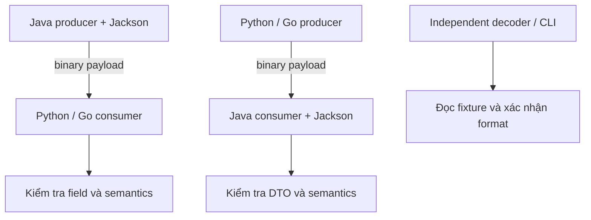

# Kiểm thử hợp đồng giữa các ngôn ngữ và công cụ khác nhau

Khi một hệ thống Java dùng Jackson để ghi dữ liệu nhị phân, file hoặc message tạo ra có thể được đọc bởi một service viết bằng Python, Go, JavaScript, Rust hay một công cụ phân tích dữ liệu. Việc Java đọc lại được chính output của Java chỉ chứng minh hai chiều serialize/deserialize trong cùng một stack tương thích với nhau. Nó chưa chứng minh các consumer khác hiểu cùng cấu trúc, kiểu dữ liệu, null, enum, timestamp và quy tắc version.

Để bảo đảm interoperability, cần kiểm thử **wire contract**: định dạng byte thực tế mà producer gửi và consumer nhận, cùng các quy tắc diễn giải dữ liệu ở mọi ngôn ngữ và công cụ tham gia hệ thống.

Trong hệ sinh thái Jackson, hai định dạng nhị phân thường gặp là **CBOR** và **Smile**. CBOR được chuẩn hóa trong RFC 8949 và có thư viện cho nhiều ngôn ngữ, nên phù hợp khi cần trao đổi dữ liệu với nhiều nền tảng. Smile là định dạng binary JSON được thiết kế cho Jackson; nó hữu ích trong hệ sinh thái hỗ trợ Smile, nhưng cần xác nhận thư viện và công cụ ở các ngôn ngữ khác trước khi chọn làm contract liên hệ thống.

Một bộ kiểm thử contract tốt không chỉ chạy `writeValueAsBytes()` rồi `readValue()` bằng cùng `ObjectMapper`. Nó cần fixture byte độc lập, consumer/decoder khác implementation, kiểm tra schema evolution, dữ liệu biên và cách xử lý message không hợp lệ.

## 1. Interoperability là gì?

Hai ứng dụng interoperable khi chúng hiểu cùng một wire format và diễn giải dữ liệu theo cùng contract. Có ít nhất bốn lớp cần kiểm tra:

1. **Encoding:** byte stream có đúng định dạng và framing mà consumer mong đợi không?
2. **Structure:** object, array, field name, tag, map key và nested value có được hiểu giống nhau không?
3. **Semantics:** null, field bị thiếu, số, enum, timestamp, binary data và Unicode có cùng ý nghĩa không?
4. **Evolution:** producer và consumer ở các version khác nhau có tiếp tục giao tiếp được không?

Ví dụ Java ghi một event:

```java
public class OrderCreated {
    private String eventId;
    private String orderId;
    private long createdAtEpochMillis;
    private String status;
    private BigDecimal total;
    private byte[] document;

    // Constructor, getter và setter
}
```

Một consumer Python có thể đọc cùng message thành dictionary. Nhưng nếu Java gửi `createdAtEpochMillis` theo milliseconds trong khi Python hiểu là seconds, cả hai bên đều parse thành công nhưng lại diễn giải sai thời gian. Đây là lỗi contract, không phải lỗi cú pháp.

Vì vậy, kiểm thử cross-language phải xác nhận cả byte format lẫn ý nghĩa từng field.

## 2. Chọn định dạng nhị phân có hệ sinh thái phù hợp

Jackson hỗ trợ nhiều data format thông qua các module riêng. Với trao đổi dữ liệu giữa nhiều ngôn ngữ, cần phân biệt định dạng self-describing với định dạng phụ thuộc schema/IDL.

| Định dạng | Đặc điểm | Khi cân nhắc |
|---|---|---|
| CBOR | Binary data model, có cấu trúc map/array/scalar/tag; được chuẩn hóa trong RFC 8949 | Khi cần binary representation và thư viện đa ngôn ngữ |
| Smile | Binary JSON do Jackson phát triển; có token và cấu trúc tương tự JSON nhưng ở dạng byte | Khi producer/consumer đều có implementation Smile tương thích, đặc biệt trong hệ Java/Jackson |
| Avro | Schema-based binary format, có writer/reader schema và quy tắc resolution | Khi hệ thống cần schema evolution và ecosystem Avro |
| Protocol Buffers | Schema/IDL và generated message types; binary wire format có quy tắc field number | Khi contract được quản lý bằng `.proto` và generated code ở nhiều ngôn ngữ |

CBOR và Smile có thể được dùng với `ObjectMapper` thông qua dataformat module. Avro và Protocol Buffers có schema compiler/runtime riêng; không nên giả định một `ObjectMapper` thông thường tự tạo ra byte stream Avro hoặc Protobuf tương thích.

### 2.1. CBOR thường phù hợp hơn khi consumer đa ngôn ngữ

CBOR có chuẩn công khai và implementation ở nhiều hệ sinh thái. Các công cụ độc lập có thể decode CBOR mà không cần chạy cùng Jackson version với producer.

CBOR hỗ trợ các kiểu dữ liệu như integer, floating point, byte string, text string, array, map, boolean, null và semantic tags. Những khả năng này phong phú hơn một số mô hình JSON đơn giản. Tuy nhiên, producer và consumer vẫn phải thống nhất cách sử dụng chúng. Ví dụ, một bên có thể gửi timestamp dưới dạng text ISO-8601 trong khi bên kia mong đợi epoch number hoặc CBOR tag.

### 2.2. Smile cần xác nhận khả năng hỗ trợ ở từng consumer

Smile tiết kiệm dung lượng và có thể serialize/deserialize hiệu quả trong các ứng dụng dùng Jackson. Nhưng không nên chọn Smile chỉ vì Java producer tạo được file.

Trước khi đưa Smile thành contract giữa các ngôn ngữ, hãy xác nhận:

- Mỗi ngôn ngữ consumer có thư viện Smile đang được bảo trì hay không.
- Thư viện đó hỗ trợ đúng phiên bản/tính năng Smile cần dùng hay không.
- Công cụ quan sát, replay, kiểm tra message và data pipeline có đọc được Smile hay không.
- Team vận hành có thể debug payload mà không phụ thuộc vào ứng dụng Java gốc hay không.

Nếu một consumer không có decoder đáng tin cậy, contract chưa đạt interoperability dù Java round-trip thành công.

## 3. Thiết lập Jackson CBOR mapper

Thêm module CBOR cùng version line với Jackson Core/Databind:

**Maven:**

```xml
<dependency>
    <groupId>com.fasterxml.jackson.dataformat</groupId>
    <artifactId>jackson-dataformat-cbor</artifactId>
    <version>${jackson.version}</version>
</dependency>
```

**Gradle:**

```groovy
implementation("com.fasterxml.jackson.dataformat:jackson-dataformat-cbor:${jacksonVersion}")
```

Tạo mapper:

```java
CBORFactory factory = new CBORFactory();
ObjectMapper cborMapper = new ObjectMapper(factory);
```

Serialize thành byte array:

```java
byte[] payload = cborMapper.writeValueAsBytes(event);
```

Deserialize:

```java
OrderCreated restored = cborMapper.readValue(payload, OrderCreated.class);
```

Đây là Java round-trip cơ bản. Nó hữu ích để kiểm tra mapper configuration và model, nhưng chưa phải cross-language contract test. Bước tiếp theo phải đưa chính `payload` này qua một decoder độc lập hoặc consumer viết bằng ngôn ngữ khác.

### 3.1. Dùng CBOR tree để quan sát cấu trúc

Có thể đọc CBOR thành `JsonNode`:

```java
JsonNode tree = cborMapper.readTree(payload);

assertEquals("ORD-100", tree.path("orderId").asText());
assertEquals("CREATED", tree.path("status").asText());
```

Tree model giúp test field và nested structure mà không cần bind ngay vào DTO. Tuy nhiên, `JsonNode` là mô hình cây của Jackson; nó không thể hiện mọi semantic tag hoặc chi tiết CBOR chuyên biệt. Với tag hoặc kiểu CBOR đặc biệt, cần kiểm tra bằng API/tool hiểu CBOR đầy đủ.

### 3.2. Byte string và dữ liệu nhị phân

Java `byte[]` thường được Jackson CBOR biểu diễn bằng CBOR byte string. Đây là một khác biệt đáng chú ý so với JSON, nơi byte array thường được biểu diễn thành Base64 text theo cấu hình Jackson.

Consumer khác phải biết field này là byte string, không phải UTF-8 text. Nếu contract yêu cầu Base64 string vì tương thích JSON, hãy encode thành string rõ ràng trước khi serialize. Đừng để mỗi ngôn ngữ tự đoán encoding của byte array.

## 4. Thiết lập Jackson Smile mapper

Thêm module Smile:

```xml
<dependency>
    <groupId>com.fasterxml.jackson.dataformat</groupId>
    <artifactId>jackson-dataformat-smile</artifactId>
    <version>${jackson.version}</version>
</dependency>
```

Tạo mapper:

```java
SmileFactory factory = new SmileFactory();
ObjectMapper smileMapper = new ObjectMapper(factory);
```

Serialize và deserialize:

```java
byte[] payload = smileMapper.writeValueAsBytes(event);

OrderCreated restored = smileMapper.readValue(payload, OrderCreated.class);
```

Smile là binary format, vì vậy không thể đọc trực tiếp bằng text editor như JSON. Khi debug, cần dùng Smile-aware decoder hoặc công cụ Java nhỏ để chuyển payload về JSON/tree có thể quan sát.

### 4.1. Không nhầm Smile với CBOR

Cả hai đều là binary data format có thể được dùng thông qua Jackson, nhưng byte stream của chúng không tương thích với nhau. Một CBOR decoder không thể đọc Smile payload và ngược lại.

Hãy ghi rõ format trong protocol, content type hoặc message metadata. Không nên dựa vào file extension hoặc việc consumer “thử đọc” nhiều decoder để đoán format.

### 4.2. Smile không phải JSON nén

Smile thay đổi representation thành binary token format; nó không đơn giản là JSON text được gzip. Không thể bỏ qua bước Smile decoding rồi đưa bytes vào JSON parser. Nếu cần compression, hãy định nghĩa thêm compression layer và thứ tự giải nén/giải mã rõ ràng.

## 5. Wire contract cần định nghĩa những gì?

Một binary message contract nên ghi rõ ít nhất các mục sau:

| Hạng mục | Ví dụ contract |
|---|---|
| Format | CBOR hoặc Smile; không suy đoán từ payload |
| Format version | Version/feature set được các bên hỗ trợ |
| Framing | Một message mỗi body, length-prefix, record framing hoặc container cụ thể |
| Root type | Map/object, array hay scalar |
| Field names | `orderId`, `createdAtEpochMillis`, `status` |
| Field presence | Required, optional, default, absent và null khác nhau thế nào |
| Numeric semantics | Integer width/range, decimal precision, float policy |
| Enum representation | Stable string identifier, không phụ thuộc ordinal |
| Time semantics | ISO-8601 UTC, epoch seconds hay epoch milliseconds |
| Binary fields | Byte string, Base64 hoặc encoding khác |
| Unknown fields | Reject, ignore hay preserve extension fields |
| Evolution | Quy tắc thêm, đổi tên, bỏ field và enum value |
| Limits | Message size, string length, nesting depth, collection count |
| Error handling | Decode failure, unsupported version, invalid field |

Nếu không có schema file riêng, contract vẫn cần tài liệu hoặc test fixture có thể thực thi. “Đây là một object Java” chưa đủ để các ngôn ngữ khác biết cách giải mã.

## 6. Kiểm thử bằng fixture nhị phân độc lập

Golden fixture là các payload byte được lưu trong repository, ví dụ:

```text
src/test/resources/contracts/cbor/order-created-v1.cbor
src/test/resources/contracts/cbor/order-created-v2.cbor
src/test/resources/contracts/smile/order-created-v1.smile
```

Fixture nên được tạo từ một nguồn độc lập với test đang xác minh. Ví dụ:

- CBOR fixture được tạo bởi Python `cbor2` hoặc một tool CBOR độc lập.
- Java test đọc fixture và deserialize thành DTO.
- Java producer tạo payload; một consumer Python/Go test đọc payload đó.
- Consumer khác tạo fixture; Java test đọc fixture đó.

Nếu fixture luôn được tạo bằng đúng `ObjectMapper` và đúng serializer đang test, lỗi tương thích có thể bị che giấu vì producer và consumer cùng chia sẻ một giả định sai.

### 6.1. Lưu fixture dưới dạng binary resource

Đọc fixture từ classpath:

```java
byte[] fixture;
try (InputStream input = getClass().getResourceAsStream(
        "/contracts/cbor/order-created-v1.cbor")) {
    if (input == null) {
        throw new IllegalStateException("Missing CBOR fixture");
    }
    fixture = input.readAllBytes();
}

OrderCreated event = cborMapper.readValue(fixture, OrderCreated.class);
```

Kiểm tra semantics:

```java
assertEquals("evt-100", event.getEventId());
assertEquals("ORD-100", event.getOrderId());
assertEquals("CREATED", event.getStatus());
assertEquals(1_798_000_000_000L, event.getCreatedAtEpochMillis());
```

Fixture nên có README hoặc metadata đi kèm ghi rõ:

- Ai tạo fixture và bằng tool/version nào.
- Format và version contract.
- Schema/event version.
- Giá trị mong đợi sau decode.
- Những edge case fixture đại diện.

### 6.2. Không mặc định so sánh byte array chính xác

Hai encoder có thể tạo ra byte stream khác nhau nhưng biểu diễn cùng dữ liệu, do map ordering, lựa chọn integer encoding, floating-point representation hoặc tùy chọn encoder. Nếu contract không yêu cầu canonical byte representation, test nên decode và so sánh semantics thay vì assert toàn bộ byte array giống hệt.

Nếu chữ ký số, content-addressed storage hoặc deduplication yêu cầu byte ổn định, cần chọn canonical encoding profile và test chính xác quy tắc canonicalization. Chỉ khi contract quy định deterministic/canonical bytes mới nên dùng golden byte-for-byte như assertion chính.

## 7. Kiểm thử hai chiều giữa producer và consumer

Một test interoperability nên bao phủ cả hai chiều:



Chiều Java → Python chỉ kiểm tra producer Java có tạo payload mà Python hiểu được. Chiều Python → Java kiểm tra Java consumer có đọc đúng payload do implementation khác tạo ra. Cả hai đều cần thiết vì một implementation có thể ghi đúng nhưng đọc sai hoặc ngược lại.

### 7.1. Ví dụ consumer Python với CBOR

Một consumer Python có thể dùng thư viện `cbor2` để decode CBOR:

```python
import cbor2

with open("order-created-v1.cbor", "rb") as source:
    event = cbor2.load(source)

assert event["eventId"] == "evt-100"
assert event["orderId"] == "ORD-100"
assert event["status"] == "CREATED"
```

Ví dụ này giả định Java producer ghi các field thành CBOR map với text keys. Nếu contract dùng integer map keys, tags hoặc byte strings, Python test phải kiểm tra đúng kiểu tương ứng.

### 7.2. Tạo fixture CBOR từ Python để Java đọc

```python
import cbor2

event = {
    "eventId": "evt-200",
    "orderId": "ORD-200",
    "createdAtEpochMillis": 1798000000000,
    "status": "CREATED",
    "total": "125.50",
}

with open("order-created-python.cbor", "wb") as target:
    cbor2.dump(event, target)
```

Java test đọc file này bằng `CBORFactory`/`ObjectMapper` rồi xác nhận các giá trị. Nếu `total` trong contract là decimal string, Java DTO nên nhận String hoặc custom conversion phù hợp. Nếu contract dùng CBOR decimal fraction tag, cả hai phía phải hỗ trợ tag đó một cách nhất quán.

### 7.3. Độc lập implementation quan trọng hơn độc lập ngôn ngữ

Hai ứng dụng viết bằng hai ngôn ngữ khác nhau nhưng dùng chung một thư viện C wrapper hoặc cùng một encoder bug vẫn có thể chia sẻ cùng lỗi. Khi rủi ro cao, dùng decoder độc lập thứ ba hoặc test vectors từ tiêu chuẩn/nhà cung cấp để xác minh wire format.

## 8. Kiểm thử Smile bằng consumer/tool khác

Với Smile, test đầu tiên là xác nhận tất cả consumer cần thiết có implementation đọc được format. Sau đó dùng fixture độc lập tương tự CBOR:

1. Java producer ghi một Smile fixture.
2. Decoder Smile khác implementation đọc fixture và kiểm tra cấu trúc.
3. Consumer ngoài tạo Smile fixture nếu thư viện của nó hỗ trợ.
4. Java `SmileFactory` đọc fixture và kiểm tra DTO.
5. Kiểm tra version header/feature nếu contract dựa vào các tính năng Smile cụ thể.

Nếu không có decoder khác implementation được duy trì, có thể tạo integration test bằng tool/SDK chính thức của consumer thực tế. Không nên gọi một test Java-to-Java là cross-language verification.

Nếu consumer đa ngôn ngữ là yêu cầu cứng nhưng Smile không có toolchain phù hợp, cân nhắc CBOR hoặc một schema-based format có code generator/runtime ở các ngôn ngữ cần hỗ trợ.

## 9. So sánh semantics thay vì chỉ so sánh JSON text

Một cách hữu ích là dùng JSON tree làm mô hình kiểm tra logic chung, nhưng phải hiểu giới hạn của nó.

Ví dụ:

```java
JsonNode expected = jsonMapper.readTree(expectedJson);
JsonNode actual = cborMapper.readTree(cborBytes);

assertEquals(expected.path("orderId").asText(),
             actual.path("orderId").asText());
assertEquals(expected.path("status").asText(),
             actual.path("status").asText());
```

Đây là cách so sánh field cụ thể. Với số, null, byte string, tags và kiểu thời gian, hãy assert type/value rõ ràng thay vì chỉ gọi `asText()` hoặc chuyển mọi thứ thành String.

Ví dụ kiểm tra null khác với missing:

```java
assertTrue(actual.has("comment"));
assertTrue(actual.get("comment").isNull());
```

Hai assertion này khác với:

```java
assertFalse(actual.has("comment"));
```

Trong một số binary formats, semantic tags hoặc native binary types không được thể hiện đầy đủ trong JSON tree. Khi chúng thuộc contract, cần test bằng API format-specific hoặc decoder độc lập.

## 10. Định nghĩa schema và version của message

Ngay cả format self-describing như CBOR, message vẫn cần một contract version. Có thể đưa version vào payload:

```json
{
  "schemaVersion": 2,
  "eventType": "OrderCreated",
  "eventId": "evt-100",
  "orderId": "ORD-100"
}
```

Hoặc truyền version qua message header/envelope của transport. Cần chọn một nguồn sự thật và bảo đảm consumer luôn biết version nào đang đọc.

### 10.1. Version trong payload hay transport metadata?

Version trong payload giúp file/message tự mô tả khi được lưu trữ hoặc replay độc lập. Version ở transport header giúp broker/router định tuyến mà không cần decode body. Một số hệ thống dùng cả hai để hỗ trợ routing và audit.

Nếu version chỉ tồn tại trong một registry bên ngoài, fixture lưu lâu dài cần lưu kèm schema ID/version để có thể giải mã lại sau này.

### 10.2. Contract phải có owner

Một schema không có owner hoặc quy trình thay đổi sẽ nhanh chóng lệch giữa producer và consumer. Nên xác định:

- Team sở hữu contract.
- Cách đề xuất thay đổi field/enum.
- Quy tắc tương thích ngược/tiến.
- Versioning policy.
- Thời gian consumer cũ được hỗ trợ.
- Cách cập nhật fixture và consumer contract tests.

## 11. Kiểm thử schema evolution

Giả sử version 1 có:

```java
public class OrderCreatedV1 {
    private String eventId;
    private String orderId;
    private String status;
}
```

Version 2 bổ sung field:

```java
public class OrderCreatedV2 {
    private String eventId;
    private String orderId;
    private String status;
    private String source;
}
```

Các tình huống cần test:

| Writer | Reader | Câu hỏi |
|---|---|---|
| V1 | V1 | Baseline có hoạt động không? |
| V2 | V2 | Version mới có hoạt động không? |
| V1 | V2 | Reader mới xử lý field thiếu/default thế nào? |
| V2 | V1 | Reader cũ xử lý field mới ra sao? |

Với Jackson POJO thông thường, reader cũ có thể fail khi gặp field mới nếu `FAIL_ON_UNKNOWN_PROPERTIES` đang bật. Nếu contract yêu cầu forward compatibility, có thể cấu hình ignore/capture unknown properties có chủ đích:

```java
@JsonIgnoreProperties(ignoreUnknown = true)
public class OrderCreatedV1 {
    private String eventId;
    private String orderId;
    private String status;
}
```

Hoặc dùng `@JsonAnySetter` nếu cần giữ extension fields. Không nên tắt unknown-property failure toàn hệ thống mà không đánh giá ảnh hưởng; một field gõ sai cũng có thể bị bỏ qua.

### 11.1. Thêm field mới

Thêm field optional thường ít rủi ro hơn field required. Nhưng reader mới phải có default rõ khi đọc message cũ:

```java
public class OrderCreatedV2 {
    private String source = "legacy";
}
```

Giá trị khởi tạo có thể được giữ khi field vắng mặt trong một số kiểu binding; constructor/creator, setter, null và mapper configuration có thể làm thay đổi behavior. Hãy kiểm thử fixture V1 với reader V2 thay vì dựa vào giả định.

### 11.2. Đổi tên field

Đổi tên field có thể làm consumer cũ hoặc mới không nhận diện property. Một chiến lược migration là reader mới tạm chấp nhận cả tên cũ và mới:

```java
public class OrderCreatedV2 {
    @JsonAlias("order_number")
    private String orderId;
}
```

`@JsonAlias` hỗ trợ tên thay thế khi deserialize; khi serialize, tên property chính vẫn được dùng theo cấu hình. Hãy xác nhận alias hoạt động với Jackson version và dataformat module đang sử dụng.

### 11.3. Xóa field

Khi bỏ field, cần biết consumer cũ có còn cần nó hay không và dữ liệu lịch sử có được replay không. Nếu event đã lưu lâu dài, giữ reader tương thích hoặc versioned DTO/migration path để có thể đọc message cũ.

### 11.4. Enum evolution

Không nên serialize enum theo ordinal. Thứ tự constant có thể thay đổi giữa phiên bản Java, gây hiểu sai dữ liệu. Dùng string identifier ổn định:

```java
public enum OrderStatus {
    CREATED,
    PAID,
    CANCELLED,
    @JsonEnumDefaultValue UNKNOWN
}
```

Consumer cũ cần chính sách khi gặp enum mới: từ chối, map về `UNKNOWN`, giữ raw string hoặc chuyển message vào dead-letter flow. `UNKNOWN` chỉ an toàn khi nghiệp vụ có thể tiếp tục mà không cần biết trạng thái thật.

### 11.5. Numeric evolution

Không đổi một field từ integer sang decimal hoặc từ milliseconds sang seconds mà không version hóa semantics. Cả hai representation có thể parse thành số hợp lệ nhưng có ý nghĩa khác.

Hãy ghi rõ:

- Unit của số đo.
- Signed/unsigned range nếu format/consumer có khác biệt.
- Precision/scale với tiền và decimal.
- Có chấp nhận exponent notation không.
- Overflow được từ chối hay xử lý thế nào.

## 12. Những trường hợp biên cần có trong contract tests

Một bộ test cross-language nên có fixture cho:

- Field bắt buộc đầy đủ.
- Optional field bị thiếu.
- Field hiện diện với null.
- Chuỗi rỗng và chuỗi chỉ có whitespace.
- Unicode ngoài ASCII, emoji và ký tự kết hợp dấu.
- Integer nhỏ, integer gần giới hạn, số âm nếu được phép.
- Decimal có precision/scale đáng kể.
- Boolean true/false.
- Array rỗng, một phần tử và nhiều phần tử.
- Object lồng nhau.
- Map có key Unicode hoặc key đặc biệt nếu được hỗ trợ.
- Byte string và dữ liệu binary rỗng/lớn.
- Timestamp ở biên timezone và epoch unit.
- Enum value không biết.
- Unknown field.
- Payload bị cắt cụt hoặc hỏng.
- Message vượt giới hạn size/depth/token.

Không cần mọi event type có toàn bộ fixture nếu contract chung đã có test format. Nhưng các field semantics quan trọng của từng message cần được kiểm tra ít nhất một lần ở mỗi chiều producer/consumer.

## 13. Timestamp, timezone và precision

Timestamp là nguồn lỗi cross-language phổ biến vì Java, Python, JavaScript và database có các API/thói quen khác nhau.

Không ghi một số thời gian mà không định nghĩa unit. Ví dụ:

```java
private long createdAtEpochMillis;
```

Tên property gợi ý milliseconds, nhưng contract nên ghi rõ epoch milliseconds UTC. Nếu consumer hiểu thành epoch seconds, kết quả lệch một nghìn lần.

Với timestamp dạng string, chọn format tường minh như ISO-8601 với offset/UTC:

```text
2026-11-12T10:30:00Z
```

Test:

- UTC `Z`.
- Offset khác UTC.
- Fractional seconds.
- Timestamp trước/sau epoch nếu hợp lệ.
- Leap second policy nếu hệ thống có yêu cầu đặc biệt.
- Precision được giữ hoặc làm tròn như thế nào.

CBOR có semantic tags liên quan đến date/time, nhưng không phải mọi thư viện đều biểu diễn chúng thành cùng kiểu host language. Nếu dùng tag, ghi rõ tag và representation mong đợi trong contract, rồi kiểm tra decoder của từng ngôn ngữ.

## 14. Decimal, floating point và tiền tệ

Không dùng binary floating point (`float`/`double`) cho giá trị tiền cần decimal precision chính xác nếu contract yêu cầu scale cố định.

Các lựa chọn cần thống nhất:

- Integer minor units, ví dụ số cent.
- Decimal text với scale rõ ràng.
- Decimal type/tag được định nghĩa trong binary format.
- Một cấu trúc gồm amount và currency.

Ví dụ contract dễ tương thích:

```json
{
  "amountMinor": 12550,
  "currency": "USD"
}
```

Nếu dùng decimal string:

```json
{
  "amount": "125.50",
  "currency": "USD"
}
```

Không để một consumer parse thành float rồi làm tròn còn consumer khác giữ decimal chính xác. Golden fixture nên bao gồm các giá trị có nhiều chữ số thập phân và trường hợp rounding.

## 15. Null, absent và default values

Trong một contract, ba trạng thái này có thể mang ý nghĩa khác nhau:

- **Absent:** field không xuất hiện trong payload.
- **Null:** field xuất hiện với giá trị null.
- **Default:** consumer gán giá trị mặc định khi field absent hoặc null theo quy tắc đã định.

Ví dụ trong message cập nhật:

```json
{}
```

có thể có nghĩa “không thay đổi comment”, trong khi:

```json
{"comment": null}
```

có thể có nghĩa “xóa comment”. Nếu consumer chuyển cả hai thành Java `null`, thông tin presence bị mất.

Khi semantics quan trọng, dùng wrapper/presence marker hoặc DTO patch chuyên biệt. Đưa cả hai trường hợp vào binary fixture và kiểm tra consumer ở mọi ngôn ngữ.

## 16. Framing và message boundaries

Một binary encoder có thể tạo một CBOR/Smile document, nhưng khi truyền qua TCP, file stream hoặc broker, consumer vẫn cần biết ranh giới message.

Contract cần xác định:

- Mỗi transport message chứa đúng một binary document hay nhiều document nối tiếp?
- Có length prefix hay envelope không?
- Nếu stream bị cắt giữa payload, consumer phát hiện lỗi thế nào?
- Có checksum, compression hoặc encryption layer không?
- Thứ tự decode/verify/decompress là gì?
- Content-Type hoặc message header nào xác định format?

Không nên nối nhiều binary payload vào cùng stream rồi giả định mọi decoder sẽ tự tìm đúng ranh giới. Dùng framing rõ ràng như broker message boundary, length prefix hoặc container format đã quy định.

### 16.1. Content type và format identifier

Ở HTTP, dùng content type/contract header được thống nhất. Với message broker, có thể dùng header như:

```text
content-type: application/cbor
schema-version: 2
event-type: OrderCreated
```

Tên content type cụ thể phải theo hệ thống/registry đã chọn. Đừng tự tạo identifier rồi mong mọi tool hiểu nó.

### 16.2. Compression là lớp riêng

Nếu payload được gzip/zstd trước khi truyền, contract cần ghi rõ compression algorithm và thứ tự xử lý. Consumer phải giải nén trước khi decode CBOR/Smile. Đặt giới hạn cả compressed size lẫn decompressed size để tránh payload nén nhỏ nhưng giải nén rất lớn.

## 17. Dùng tool độc lập để debug binary payload

Một contract test cần công cụ quan sát ngoài producer gốc.

Với CBOR:

- Dùng thư viện CBOR của ngôn ngữ consumer để decode.
- Dùng tool có hỗ trợ CBOR diagnostic notation để quan sát structure.
- Giữ raw `.cbor` fixture cùng expected semantic JSON/description.
- Dùng hex dump chỉ để điều tra byte-level khi cần; không đọc thủ công thay cho decoder.

Với Smile:

- Dùng decoder Smile tương thích với phiên bản producer.
- Nếu ecosystem không có CLI, tạo một utility độc lập nhỏ dùng Smile implementation đã chọn.
- Kiểm tra payload trong pipeline CI bằng consumer thật thay vì chỉ một helper dùng chung mapper.

JSON diagnostic representation là cách trình bày thuận tiện, nhưng có thể làm mất chi tiết như CBOR tags hoặc binary-specific values. Khi contract dùng các tính năng đó, lưu expected representation riêng.

## 18. Negative contract tests

Không chỉ kiểm tra message hợp lệ. Consumer phải xử lý input lỗi một cách có dự đoán:

- Payload không đúng format (ví dụ đưa Smile bytes vào CBOR decoder).
- Payload bị truncate.
- Header/version không hỗ trợ.
- Required field bị thiếu.
- Field có sai kiểu.
- Enum value không biết.
- Integer vượt range.
- Nested structure vượt giới hạn.
- Message có trailing bytes ngoài framing cho phép.
- Compression flag không khớp với body.

Kết quả mong đợi có thể là reject, dead-letter, retry theo chính sách hoặc chuyển sang versioned handler. Không nên âm thầm deserialize thành object mặc định rồi tiếp tục xử lý giao dịch.

## 19. Tổ chức test suite trong repository

Một cấu trúc có thể dùng:

```text
src/test/
  java/
    contracts/
      CborProducerContractTest.java
      CborConsumerContractTest.java
      SmileContractTest.java
      SchemaEvolutionTest.java
  resources/
    contracts/
      cbor/
        order-created-v1.cbor
        order-created-v2.cbor
        invalid-truncated.cbor
      smile/
        order-created-v1.smile
      expected/
        order-created-v1.json
        order-created-v2.json
      README.md
```

`README.md` của fixtures nên ghi rõ nguồn tạo, tool/version, contract version và cách regenerate. Không tự động regenerate golden fixtures mỗi lần test chạy; điều đó sẽ làm test cập nhật expected output theo implementation đang được kiểm tra và mất khả năng phát hiện breaking change.

### 19.1. CI matrix

Với nhiều consumer, chạy contract tests theo ma trận:

| Producer | Consumer | Kiểm tra |
|---|---|---|
| Java/Jackson CBOR | Python CBOR library | Java bytes decode đúng semantics |
| Python CBOR library | Java/Jackson CBOR | Java đọc được fixture độc lập |
| Java/Jackson CBOR | Go/Rust consumer | Consumer thực tế đọc được payload |
| Java/Jackson Smile | Smile consumer/tool | Smile implementation tương thích |
| V1 producer | V2 consumer | Backward compatibility |
| V2 producer | V1 consumer | Forward compatibility hoặc reject có chủ đích |

Nếu consumer nằm ở repository khác, có thể publish fixture package hoặc chạy consumer contract test qua CI pipeline liên kết. Bảo đảm fixture version được pin để test có thể tái lập.

## 20. Kiểm tra schema-based formats riêng biệt

Nếu hệ thống cần schema evolution mạnh, cân nhắc Avro hoặc Protocol Buffers. Các định dạng này có schema/IDL và quy tắc compatibility riêng.

Với Avro:

- Kiểm thử writer schema và reader schema resolution.
- Test field default, field thêm/bỏ và union/null.
- Giữ schema ID/version đi kèm payload nếu dùng schema registry.
- Dùng Avro runtime/tooling chính thức để tạo fixture và decode.

Với Protocol Buffers:

- Dùng field number ổn định; không tái sử dụng field number đã xóa.
- Đánh dấu field đã xóa bằng `reserved` theo quy tắc Protobuf.
- Test old/new generated code đọc payload của nhau.
- Kiểm tra unknown fields và semantics của scalar/default/presence theo syntax/version.

Jackson vẫn có thể được dùng để chuyển dữ liệu Java sang JSON hoặc `JsonNode` ở ranh giới ứng dụng, nhưng codec/schema contract của Avro/Protobuf nên do runtime tương ứng quản lý. Không serialize POJO thành CBOR rồi gọi đó là Avro/Protobuf chỉ vì cả hai đều là binary.

## 21. Security và giới hạn tài nguyên

Binary không có nghĩa payload an toàn hoặc nhỏ. Một payload hợp lệ có thể chứa string lớn, map nhiều entry, array lớn hoặc nesting sâu.

Với Jackson, cấu hình parser constraints trên factory thực sự được dùng:

```java
StreamReadConstraints constraints = StreamReadConstraints.builder()
    .maxNestingDepth(100)
    .maxStringLength(1_000_000)
    .maxNumberLength(128)
    .build();

CBORFactory factory = CBORFactory.builder()
    .streamReadConstraints(constraints)
    .build();

ObjectMapper cborMapper = new ObjectMapper(factory);
```

API giới hạn có thể khác theo Jackson Core version; ví dụ trên cần version hỗ trợ các builder methods tương ứng. Ngoài parser constraints, giới hạn tổng message size, decompressed size, số record và thời gian xử lý ở transport/application.

Không bật polymorphic default typing rộng cho payload không tin cậy chỉ để tăng tiện lợi. Dùng type allowlist và contract discriminator ổn định khi cần polymorphism.

## 22. Những lỗi thường gặp

**Chỉ test Java serialize rồi Java deserialize.** Hai phía dùng chung implementation có thể cùng hiểu sai contract. Thêm fixture độc lập và consumer/tool khác.

**Cho rằng mọi binary JSON format tương thích với nhau.** CBOR, Smile và các format khác có wire encoding riêng. Xác định format rõ trong protocol.

**Chọn Smile mà không kiểm tra decoder của consumer khác ngôn ngữ.** Tạo được byte stream không chứng minh consumer có thể đọc. Xác nhận toolchain trước khi chốt contract.

**So sánh byte array chính xác trong khi encoder không canonical.** Byte khác nhau có thể mang cùng semantics. So sánh sau decode, trừ khi canonical bytes là một phần contract.

**Dùng JSON tree làm bằng chứng cho mọi CBOR feature.** Tree có thể không giữ CBOR tags hoặc binary-specific semantics. Test format-specific value bằng decoder/API tương ứng.

**Không định nghĩa null, absent và default.** Các ngôn ngữ có thể ánh xạ chúng khác nhau. Đưa từng trạng thái vào fixture và assertion.

**Dùng enum ordinal.** Thứ tự constant thay đổi có thể làm dữ liệu cũ bị diễn giải sai. Dùng string ID ổn định hoặc field number theo schema format.

**Không ghi rõ timestamp unit.** Seconds và milliseconds đều là số hợp lệ nhưng khác ý nghĩa. Định nghĩa UTC, epoch unit và precision.

**Không quản lý framing.** Nối các binary document không có boundary có thể làm consumer đọc sai message. Dùng transport boundary hoặc length prefix rõ ràng.

**Regenerate fixture tự động bằng code đang test.** Golden test mất độc lập. Chỉ cập nhật fixture qua review có chủ đích và ghi nguồn tạo.

**Cho rằng Jackson POJO mapping tự tương thích Avro/Protobuf.** Hai định dạng có codec/schema riêng. Dùng runtime và contract tooling chính thức của chúng.

## 23. Quy trình triển khai contract test

1. Xác định các producer, consumer, ngôn ngữ và tool cần hỗ trợ.
2. Chọn format có decoder/runtime phù hợp ở tất cả hệ thống; ưu tiên chuẩn đa ngôn ngữ nếu cần interoperability rộng.
3. Định nghĩa wire contract: field, kiểu, presence, null, enum, timestamp, numeric precision, binary data và framing.
4. Ghi format/version/schema identifier vào payload hoặc transport metadata.
5. Tạo fixture bằng implementation độc lập và lưu trong repository/package có version.
6. Test Java producer → consumer khác ngôn ngữ.
7. Test producer khác ngôn ngữ → Java/Jackson consumer.
8. Dùng decoder/tool độc lập để kiểm tra cấu trúc và debug fixture.
9. Test V1/V2 compatibility theo cả hai chiều.
10. Test Unicode, null/absent, number boundary, byte string, timestamp, enum mới và payload lỗi.
11. Chỉ assert byte-for-byte khi contract yêu cầu canonical/deterministic encoding.
12. Chạy contract matrix trong CI và review mọi thay đổi fixture/schema.
13. Giới hạn message size, parser depth/token và compression expansion.
14. Giữ consumer cũ trong thời gian migration và xác định cách xử lý message version không hỗ trợ.

## Kết luận

Kiểm thử hợp đồng giữa các ngôn ngữ cần xác nhận wire bytes, cấu trúc và semantics bằng implementation độc lập. Với Jackson, CBOR phù hợp khi cần chuẩn nhị phân có hệ sinh thái đa ngôn ngữ; Smile chỉ nên chọn khi mọi consumer và tool cần thiết có decoder tương thích. Hãy kết hợp Java round-trip với golden binary fixtures, test hai chiều producer/consumer, decoder độc lập, schema evolution matrix và các trường hợp biên như null, absent, enum, timestamp, decimal, byte string, framing và payload hỏng. Không mặc định byte array phải giống nhau nếu format không yêu cầu canonical encoding; hãy so sánh semantics sau decode. Contract cần được version hóa, có owner, có test chạy trong CI và có giới hạn tài nguyên cho dữ liệu không tin cậy.

## Tài liệu tham khảo

- [RFC 8949 — Concise Binary Object Representation (CBOR)](https://www.rfc-editor.org/rfc/rfc8949) — định nghĩa CBOR data model, encoding, tags và diagnostic notation.
- [Jackson Dataformats](https://github.com/FasterXML/jackson-dataformats-binary) — các module binary dataformat của Jackson, bao gồm CBOR và Smile.
- [Jackson CBOR module](https://github.com/FasterXML/jackson-dataformats-binary/tree/2.x/cbor) — cấu hình và cách sử dụng CBOR với Jackson.
- [Jackson Smile module](https://github.com/FasterXML/jackson-dataformats-binary/tree/2.x/smile) — cách sử dụng Smile và đặc điểm format.
- [Apache Avro Specification](https://avro.apache.org/docs/) — schema resolution và binary encoding của Avro.
- [Protocol Buffers Documentation](https://protobuf.dev/) — schema/IDL, wire format và quy tắc tương thích của Protobuf.
