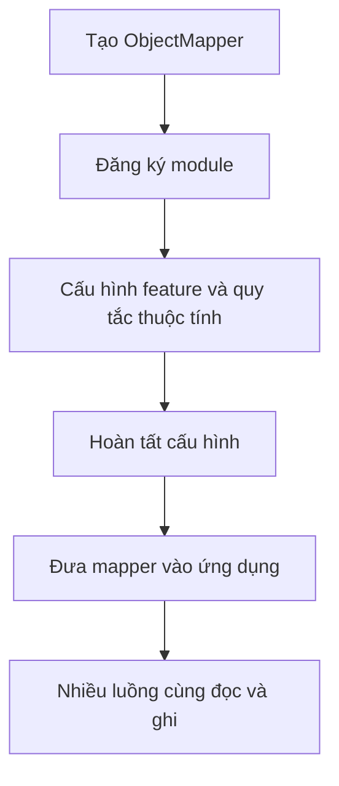

# Cấu hình một lần trước khi dùng chung trong ứng dụng

`ObjectMapper` là điểm vào chính của Jackson Databind. Ứng dụng dùng nó để chuyển đối tượng Java thành JSON và đọc JSON thành kiểu Java. Trong một ứng dụng Spring Boot hoặc một ứng dụng Java có nhiều luồng xử lý request, cùng một mapper thường được nhiều thành phần sử dụng. Vì vậy, cách tạo và cấu hình `ObjectMapper` ảnh hưởng trực tiếp đến tính nhất quán, hiệu năng và độ an toàn khi chạy đồng thời.

Nguyên tắc quan trọng là **hoàn tất cấu hình `ObjectMapper` trước khi thực hiện lần đọc hoặc ghi đầu tiên, sau đó dùng chung mapper đã cấu hình**. `ObjectMapper` được thiết kế để dùng đồng thời khi cấu hình của nó không còn bị thay đổi. Nếu cần một biến thể quy tắc cho một thao tác riêng, hãy dùng `ObjectReader` hoặc `ObjectWriter` thay vì thay đổi mapper dùng chung.

## 1. Vì sao nên cấu hình một lần?

Một `ObjectMapper` không chỉ là hàm chuyển đổi JSON. Nó giữ các cấu hình và thành phần hỗ trợ ánh xạ như:

- Quy tắc nhận diện thuộc tính Java, tên field JSON và cách truy cập field/getter/setter.
- Các feature quyết định cách ghi hoặc đọc giá trị.
- Các module mở rộng cho kiểu dữ liệu như ngày giờ Java.
- Serializer và deserializer tùy chỉnh.
- Các bộ đệm và cache phục vụ việc tìm, xây dựng và tái sử dụng serializer/deserializer.

Khi mapper được dùng lần đầu, Jackson có thể xây dựng và cache các thành phần ánh xạ dựa trên cấu hình hiện tại. Nếu ứng dụng tiếp tục thay đổi cấu hình trong lúc các luồng khác đang sử dụng mapper, các thao tác có thể quan sát những chính sách khác nhau hoặc tạo ra hành vi khó dự đoán.

Ví dụ về vòng đời nên áp dụng:



`ObjectMapper` an toàn khi dùng đồng thời nếu toàn bộ cấu hình được thực hiện trước khi bắt đầu các thao tác đọc/ghi. Sau thời điểm đó, hãy xem mapper như một thành phần cấu hình bất biến trong vòng đời ứng dụng.

## 2. Cấu hình `ObjectMapper` trong ứng dụng Java thuần

Với Jackson 2, có thể tạo mapper, đăng ký module và thiết lập các feature trước khi trả mapper cho phần còn lại của ứng dụng.

```java
import com.fasterxml.jackson.annotation.JsonInclude;
import com.fasterxml.jackson.databind.DeserializationFeature;
import com.fasterxml.jackson.databind.ObjectMapper;
import com.fasterxml.jackson.databind.PropertyNamingStrategies;
import com.fasterxml.jackson.databind.SerializationFeature;
import com.fasterxml.jackson.datatype.jsr310.JavaTimeModule;

public final class JacksonConfiguration {
    private JacksonConfiguration() {
    }

    public static ObjectMapper createMapper() {
        ObjectMapper mapper = new ObjectMapper();

        // Đăng ký module trước khi mapper được sử dụng.
        mapper.registerModule(new JavaTimeModule());

        // Quy tắc đặt tên và đưa thuộc tính vào JSON.
        mapper.setPropertyNamingStrategy(PropertyNamingStrategies.SNAKE_CASE);
        mapper.setSerializationInclusion(JsonInclude.Include.NON_NULL);

        // Quy tắc ghi/đọc JSON.
        mapper.disable(SerializationFeature.WRITE_DATES_AS_TIMESTAMPS);
        mapper.disable(DeserializationFeature.FAIL_ON_UNKNOWN_PROPERTIES);

        return mapper;
    }
}
```

Ví dụ trên cần dependency `jackson-datatype-jsr310` tương thích với phiên bản Jackson đang dùng để có `JavaTimeModule`. Các dependency Jackson nên được quản lý cùng một phiên bản, thường thông qua BOM của Jackson hoặc dependency management của Spring Boot.

Các cấu hình trong ví dụ có ý nghĩa như sau:

| Cấu hình | Tác dụng |
|---|---|
| `registerModule(new JavaTimeModule())` | Bổ sung hỗ trợ cho các kiểu ngày giờ thuộc Java Time API như `LocalDate`, `LocalDateTime` và `Instant`. |
| `SNAKE_CASE` | Ánh xạ tên thuộc tính Java như `createdAt` thành tên JSON `created_at`. |
| `NON_NULL` | Không ghi các thuộc tính có giá trị `null` trong quá trình tuần tự hóa thông thường. |
| Tắt `WRITE_DATES_AS_TIMESTAMPS` | Ghi ngày giờ theo dạng chuỗi phù hợp với serializer của module thay vì dạng timestamp/array. |
| Tắt `FAIL_ON_UNKNOWN_PROPERTIES` | Bỏ qua thuộc tính JSON không có thuộc tính tương ứng trong kiểu đích, thay vì báo lỗi. |

Đây là một chính sách minh họa, không phải bộ cấu hình bắt buộc cho mọi ứng dụng. Ví dụ, một API có hợp đồng chặt chẽ có thể muốn giữ `FAIL_ON_UNKNOWN_PROPERTIES` để phát hiện sớm dữ liệu sai phiên bản. Một hệ thống cần phân biệt rõ `null` với thuộc tính bị bỏ qua cũng cần chọn inclusion phù hợp.

### 2.1. Dùng mapper đã cấu hình

Sau khi tạo xong, mapper có thể được lưu trong một đối tượng cấu hình hoặc thành phần dùng chung:

```java
import com.fasterxml.jackson.databind.ObjectMapper;

public final class UserJsonService {
    private final ObjectMapper objectMapper;

    public UserJsonService(ObjectMapper objectMapper) {
        this.objectMapper = objectMapper;
    }

    public String toJson(User user) throws Exception {
        return objectMapper.writeValueAsString(user);
    }

    public User fromJson(String json) throws Exception {
        return objectMapper.readValue(json, User.class);
    }
}
```

`UserJsonService` không tạo mapper trong từng phương thức. Nó nhận mapper đã được cấu hình từ bên ngoài, nhờ đó toàn ứng dụng sử dụng cùng một chính sách ánh xạ.

## 3. Dùng chung `ObjectMapper` trong nhiều luồng

Trong một server, nhiều request có thể được xử lý đồng thời. Nếu mỗi request đều tạo `ObjectMapper` mới, ứng dụng sẽ lặp lại việc xây dựng cấu hình và các thành phần ánh xạ. Điều này tiêu tốn thêm bộ nhớ và thời gian khởi tạo, đồng thời làm các quy tắc JSON dễ bị phân tán giữa nhiều nơi.

Thông thường, một mapper được cấu hình hoàn chỉnh có thể được chia sẻ như một singleton:

```java
import com.fasterxml.jackson.databind.ObjectMapper;

public final class ApplicationJson {
    private static final ObjectMapper MAPPER =
            JacksonConfiguration.createMapper();

    private ApplicationJson() {
    }

    public static ObjectMapper mapper() {
        return MAPPER;
    }
}
```

Các luồng có thể đồng thời gọi `writeValueAsString()` hoặc `readValue()` trên cùng mapper. Điều kiện là không có luồng nào tiếp tục thay đổi cấu hình mapper sau khi nó đã được đưa vào sử dụng.

### 3.1. Phân biệt thread-safe với immutable

Hai khái niệm này có liên quan nhưng không giống nhau:

- **Thread-safe:** nhiều luồng có thể gọi các thao tác được hỗ trợ đồng thời mà không làm hỏng trạng thái nội bộ.
- **Immutable:** trạng thái không thể thay đổi sau khi tạo.

`ObjectMapper` có API cấu hình có thể thay đổi, nên bản thân nó không phải một đối tượng bất biến tuyệt đối. Jackson bảo đảm việc dùng chung an toàn khi cấu hình hoàn tất trước lần đọc/ghi đầu tiên. Vì vậy, cách sử dụng phù hợp là cấu hình mapper ở giai đoạn khởi tạo, sau đó không thay đổi nó trong thời gian xử lý request.

Một điểm khác cần lưu ý là serializer/deserializer tùy chỉnh thường được Jackson cache và tái sử dụng. Nếu chúng có trạng thái mutable dùng riêng cho từng request, nhiều luồng có thể ghi đè dữ liệu của nhau. Hãy thiết kế chúng không giữ trạng thái theo request; dữ liệu phụ thuộc thao tác nên được truyền qua tham số hoặc context phù hợp.

## 4. Dùng `ObjectReader` và `ObjectWriter` cho cấu hình theo thao tác

Đôi khi ứng dụng cần một biến thể đọc/ghi mà không muốn thay đổi chính sách chung. Ví dụ:

- Một endpoint cần format JSON dễ đọc để tải xuống.
- Một luồng nhập dữ liệu cần bỏ qua field không xác định, trong khi API chính vẫn từ chối field lạ.
- Một thao tác cần cố định kiểu đích hoặc kiểu đầu ra.

Jackson cung cấp `ObjectReader` và `ObjectWriter` cho các trường hợp này. Chúng là các đối tượng cấu hình bất biến; phương thức `with()` hoặc `without()` trả về một reader/writer mới với cấu hình tương ứng. Chúng có thể được tái sử dụng và chia sẻ an toàn.

```java
import com.fasterxml.jackson.databind.DeserializationFeature;
import com.fasterxml.jackson.databind.ObjectMapper;
import com.fasterxml.jackson.databind.ObjectReader;
import com.fasterxml.jackson.databind.ObjectWriter;
import com.fasterxml.jackson.databind.SerializationFeature;

public final class UserJsonService {
    private final ObjectMapper mapper;
    private final ObjectReader strictUserReader;
    private final ObjectReader tolerantUserReader;
    private final ObjectWriter compactUserWriter;
    private final ObjectWriter prettyUserWriter;

    public UserJsonService(ObjectMapper mapper) {
        this.mapper = mapper;

        this.strictUserReader = mapper.readerFor(User.class);
        this.tolerantUserReader = mapper.readerFor(User.class)
                .without(DeserializationFeature.FAIL_ON_UNKNOWN_PROPERTIES);

        this.compactUserWriter = mapper.writerFor(User.class)
                .without(SerializationFeature.INDENT_OUTPUT);
        this.prettyUserWriter = mapper.writerFor(User.class)
                .withDefaultPrettyPrinter();
    }

    public User readStrict(String json) throws Exception {
        return strictUserReader.readValue(json);
    }

    public User readTolerant(String json) throws Exception {
        return tolerantUserReader.readValue(json);
    }

    public String writeCompact(User user) throws Exception {
        return compactUserWriter.writeValueAsString(user);
    }

    public String writePretty(User user) throws Exception {
        return prettyUserWriter.writeValueAsString(user);
    }
}
```

Trong ví dụ, `mapper` vẫn giữ cấu hình chung. `strictUserReader` và `tolerantUserReader` là hai chính sách đọc khác nhau, còn hai writer tạo JSON compact hoặc pretty. Không có thao tác nào sửa cấu hình toàn cục của mapper.

Đối với kiểu generic, có thể tạo reader bằng `TypeReference`:

```java
import com.fasterxml.jackson.core.type.TypeReference;
import com.fasterxml.jackson.databind.ObjectReader;
import java.util.List;

ObjectReader usersReader = mapper.readerFor(
        new TypeReference<List<User>>() {}
);

List<User> users = usersReader.readValue(json);
```

`ObjectReader` và `ObjectWriter` phù hợp cho các biến thể có thể xác định trước. Nếu mỗi request cần dữ liệu khác nhau, không nên lưu dữ liệu request vào field của reader/writer hoặc serializer dùng chung.

## 5. Cấu hình mapper trong Spring Boot

Spring Boot thường tự cấu hình Jackson khi có các dependency phù hợp. Ứng dụng nên tận dụng `ObjectMapper` do Spring Boot quản lý để các HTTP message converter và các thành phần được inject sử dụng cùng chính sách.

### 5.1. Cấu hình bằng `application.yml`

Với các tùy chọn phổ biến, có thể khai báo trong cấu hình ứng dụng:

```yaml
spring:
  jackson:
    property-naming-strategy: SNAKE_CASE
    default-property-inclusion: NON_NULL
    deserialization:
      fail-on-unknown-properties: false
    serialization:
      write-dates-as-timestamps: false
```

Spring Boot áp dụng các thuộc tính này khi tạo mapper tự động. Các module Jackson có trên classpath, chẳng hạn module hỗ trợ Java Time, cũng được builder của Boot xử lý theo cơ chế auto-configuration tương ứng.

### 5.2. Tùy chỉnh bằng `Jackson2ObjectMapperBuilderCustomizer`

Khi cần cấu hình bằng Java, có thể thêm customizer cho builder do Spring Boot sử dụng:

```java
import com.fasterxml.jackson.annotation.JsonInclude;
import com.fasterxml.jackson.databind.DeserializationFeature;
import com.fasterxml.jackson.databind.PropertyNamingStrategies;
import com.fasterxml.jackson.databind.SerializationFeature;
import org.springframework.boot.autoconfigure.jackson.Jackson2ObjectMapperBuilderCustomizer;
import org.springframework.context.annotation.Bean;
import org.springframework.context.annotation.Configuration;

@Configuration
public class JacksonConfig {
    @Bean
    Jackson2ObjectMapperBuilderCustomizer jacksonCustomizer() {
        return builder -> builder
                .propertyNamingStrategy(PropertyNamingStrategies.SNAKE_CASE)
                .serializationInclusion(JsonInclude.Include.NON_NULL)
                .featuresToDisable(
                        SerializationFeature.WRITE_DATES_AS_TIMESTAMPS,
                        DeserializationFeature.FAIL_ON_UNKNOWN_PROPERTIES
                );
    }
}
```

Customizer được áp dụng trong giai đoạn tạo mapper. Khi cần dùng mapper trong service, hãy inject bean `ObjectMapper`:

```java
import com.fasterxml.jackson.databind.ObjectMapper;
import org.springframework.stereotype.Service;

@Service
public class ExportService {
    private final ObjectMapper objectMapper;

    public ExportService(ObjectMapper objectMapper) {
        this.objectMapper = objectMapper;
    }

    public String export(User user) throws Exception {
        return objectMapper.writeValueAsString(user);
    }
}
```

Không cần khai báo một `new ObjectMapper()` trong mỗi service. Nếu tự khai báo bean `ObjectMapper` mới, cần hiểu rõ việc đó có thay thế hoặc làm thay đổi mapper mà auto-configuration của Spring Boot cung cấp hay không. Chỉ tạo mapper riêng khi thực sự có một hợp đồng dữ liệu độc lập cần chính sách khác.

## 6. Những cấu hình cần quyết định trước khi chia sẻ

Không có một bộ feature đúng cho mọi hệ thống. Trước khi đưa mapper vào sử dụng, cần xác định hợp đồng JSON của ứng dụng.

### 6.1. Tên thuộc tính

`PropertyNamingStrategies` xác định cách chuyển tên thuộc tính Java sang tên JSON và ngược lại.

```java
mapper.setPropertyNamingStrategy(PropertyNamingStrategies.SNAKE_CASE);
```

Ví dụ, `createdAt` được ánh xạ thành `created_at`. Hãy chọn chiến lược phù hợp với API hoặc hệ thống lưu trữ mà ứng dụng giao tiếp. Nếu chỉ một thuộc tính có tên đặc biệt, `@JsonProperty` thường rõ ràng hơn việc thay đổi chiến lược cho toàn mapper.

### 6.2. Chính sách thuộc tính null

```java
mapper.setSerializationInclusion(JsonInclude.Include.NON_NULL);
```

`NON_NULL` bỏ qua thuộc tính có giá trị null khi ghi JSON. Các lựa chọn khác như `NON_EMPTY` có thể loại bỏ thêm chuỗi rỗng, collection rỗng hoặc map rỗng tùy quy tắc Jackson. Cần cân nhắc hợp đồng API: một số client phân biệt rõ field bị thiếu với field có giá trị `null`.

### 6.3. Field không xác định khi đọc

```java
mapper.disable(DeserializationFeature.FAIL_ON_UNKNOWN_PROPERTIES);
```

Tắt feature này khiến Jackson bỏ qua field không có trong kiểu Java đích. Điều đó có thể giúp client cũ tiếp nhận JSON được mở rộng, nhưng cũng có thể che giấu lỗi sai tên field hoặc sai phiên bản hợp đồng. Nếu cần phát hiện dữ liệu không mong đợi, giữ chế độ strict và xử lý ngoại lệ ở ranh giới API.

### 6.4. Ngày giờ và timezone

Đối với Java Time API, đăng ký `JavaTimeModule` và thống nhất cách biểu diễn ngày giờ:

```java
mapper.registerModule(new JavaTimeModule());
mapper.disable(SerializationFeature.WRITE_DATES_AS_TIMESTAMPS);
```

Ví dụ, `LocalDate` có thể được ghi thành chuỗi dạng `2026-11-12`; `Instant` biểu diễn một thời điểm theo UTC. Cần phân biệt `LocalDateTime` không mang timezone/offset với `OffsetDateTime` hoặc `Instant`. Đừng tự thêm timezone vào một giá trị không chứa thông tin đó nếu hợp đồng dữ liệu không quy định.

### 6.5. Pretty printing

`SerializationFeature.INDENT_OUTPUT` tạo JSON có thụt dòng, dễ đọc khi ghi tệp hoặc debug. Với response API thông thường, JSON compact thường tiết kiệm băng thông hơn. Có thể giữ mapper mặc định compact và chỉ dùng `ObjectWriter.withDefaultPrettyPrinter()` cho thao tác xuất tệp.

## 7. Vì sao không nên thay đổi cấu hình sau khi mapper đã được sử dụng?

Giả sử một service thực hiện tuần tự hóa bằng mapper dùng chung, rồi một service khác gọi `setPropertyNamingStrategy()` để đổi sang `SNAKE_CASE` trong lúc xử lý request. Những thao tác khác có thể đồng thời đang sử dụng serializer đã được Jackson cache theo cấu hình trước đó. Kết quả là chính sách ánh xạ của ứng dụng không còn rõ ràng theo từng request.

Một số phương thức cấu hình của `ObjectMapper` vẫn có thể được gọi sau khi tạo mapper, nhưng điều đó không có nghĩa thay đổi cấu hình giữa lúc dùng chung là an toàn. Tài liệu Jackson khuyến nghị cấu hình mapper hoàn chỉnh trước khi thực hiện thao tác đọc/ghi đầu tiên.

Nếu cần thay đổi chính sách:

1. Xác định xem đó là quy tắc riêng của một thao tác hay một hợp đồng JSON độc lập.
2. Nếu chỉ khác cách đọc/ghi ở một thao tác, tạo `ObjectReader` hoặc `ObjectWriter` từ mapper hiện tại.
3. Nếu cần bộ cấu hình độc lập hoàn toàn, tạo mapper riêng và cấu hình xong trước khi sử dụng.
4. Không sửa mapper singleton đang được các luồng khác sử dụng.

`ObjectMapper.copy()` có thể tạo mapper mới dựa trên cấu hình hiện tại. Tuy nhiên, việc sao chép mapper tốn chi phí gần với việc tạo mapper mới; không nên gọi `copy()` theo từng request. Hãy tạo bản sao ở giai đoạn khởi tạo nếu thực sự cần một chính sách độc lập.

## 8. Những lỗi thiết kế thường gặp

### 8.1. Tạo mapper ở mỗi lần gọi

```java
public String toJson(User user) throws Exception {
    ObjectMapper mapper = new ObjectMapper();
    return mapper.writeValueAsString(user);
}
```

Cách này lặp lại khởi tạo và bỏ qua các module/cấu hình đã thống nhất của ứng dụng. Hãy inject mapper dùng chung hoặc nhận mapper qua constructor.

### 8.2. Đăng ký module sau khi đã xử lý dữ liệu

Đăng ký module, serializer hoặc deserializer tùy chỉnh sau khi mapper đã được đưa vào sử dụng làm vòng đời cấu hình khó kiểm soát. Hãy hoàn tất các đăng ký này trong bước khởi tạo.

### 8.3. Dùng một mapper cho hai hợp đồng JSON không tương thích

Một hệ thống có thể trao đổi dữ liệu với đối tác bên ngoài và đồng thời lưu snapshot nội bộ. Hai hợp đồng có thể khác nhau về tên field, inclusion, định dạng ngày giờ hoặc chính sách field lạ. Khi đó, nên có hai mapper được cấu hình riêng, có tên và phạm vi sử dụng rõ ràng. Mỗi mapper vẫn cần được cấu hình xong trước khi chia sẻ.

### 8.4. Serializer tùy chỉnh giữ trạng thái theo request

Serializer/deserializer có thể được Jackson cache và tái sử dụng giữa nhiều thao tác. Không đặt dữ liệu tạm như user hiện tại, request id hoặc giá trị đang xử lý vào field mutable của serializer/deserializer dùng chung. Nếu quy tắc phụ thuộc vào thuộc tính, hãy xem xét contextual serializer/deserializer; nếu phụ thuộc vào thao tác, truyền thông tin qua context hoặc API đọc/ghi phù hợp.

### 8.5. Bật default typing không kiểm soát

Không bật default typing một cách rộng rãi cho JSON đến từ nguồn không tin cậy. Cơ chế này có thể đưa metadata kiểu vào JSON và ảnh hưởng đến kiểu được khởi tạo khi đọc. Nếu cần hỗ trợ đa hình, hãy khai báo subtype và chính sách type information có giới hạn rõ ràng, đồng thời kiểm tra cấu hình an toàn theo phiên bản Jackson đang dùng.

## 9. Lựa chọn cách tổ chức cấu hình

| Tình huống | Cách tổ chức phù hợp |
|---|---|
| Ứng dụng Java thuần, một chính sách JSON | Một factory/configuration class tạo mapper một lần; inject hoặc chia sẻ mapper sau khi cấu hình |
| Spring Boot dùng JSON cho REST API | Tùy chỉnh mapper auto-configured bằng `spring.jackson.*` hoặc `Jackson2ObjectMapperBuilderCustomizer` |
| Một thao tác cần format hoặc feature khác | Dùng `ObjectReader` / `ObjectWriter` |
| Hai tích hợp có hợp đồng JSON khác nhau | Hai mapper riêng, mỗi mapper cấu hình trước khi dùng |
| Cần serializer/deserializer tùy chỉnh | Đăng ký module hoặc annotation trong giai đoạn khởi tạo |
| Nhiều luồng cùng đọc/ghi | Dùng mapper đã cấu hình hoàn chỉnh; không thay đổi cấu hình trong thời gian xử lý |

Việc cấu hình `ObjectMapper` một lần tạo ra một chính sách chuyển đổi ổn định cho toàn ứng dụng. Mapper dùng chung giúp tái sử dụng cache và tránh khởi tạo lặp lại; `ObjectReader` và `ObjectWriter` cung cấp biến thể bất biến cho từng thao tác; còn Spring Boot có thể quản lý vòng đời mapper tập trung qua auto-configuration. Khi cần nhiều hợp đồng dữ liệu, hãy phân tách mapper ngay từ đầu và đặt rõ phạm vi sử dụng của từng mapper.
