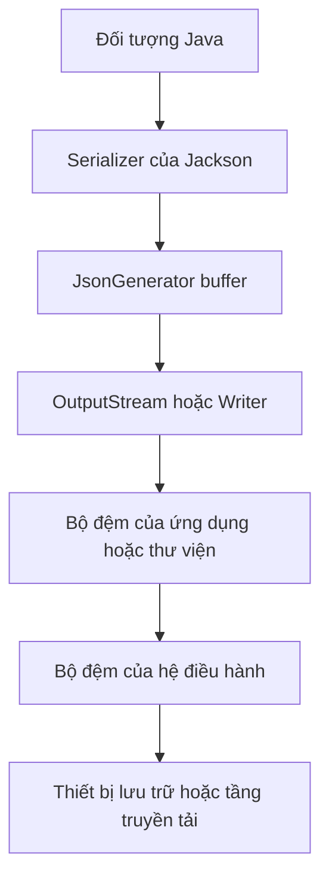

# Phân biệt đóng bộ sinh JSON, flush và độ bền của nơi lưu dữ liệu

Khi ghi JSON bằng Jackson, việc gọi phương thức ghi một giá trị mới chỉ là một phần của vòng đời xuất dữ liệu. `JsonGenerator` còn có bộ đệm riêng, có thể ghi vào một `OutputStream` cũng đang có bộ đệm, và cuối cùng dữ liệu có thể đi qua bộ đệm của hệ điều hành trước khi được lưu trên thiết bị. Vì vậy, cần phân biệt ba hành động thường bị nhầm lẫn:

- **`flush()`** đẩy dữ liệu đang được giữ trong các bộ đệm liên quan xuống tầng tiếp theo.
- **`close()`** kết thúc vòng đời của generator, hoàn tất cấu trúc JSON còn mở theo cấu hình và giải phóng tài nguyên mà generator sở hữu.
- **Độ bền (durability)** nói về khả năng dữ liệu vẫn tồn tại sau sự cố hoặc khi tiến trình/hệ thống dừng. Gọi `flush()` hoặc `close()` không tự động đồng nghĩa dữ liệu đã được ghi bền vững xuống thiết bị lưu trữ.

Hiểu đúng ranh giới này giúp tránh JSON bị thiếu, tránh đóng nhầm stream do thành phần khác sở hữu, và chọn đúng mức bảo đảm khi ghi tệp hoặc gửi response qua mạng.

## 1. Dữ liệu đi qua những lớp đệm nào?

Khi Jackson ghi một đối tượng thành JSON, luồng dữ liệu có thể đi qua nhiều tầng:



Không phải ứng dụng nào cũng có đủ mọi tầng. Ví dụ, `FileOutputStream` không thêm một bộ đệm Java như `BufferedOutputStream`, trong khi một HTTP response có thể có buffer do servlet container quản lý. Dù vậy, điểm quan trọng vẫn giống nhau: dữ liệu rời khỏi bộ đệm của Jackson chưa chắc đã rời khỏi mọi bộ đệm phía dưới.

`JsonGenerator` chịu trách nhiệm tạo token JSON và quản lý buffer của chính nó. Khi buffer đầy, Jackson có thể tự ghi một phần dữ liệu xuống target. `flush()` yêu cầu đẩy phần dữ liệu còn đang đợi xuống target; target quyết định ý nghĩa cụ thể của thao tác flush ở tầng tiếp theo.

## 2. `flush()` làm gì?

`JsonGenerator.flush()` yêu cầu generator đẩy dữ liệu JSON đang được giữ trong buffer ra target bên dưới. Với `OutputStream` hoặc `Writer` có hỗ trợ flush, generator tiếp tục gọi flush trên target nếu feature `FLUSH_PASSED_TO_STREAM` được bật.

Trong Jackson 2, feature này có tên:

```java
JsonGenerator.Feature.FLUSH_PASSED_TO_STREAM
```

Feature mặc định được bật. Có thể tắt nó nếu muốn `flush()` chỉ đẩy buffer nội bộ của generator mà không gọi `flush()` trên target:

```java
generator.disable(JsonGenerator.Feature.FLUSH_PASSED_TO_STREAM);
```

Thông thường, không cần tắt feature này. Hãy để flush lan xuống target khi ứng dụng thật sự cần dữ liệu được chuyển tiếp qua các tầng buffer. Tuy nhiên, cần hiểu rằng `flush()` của target vẫn chỉ có ý nghĩa theo hợp đồng của target đó.

### 2.1. Khi nào cần flush?

Flush hữu ích khi chương trình đang ghi một luồng dữ liệu kéo dài và bên nhận cần thấy phần dữ liệu đã tạo trước khi toàn bộ luồng kết thúc. Ví dụ:

- Ghi từng bản ghi JSON vào một kết nối hoặc giao thức streaming.
- Ghi một phần response để client có thể bắt đầu nhận dữ liệu sớm.
- Đẩy dữ liệu qua `BufferedOutputStream` trước khi một thành phần khác đọc cùng nguồn đích.
- Hoàn tất phần ghi trước khi chuyển quyền sử dụng stream cho một thành phần khác.

Nếu chỉ tạo một JSON document nhỏ rồi kết thúc ngay, việc đóng generator thường đã flush dữ liệu đang chờ. Gọi flush sau từng field hoặc từng token thường không cần thiết và có thể làm giảm hiệu năng do tạo nhiều lần chuyển dữ liệu xuống tầng dưới.

### 2.2. Flush không phải là close

Sau khi gọi `flush()`, generator vẫn mở và có thể tiếp tục ghi thêm token. Ví dụ, một JSON array có thể được ghi thành nhiều phần:

```java
JsonGenerator generator = factory.createGenerator(outputStream);
generator.writeStartArray();

generator.writeString("first");
generator.flush(); // Phần JSON hiện có được đẩy xuống target.

generator.writeString("second");
generator.writeEndArray();
generator.close();
```

Flush không kết thúc array, không đánh dấu generator đã đóng và không giải phóng tài nguyên. Bên nhận có thể đã thấy một phần dữ liệu nhưng chưa có một JSON document hoàn chỉnh để phân tích, tùy giao thức và thời điểm nhận.

## 3. `close()` làm gì?

`JsonGenerator.close()` kết thúc vòng đời ghi JSON. Thao tác này giải phóng tài nguyên nội bộ và hoàn tất việc ghi các dữ liệu còn đang chờ. Hành vi đối với cấu trúc JSON còn mở và target bên dưới chịu ảnh hưởng của các feature của generator.

Hai feature cần biết là:

| Feature | Ý nghĩa | Giá trị mặc định trong Jackson 2 |
|---|---|---|
| `AUTO_CLOSE_JSON_CONTENT` | Khi đóng generator, tự ghi token kết thúc cho object/array còn mở | Bật |
| `AUTO_CLOSE_TARGET` | Khi đóng generator, đóng target mà generator quản lý nếu target hỗ trợ đóng | Bật |

Với `AUTO_CLOSE_JSON_CONTENT`, nếu code đã gọi `writeStartObject()` nhưng chưa gọi `writeEndObject()`, thao tác close có thể tự ghi token kết thúc. Cơ chế này giúp tránh một số JSON bị cắt cụt do quên đóng cấu trúc, nhưng không nên dựa vào nó để thay thế việc quản lý cấu trúc rõ ràng. Generator không thể biết một object đã chứa đủ field theo nghiệp vụ hay chưa.

Với `AUTO_CLOSE_TARGET`, generator thường đóng `OutputStream` hoặc `Writer` bên dưới khi chính generator được đóng. Điều này hợp lý nếu generator sở hữu target. Nếu stream do caller hoặc một thành phần khác quản lý, cần xác định rõ ai có quyền đóng nó.

### 3.1. Dùng try-with-resources khi generator sở hữu stream

Nếu ứng dụng tạo cả stream và generator để ghi một tệp riêng, try-with-resources là cách quản lý vòng đời rõ ràng:

```java
import com.fasterxml.jackson.core.JsonFactory;
import com.fasterxml.jackson.core.JsonGenerator;
import com.fasterxml.jackson.databind.ObjectMapper;

import java.io.OutputStream;
import java.nio.file.Files;
import java.nio.file.Path;
import java.nio.file.StandardOpenOption;

public class JsonFileWriter {
    public static void write(Path path, Object value) throws Exception {
        ObjectMapper mapper = new ObjectMapper();
        JsonFactory factory = mapper.getFactory();

        try (OutputStream output = Files.newOutputStream(
                path,
                StandardOpenOption.CREATE,
                StandardOpenOption.TRUNCATE_EXISTING,
                StandardOpenOption.WRITE
        ); JsonGenerator generator = factory.createGenerator(output)) {
            mapper.writeValue(generator, value);
        }
    }
}
```

Trong ví dụ, generator được tạo từ stream do phương thức sở hữu. Khi thoát khỏi khối `try`, generator được đóng trước, sau đó stream được đóng. Đóng generator hoàn tất JSON và đẩy phần dữ liệu còn lại; đóng stream giải phóng tài nguyên tệp. Nếu có ngoại lệ trong lúc ghi, try-with-resources vẫn cố gắng đóng tài nguyên đã mở.

### 3.2. Khi stream do thành phần khác sở hữu

Có trường hợp caller cấp một stream cho hàm ghi và vẫn cần tiếp tục sử dụng stream sau khi hàm trả về. Ví dụ, một phần dữ liệu được ghi vào một archive hoặc một response mà vòng đời do framework quản lý.

Khi đó, có thể tắt `AUTO_CLOSE_TARGET` trên generator:

```java
public static void writeValue(
        ObjectMapper mapper,
        OutputStream output,
        Object value
) throws IOException {
    JsonGenerator generator = mapper.getFactory().createGenerator(output);
    generator.disable(JsonGenerator.Feature.AUTO_CLOSE_TARGET);

    try (generator) {
        mapper.writeValue(generator, value);
        generator.flush();
    }
}
```

Generator vẫn được đóng để hoàn tất phần JSON và giải phóng buffer của nó, nhưng target bên dưới không bị đóng theo. Quyền sở hữu stream tiếp tục thuộc về caller. Nếu caller muốn kết thúc stream, caller sẽ tự đóng ở nơi quản lý vòng đời của nó.

Không nên tắt `AUTO_CLOSE_TARGET` một cách máy móc. Nếu hàm tạo stream cũng là nơi duy nhất có trách nhiệm đóng stream, hãy để generator đóng target hoặc đóng stream rõ ràng ở khối quản lý tài nguyên tương ứng.

## 4. Flush và close có bảo đảm dữ liệu bền vững không?

**Không.** Flush và close chủ yếu giải quyết việc đẩy dữ liệu qua các bộ đệm và giải phóng tài nguyên. Chúng không phải là cam kết tổng quát rằng byte đã được ghi bền vững xuống thiết bị vật lý.

Ví dụ với một tệp:

1. Jackson ghi token vào buffer của `JsonGenerator`.
2. `flush()` đẩy dữ liệu xuống `FileOutputStream` hoặc `BufferedOutputStream`.
3. Stream có thể đẩy dữ liệu xuống hệ điều hành.
4. Hệ điều hành có thể giữ dữ liệu trong page cache trước khi ghi xuống thiết bị lưu trữ.
5. Thiết bị hoặc bộ điều khiển lưu trữ có thể tiếp tục có cache riêng.

Khi bước 2 hoặc 3 hoàn tất, ứng dụng đã chuyển dữ liệu ra khỏi buffer của mình. Điều đó không nhất thiết có nghĩa dữ liệu đã vượt qua mọi cache và được bảo đảm sau mất điện hoặc sự cố phần cứng.

### 4.1. Yêu cầu đồng bộ dữ liệu tệp với `FileChannel.force()`

Nếu yêu cầu của ứng dụng là yêu cầu hệ điều hành đồng bộ nội dung tệp xuống thiết bị lưu trữ, Java NIO cung cấp `FileChannel.force()`:

- `force(false)` yêu cầu đồng bộ nội dung tệp.
- `force(true)` yêu cầu đồng bộ cả nội dung và metadata của tệp.

Ví dụ dưới đây ghi JSON vào một `FileChannel`, đóng generator nhưng giữ channel mở, rồi yêu cầu đồng bộ:

```java
import com.fasterxml.jackson.core.JsonGenerator;
import com.fasterxml.jackson.databind.ObjectMapper;

import java.io.OutputStream;
import java.nio.channels.Channels;
import java.nio.channels.FileChannel;
import java.nio.file.Path;
import java.nio.file.StandardOpenOption;

public class DurableJsonFileWriter {
    public static void write(Path path, Object value) throws Exception {
        ObjectMapper mapper = new ObjectMapper();

        try (FileChannel channel = FileChannel.open(
                path,
                StandardOpenOption.CREATE,
                StandardOpenOption.TRUNCATE_EXISTING,
                StandardOpenOption.WRITE
        )) {
            OutputStream output = Channels.newOutputStream(channel);
            JsonGenerator generator = mapper.getFactory().createGenerator(output);

            // Generator được đóng, nhưng không đóng channel do caller sở hữu.
            generator.disable(JsonGenerator.Feature.AUTO_CLOSE_TARGET);
            try (generator) {
                mapper.writeValue(generator, value);
            }

            // Yêu cầu hệ điều hành đồng bộ nội dung và metadata của tệp.
            channel.force(true);
        }
    }
}
```

Thứ tự rất quan trọng: generator phải hoàn tất và đẩy các byte cuối cùng trước khi gọi `force(true)`. Channel chỉ được đóng sau khi force hoàn tất. Nếu generator đóng luôn channel trước, chương trình không thể gọi `force()` trên channel đã đóng.

`force(true)` là yêu cầu đồng bộ ở mức API hệ điều hành và thiết bị. Mức bảo đảm cuối cùng vẫn phụ thuộc hệ thống tệp, thiết bị, bộ điều khiển và môi trường chạy. Với yêu cầu lưu trữ quan trọng, ứng dụng còn cần thiết kế giao dịch, kiểm tra lỗi ghi, chiến lược thay thế tệp an toàn và phục hồi sau sự cố phù hợp.

### 4.2. `flush()` trên BufferedOutputStream

Nếu target là `BufferedOutputStream`, gọi `flush()` trên generator với `FLUSH_PASSED_TO_STREAM` bật sẽ tiếp tục gọi `flush()` trên `BufferedOutputStream`. Buffer Java của stream được đẩy xuống stream bên dưới.

```java
try (OutputStream file = Files.newOutputStream(path);
     BufferedOutputStream buffered = new BufferedOutputStream(file);
     JsonGenerator generator = mapper.getFactory().createGenerator(buffered)) {
    mapper.writeValue(generator, value);
    generator.flush();
}
```

Trong ví dụ này, flush đẩy buffer của generator rồi buffer của `BufferedOutputStream`. Khi các tài nguyên được đóng, chúng tiếp tục hoàn tất và giải phóng theo thứ tự ngược lại. Nhưng kể cả sau đó, dữ liệu vẫn có thể đang ở page cache của hệ điều hành. Nếu cần đồng bộ tệp, cần cơ chế như `FileChannel.force()`.

## 5. Flush trong HTTP response khác với độ bền của tệp

Khi Jackson ghi JSON vào HTTP response, target thường do servlet container hoặc framework web quản lý. Gọi flush có thể khiến buffer của response được chuyển tiếp xuống tầng socket sớm hơn. Điều này hữu ích cho streaming, nhưng không chứng minh client đã nhận hoặc đã xử lý dữ liệu.

Có thể phân biệt các mốc:

| Mốc | Điều có thể kết luận |
|---|---|
| Jackson generator flush | Buffer của generator đã được đẩy xuống target theo cấu hình. |
| HTTP response flush | Framework/container được yêu cầu đẩy buffer response xuống tầng truyền tải. |
| Byte được gửi vào socket | Dữ liệu đã được giao cho stack mạng của hệ thống cục bộ. |
| Client nhận byte | Phía client đã nhận được dữ liệu ở tầng mạng/ứng dụng tương ứng. |
| Client xử lý và lưu thành công | Cần xác nhận ở tầng giao thức hoặc nghiệp vụ, chẳng hạn response/acknowledgement. |

Không thể suy ra các mốc phía client chỉ từ việc server gọi `flush()`. Nếu cần bảo đảm client đã xử lý dữ liệu, hãy thiết kế cơ chế xác nhận ở tầng ứng dụng, ví dụ client gửi acknowledgement chứa mã bản ghi hoặc mã giao dịch.

Đối với Spring MVC, thường để framework quản lý response stream. Controller không nên tự đóng output stream mà container cấp. Với response streaming, flush chỉ nên thực hiện khi cần đẩy một phần dữ liệu theo thiết kế giao thức; gọi flush quá thường xuyên có thể làm tăng số lần ghi mạng và giảm hiệu năng.

## 6. Đóng generator có tự hoàn thiện JSON không?

JSON object và array cần token bắt đầu/kết thúc tương ứng. Generator có feature `AUTO_CLOSE_JSON_CONTENT` để tự ghi token kết thúc cho cấu trúc còn mở khi đóng.

Ví dụ:

```java
JsonGenerator generator = factory.createGenerator(outputStream);
generator.writeStartObject();
generator.writeStringField("status", "ready");

// Nếu AUTO_CLOSE_JSON_CONTENT đang bật, close có thể ghi END_OBJECT.
generator.close();
```

Tuy vậy, nên viết cấu trúc cân bằng một cách tường minh:

```java
try (JsonGenerator generator = factory.createGenerator(outputStream)) {
    generator.writeStartObject();
    generator.writeStringField("status", "ready");
    generator.writeEndObject();
}
```

Tự động đóng chỉ xử lý dấu kết thúc cấu trúc JSON còn mở. Nó không thể khôi phục field bị quên, sửa dữ liệu sai hoặc biết rằng nội dung đã đáp ứng yêu cầu nghiệp vụ. Trong code tạo JSON phức tạp, nên bảo đảm mọi nhánh điều khiển ghi token có cấu trúc hợp lệ và xử lý ngoại lệ đúng cách.

## 7. Xử lý ngoại lệ và quyền sở hữu tài nguyên

Ghi JSON có thể thất bại giữa chừng do lỗi I/O, lỗi serializer, stream bị đóng hoặc client ngắt kết nối. Khi đó, phần dữ liệu đã ghi có thể chỉ là một JSON document không hoàn chỉnh.

Một số nguyên tắc quản lý tài nguyên:

- Thành phần tạo `OutputStream` thường chịu trách nhiệm đóng stream đó.
- Thành phần tạo `JsonGenerator` chịu trách nhiệm đóng generator để hoàn tất và giải phóng buffer.
- Nếu generator không được phép đóng target, tắt `AUTO_CLOSE_TARGET` và để caller đóng target.
- Dùng try-with-resources để việc đóng diễn ra cả khi có ngoại lệ.
- Không coi file đã hoàn tất chỉ vì phương thức ghi đã bắt đầu hoặc đã flush một phần.
- Nếu cần cập nhật một tệp quan trọng mà không muốn người đọc thấy nội dung dở dang, cân nhắc ghi vào tệp tạm, hoàn tất/đồng bộ, rồi thay thế tệp đích bằng thao tác move phù hợp với hệ thống tệp.

Ví dụ ghi tệp tạm rồi đổi tên giúp tránh để người đọc mở tệp đích đúng lúc nội dung mới đang được ghi:

```java
Path temporary = target.resolveSibling(target.getFileName() + ".tmp");

try (OutputStream output = Files.newOutputStream(
        temporary,
        StandardOpenOption.CREATE,
        StandardOpenOption.TRUNCATE_EXISTING,
        StandardOpenOption.WRITE
)) {
    mapper.writeValue(output, value);
}

Files.move(
        temporary,
        target,
        StandardCopyOption.REPLACE_EXISTING,
        StandardCopyOption.ATOMIC_MOVE
);
```

`ATOMIC_MOVE` phụ thuộc khả năng của hệ thống tệp và vị trí hai tệp. Nếu hệ thống tệp không hỗ trợ, thao tác có thể thất bại; ứng dụng cần xác định rõ có cho phép fallback sang move thông thường hay không. Đổi tên nguyên tử cũng là vấn đề khác với bảo đảm dữ liệu đã được force xuống thiết bị.

## 8. So sánh flush, close và force

| Thao tác | Mục tiêu chính | Generator còn dùng được sau thao tác? | Bảo đảm dữ liệu bền vững? |
|---|---|---|---|
| `JsonGenerator.flush()` | Đẩy buffer của generator và, theo feature, flush target | Có | Không |
| `OutputStream.flush()` | Đẩy buffer của stream xuống tầng dưới theo triển khai | Stream vẫn mở | Không |
| `JsonGenerator.close()` | Kết thúc generator, hoàn tất cấu trúc theo cấu hình, giải phóng tài nguyên | Không | Không tự bảo đảm |
| `OutputStream.close()` | Đóng stream và giải phóng tài nguyên liên quan | Không | Không tự bảo đảm |
| `FileChannel.force(true)` | Yêu cầu đồng bộ nội dung và metadata tệp xuống thiết bị lưu trữ | Channel vẫn mở sau lời gọi thành công | Tăng bảo đảm đồng bộ tệp theo hợp đồng hệ điều hành, vẫn phụ thuộc tầng lưu trữ |

## 9. Chọn thao tác theo mục tiêu

- **Ghi một JSON document vào tệp thông thường:** tạo generator/stream trong try-with-resources, ghi document, rồi đóng tài nguyên. Không cần flush sau mỗi field.
- **Ghi từng phần của một luồng đang mở:** gọi flush ở ranh giới mà bên nhận cần quan sát dữ liệu, nhưng tiếp tục quản lý generator cho đến khi hoàn tất document hoặc giao thức.
- **Dùng stream do framework hoặc caller cấp:** xác định rõ quyền sở hữu. Tắt `AUTO_CLOSE_TARGET` nếu generator không được phép đóng stream bên dưới.
- **Ghi tệp cần yêu cầu đồng bộ:** hoàn tất generator, giữ `FileChannel` mở và gọi `force(true)` trước khi đóng channel.
- **Gửi dữ liệu qua HTTP:** flush có thể đẩy buffer response, nhưng cần acknowledgement nếu nghiệp vụ cần biết client đã nhận hoặc xử lý.
- **Cập nhật tệp quan trọng:** kết hợp ghi tệp tạm, đóng/force theo yêu cầu và thay thế tệp đích; xử lý trường hợp hệ thống tệp không hỗ trợ atomic move.

`flush()` trả lời câu hỏi dữ liệu đã được đẩy khỏi buffer hiện tại hay chưa; `close()` trả lời câu hỏi generator và tài nguyên thuộc quyền sở hữu của nó đã kết thúc hay chưa; còn durability trả lời câu hỏi dữ liệu có được bảo đảm tồn tại sau sự cố hay không. Ba câu hỏi này thuộc các tầng khác nhau. Khi thiết kế thao tác ghi JSON bằng Jackson, hãy chọn rõ ranh giới flush, người sở hữu stream và mức đồng bộ lưu trữ mà ứng dụng thực sự cần.
