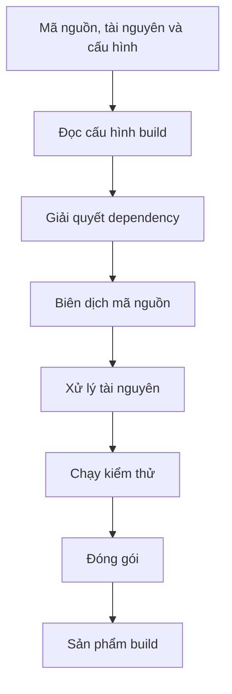

# Công cụ build là gì và vấn đề của quy trình build thủ công

Khi mới học Java, ta thường chỉ cần viết một tệp `.java`, biên dịch rồi chạy chương trình. Với một bài tập nhỏ, vài lệnh trong terminal là đủ. Nhưng khi dự án có nhiều lớp, thư viện bên ngoài, tài nguyên, bài kiểm thử và nhiều môi trường chạy, việc tự nhớ và thực hiện tất cả các bước trở nên khó kiểm soát.

Đây là lúc **công cụ build (build tool)** phát huy tác dụng. Công cụ build tự động hóa và điều phối quy trình biến mã nguồn cùng các thành phần liên quan thành sản phẩm có thể kiểm thử hoặc phân phối, chẳng hạn các tệp `.class`, một tệp JAR hoặc một gói ứng dụng.

Bài học này giải thích build tool làm gì, quy trình build thủ công thường diễn ra ra sao và vì sao cách làm thủ công nhanh chóng trở thành gánh nặng khi dự án lớn dần.

## 1. Build là quá trình tạo ra sản phẩm từ mã nguồn

Trong một dự án phần mềm, mã nguồn chỉ là một phần của đầu vào. Để tạo ra chương trình có thể chạy hoặc phân phối, ta có thể cần:

- Mã nguồn, chẳng hạn các tệp Java `.java`.
- Thư viện mà chương trình phụ thuộc.
- Tài nguyên như tệp cấu hình, hình ảnh, mẫu dữ liệu hoặc thông điệp.
- Cấu hình biên dịch và cấu hình đóng gói.
- Các bài kiểm thử và công cụ cần thiết để chạy chúng.

**Build** là quá trình xử lý những đầu vào này theo một chuỗi bước để tạo ra đầu ra. Với dự án Java, các bước thường gặp gồm:

1. Kiểm tra hoặc chuẩn bị thư mục đầu ra.
2. Giải quyết các thư viện phụ thuộc và thiết lập classpath.
3. Biên dịch mã nguồn Java thành bytecode trong các tệp `.class`.
4. Sao chép hoặc xử lý tài nguyên cần đi cùng ứng dụng.
5. Biên dịch và chạy kiểm thử.
6. Đóng gói các lớp và tài nguyên thành JAR, WAR hoặc một dạng phân phối khác.

Không phải dự án nào cũng cần tất cả các bước trên. Một thư viện có thể cần tạo JAR; một ứng dụng có thể cần thêm bước kiểm thử và đóng gói; một bài tập nhỏ có thể chỉ cần biên dịch rồi chạy.

Cũng cần phân biệt **build** với **run** và **deploy**:

- **Build** tạo ra sản phẩm từ mã nguồn và cấu hình.
- **Run** khởi chạy sản phẩm để chương trình thực thi.
- **Deploy** đưa sản phẩm đến môi trường mà người dùng hoặc hệ thống sẽ sử dụng.

Ba hoạt động có liên quan nhưng không đồng nghĩa. Build thành công chưa đảm bảo ứng dụng sẽ chạy đúng trong mọi môi trường hoặc đã được triển khai.

## 2. Công cụ build là gì?

**Công cụ build** là phần mềm giúp định nghĩa, tự động hóa và điều phối các bước build. Thay vì phải tự gõ lại từng lệnh theo đúng thứ tự, lập trình viên mô tả cấu trúc dự án, thư viện phụ thuộc và các quy tắc build trong tệp cấu hình. Sau đó, họ gọi một lệnh để công cụ thực hiện quy trình tương ứng.

Với dự án Java, các công cụ phổ biến gồm:

- **Maven**: sử dụng tệp `pom.xml` để khai báo thông tin dự án, dependency, plugin và cấu hình build.
- **Gradle**: sử dụng các tệp build như `build.gradle` hoặc `build.gradle.kts` để khai báo plugin, dependency và task.
- **Ant**: công cụ tự động hóa build lâu đời, thường mô tả các mục tiêu và bước thực hiện một cách tường minh.

Các công cụ này có cách cấu hình và mô hình thực thi khác nhau, nhưng đều giúp tự động hóa công việc build.

Một điểm dễ nhầm lẫn: **compiler không giống build tool**. `javac` là trình biên dịch Java; nó chuyển mã nguồn thành bytecode. Lệnh `jar` của JDK hỗ trợ đóng gói các tệp thành JAR. Maven và Gradle có thể điều phối compiler, công cụ kiểm thử, công cụ đóng gói và plugin khác để hoàn thành cả quy trình. Vì vậy, ta vẫn sử dụng compiler, nhưng thường không phải tự quản lý từng lệnh compiler trong dự án có build tool.

### Công cụ build thường đảm nhiệm những việc gì?

**Biên dịch mã nguồn**

Công cụ xác định các tệp nguồn cần biên dịch, vị trí lưu kết quả và các tùy chọn biên dịch. Nó cũng có thể quản lý thứ tự hoặc quan hệ giữa các bước cần thiết.

**Quản lý thư viện phụ thuộc**

Một dự án có thể sử dụng nhiều thư viện, mỗi thư viện lại có thể phụ thuộc vào thư viện khác. Build tool có thể tải các dependency đã khai báo từ kho lưu trữ, chọn phiên bản theo cấu hình và đưa chúng vào classpath phù hợp.

**Thực thi kiểm thử**

Công cụ có thể gọi framework kiểm thử, chạy các bài test và làm cho kết quả kiểm thử trở thành một phần của quy trình build. Ví dụ, một build có thể được cấu hình để thất bại nếu test không đạt.

**Đóng gói sản phẩm**

Sau khi biên dịch và xử lý tài nguyên, công cụ có thể tạo JAR, WAR hoặc gói phân phối theo cấu hình của dự án.

**Tự động hóa và tái sử dụng quy trình**

Các bước được mô tả trong cấu hình có thể được chạy lại trên máy lập trình viên, máy build hoặc hệ thống CI. Một lệnh build giúp cả nhóm thực hiện cùng một quy trình đã được định nghĩa.

Tùy công cụ và cấu hình, build tool còn có thể bỏ qua một số công việc không cần chạy lại, lưu kết quả trung gian hoặc hỗ trợ build song song. Những khả năng này giúp tiết kiệm thời gian, nhưng hiệu quả cụ thể phụ thuộc vào cách dự án được cấu hình.

## 3. Một quy trình build Java thủ công diễn ra như thế nào?

Hãy hình dung một ứng dụng Java nhỏ có mã nguồn nằm trong `src/main/java`. Nếu không dùng build tool, người phát triển phải tự gọi các công cụ của JDK và quản lý những đầu vào cần thiết.

Ví dụ, giả sử dự án có hai lớp:

```text
my-app/
├── src/
│   └── main/
│       └── java/
│           └── com/
│               └── example/
│                   ├── Main.java
│                   └── Greeter.java
└── out/
```

Ta có thể biên dịch hai tệp bằng `javac`:

```bash
javac -d out src/main/java/com/example/Greeter.java src/main/java/com/example/Main.java
```

Tùy chọn `-d out` chỉ định thư mục để lưu các tệp bytecode được tạo ra. Sau khi biên dịch thành công, ta có thể chạy lớp có phương thức `main`:

```bash
java -cp out com.example.Main
```

Ở đây, `-cp out` cho Java biết nơi tìm các lớp đã biên dịch.

Nếu dự án sử dụng thư viện bên ngoài, người phát triển còn phải tải thư viện, đặt tệp JAR vào vị trí thích hợp và thêm nó vào classpath khi biên dịch lẫn khi chạy. Ví dụ, nếu các JAR được đặt trực tiếp trong thư mục `lib`, lệnh biên dịch có thể là:

```bash
javac -cp "lib/*" -d out src/main/java/com/example/Main.java
```

Khi chạy, classpath phải chứa cả lớp của ứng dụng và thư viện. Ký tự phân cách nhiều mục classpath phụ thuộc hệ điều hành:

```bash
# Windows
java -cp "out;lib/*" com.example.Main

# macOS hoặc Linux
java -cp "out:lib/*" com.example.Main
```

Sau đó, nếu muốn phân phối ứng dụng dưới dạng JAR, ta cần đóng gói các lớp. Với JDK có hỗ trợ cú pháp này, có thể dùng:

```bash
jar --create --file app.jar --main-class com.example.Main -C out .
```

Lệnh trên đóng gói nội dung của `out` và khai báo lớp chính. Nó không tự đưa các thư viện bên ngoài trong `lib` vào JAR. Nếu ứng dụng cần những thư viện đó, ta còn phải quyết định cách phân phối và thiết lập classpath cho chúng.

Ví dụ trên chỉ có vài bước. Một dự án thực tế có thể cần thêm nhiều thao tác: xóa kết quả build cũ, biên dịch nhiều package, xử lý tài nguyên, chạy test, tạo báo cáo, tạo JAR có cấu trúc phù hợp và kiểm tra đầu ra. Người phát triển phải nhớ tất cả các lệnh, tùy chọn và thứ tự thực hiện.

## 4. Những vấn đề của quy trình build thủ công

Build thủ công có thể phù hợp khi học một lệnh hoặc thử nghiệm một chương trình nhỏ. Khi quy mô dự án và số người tham gia tăng lên, nó tạo ra nhiều vấn đề.

### 4.1. Phải nhớ và lặp lại nhiều lệnh

Mỗi lần build, người phát triển có thể phải lần lượt biên dịch, thiết lập classpath, sao chép tài nguyên, chạy test và đóng gói. Nếu quên một bước, kết quả tạo ra có thể thiếu hoặc không đúng.

Các lệnh dài cũng dễ bị gõ sai. Khi cấu trúc thư mục thay đổi, nhiều lệnh cũ phải được cập nhật. Việc ghi nhớ quy trình trong tài liệu hoặc lịch sử terminal giúp ích phần nào, nhưng vẫn để lại nhiều thao tác thủ công.

### 4.2. Dependency khó quản lý

Khi dự án dùng thư viện ngoài, người phát triển phải tự tìm và tải đúng phiên bản, lưu trữ tệp JAR, rồi cập nhật classpath. Nếu một thư viện phụ thuộc vào thư viện khác, ta còn phải tìm hiểu và bổ sung các dependency liên quan.

Một số vấn đề thường gặp:

- Thành viên trong nhóm dùng các phiên bản thư viện khác nhau.
- Máy này có đủ JAR nhưng máy khác lại thiếu.
- Cập nhật một thư viện nhưng quên cập nhật cấu hình hoặc tài liệu.
- Hai thư viện yêu cầu các phiên bản không tương thích.
- Classpath chứa sai đường dẫn hoặc thiếu một dependency khi chạy.

Build tool có thể đọc danh sách dependency từ cấu hình và giải quyết các thư viện liên quan theo quy tắc của công cụ. Nhờ vậy, nhóm quản lý dependency tập trung hơn và dễ tái tạo môi trường hơn.

### 4.3. Thứ tự và cấu hình build dễ bị sai

Trong dự án nhiều module hoặc nhiều bước xử lý, một bước có thể cần kết quả từ bước khác. Người thực hiện phải biết bước nào cần chạy trước, đầu ra nằm ở đâu và tùy chọn nào cần truyền vào.

Ví dụ, đóng gói trước khi biên dịch sẽ không tạo được JAR chứa các lớp mới. Nếu quên sao chép tài nguyên, chương trình có thể biên dịch thành công nhưng không tìm thấy tệp cấu hình khi chạy.

Khi các quy tắc này chỉ nằm trong trí nhớ của từng người, chúng khó được áp dụng nhất quán.

### 4.4. Kết quả giữa các máy có thể khác nhau

Hai thành viên có thể chạy những lệnh gần giống nhau nhưng dùng JDK, phiên bản thư viện, biến môi trường hoặc đường dẫn khác nhau. Kết quả là chương trình build được trên máy này nhưng thất bại trên máy khác.

Một quy trình thủ công thường không ghi nhận đầy đủ các giả định về môi trường. Vì thế, khi có lỗi, nhóm khó xác định lỗi đến từ mã nguồn, dependency, cấu hình hay phiên bản công cụ.

Build tool giúp tập trung hóa cấu hình và một số công cụ còn cung cấp wrapper để cả nhóm sử dụng cùng phiên bản build tool. Tuy nhiên, tính nhất quán vẫn cần được cấu hình đúng, bao gồm cả phiên bản JDK và dependency cần thiết.

### 4.5. Dễ bỏ sót kiểm thử và kiểm tra chất lượng

Nếu test phải được chạy bằng một lệnh riêng, người phát triển có thể quên chạy trước khi đóng gói hoặc chia sẻ sản phẩm. Điều này làm tăng khả năng lỗi đơn giản lọt sang bước tiếp theo.

Khi test được tích hợp vào quy trình build, nhóm có thể quy định rằng bước đóng gói chỉ tiếp tục khi các bước kiểm thử bắt buộc thành công. Cùng một quy trình cũng có thể được chạy tự động trên hệ thống CI mỗi khi có thay đổi mã nguồn.

### 4.6. Khó tự động hóa và mở rộng

Các bước thủ công phụ thuộc vào người đang thực hiện. Để đưa chúng vào CI, nhóm phải chuyển các thao tác thành script, xử lý mã thoát, đường dẫn, biến môi trường và các trường hợp lỗi.

Một script có thể giảm thao tác lặp lại, nhưng nếu quy tắc build vẫn phân tán ở nhiều nơi thì việc bảo trì tiếp tục khó khăn. Khi dự án thêm module, môi trường hoặc bước kiểm thử, quy trình càng phức tạp.

Build tool cung cấp một mô hình cấu hình và thực thi chung để máy lập trình viên và hệ thống CI có thể gọi cùng một quy trình.

### 4.7. Tốn thời gian khi phải làm lại mọi thứ

Nếu mỗi lần build đều biên dịch lại toàn bộ mã nguồn và chạy lại mọi thao tác, dự án lớn có thể mất nhiều thời gian. Người phát triển cũng phải tự xác định phần nào cần làm lại sau một thay đổi.

Nhiều build tool hỗ trợ incremental build hoặc cache để giảm công việc lặp lại khi đầu vào liên quan không thay đổi. Khả năng này phụ thuộc vào công cụ, task và cấu hình; không phải mọi build đều có thể bỏ qua mọi bước.

## 5. Build tool giúp quy trình trở nên nhất quán như thế nào?

Thay vì tự thực hiện từng lệnh, nhóm mô tả quy tắc build trong tệp cấu hình của dự án. Cấu hình thường cho biết:

- Dự án sử dụng ngôn ngữ, plugin và phiên bản công cụ nào.
- Mã nguồn và tài nguyên nằm ở đâu.
- Dự án cần những thư viện nào.
- Cần thực hiện những task hoặc phase nào.
- Đầu ra cần được tạo theo dạng nào.

Sau đó, lập trình viên gọi lệnh của build tool. Một quy trình tổng quát có thể được hình dung như sau:



Đây là sơ đồ minh họa một quy trình thường gặp. Trình tự và tên bước thực tế thay đổi theo công cụ và cấu hình. Chẳng hạn, một số dự án có thể xử lý tài nguyên trước hoặc trong lúc biên dịch; một số bước kiểm tra có thể chạy ở nhiều thời điểm khác nhau.

Với Maven hoặc Gradle, thành viên nhóm thường lấy mã nguồn về, bảo đảm máy có JDK phù hợp rồi gọi lệnh build đã thống nhất. Maven có thể được chạy bằng Maven Wrapper, thường là `./mvnw` trên macOS/Linux hoặc `mvnw.cmd` trên Windows. Gradle có thể được chạy bằng Gradle Wrapper, thường là `./gradlew` hoặc `gradlew.bat`. Wrapper giúp dự án chỉ định phiên bản build tool mà nhóm muốn sử dụng.

Ví dụ, các lệnh thường thấy là:

```bash
# Maven Wrapper
./mvnw clean package

# Gradle Wrapper
./gradlew clean build
```

Tên phase, task và những gì chúng thực hiện phụ thuộc cấu hình Maven hoặc Gradle của dự án. Ý nghĩa chung của ví dụ là người phát triển gọi quy trình đã được dự án định nghĩa, thay vì tự ghép lại từng lệnh `javac`, `java` và `jar`.

## 6. Khi nào nên dùng build tool?

Với một chương trình Java chỉ có một tệp nguồn, biên dịch bằng `javac` là cách đơn giản để hiểu compiler hoạt động ra sao. Ta không cần thêm cấu hình phức tạp chỉ để chạy một ví dụ ngắn.

Khi dự án bắt đầu có một hoặc nhiều đặc điểm sau, build tool trở nên hữu ích:

- Có nhiều tệp nguồn hoặc nhiều module.
- Sử dụng thư viện bên ngoài.
- Cần chạy test thường xuyên.
- Cần đóng gói JAR, WAR hoặc sản phẩm phân phối khác.
- Có nhiều thành viên cùng phát triển.
- Cần build trên máy chủ CI hoặc trong quy trình phát hành.
- Cần kiểm soát phiên bản công cụ và tái sử dụng quy trình giữa các môi trường.

Việc chọn Maven, Gradle hay một công cụ khác phụ thuộc vào cấu trúc dự án, yêu cầu của nhóm và hệ sinh thái đang sử dụng. Điều quan trọng trước tiên là hiểu vấn đề cần giải quyết: quy trình build phải được mô tả rõ, có thể chạy lại và được chia sẻ giữa các thành viên.

Build tool không tự bảo đảm mã nguồn không có lỗi, cũng không thay thế việc chọn dependency và cấu hình môi trường đúng. Nó cung cấp một cách có tổ chức để thực hiện các công việc đó lặp lại với ít thao tác thủ công hơn.

## 7. Ghi nhớ

- **Build** là quá trình biến mã nguồn, dependency, tài nguyên và cấu hình thành sản phẩm có thể kiểm thử hoặc phân phối.
- **Build tool** tự động hóa và điều phối các bước trong quy trình build.
- `javac` là compiler; `jar` là công cụ đóng gói của JDK; Maven và Gradle là các build tool có thể điều phối những công cụ này cùng nhiều bước khác.
- Build thủ công dễ phát sinh lỗi do lệnh lặp lại, dependency không nhất quán, sai thứ tự, khác biệt môi trường và bỏ sót test.
- Build tool giúp nhóm dùng chung cấu hình và quy trình, đồng thời tạo nền tảng cho tự động hóa trên CI.

## 8. Tự kiểm tra

1. Build khác gì với run và deploy?
2. Vì sao `javac` không đảm nhiệm toàn bộ vai trò của một build tool?
3. Khi thêm một thư viện bên ngoài vào dự án, những việc nào phải được xử lý nếu build hoàn toàn thủ công?
4. Vì sao hai thành viên có thể build cùng mã nguồn nhưng nhận kết quả khác nhau?
5. Build tool giúp hệ thống CI thực hiện quy trình build nhất quán như thế nào?

Nếu có thể trả lời các câu hỏi này bằng cách liên hệ với ví dụ `javac`, classpath và đóng gói JAR ở trên, bạn đã nắm được lý do các dự án Java sử dụng công cụ build.

