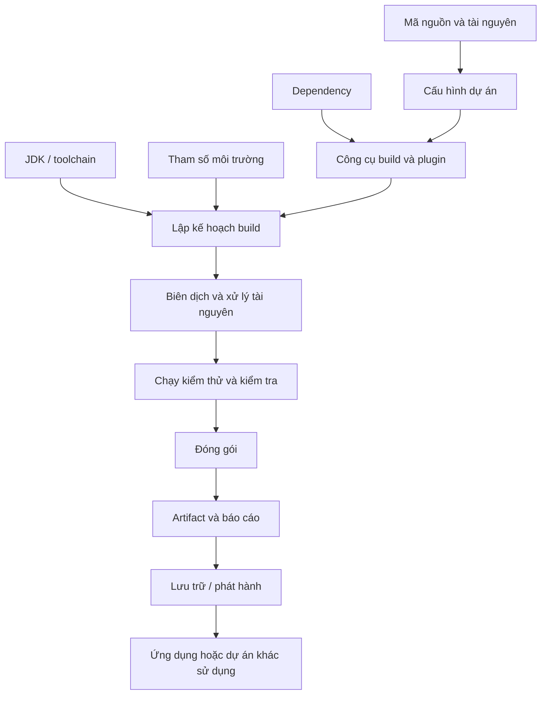
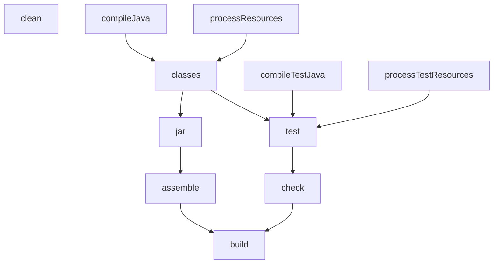
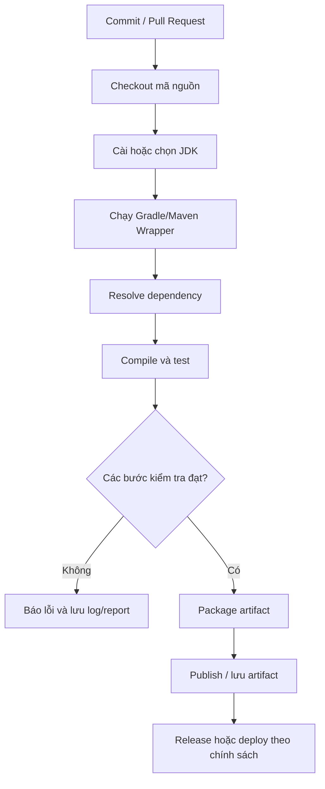

# Từ mã nguồn đến sản phẩm bàn giao: các thành phần và mối liên hệ

Một dự án Java bắt đầu bằng mã nguồn, nhưng người sử dụng dự án thường cần một sản phẩm có thể cài đặt, chạy, tích hợp hoặc tái sử dụng. Giữa hai điểm đó là **quy trình build**: tập hợp các bước biến mã nguồn và những đầu vào liên quan thành các đầu ra đã được kiểm tra.

Công cụ build như Gradle hoặc Maven điều phối quy trình này. Nó đọc cấu hình dự án, tìm dependency, chọn công cụ biên dịch, tổ chức các task hoặc phase, gọi compiler và test framework, đóng gói kết quả rồi tạo ra artifact. Hiểu mối liên hệ giữa các thành phần giúp ta biết mỗi file cấu hình có vai trò gì, vì sao một lệnh build thực hiện nhiều bước và sản phẩm cuối cùng được tạo ra từ những đầu vào nào.

## 1. Bức tranh tổng thể của một lần build

Có thể hình dung luồng chính như sau:



Sơ đồ mô tả quan hệ logic. Khi chạy thật, một số công việc có thể độc lập và được thực hiện song song; công cụ build quyết định thứ tự dựa trên quan hệ phụ thuộc giữa các task.

Đầu vào của build không chỉ là file `.java`. Một lần build thường kết hợp:

- Mã nguồn chính và mã nguồn kiểm thử.
- Tài nguyên như file cấu hình, template, ảnh, schema hoặc dữ liệu tĩnh.
- Cấu hình build mô tả plugin, dependency, phiên bản, task và cách đóng gói.
- Dependency bên ngoài hoặc module khác trong cùng repository.
- JDK và các công cụ cần thiết.
- Tham số môi trường như profile, biến môi trường hoặc thuộc tính dòng lệnh.

Đầu ra cũng không chỉ có một file JAR. Build có thể tạo bytecode, tài nguyên đã xử lý, báo cáo kiểm thử, báo cáo phân tích, JAR/WAR, gói phân phối, metadata và checksum. Những đầu ra này phục vụ các mục đích khác nhau: kiểm tra chất lượng, tái sử dụng thư viện, triển khai ứng dụng hoặc truy vết bản phát hành.

## 2. Các thành phần tham gia vào quy trình build

| Thành phần | Vai trò | Ví dụ thường gặp |
|---|---|---|
| Mã nguồn và tài nguyên | Nội dung được biên dịch, xử lý hoặc đưa vào artifact | `src/main/java`, `src/main/resources` |
| Mã nguồn kiểm thử | Kiểm tra hành vi của mã nguồn chính | `src/test/java`, `src/test/resources` |
| Build descriptor | Khai báo cách dự án được build | `build.gradle`, `build.gradle.kts`, `pom.xml` |
| Cấu hình project | Xác định module, plugin repository và cấu trúc build | `settings.gradle`, `settings.gradle.kts`, cấu hình Maven |
| Wrapper | Khởi chạy đúng phiên bản công cụ build của dự án | `gradlew`, `gradlew.bat`, `mvnw`, `mvnw.cmd` |
| Plugin | Bổ sung quy tắc, task và tích hợp cho một loại dự án | Gradle `java`, `application`; Maven compiler, Surefire, Spring Boot plugin |
| Toolchain | Cung cấp compiler và môi trường Java phù hợp | JDK 17, JDK 21 |
| Dependency | Thư viện hoặc module mà dự án cần | JUnit, Jackson, module `domain` |
| Repository | Nơi lưu và phân phối dependency hoặc artifact | Maven Central, repository nội bộ |
| Build engine | Đọc cấu hình, lập kế hoạch và thực thi công việc | Gradle, Maven |
| Artifact | Sản phẩm được tạo từ build | JAR, WAR, ZIP, image container |

### 2.1. Mã nguồn và tài nguyên

Mã nguồn là nội dung mà nhóm phát triển duy trì. Với cấu trúc Java phổ biến, `src/main/java` chứa mã nguồn ứng dụng hoặc thư viện, còn `src/main/resources` chứa tài nguyên cần có trên classpath khi chạy. `src/test/java` và `src/test/resources` dành cho kiểm thử.

Build tool dựa vào cấu hình source set hoặc quy ước của hệ sinh thái để biết file nào thuộc phần chính, file nào thuộc phần kiểm thử. Nó có thể xử lý thêm mã nguồn được sinh tự động, chẳng hạn mã Java sinh từ schema hoặc annotation processor. Mã nguồn được sinh thường là đầu ra trung gian của build; không nên chỉnh sửa trực tiếp nếu nó được tạo lại từ một schema hoặc cấu hình khác.

### 2.2. Build descriptor và cấu hình project

Build descriptor trả lời các câu hỏi như: dự án dùng plugin nào, cần thư viện nào, dùng phiên bản Java nào, có những task nào và artifact được đóng gói ra sao.

Với Gradle, cấu hình thường nằm trong `build.gradle` hoặc `build.gradle.kts`. `settings.gradle` hoặc `settings.gradle.kts` mô tả cấu trúc build, tên root project và các subproject. Với Maven, `pom.xml` là Project Object Model, khai báo tọa độ dự án, dependency, plugin và các thuộc tính build.

Ví dụ, khai báo plugin Java cho Gradle khiến Gradle hiểu quy ước source set Java và cung cấp các task chuẩn như `compileJava`, `test`, `jar`, `check` và `build`. Nếu không có plugin hoặc cấu hình tương ứng, một tên task không tự xuất hiện chỉ vì ta chạy lệnh có tên đó.

### 2.3. Wrapper và build engine

Gradle Wrapper (`gradlew` trên Unix-like, `gradlew.bat` trên Windows) và Maven Wrapper (`mvnw`, `mvnw.cmd`) là điểm khởi chạy được lưu cùng repository. Wrapper tải hoặc sử dụng phiên bản công cụ build đã được dự án chỉ định. Nhờ đó, thành viên trong nhóm và CI có thể chạy cùng phiên bản Gradle hoặc Maven mà không phải tự cài đúng phiên bản đó trước.

Wrapper không thay thế JDK. Máy chạy build vẫn cần một JDK tương thích, trừ khi môi trường đã cung cấp nó theo cách khác. Với Gradle, Java Toolchains có thể khai báo phiên bản JDK cần cho việc biên dịch hoặc chạy test. Maven cũng có thể cấu hình compiler release hoặc toolchain. Vì vậy cần phân biệt:

- **Phiên bản Gradle/Maven:** phiên bản của công cụ điều phối build.
- **Phiên bản Java:** phiên bản ngôn ngữ/API mà mã nguồn hướng tới.
- **JDK thực thi:** bộ công cụ Java mà tiến trình build và các task sử dụng.

Ba thông tin này liên quan nhưng không đồng nghĩa. Ví dụ, một dự án có thể chạy Gradle bằng JDK 21, biên dịch mã nguồn theo Java 17 và chạy test trên JDK được cấu hình riêng.

### 2.4. Plugin và task

Build engine cung cấp cơ chế thực thi; plugin bổ sung hiểu biết về một công nghệ hoặc loại dự án. Plugin Java của Gradle tạo ra các source set và task Java thông dụng. Plugin Spring Boot có thể bổ sung task đóng gói executable JAR. Trong Maven, plugin gắn các goal vào những phase của lifecycle.

Một **task** là một đơn vị công việc có đầu vào, đầu ra và quan hệ phụ thuộc. Ví dụ:

- `compileJava` biên dịch mã nguồn Java chính.
- `processResources` xử lý và sao chép tài nguyên.
- `test` chạy các bài kiểm thử.
- `jar` đóng gói class và tài nguyên thành JAR.

Task có thể phụ thuộc vào task khác. Gradle dùng các quan hệ như `dependsOn`, `mustRunAfter` hoặc dữ liệu đầu vào/đầu ra để xây dựng thứ tự thực thi. Không phải task nào cũng chạy trong mọi lệnh; chỉ những task cần thiết cho mục tiêu được yêu cầu mới thuộc task graph của lần chạy đó.

### 2.5. Dependency và repository

Dependency là thành phần mà dự án sử dụng nhưng không nhất thiết tự viết hoặc lưu trong source tree. Chẳng hạn, ứng dụng có thể dùng thư viện JSON, logging, JDBC driver hoặc test framework.

Khai báo dependency cho build tool biết tọa độ và phạm vi sử dụng của thư viện. Repository là nơi build tool tìm và tải artifact tương ứng. Khi resolve dependency, công cụ còn phải xử lý phiên bản, dependency bắc cầu (transitive dependencies), xung đột phiên bản và metadata.

Với Gradle, dependency thường được khai báo trong các configuration như `implementation`, `api`, `compileOnly`, `runtimeOnly` hoặc `testImplementation`. Với Maven, dependency thường có `groupId`, `artifactId`, `version` và `scope` như `compile`, `provided`, `runtime` hoặc `test`. Các khai báo này ảnh hưởng đến classpath ở từng giai đoạn.

Hai loại artifact cần được phân biệt:

- **Dependency artifact:** sản phẩm có sẵn mà dự án tải về để biên dịch hoặc chạy, ví dụ một JAR từ Maven Central.
- **Project artifact:** sản phẩm mà chính lần build của dự án tạo ra, ví dụ `orders-service-1.0.0.jar`.

Sau khi build và publish, project artifact của một dự án có thể trở thành dependency của dự án khác.

## 3. Từ lệnh build đến task graph và artifact

Khi chạy `./gradlew build` hoặc `mvn package`, công cụ không đơn giản đọc tất cả file rồi biên dịch một lượt. Nó thực hiện một chuỗi công việc có quan hệ với nhau.

### Bước 1: Khởi chạy công cụ

Người phát triển hoặc CI gọi Wrapper. Wrapper xác định phiên bản Gradle/Maven, khởi chạy build engine và truyền các tham số như tên task/goal, thuộc tính, profile hoặc chế độ log.

### Bước 2: Đọc cấu hình và xác định phạm vi dự án

Build engine đọc descriptor, cấu hình project, plugin và các tham số liên quan. Trong build nhiều module, nó xác định module nào tham gia và quan hệ giữa chúng. Cấu hình sai hoặc plugin không tương thích có thể khiến build thất bại trước cả khi compiler được gọi.

### Bước 3: Chọn toolchain và resolve dependency

Build cần compiler và các công cụ phù hợp. Nó cũng cần classpath chứa dependency đúng với tác vụ: dependency để biên dịch, chạy test hoặc chạy ứng dụng có thể khác nhau. Dependency được lấy từ cache cục bộ nếu hợp lệ hoặc tải từ repository đã cấu hình.

### Bước 4: Lập kế hoạch thực thi

Gradle xây dựng **task graph** từ task người dùng yêu cầu và các quan hệ phụ thuộc. Maven dùng các **lifecycle phase** và plugin goal được gắn vào phase đó. Cả hai đều giúp đảm bảo công việc cần thiết được thực hiện theo thứ tự, nhưng mô hình cấu hình và thực thi không hoàn toàn giống nhau.

### Bước 5: Biên dịch và xử lý tài nguyên

Compiler chuyển mã nguồn Java thành bytecode `.class`. Build tool đưa tài nguyên vào vị trí đầu ra phù hợp, xử lý mã nguồn được sinh nếu có và chuẩn bị classpath cho các bước tiếp theo. Nếu biên dịch thất bại, task hoặc phase phụ thuộc vào kết quả đó không thể hoàn thành.

### Bước 6: Chạy kiểm thử và kiểm tra

Test framework thực thi test trên class đã biên dịch. Các bước kiểm tra khác có thể gồm kiểm tra kiểu, format, static analysis, kiểm tra dependency hoặc integration test. Build có thể được cấu hình để dừng khi một quality gate thất bại.

### Bước 7: Đóng gói

Các class và tài nguyên cần thiết được gom thành artifact. JAR thư viện thường chứa class và resource của module. Executable JAR có thể bổ sung manifest hoặc cấu trúc đóng gói riêng để khởi chạy ứng dụng. WAR là một dạng gói triển khai cho môi trường Servlet. ZIP/TAR có thể chứa nhiều file cần thiết để phân phối.

### Bước 8: Lưu báo cáo và phát hành

Build lưu artifact, báo cáo test, log và metadata. Trong môi trường CI, artifact được lưu như build output hoặc publish lên artifact repository/release storage để một pipeline hay dự án khác có thể tải về. Việc tạo artifact, publish artifact và triển khai ứng dụng là các hoạt động liên quan nhưng khác nhau.

## 4. Lifecycle và task: Gradle và Maven tổ chức công việc ra sao?

Gradle và Maven đều tự động hóa quy trình build, nhưng không nên coi tên task của Gradle và phase của Maven là hai khái niệm hoàn toàn tương đương.

### 4.1. Gradle: task graph

Gradle tổ chức công việc thành các task. Plugin và cấu hình dự án tạo ra task, còn quan hệ phụ thuộc xác định task nào cần chạy trước. Với plugin Java tiêu chuẩn, một phần luồng phổ biến có thể mô tả như sau:



Đây là sơ đồ khái quát các quan hệ chính của Java plugin; một dự án thực tế có thể bổ sung task hoặc thay đổi cấu hình. `clean` là task riêng, thường được gọi cùng `build` trong lệnh `clean build`; nó không phải prerequisite mặc định của `build`.

Một số task thường gặp:

| Task | Ý nghĩa |
|---|---|
| `clean` | Xóa thư mục đầu ra build cũ của project |
| `compileJava` | Biên dịch mã nguồn Java chính |
| `processResources` | Xử lý tài nguyên chính |
| `test` | Chạy unit test hoặc các test thuộc source set test |
| `jar` | Tạo JAR theo cấu hình của Java plugin |
| `assemble` | Tập hợp các artifact cần assembly |
| `check` | Chạy các bước kiểm tra chất lượng được gắn vào lifecycle |
| `build` | Task lifecycle kết hợp các bước kiểm tra và đóng gói chính |

Vì `build` phụ thuộc vào các task khác, chạy `./gradlew build` có thể kích hoạt nhiều task dù người dùng chỉ nhập một lệnh. Gradle chỉ thực thi phần task graph cần thiết cho yêu cầu đó và có thể bỏ qua task khi đầu ra đã up-to-date hoặc được phục hồi từ build cache theo cấu hình.

### 4.2. Maven: lifecycle phase

Maven định nghĩa các lifecycle. Với lifecycle `default` dành cho build và phát hành artifact, một số phase thường gặp theo thứ tự là:

| Phase | Vai trò khái quát |
|---|---|
| `validate` | Kiểm tra project có đủ thông tin và cấu trúc hợp lệ |
| `compile` | Biên dịch mã nguồn chính |
| `test` | Chạy unit test |
| `package` | Đóng gói artifact, ví dụ JAR hoặc WAR |
| `verify` | Chạy thêm các kiểm tra xác minh chất lượng và tính hợp lệ |
| `install` | Cài artifact vào local Maven repository để project khác trên máy có thể dùng |
| `deploy` | Đưa artifact lên remote repository đã cấu hình |

Khi gọi `mvn package`, Maven chạy phase được yêu cầu cùng các phase đứng trước trong cùng lifecycle. Vì vậy compile và test được thực hiện trước package. `mvn install` cũng chạy các phase trước đó rồi lưu artifact vào local repository; nó không có nghĩa là cài ứng dụng lên một máy chủ.

### 4.3. Đọc đúng ý nghĩa của lệnh

| Lệnh | Điều người dùng yêu cầu |
|---|---|
| `./gradlew test` | Chạy task test và các task prerequisite cần thiết |
| `./gradlew build` | Chạy lifecycle build do các plugin/configuration định nghĩa |
| `./gradlew clean build` | Xóa đầu ra cũ rồi thực hiện build |
| `mvn test` | Chạy đến phase test của Maven default lifecycle |
| `mvn package` | Chạy đến phase package và tạo gói artifact |
| `mvn verify` | Chạy đến phase verify, bao gồm các phase trước đó |
| `mvn install` | Hoàn tất lifecycle đến install và lưu artifact vào local repository |
| `mvn deploy` | Hoàn tất lifecycle đến deploy và publish artifact lên remote repository |

Đặc biệt, từ “deploy” trong Maven lifecycle thường nói đến publish artifact lên repository. Nó không tự động đồng nghĩa với việc triển khai ứng dụng lên Kubernetes, máy chủ hay nền tảng cloud. Việc triển khai ứng dụng thường thuộc pipeline hoặc công cụ vận hành ở bước sau.

## 5. Ví dụ: một dự án Java được build bằng Gradle

Giả sử dự án có cấu trúc đơn giản:

```text
hello-app/
├── gradle/
│   └── wrapper/
│       └── gradle-wrapper.properties
├── src/
│   ├── main/
│   │   ├── java/
│   │   │   └── com/example/HelloApp.java
│   │   └── resources/
│   └── test/
│       ├── java/
│       └── resources/
├── build.gradle
├── settings.gradle
├── gradlew
└── gradlew.bat
```

Một `build.gradle` tối giản có thể như sau:

```groovy
plugins {
    id 'java'
}

group = 'com.example'
version = '1.0.0'

repositories {
    mavenCentral()
}

dependencies {
    testImplementation 'org.junit.jupiter:junit-jupiter:5.10.2'
}

tasks.test {
    useJUnitPlatform()
}
```

Đọc cấu hình theo vai trò:

1. `plugins` áp dụng Java plugin để Gradle tạo các source set và task Java tiêu chuẩn.
2. `group` và `version` mô tả định danh/version của project, đồng thời tham gia vào metadata và tên artifact theo cấu hình mặc định.
3. `repositories` khai báo nơi tìm dependency.
4. `dependencies` thêm JUnit vào classpath kiểm thử; dependency này không được đưa vào classpath biên dịch mã nguồn chính chỉ vì nó được khai báo ở `testImplementation`.
5. `tasks.test` cấu hình task test dùng JUnit Platform.

Trên macOS/Linux hoặc shell tương thích, chạy:

```bash
./gradlew clean build
```

Trên Windows Command Prompt hoặc PowerShell, chạy:

```powershell
.\gradlew.bat clean build
```

Với cấu hình Java plugin mặc định, đầu ra thường nằm trong `build/`, ví dụ:

```text
build/
├── classes/java/main/       # bytecode của source set main
├── classes/java/test/       # bytecode của source set test
├── resources/main/          # tài nguyên đã xử lý
├── reports/tests/test/      # báo cáo test dạng HTML
└── libs/hello-app-1.0.0.jar # JAR do task jar tạo
```

Tên file cụ thể phụ thuộc `rootProject.name` hoặc tên project, version và cấu hình archive. Đầu ra `jar` của Java plugin thường là JAR thư viện: nó chứa class và resource của project, nhưng không mặc nhiên gom mọi dependency bên ngoài thành một gói chạy độc lập. Nếu mục tiêu là executable JAR hoặc gói phân phối có runtime/dependency, dự án cần cấu hình phù hợp hoặc dùng plugin chuyên biệt, chẳng hạn Spring Boot plugin với task `bootJar`.

## 6. Build nhiều module: artifact của module này trở thành đầu vào của module khác

Trong dự án nhiều module, build còn điều phối quan hệ giữa các project. Ví dụ:

```text
shop-system/
├── settings.gradle
├── app/
│   └── build.gradle
├── domain/
│   └── build.gradle
└── infrastructure/
    └── build.gradle
```

`settings.gradle` có thể khai báo:

```groovy
rootProject.name = 'shop-system'

include 'app', 'domain', 'infrastructure'
```

Nếu `app` sử dụng kiểu dữ liệu và nghiệp vụ trong `domain`, `app/build.gradle` có thể khai báo:

```groovy
dependencies {
    implementation project(':domain')
}
```

Khi build `app`, Gradle biết `domain` là project dependency. Nó có thể build đầu ra cần thiết của `domain` trước khi biên dịch hoặc đóng gói `app`. Quan hệ này được thể hiện trong build graph, nên thứ tự không cần được người phát triển tự viết thành một chuỗi lệnh thủ công.

Điểm quan trọng là **dependency thể hiện quan hệ sử dụng**. Nếu `app` phụ thuộc `domain`, thay đổi ở `domain` có thể ảnh hưởng đến đầu ra của `app`. Ngược lại, một module không được khai báo là dependency không tự động trở thành đầu vào chỉ vì nó nằm cùng repository.

Với Maven, mô hình multi-module thường dùng parent POM có `<modules>` để gom các project con; project cần module khác sẽ khai báo dependency bằng tọa độ của module đó. Maven reactor sắp xếp thứ tự build dựa trên quan hệ project dependency.

## 7. Artifact là gì và sản phẩm bàn giao có thể gồm những gì?

**Artifact** là một đầu ra được tạo hoặc thu thập bởi quy trình build và có thể được lưu trữ, phân phối hoặc sử dụng ở bước sau. Artifact thường là file, nhưng trong pipeline hiện đại cũng có thể là image hoặc một gói gồm nhiều file.

| Đầu ra | Mục đích sử dụng |
|---|---|
| `.class` | Bytecode trung gian để JVM thực thi |
| JAR thư viện | Cho module hoặc ứng dụng khác dùng như dependency |
| Executable JAR | Đóng gói ứng dụng theo cấu hình cho phép khởi chạy bằng Java |
| WAR | Đóng gói ứng dụng web cho môi trường triển khai tương ứng |
| ZIP/TAR | Phân phối ứng dụng, script, cấu hình mẫu hoặc nhiều artifact liên quan |
| Container image | Đóng gói ứng dụng cùng runtime và filesystem cần thiết để chạy trong container |
| Test/analysis report | Cung cấp bằng chứng về kết quả kiểm thử hoặc kiểm tra chất lượng |
| Metadata/checksum | Mô tả phiên bản, nguồn tạo artifact và hỗ trợ xác minh tính toàn vẹn |

Một sản phẩm bàn giao cho nhóm khác thường cần nhiều thông tin hơn tên file. Người nhận cần biết artifact thuộc dự án/module nào, phiên bản nào, được build từ commit nào, dùng cấu hình/toolchain nào, test có thành công không và lấy file từ đâu. Checksum như SHA-256 giúp kiểm tra file nhận được có đúng với file đã phát hành hay không.

### 7.1. Tọa độ artifact và quản lý phiên bản

Với Maven repository, một artifact thường được định danh bằng các thành phần như:

- `groupId`: nhóm hoặc namespace của nhà phát hành.
- `artifactId`: tên artifact.
- `version`: phiên bản.
- `packaging`: loại gói, ví dụ `jar` hoặc `war`.

Ví dụ tọa độ `com.example:customer-domain:1.2.0` cho biết nhóm, tên và phiên bản của artifact. Gradle cũng có thể publish module theo tọa độ tương tự khi dùng Maven Publish hoặc một repository tương thích.

Phiên bản giúp bên sử dụng xác định chính xác đầu vào. Nếu mọi lần build đều ghi đè cùng một file hoặc dùng phiên bản động không kiểm soát, việc truy lại một bản phát hành cụ thể sẽ khó hơn. Vì vậy pipeline phát hành thường gắn version với commit, tag hoặc một quy tắc versioning đã thống nhất.

### 7.2. Package, publish và deploy

Ba từ này thường xuất hiện liên tiếp nhưng chỉ các việc khác nhau:

1. **Package:** tạo gói đầu ra, ví dụ JAR, WAR hoặc ZIP.
2. **Publish:** đưa artifact đến nơi lưu trữ/phân phối để người hoặc hệ thống khác tải về, ví dụ Maven repository hoặc GitHub Release.
3. **Deploy ứng dụng:** đưa một phiên bản ứng dụng đến môi trường chạy, ví dụ máy chủ, Kubernetes hoặc nền tảng cloud.

Một pipeline có thể package trước, chạy kiểm tra, publish artifact sau khi đạt điều kiện, rồi dùng chính artifact đó để deploy. Việc tách các bước giúp bảo đảm môi trường triển khai sử dụng đúng file đã được kiểm tra và phát hành.

## 8. Từ máy cá nhân đến CI/CD

Trên máy cá nhân, lập trình viên thường chạy một số task để biên dịch nhanh hoặc kiểm tra thay đổi. Trong CI, pipeline thực hiện một quy trình có tính lặp lại hơn:



Wrapper giúp máy cá nhân và CI dùng cùng phiên bản build engine. Toolchain giúp kiểm soát phiên bản Java. Việc khóa hoặc quản lý phiên bản dependency giúp giảm thay đổi ngoài dự kiến. CI còn có thể cache dependency và build output để tiết kiệm thời gian, nhưng cache không thay thế việc xác minh kết quả build.

Một artifact phát hành tốt cần có **nguồn gốc truy vết được**. Có thể lưu cùng artifact các thông tin như:

- Tên project/module và version.
- Commit SHA hoặc tag đã tạo ra artifact.
- Phiên bản Gradle/Maven và JDK/toolchain.
- Lệnh hoặc pipeline đã chạy.
- Kết quả test và các quality gate.
- SHA-256 checksum của file.
- Địa chỉ repository/release chứa artifact.

Khi có sự cố, các thông tin này giúp xác định người dùng đang chạy bản nào, bản đó được tạo từ thay đổi nào và có thể tái tạo hoặc thay thế bằng bản build nào.

## 9. Vì sao hai lần build có thể cho kết quả khác nhau?

Mã nguồn giống nhau chưa chắc tạo ra artifact giống nhau nếu các đầu vào khác nhau. Những yếu tố thường ảnh hưởng gồm:

- Phiên bản JDK hoặc Gradle/Maven khác nhau.
- Dependency được resolve sang phiên bản khác, nhất là khi dùng version động hoặc không khóa phiên bản.
- Plugin hoặc cấu hình build thay đổi.
- Biến môi trường, profile, system property hoặc secret ảnh hưởng đến quá trình đóng gói.
- Thời gian build, thứ tự file hoặc metadata được ghi vào archive.
- Công cụ bên ngoài, generated source hoặc dữ liệu tải trong lúc build thay đổi.

Để build có thể tái tạo tốt hơn, dự án nên pin phiên bản Wrapper, khai báo toolchain rõ ràng, quản lý dependency có kiểm soát, hạn chế đầu vào không xác định và cấu hình archive theo hướng reproducible khi phù hợp. CI nên build từ một commit xác định và lưu lại metadata của lần chạy.

Gradle có thể bỏ qua task khi nhận thấy đầu vào không đổi và đầu ra còn hợp lệ (up-to-date checking); build cache có thể phục hồi đầu ra của task từ một lần build trước. Đây là tối ưu hiệu năng dựa trên quan hệ input/output. Nếu task khai báo thiếu input hoặc output, công cụ có thể đánh giá sai tính hợp lệ của cache; vì vậy task tùy chỉnh cần mô tả đầu vào và đầu ra chính xác.

## 10. Đọc lỗi build theo mối liên hệ giữa các thành phần

Khi build thất bại, hãy xác định **công việc đầu tiên thất bại** và lần ngược về đầu vào của nó. Một số nhóm lỗi thường gặp:

| Dấu hiệu | Thành phần cần xem | Hướng kiểm tra |
|---|---|---|
| Không tải được Gradle/Maven hoặc Wrapper | Wrapper, mạng, cấu hình proxy | Phiên bản Wrapper, URL phân phối, quyền truy cập mạng |
| Không tìm thấy compiler hoặc sai phiên bản Java | JDK/toolchain | `JAVA_HOME`, JDK đã cài, cấu hình toolchain/release |
| `Could not resolve` dependency | Dependency/repository | Tọa độ, version, repository, credentials, kết nối và dependency bắc cầu |
| `package ... does not exist` | Compile classpath | Dependency khai báo sai scope/configuration hoặc source import sai |
| Compile error | Mã nguồn và compiler | Dòng lỗi đầu tiên, source compatibility, API không tương thích |
| Test failure | Test source, runtime classpath, test environment | Assertion, test report, dữ liệu và cấu hình môi trường |
| Không tạo được JAR/WAR | Task đóng gói và cấu hình archive | Task graph, file đầu vào, manifest, quyền ghi và cấu hình plugin |
| Chạy được local nhưng lỗi trên CI | Khác biệt môi trường/đầu vào | JDK, biến môi trường, file không được commit, quyền truy cập và cache |

Thông báo cuối cùng đôi khi chỉ cho biết một task phụ thuộc bị bỏ qua hoặc build tổng thể thất bại. Hãy tìm lỗi đầu tiên trong log và báo cáo chi tiết của task đó. Ví dụ, `build` thất bại có thể chỉ vì `test` thất bại; khi ấy sửa task đóng gói sẽ không giải quyết nguyên nhân.

Đầu ra trong thư mục `build/` của Gradle hoặc `target/` của Maven là sản phẩm được tạo tự động. Nếu cần thay đổi nội dung artifact, hãy sửa mã nguồn, tài nguyên hoặc cấu hình tạo ra nó rồi chạy build lại. Chỉnh sửa trực tiếp file đã sinh thường bị mất ở lần build tiếp theo và làm cho artifact không còn phản ánh đúng source control.

## 11. Kết nối các khái niệm thành một chuỗi dễ nhớ

Khi nhìn một dự án Java, hãy nối các thành phần theo quan hệ sau:

1. **Source** cung cấp mã nguồn và tài nguyên.
2. **Build configuration** mô tả module, plugin, dependency, toolchain và cách tạo sản phẩm.
3. **Wrapper** khởi chạy đúng phiên bản build engine.
4. **Dependency resolution** cung cấp thư viện cần thiết từ repository hoặc module khác.
5. **Task graph/lifecycle** xác định công việc nào phải chạy và thứ tự của chúng.
6. **Compiler, test framework và packaging tools** thực hiện các công việc cụ thể.
7. **Artifact và report** là kết quả có thể kiểm tra, lưu trữ và chuyển giao.
8. **Publish/release/deploy pipeline** đưa kết quả đến người dùng hoặc hệ thống tiếp theo.

Nhìn theo chuỗi này, Gradle hay Maven không phải là compiler, repository hay nơi triển khai ứng dụng. Chúng là công cụ điều phối các thành phần đó dựa trên cấu hình dự án. Sản phẩm bàn giao có chất lượng khi nó được tạo từ đầu vào xác định, qua các bước kiểm tra phù hợp, có phiên bản và nguồn gốc rõ ràng, đồng thời được lưu ở nơi mà bên nhận có thể truy cập và xác minh.
