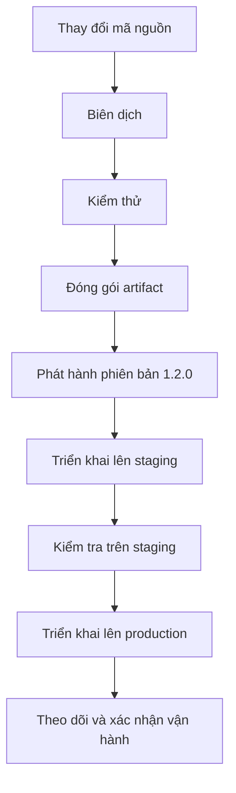

# Phân biệt biên dịch, kiểm thử, đóng gói, phát hành và triển khai

Trong quy trình phát triển phần mềm, biên dịch, kiểm thử, đóng gói, phát hành và triển khai thường xuất hiện liên tiếp trong một pipeline. Vì chúng có thể được chạy bằng các lệnh Gradle gần nhau, người mới học dễ xem chúng như những tên gọi khác nhau của cùng một việc. Thực tế, mỗi công đoạn giải quyết một câu hỏi riêng và tạo ra một kết quả riêng.

- **Biên dịch (compile):** mã nguồn có thể được chuyển thành dạng mà nền tảng thực thi hiểu được không?
- **Kiểm thử (test):** chương trình có hành vi đúng trong những tình huống đã được kiểm tra không?
- **Đóng gói (package):** những thành phần cần thiết đã được tập hợp thành một sản phẩm có thể phân phối chưa?
- **Phát hành (release):** phiên bản sản phẩm đã được định danh và đưa tới nơi người khác có thể lấy về chưa?
- **Triển khai (deploy):** phiên bản đó đã được cài đặt hoặc đưa vào chạy trong một môi trường cụ thể chưa?

Có thể hình dung sản phẩm đi qua các bước từ mã nguồn, kết quả biên dịch, bằng chứng kiểm thử, gói phần mềm, kho phát hành rồi tới môi trường chạy. Một bước thành công là điều kiện hữu ích cho bước sau, nhưng không tự động chứng minh tất cả các bước sau đã hoàn tất.

## 1. Bảng phân biệt nhanh

| Công đoạn | Đầu vào chính | Kết quả thường thấy | Câu hỏi được trả lời | Điều chưa được bảo đảm |
|---|---|---|---|---|
| Biên dịch | Mã nguồn và cấu hình biên dịch | Bytecode hoặc tệp đối tượng | Mã nguồn có hợp lệ theo quy tắc của compiler không? | Logic nghiệp vụ đúng, ứng dụng chạy đúng |
| Kiểm thử | Mã đã biên dịch, mã kiểm thử và môi trường kiểm thử | Kết quả pass/fail, báo cáo kiểm thử | Các hành vi được kiểm tra có đúng kỳ vọng không? | Mọi tình huống đều đúng, gói phát hành đã tồn tại |
| Đóng gói | Lớp đã biên dịch, tài nguyên và cấu hình đóng gói | JAR, WAR, ZIP hoặc image | Có thể tạo ra một đơn vị phần mềm để phân phối không? | Gói đã được công bố cho người dùng hoặc đang chạy |
| Phát hành | Artifact đã đóng gói và thông tin phiên bản | Phiên bản trong Maven repository, registry hoặc trang Release | Người nhận có thể lấy đúng phiên bản đã công bố không? | Phiên bản đã được cài đặt vào môi trường đích |
| Triển khai | Artifact đã chọn, cấu hình môi trường và hạ tầng | Ứng dụng hoặc dịch vụ được đưa vào môi trường | Phiên bản đã được đưa vào chạy ở môi trường cần thiết chưa? | Ứng dụng không còn lỗi hoặc sẽ luôn hoạt động ổn định |

Các kết quả trong bảng là ví dụ phổ biến. Công cụ, plugin và loại ứng dụng có thể làm thay đổi tên tác vụ hoặc định dạng artifact, nhưng ý nghĩa của năm công đoạn vẫn có thể phân biệt như trên.

## 2. Biên dịch (compile): chuyển mã nguồn thành dạng có thể thực thi

Biên dịch là quá trình dùng compiler chuyển mã nguồn sang một dạng biểu diễn khác mà nền tảng có thể xử lý. Với Java, compiler thường chuyển các tệp `.java` thành bytecode trong các tệp `.class`.

Ví dụ, mã nguồn:

```java
public class Greeting {
    public String message() {
        return "Hello, Java!";
    }
}
```

được `javac` biên dịch thành `Greeting.class`. Bytecode này được JVM nạp và thực thi khi ứng dụng chạy.

Compiler kiểm tra những điều thuộc phạm vi ngôn ngữ và kiểu dữ liệu, chẳng hạn cú pháp, tên biến, kiểu tham số, kiểu trả về, quyền truy cập và việc gọi phương thức có hợp lệ hay không. Nếu chương trình gọi một phương thức không tồn tại hoặc truyền một kiểu dữ liệu không tương thích, quá trình biên dịch có thể thất bại.

Trong Gradle, dự án Java thường có các tác vụ như:

```bash
./gradlew compileJava
./gradlew compileTestJava
```

- `compileJava` biên dịch mã nguồn chính, thường nằm trong `src/main/java`.
- `compileTestJava` biên dịch mã nguồn kiểm thử, thường nằm trong `src/test/java`. Tác vụ này cần các lớp chính và thư viện kiểm thử phù hợp trên classpath.

Biên dịch thành công chỉ cho biết compiler chấp nhận mã nguồn theo các quy tắc đang áp dụng. Một phương thức có thể biên dịch hoàn toàn bình thường nhưng vẫn tính sai tiền, xử lý sai dữ liệu hoặc ném exception khi chạy. Những vấn đề đó cần được phát hiện bằng kiểm thử và quan sát lúc chạy.

## 3. Kiểm thử (test): kiểm tra hành vi của chương trình

Kiểm thử thực thi các đoạn mã kiểm thử hoặc kịch bản kiểm thử để so sánh kết quả thực tế với kết quả mong đợi. Thay vì chỉ hỏi mã nguồn có biên dịch được hay không, kiểm thử hỏi chương trình có làm đúng việc cần làm trong những tình huống đã chọn hay không.

Một số loại kiểm thử thường gặp:

- **Unit test:** kiểm tra một đơn vị nhỏ, chẳng hạn một phương thức hoặc một lớp, thường cô lập các thành phần phụ thuộc.
- **Integration test:** kiểm tra sự phối hợp giữa nhiều thành phần, chẳng hạn service với repository hoặc ứng dụng với cơ sở dữ liệu.
- **End-to-end test:** kiểm tra một luồng sử dụng xuyên qua nhiều thành phần gần với cách người dùng thực tế tương tác.
- **Acceptance test:** xác nhận hệ thống đáp ứng các tiêu chí chấp nhận hoặc yêu cầu nghiệp vụ đã thống nhất.

Ví dụ một unit test cho `Greeting`:

```java
import static org.junit.jupiter.api.Assertions.assertEquals;

import org.junit.jupiter.api.Test;

class GreetingTest {
    @Test
    void returnsExpectedMessage() {
        Greeting greeting = new Greeting();

        assertEquals("Hello, Java!", greeting.message());
    }
}
```

Với cấu hình Java thông dụng của Gradle, có thể chạy:

```bash
./gradlew test
```

Tác vụ `test` thường cần biên dịch mã nguồn chính và mã kiểm thử trước khi chạy các test. Nếu một test thất bại, Gradle báo tác vụ thất bại và có thể tạo báo cáo để xem test nào không đạt, nguyên nhân hoặc assertion nào không khớp.

Kết quả kiểm thử cần được hiểu theo phạm vi kiểm thử đã chạy. Nếu chỉ có unit test cho một vài phương thức, kết quả pass không chứng minh toàn bộ ứng dụng đã đúng. Integration test cũng chỉ có giá trị khi môi trường và dữ liệu kiểm thử đại diện đủ tốt cho tình huống cần xác nhận.

Trong hệ sinh thái Gradle, `check` là một tác vụ tổng hợp cho các bước kiểm tra được cấu hình trong dự án. Với Java Plugin tiêu chuẩn, `check` phụ thuộc vào `test`; các plugin khác có thể bổ sung thêm tác vụ kiểm tra. Vì vậy, `test` và `check` có liên quan nhưng không phải lúc nào cũng đồng nghĩa.

## 4. Đóng gói (package): tạo artifact có thể phân phối

Sau khi mã đã được biên dịch và các bước kiểm tra cần thiết đã chạy, dự án thường cần gom các thành phần thành một sản phẩm có định dạng xác định. Quá trình này gọi là đóng gói. Sản phẩm đầu ra được gọi là **artifact**.

Trong Java, các định dạng thường gặp gồm:

- **JAR (Java Archive):** tệp lưu trữ chứa bytecode, tài nguyên và metadata theo cấu trúc JAR.
- **WAR (Web Application Archive):** gói ứng dụng web theo cấu trúc WAR.
- **ZIP:** gói nhiều tệp hoặc một bộ mã nguồn/tài nguyên theo cấu trúc do dự án quy định.
- **Container image:** ảnh chứa filesystem, ứng dụng và thông tin cần thiết để chạy trong container. Việc tạo image cũng là một dạng đóng gói artifact.

Với Gradle Java Plugin, tác vụ `jar` thường tạo JAR từ output của source set chính. Với dự án Spring Boot có plugin tương ứng, `bootJar` thường tạo JAR có thể chạy độc lập, bao gồm ứng dụng và các dependency runtime theo cơ chế loader của Spring Boot.

```bash
./gradlew jar
./gradlew bootJar
```

Hai lệnh trên chỉ là ví dụ. Tác vụ nào tồn tại và được bật phụ thuộc vào plugin cũng như cấu hình dự án. Một JAR thông thường không nhất thiết chứa tất cả thư viện runtime; JAR do Spring Boot đóng gói thường có cấu trúc khác để mang theo các dependency cần thiết.

Artifact thường xuất hiện trong thư mục đầu ra như `build/libs/`, nhưng vị trí và tên tệp có thể được tùy chỉnh. Ví dụ minh họa:

```text
build/
└── libs/
    └── inventory-service-1.2.0.jar
```

Tạo được tệp JAR chỉ chứng minh tác vụ đóng gói đã tạo ra artifact theo cấu hình hiện tại. Tệp đó có thể vẫn nằm trên máy của người build. Nó chưa tự động được tải lên kho chung, gắn nhãn phiên bản phát hành hoặc cài đặt lên máy chủ.

## 5. Phát hành (release): công bố một phiên bản

Phát hành là đưa một phiên bản phần mềm đã được xác định tới nơi người dùng, hệ thống khác hoặc nhóm vận hành có thể lấy và sử dụng. Artifact phát hành thường được gắn với một phiên bản cụ thể, ví dụ `1.2.0`, cùng metadata như tên, checksum, ghi chú thay đổi hoặc chữ ký nếu quy trình yêu cầu.

Artifact có thể được công bố tới nhiều loại nơi lưu trữ:

- Maven repository để dự án Java khác khai báo dependency và tải thư viện.
- Container registry để hệ thống triển khai lấy image theo tag hoặc digest.
- GitHub Releases hoặc hệ thống quản lý phiên bản tương tự để người dùng tải JAR, ZIP và các tệp đính kèm.
- Kho artifact nội bộ của tổ chức để các pipeline hoặc nhóm khác sử dụng.

Trong Gradle, nếu dự án cấu hình Maven Publish Plugin và publication/repository tương ứng, có thể xuất hiện các tác vụ như:

```bash
./gradlew publish
./gradlew publishToMavenLocal
```

`publish` thường công bố publication tới các repository đã cấu hình. `publishToMavenLocal` đưa publication vào Maven local repository trên máy đang chạy lệnh; điều đó hữu ích cho phát triển cục bộ nhưng không có nghĩa phiên bản đã được công bố lên kho dùng chung hoặc phát hành công khai.

Không phải dự án Gradle nào cũng có sẵn tác vụ `publish`. Tác vụ này phụ thuộc vào plugin và cấu hình xuất bản. Tương tự, một pipeline có thể thực hiện release bằng Git tag, GitHub Release, upload artifact hoặc quy trình nội bộ mà không dùng tác vụ Gradle tên `release`.

Một lần phát hành có thể bao gồm nhiều việc: xác định phiên bản, tạo artifact, kiểm tra artifact, gắn tag, tải lên repository/registry, tạo release notes và xác nhận người nhận có thể tải đúng artifact. Mục tiêu là giúp người khác nhận diện và lấy lại chính xác phiên bản đã được công bố.

Phát hành không đồng nghĩa với triển khai. Một phiên bản có thể đã nằm trong Maven repository hoặc container registry nhưng chưa được đưa lên môi trường staging hay production. Ngược lại, trong một hệ thống nội bộ, đội vận hành có thể triển khai một artifact đã phát hành từ trước mà không tạo release mới.

## 6. Triển khai (deploy): đưa phiên bản vào môi trường chạy

Triển khai là quá trình đưa một artifact đã chọn vào một môi trường đích và làm cho nó sẵn sàng hoạt động. Môi trường có thể là máy ảo, máy chủ vật lý, Kubernetes, nền tảng container, serverless hoặc một dịch vụ lưu trữ tĩnh.

Một quy trình triển khai thường có các hoạt động như:

1. Chọn chính xác phiên bản artifact cần triển khai.
2. Chuẩn bị môi trường, tài nguyên, biến cấu hình và secret cần thiết.
3. Tải artifact hoặc image về môi trường đích.
4. Cài đặt, thay thế phiên bản cũ hoặc khởi chạy phiên bản mới.
5. Kiểm tra health check, log và các chỉ số vận hành để xác nhận dịch vụ hoạt động.
6. Theo dõi sau triển khai và rollback nếu phiên bản mới gây sự cố theo tiêu chí đã định.

Ví dụ, một container image `inventory-service:1.2.0` đã được phát hành lên registry. Bước triển khai có thể cập nhật workload Kubernetes để sử dụng image đó. Kubernetes sau đó tạo hoặc thay thế các Pod theo cấu hình. Việc image đã tồn tại trong registry chưa có nghĩa các Pod đã chạy phiên bản mới.

Triển khai cũng không nhất thiết là chạy một lệnh Gradle. Có dự án dùng plugin Gradle cung cấp tác vụ deploy; có dự án giao việc này cho GitHub Actions, Jenkins, Argo CD, Helm, Kubernetes CLI hoặc nền tảng cloud. Vì vậy, `deploy` không phải là một tác vụ mặc định có mặt trong mọi dự án Gradle.

Một lần triển khai thành công cho biết quy trình đã đưa phiên bản vào môi trường theo các điều kiện xác nhận của nó. Ứng dụng vẫn cần giám sát sau đó: health check có thể pass trong khi một luồng nghiệp vụ hiếm gặp vẫn lỗi, hoặc dịch vụ có thể gặp vấn đề khi tải tăng cao.

## 7. Nhìn toàn bộ quy trình qua một ví dụ

Giả sử nhóm phát triển một ứng dụng quản lý kho bằng Java và muốn đưa phiên bản `1.2.0` lên production.



Ở từng bước, nhóm cần giữ được mối liên hệ giữa mã nguồn, kết quả kiểm thử và artifact:

- **Biên dịch:** xác nhận các lớp Java có thể được tạo từ mã nguồn.
- **Kiểm thử:** chạy unit test và integration test để kiểm tra các hành vi quan trọng.
- **Đóng gói:** tạo `inventory-service-1.2.0.jar` hoặc container image tương ứng.
- **Phát hành:** đưa artifact đã chọn lên kho chung với định danh phiên bản `1.2.0`.
- **Triển khai:** cấu hình môi trường staging rồi production để chạy đúng artifact `1.2.0`.

Nếu phát hiện lỗi trên staging, nhóm có thể dừng trước khi triển khai production. Nếu lỗi xuất hiện sau khi phát hành, nhóm có thể phát hành phiên bản sửa lỗi mới. Nếu phiên bản mới đã triển khai gây sự cố, đội vận hành có thể rollback về artifact của phiên bản trước nếu hệ thống hỗ trợ và quy trình cho phép.

Một nguyên tắc hữu ích là **xây dựng artifact một lần rồi đưa chính artifact đó qua các môi trường**. Ví dụ, cùng một image đã được kiểm thử có thể được triển khai lên staging rồi production; thông tin khác nhau giữa các môi trường được cung cấp qua cấu hình bên ngoài. Cách làm này giảm nguy cơ mỗi môi trường vô tình chạy một gói được build khác nhau.

## 8. Các tác vụ Gradle liên quan và cách đọc đúng kết quả

Gradle tổ chức công việc thành các task và task graph. Một task có thể phụ thuộc vào task khác, vì vậy khi chạy một lệnh, Gradle có thể tự thực hiện nhiều bước cần thiết trước đó.

Với Java Plugin tiêu chuẩn, một số task thường gặp là:

| Task | Vai trò thường gặp |
|---|---|
| `compileJava` | Biên dịch mã nguồn chính |
| `compileTestJava` | Biên dịch mã nguồn kiểm thử |
| `test` | Chạy test đã cấu hình |
| `check` | Chạy các bước kiểm tra được gom vào lifecycle verification |
| `jar` | Tạo JAR từ output của source set |
| `assemble` | Gom các artifact được cấu hình cho dự án |
| `build` | Task lifecycle tổng hợp, thường phụ thuộc vào `check` và `assemble` |

Plugin Spring Boot, plugin xuất bản hoặc plugin triển khai có thể bổ sung task riêng như `bootJar`, `publish` hoặc task deploy do dự án định nghĩa. Không nên giả định mọi tên task đều tồn tại ở mọi module.

Ví dụ, có thể chạy:

```bash
./gradlew test
./gradlew build
./gradlew tasks --all
./gradlew build --dry-run
```

- `test` yêu cầu Gradle chạy các task cần thiết để thực hiện kiểm thử.
- Với Java Plugin tiêu chuẩn, `build` gom phần kiểm tra và phần tạo artifact thông qua `check` và `assemble`. Plugin khác có thể mở rộng task graph.
- `tasks --all` liệt kê task mà dự án hiện tại cung cấp, hữu ích khi cần tìm task do plugin hoặc dự án tự định nghĩa.
- `--dry-run` cho xem những task Gradle dự định chạy mà không thực thi chúng, hữu ích để hiểu quan hệ phụ thuộc.

Không nên suy luận rằng `build` luôn phát hành hoặc triển khai ứng dụng. Trong cấu hình Java thông dụng, `build` tập trung vào kiểm tra và tạo output. Việc upload artifact, tạo release hay cập nhật môi trường chạy thường thuộc các task/plugin khác hoặc pipeline CI/CD riêng.

Khi đọc kết quả Gradle, hãy xem chính xác task nào đã chạy và task nào phụ thuộc vào nó. Dòng `BUILD SUCCESSFUL` có nghĩa các task được yêu cầu trong lần chạy đó hoàn tất thành công; nó không tự khẳng định toàn bộ quy trình phát hành phần mềm đã hoàn thành.

## 9. Những nhầm lẫn thường gặp

| Nhầm lẫn | Cách hiểu chính xác |
|---|---|
| Biên dịch thành công nghĩa là chương trình đúng | Compiler xác nhận tính hợp lệ ở mức ngôn ngữ và kiểu; kiểm thử mới kiểm tra hành vi theo các trường hợp đã chọn. |
| Chạy test thành công nghĩa là đã có gói phát hành | Test có thể chạy trực tiếp trên các lớp đã biên dịch; đóng gói và phát hành là các công đoạn riêng. |
| Tạo được JAR nghĩa là người dùng đã tải được JAR | JAR có thể chỉ nằm trong thư mục `build/libs/` trên máy build. Cần công bố tới nơi nhận có thể truy cập. |
| Upload artifact nghĩa là ứng dụng đã chạy | Upload chỉ đưa artifact tới repository hoặc registry. Triển khai còn cần đưa nó vào môi trường và khởi chạy. |
| `build` nghĩa là release và deploy | `build` thường là task lifecycle của Gradle; ý nghĩa cụ thể phụ thuộc plugin, còn release/deploy thường cần cấu hình riêng. |
| Deploy thành công nghĩa là ứng dụng không còn lỗi | Cần health check, log, metric và kiểm thử sau triển khai để đánh giá hoạt động thực tế. |

Một số ví dụ thực tế giúp phân biệt rõ hơn:

- `compileJava` thành công nhưng `test` thất bại: mã nguồn hợp lệ về mặt biên dịch, nhưng ít nhất một hành vi được kiểm tra không đạt.
- `test` thành công nhưng `bootJar` thất bại: kiểm thử đã qua, nhưng cấu hình hoặc quá trình tạo gói vẫn có vấn đề.
- `bootJar` thành công nhưng `publish` thất bại: artifact đã được tạo cục bộ, nhưng chưa được công bố tới repository theo yêu cầu.
- `publish` thành công nhưng deploy thất bại: artifact đã có trong kho, nhưng môi trường đích hoặc bước cập nhật ứng dụng gặp vấn đề.
- deploy thành công nhưng health check sau đó thất bại: phiên bản đã được đưa vào môi trường, nhưng chưa đáp ứng điều kiện vận hành mong muốn.

## 10. Liên hệ với CI/CD

CI/CD tự động hóa nhiều công đoạn ở trên, nhưng các thuật ngữ này vẫn có ý nghĩa riêng:

- **Continuous Integration (CI):** thường tự động biên dịch và chạy kiểm thử khi có thay đổi mã nguồn để phát hiện lỗi tích hợp sớm.
- **Continuous Delivery:** duy trì khả năng tạo ra phiên bản đã được xác minh và sẵn sàng phát hành; bước triển khai production có thể vẫn cần người phê duyệt.
- **Continuous Deployment:** tự động triển khai thay đổi đã vượt qua các cổng kiểm tra tới production mà không cần một bước phê duyệt thủ công riêng cho từng lần phát hành.

Một pipeline có thể tự động chạy compile, test, package và publish, sau đó chờ phê duyệt trước khi deploy. Pipeline khác có thể tự động triển khai ngay khi mọi kiểm tra đạt. Mức độ tự động hóa khác nhau không làm thay đổi bản chất của từng công đoạn.

## 11. Cách tự xác định một công đoạn đã hoàn tất

Khi xem một pipeline hoặc đọc cấu hình build, hãy tìm bằng chứng phù hợp với từng mục tiêu:

1. **Biên dịch:** task compiler hoàn tất và có output lớp tương ứng.
2. **Kiểm thử:** báo cáo test cho biết những test nào đã chạy, pass hoặc fail.
3. **Đóng gói:** artifact được tạo đúng định dạng, tên và phiên bản mong đợi.
4. **Phát hành:** repository, registry hoặc trang Release có thể truy xuất đúng artifact và định danh phiên bản.
5. **Triển khai:** môi trường đích đang sử dụng đúng phiên bản; trạng thái rollout và health check đáp ứng điều kiện xác nhận.

Các lệnh kiểm tra task và task graph của Gradle có thể giúp hiểu phần build. Với release và deploy, cần kiểm tra thêm cấu hình CI/CD, quyền truy cập repository, trạng thái registry và trạng thái môi trường đích. Tên một task hoặc một dòng `BUILD SUCCESSFUL` không đủ để suy ra mọi công đoạn đều đã xảy ra.

Khi phân tích sự cố, hãy xác định công đoạn đầu tiên không đạt rồi xem đầu vào và đầu ra của chính công đoạn đó. Ví dụ, nếu compile thất bại thì cần xử lý mã nguồn hoặc cấu hình compiler; nếu package thất bại sau khi test pass thì tập trung vào cấu hình đóng gói; nếu publish thất bại thì kiểm tra repository, credentials và metadata; nếu deploy thất bại thì kiểm tra artifact được chọn, cấu hình môi trường, quyền triển khai và trạng thái hạ tầng. Cách khoanh vùng này giúp tìm đúng nơi phát sinh vấn đề trong chuỗi bàn giao phần mềm.
