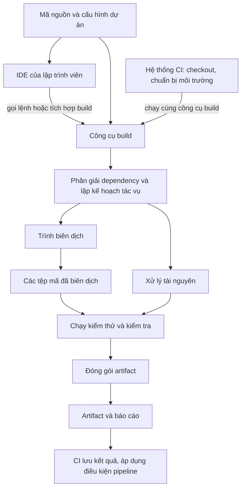

# Vai trò của công cụ build so với trình biên dịch, IDE và hệ thống CI

Khi làm việc với một dự án Java, bạn thường gặp bốn thành phần cùng tham gia vào quá trình tạo và kiểm tra phần mềm: **trình biên dịch**, **công cụ build**, **IDE** và **hệ thống CI**. Chúng có thể xuất hiện cạnh nhau trong một nút bấm hoặc một lệnh duy nhất, nhưng mỗi thành phần giải quyết một nhóm vấn đề khác nhau.

Trình biên dịch chuyển mã nguồn thành dạng mã mà nền tảng có thể xử lý. Công cụ build điều phối các bước cần thiết để biến một dự án thành kết quả có thể kiểm tra hoặc phân phối. IDE cung cấp môi trường làm việc cho lập trình viên và tích hợp với công cụ build. Hệ thống CI tự động lấy mã nguồn, chuẩn bị môi trường rồi chạy quy trình kiểm tra và build khi có thay đổi.

Hiểu đúng ranh giới này giúp bạn biết nên tìm lỗi ở đâu, vì sao build trên máy cá nhân có thể khác CI, và vì sao một dự án thường cần cả bốn thành phần.

## 1. Nhìn toàn cảnh một quy trình build

Một dự án Java không chỉ cần biên dịch một tệp `.java`. Trước khi có thể tạo ra một JAR hoặc WAR đáng tin cậy, dự án có thể cần lấy thư viện bên ngoài, xử lý tài nguyên, biên dịch mã chính và mã kiểm thử, chạy test, kiểm tra chất lượng rồi đóng gói kết quả.

Các thành phần tham gia có thể được hình dung như sau:



Sơ đồ mô tả trách nhiệm ở mức khái niệm. Tùy dự án và plugin, thứ tự thực tế, số lượng tác vụ và cách thực thi có thể khác nhau. Điểm cốt lõi là công cụ build tổ chức công việc; trình biên dịch chỉ đảm nhiệm phần chuyển đổi mã nguồn thuộc phạm vi của nó; IDE và CI là hai môi trường khác nhau có thể yêu cầu công cụ build thực hiện công việc.

## 2. Trình biên dịch: chuyển đổi mã nguồn

**Trình biên dịch (compiler)** đọc mã nguồn theo ngôn ngữ và quy tắc của nó, kiểm tra các điều kiện cần thiết, sau đó tạo ra dạng mã đích. Với Java, `javac` biên dịch mã nguồn `.java` thành bytecode trong các tệp `.class`. JVM sử dụng bytecode đó khi chạy chương trình.

Ví dụ, xét tệp `Hello.java`:

```java
public class Hello {
    public static void main(String[] args) {
        System.out.println("Hello, Java!");
    }
}
```

Có thể gọi trình biên dịch Java trực tiếp:

```bash
javac Hello.java
```

Nếu biên dịch thành công, lệnh tạo `Hello.class`. Lệnh này minh họa đúng công việc của compiler: chuyển một hoặc nhiều đơn vị mã nguồn thành bytecode và báo lỗi biên dịch khi mã không hợp lệ.

Trong dự án thực tế, việc biên dịch còn cần biết nhiều thông tin như:

- Phiên bản Java và mức tương thích của bytecode.
- Đường dẫn chứa các thư viện mà mã nguồn tham chiếu.
- Thư mục mã nguồn và thư mục đầu ra.
- Các tùy chọn biên dịch, annotation processor và cấu hình liên quan.
- Thứ tự hoặc quan hệ giữa những phần mã cần được tạo trước.

Compiler không phải nơi thuận tiện để quản lý toàn bộ các thông tin và bước này cho cả dự án. Có thể gọi `javac` bằng script tự viết, nhưng khi dự án có nhiều thư mục, dependency, test và quy trình đóng gói, script sẽ phải tự gánh thêm nhiều trách nhiệm. Đây là một trong những lý do công cụ build tồn tại.

Compiler thường trả lời câu hỏi: **mã nguồn này có thể được chuyển thành mã đích hay không, và kết quả là gì?** Nó không tự chịu trách nhiệm đầy đủ cho việc lấy dependency, chạy toàn bộ test suite, tạo báo cáo, đóng gói mọi tài nguyên hay quyết định khi nào pipeline được phép phát hành.

## 3. Công cụ build: điều phối toàn bộ quy trình tạo sản phẩm

**Công cụ build (build tool)** tự động hóa và điều phối các công việc cần thực hiện để tạo, kiểm tra và đóng gói một dự án. Nó biết cấu trúc dự án, dependency, các tác vụ, điều kiện phụ thuộc giữa tác vụ và nơi lưu kết quả.

Trong hệ sinh thái Java, những công cụ phổ biến gồm:

- **Gradle**: mô tả build bằng build script, tổ chức công việc thành các task và xây dựng đồ thị thực thi.
- **Maven**: mô tả dự án và dependency trong `pom.xml`, tổ chức build theo lifecycle và các goal/plugin.
- **Ant**: sử dụng các target và task được khai báo trong build file.

Tên và cách cấu hình khác nhau, nhưng chúng cùng giải quyết bài toán tự động hóa quy trình build.

### 3.1. Các trách nhiệm thường gặp

Một build tool có thể đảm nhiệm hoặc điều phối các công việc sau:

| Trách nhiệm | Ý nghĩa |
|---|---|
| Đọc cấu hình dự án | Xác định plugin, phiên bản, thư mục, tùy chọn và các thành phần tham gia build. |
| Phân giải dependency | Tìm và tải thư viện cần thiết, xác định phiên bản và classpath cho từng tác vụ. |
| Lập kế hoạch thực thi | Xác định tác vụ nào cần chạy và quan hệ phụ thuộc giữa chúng. |
| Biên dịch | Gọi hoặc tích hợp compiler với cấu hình phù hợp. |
| Xử lý tài nguyên | Sao chép hoặc xử lý tệp cấu hình, ảnh, template và tài nguyên khác. |
| Kiểm thử | Biên dịch mã test, khởi chạy test framework và thu thập kết quả. |
| Kiểm tra bổ sung | Chạy các tác vụ như kiểm tra kiểu, phân tích mã, kiểm tra định dạng hoặc kiểm tra dependency nếu dự án đã cấu hình. |
| Đóng gói | Tạo JAR, WAR hoặc artifact theo cấu hình dự án. |
| Tái sử dụng kết quả | Có thể bỏ qua tác vụ không cần chạy lại, dùng cache hoặc chạy song song khi điều kiện cho phép. |

Không phải dự án nào cũng bật tất cả các khả năng trên. Build tool cung cấp cơ chế; plugin và cấu hình dự án xác định những việc cụ thể sẽ diễn ra.

### 3.2. Build tool phối hợp với compiler như thế nào?

Khi chạy tác vụ biên dịch, build tool chuẩn bị đầu vào cho compiler. Chẳng hạn, nó xác định tệp nguồn, phiên bản Java, classpath, thư mục đích và tùy chọn biên dịch. Sau đó, nó thực thi compiler hoặc tích hợp với compiler để tạo bytecode. Nếu có lỗi, kết quả lỗi được trả về qua tác vụ build.

Vì vậy, khi một lệnh Gradle biên dịch mã Java, không nên hiểu rằng Gradle chính là `javac`. Gradle điều phối task biên dịch và cung cấp cấu hình; Java compiler thực hiện việc biên dịch. Quan hệ tương tự cũng tồn tại giữa Maven và compiler mà plugin biên dịch của Maven sử dụng.

### 3.3. Task graph: mô tả quan hệ giữa các bước

Với Gradle, công việc được biểu diễn bằng các **task**. Task có thể phụ thuộc vào task khác. Gradle sử dụng các quan hệ đó để xác định những task cần chạy và thứ tự phù hợp.

Trong một dự án sử dụng Java plugin tiêu chuẩn của Gradle, luồng khái quát có thể gồm:

```text
build
├── check
│   └── test
│       └── testClasses
│           ├── compileTestJava
│           └── processTestResources
└── assemble
    └── jar
        └── classes
            ├── compileJava
            └── processResources
```

Đây là sơ đồ rút gọn để minh họa các quan hệ chính. Plugin khác có thể bổ sung task và dependency. Một task cũng có thể được dùng chung bởi nhiều nhánh; Gradle không cần thực thi cùng một task nhiều lần chỉ vì có nhiều task phụ thuộc vào nó.

Lệnh sau yêu cầu Gradle xóa kết quả build cũ rồi thực hiện build:

```bash
./gradlew clean build
```

Trên Windows, có thể gọi wrapper bằng:

```powershell
.\gradlew.bat clean build
```

Với Java plugin tiêu chuẩn, task `build` phụ thuộc vào các nhóm kiểm tra (`check`) và lắp ráp (`assemble`); `check` thường kéo theo `test`, còn `assemble` tạo artifact như JAR. Plugin dự án có thể thay đổi hoặc mở rộng đồ thị này.

Trong Maven, có thể yêu cầu chạy lifecycle đến giai đoạn `verify`:

```bash
./mvnw clean verify
```

Maven và Gradle có mô hình cấu hình, tên bước và quy tắc riêng. Không nên giả định một task Gradle và một phase Maven có quan hệ một-một chỉ vì tên gọi gần giống nhau.

### 3.4. Vì sao build tool quan trọng với dự án?

Build tool đưa quy trình build vào cấu hình có thể lưu cùng mã nguồn. Thành viên trong nhóm có thể sử dụng cùng dependency, task và tùy chọn thay vì mỗi người tự viết một chuỗi lệnh khác nhau.

Điều này hỗ trợ:

- **Tính nhất quán**: các bước build được mô tả tập trung và có thể xem xét trong phiên bản hóa mã nguồn.
- **Khả năng lặp lại**: nhóm có thể chạy lại cùng quy trình trên máy khác hoặc CI, với điều kiện môi trường và đầu vào tương ứng.
- **Quản lý dependency**: thư viện và phiên bản được khai báo, phân giải theo quy tắc rõ ràng.
- **Tự động hóa**: biên dịch, test, đóng gói và kiểm tra được kết nối thành một quy trình.
- **Hiệu quả**: task graph, incremental build, cache và thực thi song song có thể giảm công việc lặp lại khi cấu hình hỗ trợ.

Build tool không tự bảo đảm mọi máy đều cho ra kết quả giống hệt nhau. Muốn build đáng tin cậy, dự án vẫn cần kiểm soát phiên bản JDK, phiên bản build tool, dependency, cấu hình và những đầu vào bên ngoài có ảnh hưởng đến kết quả.

## 4. IDE: môi trường làm việc của lập trình viên

**IDE (Integrated Development Environment)** là môi trường phát triển tích hợp. IDE hỗ trợ lập trình viên viết, đọc, điều hướng, chạy và gỡ lỗi mã nguồn trong một giao diện thống nhất.

Các chức năng thường gặp của IDE gồm:

- Soạn thảo mã với tô màu cú pháp, tự động hoàn thành và gợi ý lỗi.
- Điều hướng đến khai báo, tìm nơi sử dụng, đổi tên và tái cấu trúc mã.
- Quản lý cấu trúc project và cấu hình chạy.
- Chạy chương trình, đặt breakpoint và gỡ lỗi.
- Tích hợp Git, terminal, công cụ kiểm tra mã và trình quản lý dependency.
- Tích hợp Gradle hoặc Maven để đồng bộ project, xem task và chạy build.

IDE tập trung vào trải nghiệm phát triển. Nó giúp lập trình viên thao tác thuận tiện, nhưng không thay thế vai trò cấu hình quy trình build của dự án.

### 4.1. IDE gọi build tool

Khi mở một dự án Gradle, IDE thường đọc build script và đồng bộ mô hình dự án. IDE có thể hiển thị source set, dependency, task và cấu hình chạy dựa trên thông tin đó.

Khi lập trình viên bấm nút chạy một task Gradle trong IDE, IDE có thể gọi Gradle thông qua wrapper hoặc Gradle Tooling API. Khi đó, Gradle vẫn thực hiện quy trình build theo cấu hình của dự án; IDE là giao diện để yêu cầu và quan sát kết quả.

Ví dụ, cùng một task có thể được chạy theo hai cách:

```text
Trong IDE:
  Mở cửa sổ Gradle → chọn task test → Run

Trong terminal:
  ./gradlew test
```

Nếu cả hai cách đều gọi cùng Gradle project và dùng cùng môi trường, chúng thường thực hiện cùng quy tắc build. Tuy nhiên, cấu hình chạy riêng của IDE, JDK mà IDE chọn, biến môi trường hoặc cách IDE biên dịch có thể khiến kết quả khác nhau.

### 4.2. IDE đôi khi có cơ chế biên dịch riêng

Một số IDE có thể dùng compiler hoặc cơ chế build nội bộ cho một số thao tác, ví dụ biên dịch nhanh khi lưu hoặc chạy một cấu hình riêng. Vì thế, thao tác **Build Project** trong IDE không phải lúc nào cũng đồng nghĩa với việc chạy task `build` của Gradle hay lifecycle `verify` của Maven.

Điều này có thể tạo ra tình huống:

- Mã chạy được trong IDE nhưng build từ terminal thất bại.
- IDE báo lỗi hoặc không nhận dependency dù lệnh build thành công.
- IDE và build tool đang dùng hai phiên bản JDK khác nhau.
- Annotation processing, generated source hoặc classpath được cấu hình khác nhau.

Khi cần xác nhận dự án có thể build theo quy trình đã khai báo, hãy chạy wrapper của dự án trong terminal. IDE vẫn rất hữu ích để tìm lỗi và sửa mã, còn lệnh build của dự án cung cấp một cách kiểm tra rõ ràng có thể dùng lại trong CI.

## 5. Hệ thống CI: tự động kiểm tra thay đổi trong môi trường tích hợp

**CI (Continuous Integration — tích hợp liên tục)** là cách tổ chức việc tích hợp và kiểm tra các thay đổi mã nguồn thường xuyên bằng quy trình tự động. Hệ thống CI theo dõi sự kiện như push commit, tạo pull request hoặc yêu cầu chạy thủ công, sau đó khởi chạy pipeline trên một runner.

Các hệ thống CI phổ biến gồm GitHub Actions, GitLab CI, Jenkins và Azure Pipelines. Tùy hệ thống, pipeline có thể được mô tả bằng YAML, giao diện cấu hình hoặc mã lệnh.

Một pipeline CI điển hình có thể thực hiện:

1. Nhận sự kiện kích hoạt, chẳng hạn một pull request.
2. Lấy đúng commit cần kiểm tra từ repository.
3. Chuẩn bị môi trường như JDK, hệ điều hành, biến môi trường và quyền truy cập cần thiết.
4. Khôi phục cache nếu pipeline được cấu hình.
5. Gọi build tool của dự án để biên dịch, chạy test và đóng gói.
6. Thu thập báo cáo test, log và artifact.
7. Đánh dấu pipeline thành công hoặc thất bại để nhóm sử dụng kết quả đó trong quá trình review và tích hợp.

CI chịu trách nhiệm tự động hóa quy trình ở cấp repository hoặc nhóm dự án. Nó có thể điều phối nhiều job, nhiều môi trường và nhiều bước ngoài build. Việc biên dịch và đóng gói dự án thường vẫn do build tool thực hiện trên runner.

### 5.1. CI gọi build tool như thế nào?

Ví dụ dưới đây mô tả một pipeline Java ở mức khái quát:

```yaml
steps:
  - name: Lấy mã nguồn
    run: checkout repository

  - name: Chuẩn bị Java
    run: install JDK 21

  - name: Kiểm tra dự án
    run: ./gradlew --no-daemon clean build

  - name: Lưu kết quả
    run: upload test reports and build artifacts
```

Các dòng `checkout repository`, `install JDK 21` và `upload test reports and build artifacts` là mô tả hành động để dễ đọc, không phải cú pháp lệnh dùng nguyên văn trong mọi hệ thống CI. Cú pháp thật phụ thuộc nền tảng CI.

Điểm quan trọng nằm ở lệnh:

```bash
./gradlew --no-daemon clean build
```

Runner gọi Gradle Wrapper được lưu trong repository. Wrapper chọn phiên bản Gradle đã khai báo; Gradle đọc cấu hình và thực hiện task graph. Task biên dịch gọi compiler, task test chạy test framework, task đóng gói tạo artifact. CI nhận mã thoát và các tệp kết quả để xác định trạng thái job.

Khi chạy trên máy cá nhân, lập trình viên cũng có thể gọi cùng wrapper:

```bash
./gradlew --no-daemon clean build
```

Nhờ đó, quy trình build được chia sẻ giữa máy cá nhân và CI. Kết quả vẫn có thể khác nếu JDK, hệ điều hành, biến môi trường, quyền truy cập, dependency bên ngoài hoặc đầu vào khác không giống nhau.

### 5.2. CI không phải là build tool

CI và build tool thường được nhắc cùng nhau vì pipeline CI thường chạy lệnh build. Tuy nhiên, chúng nằm ở hai cấp trách nhiệm:

- CI quyết định **khi nào** pipeline chạy, chạy trên runner nào, gồm những job nào và điều kiện nào được xem là thành công.
- Build tool quyết định **dự án cần làm những bước build nào**, dependency ra sao, task nào phụ thuộc task nào và artifact được tạo như thế nào.

Một pipeline có thể gọi Gradle, Maven, npm, Docker hoặc nhiều công cụ khác. Ngược lại, bạn có thể chạy Gradle hoặc Maven trên máy cá nhân mà không cần một hệ thống CI.

CI cũng không đồng nghĩa với triển khai ứng dụng lên production. Một pipeline có thể chỉ kiểm tra và tạo artifact; việc phát hành hoặc triển khai có thể là các giai đoạn tiếp theo với điều kiện và quyền riêng.

## 6. So sánh bốn thành phần

| Thành phần | Câu hỏi chính | Trách nhiệm tiêu biểu | Ví dụ |
|---|---|---|---|
| Trình biên dịch | Mã nguồn chuyển thành mã đích như thế nào? | Phân tích và biên dịch mã nguồn, báo lỗi biên dịch, tạo bytecode hoặc mã đích. | `javac`, Kotlin compiler |
| Công cụ build | Cần thực hiện những bước nào để tạo và kiểm tra dự án? | Quản lý dependency, lập kế hoạch task, gọi compiler, chạy test, xử lý tài nguyên, đóng gói. | Gradle, Maven, Ant |
| IDE | Lập trình viên làm việc với mã nguồn thuận tiện ra sao? | Soạn thảo, điều hướng, refactor, chạy, debug và tích hợp công cụ. | IntelliJ IDEA, Eclipse, VS Code |
| Hệ thống CI | Làm sao tự động kiểm tra thay đổi trong môi trường dùng chung? | Kích hoạt pipeline, lấy mã nguồn, chuẩn bị runner, gọi build tool, lưu kết quả và áp dụng điều kiện job. | GitHub Actions, GitLab CI, Jenkins |

Có thể ghi nhớ sự phân công bằng bốn câu hỏi:

```text
Compiler  → Biên dịch mã nguồn.
Build tool → Điều phối quy trình build của dự án.
IDE        → Hỗ trợ lập trình viên làm việc với dự án.
CI         → Tự động chạy quy trình trên runner khi có sự kiện.
```

Các thành phần có thể tích hợp sâu với nhau. Một nút bấm trong IDE có thể gọi task Gradle; một job CI có thể gọi Gradle Wrapper; task Gradle có thể gọi compiler và test framework. Việc chúng xuất hiện trong cùng một chuỗi không làm trách nhiệm của chúng trở thành một.

## 7. Ví dụ xuyên suốt: từ sửa mã đến CI

Giả sử bạn đang phát triển một ứng dụng Java dùng Gradle.

**Bước 1 — Viết mã trong IDE.** Bạn mở lớp `OrderService`, thêm một phương thức và dùng tính năng tự động hoàn thành hoặc điều hướng của IDE. IDE giúp bạn làm việc với mã nguồn và có thể cảnh báo lỗi ngay trong trình soạn thảo.

**Bước 2 — Yêu cầu build tool kiểm tra.** Bạn chạy `./gradlew test`. Gradle đọc cấu hình, phân giải dependency, xây dựng task graph và xác định các tác vụ cần chạy. Nó chuẩn bị classpath rồi gọi compiler để biên dịch mã chính và mã test.

**Bước 3 — Compiler thực hiện phần biên dịch.** Java compiler kiểm tra mã và tạo bytecode. Nếu có lỗi cú pháp hoặc kiểu dữ liệu, compiler báo lỗi; Gradle nhận lỗi từ task và đánh dấu build thất bại.

**Bước 4 — Build tool chạy test.** Nếu biên dịch thành công, Gradle chạy các test theo cấu hình. Test framework thực thi các trường hợp kiểm thử; Gradle thu thập kết quả và tạo báo cáo theo cấu hình dự án.

**Bước 5 — Đẩy thay đổi lên repository.** Khi bạn push commit hoặc mở pull request, hệ thống CI nhận sự kiện và khởi chạy pipeline.

**Bước 6 — CI kiểm tra trong runner.** Runner lấy đúng commit, chuẩn bị JDK và gọi lại lệnh build của dự án. Build tool thực hiện quy trình đã khai báo. CI thu thập trạng thái, báo cáo và artifact rồi hiển thị kết quả cho nhóm.

Nếu lệnh build trên máy cá nhân thành công nhưng CI thất bại, hãy so sánh môi trường và đầu vào trước khi kết luận mã nguồn có vấn đề. Ví dụ, máy cá nhân có thể dùng JDK 21 trong khi runner dùng JDK 17; IDE có thể có biến môi trường mà runner không có; hoặc dependency chỉ tồn tại trong cache cục bộ.

## 8. Chọn đúng nơi để tìm lỗi

Nhận diện đúng thành phần thường giúp thu hẹp phạm vi điều tra:

| Triệu chứng | Nơi nên kiểm tra đầu tiên | Điều cần xem |
|---|---|---|
| Lỗi cú pháp, kiểu dữ liệu hoặc không tìm thấy symbol khi biên dịch | Compiler và mã nguồn | Thông báo compiler, import, kiểu dữ liệu, classpath mà task biên dịch nhận được. |
| Không tải được thư viện hoặc xung đột phiên bản dependency | Build tool | Khai báo dependency, repository, phiên bản, cấu hình và kết quả phân giải dependency. |
| Task không chạy, chạy sai thứ tự hoặc thiếu đầu ra | Build tool | Task graph, quan hệ phụ thuộc, input/output và cấu hình plugin. |
| IDE không nhận source folder hoặc dependency dù terminal build thành công | IDE và bước đồng bộ project | Gradle/Maven sync, JDK của IDE, cấu hình project model và cache của IDE. |
| Chạy được trong IDE nhưng lệnh wrapper thất bại | Build tool và môi trường local | JDK, compiler options, annotation processing, cấu hình chạy và lệnh build thực tế. |
| Local thành công nhưng CI thất bại | Môi trường CI trước, sau đó là build | JDK, OS, biến môi trường, secret, quyền truy cập, cache, working directory và commit được checkout. |
| CI không được kích hoạt hoặc chạy sai job | Cấu hình CI | Trigger, điều kiện, nhánh, quyền và quan hệ giữa các job. |

Một cách điều tra có hệ thống là lấy lệnh CI thực sự chạy rồi thử chạy cùng lệnh bằng wrapper trên máy cá nhân. Sau đó so sánh phiên bản JDK, build tool, hệ điều hành và biến môi trường. Khi cần, bật log chi tiết của build tool để xác định task nào thất bại và lỗi xuất phát từ compiler, test hay một plugin.

## 9. Một số hiểu nhầm thường gặp

### “Gradle là trình biên dịch Java”

Không chính xác. Gradle là build automation tool. Nó có thể điều phối task biên dịch và gọi Java compiler, nhưng bản thân trách nhiệm của Gradle rộng hơn biên dịch.

### “Bấm Build trong IDE là đã chạy toàn bộ build của dự án”

Không phải lúc nào cũng vậy. Nút Build có thể sử dụng tích hợp Gradle/Maven hoặc cơ chế build nội bộ của IDE, tùy cấu hình. Hãy kiểm tra lệnh hoặc task thực tế được gọi.

### “CI biên dịch mã nguồn nên CI chính là compiler”

CI khởi chạy job và lệnh. Lệnh đó thường gọi build tool, rồi build tool gọi compiler. CI chịu trách nhiệm điều phối pipeline và môi trường thực thi.

### “Có build tool là không cần IDE”

Build tool có thể chạy độc lập trong terminal hoặc CI, nhưng không cung cấp đầy đủ trải nghiệm soạn thảo, điều hướng và gỡ lỗi mà IDE hướng đến. Hai thành phần phục vụ các nhu cầu khác nhau.

### “Build thành công nghĩa là ứng dụng chắc chắn đúng và sẵn sàng production”

Build thành công chỉ cho biết các bước đã được cấu hình trong lần chạy đó hoàn tất. Chất lượng kết quả còn phụ thuộc độ bao phủ của test, các kiểm tra được bật, cấu hình môi trường và những tiêu chí phát hành khác. Một build không chạy test hoặc không có kiểm tra bảo mật không thể chứng minh các điều kiện đó đã được đáp ứng.

## 10. Thực hành: lần theo một lệnh build

Trong một dự án Gradle có Java plugin, hãy thực hiện các bước sau:

1. Mở terminal tại thư mục chứa `gradlew` hoặc `gradlew.bat`.
2. Chạy `./gradlew tasks` để xem những task được công khai trong dự án. Trên Windows, dùng `.\gradlew.bat tasks`.
3. Chạy `./gradlew clean build` và quan sát các task xuất hiện trong log.
4. Tìm task biên dịch Java, chẳng hạn `compileJava`, và nhận diện thông báo lỗi nếu có.
5. Tìm task test, chẳng hạn `test`, rồi xem báo cáo test do dự án tạo ra.
6. Tìm artifact được đóng gói, chẳng hạn JAR trong thư mục `build/libs/` của module.
7. So sánh kết quả khi chạy task từ cửa sổ Gradle trong IDE và khi chạy cùng lệnh wrapper từ terminal.

Khi thực hành, hãy tự trả lời:

- Task nào gọi compiler?
- Dependency được phân giải trước khi compiler chạy như thế nào?
- Task nào chạy test và task nào đóng gói artifact?
- IDE đang gọi Gradle hay dùng cơ chế build riêng?
- Nếu CI chạy cùng lệnh wrapper, những khác biệt môi trường nào vẫn có thể làm kết quả thay đổi?

Nếu dự án dùng Maven, có thể làm bài thực hành tương tự bằng Maven Wrapper và quan sát các phase từ `clean` đến `verify`.

## 11. Kết luận

Trình biên dịch là thành phần chuyển mã nguồn thành mã đích. Công cụ build tổ chức các bước cần thiết để tạo và kiểm tra sản phẩm của dự án, đồng thời kết nối compiler với dependency, test, xử lý tài nguyên và đóng gói. IDE cung cấp môi trường phát triển và có thể tích hợp để gọi công cụ build. Hệ thống CI tự động chuẩn bị môi trường, lấy mã nguồn và chạy quy trình build khi có thay đổi.

Trong một dự án Java hiện đại, cách phối hợp phổ biến là lập trình viên làm việc trong IDE, dùng Gradle hoặc Maven để mô tả và chạy quy trình build, còn CI gọi lại quy trình đó trên runner để kiểm tra các thay đổi một cách nhất quán. Khi biết thành phần nào chịu trách nhiệm cho từng bước, bạn có thể đọc log chính xác hơn, xử lý lỗi nhanh hơn và thiết kế quy trình phát triển đáng tin cậy hơn.
