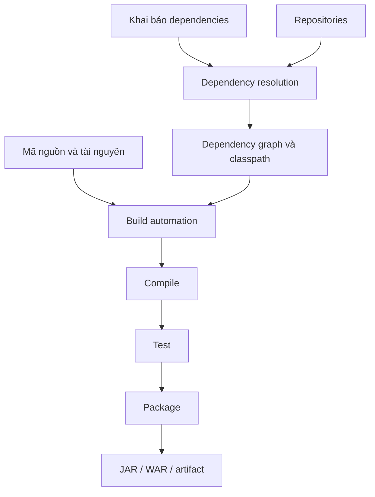
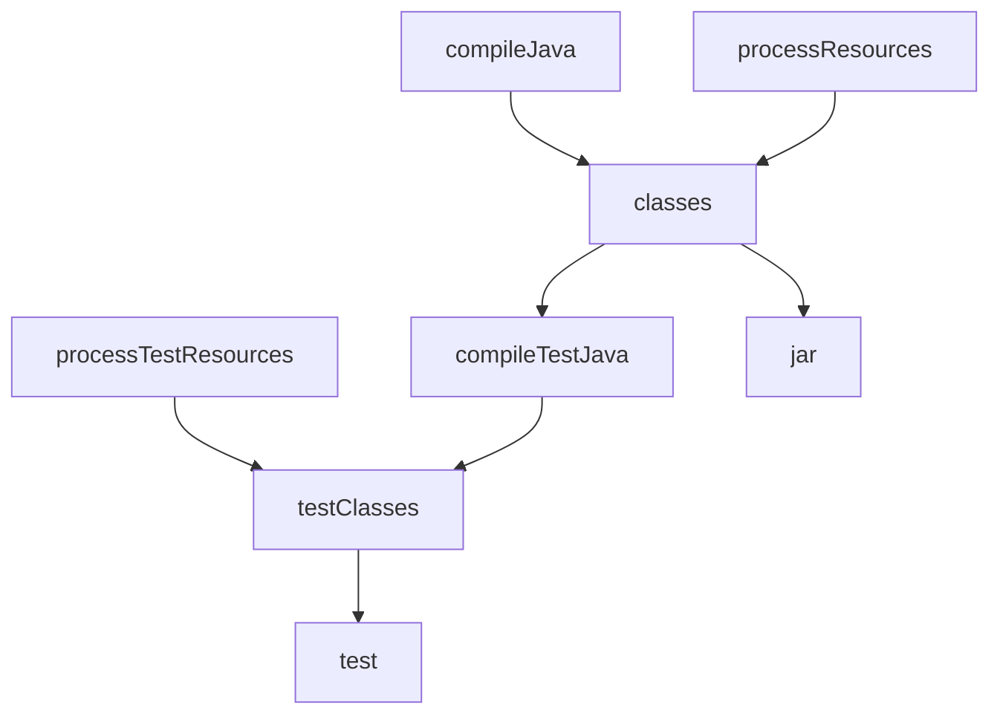

# Tự động hóa build và quản lý phụ thuộc: hai trách nhiệm cốt lõi

Một dự án Java có thể chỉ gồm vài lớp, nhưng để biến mã nguồn thành một ứng dụng có thể chạy được, ta vẫn phải thực hiện nhiều bước: lấy thư viện cần thiết, biên dịch, xử lý tài nguyên, biên dịch và chạy kiểm thử, đóng gói, rồi chuẩn bị sản phẩm cho môi trường triển khai. Khi dự án lớn hơn, những bước này cần được thực hiện nhất quán trên máy của nhiều lập trình viên và trên máy chủ CI.

Build tool giải quyết công việc đó bằng hai nhóm trách nhiệm liên quan chặt chẽ:

- **Tự động hóa build (build automation):** mô tả và điều phối các công việc cần thực hiện để kiểm tra, biên dịch và tạo sản phẩm từ mã nguồn.
- **Quản lý phụ thuộc (dependency management):** xác định thư viện mà dự án cần, tìm chúng trong các kho lưu trữ, giải quyết phiên bản và cung cấp đúng classpath cho từng công việc.

Hai trách nhiệm này thường xuất hiện trong cùng một file cấu hình, nhưng chúng trả lời hai câu hỏi khác nhau. Tự động hóa build trả lời *cần làm những việc gì và theo thứ tự nào?* Quản lý phụ thuộc trả lời *cần những thành phần nào để thực hiện các việc đó?*

## 1. Vì sao dự án cần build tool?

Về lý thuyết, ta có thể dùng `javac` để biên dịch từng file, tự tìm các file JAR, ghép chúng vào classpath, gọi công cụ kiểm thử và dùng `jar` để đóng gói. Cách làm thủ công này nhanh chóng trở nên khó kiểm soát:

- Một bước bị quên có thể khiến sản phẩm thiếu tài nguyên hoặc thiếu lớp cần thiết.
- Mỗi máy có thể dùng một phiên bản thư viện hoặc một cách gọi lệnh khác nhau.
- Khi một file thay đổi, ta khó biết chính xác những bước nào cần chạy lại.
- Một dự án nhiều module có thể có hàng trăm quan hệ giữa các bước build và các thư viện.
- Máy CI cần một quy trình có thể chạy tự động mà không phụ thuộc vào thao tác thủ công của lập trình viên.

Build tool đưa quy trình vào cấu hình có thể đọc, chia công việc thành các task hoặc phase, quản lý quan hệ phụ thuộc giữa chúng và thực thi theo một quy tắc thống nhất. Nó cũng có thể tải thư viện từ repository và xây dựng classpath cho từng nhóm công việc.



Sơ đồ cho thấy hai trách nhiệm gặp nhau tại lúc thực thi: các task của build cần thư viện đã được phân giải để biên dịch hoặc chạy kiểm thử.

## 2. Trách nhiệm thứ nhất: tự động hóa build

### 2.1. Build là một quy trình gồm nhiều công việc

Build là quá trình chuyển đầu vào của dự án thành đầu ra có thể kiểm tra hoặc phân phối. Với một ứng dụng Java thông thường, các công việc thường gồm:

1. Kiểm tra cấu hình và chuẩn bị môi trường build.
2. Biên dịch mã nguồn chính.
3. Sao chép hoặc xử lý tài nguyên như file cấu hình, template và file tĩnh.
4. Biên dịch mã nguồn kiểm thử.
5. Chạy kiểm thử tự động.
6. Đóng gói các lớp và tài nguyên thành JAR hoặc WAR.
7. Thực hiện các bước bổ sung như kiểm tra chất lượng mã, tạo tài liệu hoặc tạo artifact phân phối.

Không phải dự án nào cũng cần tất cả các bước. Build tool cho phép dự án mô tả những công việc phù hợp với cấu trúc và mục tiêu của nó.

### 2.2. Task và quan hệ giữa các task

Trong Gradle, một **task** là một đơn vị công việc có tên, chẳng hạn `compileJava`, `test` hoặc `jar`. Task có thể khai báo đầu vào, đầu ra và các task cần hoàn thành trước nó. Build tool dùng những quan hệ đó để tạo thành task graph.

Ví dụ, task `test` cần có các lớp kiểm thử đã biên dịch và các lớp chính của ứng dụng. Vì vậy, khi yêu cầu chạy `test`, Gradle có thể thực hiện các task tiền đề cần thiết trước khi chạy bộ kiểm thử. Người dùng không phải tự gọi từng lệnh theo thứ tự.



Đây là hình minh họa các quan hệ tiêu biểu của Java plugin. Task graph thực tế được Gradle tạo từ plugin và cấu hình của dự án; không nên mặc định mọi dự án đều có chính xác cùng một đồ thị.

Task graph cũng giúp build tool tránh thực hiện công việc không cần thiết. Nếu đầu vào và đầu ra của một task vẫn hợp lệ, task có thể được đánh dấu `UP-TO-DATE`. Một số task còn có thể dùng build cache để tái sử dụng đầu ra đã được tạo từ cùng một tập đầu vào. Cơ chế này giúp build nhanh hơn, nhưng chỉ đáng tin cậy khi task khai báo đầu vào và đầu ra chính xác.

### 2.3. Plugin cung cấp quy trình build có sẵn

Build tool không yêu cầu lập trình viên tự định nghĩa mọi task từ đầu. Plugin đóng gói các quy ước và công việc phổ biến để dự án có thể sử dụng lại.

Ví dụ, Gradle Java plugin cung cấp các task và cấu hình quen thuộc như:

| Task | Vai trò |
|---|---|
| `compileJava` | Biên dịch mã nguồn Java chính |
| `processResources` | Xử lý và sao chép tài nguyên chính |
| `classes` | Gom các đầu ra cần thiết của phần mã nguồn chính |
| `compileTestJava` | Biên dịch mã nguồn kiểm thử |
| `test` | Chạy kiểm thử tự động |
| `jar` | Đóng gói lớp và tài nguyên thành JAR |
| `build` | Gom các bước kiểm tra và tạo sản phẩm chính của Java plugin |

Plugin giúp dự án tuân theo một quy trình quen thuộc. Dự án vẫn có thể bổ sung task riêng hoặc cấu hình lại hành vi khi có nhu cầu cụ thể.

### 2.4. Gradle thực thi build như thế nào?

Gradle thường xử lý một lần chạy build qua ba giai đoạn:

- **Initialization:** xác định build và các project tham gia.
- **Configuration:** đọc build script, áp dụng plugin, cấu hình project và xác định các task liên quan.
- **Execution:** thực thi các task trong task graph đã được xác định.

Sự phân chia này có ý nghĩa khi viết build script. Những thao tác cấu hình nên mô tả công việc cần làm; không nên tùy tiện đọc nhiều file, gọi dịch vụ bên ngoài hoặc thực hiện công việc nặng ngay trong giai đoạn configuration. Nếu mọi lần chạy đều làm các thao tác đó, ngay cả khi chỉ muốn chạy một task nhỏ, thời gian khởi động build cũng có thể tăng đáng kể.

### 2.5. Chạy quy trình build

Với Gradle Wrapper, các lệnh thường dùng là:

```bash
# Liệt kê các task có thể chạy
./gradlew tasks --all

# Chạy kiểm thử; Gradle tự chạy các task tiền đề cần thiết
./gradlew test

# Chạy các bước build chính do plugin cung cấp
./gradlew build

# Xóa đầu ra build cũ rồi chạy build lại
./gradlew clean build
```

Trên Windows, có thể dùng `gradlew.bat` thay cho `./gradlew`. Wrapper giúp dự án chỉ định phiên bản Gradle cần dùng, nhờ đó lập trình viên và CI không phải dựa vào một bản Gradle cài đặt toàn cục có thể khác nhau.

Lệnh `build` không phải tên gọi chung cho mọi thao tác có thể tưởng tượng ra. Nó là task được plugin hoặc build script định nghĩa. Với Java plugin, task này kết hợp các bước kiểm tra và tạo artifact theo quy ước của plugin.

## 3. Trách nhiệm thứ hai: quản lý phụ thuộc

### 3.1. Dependency là gì?

Dependency là một thành phần mà dự án cần để biên dịch, chạy, kiểm thử hoặc thực hiện một công việc khác. Thành phần đó có thể là:

- Thư viện bên ngoài được phát hành dưới dạng JAR.
- Một module khác trong cùng hệ thống build.
- Plugin hoặc công cụ phục vụ quá trình build.
- Một thư viện chỉ cần khi chạy kiểm thử hoặc chỉ cần ở runtime.

Nếu quản lý thủ công, lập trình viên phải tự tìm file JAR, tải đúng phiên bản, lưu trữ chúng và ghép chúng vào classpath phù hợp. Cách làm đó khó mở rộng và dễ dẫn đến tình trạng các máy dùng các tập thư viện khác nhau.

Dependency management cho phép khai báo nhu cầu ở mức tọa độ và quy tắc. Build tool chịu trách nhiệm tìm artifact, đọc metadata, giải quyết cây phụ thuộc và cung cấp các file cần thiết cho build.

### 3.2. Tọa độ của một thư viện

Trong hệ sinh thái Maven, một artifact thường được nhận diện bằng ba thành phần chính:

```text
group : artifact : version
```

Ví dụ:

```text
org.slf4j : slf4j-api : 2.0.13
```

- `group` xác định nhóm hoặc tổ chức phát hành.
- `artifact` là tên thành phần.
- `version` xác định phiên bản cụ thể.

Tọa độ giúp build tool biết chính xác artifact nào cần tìm trong repository. Metadata đi kèm artifact còn có thể mô tả các dependency khác, thông tin phiên bản và cách sử dụng thành phần đó.

### 3.3. Repository là nơi lưu artifact

Repository là kho lưu trữ artifact và metadata. Một dự án Java có thể sử dụng repository công khai như Maven Central, repository riêng của tổ chức hoặc repository nội bộ của nhóm phát triển.

Khi phân giải dependency, build tool tìm artifact theo tọa độ trong các repository đã được cấu hình. Nếu artifact không tồn tại ở nơi được phép truy cập, hoặc mạng hay thông tin xác thực có vấn đề, bước resolution sẽ thất bại.

Repository khai báo cho dependency của ứng dụng cũng cần được phân biệt với nơi phân phối plugin build. Trong Gradle, `repositories` trong `build.gradle` thường khai báo nơi tìm thư viện cho project; `pluginManagement.repositories` trong `settings.gradle` điều khiển nơi tìm plugin được khai báo trong khối `plugins`.

### 3.4. Dependency configuration xác định phạm vi sử dụng

Không phải thư viện nào cũng cần xuất hiện trong mọi classpath. Một thư viện có thể chỉ cần lúc biên dịch, chỉ cần khi chạy, hoặc chỉ cần cho kiểm thử. Gradle dùng các **configuration** để biểu diễn phạm vi đó.

Với Java plugin, một số configuration thường gặp là:

| Configuration | Mục đích |
|---|---|
| `implementation` | Thư viện phục vụ mã nguồn chính và cần cho runtime của ứng dụng |
| `compileOnly` | Thư viện cần để biên dịch nhưng không được đưa vào runtime classpath theo cấu hình này |
| `runtimeOnly` | Thư viện cần khi chạy nhưng không cần để biên dịch mã nguồn chính |
| `testImplementation` | Thư viện phục vụ biên dịch và chạy kiểm thử |
| `testRuntimeOnly` | Thư viện chỉ cần khi chạy kiểm thử |
| `annotationProcessor` | Bộ xử lý annotation dùng trong quá trình biên dịch |

Ví dụ, mã nguồn có thể tham chiếu một API ở thời điểm biên dịch, trong khi implementation của API đó được cung cấp khi ứng dụng chạy. Nếu khai báo nhầm phạm vi, build có thể biên dịch thành công nhưng ứng dụng lỗi khi khởi động vì thiếu lớp ở runtime; hoặc ngược lại, một thư viện không cần thiết bị đưa vào classpath biên dịch.

Với plugin `java-library`, còn có configuration `api` để biểu diễn dependency thuộc API công khai mà module cần để lộ cho module tiêu thụ. Chỉ dùng `api` khi dependency thực sự là một phần của API mà người dùng module cần nhìn thấy; các dependency nội bộ thông thường nên được khai báo bằng `implementation`.

### 3.5. Dependency bắc cầu tạo thành đồ thị

Một thư viện có thể phụ thuộc vào các thư viện khác. Khi dự án khai báo thư viện A, build tool có thể cần tải thêm B và C vì metadata của A khai báo chúng. Đây là **transitive dependency** hay dependency bắc cầu.

Ví dụ minh họa:

```text
Ứng dụng
└── Library A
    ├── Library B
    │   └── Library D
    └── Library C
```

Ứng dụng khai báo trực tiếp A, nhưng classpath sau khi resolution có thể gồm cả A, B, C và D. Nhờ dependency bắc cầu, người dùng thư viện không cần khai báo lại mọi thành phần nền tảng mà thư viện đã công bố.

Tuy nhiên, dependency bắc cầu cũng có thể đưa vào dự án một thư viện không được dự đoán trước. Vì vậy cần biết cách xem dependency graph và truy tìm lý do một thư viện xuất hiện.

### 3.6. Xử lý nhiều yêu cầu phiên bản

Một dependency graph có thể yêu cầu nhiều phiên bản của cùng một module. Chẳng hạn, ứng dụng khai báo thư viện X phiên bản 2, trong khi thư viện A lại yêu cầu X phiên bản 1.

Build tool cần áp dụng quy tắc giải quyết xung đột để quyết định phiên bản nào được dùng. Quy tắc cụ thể phụ thuộc vào build tool, metadata và cấu hình của dự án. Không nên giả định rằng chỉ cần thêm một dòng dependency là phiên bản mong muốn chắc chắn được chọn.

Các cách quản lý phiên bản thường dùng gồm:

- Khai báo phiên bản rõ ràng cho dependency trực tiếp.
- Dùng **platform/BOM** để quản lý một nhóm phiên bản tương thích tập trung.
- Dùng version constraint để mô tả phiên bản được phép hoặc phiên bản ưu tiên.
- Dùng dependency locking để ghi nhận phiên bản đã được phân giải cho các configuration được khóa.
- Kiểm tra dependency graph khi một thư viện có phiên bản bất ngờ.

Với Gradle, không nên tùy tiện dùng phiên bản động như `1.+` hoặc `latest.release` cho build cần tái lập. Kết quả resolution có thể thay đổi theo thời điểm chạy khi repository xuất hiện phiên bản mới. Nếu dự án cần chủ động cập nhật, hãy thực hiện cập nhật có kiểm soát và ghi nhận phiên bản đã chọn.

### 3.7. Dependency trực tiếp và dependency bắc cầu cần được phân biệt

Dependency trực tiếp là dependency được khai báo bởi chính project. Dependency bắc cầu xuất hiện do metadata của một dependency khác yêu cầu.

Khi ứng dụng trực tiếp sử dụng một API, nên khai báo thư viện cung cấp API đó trực tiếp trong project. Không nên dựa vào việc một thư viện khác tình cờ kéo nó vào qua dependency bắc cầu. Nếu dependency trung gian thay đổi metadata hoặc bị loại bỏ, mã nguồn ứng dụng có thể không còn biên dịch được.

Ngược lại, không cần khai báo lặp lại mọi dependency bắc cầu mà ứng dụng không trực tiếp sử dụng. Hãy để metadata của thư viện mô tả các thành phần mà nó cần, và kiểm tra graph khi cần điều tra.

## 4. Hai trách nhiệm phối hợp trong một build

Build automation và dependency management có thể hình dung như hai phần nối tiếp nhau:

1. Build script mô tả các task cần chạy và quan hệ giữa chúng.
2. Các dependency được khai báo trong configuration phù hợp.
3. Build tool phân giải dependency từ repository và tạo classpath cho từng configuration.
4. Khi task cần classpath đó được thực thi, build tool cung cấp các artifact đã phân giải.
5. Các task biên dịch, kiểm thử và đóng gói tạo ra đầu ra của dự án.

Ví dụ với Gradle Groovy DSL:

```groovy
plugins {
    id 'java'
}

group = 'com.example'
version = '1.0.0'

repositories {
    mavenCentral()
}

dependencies {
    // Dùng trong mã nguồn chính và khi ứng dụng chạy
    implementation 'org.slf4j:slf4j-api:2.0.13'

    // Dùng để biên dịch và chạy kiểm thử
    testImplementation 'org.junit.jupiter:junit-jupiter:5.10.3'
}

tasks.named('test') {
    useJUnitPlatform()
}
```

Trong ví dụ này:

- `plugins` áp dụng Java plugin, cung cấp task và configuration chuẩn cho dự án Java.
- `repositories` khai báo nơi Gradle tìm các artifact.
- `dependencies` khai báo thư viện và configuration mà mỗi thư viện thuộc về.
- `tasks.named('test')` cấu hình cách task kiểm thử chạy.
- Khi gọi `./gradlew test`, Gradle tạo task graph cần thiết, phân giải các dependency cho compile/test, rồi thực thi các task.

Một lệnh có thể làm lộ rõ cả hai trách nhiệm:

```bash
./gradlew clean test
```

`clean` và `test` thuộc quy trình task của build automation. Việc tải JUnit, giải quyết phiên bản và đặt JUnit vào classpath kiểm thử thuộc dependency management. Task `test` sử dụng dependency đã phân giải để thực thi kiểm thử.

## 5. Cùng ý tưởng trong Gradle và Maven

Gradle và Maven đều hỗ trợ tự động hóa build và quản lý dependency, nhưng cách mô tả quy trình khác nhau.

| Khía cạnh | Gradle | Maven |
|---|---|---|
| Cấu hình thường gặp | `build.gradle` hoặc `build.gradle.kts` | `pom.xml` |
| Mô tả build | Task và task graph | Lifecycle phase và plugin goal |
| Khai báo dependency | Khối `dependencies` với configuration | Khối `dependencies` với scope |
| Khai báo repository | Khối `repositories` | Khối `repositories` |
| Chạy build | Gradle Wrapper, ví dụ `./gradlew build` | Maven Wrapper, ví dụ `./mvnw package` |

Trong Maven, dependency có thể được khai báo như sau:

```xml
<dependencies>
    <dependency>
        <groupId>org.slf4j</groupId>
        <artifactId>slf4j-api</artifactId>
        <version>2.0.13</version>
    </dependency>
</dependencies>
```

Khi chạy `./mvnw package`, Maven đi qua các phase cần thiết của lifecycle `default`, đồng thời phân giải dependency để cung cấp classpath cho các plugin goal như biên dịch và kiểm thử. Với Gradle, người dùng yêu cầu task; với Maven, người dùng thường yêu cầu phase của lifecycle. Cả hai đều phối hợp việc điều phối công việc với việc cung cấp thư viện cần thiết.

## 6. Nhận biết lỗi thuộc trách nhiệm nào

Hiểu hai trách nhiệm giúp khoanh vùng lỗi nhanh hơn. Một số dấu hiệu thường gặp:

| Hiện tượng | Nơi cần kiểm tra trước |
|---|---|
| `Could not resolve ...` hoặc không tải được artifact | Repository, tọa độ, phiên bản, mạng và thông tin xác thực của dependency management |
| `package ... does not exist` hoặc `cannot find symbol` | Dependency có được khai báo không, có nằm trong compile classpath không, và mã nguồn có import đúng không |
| Biên dịch thành công nhưng chạy lỗi `ClassNotFoundException` hoặc `NoClassDefFoundError` | Thư viện có nằm trong runtime classpath hoặc artifact triển khai không |
| Không tìm thấy task được yêu cầu | Plugin đã được áp dụng chưa, tên task có đúng không, và task có thuộc project đang chạy không |
| Task không chạy dù đầu ra đã tồn tại | Kiểm tra trạng thái `UP-TO-DATE`, đầu vào/đầu ra và quan hệ task |
| Build chạy được trên máy cá nhân nhưng thất bại trên CI | Phiên bản JDK/Gradle, cấu hình môi trường, repository, credentials và tính tái lập của dependency |

Không nên kết luận ngay rằng mọi lỗi compile đều do thiếu dependency. Lỗi `cannot find symbol` cũng có thể do sai tên lớp, sai package, thiếu import hoặc mã nguồn chưa được tạo. Hãy đọc thông báo lỗi và xác định task thất bại trước khi thay đổi build script.

### 6.1. Xem task và dependency graph

Một số lệnh Gradle hữu ích khi điều tra:

```bash
# Xem task của project
./gradlew tasks --all

# Xem cây dependency của các configuration
./gradlew dependencies

# Xem vì sao một module được chọn trong configuration cụ thể
./gradlew dependencyInsight --dependency slf4j-api --configuration runtimeClasspath

# Chạy task với log chi tiết hơn
./gradlew test --info
```

`dependencies` cho biết những dependency nào nằm trong graph của các configuration. `dependencyInsight` giúp truy ra dependency nào đưa một module vào graph và vì sao một phiên bản được chọn. Tên configuration cần kiểm tra phải phù hợp với plugin và project thực tế.

## 7. Giữ build ổn định và có thể tái lập

Một build hữu ích cần cho kết quả nhất quán khi chạy trên máy lập trình viên và CI. Các thực hành sau hỗ trợ mục tiêu đó:

**Dùng Wrapper và thống nhất JDK.** Commit các file Gradle Wrapper hoặc Maven Wrapper cần thiết. Cấu hình Java toolchain hoặc môi trường CI để các lần build dùng phiên bản JDK đã thống nhất.

**Quản lý phiên bản dependency có chủ đích.** Ưu tiên phiên bản rõ ràng, BOM/platform hoặc version catalog khi phù hợp. Tránh phụ thuộc vào phiên bản động trong quy trình cần kết quả ổn định.

**Khóa và xác minh dependency khi dự án cần tính tái lập cao.** Dependency locking ghi nhận phiên bản đã phân giải; dependency verification có thể xác minh checksum hoặc chữ ký của artifact. Hai cơ chế này phục vụ các mục tiêu khác nhau: một cơ chế cố định lựa chọn phiên bản, cơ chế kia kiểm tra tính toàn vẹn của artifact.

**Giữ cấu hình theo đúng phạm vi.** Dùng `implementation`, `compileOnly`, `runtimeOnly` và các configuration kiểm thử đúng mục đích. Phạm vi chính xác giúp classpath gọn hơn và hạn chế việc vô tình làm lộ dependency nội bộ.

**Khai báo đầu vào và đầu ra của task chính xác.** Điều này giúp Gradle xác định khi nào task cần chạy lại và khi nào có thể tái sử dụng đầu ra. Task có tác dụng phụ nhưng không khai báo đầy đủ có thể khiến build cho kết quả cũ hoặc khó tái lập.

**Chạy cùng một quy trình trong CI.** CI nên gọi Wrapper và các task/phase đã được nhóm thống nhất, chẳng hạn `./gradlew clean build`. Không dựa vào JAR đã tải thủ công hoặc thư viện chỉ tồn tại trong thư mục cá nhân của một lập trình viên.

**Phân biệt cache với khai báo dependency.** Cache giúp tránh tải lại artifact hoặc tính toán lại đầu ra. Cache không thay thế dependency declaration và cũng không phải nguồn chân lý về phiên bản mà dự án muốn sử dụng.

## 8. Thực hành đọc một build script

Hãy xem lại ví dụ Gradle ở phần 4 và thử trả lời các câu hỏi sau khi đọc:

1. Plugin nào cung cấp các task Java như `compileJava`, `test` và `jar`?
2. Gradle sẽ tìm `slf4j-api` và JUnit ở đâu?
3. Vì sao JUnit được khai báo bằng `testImplementation` thay vì `implementation`?
4. Khi chạy `./gradlew test`, những task nào cần hoàn thành trước task `test`?
5. Nếu biên dịch thành công nhưng chạy ứng dụng bị thiếu một lớp của SLF4J, cần kiểm tra configuration nào và classpath nào?

Có thể tự kiểm chứng bằng các lệnh `./gradlew tasks --all`, `./gradlew dependencies` và `./gradlew dependencyInsight`. Mục tiêu là tập phân biệt phần cấu hình mô tả công việc với phần cấu hình mô tả thư viện cần thiết.

Khi đọc bất kỳ build script nào, hãy lần lượt xác định plugin tạo ra những task nào, task graph được nối ra sao, dependency được khai báo trong configuration nào, và repository nào chịu trách nhiệm cung cấp artifact. Nắm được bốn điểm này giúp ta hiểu phần lớn quy trình build của một dự án Java mà không cần bắt đầu bằng việc đọc toàn bộ mã nguồn ứng dụng.
