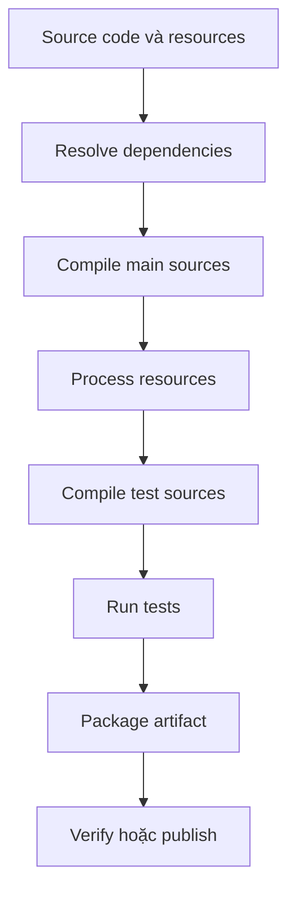

# Lộ trình học và ranh giới giữa kiến thức nền tảng với từng công cụ

Build tool là một phần quan trọng trong quy trình phát triển ứng dụng Java. Khi dự án còn nhỏ, ta có thể tự gọi trình biên dịch, tự quản lý classpath và tự đóng gói JAR. Khi dự án có nhiều thư viện, nhiều module, nhiều loại kiểm thử và cần chạy giống nhau trên máy lập trình viên lẫn máy CI, việc thực hiện thủ công trở nên dễ sai và khó lặp lại. Build tool giải quyết bài toán đó bằng cách mô tả các đầu vào, các bước xử lý và đầu ra của quá trình build, sau đó thực thi chúng theo một quy tắc nhất quán.

Để học chủ đề này hiệu quả, cần tách hai lớp kiến thức. Lớp thứ nhất là **nền tảng chung**: hiểu một bản build cần làm gì, dependency được tìm và sử dụng ra sao, các bước build liên hệ với nhau thế nào, và vì sao cần build có thể tái lập. Lớp thứ hai là **cách từng công cụ biểu diễn và thực hiện các khái niệm đó**: Maven dùng project model, lifecycle, phase và plugin goal; Gradle dùng project, task, task graph, configuration và plugin; Ant dùng target và task. Nắm lớp nền tảng trước giúp ta học cú pháp của từng công cụ nhanh hơn và tránh nhầm rằng tên gọi giống nhau thì cơ chế cũng giống nhau.

## 1. Build tool giải quyết vấn đề gì?

Một ứng dụng Java thường đi qua nhiều bước trước khi có thể chạy hoặc phát hành:

1. Thu thập mã nguồn và tài nguyên.
2. Tải các thư viện mà dự án phụ thuộc.
3. Biên dịch mã nguồn Java thành bytecode.
4. Xử lý hoặc sao chép tài nguyên cần thiết.
5. Biên dịch và chạy kiểm thử.
6. Đóng gói kết quả thành JAR, WAR hoặc một loại artifact khác.
7. Thực hiện các bước kiểm tra bổ sung và, khi được yêu cầu, đưa artifact đến nơi lưu trữ hoặc môi trường triển khai.

Các bước cụ thể phụ thuộc loại dự án. Một thư viện Java có thể tạo JAR; một ứng dụng web có thể tạo WAR; một ứng dụng Spring Boot có thể tạo JAR có thể chạy độc lập. Không phải dự án nào cũng cần mọi bước, nhưng các bước vẫn cần được tổ chức có trật tự.

Nếu tự thực hiện, lập trình viên phải nhớ lệnh biên dịch, đường dẫn thư viện, thứ tự chạy kiểm thử và cách đóng gói. Khi một thư viện thay đổi, nhiều lệnh có thể phải đổi theo. Khi một thành viên mới tham gia, họ phải tự tìm hiểu quy trình. Khi CI chạy trên một máy khác, khác biệt về JDK, thư viện hoặc lệnh gọi có thể khiến kết quả không giống máy cá nhân.

Build tool đưa quy trình đó vào cấu hình có thể chia sẻ và tự động hóa. Công cụ có thể:

- giải quyết dependency trực tiếp và dependency bắc cầu;
- gọi compiler và các công cụ kiểm thử;
- sắp xếp công việc theo quan hệ phụ thuộc;
- chỉ chạy những phần cần thiết khi có thể xác định đầu vào và đầu ra;
- tạo artifact theo một quy trình thống nhất;
- cung cấp lệnh chuẩn để lập trình viên và CI cùng sử dụng.

Build tool không thay thế Java compiler, JVM, trình quản lý mã nguồn hay CI server. Nó điều phối những thành phần đó và kết nối chúng thành một quy trình build.

## 2. Mô hình chung cần hiểu trước khi học cú pháp

Các công cụ có cách tổ chức khác nhau, nhưng người học nên nhận diện được những khái niệm chung dưới đây.

| Khái niệm nền tảng | Ý nghĩa | Câu hỏi cần trả lời |
|---|---|---|
| Project | Một đơn vị mã nguồn và cấu hình được build | Đâu là thư mục gốc và đâu là các module? |
| Source set / source directory | Vị trí mã nguồn theo mục đích, chẳng hạn mã ứng dụng và mã kiểm thử | Công cụ lấy file Java từ đâu? |
| Dependency | Thư viện hoặc module cần để biên dịch, kiểm thử hay chạy ứng dụng | Dự án cần thư viện nào, phiên bản nào và ở giai đoạn nào? |
| Repository | Nơi lưu artifact để công cụ tìm và tải dependency | Artifact được lấy từ kho cục bộ hay kho từ xa nào? |
| Compiler và toolchain | Các công cụ và phiên bản dùng để biên dịch | Dự án yêu cầu JDK nào và tạo bytecode cho Java phiên bản nào? |
| Build step | Một công việc trong quy trình, như compile hoặc test | Bước này làm gì và cần đầu vào nào? |
| Lifecycle / task graph / target dependencies | Cách các bước được tổ chức và liên kết | Khi gọi một lệnh, những bước nào sẽ chạy và theo thứ tự nào? |
| Plugin | Phần mở rộng bổ sung khả năng cho build tool | Khả năng compile, test, đóng gói hoặc publish đến từ đâu? |
| Artifact | Đầu ra có thể sử dụng hoặc phân phối, như JAR hay WAR | Kết quả nằm ở đâu và có tên, phiên bản gì? |
| Build configuration | Quy tắc mô tả cách dự án được build | Cấu hình nào quyết định dependency, compiler và đầu ra? |

Một quy trình build Java điển hình có thể hình dung như sau:



Sơ đồ mô tả luồng khái niệm, không phải thứ tự bắt buộc cho mọi công cụ hoặc mọi dự án. Chẳng hạn, một số bước xử lý tài nguyên có thể chạy song song với bước khác nếu không có phụ thuộc dữ liệu; một lệnh chỉ compile có thể dừng trước kiểm thử và đóng gói.

### 2.1. Hiểu đầu vào, công việc và đầu ra

Mỗi bước build nên được hiểu qua ba câu hỏi:

- **Đầu vào:** bước này đọc mã nguồn, tài nguyên, dependency hay cấu hình nào?
- **Công việc:** bước này biên dịch, kiểm thử, kiểm tra hay đóng gói điều gì?
- **Đầu ra:** bước này tạo file nào, hoặc tạo ra thông tin nào cho bước sau?

Ví dụ, bước compile mã ứng dụng đọc file `.java`, classpath hoặc module path và cấu hình compiler; nó tạo file `.class`. Bước test đọc bytecode đã biên dịch cùng mã kiểm thử và thư viện kiểm thử; nó tạo kết quả kiểm thử hoặc báo lỗi nếu có test thất bại. Bước package gom bytecode và tài nguyên theo cấu trúc phù hợp để tạo JAR hoặc WAR.

Khi hiểu quan hệ đầu vào và đầu ra, ta dễ đọc log hơn. Nếu compile thất bại, nguyên nhân thường nằm ở mã nguồn, JDK, compiler options hoặc dependency cần cho compile. Nếu test thất bại, cần phân biệt lỗi biên dịch test với lỗi assertion hoặc lỗi môi trường khi chạy test. Nếu package thiếu tài nguyên, cần xem cấu hình resource và bước đóng gói.

### 2.2. Phân biệt dependency với repository

Dependency là thứ dự án cần dùng. Repository là nơi công cụ tìm artifact tương ứng. Hai khái niệm liên quan nhưng không đồng nghĩa.

Ví dụ, dự án có thể khai báo cần thư viện `org.example:sample-library:1.2.0`. Tọa độ này mô tả nhóm, tên và phiên bản artifact. Công cụ tìm artifact trong repository được cấu hình, có thể là kho cục bộ trên máy hoặc kho Maven tương thích ở mạng nội bộ hay Internet.

Dependency bắc cầu xuất hiện khi một thư viện mà dự án khai báo lại phụ thuộc vào thư viện khác. Vì vậy, danh sách dependency thực tế có thể dài hơn danh sách khai báo trực tiếp. Người học cần biết cách xem cây dependency và cách xử lý xung đột phiên bản khi nhiều nhánh yêu cầu các phiên bản khác nhau.

### 2.3. Phân biệt build với run

Build thường tạo và kiểm tra artifact. Run khởi chạy ứng dụng bằng JVM hoặc môi trường tương ứng. Một build tool có thể cung cấp tác vụ hoặc plugin để chạy ứng dụng, nhưng khả năng đó là phần được bổ sung. Việc một dự án build thành công không tự động chứng minh ứng dụng chạy đúng trong môi trường triển khai.

## 3. Lộ trình học theo từng lớp

Nên đi từ quy trình Java cơ bản đến mô hình build chung, sau đó học sâu một công cụ. Khi đã hiểu một công cụ, việc học công cụ thứ hai sẽ dễ hơn vì ta chỉ cần học cách biểu diễn những khái niệm đã biết.

### Giai đoạn 1 — Ôn kiến thức Java và dòng lệnh cần thiết

Trước khi học Maven hoặc Gradle, hãy chắc rằng bạn hiểu:

- JDK gồm những công cụ phát triển nào và JVM làm nhiệm vụ gì;
- sự khác nhau giữa mã nguồn `.java`, bytecode `.class` và file JAR;
- cách `javac` biên dịch mã nguồn và cách `java` chạy lớp có hàm `main`;
- classpath dùng để tìm lớp và thư viện ở thời điểm biên dịch hoặc chạy;
- cấu trúc thư mục cơ bản của một dự án Java;
- cách dùng terminal để chuyển thư mục, truyền tham số và đọc exit code.

Một ví dụ nhỏ giúp thấy những việc build tool sẽ tự động hóa:

```bash
# Biên dịch một lớp Java đơn giản
javac -d out src/main/java/com/example/App.java

# Chạy lớp đã biên dịch
java -cp out com.example.App

# Tạo JAR từ các lớp đã biên dịch
jar --create --file app.jar -C out .
```

Đây chỉ là minh họa cho một lớp đơn giản, chưa xử lý dependency, resource, test, phiên bản compiler hay cấu hình đóng gói phức tạp. Mục tiêu là hiểu các đầu ra cơ bản trước khi giao việc điều phối cho build tool.

**Kết quả cần đạt:** có thể giải thích compiler tạo bytecode, JVM chạy bytecode và JAR gom các file cần thiết như thế nào.

### Giai đoạn 2 — Học mô hình build chung

Tiếp theo, hãy học các khái niệm độc lập với cú pháp của một công cụ cụ thể:

1. Project và module: một dự án có thể chỉ có một module hoặc có nhiều module phối hợp.
2. Source và resource: mã ứng dụng, mã kiểm thử và tài nguyên được tổ chức theo mục đích.
3. Dependency và repository: dự án khai báo thư viện, công cụ giải quyết phiên bản và tải artifact.
4. Build steps: compile, test, package và các bước kiểm tra khác.
5. Quan hệ phụ thuộc: bước sau cần kết quả của bước trước; một số công việc có thể được thực thi song song nếu độc lập.
6. Plugin: build tool mở rộng khả năng bằng các plugin tích hợp compiler, test framework, đóng gói hoặc publish.
7. Artifact: kết quả build có thể được lưu, kiểm thử, chia sẻ hoặc triển khai.

Ở giai đoạn này, hãy mô tả một quy trình bằng ngôn ngữ thông thường hoặc sơ đồ. Chưa cần nhớ toàn bộ tên lệnh hay cú pháp XML/Kotlin/Groovy.

**Kết quả cần đạt:** khi nhìn một cấu hình build, có thể xác định dependency, bước compile, bước test, đầu ra và phần mở rộng đang được sử dụng.

### Giai đoạn 3 — Chọn một công cụ làm công cụ chính

Với dự án Java, Maven và Gradle là hai lựa chọn phổ biến. Người mới nên chọn một công cụ để học xuyên suốt một dự án nhỏ, thay vì học song song hai bộ cú pháp ngay từ đầu.

- Chọn **Maven** nếu bạn muốn bắt đầu từ một mô hình dự án có quy ước rõ, cấu hình thường tập trung trong `pom.xml`, và quy trình được tổ chức theo các lifecycle phase.
- Chọn **Gradle** nếu bạn muốn làm quen với mô hình task linh hoạt, cấu hình bằng Groovy DSL hoặc Kotlin DSL, và khả năng tùy chỉnh build sâu hơn.

Trong giai đoạn này, hãy hoàn thành các việc sau với công cụ đã chọn:

1. Đọc cấu trúc thư mục và file cấu hình của dự án.
2. Chạy lệnh build bằng wrapper của dự án.
3. Chạy riêng bước kiểm thử và xem kết quả.
4. Thêm một dependency cần thiết và xác nhận nó được giải quyết.
5. Tạo artifact và xác định chính xác file đầu ra.
6. Thay đổi một cấu hình nhỏ, chạy lại build và quan sát bước nào được thực thi.
7. Đọc log khi cố ý tạo một lỗi có thể khôi phục, chẳng hạn tên lớp sai hoặc dependency không tồn tại.

**Kết quả cần đạt:** có thể clone một dự án mẫu, dùng wrapper để build và test, giải thích cấu hình quan trọng, đồng thời tìm được artifact được tạo ra.

### Giai đoạn 4 — Học cách kiểm soát build

Khi đã build được dự án, hãy tìm hiểu các khả năng giúp quy trình ổn định hơn:

- **Java toolchain và compiler options:** chọn JDK dùng để biên dịch và phiên bản bytecode mục tiêu một cách tường minh.
- **Dependency scopes/configurations:** giới hạn thư viện vào đúng giai đoạn compile, test hoặc runtime.
- **Multi-module build:** chia dự án thành các phần có ranh giới và dependency rõ ràng.
- **Profiles hoặc build variants:** điều chỉnh cấu hình theo môi trường hoặc mục đích build, đồng thời tránh làm cấu hình khó đoán.
- **Incremental build và cache:** tránh lặp lại công việc khi đầu vào chưa thay đổi và khi điều kiện cache phù hợp.
- **Reproducibility:** kiểm soát phiên bản công cụ, dependency và môi trường để kết quả có thể tái tạo.
- **Publishing:** đưa artifact đến repository hoặc registry theo quy trình có kiểm soát.

Không cần học mọi tính năng nâng cao cùng lúc. Hãy bắt đầu từ vấn đề thực tế của dự án. Ví dụ, nếu máy cá nhân và CI dùng JDK khác nhau, ưu tiên học toolchain và cấu hình Java version. Nếu build tải nhiều thư viện, ưu tiên dependency graph và repository. Nếu dự án có nhiều module, học cấu trúc multi-module trước khi tối ưu cache.

### Giai đoạn 5 — Kết nối build tool với CI

CI server không thay thế build tool. CI thường checkout mã nguồn, thiết lập JDK, gọi lệnh wrapper, lưu kết quả kiểm thử và lưu hoặc publish artifact theo cấu hình pipeline.

Người học nên biết cách:

- gọi cùng một lệnh build mà nhóm dùng ở máy cá nhân;
- cố định phiên bản JDK và build tool;
- truyền cấu hình môi trường mà không đưa secret vào repository;
- đọc log và xác định build thất bại ở bước nào;
- lưu test report và artifact để các bước sau sử dụng;
- phân biệt lỗi do mã nguồn, dependency, cấu hình build và môi trường CI.

**Kết quả cần đạt:** có thể giải thích vì sao một lệnh build chạy được ở máy cá nhân nhưng thất bại trên CI, và biết cách thu hẹp nguyên nhân bằng log cùng thông tin môi trường.

## 4. Ranh giới giữa nền tảng chung và kiến thức riêng của công cụ

Một cách học dễ gây nhầm lẫn là học thuộc cú pháp trước khi hiểu khái niệm. Ví dụ, `test` trong Gradle là tên một task thường gặp; `test` trong Maven là một lifecycle phase. Cả hai có thể dẫn đến việc chạy kiểm thử, nhưng cơ chế tổ chức và cách mở rộng không giống nhau.

Bảng dưới đây chỉ ra đâu là điều cần hiểu ở mức nền tảng và đâu là phần cần học theo công cụ.

| Chủ đề | Kiến thức nền tảng cần nắm | Maven | Gradle | Ant |
|---|---|---|---|---|
| Đơn vị build | Một dự án có thể gồm một hoặc nhiều phần | Project và module được mô tả bằng POM | Root project và subproject được cấu hình trong settings/build files | Build file mô tả các target |
| Tổ chức công việc | Các bước build có thứ tự và quan hệ phụ thuộc | Lifecycle, phase và plugin goal | Task và task graph | Target và task; target có thể khai báo phụ thuộc target khác |
| Cấu hình | Quy tắc xác định cách build dự án | XML trong `pom.xml`, kết hợp POM kế thừa và plugin configuration | Groovy DSL hoặc Kotlin DSL trong file build | XML trong build file, thường là `build.xml` |
| Dependency | Khai báo thư viện, phiên bản, phạm vi sử dụng và nguồn tải | Dependency và scope; dependency management | Dependency configurations như `implementation`, `runtimeOnly`, `testImplementation` | Ant lõi tập trung vào điều phối task; quản lý dependency thường cần công cụ hoặc tích hợp bổ sung |
| Mở rộng | Tính năng build có thể được cung cấp bởi thành phần mở rộng | Maven plugins và goals | Gradle plugins, tasks và extensions | Ant tasks và task libraries |
| Đầu ra | Artifact có định dạng, tên và phiên bản | Thường dùng Maven packaging và plugin tương ứng | Thường dùng plugin như `java` hoặc `application` | Do các target/task được cấu hình tạo ra |
| Thực thi | Lệnh chọn công việc cần chạy | Gọi phase hoặc plugin goal | Gọi task; Gradle xây dựng task graph cần thực thi | Gọi target |

### 4.1. Lifecycle, task graph và target không phải cùng một thứ

Đây là ranh giới quan trọng nhất khi so sánh công cụ.

**Maven:** lifecycle là chuỗi các phase có thứ tự. Khi gọi một phase, Maven thực hiện các phase đứng trước nó trong lifecycle tương ứng và chạy các plugin goal đã được gắn vào những phase đó. Một plugin goal là công việc cụ thể do plugin cung cấp. Vì vậy, phase và goal là hai khái niệm khác nhau.

**Gradle:** task là một đơn vị công việc. Các task khai báo quan hệ phụ thuộc với nhau; Gradle xác định task graph cần thực thi từ task người dùng yêu cầu. Task graph có thể chứa các task phụ thuộc cần thiết và chỉ chạy những task phù hợp với yêu cầu cùng trạng thái đầu vào/đầu ra.

**Ant:** target là một nhóm công việc được đặt tên. Target có thể phụ thuộc target khác, còn task là hành động cụ thể bên trong target, chẳng hạn compile hoặc copy file.

Ví dụ, có thể thấy lệnh Maven `mvn test` và lệnh Gradle `gradle test` đều liên quan đến kiểm thử. Nhưng khi đọc cấu hình, cần nhớ Maven đang gọi một phase trong lifecycle còn Gradle đang yêu cầu một task. Không nên suy ra rằng mọi phase Maven đều có task Gradle tương đương một-một.

### 4.2. Dependency scope và configuration

Khái niệm chung là một thư viện có thể cần ở thời điểm biên dịch, chỉ khi chạy ứng dụng, hoặc chỉ khi chạy kiểm thử. Mỗi công cụ có mô hình biểu diễn riêng.

Trong Maven, dependency thường khai báo trong `pom.xml` với scope như `compile`, `runtime`, `test` hoặc `provided`. Scope ảnh hưởng đến classpath ở các giai đoạn khác nhau và cách dependency được truyền tiếp.

Trong Gradle, dependency được khai báo vào configuration như `implementation`, `api`, `compileOnly`, `runtimeOnly` hoặc `testImplementation`. Configuration xác định cách dependency tham gia vào các classpath và có được công khai cho module phụ thuộc hay không.

Tên scope và configuration không nên được dịch máy móc. Khi chuyển dự án giữa công cụ, cần xem mục đích thực tế của thư viện, classpath cần thiết và hành vi truyền dependency, sau đó chọn cấu hình tương ứng.

### 4.3. Cú pháp cấu hình là kiến thức riêng của công cụ

Maven dùng XML trong POM. Gradle dùng DSL dựa trên Groovy hoặc Kotlin. Ant cũng dùng XML nhưng mô hình build và mục tiêu của nó khác Maven. Việc hai công cụ cùng dùng XML không có nghĩa cấu trúc hay ngữ nghĩa cấu hình giống nhau.

Hãy học cú pháp sau khi đã trả lời được câu hỏi cấu hình đó nhằm mục đích gì. Chẳng hạn, trước khi ghi nhớ vị trí khai báo dependency trong `pom.xml` hoặc `build.gradle.kts`, hãy hiểu dependency cần thiết cho compile, test hay runtime.

## 5. Nhận diện cấu trúc dự án Maven và Gradle

Một dự án Java dùng Maven thường có cấu trúc như sau:

```text
my-app/
├── pom.xml
├── mvnw
├── mvnw.cmd
├── .mvn/
└── src/
    ├── main/
    │   ├── java/
    │   └── resources/
    └── test/
        ├── java/
        └── resources/
```

`pom.xml` mô tả project, dependency, phiên bản và plugin. `mvnw` cùng `mvnw.cmd` là Maven Wrapper cho phép dự án chỉ định phiên bản Maven mà nhóm muốn sử dụng. Thư mục `src/main` thường chứa mã và tài nguyên của ứng dụng; `src/test` chứa mã và tài nguyên kiểm thử. Kết quả build mặc định thường nằm trong `target/`.

Một dự án Java dùng Gradle có thể có cấu trúc như sau:

```text
my-app/
├── settings.gradle.kts
├── build.gradle.kts
├── gradlew
├── gradlew.bat
├── gradle/
│   └── wrapper/
└── src/
    ├── main/
    │   ├── java/
    │   └── resources/
    └── test/
        ├── java/
        └── resources/
```

`settings.gradle.kts` xác định cấu trúc build và các project tham gia; `build.gradle.kts` chứa cấu hình cho project. Dự án dùng Groovy DSL có thể đặt tên tương ứng là `settings.gradle` và `build.gradle`. Wrapper gồm script `gradlew`/`gradlew.bat` và cấu hình trong `gradle/wrapper/`. Kết quả build mặc định thường nằm trong `build/`.

Các cấu trúc trên là quy ước phổ biến, không phải giới hạn cứng. Dự án có thể tùy chỉnh source directory, thư mục output, cách chia module hoặc cách đặt file cấu hình. Khi tham gia một codebase, hãy đọc cấu hình thực tế trước khi giả định vị trí.

## 6. Nhìn cùng một nhu cầu qua Maven và Gradle

Ví dụ dưới đây minh họa cách hai công cụ biểu diễn một phần cấu hình Java. Đây là ví dụ tối giản để nhận ra khác biệt về cách viết; dự án thực tế có thể cần thêm phiên bản plugin, repository, test engine, compiler options và quy tắc đóng gói.

**Maven — `pom.xml`:**

```xml
<project xmlns="http://maven.apache.org/POM/4.0.0"
         xmlns:xsi="http://www.w3.org/2001/XMLSchema-instance"
         xsi:schemaLocation="http://maven.apache.org/POM/4.0.0
         https://maven.apache.org/xsd/maven-4.0.0.xsd">
    <modelVersion>4.0.0</modelVersion>

    <groupId>com.example</groupId>
    <artifactId>my-app</artifactId>
    <version>1.0.0</version>

    <properties>
        <maven.compiler.release>17</maven.compiler.release>
        <project.build.sourceEncoding>UTF-8</project.build.sourceEncoding>
    </properties>

    <dependencies>
        <dependency>
            <groupId>org.junit.jupiter</groupId>
            <artifactId>junit-jupiter</artifactId>
            <version>5.10.2</version>
            <scope>test</scope>
        </dependency>
    </dependencies>
</project>
```

**Gradle — `build.gradle.kts`:**

```kotlin
plugins {
    java
}

group = "com.example"
version = "1.0.0"

repositories {
    mavenCentral()
}

dependencies {
    testImplementation("org.junit.jupiter:junit-jupiter:5.10.2")
}

java {
    toolchain {
        languageVersion.set(JavaLanguageVersion.of(17))
    }
}

tasks.test {
    useJUnitPlatform()
}
```

Hai ví dụ đều mô tả một dự án Java, một phiên bản thư viện kiểm thử và mục tiêu dùng Java 17. Tuy nhiên, chúng không phải hai bản sao cú pháp. Maven dùng POM cùng các quy ước và plugin của Maven; Gradle áp dụng plugin Java, khai báo dependency vào configuration và cấu hình task `test`.

Các lệnh thường dùng để bắt đầu:

| Mục đích | Maven Wrapper | Gradle Wrapper |
|---|---|---|
| Xóa đầu ra cũ và build | `./mvnw clean verify` | `./gradlew clean build` |
| Chạy kiểm thử | `./mvnw test` | `./gradlew test` |
| Hiển thị trợ giúp hoặc danh sách công việc | `./mvnw help` và các goal trợ giúp phù hợp | `./gradlew tasks` |
| Dùng trên Windows | `mvnw.cmd ...` | `gradlew.bat ...` |

Trên Windows, có thể gọi trực tiếp file `.cmd` hoặc `.bat`; trên macOS/Linux thường dùng script có tên không có phần mở rộng. Trong cả hai trường hợp, ưu tiên wrapper được commit cùng dự án để sử dụng phiên bản build tool đã được nhóm chọn.

## 7. Chọn thứ tự học Maven, Gradle và Ant

Không cần học cả ba công cụ với độ sâu như nhau ngay từ đầu.

### Maven

Nếu bắt đầu với Maven, nên học theo thứ tự:

1. Cấu trúc project và các phần chính của `pom.xml`.
2. Maven coordinates (`groupId`, `artifactId`, `version`) và cách dependency được khai báo.
3. Lifecycle, phase và sự khác nhau giữa phase với plugin goal.
4. Dependency scopes, transitive dependencies và dependency management.
5. Plugin configuration, compiler và test plugin.
6. Multi-module project, parent POM và kế thừa cấu hình.
7. Profiles, properties, settings và Maven Wrapper.
8. Đóng gói, kiểm tra và publish artifact.

Khi gặp một lệnh Maven, hãy xác định nó gọi phase hay plugin goal. Khi gặp một dependency, hãy xác định scope và xem dependency graph nếu hành vi chưa rõ.

### Gradle

Nếu bắt đầu với Gradle, nên học theo thứ tự:

1. Project, settings file và build file.
2. Plugin, task và cách Gradle tạo task graph.
3. Các task cơ bản của plugin Java: compile, test, jar và build.
4. Dependency configurations và repository.
5. Java toolchain và compiler options.
6. Multi-project build và cách các project phụ thuộc nhau.
7. Task inputs/outputs, incremental build và build cache.
8. Wrapper, version catalogs và các tính năng quản lý build nâng cao.

Khi đọc một lệnh Gradle, hãy xác định task được yêu cầu và các task phụ thuộc cần chạy. Khi đọc một task tùy chỉnh, hãy xem đầu vào và đầu ra đã được khai báo ra sao, vì thông tin này ảnh hưởng đến khả năng incremental và cache.

### Ant

Ant hữu ích để hiểu cách tự mô tả một quy trình bằng target và task, đặc biệt khi gặp dự án cũ hoặc build script tùy chỉnh. Nên học cách đọc target, thuộc tính, đường dẫn và quan hệ phụ thuộc giữa target. Ant lõi không áp đặt cùng một mô hình dependency quản lý theo tọa độ như Maven; dự án có thể kết hợp công cụ khác hoặc cơ chế riêng để quản lý thư viện.

Nếu công việc chính là phát triển ứng dụng Java mới, thường nên ưu tiên Maven hoặc Gradle trước. Học Ant khi dự án đang sử dụng nó hoặc khi cần hiểu quy trình build được viết theo mô hình target/task.

## 8. Những điều không nên nhầm lẫn khi học

**Build tool và IDE:** IDE có thể gọi Maven hoặc Gradle, hiển thị dependency và chạy test. Tuy nhiên, cấu hình build của dự án mới là nơi cần được chia sẻ để command line và CI có thể thực hiện cùng quy trình. Không nên phụ thuộc vào một thiết lập chỉ tồn tại trên máy cá nhân trong IDE.

**JDK cài trên máy và Java version của dự án:** máy có thể cài nhiều JDK. Dự án cần xác định phiên bản dùng để biên dịch và phiên bản runtime dự kiến. Chỉ nhìn `java -version` trong terminal chưa chắc đã cho biết compiler toolchain mà build đang sử dụng.

**Wrapper và build tool:** wrapper là cơ chế khởi chạy phiên bản build tool được dự án cấu hình. Wrapper không thay thế cấu hình dependency hay logic build. Dùng wrapper giúp thành viên trong nhóm và CI giảm khác biệt về phiên bản Maven/Gradle.

**Dependency khai báo trực tiếp và dependency thực tế:** thư viện có thể kéo theo dependency bắc cầu. Khi một lớp có thể compile trên máy này nhưng không compile trên máy khác, hoặc khi xuất hiện xung đột phiên bản, hãy xem dependency graph và classpath thực tế.

**Build thành công và ứng dụng hoạt động đúng:** build thành công cho biết những bước được yêu cầu đã hoàn thành. Nó không chứng minh mọi luồng nghiệp vụ, cấu hình production, kết nối bên ngoài hay hành vi khi triển khai đều đúng. Cần test phù hợp và xác minh ở môi trường mục tiêu.

**Incremental build và cache:** build nhanh hơn không đồng nghĩa mọi bước đều bị bỏ qua một cách an toàn. Khả năng bỏ qua hoặc tái sử dụng kết quả phụ thuộc vào việc công cụ biết đúng đầu vào, đầu ra và trạng thái của công việc. Một task hoặc plugin khai báo sai có thể làm kết quả cache không đáng tin cậy.

**Cú pháp giống nhau và ngữ nghĩa giống nhau:** Maven và Ant đều dùng XML nhưng có mô hình khác nhau. Maven và Gradle đều có thể chạy test nhưng biểu diễn luồng thực thi khác nhau. Hãy so sánh theo mục đích và hành vi, không chỉ theo tên lệnh.

## 9. Cách đọc log và xử lý lỗi theo mô hình nền tảng

Khi build thất bại, trước hết xác định bước thất bại và loại đầu vào mà bước đó sử dụng. Sau đó mới đi sâu vào cú pháp hoặc cơ chế riêng của công cụ.

| Dấu hiệu | Nhóm nguyên nhân nên kiểm tra | Hướng tìm hiểu |
|---|---|---|
| Không tìm thấy dependency | Tọa độ hoặc phiên bản sai, repository không truy cập được, xác thực hoặc proxy | Dependency declaration, repository và log phân giải dependency |
| Không tìm thấy package/class khi compile | Dependency không nằm trong compile classpath, sai source set, sai module hoặc cấu hình compiler | Dependency scope/configuration, source directories và compiler options |
| `Unsupported class file major version` hoặc lỗi phiên bản bytecode | JDK/compiler/runtime không tương thích với bytecode hoặc plugin đang dùng | Java toolchain, Java version và tương thích phiên bản công cụ |
| Test không được phát hiện | Test framework, engine, naming convention hoặc cấu hình test task/plugin | Test dependency, test runner và cấu hình test |
| Test chạy nhưng thất bại | Assertion, dữ liệu, môi trường hoặc thứ tự phụ thuộc giữa test | Test report, stack trace và điều kiện chạy test |
| JAR thiếu class hoặc resource | Quy tắc package, resource directory hoặc plugin đóng gói | Nội dung artifact và cấu hình packaging |
| Máy cá nhân chạy được nhưng CI thất bại | Khác biệt JDK, biến môi trường, quyền truy cập repository, hệ điều hành hoặc secret | Log CI, wrapper, toolchain và cấu hình môi trường |

Một quy trình xử lý lỗi có thể áp dụng với mọi build tool:

1. Đọc phần đầu và phần cuối log để tìm lệnh được gọi, bước thất bại và thông báo nguyên nhân gần nhất.
2. Phân loại lỗi: cấu hình, dependency, compiler, test, packaging hay môi trường.
3. Kiểm tra đúng đầu vào của bước đó: file nguồn, classpath, repository, JDK, biến môi trường hoặc output từ bước trước.
4. Dùng lệnh chẩn đoán của công cụ để lấy thêm thông tin khi cần.
5. Sửa nguyên nhân nhỏ nhất có thể, chạy lại bước liên quan rồi chạy lại quy trình cần thiết.

Một số lệnh hỗ trợ chẩn đoán thường gặp:

```bash
# Maven: hiển thị cây dependency
./mvnw dependency:tree

# Maven: hiển thị POM hiệu lực sau kế thừa và áp dụng cấu hình
./mvnw help:effective-pom

# Gradle: liệt kê task
./gradlew tasks

# Gradle: xem dependency của configuration runtimeClasspath
./gradlew dependencies --configuration runtimeClasspath

# Gradle: xem vì sao một dependency được chọn
./gradlew dependencyInsight --dependency junit --configuration testRuntimeClasspath
```

Tên configuration hoặc plugin có thể khác theo loại dự án. Nếu một lệnh chẩn đoán không có sẵn, hãy kiểm tra plugin và phiên bản mà dự án đang dùng.

## 10. Thói quen giúp build ổn định và dễ chia sẻ

- Dùng wrapper đi cùng repository thay vì dựa vào phiên bản build tool cài toàn cục.
- Khai báo rõ Java version hoặc toolchain mà dự án yêu cầu.
- Kiểm soát phiên bản dependency; tránh để build tự chọn phiên bản không xác định.
- Giữ secret và thông tin xác thực ngoài file cấu hình được commit.
- Dùng cùng lệnh build ở máy cá nhân và CI khi có thể.
- Đọc dependency graph khi có xung đột hoặc khi thư viện xuất hiện ngoài dự kiến.
- Đảm bảo build không phụ thuộc vào file sinh ra thủ công trên máy của một thành viên.
- Xem artifact và test report sau khi build để xác nhận đúng đầu ra cần thiết.
- Chỉ tối ưu incremental build hoặc cache sau khi đã hiểu đầu vào, đầu ra và tính đúng đắn của từng bước.

Build tái lập không chỉ là việc hai lần chạy cho cùng một thông báo thành công. Mục tiêu là kiểm soát các yếu tố có thể làm thay đổi kết quả: mã nguồn, dependency, phiên bản build tool, JDK, cấu hình và môi trường. Mức độ tái lập tuyệt đối còn phụ thuộc plugin, timestamp, hệ điều hành và các công cụ bên ngoài, vì vậy cần xác định yêu cầu của dự án thay vì giả định rằng mọi build đều tự động hoàn toàn giống nhau.

## 11. Tự kiểm tra mức độ sẵn sàng

Trước khi chuyển sang học sâu một công cụ, hãy thử giải thích bằng lời của mình các câu hỏi sau:

1. Build tool nhận những đầu vào nào và tạo ra những đầu ra nào trong một dự án Java?
2. Compiler, JVM và build tool giữ những vai trò khác nhau ra sao?
3. Dependency khác repository ở điểm nào? Dependency bắc cầu là gì?
4. Vì sao compile, test và package cần được tổ chức theo quan hệ phụ thuộc?
5. Plugin bổ sung khả năng gì cho build tool?
6. Artifact là gì và làm thế nào xác định file artifact của dự án?
7. Maven phase khác plugin goal như thế nào?
8. Gradle task và task graph có vai trò gì?
9. Ant target khác task như thế nào?
10. Vì sao không nên coi Maven scope và Gradle configuration là các tên gọi có thể thay thế trực tiếp cho nhau?
11. Wrapper giúp nhóm kiểm soát điều gì?
12. Khi build thất bại trên CI nhưng thành công ở máy cá nhân, cần so sánh những yếu tố nào?

Nếu có thể trả lời các câu hỏi nền tảng mà không cần nhớ cú pháp cụ thể, bạn đã có cơ sở để học Maven hoặc Gradle. Khi chuyển sang công cụ khác, hãy giữ nguyên mô hình tư duy về dependency, đầu vào/đầu ra, quy trình và artifact; sau đó học cách công cụ mới đặt tên, cấu hình và thực thi từng phần.

## 12. Thứ tự ưu tiên khi tiếp tục học

Một lộ trình thực hành ngắn gọn có thể triển khai như sau:

| Thứ tự | Nội dung | Sản phẩm thực hành |
|---|---|---|
| 1 | JDK, `javac`, `java`, JAR và classpath | Biên dịch và chạy được một ứng dụng Java nhỏ bằng terminal |
| 2 | Project, source/resource, dependency và artifact | Vẽ được luồng build và chỉ ra đầu vào/đầu ra của từng bước |
| 3 | Một công cụ chính: Maven hoặc Gradle | Build, test và package một dự án bằng wrapper |
| 4 | Dependency graph, plugin, compiler và test | Thêm thư viện, xem dependency và xử lý một lỗi cấu hình đơn giản |
| 5 | Multi-module, toolchain và cấu hình môi trường | Tạo hoặc đọc được dự án có nhiều module và Java version rõ ràng |
| 6 | CI, cache và publishing | Chạy build trên CI và lưu artifact/test report |
| 7 | Công cụ thứ hai hoặc Ant khi cần | Ánh xạ khái niệm đã biết sang mô hình và cú pháp mới |

Hãy ưu tiên hiểu nguyên nhân của mỗi cấu hình thay vì ghi nhớ danh sách lệnh dài. Khi một công cụ thay đổi cú pháp hoặc dự án sử dụng plugin mới, kiến thức nền tảng vẫn giúp bạn đặt đúng câu hỏi: bước nào đang chạy, cần đầu vào gì, dependency nào được dùng, và kết quả nào được tạo ra. Đó là nền tảng để đọc, xây dựng và bảo trì quy trình build Java trong nhiều dự án khác nhau.
