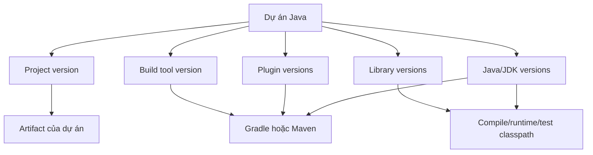
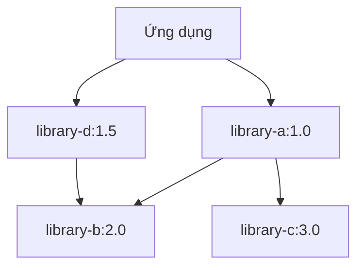

# Phân biệt phiên bản dự án, công cụ build, plugin và thư viện

Trong một dự án Java, có thể bắt gặp nhiều số phiên bản cùng lúc: phiên bản của chính ứng dụng, phiên bản Gradle hoặc Maven, phiên bản plugin Spring Boot, phiên bản JUnit, phiên bản Jackson và phiên bản của những thư viện bắc cầu mà các dependency khác kéo vào. Các số này có thể trông giống nhau nhưng thuộc những thành phần khác nhau và được quản lý ở những vị trí khác nhau.

Nếu nhầm các loại phiên bản, nhóm phát triển có thể nâng phiên bản ứng dụng nhưng vô tình thay đổi build tool, cập nhật plugin mà không kiểm tra yêu cầu JDK, hoặc tưởng rằng khai báo một dependency đã cố định toàn bộ thư viện được sử dụng. Muốn kiểm soát build, trước hết cần xác định **phiên bản đang nói đến thành phần nào**, ai sở hữu nó, và công cụ nào dùng giá trị đó.

## 1. Bốn nhóm phiên bản cần phân biệt

Một dự án thường có ít nhất bốn nhóm phiên bản độc lập:

| Nhóm phiên bản | Đối tượng được định danh | Ví dụ | Nơi thường khai báo |
|---|---|---|---|
| Phiên bản dự án | Ứng dụng, thư viện hoặc module do nhóm phát triển | `1.4.0` | Gradle `version`, Maven `<version>` |
| Phiên bản công cụ build | Gradle hoặc Maven dùng để cấu hình và chạy build | Gradle `8.5`, Maven `3.9.x` | Gradle/Maven Wrapper |
| Phiên bản plugin | Phần mở rộng bổ sung task, goal hoặc tích hợp build | Spring Boot Gradle Plugin `3.3.5` | Gradle plugin DSL/catalog, Maven plugin declaration |
| Phiên bản thư viện | Dependency mà mã nguồn hoặc runtime sử dụng | JUnit `5.10.2`, Jackson `2.17.2` | Gradle dependency/catalog, Maven dependency/BOM |

Ngoài bốn nhóm trên, dự án còn có thể quản lý phiên bản JDK, Java release mục tiêu, phiên bản container image, phiên bản schema hoặc phiên bản công cụ phụ trợ. Những giá trị đó cũng cần được phân biệt theo vai trò của chúng.

Ví dụ minh họa một dự án có thể dùng đồng thời:

- Phiên bản dự án: `1.4.0`.
- Gradle Wrapper: `8.5`.
- JDK chạy Gradle: `21`.
- Java release mục tiêu: `17`.
- Spring Boot Gradle Plugin: `3.3.5`.
- JUnit Jupiter: `5.10.2`.
- Jackson Databind: `2.17.2`.

Các giá trị này không cần giống nhau. Mỗi giá trị trả lời một câu hỏi khác nhau: sản phẩm của ta là bản nào, build chạy bằng công cụ nào, plugin nào mở rộng build và thư viện nào được đưa vào classpath.



## 2. Phiên bản dự án (project version)

Project version định danh phiên bản của ứng dụng, thư viện hoặc module mà nhóm đang phát triển. Nó thường xuất hiện trong tên artifact, metadata, tọa độ repository, manifest hoặc thông tin phát hành.

### 2.1. Project version trong Gradle

Trong `build.gradle`:

```groovy
plugins {
    id 'java-library'
}

group = 'com.example'
version = '1.4.0'
```

Ở đây:

- `group` là namespace hoặc nhóm phát hành.
- `version` là phiên bản của project.
- Plugin Java/Java Library sử dụng các giá trị này trong metadata và cấu hình archive mặc định.

Nếu project tạo JAR, tên archive mặc định thường kết hợp tên project và version, ví dụ `my-library-1.4.0.jar`. Tên chính xác còn phụ thuộc `rootProject.name`, tên subproject và cấu hình archive.

Có thể đọc phiên bản trong build script bằng `project.version`. Với multi-project build, mỗi project có thể có version riêng nếu build được thiết kế như vậy; không bắt buộc mọi module phải dùng cùng một version.

### 2.2. Project version trong Maven

Trong `pom.xml`:

```xml
<groupId>com.example</groupId>
<artifactId>customer-domain</artifactId>
<version>1.4.0</version>
<packaging>jar</packaging>
```

Ba thành phần `groupId`, `artifactId` và `version` tạo thành tọa độ GAV để định danh một phiên bản artifact trong Maven repository:

```text
com.example:customer-domain:1.4.0
```

`packaging` cho biết loại gói Maven tạo, ví dụ `jar`, `war` hoặc `pom`. Trong Maven multi-module, POM cha có thể quản lý version chung qua parent và property, nhưng từng module vẫn có thể có tọa độ riêng theo cấu hình.

### 2.3. Project version không phải build tool version

Đổi project version từ `1.4.0` thành `1.5.0` không tự nâng Gradle hoặc Maven. Tương tự, nâng Gradle Wrapper từ `8.5` lên `8.7` không tự đổi version của ứng dụng.

Hai thay đổi có thể được thực hiện trong cùng một đợt phát hành, nhưng cần được xem xét và kiểm soát riêng. Ví dụ, nhóm có thể phát hành ứng dụng `1.5.0` bằng cùng Gradle `8.5`, hoặc nâng Gradle lên `8.7` trong một thay đổi kỹ thuật nhưng giữ project version hiện tại.

### 2.4. Project version và version của artifact đã publish

Project version thường tham gia tọa độ artifact, nhưng quy trình phát hành có thể biến đổi hoặc bổ sung metadata. Một plugin versioning có thể lấy version từ Git tag, commit hoặc biến môi trường. CI cũng có thể gắn build number hoặc commit SHA vào tên file/release label.

Vì vậy, khi truy vết sản phẩm, hãy phân biệt:

- Version khai báo trong build descriptor.
- Tọa độ artifact thực tế được publish.
- Git tag/commit tạo ra artifact.
- Build number hoặc release identifier của CI.

Các thông tin này nên được liên kết với nhau trong metadata phát hành để biết chính xác artifact đến từ source nào.

## 3. Phiên bản công cụ build (Gradle/Maven version)

Gradle và Maven là công cụ điều phối build. Phiên bản của chúng ảnh hưởng đến cú pháp/capability build, API plugin, cách resolve dependency, hành vi task/goal và các yêu cầu về JDK.

### 3.1. Gradle Wrapper quyết định phiên bản Gradle của dự án

Một dự án Gradle thường commit các file Wrapper:

```text
gradlew
gradlew.bat
gradle/wrapper/gradle-wrapper.jar
gradle/wrapper/gradle-wrapper.properties
```

Trong `gradle/wrapper/gradle-wrapper.properties`, thuộc tính `distributionUrl` chỉ định bản Gradle được sử dụng, ví dụ:

```properties
distributionUrl=https\://services.gradle.org/distributions/gradle-8.5-bin.zip
```

Khi chạy:

```bash
./gradlew --version
./gradlew build
```

Wrapper tải hoặc sử dụng distribution được chỉ định rồi chạy Gradle tương ứng. Trên Windows:

```powershell
.\gradlew.bat --version
.\gradlew.bat build
```

Nếu gọi `gradle build` trực tiếp, shell có thể dùng phiên bản Gradle cài toàn cục trên máy. Phiên bản đó có thể khác Wrapper của dự án. Vì vậy, hướng dẫn nhóm và CI nên ưu tiên Wrapper đã commit.

### 3.2. Maven Wrapper quyết định phiên bản Maven

Maven Wrapper cũng lưu phiên bản Maven trong repository, thường qua cấu hình trong `.mvn/wrapper/` và script `mvnw`/`mvnw.cmd`.

```bash
./mvnw --version
./mvnw verify
```

Trên Windows:

```powershell
.\mvnw.cmd --version
.\mvnw.cmd verify
```

Kết quả `--version` giúp xác định Maven và Java đang được sử dụng. Nếu dùng `mvn verify` trực tiếp, phiên bản Maven cài toàn cục có thể khác với phiên bản Wrapper.

### 3.3. Nâng phiên bản build tool cần xem xét tương thích

Khi nâng Gradle hoặc Maven, cần xem:

- JDK nào có thể chạy phiên bản công cụ mới.
- Phiên bản plugin có tương thích với build tool mới không.
- API hoặc DSL đã dùng có bị deprecated/thay đổi không.
- Các task tùy chỉnh và convention plugin có còn hoạt động không.
- CI, IDE và script local có dùng Wrapper mới không.

Nâng build tool không đồng nghĩa với nâng Java release của ứng dụng. Ví dụ, Gradle mới có thể chạy bằng JDK 21 nhưng project vẫn biên dịch theo Java 17 nếu toolchain/release được cấu hình như vậy.

## 4. Phiên bản plugin build

Plugin mở rộng build tool. Plugin có thể thêm task, cấu hình source set, tạo goal, tích hợp compiler/test framework, đóng gói ứng dụng hoặc publish artifact.

Plugin có version riêng vì nó là một thành phần phần mềm được phát hành độc lập. Version của plugin không phải project version và cũng không phải version của thư viện mà ứng dụng sử dụng.

### 4.1. Plugin version trong Gradle Plugins DSL

Ví dụ trong `build.gradle`:

```groovy
plugins {
    id 'java'
    id 'org.springframework.boot' version '3.3.5'
}
```

`org.springframework.boot` là plugin id; `3.3.5` ở đây là version của Gradle plugin Spring Boot. Nó không tự động nói rằng project của ta có version `3.3.5` hoặc mọi thư viện Spring đều ở version đó.

Plugin version có thể được khai báo tập trung trong `settings.gradle` qua `pluginManagement`, hoặc trong version catalog. Ví dụ `settings.gradle`:

```groovy
pluginManagement {
    repositories {
        gradlePluginPortal()
        mavenCentral()
    }

    plugins {
        id 'org.springframework.boot' version '3.3.5'
    }
}
```

Sau đó build script có thể áp dụng plugin mà không lặp version:

```groovy
plugins {
    id 'java'
    id 'org.springframework.boot'
}
```

`pluginManagement` điều khiển việc tìm và phân giải plugin; plugin vẫn cần được áp dụng ở project thích hợp. Trong multi-project build, có thể dùng `apply false` ở root để khai báo plugin/version mà chưa áp dụng plugin cho root project, rồi áp dụng ở subproject cần dùng.

### 4.2. Plugin version trong Maven

Maven plugin được khai báo trong phần `build/plugins` của POM. Ví dụ:

```xml
<build>
    <plugins>
        <plugin>
            <groupId>org.apache.maven.plugins</groupId>
            <artifactId>maven-compiler-plugin</artifactId>
            <version>3.13.0</version>
            <configuration>
                <release>17</release>
            </configuration>
        </plugin>
    </plugins>
</build>
```

`3.13.0` là version của Maven Compiler Plugin. Thuộc tính `release` lại chỉ định Java release mục tiêu. Đây là hai loại phiên bản/thiết lập khác nhau dù cùng xuất hiện trong một đoạn cấu hình.

### 4.3. `pluginManagement` trong Maven

Trong POM cha, `pluginManagement` có thể quản lý version và cấu hình plugin cho các module con:

```xml
<build>
    <pluginManagement>
        <plugins>
            <plugin>
                <groupId>org.apache.maven.plugins</groupId>
                <artifactId>maven-compiler-plugin</artifactId>
                <version>3.13.0</version>
                <configuration>
                    <release>17</release>
                </configuration>
            </plugin>
        </plugins>
    </pluginManagement>
</build>
```

`pluginManagement` cung cấp cấu hình quản lý để plugin được sử dụng ở project con kế thừa. Nó không có nghĩa mọi plugin được liệt kê đều tự động chạy chỉ vì xuất hiện trong `pluginManagement`. Project cần áp dụng hoặc gọi plugin theo lifecycle/cấu hình tương ứng.

### 4.4. Plugin không phải library dependency

Plugin được build tool nạp để thay đổi hoặc mở rộng quá trình build. Library dependency được đưa vào classpath của source set, test hoặc runtime theo configuration/scope.

Ví dụ:

```groovy
plugins {
    id 'org.springframework.boot' version '3.3.5'
}

dependencies {
    implementation 'org.springframework.boot:spring-boot-starter-web:3.3.5'
}
```

Hai dòng cùng có `3.3.5`, nhưng dòng đầu là version của Gradle plugin; dòng sau là version của thư viện starter. Chúng có thể được quản lý chung bởi một hệ sinh thái/BOM, nhưng về mặt khái niệm vẫn là hai artifact riêng và cần được phân giải theo hai cơ chế riêng.

## 5. Phiên bản thư viện (library/dependency version)

Library version định danh một artifact mà ứng dụng hoặc module sử dụng. Ví dụ, JUnit là thư viện kiểm thử, Jackson là thư viện xử lý JSON, PostgreSQL JDBC Driver là driver kết nối database.

### 5.1. Khai báo dependency trong Gradle

```groovy
dependencies {
    implementation 'com.fasterxml.jackson.core:jackson-databind:2.17.2'
    testImplementation 'org.junit.jupiter:junit-jupiter:5.10.2'
}
```

Trong tọa độ `group:artifact:version`:

- `group` định danh namespace/nhà phát hành.
- `artifact` là tên module/thư viện.
- `version` là phiên bản dependency được yêu cầu.

`implementation` và `testImplementation` là Gradle dependency configurations, không phải version. Chúng xác định phạm vi sử dụng dependency trong build.

### 5.2. Khai báo dependency trong Maven

```xml
<dependencies>
    <dependency>
        <groupId>com.fasterxml.jackson.core</groupId>
        <artifactId>jackson-databind</artifactId>
        <version>2.17.2</version>
    </dependency>

    <dependency>
        <groupId>org.junit.jupiter</groupId>
        <artifactId>junit-jupiter</artifactId>
        <version>5.10.2</version>
        <scope>test</scope>
    </dependency>
</dependencies>
```

`<version>` định danh phiên bản thư viện. `<scope>` xác định phạm vi dependency trong Maven, chẳng hạn `compile`, `provided`, `runtime` hoặc `test`. Scope không phải một loại version.

### 5.3. Dependency bắc cầu (transitive dependency)

Một thư viện có thể phụ thuộc vào những thư viện khác. Khi khai báo dependency trực tiếp, build tool có thể resolve thêm các dependency bắc cầu dựa trên metadata của artifact.

Ví dụ khái quát:



Ứng dụng khai báo trực tiếp `library-a` và `library-d`, nhưng cả hai có thể cùng kéo `library-c` vào graph. Build tool phải giải quyết trường hợp có nhiều yêu cầu version cho cùng một module theo quy tắc của hệ sinh thái và cấu hình dự án.

Do đó, version ghi trong dependency trực tiếp chưa chắc là version cuối cùng của mọi thư viện runtime. Cần xem dependency graph hoặc resolved dependency report để biết kết quả thực tế.

## 6. Quản lý phiên bản tập trung

Khi dự án có nhiều module, khai báo version lặp đi lặp lại dễ dẫn đến không thống nhất. Gradle và Maven đều có cơ chế quản lý phiên bản tập trung.

### 6.1. Gradle Version Catalog

Gradle Version Catalog thường được lưu trong `gradle/libs.versions.toml`:

```toml
[versions]
spring-boot = "3.3.5"
junit = "5.10.2"
jackson = "2.17.2"

[libraries]
spring-boot-starter-web = { module = "org.springframework.boot:spring-boot-starter-web", version.ref = "spring-boot" }
junit-jupiter = { module = "org.junit.jupiter:junit-jupiter", version.ref = "junit" }
jackson-databind = { module = "com.fasterxml.jackson.core:jackson-databind", version.ref = "jackson" }

[plugins]
spring-boot = { id = "org.springframework.boot", version.ref = "spring-boot" }
```

Sau đó build script có thể dùng alias:

```groovy
plugins {
    alias(libs.plugins.spring.boot)
}

dependencies {
    implementation libs.spring.boot.starter.web
    implementation libs.jackson.databind
    testImplementation libs.junit.jupiter
}
```

Version catalog giúp giảm lặp, gom tên alias và version vào một nơi. Alias plugin và alias library vẫn đại diện cho các loại artifact khác nhau. Việc cùng tham chiếu một version key không làm plugin và thư viện trở thành một artifact.

### 6.2. Maven dependencyManagement

Maven có thể quản lý dependency version trong `<dependencyManagement>` của POM cha:

```xml
<dependencyManagement>
    <dependencies>
        <dependency>
            <groupId>com.fasterxml.jackson.core</groupId>
            <artifactId>jackson-databind</artifactId>
            <version>2.17.2</version>
        </dependency>
        <dependency>
            <groupId>org.junit.jupiter</groupId>
            <artifactId>junit-jupiter</artifactId>
            <version>5.10.2</version>
        </dependency>
    </dependencies>
</dependencyManagement>
```

Project con có thể khai báo dependency mà không lặp version:

```xml
<dependencies>
    <dependency>
        <groupId>com.fasterxml.jackson.core</groupId>
        <artifactId>jackson-databind</artifactId>
    </dependency>
    <dependency>
        <groupId>org.junit.jupiter</groupId>
        <artifactId>junit-jupiter</artifactId>
        <scope>test</scope>
    </dependency>
</dependencies>
```

`dependencyManagement` quản lý version và một số thuộc tính dependency; nó không tự thêm mọi dependency vào project. Module vẫn phải khai báo dependency mà nó thực sự sử dụng.

### 6.3. So sánh các cơ chế quản lý

| Nhu cầu | Gradle | Maven |
|---|---|---|
| Khai báo version thư viện tập trung | Version Catalog, constraints, platform | `dependencyManagement`, BOM |
| Quản lý version plugin | `pluginManagement`, version catalog | `pluginManagement` |
| Dùng dependency trong module | `dependencies { ... }` | `<dependencies>` |
| Chọn phạm vi dependency | Configurations như `implementation`, `runtimeOnly`, `testImplementation` | Scopes như `compile`, `runtime`, `provided`, `test` |
| Kiểm tra dependency đã resolve | `dependencies`, `dependencyInsight` | `dependency:tree` |

Quản lý tập trung giúp giảm lỗi lệch version giữa module, nhưng vẫn cần hiểu từng module thực sự dùng dependency nào. Không nên khai báo tất cả thư viện vào mọi module chỉ vì chúng có trong catalog hoặc dependency management.

## 7. BOM và platform: quản lý một nhóm thư viện tương thích

Một hệ sinh thái có thể phát hành nhiều thư viện được kiểm thử cùng nhau. Nếu tự chọn version riêng cho từng thư viện, nhóm dễ tạo ra tổ hợp không tương thích. BOM (Bill of Materials) hoặc platform giúp công bố một bộ version/constraint có liên quan.

### 7.1. BOM trong Maven

Ví dụ import một BOM vào `dependencyManagement`:

```xml
<dependencyManagement>
    <dependencies>
        <dependency>
            <groupId>org.springframework.boot</groupId>
            <artifactId>spring-boot-dependencies</artifactId>
            <version>3.3.5</version>
            <type>pom</type>
            <scope>import</scope>
        </dependency>
    </dependencies>
</dependencyManagement>
```

Sau đó dependency thuộc BOM có thể không cần khai báo version riêng:

```xml
<dependencies>
    <dependency>
        <groupId>org.springframework.boot</groupId>
        <artifactId>spring-boot-starter-web</artifactId>
    </dependency>
</dependencies>
```

Version trong BOM quản lý phiên bản dependency theo danh mục mà BOM công bố. Việc import BOM không có nghĩa mọi thư viện trên thế giới đều được quản lý; chỉ những module thuộc BOM hoặc được quản lý qua cơ chế kế thừa tương ứng mới nhận version/constraint đó.

### 7.2. Platform trong Gradle

Gradle có thể sử dụng BOM như một platform:

```groovy
dependencies {
    implementation platform('org.springframework.boot:spring-boot-dependencies:3.3.5')
    implementation 'org.springframework.boot:spring-boot-starter-web'
}
```

Platform cung cấp dependency constraints để Gradle lựa chọn version phù hợp. `enforcedPlatform(...)` áp đặt version mạnh hơn và có thể ảnh hưởng đến consumer khi publish; chỉ dùng khi chính sách version cần hành vi đó. Với thư viện được publish cho bên khác sử dụng, cần cân nhắc tác động của constraints lên dependency graph của consumer.

### 7.3. Plugin version và BOM version không tự động là một

Một Spring Boot Gradle Plugin version có thể được phát hành cùng hệ sinh thái Spring Boot, nhưng dependency management vẫn có cơ chế riêng. Nếu plugin hoặc plugin quản lý dependency tự động cung cấp BOM, cần hiểu rõ convention mà nó áp dụng. Không nên chỉ thấy plugin version là `3.3.5` rồi giả định mọi thư viện Spring đều tự động có đúng version đó trong mọi build configuration.

## 8. Semantic Versioning và cách đọc version

Nhiều dự án dùng quy ước Semantic Versioning (SemVer) với dạng:

```text
MAJOR.MINOR.PATCH
```

- **MAJOR:** thay đổi không tương thích ngược theo chính sách versioning của dự án.
- **MINOR:** thêm chức năng tương thích ngược.
- **PATCH:** sửa lỗi tương thích ngược.

Ví dụ, `2.4.1` có thể được hiểu là major 2, minor 4, patch 1 nếu dự án tuyên bố tuân theo SemVer. Tuy nhiên, không phải mọi dự án hoặc thư viện đều áp dụng SemVer nghiêm ngặt. Cần đọc chính sách versioning/release notes của sản phẩm thay vì suy luận chỉ từ con số.

### 8.1. Pre-release và build metadata

SemVer cho phép hậu tố pre-release, ví dụ:

```text
2.0.0-alpha.1
2.0.0-beta.2
2.0.0-rc.1
2.0.0+build.45
```

`alpha`, `beta` và `rc` thường biểu thị các giai đoạn trước release chính thức. Build metadata sau dấu `+` bổ sung thông tin build và không làm thay đổi precedence theo SemVer. Cách repository lưu trữ, so sánh và publish những version này vẫn phụ thuộc công cụ và chính sách của dự án.

### 8.2. Snapshot và phiên bản phát triển

Trong Maven, hậu tố `-SNAPSHOT` thường dùng cho phiên bản đang phát triển, ví dụ `1.5.0-SNAPSHOT`. Repository có thể lưu snapshot theo timestamp/build number và metadata để xác định bản mới nhất. Snapshot có thể thay đổi nội dung theo thời gian, nên không tương đương một release bất biến.

Gradle cũng có khái niệm changing module và cache policy cho dependency có thể thay đổi. Nếu dùng một version snapshot hoặc module được đánh dấu changing, cần hiểu cache và thời điểm refresh để tránh bất ngờ khi resolve.

### 8.3. Không suy luận tương thích chỉ từ số version

Hai thư viện cùng major version chưa chắc tương thích với mọi plugin hoặc JDK. Một plugin có thể yêu cầu Gradle tối thiểu, Maven tối thiểu hoặc Java runtime nhất định. Một thư viện có thể bỏ API ở minor release nếu chính sách versioning của nó không theo SemVer nghiêm ngặt.

Trước khi nâng version, nên xem release notes, compatibility matrix, yêu cầu JDK/build tool và các thay đổi API quan trọng.

## 9. Version cố định, version động và dependency locking

Version khai báo có thể là một giá trị cụ thể hoặc một selector cho phép build tool chọn version theo quy tắc.

### 9.1. Version cố định

Ví dụ:

```groovy
dependencies {
    implementation 'com.fasterxml.jackson.core:jackson-databind:2.17.2'
}
```

Khai báo version cụ thể giúp người đọc biết yêu cầu trực tiếp. Tuy nhiên, dependency bắc cầu vẫn có thể chịu ảnh hưởng từ conflict resolution, constraints, platform, resolution rules hoặc dependency khác. Vì vậy version trực tiếp cố định không tự động khóa toàn bộ graph.

### 9.2. Version động và version range

Một số selector thường gặp:

```groovy
dependencies {
    implementation 'com.example:library:1.+'
}
```

Selector `1.+` cho phép chọn một version phù hợp trong nhánh 1.x theo metadata repository và quy tắc của Gradle. Maven cũng hỗ trợ version range trong một số khai báo. Cú pháp `latest.release` hoặc selector động khác có thể khiến cùng một source resolve ra version khác ở những thời điểm khác nhau.

Version động hữu ích trong một số quy trình thử nghiệm hoặc cập nhật có kiểm soát, nhưng làm giảm khả năng tái lập nếu không ghi lại kết quả đã resolve. Với build phát hành, version cụ thể và dependency locking thường dễ kiểm soát hơn.

### 9.3. Dependency locking trong Gradle

Dependency locking lưu lại version đã resolve cho các configuration được bật locking. Ví dụ trong `build.gradle`:

```groovy
dependencyLocking {
    lockAllConfigurations()
}
```

Sau đó chạy các task resolve dependency với tùy chọn ghi lock state, ví dụ:

```bash
./gradlew build --write-locks
```

Gradle có thể tạo hoặc cập nhật file lock cho những configuration được resolve trong lần chạy. Cần commit lockfile theo chính sách repository và cập nhật nó có chủ đích khi nâng dependency. Locking giúp cố định kết quả resolution; nó không thay thế việc kiểm tra tính tương thích hoặc cập nhật bảo mật.

### 9.4. Kiểm soát dependency update

Một quy trình cập nhật an toàn thường gồm:

1. Xác định dependency trực tiếp cần nâng và lý do nâng.
2. Đọc release notes và yêu cầu tương thích.
3. Cập nhật version catalog, BOM, dependency management hoặc khai báo liên quan.
4. Cập nhật lock state nếu dự án dùng locking.
5. Kiểm tra dependency graph để biết cả version bắc cầu.
6. Chạy test và các quality gate phù hợp.
7. Ghi nhận thay đổi và phát hành theo quy trình của nhóm.

Không nên nâng hàng loạt plugin và thư viện chỉ bằng cách thay mọi chuỗi version giống nhau. Cùng một chuỗi số có thể xuất hiện ở các thành phần không liên quan.

## 10. Xem phiên bản thực tế mà build đang sử dụng

Đọc file cấu hình cho biết version được yêu cầu hoặc khai báo ở đâu. Để biết công cụ thực sự chạy và dependency thực sự được resolve, cần dùng lệnh kiểm tra phù hợp.

### 10.1. Gradle

Xem Gradle và JVM chạy Wrapper:

```bash
./gradlew --version
```

Xem dependency của một configuration:

```bash
./gradlew dependencies --configuration runtimeClasspath
```

Truy tìm version của một dependency cụ thể:

```bash
./gradlew dependencyInsight \
    --dependency jackson-databind \
    --configuration runtimeClasspath
```

Xem dependency classpath của build script/plugin:

```bash
./gradlew buildEnvironment
```

`buildEnvironment` giúp xem buildscript classpath của project hiện tại; plugin được phân giải qua Plugins DSL có thể có cơ chế resolution khác và cần kiểm tra settings/plugin management tương ứng.

### 10.2. Maven

Xem Maven và Java runtime:

```bash
./mvnw --version
```

Xem dependency graph:

```bash
./mvnw dependency:tree
```

Xem POM hiệu lực sau khi kế thừa parent, property và profile:

```bash
./mvnw help:effective-pom
```

POM hiệu lực giúp tìm version plugin/dependency cuối cùng được cấu hình và kế thừa. Với Maven settings/mirror, có thể kiểm tra cấu hình hiệu lực theo cách phù hợp, nhưng không chia sẻ đầu ra chứa thông tin credential hoặc secret.

### 10.3. Kiểm tra artifact đã tạo

Sau khi build, xem tên artifact và metadata trong JAR/WAR hoặc repository đã publish. Với JAR, có thể xem `META-INF/MANIFEST.MF` nếu build ghi version vào manifest. Tên file không phải lúc nào cũng là bằng chứng duy nhất vì archive task có thể được cấu hình để đổi tên hoặc bỏ version khỏi filename.

Khi điều tra một bản phát hành, nên đối chiếu project version, tọa độ artifact, commit/tag và checksum. Như vậy có thể phân biệt “source khai báo version nào” với “file nào đã được publish”.

## 11. Ví dụ tổng hợp: các version độc lập trong một dự án Gradle

Giả sử một thư viện Java có project version `1.4.0`, dùng Gradle Wrapper `8.5`, Java toolchain 17, plugin kiểm tra chất lượng và JUnit cho test. Một cấu hình rút gọn có thể là:

```groovy
plugins {
    id 'java-library'
    id 'org.springframework.boot' version '3.3.5' apply false
}

group = 'com.example'
version = '1.4.0'

java {
    toolchain {
        languageVersion = JavaLanguageVersion.of(17)
    }
}

dependencies {
    testImplementation 'org.junit.jupiter:junit-jupiter:5.10.2'
    implementation 'com.fasterxml.jackson.core:jackson-databind:2.17.2'
}

tasks.test {
    useJUnitPlatform()
}
```

Đọc từng giá trị:

| Giá trị | Ý nghĩa |
|---|---|
| `1.4.0` | Version của project/artifact do nhóm phát triển |
| `8.5` trong Wrapper properties | Version Gradle được Wrapper tải và chạy |
| `17` trong toolchain | JDK được chọn cho các task Java hỗ trợ toolchain |
| `3.3.5` sau plugin id | Version của Spring Boot Gradle Plugin |
| `5.10.2` | Version JUnit Jupiter dependency |
| `2.17.2` | Version Jackson Databind dependency |

Trong ví dụ, `apply false` khai báo plugin nhưng chưa áp dụng nó vào project hiện tại. Một subproject ứng dụng có thể áp dụng plugin nếu cần. Cấu hình trên là minh họa cách các nhóm version được đặt cạnh nhau; dự án thật cần chọn plugin phù hợp với loại project và kiểm tra ma trận tương thích giữa Gradle, JDK và plugin.

## 12. Ví dụ tổng hợp: các version độc lập trong một dự án Maven

Một POM có thể khai báo project version, compiler plugin version và library version riêng:

```xml
<project>
    <modelVersion>4.0.0</modelVersion>

    <groupId>com.example</groupId>
    <artifactId>customer-service</artifactId>
    <version>1.4.0</version>
    <packaging>jar</packaging>

    <properties>
        <maven.compiler.release>17</maven.compiler.release>
        <project.build.sourceEncoding>UTF-8</project.build.sourceEncoding>
        <junit.version>5.10.2</junit.version>
        <jackson.version>2.17.2</jackson.version>
    </properties>

    <dependencies>
        <dependency>
            <groupId>org.junit.jupiter</groupId>
            <artifactId>junit-jupiter</artifactId>
            <version>${junit.version}</version>
            <scope>test</scope>
        </dependency>
        <dependency>
            <groupId>com.fasterxml.jackson.core</groupId>
            <artifactId>jackson-databind</artifactId>
            <version>${jackson.version}</version>
        </dependency>
    </dependencies>

    <build>
        <plugins>
            <plugin>
                <groupId>org.apache.maven.plugins</groupId>
                <artifactId>maven-compiler-plugin</artifactId>
                <version>3.13.0</version>
            </plugin>
        </plugins>
    </build>
</project>
```

Ở đây, `1.4.0` là version của project; `3.13.0` là version Maven Compiler Plugin; `17` là Java release; `5.10.2` và `2.17.2` là version thư viện. Phiên bản Maven được chọn trong Maven Wrapper, không nằm trong `<version>` của project hay `<version>` của compiler plugin.

## 13. Những nhầm lẫn phổ biến

| Nhầm lẫn | Thực tế cần hiểu |
|---|---|
| Đổi project version là đã nâng Gradle | Project version và Gradle Wrapper version độc lập |
| Plugin Spring Boot `3.3.5` nghĩa là ứng dụng version `3.3.5` | Đây là version plugin; project version khai báo riêng |
| Dependency khai báo version `2.17.2` thì mọi dependency bắc cầu đều cố định | Các dependency bắc cầu cần được resolve, quản lý qua BOM/constraints/locking và kiểm tra graph |
| `implementation` là version của thư viện | Đây là Gradle configuration xác định phạm vi dependency |
| Maven `<scope>test</scope>` là một version | Scope quy định dependency dùng trong phạm vi nào |
| `pluginManagement` tự động áp dụng mọi plugin | Nó quản lý resolution/version; project vẫn phải áp dụng plugin theo cấu hình |
| Dùng BOM là không cần quản lý version nữa | BOM chỉ quản lý những dependency mà nó công bố; plugin và các thư viện ngoài BOM vẫn cần quản lý |
| Version cố định trực tiếp bảo đảm build tái lập tuyệt đối | Plugin, dependency bắc cầu, toolchain, resolution rules và đầu vào khác vẫn ảnh hưởng kết quả |
| Nâng mọi chuỗi `3.3.5` cùng lúc là an toàn | Các chuỗi giống nhau có thể thuộc plugin, BOM, dependency hoặc project khác nhau |
| Version mới hơn luôn tương thích | Phải xem release notes, yêu cầu JDK/build tool và compatibility matrix |

## 14. Quy trình thay đổi phiên bản có kiểm soát

Khi nhận yêu cầu nâng một version, trước tiên xác định loại thành phần:

1. Nếu là **project version**, kiểm tra artifact name, metadata, tọa độ publish, Git tag và chính sách versioning.
2. Nếu là **Gradle/Maven version**, cập nhật Wrapper và kiểm tra JDK, plugin, build script, CI/IDE.
3. Nếu là **plugin version**, kiểm tra build tool tương thích, API/plugin DSL và task mà plugin cung cấp.
4. Nếu là **library version**, kiểm tra API thay đổi, dependency bắc cầu, BOM/constraints, runtime và test.
5. Nếu là **JDK/toolchain version**, kiểm tra cả JVM chạy build, compiler release, test runtime và môi trường triển khai.

Sau khi xác định đúng nhóm, cập nhật ở nguồn quản lý tương ứng, xem dependency graph hoặc effective POM, chạy các kiểm tra phù hợp và ghi lại thay đổi. Với build phát hành, nên pin hoặc lock dependency theo chính sách để lần build sau có thể tái hiện kết quả.

Các version trong dự án cùng tham gia tạo nên sản phẩm cuối cùng, nhưng mỗi version có chủ sở hữu và tác động riêng. Project version nói về sản phẩm do nhóm phát triển; Gradle/Maven version nói về công cụ điều phối; plugin version nói về phần mở rộng build; library version nói về dependency được sử dụng. Phân biệt đúng các nhóm này giúp nâng cấp có chủ đích, tránh thay đổi ngoài ý muốn và truy vết chính xác artifact đã tạo ra.
