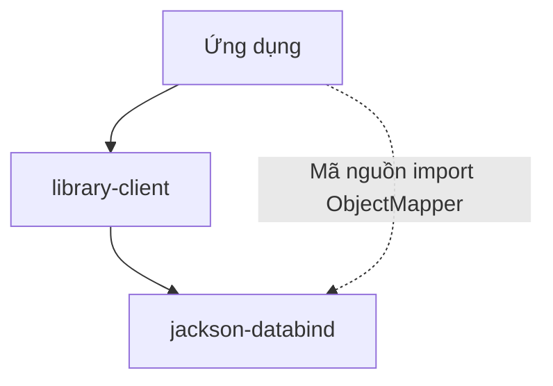
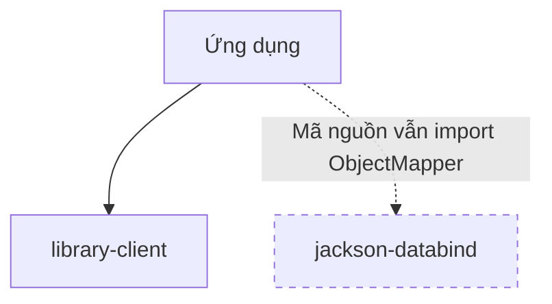
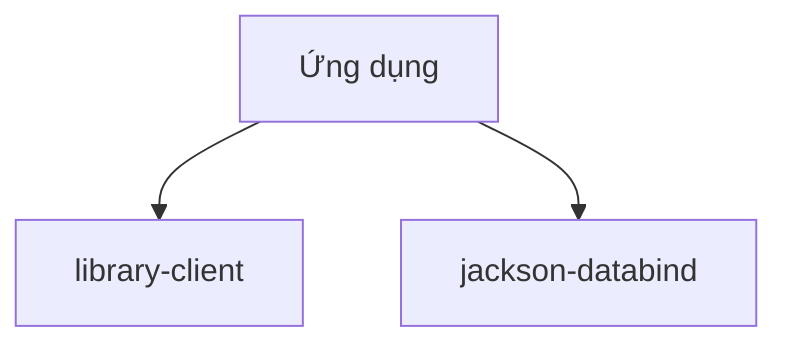
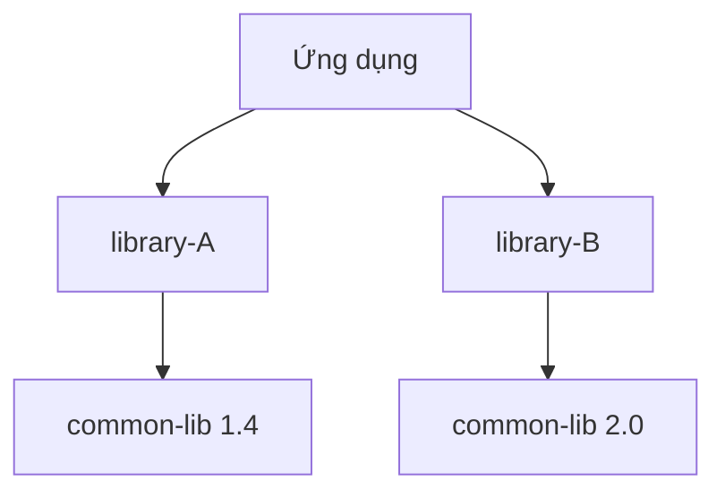

# Vì sao nên khai báo trực tiếp thư viện mà mã nguồn sử dụng

Một dự án Java thường sử dụng nhiều thư viện bên ngoài. Có thư viện được khai báo trực tiếp trong build file, nhưng cũng có thư viện xuất hiện trong classpath vì một thư viện khác phụ thuộc vào nó. Trường hợp thứ hai gọi là **phụ thuộc bắc cầu (transitive dependency)**.

Một vấn đề dễ gặp là mã nguồn của dự án import và gọi trực tiếp lớp của thư viện A, nhưng build file lại không khai báo A. Chương trình vẫn biên dịch được vì thư viện B tình cờ kéo A vào classpath. Đến khi B thay đổi hoặc bỏ A khỏi dependency của nó, dự án có thể không còn biên dịch được.

Vì vậy, nguyên tắc quan trọng là: **nếu mã nguồn của một module trực tiếp sử dụng một thư viện, module đó nên khai báo thư viện ấy như một dependency trực tiếp**, ngay cả khi thư viện hiện tại đã được đưa vào classpath thông qua dependency khác.

Bài học này giải thích direct và transitive dependency, lý do cần khai báo trực tiếp, cách thực hiện trong Maven và Gradle, cách chọn scope phù hợp và cách kiểm tra dependency graph.

## 1. Direct dependency và transitive dependency

### 1.1. Direct dependency là gì?

Direct dependency là thư viện mà dự án chủ động khai báo trong cấu hình build vì mã nguồn hoặc chức năng của chính dự án cần nó.

Ví dụ, mã nguồn có:

```java
import com.fasterxml.jackson.databind.ObjectMapper;

public class JsonReader {
    private final ObjectMapper mapper = new ObjectMapper();
}
```

Module này đang sử dụng API của Jackson Databind. Vì vậy, Jackson Databind là một dependency trực tiếp của module, và cần được khai báo trong build file.

### 1.2. Transitive dependency là gì?

Transitive dependency là thư viện được đưa vào dependency graph thông qua một dependency khác.

Ví dụ:


Ứng dụng khai báo library-client. Library-client phụ thuộc jackson-databind, còn jackson-databind phụ thuộc jackson-core. Do đó, cả jackson-databind và jackson-core có thể xuất hiện trên classpath của ứng dụng thông qua các quan hệ bắc cầu.

Nếu mã nguồn ứng dụng trực tiếp gọi ObjectMapper từ jackson-databind, thì jackson-databind là dependency trực tiếp theo cách sử dụng của ứng dụng, dù build file hiện chỉ khai báo library-client.

### 1.3. So sánh hai loại dependency

| Đặc điểm | Direct dependency | Transitive dependency |
|---|---|---|
| Ai khai báo? | Chính module đang sử dụng thư viện | Một dependency khác khai báo |
| Lý do xuất hiện | Mã nguồn hoặc API của module cần thư viện | Cần để dependency khác hoạt động |
| Mức độ chủ động | Module trực tiếp kiểm soát việc sử dụng và khai báo | Phụ thuộc vào cấu hình của thư viện cha |
| Rủi ro khi thư viện cha thay đổi | Thấp hơn nếu dependency đã được khai báo trực tiếp | Có thể biến mất hoặc đổi phiên bản khi thư viện cha thay đổi |
| Vai trò trong dependency graph | Cạnh xuất phát trực tiếp từ project | Nằm trên đường đi qua dependency khác |

Một thư viện có thể vừa là transitive dependency trong một nhánh, vừa được khai báo trực tiếp bởi project. Khi đó nó có nhiều đường đi trong graph, nhưng build tool vẫn giải quyết dependency theo quy tắc của công cụ và cấu hình phiên bản.

## 2. Vì sao không nên dựa vào dependency bắc cầu khi mã nguồn sử dụng trực tiếp?

### 2.1. Tránh phụ thuộc ngầm vào cấu trúc nội bộ của thư viện khác

Giả sử ứng dụng chỉ khai báo library-client nhưng mã nguồn lại import ObjectMapper. Hiện tại library-client kéo jackson-databind vào nên compiler tìm thấy lớp.

Sau này library-client có thể:

- Bỏ Jackson vì không còn cần xử lý JSON.
- Chuyển sang thư viện JSON khác.
- Đổi phiên bản hoặc scope của dependency.
- Đưa Jackson thành dependency optional.
- Tách chức năng JSON sang module khác.

Nếu ứng dụng không khai báo Jackson trực tiếp, build có thể thất bại dù mã nguồn ứng dụng không hề thay đổi.

Đây là một dạng phụ thuộc ngầm: module đang sử dụng một thư viện nhưng không thể hiện điều đó trong cấu hình của chính nó.

### 2.2. Build file phản ánh đúng nhu cầu của mã nguồn

Build file cũng là tài liệu mô tả kiến trúc dependency. Khi một người đọc thấy module khai báo Jackson Databind, họ biết mã nguồn có thể phụ thuộc vào API của Jackson.

Nếu dependency chỉ xuất hiện bắc cầu, người đọc phải lần theo nhiều tầng dependency mới hiểu tại sao thư viện đó có mặt.

Khai báo trực tiếp giúp:

- Thể hiện thư viện nào là một phần của thiết kế module.
- Dễ tìm nơi cần nâng cấp hoặc thay thế.
- Dễ xem xét dependency mới trong code review.
- Giảm phụ thuộc vào chi tiết triển khai của thư viện khác.

### 2.3. Tránh lỗi biên dịch khi dependency cha thay đổi

Hãy xét dependency graph ban đầu:



Ứng dụng sử dụng ObjectMapper nhưng chỉ khai báo library-client. Khi library-client bỏ Jackson, cạnh từ B đến C biến mất:



Compiler có thể báo không tìm thấy package hoặc class. Nếu ứng dụng khai báo Jackson trực tiếp, graph thể hiện rõ cả hai nhu cầu:



Khi library-client thay đổi dependency nội bộ, ứng dụng vẫn khai báo rõ thư viện mà mã nguồn của nó cần.

### 2.4. Kiểm soát phiên bản có chủ đích

Khi dependency chỉ đến từ một thư viện cha, phiên bản thực tế có thể bị ảnh hưởng bởi các dependency khác trong graph và quy tắc mediation hoặc resolution của build tool.

Khai báo trực tiếp giúp project thể hiện rõ hơn phiên bản hoặc constraint mà nó mong muốn. Tuy nhiên, chỉ thêm dependency trực tiếp không có nghĩa luôn thắng mọi quy tắc giải quyết phiên bản. Maven và Gradle có cách xử lý conflict riêng; cần xem dependency tree hoặc dependency insight để biết phiên bản cuối cùng.

### 2.5. Hỗ trợ kiểm kê và bảo trì dependency

Khai báo trực tiếp giúp nhóm nhận diện các thư viện mà module chủ động sử dụng. Điều này hữu ích khi:

- Rà soát dependency trước khi phát hành.
- Đánh giá thư viện cần nâng cấp.
- Xem xét giấy phép sử dụng.
- Phân tích lỗ hổng bảo mật.
- Tìm thư viện không còn được sử dụng.

Tuy nhiên, khai báo trực tiếp không thay thế việc kiểm tra dependency bắc cầu. Một lỗ hổng có thể nằm trong thư viện mà project không khai báo trực tiếp. Vì vậy, cần xem toàn bộ dependency graph khi kiểm kê bảo mật.

## 3. Ví dụ cụ thể: ứng dụng dùng Jackson qua một thư viện khác

Giả sử dự án có hai dependency:

- library-client cung cấp API gọi dịch vụ.
- library-client hiện phụ thuộc jackson-databind để xử lý JSON.

Mã nguồn ứng dụng:

```java
package com.example.app;

import com.fasterxml.jackson.databind.ObjectMapper;

public class Main {
    public static void main(String[] args) throws Exception {
        ObjectMapper mapper = new ObjectMapper();

        String json = mapper.writeValueAsString(
            java.util.Map.of("name", "Linh")
        );

        System.out.println(json);
    }
}
```

Nếu build file chỉ khai báo library-client, chương trình có thể biên dịch hiện tại vì Jackson được kéo vào theo dependency graph.

Nhưng điều đó khiến ứng dụng dựa vào một dependency mà library-client có thể thay đổi. Vì ứng dụng trực tiếp import ObjectMapper, nó nên khai báo jackson-databind trực tiếp.

Điều này không có nghĩa phải khai báo mọi dependency bắc cầu. Chỉ những thư viện mà chính mã nguồn hoặc API của module trực tiếp sử dụng mới cần được xem là direct dependency của module.

## 4. Khai báo direct dependency trong Maven

Maven khai báo dependency trực tiếp trong phần dependencies của POM.

Ví dụ:

```xml
<project>
    <modelVersion>4.0.0</modelVersion>

    <groupId>com.example</groupId>
    <artifactId>sample-app</artifactId>
    <version>1.0.0</version>

    <dependencies>
        <dependency>
            <groupId>com.example</groupId>
            <artifactId>library-client</artifactId>
            <version>2.0.0</version>
        </dependency>

        <dependency>
            <groupId>com.fasterxml.jackson.core</groupId>
            <artifactId>jackson-databind</artifactId>
            <version>2.18.3</version>
        </dependency>
    </dependencies>
</project>
```

Trong ví dụ này:

- library-client là dependency trực tiếp vì ứng dụng sử dụng API của nó.
- jackson-databind cũng là dependency trực tiếp vì mã nguồn ứng dụng import ObjectMapper.
- jackson-core và jackson-annotations có thể được kéo vào qua jackson-databind nếu chúng là dependency của phiên bản đã chọn.

Không cần khai báo lại jackson-core chỉ vì nó xuất hiện trong dependency tree. Chỉ khai báo trực tiếp jackson-core nếu mã nguồn của module cũng trực tiếp sử dụng API của thư viện đó.

### 4.1. Dependency và dependencyManagement khác nhau

Maven có hai phần thường dễ nhầm:

- **dependencies** khai báo các thư viện mà project thực sự sử dụng.
- **dependencyManagement** quản lý phiên bản hoặc cấu hình mặc định cho dependency khi dependency đó được khai báo ở project hoặc module con.

Ví dụ:

```xml
<project>
    <dependencyManagement>
        <dependencies>
            <dependency>
                <groupId>com.fasterxml.jackson</groupId>
                <artifactId>jackson-bom</artifactId>
                <version>2.18.3</version>
                <type>pom</type>
                <scope>import</scope>
            </dependency>
        </dependencies>
    </dependencyManagement>

    <dependencies>
        <dependency>
            <groupId>com.fasterxml.jackson.core</groupId>
            <artifactId>jackson-databind</artifactId>
        </dependency>
    </dependencies>
</project>
```

BOM giúp quản lý phiên bản nhất quán cho các dependency thuộc cùng hệ sinh thái. Tuy nhiên, phần dependencyManagement không tự thêm mọi thư viện vào classpath. Project vẫn phải khai báo jackson-databind trong dependencies vì mã nguồn sử dụng nó.

### 4.2. Chọn Maven scope phù hợp

Không phải mọi dependency trực tiếp đều thuộc cùng một scope.

| Scope | Khi nào dùng? | Có trên compile classpath của mã chính? | Có trên runtime classpath thông thường? |
|---|---|---:|---:|
| compile | Mặc định; mã chính cần thư viện khi biên dịch | Có | Có |
| provided | Mã cần API khi biên dịch nhưng môi trường chạy cung cấp | Có | Không theo runtime classpath thông thường |
| runtime | Cần khi chạy nhưng mã chính không cần API để biên dịch | Không | Có |
| test | Chỉ dùng trong mã và quá trình kiểm thử | Không | Chỉ trong test |

Ví dụ:

```xml
<dependencies>
    <!-- Mã chính import ObjectMapper -->
    <dependency>
        <groupId>com.fasterxml.jackson.core</groupId>
        <artifactId>jackson-databind</artifactId>
        <version>2.18.3</version>
    </dependency>

    <!-- Chỉ test sử dụng JUnit -->
    <dependency>
        <groupId>org.junit.jupiter</groupId>
        <artifactId>junit-jupiter</artifactId>
        <version>5.11.4</version>
        <scope>test</scope>
    </dependency>
</dependencies>
```

Nếu mã test import JUnit, dependency JUnit cần được khai báo ở scope test. Không nên để JUnit thành dependency compile/runtime của ứng dụng chỉ vì test cần nó.

### 4.3. Dependency optional và exclusion

Maven cho phép dependency được đánh dấu optional. Khi một thư viện cha khai báo dependency optional, dependency đó không tự động được truyền đến project tiêu thụ theo cách thông thường. Nếu mã nguồn của project tiêu thụ trực tiếp sử dụng thư viện optional đó, project cần khai báo dependency trực tiếp.

Maven cũng hỗ trợ exclusion để loại một dependency bắc cầu không mong muốn khỏi nhánh dependency cụ thể. Exclusion hữu ích khi xử lý xung đột hoặc loại thư viện không cần thiết, nhưng không nên loại một thư viện mà mã nguồn của chính module vẫn sử dụng.

## 5. Khai báo direct dependency trong Gradle

Trong Gradle, dependency được khai báo theo configuration trong build script.

Ví dụ Groovy DSL:

```groovy
plugins {
    id 'java'
}

repositories {
    mavenCentral()
}

dependencies {
    implementation 'com.example:library-client:2.0.0'
    implementation 'com.fasterxml.jackson.core:jackson-databind:2.18.3'
}
```

Ví dụ Kotlin DSL:

```kotlin
plugins {
    java
}

repositories {
    mavenCentral()
}

dependencies {
    implementation("com.example:library-client:2.0.0")
    implementation("com.fasterxml.jackson.core:jackson-databind:2.18.3")
}
```

Cả hai ví dụ đều khai báo rõ library-client và jackson-databind là dependency của project. Mã nguồn sử dụng Jackson không còn phụ thuộc vào việc library-client có tiếp tục kéo Jackson vào hay không.

### 5.1. Các configuration thường gặp

Gradle có nhiều configuration để biểu thị mục đích sử dụng dependency.

| Configuration | Mục đích |
|---|---|
| implementation | Dependency cần cho việc biên dịch và chạy module |
| api | Dependency được công khai qua API của library, thường dùng với Java Library Plugin |
| compileOnly | Cần khi biên dịch nhưng không được đưa vào runtime classpath |
| runtimeOnly | Chỉ cần khi chạy |
| testImplementation | Cần cho biên dịch và chạy test |
| testRuntimeOnly | Chỉ cần ở runtime của test |
| annotationProcessor | Processor chạy trong quá trình biên dịch |

Ví dụ:

```groovy
plugins {
    id 'java-library'
}

dependencies {
    // API công khai của thư viện có sử dụng kiểu này.
    api 'org.example:public-api-types:1.0.0'

    // Dependency dùng nội bộ trong implementation.
    implementation 'com.fasterxml.jackson.core:jackson-databind:2.18.3'

    // Annotation chỉ cần khi biên dịch.
    compileOnly 'org.example:compile-annotations:1.0.0'

    // Driver chỉ cần khi chạy.
    runtimeOnly 'org.example:database-driver:1.0.0'

    // Framework test.
    testImplementation 'org.junit.jupiter:junit-jupiter:5.11.4'
}
```

Chọn configuration dựa trên cách module sử dụng thư viện:

- Nếu mã chính import lớp trong dependency để biên dịch, dependency phải có trên compile classpath của module.
- Nếu dependency chỉ cần khi chạy thông qua cơ chế tải động hoặc cấu hình runtime, có thể dùng runtimeOnly.
- Nếu dependency chỉ được test sử dụng, dùng testImplementation hoặc testRuntimeOnly.
- Nếu module là thư viện và kiểu của dependency xuất hiện trong API công khai, cân nhắc api thay vì implementation.

### 5.2. Khác biệt giữa api và implementation

Giả sử module library có phương thức công khai:

```java
public com.fasterxml.jackson.databind.JsonNode parse(String json) {
    // ...
}
```

Kiểu JsonNode xuất hiện trong chữ ký API công khai. Project sử dụng library có thể cần Jackson trên compile classpath để biên dịch mã gọi API này. Với Gradle Java Library Plugin, dependency có thể cần khai báo bằng api.

Nếu library chỉ dùng ObjectMapper bên trong và chỉ trả về kiểu dữ liệu do chính library định nghĩa, dependency có thể là implementation. Khi đó, dependency vẫn có mặt khi chạy library nhưng không được công khai như một phần compile API của consumer.

Điều này không thay đổi nguyên tắc khai báo trực tiếp: module library cần khai báo Jackson vì chính mã nguồn của nó sử dụng Jackson. Configuration api hay implementation quyết định mức độ dependency được phơi bày cho consumer.

## 6. Direct dependency không có nghĩa phải khai báo lại mọi thứ

Một hiểu lầm thường gặp là nhìn thấy một dependency trong cây rồi thêm tất cả các dependency bắc cầu vào build file. Việc đó tạo cấu hình dài, khó bảo trì và có thể làm project kiểm soát những thư viện mà nó không trực tiếp sử dụng.

Nguyên tắc phù hợp là:

- Khai báo trực tiếp thư viện mà mã nguồn chính import hoặc gọi API.
- Khai báo trực tiếp thư viện mà mã test sử dụng trong scope test.
- Khai báo thư viện cần thiết cho runtime nếu ứng dụng hoặc môi trường cần nó nhưng mã nguồn không import trực tiếp.
- Để build tool giải quyết dependency bắc cầu của các thư viện khác.
- Chỉ thêm dependency bắc cầu thành direct dependency khi module thực sự có nhu cầu sử dụng nó.

Ví dụ, nếu ứng dụng chỉ sử dụng library-client và không import bất kỳ lớp Jackson nào, ứng dụng không cần khai báo Jackson chỉ vì library-client đang dùng Jackson nội bộ.

Ngược lại, nếu ứng dụng import ObjectMapper, Jackson Databind là dependency trực tiếp của ứng dụng.

## 7. Điều gì xảy ra khi phiên bản dependency bị xung đột?

Một dependency có thể được yêu cầu ở nhiều phiên bản qua các nhánh khác nhau.

Ví dụ:



Cả library-A và library-B đều cần common-lib nhưng yêu cầu phiên bản khác nhau. Build tool phải chọn một phiên bản hoặc báo xung đột theo quy tắc resolution và cấu hình.

Khai báo common-lib trực tiếp có thể thể hiện phiên bản mà project muốn sử dụng, nhưng không nên hiểu rằng mọi công cụ đều áp dụng cùng một quy tắc ưu tiên.

### 7.1. Maven dependency mediation

Maven dùng quy tắc dependency mediation để chọn phiên bản khi cùng một artifact xuất hiện nhiều lần trong cây dependency. Quy tắc nearest definition thường được áp dụng; nếu các đường dẫn có độ sâu bằng nhau, thứ tự khai báo có thể ảnh hưởng lựa chọn.

Có thể kiểm tra cây dependency bằng:

```bash
./mvnw dependency:tree
```

Lọc một dependency cụ thể:

```bash
./mvnw dependency:tree -Dincludes=com.fasterxml.jackson.core:jackson-databind
```

Nếu cần quản lý phiên bản nhất quán trên nhiều module, Maven BOM và dependencyManagement có thể giúp tập trung version policy.

### 7.2. Gradle dependency resolution

Gradle xây dựng dependency graph và áp dụng các quy tắc resolution, constraints, platforms hoặc resolution strategy để chọn phiên bản. Kết quả không nên được suy đoán chỉ từ thứ tự các dòng trong dependencies block.

Xem dependency graph:

```bash
./gradlew dependencies --configuration runtimeClasspath
```

Xem lý do một dependency được chọn:

```bash
./gradlew dependencyInsight --dependency jackson-databind --configuration runtimeClasspath
```

Kết quả dependencyInsight giúp biết dependency đến từ nhánh nào, phiên bản nào được chọn và lý do resolution.

## 8. BOM, version catalog và dependency constraint

Khi dự án có nhiều dependency liên quan, việc lặp lại version ở nhiều module có thể dẫn đến lệch phiên bản.

Maven BOM và Gradle platform giúp tập trung quản lý phiên bản. Gradle version catalog giúp đặt alias cho tọa độ dependency. Các cơ chế này giúp quản lý version, nhưng không làm mất yêu cầu khai báo dependency mà module trực tiếp sử dụng.

Ví dụ Gradle version catalog:

```toml
[versions]
jackson = "2.18.3"

[libraries]
jackson-databind = { module = "com.fasterxml.jackson.core:jackson-databind", version.ref = "jackson" }
```

Sau đó module vẫn cần khai báo alias:

```kotlin
dependencies {
    implementation(libs.jackson.databind)
}
```

Catalog chỉ cung cấp tên và thông tin dependency để tái sử dụng. Nếu mã nguồn module sử dụng Jackson, dependency vẫn cần xuất hiện trong configuration của module.

Tương tự, dependencyManagement trong Maven có thể quản lý version nhưng không tự động đưa thư viện vào dependencies.

## 9. Cách tìm dependency đang được sử dụng

Khi không chắc một thư viện là direct hay transitive, hãy kiểm tra hai khía cạnh:

1. Mã nguồn có import hoặc gọi API của thư viện đó không?
2. Dependency graph cho biết thư viện được đưa vào qua nhánh nào?

Có thể tìm import trong mã nguồn bằng IDE hoặc công cụ tìm kiếm của repository. Sau đó xem dependency tree.

### 9.1. Với Maven

```bash
./mvnw dependency:tree
```

Lọc theo groupId và artifactId:

```bash
./mvnw dependency:tree -Dincludes=com.fasterxml.jackson.core:jackson-databind
```

Maven Help Plugin cũng có thể hỗ trợ xem effective POM, nhưng dependency:tree thường là điểm bắt đầu trực tiếp để hiểu đường đi của một thư viện.

### 9.2. Với Gradle

```bash
./gradlew dependencies --configuration compileClasspath
./gradlew dependencies --configuration runtimeClasspath
```

Tìm lý do dependency xuất hiện:

```bash
./gradlew dependencyInsight --dependency jackson-databind --configuration compileClasspath
```

Với dependency chỉ dùng ở test, kiểm tra testCompileClasspath hoặc testRuntimeClasspath tương ứng.

### 9.3. Cách đọc kết quả

Một dependency tree có thể biểu diễn như:

```text
com.example:sample-app
+--- com.example:library-client:2.0.0
|    \--- com.fasterxml.jackson.core:jackson-databind:2.18.3
|         +--- com.fasterxml.jackson.core:jackson-core:2.18.3
|         \--- com.fasterxml.jackson.core:jackson-annotations:2.18.3
\--- com.fasterxml.jackson.core:jackson-databind:2.18.3
```

Trong ví dụ này, Jackson Databind vừa xuất hiện qua library-client, vừa được project khai báo trực tiếp. Đây là điều có thể xảy ra và không đồng nghĩa có hai bản JAR giống nhau phải được nạp hai lần. Build tool giải quyết dependency graph và chọn artifact theo quy tắc của nó.

## 10. Dependency trực tiếp trong thư viện và API công khai

Khi phát triển một thư viện Java, cần chú ý dependency có xuất hiện trong API công khai hay không.

Ví dụ, thư viện cung cấp:

```java
public class JsonService {
    public com.fasterxml.jackson.databind.JsonNode parse(String input) {
        // Parse JSON and return a JsonNode.
        return null;
    }
}
```

Người dùng thư viện cần biết kiểu JsonNode để gọi và xử lý kết quả. Dependency này là một phần của API công khai.

Trong Gradle với Java Library Plugin, có thể khai báo dependency bằng api nếu consumer cần nó trên compile classpath.

Nếu thư viện chỉ dùng Jackson bên trong:

```java
public class JsonService {
    public String normalize(String input) {
        // Use Jackson internally and return a String.
        return input;
    }
}
```

thì dependency có thể được khai báo bằng implementation. Consumer không cần biết thư viện nội bộ đang dùng Jackson nếu API công khai không phơi bày kiểu của Jackson.

Với Maven, scope và tính transitive của dependency có quy tắc khác với Gradle api/implementation. Cần chọn scope phù hợp và xem xét dependency được truyền tới consumer như thế nào.

## 11. Dependency test cũng cần được khai báo trực tiếp

Nếu mã test import JUnit, Mockito hoặc AssertJ, module nên khai báo thư viện đó trong test scope/configuration của chính module.

Không nên dựa vào việc một framework khác tình cờ kéo JUnit vào.

Ví dụ Gradle:

```groovy
dependencies {
    testImplementation 'org.junit.jupiter:junit-jupiter:5.11.4'
    testImplementation 'org.assertj:assertj-core:3.27.3'
}
```

Ví dụ Maven:

```xml
<dependencies>
    <dependency>
        <groupId>org.junit.jupiter</groupId>
        <artifactId>junit-jupiter</artifactId>
        <version>5.11.4</version>
        <scope>test</scope>
    </dependency>
</dependencies>
```

Nếu một module có nhiều test source set hoặc integration test riêng, hãy khai báo dependency trong configuration tương ứng. Mỗi source set nên thể hiện rõ thư viện nào cần cho việc biên dịch và chạy test của nó.

## 12. Những lỗi thường gặp

| Hiện tượng | Nguyên nhân có thể | Cách xử lý |
|---|---|---|
| Mã nguồn import được lớp nhưng build file không khai báo thư viện | Thư viện đang được kéo vào qua dependency khác | Khai báo trực tiếp thư viện mà mã nguồn sử dụng |
| Build lỗi sau khi nâng cấp một dependency cha | Dependency cha đã bỏ hoặc đổi scope của thư viện bắc cầu | Khai báo thư viện cần dùng trực tiếp trong module |
| Máy này biên dịch được, máy khác không | Dependency graph khác do version, profile hoặc cấu hình | Kiểm tra dependency tree và cấu hình hiệu lực |
| Dependency xuất hiện nhiều lần trong tree | Nhiều nhánh cùng yêu cầu một artifact | Dùng dependency insight/tree để xem version được chọn |
| JAR chạy lỗi dù compile thành công | Dependency cần lúc chạy bị thiếu hoặc scope sai | Kiểm tra runtime classpath và chọn scope phù hợp |
| Test không tìm thấy framework | Dependency test không được khai báo đúng | Khai báo trong test scope/configuration |
| Consumer không biên dịch được khi dùng API của thư viện | Dependency chứa kiểu trong public API không được truyền tới compile classpath của consumer | Với Gradle Java Library, xem xét api; với Maven, kiểm tra scope và dependency propagation |
| Build file chứa quá nhiều dependency | Khai báo mọi transitive dependency dù mã nguồn không dùng | Chỉ khai báo trực tiếp dependency mà module thực sự cần |
| Phiên bản thư viện không như mong đợi | Có conflict hoặc constraint/BOM đang ảnh hưởng resolution | Kiểm tra dependency tree hoặc dependencyInsight |

## 13. Nguyên tắc thực hành

### Khai báo thư viện theo cách mã nguồn sử dụng

Nếu module import lớp hoặc gọi API của một thư viện, hãy khai báo thư viện đó trực tiếp. Đừng dựa vào việc một dependency khác đang kéo nó vào.

### Chọn scope theo thời điểm sử dụng

Mã chính cần dependency khi compile hoặc runtime; mã test cần dependency trong test configuration; thư viện chỉ cần lúc chạy có thể dùng runtimeOnly hoặc scope runtime tùy công cụ.

### Không khai báo thừa

Không cần đưa tất cả dependency bắc cầu vào build file. Hãy để build tool quản lý những thư viện nội bộ mà dependency khác cần.

### Quản lý phiên bản tập trung

Dùng Maven BOM, dependencyManagement, Gradle platform, version catalog hoặc dependency constraints để tránh version drift giữa các module.

### Xem xét dependency graph khi nâng cấp

Khi nâng cấp thư viện, hãy kiểm tra dependency tree, phiên bản được chọn, thay đổi transitive dependencies và kết quả test.

### Phân biệt dependency implementation với dependency API

Nếu đang xây dựng thư viện, xác định dependency có xuất hiện trong chữ ký API công khai không. Cách khai báo dependency ảnh hưởng đến classpath mà consumer nhận được.

### Theo dõi cả direct và transitive dependencies

Direct dependency giúp thể hiện nhu cầu của module, nhưng lỗi bảo mật hoặc license vẫn có thể nằm trong dependency bắc cầu. Việc kiểm kê cần xem toàn bộ graph.

## 14. Ghi nhớ

- Direct dependency là thư viện mà module chủ động khai báo vì mã nguồn hoặc API của module cần nó.
- Transitive dependency được đưa vào graph thông qua một dependency khác.
- Nếu mã nguồn trực tiếp import hoặc sử dụng thư viện, hãy khai báo thư viện đó trực tiếp dù hiện tại nó đã xuất hiện bắc cầu.
- Không khai báo lại mọi transitive dependency; chỉ khai báo thư viện mà module thực sự sử dụng.
- Maven khai báo dependency trong dependencies; dependencyManagement quản lý phiên bản nhưng không tự thêm thư viện vào project.
- Gradle dùng các configuration như implementation, api, compileOnly, runtimeOnly và testImplementation.
- Với Gradle Java Library Plugin, api phù hợp khi dependency xuất hiện trong API công khai cần consumer biên dịch; implementation phù hợp cho dependency nội bộ.
- Maven và Gradle có quy tắc resolution phiên bản khác nhau; dùng dependency tree hoặc dependencyInsight để kiểm tra kết quả.
- BOM, platform và version catalog giúp quản lý phiên bản nhưng không thay thế việc khai báo direct dependency.
- Dependency test cần được khai báo trong test scope/configuration.
- Cần kiểm tra cả dependency bắc cầu khi đánh giá bảo mật và giấy phép.

## 15. Tự kiểm tra

1. Direct dependency khác transitive dependency như thế nào?
2. Vì sao mã nguồn import ObjectMapper nhưng chỉ khai báo library-client lại tạo ra một phụ thuộc ngầm?
3. Điều gì có thể xảy ra khi library-client bỏ jackson-databind khỏi dependency của nó?
4. Vì sao không cần khai báo mọi dependency bắc cầu trong build file?
5. Maven dependencies khác dependencyManagement ở điểm nào?
6. Gradle implementation khác api như thế nào khi xây dựng một thư viện?
7. Khi nào nên dùng testImplementation hoặc Maven test scope?
8. Làm thế nào để xem một dependency được đưa vào graph qua nhánh nào?
9. Vì sao khai báo direct dependency không có nghĩa phiên bản của nó luôn thắng mọi conflict?
10. Nếu dependency chỉ xuất hiện trong API công khai của thư viện, cần xem xét điều gì khi khai báo dependency?

Khi có thể xác định thư viện nào được mã nguồn sử dụng trực tiếp, phân biệt nó với dependency bắc cầu và chọn đúng scope trong Maven hoặc Gradle, bạn đã nắm được nguyên tắc quan trọng để dependency graph rõ ràng, ổn định và dễ bảo trì.

