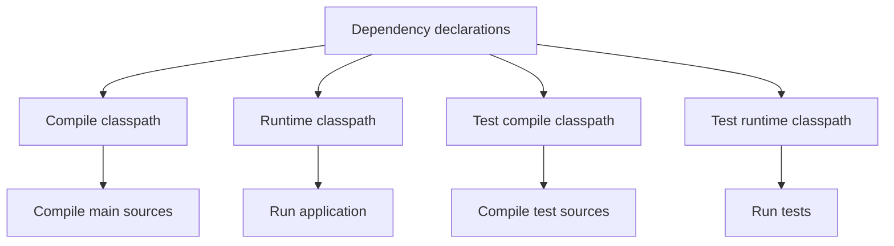

# Phụ thuộc để biên dịch, để chạy và chỉ để kiểm thử

Một dự án Java thường sử dụng nhiều thư viện: thư viện cung cấp kiểu dữ liệu và API cho mã ứng dụng, driver kết nối cơ sở dữ liệu, framework web, thư viện logging, framework kiểm thử và các công cụ chỉ dùng trong lúc build. Không phải thư viện nào cũng cần có mặt ở mọi giai đoạn.

Khi khai báo dependency, cần xác định **thư viện được cần ở thời điểm nào**:

- **Compile time:** compiler cần thư viện để phân giải class, interface, method và kiểu dữ liệu được tham chiếu trong mã nguồn.
- **Runtime:** JVM hoặc ứng dụng cần thư viện khi thực thi, dù mã nguồn có thể không tham chiếu trực tiếp đến lớp cụ thể của thư viện đó.
- **Test compile/runtime:** mã kiểm thử cần thư viện để biên dịch hoặc chạy test.
- **Build time:** một công cụ như annotation processor, compiler plugin hoặc code generator cần thư viện để thực hiện công việc build.

Chọn đúng scope hoặc configuration giúp classpath ở mỗi giai đoạn chỉ chứa những thư viện cần thiết. Điều này giảm dependency không cần thiết, tránh đóng gói nhầm thư viện, làm rõ trách nhiệm cung cấp runtime và hạn chế xung đột phiên bản.

## 1. Compile time và runtime khác nhau thế nào?

### 1.1. Compile time

Khi biên dịch Java, compiler cần biết các kiểu được mã nguồn sử dụng. Nếu lớp `OrderService` khai báo một tham số có kiểu `ObjectMapper`, compiler phải tìm được lớp `ObjectMapper` trong compile classpath. Nếu không, lỗi thường gặp là `package ... does not exist` hoặc `cannot find symbol`.

Ví dụ:

```java
import com.fasterxml.jackson.databind.ObjectMapper;

public class OrderJsonWriter {
    private final ObjectMapper mapper = new ObjectMapper();

    public String write(Object value) throws Exception {
        return mapper.writeValueAsString(value);
    }
}
```

Để biên dịch đoạn mã này, dependency cung cấp `ObjectMapper` phải có mặt trong compile classpath. Nếu dependency chỉ được khai báo cho runtime, compiler không nhìn thấy lớp đó và không thể biên dịch.

Compile classpath cũng ảnh hưởng đến phiên bản API mà compiler nhìn thấy. Nếu có hai phiên bản của cùng một thư viện, thứ tự và quy tắc giải quyết dependency có thể quyết định lớp nào được chọn. Vì vậy, việc khai báo đúng scope chưa đủ; còn phải kiểm tra phiên bản thực tế được resolve.

### 1.2. Runtime

Sau khi biên dịch, bytecode có thể cần các lớp của thư viện khi JVM thực thi. Runtime classpath là tập lớp và JAR mà ứng dụng có thể nạp khi chạy.

Một trường hợp điển hình là JDBC driver. Mã ứng dụng có thể chỉ dùng API chuẩn `java.sql` và gọi `DriverManager`, trong khi driver của PostgreSQL được nạp khi ứng dụng kết nối cơ sở dữ liệu. Compiler không cần lớp riêng của driver nếu mã nguồn không tham chiếu trực tiếp đến lớp đó, nhưng runtime cần driver để tạo kết nối.

```java
import java.sql.Connection;
import java.sql.DriverManager;

public class DatabaseConnection {
    public Connection open(String url, String user, String password)
            throws Exception {
        return DriverManager.getConnection(url, user, password);
    }
}
```

Đoạn mã có thể biên dịch chỉ với API JDBC có trong JDK. Khi chạy, ứng dụng cần driver tương ứng trong runtime classpath. Nếu driver không có mặt, việc kết nối có thể thất bại dù compile đã thành công.

### 1.3. Test compile và test runtime

Test source là mã Java riêng, thường nằm trong `src/test/java`. Nó có thể sử dụng các thư viện mà mã ứng dụng không cần, chẳng hạn JUnit, Mockito, AssertJ hoặc Testcontainers.

Ví dụ:

```java
import org.junit.jupiter.api.Test;

import static org.junit.jupiter.api.Assertions.assertEquals;

class PriceCalculatorTest {
    @Test
    void appliesDiscount() {
        PriceCalculator calculator = new PriceCalculator();
        assertEquals(90, calculator.finalPrice(100, 10));
    }
}
```

JUnit cần có mặt khi biên dịch test source và khi test runner thực thi test. Tuy nhiên, ứng dụng production không cần JUnit để chạy. Vì vậy, dependency này nên thuộc phạm vi test thay vì dependency runtime của ứng dụng.

Một số thư viện kiểm thử có phần API cần khi biên dịch test và phần engine/launcher cần khi chạy test. Build tool có thể biểu diễn chúng bằng configuration riêng hoặc metadata dependency để các phần tương ứng xuất hiện trong đúng classpath.

## 2. Bốn classpath nên phân biệt

Trong dự án Java dùng build tool, có thể hình dung các classpath chính như sau:

| Classpath | Thành phần điển hình | Ai sử dụng? |
|---|---|---|
| `compileClasspath` | Dependency cần để biên dịch mã ứng dụng | Java compiler cho `src/main/java` |
| `runtimeClasspath` | Output đã biên dịch và dependency cần khi chạy ứng dụng | JVM hoặc task chạy ứng dụng |
| `testCompileClasspath` | Output mã chính, dependency ứng dụng cần để biên dịch và thư viện test compile | Compiler cho `src/test/java` |
| `testRuntimeClasspath` | Output mã chính, output test và dependency cần để chạy test | Test runner/JVM chạy test |

Đây là tên configuration thường gặp trong Gradle. Maven có các classpath được tạo theo lifecycle và dependency scope, nhưng không dùng chính các tên configuration này.

Một thư viện có thể xuất hiện trong một classpath nhưng không xuất hiện trong classpath khác. Ví dụ, JUnit thường nằm trong test compile và test runtime, nhưng không nằm trong runtime classpath của ứng dụng. JDBC driver có thể chỉ cần runtime. Một API do application server cung cấp có thể cần khi compile nhưng không được đóng gói cùng ứng dụng.



Sơ đồ chỉ thể hiện các vai trò. Quan hệ cụ thể giữa các classpath được build tool xác định theo dependency scope, configuration, plugin và loại project.

## 3. Maven: dependency scope

Trong Maven, scope được khai báo bằng phần tử `<scope>` trong một dependency của `pom.xml`. Nếu không ghi scope, Maven dùng `compile` làm mặc định.

Các scope thường gặp:

| Maven scope | Compile mã chính | Runtime ứng dụng | Compile/chạy test | Được truyền như dependency tới project dùng thư viện? |
|---|---:|---:|---:|---|
| `compile` | Có | Có | Có | Có, theo quy tắc dependency mediation của Maven |
| `provided` | Có | Không | Có | Không được truyền như dependency thông thường |
| `runtime` | Không | Có | Có | Có, với phạm vi runtime phù hợp |
| `test` | Không | Không | Có | Không |
| `system` | Có | Không theo runtime thông thường | Có | Không; dùng đường dẫn cục bộ, không khuyến nghị |

Maven còn có scope `import` trong `dependencyManagement` dành cho BOM; đây là trường hợp quản lý dependency đặc biệt, không phải scope để thêm thư viện thông thường vào classpath của mã ứng dụng.

### 3.1. `compile`: dependency dùng cho mã ứng dụng

`compile` là scope mặc định. Dependency thuộc scope này có mặt trong compile classpath, runtime classpath và classpath kiểm thử. Nó cũng có thể được truyền tiếp tới project phụ thuộc theo quy tắc giải quyết dependency của Maven.

Ví dụ, nếu mã ứng dụng trực tiếp gọi API của Jackson, khai báo:

```xml
<dependency>
    <groupId>com.fasterxml.jackson.core</groupId>
    <artifactId>jackson-databind</artifactId>
    <version>2.17.2</version>
    <scope>compile</scope>
</dependency>
```

Vì `compile` là mặc định, có thể bỏ hẳn dòng scope:

```xml
<dependency>
    <groupId>com.fasterxml.jackson.core</groupId>
    <artifactId>jackson-databind</artifactId>
    <version>2.17.2</version>
</dependency>
```

Chọn scope này khi mã chính tham chiếu trực tiếp kiểu hoặc API của thư viện và ứng dụng cũng cần thư viện đó lúc chạy.

### 3.2. `provided`: compile được, runtime do môi trường cung cấp

`provided` có mặt trong compile classpath và test classpath, nhưng không có trong runtime classpath thông thường của ứng dụng. Maven giả định môi trường triển khai sẽ cung cấp thư viện đó.

Ví dụ, một ứng dụng web được triển khai lên servlet container có thể biên dịch với Servlet API nhưng không cần đóng gói API đó như một thư viện riêng nếu container đã cung cấp:

```xml
<dependency>
    <groupId>jakarta.servlet</groupId>
    <artifactId>jakarta.servlet-api</artifactId>
    <version>6.0.0</version>
    <scope>provided</scope>
</dependency>
```

Chỉ dùng `provided` khi môi trường chạy thực sự cung cấp đúng API và phiên bản tương thích. Nếu chạy ứng dụng độc lập mà runtime không có Servlet API, ứng dụng có thể gặp lỗi nạp lớp.

Scope `provided` cũng không được truyền tiếp như một dependency thông thường tới project tiêu thụ. Đây là điều cần nhớ khi tạo thư viện: project downstream có thể phải tự khai báo dependency mà thư viện cần ở compile time.

### 3.3. `runtime`: cần khi chạy, không cần để biên dịch mã chính

`runtime` không có trong compile classpath của mã chính, nhưng có trong runtime classpath và classpath kiểm thử.

Ví dụ, nếu mã nguồn chỉ dùng JDBC API trong JDK và driver được tự động phát hiện khi chạy, có thể khai báo PostgreSQL driver như sau:

```xml
<dependency>
    <groupId>org.postgresql</groupId>
    <artifactId>postgresql</artifactId>
    <version>42.7.3</version>
    <scope>runtime</scope>
</dependency>
```

Nếu mã nguồn tham chiếu trực tiếp lớp riêng của driver, ví dụ `org.postgresql.ds.PGSimpleDataSource`, thì driver phải có mặt trong compile classpath. Khi đó scope `runtime` là không đủ; cần dùng scope phù hợp với việc mã chính tham chiếu API đó, thường là `compile`.

### 3.4. `test`: chỉ dành cho kiểm thử

Dependency scope `test` chỉ có mặt trong compile classpath và runtime classpath của test. Nó không có trong compile hoặc runtime classpath của ứng dụng chính và không được truyền tiếp như dependency thông thường.

Ví dụ:

```xml
<dependency>
    <groupId>org.junit.jupiter</groupId>
    <artifactId>junit-jupiter</artifactId>
    <version>5.10.2</version>
    <scope>test</scope>
</dependency>
```

Chọn scope `test` cho framework kiểm thử, assertion library, mock library và các tiện ích chỉ phục vụ test. Không nên dùng `compile` chỉ vì test source cần thư viện đó; làm vậy sẽ đưa thư viện test vào phạm vi dependency của ứng dụng.

### 3.5. `system`: trường hợp đặc biệt, nên tránh

`system` yêu cầu chỉ định đường dẫn đến JAR trên máy thông qua `systemPath`. Ví dụ:

```xml
<dependency>
    <groupId>com.example</groupId>
    <artifactId>legacy-library</artifactId>
    <version>1.0</version>
    <scope>system</scope>
    <systemPath>${project.basedir}/lib/legacy-library.jar</systemPath>
</dependency>
```

Cách này phụ thuộc file có mặt đúng đường dẫn trên từng máy, không dùng cơ chế repository thông thường và gây khó khăn cho CI cũng như nhóm phát triển. Nếu có thể, hãy cài hoặc publish JAR vào Maven repository nội bộ rồi khai báo như dependency thông thường.

### 3.6. `import`: nhập BOM trong dependency management

Một BOM (Bill of Materials) quản lý phiên bản của một nhóm dependency. Maven cho phép nhập BOM trong `dependencyManagement` bằng `type` là `pom` và `scope` là `import`:

```xml
<dependencyManagement>
    <dependencies>
        <dependency>
            <groupId>org.junit</groupId>
            <artifactId>junit-bom</artifactId>
            <version>5.10.2</version>
            <type>pom</type>
            <scope>import</scope>
        </dependency>
    </dependencies>
</dependencyManagement>
```

Sau đó dependency có thể dùng version được BOM quản lý:

```xml
<dependency>
    <groupId>org.junit.jupiter</groupId>
    <artifactId>junit-jupiter</artifactId>
    <scope>test</scope>
</dependency>
```

`dependencyManagement` quản lý phiên bản và metadata khi dependency được khai báo; nó không tự thêm mọi dependency trong BOM vào project. Muốn sử dụng một thư viện, vẫn cần khai báo dependency tương ứng.

## 4. Gradle: dependency configurations

Gradle không gọi các cấu hình dependency này là Maven scopes. Với plugin Java, các configuration chính thường gồm:

| Gradle configuration | Compile mã chính | Runtime ứng dụng | Compile test | Runtime test |
|---|---:|---:|---:|---:|
| `implementation` | Có | Có | Có trong classpath test kế thừa | Có trong classpath test kế thừa |
| `compileOnly` | Có | Không | Có thể có trong compile classpath kế thừa | Không tự có trong runtime |
| `runtimeOnly` | Không | Có | Không phải test compile dependency | Có trong test runtime classpath kế thừa |
| `testImplementation` | Không | Không | Có | Có |
| `testCompileOnly` | Không | Không | Có | Không |
| `testRuntimeOnly` | Không | Không | Không | Có |

Đây là cách nhìn chức năng của các configuration chuẩn. Plugin bổ sung, source set tùy chỉnh hoặc project dependency có thể tạo thêm configuration và quan hệ kế thừa.

### 4.1. `implementation`: cần để biên dịch và chạy

Khi mã ứng dụng sử dụng trực tiếp API của một thư viện và ứng dụng cần thư viện đó lúc chạy, dùng `implementation`:

```kotlin
plugins {
    java
}

repositories {
    mavenCentral()
}

dependencies {
    implementation("com.fasterxml.jackson.core:jackson-databind:2.17.2")
}
```

Dependency `implementation` tham gia compile classpath và runtime classpath của source set chính. Với plugin Java, nó cũng là một phần của classpath cần thiết khi biên dịch và chạy test.

Nếu project là thư viện và áp dụng plugin `java-library`, `implementation` còn giúp giữ dependency ở mức implementation detail: project tiêu thụ thư viện không tự động nhìn thấy dependency đó trên compile classpath chỉ vì nó được dùng bên trong thư viện.

### 4.2. `compileOnly`: chỉ cần khi biên dịch

Dùng `compileOnly` khi mã nguồn cần API để biên dịch nhưng runtime được cung cấp bởi môi trường hoặc một thành phần khác.

Ví dụ với Servlet API:

```kotlin
dependencies {
    compileOnly("jakarta.servlet:jakarta.servlet-api:6.0.0")
}
```

Đây là lựa chọn tương ứng về mục đích với Maven `provided` trong nhiều trường hợp. Tuy nhiên, hành vi truyền dependency và cách đóng gói giữa hai công cụ không hoàn toàn giống nhau.

Nếu chạy ứng dụng ngoài servlet container, cần tự cung cấp API/runtime phù hợp. `compileOnly` không tự thêm JAR vào runtime classpath của ứng dụng.

Với plugin `java-library`, nếu một dependency chỉ dùng khi compile nhưng lại xuất hiện trong public API của thư viện và consumer cần nó để biên dịch, có thể cần xem xét `compileOnlyApi`. Đây là configuration của Java Library Plugin, có ý nghĩa công khai API compile-only cho consumer. Không dùng nó thay thế `compileOnly` cho dependency chỉ là chi tiết nội bộ.

### 4.3. `runtimeOnly`: chỉ cần khi chạy

Dùng `runtimeOnly` khi ứng dụng cần thư viện lúc thực thi nhưng mã nguồn không tham chiếu trực tiếp API của thư viện đó.

```kotlin
dependencies {
    runtimeOnly("org.postgresql:postgresql:42.7.3")
}
```

Ví dụ JDBC driver có thể được tìm qua cơ chế service provider hoặc được nạp bởi framework ở runtime. Nếu mã nguồn tham chiếu lớp cụ thể của driver, hãy chuyển dependency sang configuration có mặt trong compile classpath, thường là `implementation`.

### 4.4. `testImplementation`: cần để biên dịch và chạy test

```kotlin
dependencies {
    testImplementation("org.junit.jupiter:junit-jupiter:5.10.2")
}

tasks.test {
    useJUnitPlatform()
}
```

`testImplementation` đặt dependency vào classpath biên dịch và chạy test. Nó không đưa JUnit vào runtime classpath của ứng dụng chính.

Nếu test sử dụng Mockito, AssertJ hoặc thư viện test khác, chúng thường cũng được khai báo ở `testImplementation`.

### 4.5. `testCompileOnly`: chỉ cần để biên dịch test

Một số API chỉ cần để biên dịch test, còn lúc chạy test có một môi trường hoặc engine khác cung cấp. Khi đó có thể dùng `testCompileOnly`.

Ví dụ tổng quát:

```kotlin
dependencies {
    testCompileOnly("com.example:test-annotations:1.0.0")
}
```

Chỉ chọn configuration này khi chắc chắn thư viện không cần có mặt lúc test thực thi. Nếu test runner cần nạp lớp đó, dùng `testRuntimeOnly` hoặc `testImplementation` theo nhu cầu.

### 4.6. `testRuntimeOnly`: chỉ cần khi chạy test

Một số test framework tách API và engine. Mã test có thể biên dịch nhờ API đã có trong `testImplementation`, trong khi engine/launcher được cần ở runtime:

```kotlin
dependencies {
    testImplementation("org.junit.jupiter:junit-jupiter-api:5.10.2")
    testRuntimeOnly("org.junit.jupiter:junit-jupiter-engine:5.10.2")
}
```

Đây là cách khai báo tách API và engine. Trong nhiều dự án, dependency tổng hợp `junit-jupiter` trong `testImplementation` đã kéo theo các thành phần cần thiết qua metadata; khi đó không cần khai báo trùng lặp. Hãy xem dependency graph của phiên bản đang dùng.

## 5. `api` và `implementation` khi xây dựng thư viện Gradle

Nếu dự án chỉ tạo ứng dụng, `implementation` thường là lựa chọn cho dependency của mã chính. Nếu dự án tạo thư viện mà module khác sẽ phụ thuộc, cần hiểu thêm `api`.

`api` được cung cấp bởi plugin `java-library`. Dependency khai báo bằng `api` được đưa vào API compile classpath của project tiêu thụ thư viện. Dùng khi kiểu hoặc API của dependency xuất hiện trong public API mà consumer cần nhìn thấy để biên dịch.

Ví dụ thư viện công khai một kiểu của Guava:

```java
package com.example.library;

import com.google.common.collect.ImmutableList;

public class ProductCatalog {
    public ImmutableList<String> productNames() {
        return ImmutableList.of("Book", "Pen");
    }
}
```

Nếu consumer cần biên dịch mã gọi `productNames()` và nhìn thấy kiểu `ImmutableList`, dependency Guava là một phần của API công khai. Với Gradle Java Library Plugin, có thể khai báo:

```kotlin
plugins {
    `java-library`
}

dependencies {
    api("com.google.guava:guava:33.2.1-jre")
}
```

Nếu thư viện chỉ dùng Guava bên trong implementation và public API không để lộ kiểu của Guava, thường nên dùng:

```kotlin
dependencies {
    implementation("com.google.guava:guava:33.2.1-jre")
}
```

Sự khác biệt giúp giảm dependency bị lộ ra compile classpath của consumer và hạn chế việc thay đổi implementation làm ảnh hưởng build của các project phụ thuộc.

Không nên chọn `api` chỉ vì một dependency được dùng trong mã nguồn. Hãy xem kiểu của dependency có xuất hiện trong public signature, superclass/interface công khai hoặc annotation mà consumer cần phân giải hay không.

## 6. So sánh Maven scope và Gradle configuration

Hai công cụ có mục tiêu tương tự nhưng mô hình không ánh xạ một-một hoàn toàn.

| Nhu cầu | Maven | Gradle Java Plugin |
|---|---|---|
| Mã chính cần khi compile và chạy | `compile` (mặc định) | `implementation` |
| Compile được, runtime do môi trường cung cấp | `provided` | `compileOnly` |
| Chỉ cần khi chạy ứng dụng | `runtime` | `runtimeOnly` |
| Chỉ dùng cho compile/test của test source và chạy test | `test` | `testImplementation` |
| Chỉ cần compile test | Không có scope riêng tương đương phổ biến; thường dùng `test` nếu cũng cần runtime | `testCompileOnly` |
| Chỉ cần khi chạy test | Không có scope riêng tương đương phổ biến; thường dùng `test` | `testRuntimeOnly` |
| API dependency được công khai cho consumer compile | Dependency `compile` thường có tính truyền tiếp theo quy tắc Maven | `api` của plugin `java-library` |
| Processor chạy trong lúc compile | Thường cấu hình compiler plugin/processor path | `annotationProcessor`, `testAnnotationProcessor` |

Đây là bảng định hướng lựa chọn theo nhu cầu, không phải quy tắc chuyển đổi máy móc. Maven và Gradle có quy tắc riêng về dependency bắc cầu, API visibility, project dependency, packaging và classpath của từng plugin.

Khi chuyển dự án từ Maven sang Gradle hoặc ngược lại, hãy kiểm tra cách dependency thực sự được sử dụng và classpath cần thiết, thay vì chỉ thay tên scope bằng tên gần giống.

## 7. Annotation processor và dependency dùng lúc build

Một số thư viện không được gọi khi ứng dụng chạy mà được compiler hoặc build tool sử dụng để tạo mã trong lúc compile. Ví dụ phổ biến là annotation processor.

Lombok là ví dụ thường gặp: compiler cần processor để xử lý annotation và tạo thành viên cần thiết trong quá trình biên dịch. Với Gradle, processor nên nằm trong `annotationProcessor`:

```kotlin
dependencies {
    compileOnly("org.projectlombok:lombok:1.18.34")
    annotationProcessor("org.projectlombok:lombok:1.18.34")
}
```

Nếu test source cũng sử dụng annotation cần processor, khai báo thêm configuration tương ứng:

```kotlin
dependencies {
    testCompileOnly("org.projectlombok:lombok:1.18.34")
    testAnnotationProcessor("org.projectlombok:lombok:1.18.34")
}
```

Đặt processor trên compile classpath thông thường có thể làm processor được phát hiện ngoài ý muốn, làm classpath lớn hơn hoặc tạo khác biệt giữa môi trường. Dùng processor path riêng giúp nêu rõ thư viện được sử dụng bởi compiler trong lúc build.

Với Maven, có thể cấu hình `annotationProcessorPaths` của Maven Compiler Plugin:

```xml
<plugin>
    <groupId>org.apache.maven.plugins</groupId>
    <artifactId>maven-compiler-plugin</artifactId>
    <version>3.13.0</version>
    <configuration>
        <annotationProcessorPaths>
            <path>
                <groupId>org.projectlombok</groupId>
                <artifactId>lombok</artifactId>
                <version>1.18.34</version>
            </path>
        </annotationProcessorPaths>
    </configuration>
</plugin>
```

Ví dụ này minh họa vị trí cấu hình processor. Dự án có thể cần khai báo dependency Lombok bổ sung cho compile/test theo cách phù hợp với cách mã nguồn sử dụng annotation và phiên bản compiler plugin.

## 8. Dependency scope và dependency bắc cầu

Một dependency trực tiếp có thể kéo theo nhiều dependency khác. Ví dụ, thư viện JSON có thể phụ thuộc vào thư viện annotations hoặc core. Các dependency được kéo theo gọi là **transitive dependencies**.

Build tool giải quyết scope/configuration của dependency bắc cầu theo quy tắc riêng. Vì vậy, việc khai báo một dependency ở scope compile không có nghĩa mọi dependency bắc cầu của nó cũng luôn xuất hiện ở mọi classpath. Scope kết hợp qua các tầng phụ thuộc và có thể bị giới hạn bởi `provided`, `test`, optional hoặc exclusion.

### 8.1. Maven: scope ảnh hưởng dependency truyền tiếp

Trong Maven, một dependency `compile` thường được truyền tiếp đến project tiêu thụ. Dependency `provided` và `test` không được truyền như dependency thông thường. Dependency `runtime` được truyền với phạm vi runtime phù hợp.

Điều này quan trọng khi phát triển thư viện. Nếu thư viện dùng một API mà consumer cần để biên dịch, hãy xác định dependency đó có phải compile dependency được truyền tiếp hay không. Nếu thư viện dựa vào runtime do container cung cấp, scope `provided` có thể phù hợp, nhưng consumer phải biết môi trường đó cung cấp thư viện.

### 8.2. Gradle: configuration và API visibility

Trong Gradle Java Library Plugin:

- `api` đưa dependency vào compile API của consumer;
- `implementation` giữ dependency ở phía implementation của project;
- `compileOnly` không được đưa vào runtime classpath;
- `runtimeOnly` không tham gia compile classpath;
- các configuration test có phạm vi riêng.

Tách `api` và `implementation` giúp build consumer ít bị ảnh hưởng bởi dependency nội bộ. Nếu một thư viện thay đổi implementation từ thư viện A sang B nhưng public API không đổi, consumer thường không cần biên dịch lại chỉ vì dependency implementation thay đổi.

### 8.3. Optional và exclusion không phải scope

Trong Maven, `optional` và `exclusions` điều khiển cách dependency được truyền hoặc loại bỏ khỏi đồ thị. Chúng không thay thế scope.

Ví dụ optional:

```xml
<dependency>
    <groupId>com.example</groupId>
    <artifactId>database-integration</artifactId>
    <version>1.0.0</version>
    <optional>true</optional>
</dependency>
```

Dependency optional không tự động được truyền cho project tiêu thụ như dependency bắt buộc. Consumer cần tự khai báo nếu sử dụng tính năng đó.

Ví dụ exclusion:

```xml
<dependency>
    <groupId>com.example</groupId>
    <artifactId>legacy-client</artifactId>
    <version>2.0.0</version>
    <exclusions>
        <exclusion>
            <groupId>commons-logging</groupId>
            <artifactId>commons-logging</artifactId>
        </exclusion>
    </exclusions>
</dependency>
```

Exclusion loại dependency bắc cầu cụ thể khỏi nhánh đó. Chỉ dùng khi đã xác định xung đột hoặc dependency không mong muốn và có phương án thay thế phù hợp.

Trong Gradle, có thể dùng constraints, exclusions hoặc dependency substitution để điều chỉnh đồ thị dependency. Hãy xem dependency insight trước khi thay đổi vì loại bỏ một thư viện có thể làm hỏng runtime dù compile vẫn thành công.

## 9. Ví dụ cấu hình một ứng dụng Java hoàn chỉnh

Giả sử một ứng dụng web có các nhu cầu:

- Jackson được dùng trong mã chính để đọc/ghi JSON;
- Servlet API dùng để biên dịch controller, nhưng servlet container cung cấp lúc chạy;
- PostgreSQL JDBC driver chỉ được cần khi ứng dụng kết nối database;
- JUnit chỉ được dùng để kiểm thử.

### 9.1. Maven `pom.xml`

```xml
<dependencies>
    <!-- Mã chính dùng API và ứng dụng cần thư viện khi chạy. -->
    <dependency>
        <groupId>com.fasterxml.jackson.core</groupId>
        <artifactId>jackson-databind</artifactId>
        <version>2.17.2</version>
    </dependency>

    <!-- Compile/test cần API; servlet container cung cấp khi chạy. -->
    <dependency>
        <groupId>jakarta.servlet</groupId>
        <artifactId>jakarta.servlet-api</artifactId>
        <version>6.0.0</version>
        <scope>provided</scope>
    </dependency>

    <!-- Chỉ cần khi ứng dụng chạy và mở kết nối PostgreSQL. -->
    <dependency>
        <groupId>org.postgresql</groupId>
        <artifactId>postgresql</artifactId>
        <version>42.7.3</version>
        <scope>runtime</scope>
    </dependency>

    <!-- Chỉ dùng để biên dịch và chạy test. -->
    <dependency>
        <groupId>org.junit.jupiter</groupId>
        <artifactId>junit-jupiter</artifactId>
        <version>5.10.2</version>
        <scope>test</scope>
    </dependency>
</dependencies>
```

### 9.2. Gradle `build.gradle.kts`

```kotlin
plugins {
    java
}

repositories {
    mavenCentral()
}

dependencies {
    implementation("com.fasterxml.jackson.core:jackson-databind:2.17.2")

    compileOnly("jakarta.servlet:jakarta.servlet-api:6.0.0")

    runtimeOnly("org.postgresql:postgresql:42.7.3")

    testImplementation("org.junit.jupiter:junit-jupiter:5.10.2")
}

tasks.test {
    useJUnitPlatform()
}
```

Hai cấu hình thể hiện cùng ý định ở mức tổng quát, nhưng không nên giả định mọi hành vi truyền dependency và đóng gói giống hệt nhau. Khi chuyển công cụ, hãy kiểm tra runtime classpath và nội dung artifact thực tế.

## 10. Chọn scope theo cách mã nguồn sử dụng thư viện

Một quy tắc hữu ích là xem mã nguồn có tham chiếu API của thư viện hay không, và thư viện có cần tồn tại trong môi trường chạy hay không.

| Cách sử dụng | Lựa chọn thường phù hợp | Lý do |
|---|---|---|
| Mã chính gọi trực tiếp class/method của thư viện; ứng dụng cần thư viện khi chạy | Maven `compile`; Gradle `implementation` | Cần cả compile và runtime |
| Mã chính tham chiếu API do server/container cung cấp | Maven `provided`; Gradle `compileOnly` | Cần compile, môi trường triển khai cung cấp runtime |
| Mã chính không tham chiếu class driver nhưng framework nạp driver lúc chạy | Maven `runtime`; Gradle `runtimeOnly` | Không cần compile, cần runtime |
| Test source gọi API của framework kiểm thử | Maven `test`; Gradle `testImplementation` | Chỉ cần cho test compile/runtime |
| Test chỉ cần một engine/launcher khi chạy | Có thể cấu hình plugin/dependency phù hợp; Gradle `testRuntimeOnly` | Không cần API ở compile test nếu API đã được cung cấp riêng |
| Compiler cần processor để sinh mã | Compiler plugin processor path; Gradle `annotationProcessor` | Chỉ cần trong lúc compile/build |

Đây là quy tắc bắt đầu. Với một thư viện cụ thể, cần đọc tài liệu của nó và xem cách ứng dụng hoặc plugin nạp lớp.

## 11. Chẩn đoán lỗi liên quan đến scope

Lỗi dependency có thể xuất hiện ở nhiều giai đoạn. Xác định giai đoạn đầu tiên gặp lỗi giúp khoanh vùng configuration cần kiểm tra.

| Triệu chứng | Giai đoạn | Nguyên nhân thường gặp | Hướng xử lý |
|---|---|---|---|
| `package ... does not exist` | Compile | Dependency thiếu trên compile classpath hoặc sai version/artifact | Kiểm tra scope/configuration và dependency graph |
| `cannot find symbol` cho class bên ngoài | Compile | Dependency không được khai báo đúng hoặc phiên bản không có API đó | Xác định JAR và phiên bản cần dùng |
| `ClassNotFoundException` | Runtime/reflection | Lớp không có trong runtime classpath hoặc tên lớp được nạp sai | Kiểm tra runtime dependency và cơ chế nạp lớp |
| `NoClassDefFoundError` | Runtime | JVM không thể nạp một lớp cần thiết; có thể thiếu JAR hoặc lỗi khởi tạo lớp trước đó | Xem stack trace đầy đủ và runtime classpath |
| `NoSuchMethodError` | Runtime | Class được nạp từ phiên bản không có method mà bytecode mong đợi | Kiểm tra dependency conflict và phiên bản được chọn |
| Test compile được nhưng test không khởi chạy | Test runtime | Thiếu test engine/launcher hoặc cấu hình test runner | Kiểm tra test runtime classpath và plugin test |
| Ứng dụng chạy ở IDE nhưng lỗi trong container | Production runtime | IDE vô tình có JAR mà artifact/container không có, hoặc container cung cấp API khác phiên bản | Kiểm tra artifact và runtime của môi trường triển khai |

### 11.1. Phân biệt lỗi resolve dependency và lỗi classpath

Lỗi resolve xảy ra khi build tool không tìm được artifact theo tọa độ/version/repository. Lỗi classpath xảy ra khi artifact có thể đã được tải nhưng không nằm trong classpath của giai đoạn cần sử dụng.

Ví dụ:

- `Could not resolve ...` thường liên quan repository, tọa độ, version, xác thực hoặc mạng.
- `package ... does not exist` thường liên quan compile classpath hoặc nội dung JAR.
- `ClassNotFoundException` thường liên quan runtime classpath hoặc cơ chế class loading.

Không nên đổi scope để xử lý lỗi resolve nếu nguyên nhân thực sự là repository không truy cập được.

### 11.2. Maven: xem dependency tree

Xem toàn bộ cây dependency:

```bash
./mvnw dependency:tree
```

Lọc theo scope:

```bash
./mvnw dependency:tree -Dscope=runtime
./mvnw dependency:tree -Dscope=test
```

Lọc theo artifact hoặc group khi cần:

```bash
./mvnw dependency:tree -Dincludes=org.postgresql:postgresql
```

Xem POM hiệu lực sau kế thừa và áp dụng dependency management:

```bash
./mvnw help:effective-pom
```

### 11.3. Gradle: xem configuration dependency

Xem compile classpath:

```bash
./gradlew dependencies --configuration compileClasspath
```

Xem runtime classpath:

```bash
./gradlew dependencies --configuration runtimeClasspath
```

Xem classpath của test:

```bash
./gradlew dependencies --configuration testCompileClasspath
./gradlew dependencies --configuration testRuntimeClasspath
```

Tìm lý do một dependency version được chọn:

```bash
./gradlew dependencyInsight \
    --dependency jackson-databind \
    --configuration runtimeClasspath
```

Trên Windows PowerShell, có thể viết lệnh trên một dòng hoặc dùng dấu backtick theo quy tắc PowerShell. Cần chạy trong thư mục chứa Gradle Wrapper của dự án.

### 11.4. Kiểm tra runtime thực tế

Dependency tree cho biết build tool resolve những artifact nào. Nhưng môi trường chạy có thể thêm, loại bỏ hoặc thay thế thư viện. Khi lỗi chỉ xuất hiện ở production, cần kiểm tra:

- JAR/WAR có chứa dependency cần thiết không;
- dependency nào được đóng gói và dependency nào do container cung cấp;
- classloader của application server có ưu tiên thư viện của server hay của ứng dụng;
- runtime classpath trong service/container có đúng như dự kiến không;
- phiên bản dependency thực tế có chứa method/API mà ứng dụng yêu cầu không.

## 12. Các nhầm lẫn thường gặp

### 12.1. Nghĩ rằng compile thành công nghĩa là runtime sẽ thành công

Compiler chỉ kiểm tra những gì có trong compile classpath và các quy tắc ngôn ngữ/API được cấu hình. Một thư viện `runtimeOnly` hoặc Maven `runtime` có thể bị thiếu ở môi trường chạy. Vì vậy, compile thành công chưa xác nhận ứng dụng có đủ thư viện để chạy.

### 12.2. Đưa mọi dependency vào compile scope cho chắc

Khai báo tất cả bằng `compile` hoặc `implementation` có thể khiến compile classpath lớn, dependency nội bộ bị lộ cho consumer và các thư viện test/build bị đưa vào phạm vi ứng dụng không cần thiết.

Hãy xác định vai trò thực tế của từng thư viện. Dùng compile+runtime cho API mà ứng dụng thực sự cần ở cả hai giai đoạn; dùng runtime-only khi mã không cần API lúc compile; dùng test-only cho thư viện kiểm thử.

### 12.3. Cho rằng `provided` và `compileOnly` hoàn toàn giống nhau

Chúng có mục đích gần nhau: compile được nhưng không đưa dependency vào runtime classpath thông thường. Tuy nhiên, quy tắc truyền dependency, test classpath, plugin đóng gói và cấu hình project library khác nhau. Khi chuyển công cụ, cần kiểm tra consumer và artifact.

### 12.4. Cho rằng dependency test không thể ảnh hưởng mã chính

Nếu test framework hoặc thư viện test bị khai báo nhầm ở compile/runtime của ứng dụng, chúng có thể bị truyền tiếp hoặc đóng gói ngoài ý muốn. Ngược lại, dependency cần cho test nhưng khai báo chỉ runtime của ứng dụng có thể không đủ để compile test source.

### 12.5. Dùng `runtimeOnly` dù mã nguồn tham chiếu class của thư viện

Nếu source có `import org.vendor.SomeType`, compiler cần JAR chứa `SomeType`. `runtimeOnly` không đặt JAR đó vào compile classpath. Hãy dùng configuration compile phù hợp.

### 12.6. Quên rằng test có runtime riêng

Test runner cần JUnit engine, launcher và có thể cần driver hoặc test fixture. Việc một dependency có trong compile classpath của test không đảm bảo nó cũng có trong test runtime classpath. Hãy xem riêng `testCompileClasspath` và `testRuntimeClasspath`.

### 12.7. Nhầm dependency scope với version management

Scope trả lời dependency được dùng ở giai đoạn nào. BOM, `dependencyManagement`, Gradle version catalog và dependency constraints giúp quản lý version. Hai vấn đề liên quan nhưng không thay thế nhau.

## 13. Quy trình quyết định scope/configuration

Khi thêm một dependency mới, hãy trả lời lần lượt:

1. Mã nguồn chính có import hoặc tham chiếu kiểu/API của thư viện không?
2. Ứng dụng có cần thư viện đó khi chạy không?
3. Môi trường triển khai có cung cấp thư viện thay cho ứng dụng không?
4. Chỉ mã test có sử dụng thư viện không?
5. Thư viện có phải annotation processor hoặc công cụ chỉ chạy trong lúc build không?
6. Nếu project là thư viện, API công khai có để lộ kiểu của dependency cho consumer không?
7. Dependency có kéo theo phiên bản hoặc thư viện bắc cầu xung đột không?
8. Artifact cuối có chứa đúng các thư viện cần thiết và loại trừ đúng các thư viện do môi trường cung cấp không?

Sau khi chọn scope/configuration, hãy kiểm tra classpath tương ứng bằng dependency report và chạy mục tiêu phù hợp. Với ứng dụng, nên xác nhận cả test runtime và cách khởi chạy artifact. Với thư viện, nên kiểm tra compile classpath của một consumer mẫu để bảo đảm public API có dependency cần thiết.

## 14. Bài tập thực hành

### Bài 1 — Phân loại dependency

Với ứng dụng web sử dụng Jackson, Servlet API, PostgreSQL driver và JUnit, hãy xác định mỗi thư viện cần có trong compile classpath, runtime classpath, test compile classpath và test runtime classpath nào. Viết lý do cho từng lựa chọn.

### Bài 2 — Quan sát Maven classpath theo scope

Tạo một dự án Maven nhỏ và khai báo:

- một dependency mặc định `compile`;
- một dependency `provided`;
- một dependency `runtime`;
- một dependency `test`.

Chạy `dependency:tree` với các scope khác nhau. Ghi lại dependency nào xuất hiện ở từng báo cáo và giải thích vì sao.

### Bài 3 — Quan sát Gradle configurations

Trong một dự án Gradle Java, khai báo `implementation`, `compileOnly`, `runtimeOnly`, `testImplementation`, `testCompileOnly` và `testRuntimeOnly` bằng các thư viện phù hợp. Chạy các lệnh:

```bash
./gradlew dependencies --configuration compileClasspath
./gradlew dependencies --configuration runtimeClasspath
./gradlew dependencies --configuration testCompileClasspath
./gradlew dependencies --configuration testRuntimeClasspath
```

So sánh kết quả và giải thích vì sao mỗi dependency xuất hiện hoặc không xuất hiện.

### Bài 4 — Tạo lỗi compile và runtime

Khai báo một thư viện chỉ ở runtime nhưng viết mã chính tham chiếu trực tiếp một class của thư viện. Quan sát lỗi compile. Sau đó đổi configuration để compile thành công. Thử bỏ JAR khỏi runtime môi trường và quan sát lỗi khi chạy.

Mục tiêu là nhận ra compile classpath và runtime classpath là hai tập khác nhau.

### Bài 5 — Phân biệt API và implementation

Tạo một thư viện Gradle dùng một dependency trong public method signature. So sánh `api` và `implementation` trong plugin `java-library`. Tạo một project consumer và quan sát compile classpath của consumer thay đổi ra sao.

## 15. Câu hỏi tự kiểm tra

1. Compile classpath khác runtime classpath ở điểm nào?
2. Vì sao JDBC driver có thể chỉ cần ở runtime?
3. Khi nào một dependency cần có mặt trong cả compile và runtime?
4. Maven scope `provided` phù hợp với loại môi trường nào?
5. Maven scope `runtime` có cho compiler thấy class của thư viện không?
6. Vì sao JUnit thường được khai báo với scope `test`?
7. Gradle `implementation` khác `api` như thế nào trong một thư viện dùng Java Library Plugin?
8. `compileOnly` khác `runtimeOnly` ở classpath nào?
9. Khi nào nên dùng `testRuntimeOnly`?
10. Annotation processor nên được đặt trong configuration nào của Gradle?
11. Vì sao `system` scope của Maven thường không phù hợp cho dự án nhóm?
12. BOM trong Maven `dependencyManagement` có tự thêm dependency vào project không?
13. Dependency bắc cầu có thể bị ảnh hưởng bởi scope, optional và exclusion như thế nào?
14. Lệnh nào giúp xem dependency tree Maven và dependency insight Gradle?
15. Khi ứng dụng compile thành công nhưng runtime báo thiếu class, nên kiểm tra những gì?

Khi phân loại được dependency theo compile, runtime, test và build time, bạn có thể tạo classpath gọn và đúng với mục đích của từng giai đoạn. Hãy khai báo theo cách mã nguồn và môi trường thực tế sử dụng thư viện, sau đó kiểm tra dependency graph và artifact để xác nhận cấu hình đang tạo ra đúng hành vi mong muốn.
