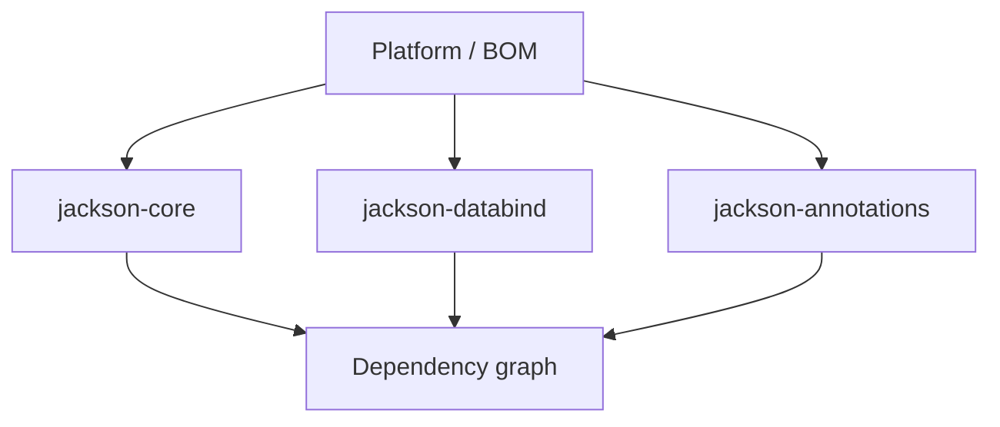

# Ràng buộc phiên bản, BOM và nền tảng quản lý phiên bản

Trong một dự án Java, nhiều thư viện có thể cùng phụ thuộc vào những module khác. Một thư viện web có thể yêu cầu Jackson, một thư viện logging lại kéo theo một module Jackson khác, còn ứng dụng khai báo thêm Jackson trực tiếp. Nếu mỗi thành phần tự chọn phiên bản, dependency graph có thể chứa nhiều yêu cầu khác nhau cho cùng một module. Gradle phải giải quyết xung đột đó, và phiên bản cuối cùng đôi khi không phải phiên bản mà nhóm muốn chuẩn hóa.

Gradle cung cấp **dependency constraints**, **platform** và khả năng nhập **Maven BOM** để quản lý các phiên bản có liên quan. Những cơ chế này giúp nhóm đặt quy tắc cho dependency graph, đồng bộ một nhóm thư viện và chia sẻ chính sách phiên bản giữa nhiều module. Muốn sử dụng đúng, cần hiểu mỗi cơ chế tác động vào quá trình phân giải dependency như thế nào.

## 1. Vì sao cần quản lý phiên bản tập trung?

Giả sử một ứng dụng sử dụng Spring, Jackson và JUnit. Một dependency có thể yêu cầu Jackson 2.15, dependency khác yêu cầu 2.16, trong khi module ứng dụng khai báo trực tiếp 2.17. Nếu không có quy tắc chung, kết quả phụ thuộc vào các yêu cầu trong toàn bộ graph và quy tắc giải quyết xung đột của Gradle.

Một vài vấn đề thường gặp:

- **Không đồng bộ:** các module thuộc cùng một bộ thư viện được chọn ở các phiên bản không tương thích.
- **Khó nâng cấp:** muốn cập nhật một bộ thư viện phải tìm nhiều khai báo ở nhiều project.
- **Khó tái lập:** version động hoặc dependency transitive thay đổi có thể làm kết quả build khác nhau theo thời điểm.
- **Khó giải thích:** khi một dependency nhận phiên bản khác với khai báo ban đầu, nhóm khó tìm nguồn yêu cầu phiên bản đó.
- **Rủi ro bảo mật:** một dependency gián tiếp có thể giữ phiên bản cũ chứa lỗ hổng nếu nhóm không có chính sách nâng cấp rõ ràng.

Quản lý phiên bản tập trung giúp diễn tả quy tắc một lần và áp dụng nhất quán cho các configuration hoặc project cần thiết. Trong Gradle, có thể dùng dependency constraints ở từng project, tạo một Gradle platform, hoặc nhập một Maven BOM đã được nhà cung cấp thư viện công bố.

## 2. Gradle phân giải phiên bản dependency như thế nào?

Khi Gradle phân giải một configuration, nó xây dựng dependency graph từ các dependency trực tiếp và dependency bắc cầu (transitive dependencies). Nhiều thành phần trong graph có thể yêu cầu cùng một module nhưng đưa ra các version khác nhau.

Ví dụ, ứng dụng khai báo:

```groovy
dependencies {
    implementation 'com.example:reporting-client:1.0.0'
    implementation 'com.fasterxml.jackson.core:jackson-databind:2.17.1'
}
```

Giả sử `reporting-client` cũng phụ thuộc vào `jackson-databind:2.16.2`. Khi giải quyết graph, Gradle xem xét cả hai yêu cầu. Theo quy tắc mặc định, Gradle thường chọn phiên bản cao hơn trong các phiên bản được yêu cầu, trừ khi có constraint, rich version, rule hoặc cơ chế khác thay đổi kết quả.

Điều này có nghĩa version ghi trong một dependency declaration không phải lúc nào cũng là version cuối cùng được chọn. Dependency declaration đưa ra một yêu cầu; kết quả thực tế được xác định khi Gradle giải quyết toàn bộ graph.

Có thể xem dependency graph bằng lệnh:

```bash
./gradlew dependencyInsight --dependency jackson-databind --configuration runtimeClasspath
./gradlew dependencies --configuration runtimeClasspath
```

`dependencyInsight` tập trung vào một module và giúp xem các yêu cầu phiên bản, lý do chọn version và đường dependency kéo module đó vào. `dependencies` hiển thị graph của configuration được chỉ định.

## 3. Dependency constraint là gì?

**Dependency constraint** là một quy tắc đặt giới hạn hoặc định hướng phiên bản cho một module khi module đó xuất hiện trong dependency graph. Constraint không tự thêm module đó vào graph.

Ví dụ:

```groovy
dependencies {
    constraints {
        implementation('com.fasterxml.jackson.core:jackson-databind:2.17.1') {
            because 'Use the approved Jackson version across this application.'
        }
    }
}
```

Đoạn cấu hình trên nói rằng nếu `jackson-databind` xuất hiện trong configuration `implementation`, phiên bản cần được giải quyết theo constraint này. Nếu không có dependency nào yêu cầu `jackson-databind`, chỉ riêng constraint không làm Gradle tải module đó.

Đây là khác biệt quan trọng giữa dependency và constraint:

| Khai báo | Có thêm module vào graph? | Vai trò |
|---|---|---|
| `implementation('group:module:version')` | Có | Yêu cầu sử dụng module ở configuration tương ứng |
| `constraints { implementation('group:module:version') }` | Không | Đặt quy tắc version nếu module xuất hiện |
| `platform('group:bom:version')` | Đưa platform vào graph; các constraint của platform tác động lên module liên quan | Nhập tập quy tắc phiên bản |

Constraint hữu ích khi muốn kiểm soát cả dependency transitive mà không cần thay đổi khai báo của thư viện đã kéo nó vào.

## 4. Các loại quy tắc version trong Gradle

Gradle hỗ trợ rich version constraints để diễn tả mức độ bắt buộc và ưu tiên của một phiên bản.

### `require`: phiên bản tối thiểu được yêu cầu

Khai báo version thông thường trong constraint thường mang ý nghĩa yêu cầu phiên bản đó hoặc cao hơn trong quá trình giải quyết. Ví dụ:

```groovy
dependencies {
    constraints {
        implementation('org.apache.commons:commons-text:1.10.0')
    }
}
```

Nếu một dependency khác yêu cầu `commons-text:1.12.0`, Gradle có thể chọn phiên bản cao hơn đáp ứng yêu cầu. Đây là cách phù hợp khi nhóm muốn đặt một mức tối thiểu đã được chấp thuận.

Có thể viết tường minh:

```groovy
dependencies {
    constraints {
        implementation('org.apache.commons:commons-text') {
            version {
                require('1.10.0')
            }
        }
    }
}
```

### `strictly`: giới hạn phiên bản được phép

`strictly` đặt một yêu cầu nghiêm ngặt hơn. Nếu dùng một version chính xác, Gradle phải chọn đúng version đó; nếu dùng range, version được chọn phải nằm trong range được phép.

```groovy
dependencies {
    constraints {
        implementation('org.apache.commons:commons-text') {
            version {
                strictly('[1.10.0, 2.0)')
            }
            because 'Avoid versions outside the supported major release line.'
        }
    }
}
```

Trong ví dụ này, phiên bản phải nằm trong khoảng từ `1.10.0` trở lên và nhỏ hơn `2.0`. Nếu graph chỉ có các yêu cầu không thể thỏa mãn constraint nghiêm ngặt, quá trình giải quyết dependency có thể thất bại thay vì âm thầm chọn version không được phép.

Dùng `strictly` khi giới hạn là chính sách bắt buộc, chẳng hạn cần tránh một major version chưa tương thích. Không nên dùng strict constraint cho mọi thư viện nếu nhóm vẫn muốn dependency graph có thể nâng cấp linh hoạt.

### `prefer`: phiên bản ưu tiên

`prefer` nêu phiên bản nên được chọn khi các yêu cầu khác không buộc phải chọn một version khác:

```groovy
dependencies {
    constraints {
        implementation('com.google.guava:guava') {
            version {
                prefer('33.2.1-jre')
            }
        }
    }
}
```

Đây là một ưu tiên mềm. Một yêu cầu mạnh hơn trong graph có thể khiến Gradle chọn phiên bản khác. Dùng `prefer` khi muốn đặt mặc định mà vẫn cho phép quá trình giải quyết xem xét những yêu cầu khác.

### `reject` và `rejectAll`

Có thể loại trừ một hoặc nhiều phiên bản không được chấp nhận:

```groovy
dependencies {
    constraints {
        implementation('com.google.guava:guava') {
            version {
                prefer('33.2.1-jre')
                reject('32.0.0-jre')
                reject('32.0.1-jre')
            }
            because 'These releases are excluded by the dependency policy.'
        }
    }
}
```

`reject` loại một version cụ thể hoặc một pattern/range theo cú pháp version của Gradle. `rejectAll()` loại mọi phiên bản trong một rich constraint, thường chỉ có ý nghĩa khi kết hợp với những điều kiện khác và cần được dùng cẩn trọng.

### So sánh nhanh

| Quy tắc | Ý nghĩa | Mức độ |
|---|---|---|
| `require` | Yêu cầu phiên bản hoặc mức tối thiểu phù hợp | Bắt buộc theo yêu cầu, cho phép nâng version |
| `strictly` | Chỉ cho phép version hoặc range chỉ định | Ràng buộc nghiêm ngặt |
| `prefer` | Ưu tiên version khi có thể | Mềm, có thể bị yêu cầu khác vượt qua |
| `reject` | Loại version không được dùng | Cấm các version được chỉ định |
| `because` | Ghi lý do cho constraint | Metadata giải thích, không tự thay đổi thuật toán chọn version |

## 5. Maven BOM là gì?

**BOM (Bill of Materials)** là một artifact Maven, thường có packaging `pom`, chứa danh sách dependency được quản lý phiên bản trong phần `dependencyManagement`.

Nhà cung cấp một hệ sinh thái thư viện thường phát hành BOM để các module trong cùng hệ sinh thái sử dụng những phiên bản đã được kiểm tra tương thích với nhau. Ví dụ, Spring Boot phát hành BOM quản lý version của nhiều module Spring và thư viện liên quan.

Một BOM thường có dạng khái niệm như sau:

```xml
<project>
  <modelVersion>4.0.0</modelVersion>
  <groupId>com.example.platform</groupId>
  <artifactId>example-bom</artifactId>
  <version>1.0.0</version>
  <packaging>pom</packaging>

  <dependencyManagement>
    <dependencies>
      <dependency>
        <groupId>org.junit.jupiter</groupId>
        <artifactId>junit-jupiter</artifactId>
        <version>5.10.2</version>
      </dependency>
      <dependency>
        <groupId>com.fasterxml.jackson.core</groupId>
        <artifactId>jackson-databind</artifactId>
        <version>2.17.1</version>
      </dependency>
    </dependencies>
  </dependencyManagement>
</project>
```

Các mục trong `dependencyManagement` quản lý version mặc định cho dependency khi project khai báo sử dụng chúng. Bản thân việc import BOM không có nghĩa mọi thư viện trong BOM đều được thêm vào ứng dụng. Project vẫn phải khai báo dependency nào nó thực sự cần.

Điều này giúp BOM vừa cung cấp chính sách version chung vừa tránh kéo vào những thư viện không được dùng.

## 6. Import Maven BOM trong Gradle bằng `platform()`

Gradle có thể tiêu thụ Maven BOM như một platform bằng hàm `platform()`.

Ví dụ dùng Spring Boot BOM:

```groovy
dependencies {
    implementation(platform('org.springframework.boot:spring-boot-dependencies:3.3.5'))

    implementation('org.springframework.boot:spring-boot-starter-web')
    implementation('org.springframework.boot:spring-boot-starter-validation')
    testImplementation('org.springframework.boot:spring-boot-starter-test')
}
```

BOM `spring-boot-dependencies` cung cấp các constraint/version management cho các dependency được liệt kê trong BOM. Các starter được khai báo riêng để đưa chúng vào graph. Nhờ đó, các module Spring và thư viện được BOM quản lý có thể dùng phiên bản tương thích theo bộ version của Spring Boot.

Có thể nhập BOM của một thư viện khác theo cách tương tự:

```kotlin
dependencies {
    implementation(platform("com.fasterxml.jackson:jackson-bom:2.17.1"))

    implementation("com.fasterxml.jackson.core:jackson-databind")
    implementation("com.fasterxml.jackson.core:jackson-core")
    implementation("com.fasterxml.jackson.core:jackson-annotations")
}
```

Các dependency được khai báo không cần lặp version nếu BOM cung cấp constraint phù hợp. Khi Gradle phân giải graph, platform góp các quy tắc version vào quá trình chọn phiên bản.

### `platform()` có ý nghĩa gì?

`platform()` yêu cầu Gradle sử dụng component như một platform. Với Maven BOM, Gradle đọc dependency management và chuyển các mục quản lý phiên bản thành các dependency constraints.

Platform được thêm vào configuration như một dependency đặc biệt, còn các constraint của nó áp dụng cho những module tương ứng xuất hiện trong graph. Nó không tự động thêm tất cả thư viện được quản lý vào graph.

### `enforcedPlatform()` khác gì?

Gradle cũng có `enforcedPlatform()`:

```groovy
dependencies {
    implementation(enforcedPlatform('org.springframework.boot:spring-boot-dependencies:3.3.5'))
}
```

`enforcedPlatform()` áp đặt version từ platform theo cách mạnh hơn, có thể ghi đè những version khác trong dependency graph. Các quy tắc bị ép này có thể lan truyền tới consumer khi component được publish, làm giảm quyền quyết định version của ứng dụng sử dụng thư viện.

Vì vậy:

- Ưu tiên `platform()` cho phần lớn trường hợp quản lý version thông thường.
- Dùng `enforcedPlatform()` khi thực sự cần ép một tập version và hiểu rõ tác động tới toàn bộ graph.
- Với thư viện được publish để nhiều ứng dụng khác sử dụng, cần thận trọng khi export enforced platform vì có thể ép dependency của consumer theo lựa chọn của thư viện.

## 7. Tạo Gradle platform riêng bằng `java-platform`

Nếu tổ chức có nhiều project cần tuân theo một bộ version nội bộ, có thể tạo một project chuyên quản lý dependency constraints bằng Java Platform Plugin.

Ví dụ cấu trúc:

```text
inventory-system/
├── settings.gradle.kts
├── dependency-platform/
│   └── build.gradle.kts
├── inventory-core/
│   └── build.gradle.kts
└── inventory-api/
    └── build.gradle.kts
```

Đưa project platform vào build:

```kotlin
// settings.gradle.kts
rootProject.name = "inventory-system"
include(":dependency-platform", ":inventory-core", ":inventory-api")
```

Cấu hình `dependency-platform/build.gradle.kts`:

```kotlin
plugins {
    `java-platform`
}

group = "com.example.platform"
version = "1.0.0"

dependencies {
    constraints {
        api("org.junit.jupiter:junit-jupiter:5.10.2")
        api("com.fasterxml.jackson.core:jackson-databind:2.17.1")
        api("com.fasterxml.jackson.core:jackson-core:2.17.1")
        api("com.fasterxml.jackson.core:jackson-annotations:2.17.1")
    }
}
```

Project này không phải ứng dụng Java thông thường. Nó tạo một platform component chứa các constraints. Các khai báo `api(...)` trong khối `constraints` mô tả những module và version mà platform quản lý; chúng không tự thêm các thư viện đó thành dependency runtime của platform.

Một module tiêu thụ platform:

```kotlin
// inventory-api/build.gradle.kts
plugins {
    java
}

dependencies {
    implementation(platform(project(":dependency-platform")))

    implementation("com.fasterxml.jackson.core:jackson-databind")
    testImplementation("org.junit.jupiter:junit-jupiter")
}
```

Khi dependency được khai báo không kèm version, Gradle lấy version phù hợp từ platform constraint đã được đưa vào configuration. Module `inventory-core` có thể dùng cùng platform để nhận chính sách tương tự.

### Import một BOM bên ngoài vào platform nội bộ

Một platform nội bộ có thể gom thêm BOM do nhà cung cấp phát hành. Khi platform project cần khai báo platform dependency, bật `allowDependencies()`:

```kotlin
plugins {
    `java-platform`
}

javaPlatform {
    allowDependencies()
}

dependencies {
    api(platform("org.springframework.boot:spring-boot-dependencies:3.3.5"))

    constraints {
        api("com.example:internal-client:2.4.0")
    }
}
```

Cách này giúp tổ chức kết hợp quy tắc version từ hệ sinh thái bên ngoài với constraint nội bộ. Cần lựa chọn rõ version của BOM và kiểm tra tương thích giữa các bộ thư viện được nhập.

## 8. `api` và `implementation` khi áp dụng platform

Trong project Java Library, phạm vi dependency quyết định thông tin nào được công khai cho consumer của thư viện.

Ví dụ:

```kotlin
plugins {
    `java-library`
}

dependencies {
    implementation(platform(project(":dependency-platform")))
    api("com.fasterxml.jackson.core:jackson-databind")
}
```

Platform được khai báo trong `implementation` phục vụ cấu hình nội bộ của project. Consumer không nhất thiết nhận lại platform constraint thông qua API dependency của thư viện.

Nếu thư viện muốn công bố chính sách version platform cho consumer, có thể cân nhắc khai báo platform trong `api`:

```kotlin
dependencies {
    api(platform(project(":dependency-platform")))
    api("com.fasterxml.jackson.core:jackson-databind")
}
```

Điều này có nghĩa consumer của thư viện cũng nhận platform constraint qua metadata dependency được công bố. Chỉ nên làm vậy nếu đó thực sự là một phần của hợp đồng dependency mà thư viện muốn chia sẻ.

Nếu mục tiêu là ứng dụng cuối cùng kiểm soát tất cả dependency, có thể để ứng dụng nhập platform trực tiếp thay vì buộc mọi consumer phải nhận platform qua một thư viện trung gian.

## 9. Platform và version alignment

Một platform có thể quản lý version của nhiều module liên quan. Điều này đặc biệt hữu ích với thư viện được phát hành thành nhiều artifact nhưng cần dùng cùng một release train.

Ví dụ Jackson có nhiều module:

- `jackson-core`
- `jackson-databind`
- `jackson-annotations`

Một platform có thể đặt version cho cả ba module để giảm khả năng phối hợp các phiên bản khác nhau. Tương tự, Spring Boot BOM quản lý nhiều thành phần trong hệ sinh thái Spring và các thư viện tích hợp.

Version alignment có thể được hiểu qua sơ đồ:



Platform không có nghĩa tất cả module luôn được tải. Nó cung cấp các quy tắc phiên bản cho module xuất hiện trong graph. Khi ứng dụng chỉ dùng `jackson-databind`, Gradle chỉ cần module đó và những dependency transitive cần thiết.

Nếu cần giữ các module trong cùng một release train ngay cả khi một số module được kéo vào từ những đường dependency khác nhau, platform là một nơi phù hợp để diễn tả mối quan hệ version đó.

## 10. Platform, BOM, constraint và version catalog khác nhau ra sao?

Các cơ chế này có thể cùng tham gia quản lý dependency nhưng giải quyết những phần việc khác nhau.

| Cơ chế | Mục đích chính | Có tự thêm các thư viện được quản lý không? | Phạm vi thường dùng |
|---|---|---|---|
| Dependency declaration | Yêu cầu sử dụng một module | Có | Một configuration của project |
| Dependency constraint | Đặt yêu cầu/giới hạn version cho module | Không | Configuration hoặc platform |
| Maven BOM | Tập hợp version management trong POM | Không | Nhiều project dùng cùng hệ sinh thái thư viện |
| Gradle platform | Cung cấp tập dependency constraints | Không, ngoài chính component platform | Project hoặc nhiều project tiêu thụ platform |
| Version catalog | Tập trung alias và version để build script tham chiếu | Không tự thêm; alias chỉ có tác dụng khi được dùng trong dependency declaration | Một build và các build được cấu hình catalog riêng |
| Dependency locking | Ghi lại version đã được chọn để các lần resolve sau ổn định hơn | Không | Configuration đã bật locking |
| `resolutionStrategy.force` | Ép một version trong resolution strategy | Không | Quy tắc phân giải của configuration |

Version catalog rất hữu ích để tránh lặp version trong nhiều build script, nhưng bản thân catalog không thay thế platform. Nếu mỗi module khai báo các alias khác nhau hoặc dependency transitive kéo thêm version khác, quá trình resolution vẫn cần áp dụng quy tắc dependency graph.

Ví dụ version catalog:

```toml
[versions]
jackson = "2.17.1"

[libraries]
jackson-databind = { module = "com.fasterxml.jackson.core:jackson-databind", version.ref = "jackson" }
```

Dùng trong build script:

```kotlin
dependencies {
    implementation(libs.jackson.databind)
}
```

Khai báo này giúp module tham chiếu version qua alias. Nếu nhiều module cần cùng một bộ constraint, một platform vẫn có thể là lựa chọn phù hợp hơn để thể hiện chính sách chung, bao gồm cả dependency transitive.

## 11. Kết hợp platform với dependency locking

Platform và dependency locking bổ sung cho nhau:

- Platform/constraints diễn tả những version được yêu cầu, ưu tiên hoặc cho phép.
- Dependency locking ghi lại các version thực tế được chọn cho những configuration đã bật locking.

Có thể bật dependency locking trong build script:

```groovy
dependencyLocking {
    lockAllConfigurations()
}
```

Sau đó chạy một build task để Gradle ghi lock state cho các configuration được resolve theo cấu hình locking:

```bash
./gradlew build --write-locks
```

Tệp lock được tạo hoặc cập nhật tùy cấu hình dự án và các configuration đã được resolve. Lockfile nên được quản lý trong version control khi nhóm muốn các lần build tiếp theo sử dụng cùng tập version đã chọn.

Khi cập nhật BOM hoặc platform, version được chọn có thể thay đổi. Nhóm cần xem diff của lockfile, đánh giá thay đổi dependency và commit lock state mới theo quy trình review.

Locking không thay thế constraints. Lockfile lưu kết quả đã chọn; constraints tiếp tục diễn tả chính sách version mà build muốn áp dụng. Nếu lock state cũ không còn phù hợp với constraint mới, Gradle có thể cần cập nhật lockfile hoặc báo lỗi resolution tùy tình huống.

## 12. Khi nào dùng `resolutionStrategy.force`?

Gradle có thể ép version bằng resolution strategy:

```groovy
configurations.configureEach {
    resolutionStrategy.force 'com.fasterxml.jackson.core:jackson-databind:2.17.1'
}
```

`force` là một cơ chế can thiệp trực tiếp vào kết quả resolution. Nó có thể hữu ích như biện pháp xử lý tạm thời khi cần ép một module cụ thể trong configuration.

Tuy nhiên, khi mục tiêu là diễn tả chính sách version có thể giải thích, tái sử dụng và xuất bản, dependency constraints hoặc platform thường rõ ràng hơn. Chúng cho phép thể hiện version yêu cầu, version nghiêm ngặt, version ưu tiên, version bị loại và lý do của constraint.

Không nên thêm nhiều `force` rải rác trong build script. Các rule này có thể khó truy tìm, khó phối hợp với platform và gây bất ngờ cho project khác. Nếu buộc phải dùng, hãy giới hạn phạm vi configuration, ghi rõ lý do và kiểm tra dependencyInsight để hiểu kết quả.

## 13. Cách kiểm tra version thực tế được chọn

Sau khi khai báo constraint hoặc platform, không nên chỉ nhìn build script rồi giả định Gradle đã chọn đúng version. Hãy kiểm tra dependency graph.

Ví dụ:

```bash
./gradlew dependencyInsight --dependency jackson-databind --configuration runtimeClasspath
```

Lệnh này giúp trả lời:

- Module được yêu cầu từ những dependency nào?
- Có bao nhiêu version được yêu cầu?
- Version nào được chọn?
- Constraint hoặc platform nào ảnh hưởng tới kết quả?
- Có version nào bị loại hoặc bị thay thế không?

Có thể xem toàn bộ graph:

```bash
./gradlew dependencies --configuration runtimeClasspath
```

Nếu project dùng nhiều configuration, cần xem đúng configuration liên quan: `compileClasspath`, `runtimeClasspath`, `testRuntimeClasspath` hoặc configuration riêng của plugin. Version có thể khác nhau giữa các configuration nếu dependency và constraint được khai báo ở scope khác nhau.

Khi điều tra vấn đề tương thích, hãy xem cả dependency transitive và đường dẫn kéo module vào graph. Việc một version không xuất hiện trực tiếp trong `build.gradle` không có nghĩa nó không ảnh hưởng ứng dụng.

## 14. Những nhầm lẫn thường gặp

| Nhầm lẫn | Cách hiểu chính xác |
|---|---|
| Constraint tự thêm dependency vào project | Constraint chỉ tác động khi module xuất hiện trong graph. |
| Import BOM sẽ tải mọi thư viện trong BOM | BOM cung cấp version management; project vẫn khai báo thư viện cần dùng. |
| Version ghi trong dependency declaration luôn là version cuối cùng | Gradle giải quyết toàn bộ graph và có thể chọn version khác theo quy tắc resolution. |
| `platform()` và `enforcedPlatform()` giống nhau | `enforcedPlatform()` áp đặt version mạnh hơn và có thể ảnh hưởng consumer. |
| Version catalog thay thế platform | Catalog tập trung alias/version; platform tập hợp constraint cho dependency graph. |
| Lockfile thay thế BOM | Lockfile ghi version đã chọn; BOM/platform diễn tả chính sách version. |
| `force` là cách chuẩn cho mọi xung đột | `force` là công cụ ép trực tiếp; constraint/platform thường diễn tả chính sách tốt hơn. |
| Dùng platform thì mọi module đều tự được thêm vào classpath | Platform chỉ cung cấp quy tắc; dependency phải được khai báo riêng nếu project cần dùng. |

## 15. Lộ trình đưa quản lý version tập trung vào dự án

Một quy trình triển khai có thể thực hiện theo các bước sau:

1. **Khảo sát dependency graph:** dùng `dependencies` và `dependencyInsight` để tìm các module có nhiều version hoặc xung đột.
2. **Xác định chính sách:** phân loại version nào cần đồng bộ, version nào chỉ cần mức tối thiểu, version nào phải bị loại và version nào cần strict pin.
3. **Chọn nguồn quản lý:** dùng BOM của nhà cung cấp nếu hệ sinh thái đã có BOM phù hợp; dùng Gradle platform nội bộ nếu tổ chức cần thêm constraint riêng.
4. **Đưa constraint vào đúng scope:** quyết định constraint chỉ áp dụng trong project hay cần được export tới consumer.
5. **Kết hợp version catalog khi phù hợp:** dùng alias để tham chiếu dependency trực tiếp, tránh lặp version trong build script.
6. **Bật dependency locking nếu cần tái lập:** ghi và review lockfile sau khi cập nhật platform hoặc dependency.
7. **Kiểm tra graph sau thay đổi:** xác nhận version thực tế và các đường dependency đã được quản lý như mong muốn.
8. **Cập nhật theo phiên bản:** nâng BOM/platform có chủ đích, xem thay đổi dependency và chạy các kiểm tra phù hợp.

Không nên gom mọi dependency vào một platform ngay từ đầu. Bắt đầu từ những thư viện có quan hệ version rõ ràng hoặc thường gây xung đột, sau đó mở rộng khi có nhu cầu thực tế.

## 16. Nguyên tắc cần ghi nhớ

Dependency declaration thêm module vào graph; dependency constraint định hướng phiên bản nếu module xuất hiện; Maven BOM và Gradle platform gom nhiều quy tắc version thành một đơn vị có thể tái sử dụng. `platform()` thường là lựa chọn phù hợp để nhập BOM; `enforcedPlatform()` dùng khi cần ép version và hiểu rõ tác động tới consumer. Plugin `java-platform` cho phép tổ chức tự tạo platform và công bố bộ constraint của mình.

Version catalog quản lý alias và version tham chiếu trong build script, còn dependency locking ghi lại kết quả version đã được chọn. Những cơ chế này bổ sung cho nhau. Khi cần chẩn đoán, hãy dùng `dependencyInsight` và xem đúng configuration để biết version nào thực sự được chọn và lý do. Quản lý phiên bản tốt giúp dependency graph nhất quán, dễ nâng cấp và dễ truy vết trong các dự án Java sử dụng Gradle.
