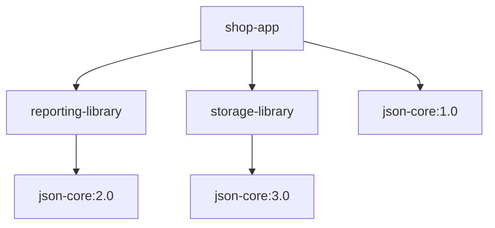

# Khác biệt nguyên tắc giải quyết xung đột giữa Maven và Gradle

Một ứng dụng Java thường sử dụng nhiều thư viện, và mỗi thư viện lại có thể phụ thuộc vào những thư viện khác. Khi hai nhánh dependency yêu cầu các phiên bản khác nhau của cùng một thư viện, build tool phải quyết định phiên bản nào được đưa vào classpath. Tình huống đó được gọi là **dependency version conflict**.

Maven và Gradle đều giải quyết xung đột dependency, nhưng nguyên tắc mặc định của chúng khác nhau. Maven dùng cơ chế *nearest definition*: ưu tiên phiên bản được khai báo ở đường đi ngắn nhất từ project hiện tại; nếu nhiều phiên bản nằm ở cùng độ sâu, thứ tự khai báo quyết định. Gradle mặc định chọn phiên bản cao nhất trong các phiên bản được yêu cầu cho cùng một module, sau khi áp dụng các constraint và rule có hiệu lực.

Khác biệt này có thể làm cùng một dependency tree tạo ra classpath khác nhau khi chuyển build tool. Muốn kiểm soát kết quả, cần hiểu cách mỗi công cụ chọn phiên bản, cách khai báo quy tắc quản lý phiên bản và cách đọc báo cáo dependency để tìm nguyên nhân.

## 1. Xung đột phiên bản dependency là gì?

Giả sử ứng dụng `shop-app` sử dụng hai thư viện:

- `reporting-library` phụ thuộc `json-core:2.0`.
- `storage-library` phụ thuộc `json-core:3.0`.

Ứng dụng cũng có thể khai báo trực tiếp một phiên bản khác của `json-core`. Khi build tool resolve runtime classpath, nó phải xác định phiên bản nào được sử dụng cho module đó.



Đồ thị trên cho thấy ba nhánh cùng yêu cầu các phiên bản khác nhau của một thư viện. Build tool cần áp dụng quy tắc của nó để tạo ra một kết quả dependency graph có thể sử dụng.

### 1.1. Vì sao cùng một thư viện có nhiều phiên bản?

Các nguyên nhân thường gặp:

- Hai thư viện độc lập được phát triển với các phiên bản dependency khác nhau.
- Một thư viện được nâng cấp nhưng dependency bắc cầu của nó chưa được nâng đồng bộ.
- Ứng dụng khai báo trực tiếp một phiên bản cũ trong khi thư viện khác cần phiên bản mới hơn.
- Một BOM hoặc dependency constraint quản lý phiên bản ở một phạm vi, còn module khác khai báo phiên bản riêng.
- Dependency graph thay đổi khi thêm plugin, module hoặc thư viện mới.

Dependency bắc cầu (transitive dependency) là dependency được kéo vào thông qua một dependency khác. Người phát triển có thể chỉ khai báo hai thư viện cấp cao, nhưng classpath cuối cùng còn chứa hàng chục thư viện bắc cầu.

### 1.2. Xung đột phiên bản khác với lỗi thiếu dependency

Hai tình huống cần được phân biệt:

- **Thiếu dependency:** thư viện cần thiết không có trong configuration/classpath, dẫn đến lỗi resolve hoặc lỗi biên dịch/runtime không tìm thấy class.
- **Xung đột phiên bản:** nhiều dependency yêu cầu các phiên bản khác nhau của cùng một module/artifact; build tool phải chọn hoặc từ chối một phiên bản theo quy tắc.

Việc chọn được một phiên bản không bảo đảm tương thích nhị phân hoặc tương thích hành vi. Ví dụ, một thư viện có thể đã xóa method mà dependency cũ đang gọi. Build vẫn resolve thành công, nhưng ứng dụng có thể lỗi `NoSuchMethodError` khi chạy. Vì vậy, giải quyết xung đột là bước quản lý classpath; kiểm tra tương thích vẫn cần test phù hợp.

## 2. Maven: nguyên tắc Nearest Definition

Maven dùng cơ chế dependency mediation để chọn phiên bản khi cùng một artifact xuất hiện nhiều lần trong dependency tree. Quy tắc mặc định được biết đến là **nearest definition** — phiên bản có đường đi ngắn nhất từ project hiện tại được chọn.

Độ sâu được tính từ project đang build:

- Dependency được project khai báo trực tiếp nằm ở độ sâu 1.
- Dependency của một dependency trực tiếp nằm ở độ sâu 2.
- Dependency của dependency bắc cầu tiếp theo nằm ở độ sâu 3, v.v.

Nếu hai phiên bản cùng nằm ở độ sâu, Maven chọn phiên bản xuất hiện trước theo thứ tự khai báo dependency trong POM/nhánh tương ứng.

### 2.1. Ví dụ: phiên bản trực tiếp thắng phiên bản bắc cầu

Giả sử `shop-app` khai báo:

```xml
<dependencies>
    <dependency>
        <groupId>com.example</groupId>
        <artifactId>json-core</artifactId>
        <version>1.0</version>
    </dependency>

    <dependency>
        <groupId>com.example</groupId>
        <artifactId>reporting-library</artifactId>
        <version>2.0</version>
    </dependency>
</dependencies>
```

Giả sử `reporting-library:2.0` có dependency bắc cầu:

```xml
<dependency>
    <groupId>com.example</groupId>
    <artifactId>json-core</artifactId>
    <version>3.0</version>
</dependency>
```

Dependency tree được rút gọn:

```text
shop-app
├── json-core:1.0                         (depth 1)
└── reporting-library:2.0
    └── json-core:3.0                     (depth 2)
```

Maven chọn `json-core:1.0` vì nó gần project hơn. Phiên bản `3.0` nằm sâu hơn nên bị loại khỏi classpath đã mediation.

Điều này có thể gây bất ngờ: phiên bản được chọn không nhất thiết là phiên bản lớn nhất. Nếu `reporting-library` thực sự cần API chỉ có từ `json-core:3.0`, ứng dụng có thể compile hoặc chạy lỗi. Khi ấy nhóm cần quản lý phiên bản có chủ đích, kiểm tra tương thích và xác minh dependency tree.

### 2.2. Ví dụ: hai phiên bản cùng độ sâu

Giả sử ứng dụng khai báo hai thư viện trực tiếp:

```xml
<dependencies>
    <dependency>
        <groupId>com.example</groupId>
        <artifactId>reporting-library</artifactId>
        <version>2.0</version>
    </dependency>
    <dependency>
        <groupId>com.example</groupId>
        <artifactId>storage-library</artifactId>
        <version>4.0</version>
    </dependency>
</dependencies>
```

Giả sử mỗi thư viện đều phụ thuộc `json-core`, nhưng một nhánh yêu cầu `2.0`, nhánh còn lại yêu cầu `3.0`:

```text
shop-app
├── reporting-library:2.0
│   └── json-core:2.0                 (depth 2)
└── storage-library:4.0
    └── json-core:3.0                 (depth 2)
```

Hai phiên bản nằm cùng độ sâu. Maven chọn phiên bản gặp trước theo thứ tự khai báo dependency. Nếu đổi thứ tự hai dependency cấp cao trong POM, kết quả mediation ở trường hợp cùng độ sâu có thể thay đổi.

Đây là lý do không nên dựa vào thứ tự khai báo tình cờ để quản lý phiên bản thư viện dùng chung. Khi phiên bản cần được thống nhất, hãy khai báo quy tắc rõ ràng bằng `dependencyManagement` hoặc BOM.

### 2.3. `dependencyManagement` kiểm soát phiên bản

`dependencyManagement` cho phép POM quản lý phiên bản, scope, type và một số thuộc tính của dependency khi dependency được khai báo trong project hoặc xuất hiện bắc cầu. Bản thân một entry trong `dependencyManagement` **không tự thêm thư viện vào classpath**.

Ví dụ:

```xml
<dependencyManagement>
    <dependencies>
        <dependency>
            <groupId>com.example</groupId>
            <artifactId>json-core</artifactId>
            <version>3.0</version>
        </dependency>
    </dependencies>
</dependencyManagement>

<dependencies>
    <dependency>
        <groupId>com.example</groupId>
        <artifactId>reporting-library</artifactId>
        <version>2.0</version>
    </dependency>
</dependencies>
```

Trong ví dụ này, `reporting-library` vẫn là dependency được khai báo trực tiếp. Phiên bản `json-core:3.0` được quản lý cho dependency bắc cầu phù hợp với entry trong dependency management. Nếu muốn dùng `json-core` trực tiếp trong mã nguồn, project vẫn cần khai báo nó trong `<dependencies>`.

Nếu một dependency được khai báo trực tiếp với version riêng, version tường minh trong khai báo đó có thể được sử dụng thay cho version được quản lý. Vì thế cần tránh để module con khai báo phiên bản tùy ý khi parent POM đã có quy tắc quản lý chung.

### 2.4. Parent POM và BOM

Parent POM có thể quản lý phiên bản cho các module con bằng `dependencyManagement`. BOM (Bill of Materials) là một POM tập trung danh sách phiên bản dependency tương thích. Project có thể import BOM bằng `type` là `pom` và `scope` là `import`:

```xml
<dependencyManagement>
    <dependencies>
        <dependency>
            <groupId>com.example.platform</groupId>
            <artifactId>platform-bom</artifactId>
            <version>5.0</version>
            <type>pom</type>
            <scope>import</scope>
        </dependency>
    </dependencies>
</dependencyManagement>
```

Sau khi import BOM, project có thể khai báo dependency được BOM quản lý mà không cần lặp lại version ở từng entry:

```xml
<dependencies>
    <dependency>
        <groupId>com.example</groupId>
        <artifactId>json-core</artifactId>
    </dependency>
</dependencies>
```

BOM giúp các module trong cùng hệ thống dùng một bộ phiên bản đã được phối hợp. Nó không tự thêm toàn bộ thư viện trong BOM vào classpath; project chỉ nhận dependency mà nó thực sự khai báo hoặc được kéo vào qua dependency graph.

### 2.5. Exclusion và scope ảnh hưởng dependency tree

Maven cho phép loại một dependency bắc cầu trên một nhánh bằng `<exclusions>`:

```xml
<dependency>
    <groupId>com.example</groupId>
    <artifactId>reporting-library</artifactId>
    <version>2.0</version>
    <exclusions>
        <exclusion>
            <groupId>com.example</groupId>
            <artifactId>json-core</artifactId>
        </exclusion>
    </exclusions>
</dependency>
```

Exclusion áp dụng cho nhánh dependency được khai báo, không phải một lệnh xóa artifact trên toàn project bất kể nó được đưa vào từ đâu. Nếu một nhánh khác vẫn kéo `json-core` vào, dependency đó vẫn có thể xuất hiện trong graph.

Scope như `compile`, `provided`, `runtime` và `test` ảnh hưởng việc dependency được truyền tiếp và xuất hiện trong các classpath khác nhau. Khi so sánh xung đột, phải xem đúng dependency tree và scope đang quan tâm, đặc biệt khi lỗi chỉ xảy ra lúc chạy ứng dụng hoặc khi chạy test.

## 3. Gradle: mặc định chọn phiên bản cao nhất

Gradle giải quyết xung đột phiên bản theo module. Khi nhiều dependency yêu cầu các phiên bản khác nhau của cùng module, quy tắc mặc định là chọn phiên bản cao nhất trong các phiên bản có thể được sử dụng, sau khi xét các constraint và resolution rule áp dụng cho configuration đó.

Trong Gradle, module thường được định danh bởi `group` và `name`; version là thuộc tính phiên bản của module. Metadata đến từ Maven POM, Gradle Module Metadata hoặc repository khác có thể cung cấp thêm thông tin về dependency và variant.

### 3.1. Ví dụ: dependency bắc cầu phiên bản cao hơn được chọn

Giả sử `shop-app` có `build.gradle`:

```groovy
dependencies {
    implementation 'com.example:json-core:1.0'
    implementation 'com.example:reporting-library:2.0'
}
```

Giả sử `reporting-library:2.0` yêu cầu `com.example:json-core:3.0`. Khi Gradle resolve `runtimeClasspath`, các yêu cầu là:

```text
shop-app
├── json-core:1.0
└── reporting-library:2.0
    └── json-core:3.0
```

Gradle mặc định chọn `json-core:3.0`, vì đây là phiên bản cao hơn trong các yêu cầu cho cùng module. Độ sâu của dependency không làm cho phiên bản trực tiếp `1.0` tự động thắng như quy tắc nearest definition của Maven.

Điều này có thể giúp ứng dụng nhận được bản sửa lỗi hoặc API mới hơn, nhưng cũng có thể gây thay đổi hành vi. “Cao nhất” không đồng nghĩa với “tương thích nhất”. Nếu thư viện cấp cao chưa tương thích với phiên bản mới, cần điều chỉnh dependency hoặc giới hạn phiên bản bằng constraint có chủ đích.

### 3.2. Constraint kiểm soát khoảng phiên bản

Gradle hỗ trợ dependency constraints để quy định phiên bản cho module mà không nhất thiết thêm module đó vào dependency graph:

```groovy
dependencies {
    implementation 'com.example:reporting-library:2.0'

    constraints {
        implementation('com.example:json-core') {
            version {
                strictly '2.5'
            }
            because 'The application is validated against json-core 2.5.'
        }
    }
}
```

Constraint `strictly '2.5'` yêu cầu phiên bản phù hợp nghiêm ngặt với 2.5. Nếu dependency khác đòi một phiên bản không tương thích với constraint, Gradle có thể báo lỗi resolve thay vì âm thầm chọn phiên bản không đáp ứng yêu cầu.

Một constraint không phải dependency khai báo thông thường. Nếu không có dependency nào kéo `json-core` vào graph, constraint đơn lẻ không làm thư viện xuất hiện trên classpath.

### 3.3. Phân biệt `require`, `prefer`, `strictly` và `reject`

Gradle rich version constraints cho phép diễn tả ý định rõ hơn:

```groovy
dependencies {
    constraints {
        implementation('com.example:json-core') {
            version {
                require '[2.0, 4.0)'
                prefer '3.1'
                reject '3.0.0-rc1'
            }
        }
    }
}
```

Ý nghĩa khái quát:

- `require`: xác định phiên bản hoặc khoảng phiên bản tối thiểu/được chấp nhận theo quy tắc version constraint.
- `prefer`: đưa ra phiên bản ưu tiên khi các yêu cầu khác cho phép.
- `strictly`: giới hạn nghiêm ngặt các phiên bản được phép; nếu không thể thỏa mãn, resolution thất bại.
- `reject`: loại những phiên bản không được chấp nhận.

Ví dụ trên chỉ minh họa cú pháp và ý định. Khi nhiều constraint cùng tác động, Gradle kết hợp chúng để tìm phiên bản đáp ứng các điều kiện; `prefer` không thể làm mất hiệu lực một constraint nghiêm ngặt xung đột với nó.

### 3.4. Platform và BOM trong Gradle

Gradle có thể sử dụng Maven BOM như một platform để quản lý phiên bản liên quan:

```groovy
dependencies {
    implementation platform('com.example:platform-bom:5.0')

    implementation 'com.example:json-core'
    implementation 'com.example:xml-core'
}
```

`platform(...)` đưa các dependency constraints từ BOM vào graph để điều phối phiên bản. Nếu cần áp dụng constraint theo chế độ bắt buộc mạnh hơn, Gradle cung cấp `enforcedPlatform(...)`; cách dùng này có thể ép phiên bản cho các dependency liên quan và ảnh hưởng đến consumer khi module được xuất bản. Chỉ dùng khi thật sự muốn áp đặt phiên bản như một chính sách.

Một platform Gradle có thể được tạo riêng để quản lý dependency nội bộ. Cách này giúp nhiều module dùng chung bộ phiên bản thay vì khai báo các version rải rác.

### 3.5. `force` và resolution strategy

Gradle cho phép ép phiên bản qua resolution strategy:

```groovy
configurations.configureEach {
    resolutionStrategy {
        force 'com.example:json-core:2.5'
    }
}
```

`force` là biện pháp mạnh, áp dụng trực tiếp vào resolution của configuration. Nó có thể giải quyết nhanh một xung đột, nhưng cũng có thể ghi đè yêu cầu từ dependency khác mà không thể hiện rõ hợp đồng tương thích trong metadata của module.

Trong dự án dài hạn, ưu tiên dependency constraints hoặc platform/BOM để thể hiện chính sách phiên bản có thể chia sẻ và giải thích được. Dùng `force` cho trường hợp ngoại lệ có chủ đích, ghi rõ lý do và có test xác minh.

### 3.6. Version catalog không tự giải quyết xung đột

Gradle Version Catalog (`libs.versions.toml`) tập trung tên alias và phiên bản dùng trong khai báo:

```toml
[versions]
jsonCore = "3.1.0"

[libraries]
json-core = { module = "com.example:json-core", version.ref = "jsonCore" }
```

Build script có thể tham chiếu alias tương ứng. Version catalog giúp tránh lặp chuỗi tọa độ và giữ khai báo nhất quán giữa module. Tuy nhiên, catalog không phải cơ chế khóa toàn bộ dependency graph. Dependency bắc cầu vẫn có thể yêu cầu phiên bản khác và Gradle vẫn áp dụng quy tắc conflict resolution cùng các constraint/rule có hiệu lực.

## 4. So sánh trực tiếp Maven và Gradle

| Nội dung | Maven | Gradle mặc định |
|---|---|---|
| Nguyên tắc mediation | Nearest definition | Chọn phiên bản cao nhất trong các yêu cầu phù hợp |
| Ưu tiên dependency trực tiếp phiên bản thấp | Thường thắng dependency bắc cầu sâu hơn | Không tự thắng chỉ vì được khai báo trực tiếp |
| Cùng độ sâu | Dependency khai báo trước thắng | Chọn theo quy tắc phiên bản và constraints, không theo vị trí gần nhất |
| Quản lý phiên bản tập trung | `dependencyManagement`, parent POM, BOM | Dependency constraints, platform/BOM, version catalog cho khai báo |
| Loại dependency bắc cầu | `<exclusions>` trên nhánh | `exclude` trên dependency/configuration phù hợp |
| Kiểm tra kết quả | `dependency:tree`, effective POM | `dependencies`, `dependencyInsight` |
| Khóa kết quả | Thường quản lý version trong POM/BOM và kiểm tra hội tụ bằng plugin | Dependency locking ghi nhận phiên bản đã chọn cho configuration |

Hai công cụ đều cho phép tùy chỉnh kết quả. Bảng so sánh mô tả hành vi mặc định phổ biến; khi dự án dùng plugin, rule, constraint, BOM hoặc metadata đặc biệt, kết quả thực tế phải được xác nhận bằng báo cáo của chính build.

### 4.1. Cùng một dependency tree, kết quả khác nhau

Xét lại tình huống:

```text
app
├── core:1.0
└── feature:2.0
    └── core:3.0
```

| Công cụ | Lý do | Phiên bản được chọn |
|---|---|---|
| Maven | `core:1.0` ở depth 1, gần hơn `core:3.0` ở depth 2 | `1.0` |
| Gradle | `3.0` là phiên bản cao hơn trong các yêu cầu mặc định có thể thỏa mãn | `3.0` |

Khi chuyển một dự án từ Maven sang Gradle, không nên giả định classpath runtime sẽ giữ nguyên chỉ vì các dependency khai báo trong file build có cùng tọa độ và version. Cần kiểm tra dependency tree sau khi migrate, đặc biệt với các thư viện nền tảng như logging, JSON, HTTP client, database driver và framework.

### 4.2. Khác biệt về danh tính module/artifact

Maven thường xác định artifact bằng `groupId`, `artifactId`, `type` và `classifier` (với `version` xác định phiên bản). Gradle dùng module coordinates như `group:name:version`, đồng thời có mô hình variant/capability phong phú hơn khi metadata hỗ trợ.

Vì vậy, không phải mọi xung đột đều là hai version của cùng một tọa độ đơn giản. Hai module khác tên có thể cung cấp cùng capability trong Gradle; khi đó Gradle có thể báo capability conflict. Đây là tình huống khác với version conflict của cùng module và cần giải quyết bằng cách chọn implementation/capability phù hợp.

## 5. Cách kiểm tra Maven đã chọn phiên bản nào

Không nên đoán phiên bản được chọn chỉ bằng cách đọc một dòng dependency trong POM. Hãy xem dependency tree sau khi Maven đã áp dụng mediation.

### 5.1. `dependency:tree`

Chạy:

```bash
mvn dependency:tree
```

Để lọc một dependency cụ thể:

```bash
mvn dependency:tree -Dincludes=com.example:json-core
```

Có thể dùng `-Dverbose` để hiển thị thêm các node bị loại bởi mediation:

```bash
mvn dependency:tree -Dverbose -Dincludes=com.example:json-core
```

Output minh họa:

```text
com.example:shop-app:jar:1.0
+- com.example:json-core:jar:1.0:compile
\- com.example:reporting-library:jar:2.0:compile
   \- (com.example:json-core:jar:3.0:compile - omitted for conflict with 1.0)
```

Trong ví dụ này, dependency trực tiếp `1.0` được giữ lại; `3.0` bị loại vì xung đột với phiên bản đã được mediation.

### 5.2. Xem effective POM

POM hiệu lực bao gồm cấu hình kế thừa từ parent, profile và dependency management sau khi Maven hợp nhất:

```bash
mvn help:effective-pom
```

Khi nghi ngờ parent POM hoặc BOM đang quản lý version, hãy xem effective POM để xác định version thực sự được áp dụng. Effective POM cho biết cấu hình đã hợp nhất; dependency tree vẫn là nơi phù hợp để xem đường đi và kết quả mediation của dependency graph.

### 5.3. Kiểm tra dependency convergence

Maven Enforcer Plugin có rule `dependencyConvergence` để phát hiện khi dependency tree chứa các đường đi yêu cầu các phiên bản khác nhau của cùng artifact. Rule này hữu ích để nhóm chủ động xử lý sự khác biệt thay vì chỉ chấp nhận phiên bản nearest một cách tình cờ.

Ví dụ cấu hình minh họa:

```xml
<build>
    <plugins>
        <plugin>
            <groupId>org.apache.maven.plugins</groupId>
            <artifactId>maven-enforcer-plugin</artifactId>
            <version>3.5.0</version>
            <executions>
                <execution>
                    <id>enforce-dependency-convergence</id>
                    <goals>
                        <goal>enforce</goal>
                    </goals>
                    <configuration>
                        <rules>
                            <dependencyConvergence/>
                        </rules>
                    </configuration>
                </execution>
            </executions>
        </plugin>
    </plugins>
</build>
```

Rule có thể khiến build thất bại khi phát hiện nhiều version, kể cả khi Maven vẫn có thể mediation để tạo classpath. Mục tiêu là buộc nhóm quyết định phiên bản rõ ràng. Tùy dự án, có thể cần cấu hình exclusions hoặc phạm vi rule phù hợp.

## 6. Cách kiểm tra Gradle đã chọn phiên bản nào

Gradle cung cấp task `dependencies` để xem dependency tree theo configuration và `dependencyInsight` để giải thích vì sao một version được chọn.

### 6.1. Xem dependency tree theo configuration

Ví dụ xem runtime classpath:

```bash
./gradlew dependencies --configuration runtimeClasspath
```

Xem compile classpath:

```bash
./gradlew dependencies --configuration compileClasspath
```

Trong project nhiều module, có thể chỉ định project path:

```bash
./gradlew :app:dependencies --configuration runtimeClasspath
```

Các configuration khác nhau có thể resolve dependency graph khác nhau. Nếu lỗi xảy ra khi chạy ứng dụng, hãy xem `runtimeClasspath`; nếu lỗi biên dịch, xem `compileClasspath`; nếu lỗi test, xem configuration test tương ứng như `testRuntimeClasspath`.

### 6.2. Dùng `dependencyInsight`

Lệnh này tập trung vào một module và giải thích lý do version được chọn:

```bash
./gradlew dependencyInsight \
    --dependency json-core \
    --configuration runtimeClasspath
```

Trên PowerShell, có thể viết trên một dòng:

```powershell
.\gradlew.bat dependencyInsight --dependency json-core --configuration runtimeClasspath
```

Output có thể cho biết version được chọn bởi conflict resolution, constraint, forced rule hoặc dependency path nào yêu cầu version đó. Đây thường là công cụ đầu tiên nên dùng khi một dependency bất ngờ được nâng lên hoặc hạ xuống.

### 6.3. Hiểu các selection reason

Gradle có thể hiển thị các lý do lựa chọn như:

- `By conflict resolution`: có nhiều version được yêu cầu và Gradle chọn version theo quy tắc conflict resolution.
- `By constraint`: một dependency constraint ảnh hưởng kết quả.
- `Forced`: version bị ép bởi resolution strategy.
- `Selected by rule`: một resolution rule hoặc component selection rule tham gia lựa chọn.
- `By ancestor`: một dependency constraint/selection từ ancestor trong graph có ảnh hưởng.

Thông tin cụ thể phụ thuộc phiên bản Gradle và loại metadata. Đọc cả phần requested và selected để biết dependency nào yêu cầu version nào, thay vì chỉ nhìn dòng version cuối cùng.

### 6.4. Xem dependency graph trên build scan

Nếu tổ chức cho phép sử dụng Gradle Build Scan, báo cáo có thể cung cấp góc nhìn trực quan hơn về dependency graph và lý do lựa chọn. Scan có thể gửi dữ liệu build đến dịch vụ bên ngoài tùy cấu hình; hãy tuân thủ chính sách dữ liệu của tổ chức trước khi publish scan, nhất là với repository riêng tư hoặc thông tin nhạy cảm.

## 7. Các cơ chế quản lý phiên bản tương ứng

Maven và Gradle đều có cách quản lý phiên bản tập trung, nhưng cấu trúc và ý nghĩa không hoàn toàn giống nhau.

| Nhu cầu | Maven | Gradle |
|---|---|---|
| Quản lý version cho nhiều module | Parent POM và `dependencyManagement` | Convention plugin, platform, dependency constraints |
| Nhập bộ version từ BOM | Import BOM trong `dependencyManagement` | `platform(...)` hoặc `enforcedPlatform(...)` |
| Không thêm dependency chỉ để đặt version | Entry `dependencyManagement` | Dependency constraint |
| Loại dependency bắc cầu trên một nhánh | `<exclusions>` | `exclude group/module` trong dependency declaration |
| Phát hiện nhiều version không hội tụ | Maven Enforcer `dependencyConvergence` | Dependency insight, constraints và policy/plugin phù hợp |
| Ghi nhận version đã resolve | Version tường minh/BOM và cơ chế quản lý build | Dependency locking |

### 7.1. Maven: parent POM quản lý version cho module con

Parent POM có thể định nghĩa:

```xml
<dependencyManagement>
    <dependencies>
        <dependency>
            <groupId>com.example</groupId>
            <artifactId>json-core</artifactId>
            <version>3.1.0</version>
        </dependency>
    </dependencies>
</dependencyManagement>
```

Module con kế thừa parent có thể khai báo:

```xml
<dependencies>
    <dependency>
        <groupId>com.example</groupId>
        <artifactId>json-core</artifactId>
    </dependency>
</dependencies>
```

Version được lấy từ dependency management. Nếu nhiều module cùng kế thừa parent, nhóm có một nơi để cập nhật version và review tác động.

### 7.2. Gradle: platform hoặc constraints quản lý version

Với Gradle, một module platform có thể công bố constraints:

```groovy
plugins {
    id 'java-platform'
}

dependencies {
    constraints {
        api 'com.example:json-core:3.1.0'
        api 'com.example:xml-core:2.4.0'
    }
}
```

Project sử dụng platform:

```groovy
dependencies {
    implementation platform(project(':dependency-platform'))
    implementation 'com.example:json-core'
    implementation 'com.example:xml-core'
}
```

Platform mô tả một bộ version/constraint dùng chung. Các module ứng dụng có thể khai báo dependency mà không lặp lại version. Platform nên tập trung vào những dependency cần phối hợp, có chính sách nâng cấp và kiểm thử tương thích.

### 7.3. Dependency locking trong Gradle

Dependency locking giúp ghi nhận phiên bản đã resolve cho những configuration được bật locking. Khi graph thay đổi, build có thể phát hiện lock state không còn khớp và yêu cầu cập nhật lockfile theo quy trình.

Ví dụ bật locking cho configuration:

```groovy
dependencyLocking {
    lockAllConfigurations()
}
```

Sau đó tạo/cập nhật lock state bằng lệnh phù hợp với project, ví dụ:

```bash
./gradlew build --write-locks
```

Locking giúp các lần build dùng kết quả version đã ghi nhận, nhưng không thay thế việc quản lý constraint hoặc kiểm tra tương thích. Khi nâng dependency, cần review thay đổi lockfile cùng với thay đổi mã nguồn và test.

## 8. Exclusion và thay thế dependency: sử dụng có chủ đích

Khi một thư viện kéo theo dependency không mong muốn, có thể loại nó khỏi nhánh và khai báo phiên bản thay thế ở cấp ứng dụng. Nhưng exclusion không nên là thao tác đầu tiên nếu chưa biết thư viện cấp cao có thực sự cần dependency đó không.

### 8.1. Maven exclusion

```xml
<dependency>
    <groupId>com.example</groupId>
    <artifactId>reporting-library</artifactId>
    <version>2.0</version>
    <exclusions>
        <exclusion>
            <groupId>com.example</groupId>
            <artifactId>json-core</artifactId>
        </exclusion>
    </exclusions>
</dependency>
```

Sau đó nếu ứng dụng cần dependency này, hãy khai báo version đã được xác minh trong dependency management hoặc dependency trực tiếp.

### 8.2. Gradle exclusion

```groovy
dependencies {
    implementation('com.example:reporting-library:2.0') {
        exclude group: 'com.example', module: 'json-core'
    }

    implementation 'com.example:json-core:3.1.0'
}
```

Exclusion trên dependency declaration tác động đến nhánh đó. Nếu module được kéo vào từ nhánh khác, nó vẫn có thể xuất hiện. Hãy kiểm tra lại `dependencyInsight` sau khi sửa.

### 8.3. Khi nào cần substitution hoặc rule?

Gradle có dependency substitution và component metadata rules để thay thế module hoặc điều chỉnh metadata khi cần. Đây là công cụ mạnh, hữu ích trong các trường hợp module cũ được thay bằng module mới hoặc metadata repository không mô tả đúng quan hệ. Tuy nhiên, rule toàn cục có thể ảnh hưởng nhiều configuration/project; hãy giới hạn phạm vi, ghi rõ lý do và kiểm thử graph sau khi áp dụng.

Maven có các cơ chế khác như dependency management, exclusions, relocation metadata và plugin hỗ trợ quản lý dependency. Không nên cố ép hai build tool có cùng cú pháp; hãy chuyển ý định quản lý dependency sang cơ chế tương ứng của công cụ đích.

## 9. Khi nào chọn phiên bản cao nhất chưa đủ?

Gradle mặc định chọn version cao hơn để giải quyết conflict, nhưng phiên bản cao hơn có thể chứa breaking change. Maven nearest definition cũng có thể giữ một version cũ không đáp ứng yêu cầu của thư viện cấp cao. Cả hai trường hợp đều cần quyết định tương thích dựa trên hợp đồng thư viện.

Các yếu tố cần xem:

- **Binary compatibility:** các class và method mà consumer đã biên dịch có còn tồn tại với chữ ký tương thích không?
- **Source compatibility:** mã nguồn có còn biên dịch với API mới không?
- **Behavioral compatibility:** hành vi, mặc định, serialization hoặc xử lý lỗi có thay đổi không?
- **Runtime compatibility:** thư viện có yêu cầu JDK hoặc dependency nền khác không?
- **Security fixes:** phiên bản cũ có lỗ hổng đã được khắc phục ở bản mới không?
- **Framework alignment:** phiên bản có nằm trong bộ đã được framework/BOM kiểm thử không?

Không nên chọn phiên bản chỉ dựa vào số lớn hơn hoặc nhỏ hơn. Hãy đọc release notes/changelog, kiểm tra yêu cầu của dependency sử dụng nó và chạy test ở classpath cuối cùng.

### 9.1. Ví dụ lỗi runtime dù build resolve thành công

Giả sử `reporting-library` được biên dịch với `json-core:2.x` và gọi method `JsonParser.parseLegacy(...)`. Gradle chọn `json-core:3.x` do version cao hơn. Nếu `3.x` đã xóa method này, ứng dụng có thể compile được trong một số cấu hình nhưng gặp lỗi khi đường gọi được thực thi:

```text
java.lang.NoSuchMethodError:
    com.example.json.JsonParser.parseLegacy(...)
```

Lỗi này không có nghĩa Gradle chọn sai theo quy tắc của nó. Nó cho thấy dependency graph được resolve không tương thích với kỳ vọng của thư viện consumer. Cần chọn một bộ version tương thích, nâng `reporting-library`, hoặc điều chỉnh constraint/platform sau khi xác minh.

### 9.2. Nâng dependency theo nhóm

Khi nâng một thư viện nền tảng, nên:

1. Xác định mọi module sử dụng nó và các dependency bắc cầu liên quan.
2. Kiểm tra release notes, yêu cầu JDK và breaking changes.
3. Cập nhật BOM/platform hoặc dependency management tại nơi quản lý chung.
4. Resolve lại graph ở compile, runtime và test configurations.
5. Chạy unit test, integration test và các kiểm tra tương thích liên quan.
6. Review lockfile/effective POM và báo cáo dependency trước khi phát hành.

## 10. Chuyển dự án từ Maven sang Gradle hoặc ngược lại

Khi migrate build tool, cần coi dependency graph là một phần của hành vi build. Sao chép các dependency declaration chưa đủ để bảo đảm classpath giống nhau.

### 10.1. Lập danh sách dependency đã resolve ở build cũ

Với Maven:

```bash
mvn dependency:tree -Dverbose
```

Lưu lại các dependency trực tiếp, transitive, version được chọn, version bị loại và scope. Xem effective POM để nhận biết parent/BOM đang quản lý version.

### 10.2. Resolve graph ở build mới

Với Gradle:

```bash
./gradlew dependencies --configuration compileClasspath
./gradlew dependencies --configuration runtimeClasspath
```

Sau đó dùng `dependencyInsight` cho các thư viện quan trọng. So sánh theo module/artifact và configuration tương ứng, không chỉ so sánh tổng số JAR.

### 10.3. Xử lý các version khác nhau có chủ đích

Nếu Maven chọn version gần hơn nhưng Gradle chọn version cao hơn, hãy quyết định version nào phù hợp dựa trên tương thích và chính sách của dự án. Dùng platform/constraint/locking ở Gradle hoặc dependency management/BOM ở Maven để ghi lại quyết định. Không thêm `force` hoặc exclusion hàng loạt chỉ để làm hai báo cáo trông giống nhau.

### 10.4. Kiểm tra runtime classpath và test

Compile classpath giống nhau không bảo đảm runtime classpath giống nhau. Scope/configuration mapping giữa Maven và Gradle có thể khác. Kiểm tra cả dependency dùng lúc chạy ứng dụng, lúc chạy test và các plugin/runtime integration. Chạy test từ Wrapper của build mới trong môi trường sạch trước khi coi migration hoàn tất.

## 11. Quy trình điều tra một xung đột phiên bản

Khi gặp lỗi do dependency conflict, hãy làm theo trình tự:

1. Xác định module/artifact bị xung đột bằng group/name hoặc groupId/artifactId.
2. Xác định configuration/classpath bị ảnh hưởng: compile, runtime hay test.
3. In dependency tree của configuration đó.
4. Ghi lại tất cả version được yêu cầu và dependency path kéo chúng vào.
5. Xác định quy tắc mặc định hoặc rule tùy chỉnh đã chọn version hiện tại.
6. Kiểm tra yêu cầu tương thích của các thư viện consumer.
7. Chọn chính sách tập trung: Maven dependency management/BOM hoặc Gradle constraint/platform.
8. Chỉ dùng exclusion, force hoặc substitution khi có lý do rõ ràng.
9. Resolve lại graph và kiểm tra version được chọn.
10. Chạy test liên quan để xác nhận classpath mới tương thích.

### 11.1. Ví dụ tình huống Maven

Ứng dụng có dependency trực tiếp `json-core:1.0`, trong khi `reporting-library` yêu cầu `json-core:3.0`. Maven tree cho thấy `1.0` được chọn vì ở độ sâu gần hơn. Nếu ứng dụng cần version `3.0` và đã xác minh tương thích, hãy quản lý version bằng `dependencyManagement` hoặc khai báo version trực tiếp có chủ đích, sau đó kiểm tra lại `dependency:tree -Dverbose`. Nếu thư viện cũ không tương thích với `3.0`, nâng thư viện consumer hoặc chọn bộ version tương thích thay vì chỉ ép version.

### 11.2. Ví dụ tình huống Gradle

Ứng dụng khai báo `json-core:1.0`, nhưng `reporting-library` yêu cầu `3.0`. `dependencyInsight` cho biết `3.0` được chọn bởi conflict resolution. Nếu muốn cố định ở `2.5`, thêm constraint `strictly '2.5'` chỉ sau khi xác minh tất cả consumer tương thích. Chạy lại `dependencyInsight` để xác nhận constraint có hiệu lực; nếu yêu cầu của dependency khác không thể thỏa mãn, hãy xử lý xung đột thay vì nới lỏng tùy tiện.

## 12. Những hiểu nhầm phổ biến

| Hiểu nhầm | Thực tế |
|---|---|
| Maven luôn chọn version lớn nhất | Maven mặc định chọn nearest definition; cùng độ sâu thì dependency khai báo trước thắng |
| Gradle luôn chọn dependency trực tiếp | Gradle mặc định chọn version cao nhất theo module và constraints, không ưu tiên đường đi ngắn hơn |
| `dependencyManagement` tự thêm mọi thư viện vào classpath | Nó quản lý thuộc tính dependency; project vẫn phải khai báo dependency hoặc nhận nó qua graph |
| Gradle Version Catalog khóa toàn bộ graph | Catalog tập trung alias/version khai báo; transitive graph vẫn cần constraints/locking và resolution |
| Chọn được version nghĩa là thư viện tương thích | Resolve thành công chỉ cho biết graph có thể được chọn; API/runtime compatibility cần được kiểm tra |
| Exclusion xóa artifact khỏi mọi nhánh | Exclusion thường áp dụng trên dependency path được cấu hình; nhánh khác vẫn có thể đưa artifact vào |
| `force` là cách quản lý version tốt nhất | `force` có thể ghi đè yêu cầu; platform/constraint thường thể hiện chính sách rõ hơn |
| Compile classpath và runtime classpath luôn giống nhau | Scope/configuration có thể khiến graph khác nhau; cần kiểm tra đúng classpath gây lỗi |
| Hai build tool tạo cùng dependency declaration thì kết quả giống nhau | Quy tắc mediation khác nhau nên version được chọn có thể khác |

## 13. Ghi nhận chính sách dependency cho dự án

Một dự án nhiều module nên có một nơi dễ tìm để quản lý các dependency quan trọng. Với Maven, đó thường là parent POM/BOM và các rule Enforcer. Với Gradle, đó có thể là version catalog kết hợp platform, constraints và dependency locking.

Tài liệu dự án nên nêu:

- Những thư viện nền tảng nào được quản lý tập trung.
- BOM/platform nào là nguồn version chuẩn.
- Cách thêm dependency mới và khi nào được khai báo version riêng.
- Cách kiểm tra dependency tree và giải thích version được chọn.
- Quy trình xử lý khi có version conflict hoặc breaking change.
- Cách cập nhật lockfile/effective POM và review thay đổi.
- Những exception như `force`, exclusion hoặc substitution cùng lý do tồn tại.

Không cần ép mọi dependency về một version duy nhất nếu các module/configuration có yêu cầu khác nhau và build tool hỗ trợ chúng một cách hợp lệ. Điều quan trọng là các khác biệt phải được chủ động thiết kế, kiểm tra và giải thích.

Maven và Gradle đều giải quyết dependency conflict để tạo classpath có thể sử dụng, nhưng cách ưu tiên mặc định khác nhau: Maven dựa trên độ gần của dependency trong tree, còn Gradle mặc định chọn version cao nhất trong các yêu cầu có thể thỏa mãn. Khi hiểu sự khác biệt này, người phát triển có thể dự đoán kết quả khi thêm thư viện, đọc đúng dependency report, quản lý version bằng BOM/platform/constraints và tránh những lỗi runtime do chọn được một version nhưng không tương thích với consumer.
