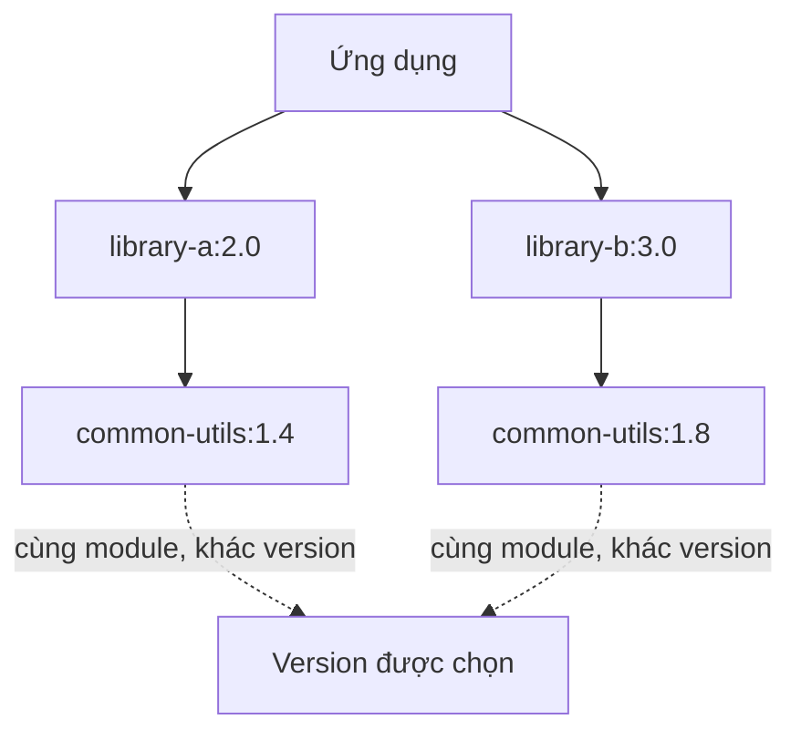

# Ràng buộc, ép phiên bản và loại trừ: chọn đúng biện pháp

Khi nhiều thư viện cùng yêu cầu một module nhưng cần các phiên bản khác nhau, build tool phải giải quyết xung đột để tạo compile classpath và runtime classpath phù hợp. Khi đó, bạn có thể gặp ba biện pháp thường được nhắc đến: **ràng buộc phiên bản (dependency constraint)**, **ép phiên bản (force)** và **loại trừ dependency (exclusion)**.

Ba biện pháp này giải quyết ba vấn đề khác nhau. Constraint diễn tả phiên bản nào được chấp nhận hoặc được ưu tiên khi module xuất hiện trong dependency graph. Force áp đặt một phiên bản cụ thể lên quá trình chọn phiên bản. Exclusion loại bỏ một dependency bắc cầu khỏi một nhánh của graph. Dùng sai biện pháp có thể che giấu xung đột, làm thiếu lớp lúc chạy hoặc khiến một bản vá bảo mật không còn hiệu lực.

## 1. Bắt đầu từ dependency graph

Giả sử một ứng dụng khai báo hai thư viện trực tiếp:

```text
Ứng dụng
├── library-a:2.0
│   └── common-utils:1.4
└── library-b:3.0
    └── common-utils:1.8
```

Cả hai thư viện đều cần module `common-utils`, nhưng một nhánh yêu cầu phiên bản `1.4`, nhánh còn lại yêu cầu `1.8`. Nếu đưa cả hai phiên bản của cùng module vào một classpath thông thường, ứng dụng có thể gặp hành vi khó dự đoán hoặc lỗi tương thích. Vì vậy, build tool cần chọn một phiên bản theo quy tắc resolution.

Dependency graph còn có thể chứa nhiều đường dẫn tới cùng một module. Một dependency được khai báo trực tiếp có thể kéo theo nhiều dependency bắc cầu; những dependency bắc cầu đó lại tiếp tục yêu cầu các module khác.



Trước khi thay đổi cấu hình, hãy xác định:

- Module nào đang xung đột?
- Những dependency trực tiếp nào đưa module đó vào graph?
- Mỗi nhánh yêu cầu phiên bản nào?
- Module đó có thật sự cần ở runtime không?
- Phiên bản mới hơn có tương thích với các thư viện đang dùng không?

Không nên bắt đầu bằng cách thêm một dòng force hoặc exclusion khi chưa biết dependency nào tạo ra xung đột.

## 2. Phân biệt ba biện pháp

| Biện pháp | Tác động | Dùng khi nào? | Rủi ro chính |
|---|---|---|---|
| Constraint | Đặt quy tắc hoặc giới hạn cho phiên bản nếu module được đưa vào graph. | Muốn quản lý phiên bản dùng chung, đặt mức tối thiểu/tối đa, ưu tiên hoặc từ chối phiên bản. | Constraint quá chặt có thể làm resolution thất bại hoặc loại bỏ phiên bản cần thiết. |
| Force | Buộc resolution sử dụng phiên bản đã chỉ định trong phạm vi cấu hình áp dụng. | Cần biện pháp khẩn cấp, có chủ đích để đồng nhất một module trong toàn configuration. | Có thể bỏ qua yêu cầu của dependency khác và gây lỗi tương thích lúc chạy. |
| Exclusion | Loại một module khỏi nhánh dependency được chỉ định. | Một dependency kéo theo thư viện không cần thiết, không tương thích hoặc phải được cung cấp theo cách khác. | Có thể làm thiếu lớp hoặc tài nguyên; module vẫn xuất hiện nếu nhánh khác đưa nó vào graph. |

Một quy tắc thực tế là chọn biện pháp theo nguyên nhân: nếu vấn đề nằm ở **phiên bản**, cân nhắc constraint hoặc platform; nếu thật sự cần áp đặt một phiên bản duy nhất, mới cân nhắc force; nếu vấn đề là **module không nên có mặt**, xem xét exclusion sau khi xác nhận không có mã nào cần nó.

## 3. Constraint trong Gradle

Gradle dependency constraint cho biết điều kiện về phiên bản của một module. Constraint không tự thêm module đó vào dependency graph. Nó chỉ có tác dụng khi một dependency khác đã đưa module tương ứng vào graph.

Ví dụ, project muốn quản lý phiên bản `common-utils` ở mức `1.8`:

```groovy
dependencies {
    constraints {
        implementation('org.example:common-utils') {
            version {
                strictly '1.8'
            }
            because 'Các module trong ứng dụng đã được kiểm thử với common-utils 1.8'
        }
    }
}
```

Nếu không có dependency nào yêu cầu `org.example:common-utils`, constraint trên không làm Gradle tải module đó. Khi module xuất hiện do một nhánh dependency khác, constraint tham gia quyết định phiên bản được chọn.

### 3.1. Constraint không phải dependency

Hai khai báo sau có ý nghĩa khác nhau:

```groovy
dependencies {
    // Thêm module vào dependency graph.
    implementation 'org.example:common-utils:1.8'

    // Chỉ đặt quy tắc cho module nếu nó được đưa vào graph.
    constraints {
        implementation('org.example:common-utils') {
            version {
                strictly '1.8'
            }
        }
    }
}
```

Khai báo `implementation` thêm dependency trực tiếp. Khối `constraints` không thêm dependency; nó chỉ điều khiển việc chọn version khi module đã được yêu cầu ở nơi khác. Đây là điểm quan trọng khi dùng constraint để quản lý phiên bản cho nhiều module mà không muốn mỗi module đều phải khai báo một dependency trực tiếp.

### 3.2. `require`, `strictly`, `prefer` và `reject`

Gradle hỗ trợ rich version constraints để mô tả mức độ yêu cầu khác nhau.

| Thuộc tính | Ý nghĩa | Cách hiểu |
|---|---|---|
| `require` | Phiên bản hoặc khoảng phiên bản được yêu cầu. | Là yêu cầu tối thiểu theo quy tắc resolution; xung đột có thể khiến Gradle chọn phiên bản cao hơn. |
| `strictly` | Giới hạn nghiêm ngặt phiên bản được chấp nhận. | Phiên bản ngoài giới hạn bị loại; nếu không còn lựa chọn hợp lệ, resolution thất bại. |
| `prefer` | Phiên bản ưu tiên khi không có yêu cầu mạnh hơn. | Là lựa chọn mềm, có thể bị yêu cầu khác ghi đè. |
| `reject` | Danh sách phiên bản hoặc khoảng phiên bản không được chấp nhận. | Dùng để loại các phiên bản đã biết có vấn đề. |

Ví dụ:

```groovy
dependencies {
    constraints {
        implementation('org.example:common-utils') {
            version {
                require '[1.7, 2.0)'
                prefer '1.8.2'
                reject '1.7.4', '1.8.0'
            }
            because 'Chỉ dùng nhánh 1.x và tránh các bản đã xác định có lỗi'
        }
    }
}
```

Trong ví dụ, project chấp nhận phiên bản trong khoảng từ `1.7` đến trước `2.0`, ưu tiên `1.8.2`, đồng thời loại `1.7.4` và `1.8.0`. Nếu dependency graph và các yêu cầu khác không cho phép chọn phiên bản phù hợp, Gradle có thể báo lỗi resolution. `prefer` không biến một phiên bản thành bắt buộc.

Một ví dụ dùng `strictly`:

```groovy
dependencies {
    constraints {
        implementation('org.example:common-utils') {
            version {
                strictly '1.8.2'
            }
            because 'Phiên bản này đã được xác nhận tương thích trong hệ thống'
        }
    }
}
```

`strictly '1.8.2'` yêu cầu đúng version đó. Nếu một dependency khác yêu cầu phiên bản không tương thích với constraint nghiêm ngặt, Gradle không âm thầm chọn một version ngoài giới hạn; quá trình resolution có thể thất bại để bạn xử lý xung đột.

### 3.3. Constraint trực tiếp và constraint dùng chung

Khi nhiều project cần dùng chung một bộ phiên bản, có thể quản lý constraint trong convention plugin, platform hoặc dependency constraints dùng chung. Điều này giảm việc lặp lại version ở nhiều build script.

Ví dụ constraint đặt trong một project:

```kotlin
dependencies {
    constraints {
        implementation("org.example:common-utils") {
            version {
                strictly("1.8.2")
            }
            because("Đồng nhất phiên bản đã được kiểm thử")
        }
    }
}
```

Với nhiều project, Gradle platform hoặc Maven BOM thường là cách thể hiện bộ phiên bản dùng chung rõ ràng hơn. Platform có thể gom các constraint và được import/consumed ở nhiều project. Hãy chọn cách quản lý theo phạm vi cần chia sẻ, thay vì sao chép cùng một constraint vào từng module.

## 4. Force version trong Gradle

Force là biện pháp áp đặt một version cho module trong configuration mà resolution strategy áp dụng. Ví dụ:

```groovy
configurations.configureEach {
    resolutionStrategy.force 'org.example:common-utils:1.8.2'
}
```

Khi module `org.example:common-utils` xuất hiện trong các configuration phù hợp, Gradle bị buộc chọn `1.8.2` theo force rule. Điều này có thể hữu ích khi cần khắc phục nhanh một dependency graph đang chọn version có lỗi hoặc khi tổ chức phải áp dụng một bản vá ngay lập tức.

### 4.1. Force có phạm vi rộng

Đoạn cấu hình trên áp dụng force cho các configuration được cấu hình. Nếu chỉ muốn tác động tới một configuration cụ thể, có thể giới hạn phạm vi:

```groovy
configurations.named('runtimeClasspath') {
    resolutionStrategy.force 'org.example:common-utils:1.8.2'
}
```

Giới hạn phạm vi giúp tránh vô tình thay đổi compile, test hoặc các configuration khác. Tuy nhiên, cần bảo đảm runtime và compile không chọn hai phiên bản không tương thích nếu module có API được dùng khi biên dịch.

### 4.2. Vì sao không nên dùng force như lựa chọn đầu tiên?

Force có thể ghi đè lựa chọn do dependency graph và các constraint khác tạo ra. Ví dụ, `library-a` chỉ tương thích với `common-utils:1.4`, còn `library-b` cần API mới ở `1.8`. Force `1.8` có thể làm `library-a` lỗi lúc chạy; force `1.4` có thể làm `library-b` không tìm thấy phương thức.

Force không sửa mã của các thư viện phụ thuộc và không chứng minh phiên bản bị ép tương thích. Vì vậy:

- Chỉ force khi đã xác định rõ module và version cần áp đặt.
- Ghi lý do trong build script hoặc tài liệu quản lý dependency.
- Chạy test của tất cả thành phần liên quan, đặc biệt là integration test.
- Theo dõi issue upstream và gỡ force khi dependency đã được nâng cấp đúng cách.
- Tránh force toàn cục chỉ để làm cho một lỗi resolution biến mất.

### 4.3. Constraint nghiêm ngặt hay force?

Nếu mục tiêu là diễn đạt một quy tắc phiên bản có thể kiểm tra và truyền đạt cho consumer, constraint thường phù hợp hơn. `strictly` cho biết giới hạn chấp nhận; nếu graph không thỏa mãn, build thất bại rõ ràng.

Force là một quyết định resolution mang tính áp đặt. Nó có thể hữu ích cho tình huống sửa lỗi tạm thời, nhưng ít diễn đạt được lý do và mức tương thích như một constraint được mô hình hóa rõ ràng.

Không nên coi force là cách thay thế chung cho dependency management hoặc platform. Với dự án nhiều module, hãy cân nhắc constraint/platform để quản lý phiên bản theo chính sách lâu dài.

## 5. Exclusion trong Gradle

Exclusion loại một dependency bắc cầu khỏi nhánh được khai báo. Giả sử ứng dụng dùng `legacy-client`, và thư viện này kéo theo một logging implementation mà ứng dụng không muốn sử dụng:

```text
Ứng dụng
└── legacy-client
    └── logging-implementation
```

Nếu project có một logging implementation khác và đã xác nhận `legacy-client` không cần module kia, có thể loại nó trên dependency edge:

```groovy
dependencies {
    implementation('org.example:legacy-client:2.3.0') {
        exclude group: 'org.example.logging', module: 'logging-implementation'
    }
}
```

Exclusion này nói rằng khi phân giải nhánh đi qua `legacy-client`, không đưa module `logging-implementation` vào graph theo nhánh đó.

### 5.1. Exclusion gắn với một dependency edge

Exclusion của Gradle gắn với dependency declaration. Nếu một dependency khác cũng kéo cùng module vào graph mà không có exclusion tương ứng, module đó vẫn có thể xuất hiện.

Ví dụ:

```text
Ứng dụng
├── legacy-client
│   └── logging-implementation  (bị exclude trên nhánh này)
└── metrics-client
    └── logging-implementation  (vẫn được yêu cầu)
```

Trong tình huống này, loại module khỏi nhánh `legacy-client` không loại được yêu cầu đến từ `metrics-client`. Hãy xem toàn bộ dependency graph trước khi kết luận exclusion đã loại module khỏi runtime classpath.

### 5.2. Exclude trên nhiều dependency

Nếu nhiều dependency trực tiếp kéo cùng module vào graph và tất cả các nhánh đó đều không cần module, bạn phải áp dụng exclusion trên những nhánh thích hợp hoặc cấu hình exclusion ở phạm vi configuration sau khi đánh giá ảnh hưởng.

```groovy
dependencies {
    implementation('org.example:legacy-client:2.3.0') {
        exclude group: 'org.example.logging', module: 'logging-implementation'
    }

    implementation('org.example:metrics-client:4.1.0') {
        exclude group: 'org.example.logging', module: 'logging-implementation'
    }
}
```

Chỉ lặp exclusion khi đã xác nhận module không cần thiết trên từng nhánh. Nếu một dependency thật sự cần lớp đó lúc chạy, loại bỏ nó có thể gây `NoClassDefFoundError`, `ClassNotFoundException` hoặc lỗi khởi tạo khác.

### 5.3. Exclude toàn bộ dependency bắc cầu

Gradle có tùy chọn `transitive = false` trên một dependency:

```groovy
dependencies {
    implementation('org.example:standalone-client:2.0.0') {
        transitive = false
    }
}
```

Tùy chọn này ngăn toàn bộ dependency bắc cầu của `standalone-client` được đưa vào graph thông qua dependency edge đó. Nó rộng hơn exclusion một module cụ thể và có thể khiến nhiều thư viện cần thiết bị thiếu.

Chỉ dùng `transitive = false` khi bạn chủ động tự quản lý toàn bộ dependency mà thư viện cần, ví dụ một hệ thống đóng gói đặc biệt đã cung cấp chúng theo cách khác. Nếu chỉ có một module không mong muốn, exclusion cụ thể thường dễ hiểu và ít ảnh hưởng hơn.

### 5.4. Exclusion không phải cách sửa xung đột phiên bản

Nếu hai nhánh cần cùng một module nhưng khác version, exclusion một nhánh có thể khiến graph chỉ còn một yêu cầu, nhưng đó thường là cách né vấn đề. Nó chỉ đúng nếu nhánh bị loại thực sự không cần module đó hoặc module được cung cấp bằng một cơ chế khác.

Nếu cả hai thư viện đều cần API của module, hãy xử lý bằng constraint, platform, nâng phiên bản dependency cha hoặc chọn một bộ thư viện tương thích. Đừng loại dependency chỉ để làm dependency tree trông gọn hơn.

## 6. Cách diễn đạt tương ứng trong Maven

Maven có những cơ chế tương tự về mục tiêu nhưng cú pháp và mô hình resolution khác Gradle. Đặc biệt, Maven không có một cấu hình `force` phổ quát tương đương trực tiếp với `resolutionStrategy.force` của Gradle.

### 6.1. Quản lý phiên bản bằng `dependencyManagement`

Trong Maven, `dependencyManagement` cho phép quản lý version và metadata dependency tập trung. Nó không tự thêm dependency vào project; dependency vẫn phải được khai báo ở `<dependencies>` hoặc được đưa vào graph bởi một dependency khác.

Ví dụ trong parent POM:

```xml
<dependencyManagement>
    <dependencies>
        <dependency>
            <groupId>org.example</groupId>
            <artifactId>common-utils</artifactId>
            <version>1.8.2</version>
        </dependency>
    </dependencies>
</dependencyManagement>
```

Module con có thể khai báo dependency mà không lặp version:

```xml
<dependencies>
    <dependency>
        <groupId>org.example</groupId>
        <artifactId>common-utils</artifactId>
    </dependency>
</dependencies>
```

Version được quản lý từ parent sẽ được áp dụng cho dependency đó nếu child không khai báo version khác. Dependency management cũng có thể ảnh hưởng đến version của dependency bắc cầu trong phạm vi project theo quy tắc Maven.

Nếu một dependency trực tiếp khai báo version rõ ràng, version trực tiếp đó có thể ghi đè version được quản lý. Do vậy, để quản lý nhất quán, cần kiểm tra cả dependency declaration ở module con lẫn parent/BOM.

### 6.2. Dùng BOM để quản lý một bộ version

Một BOM (Bill of Materials) là POM có packaging `pom`, dùng `dependencyManagement` để công bố bộ version tương thích. Project có thể import BOM:

```xml
<dependencyManagement>
    <dependencies>
        <dependency>
            <groupId>org.example.platform</groupId>
            <artifactId>platform-bom</artifactId>
            <version>5.2.0</version>
            <type>pom</type>
            <scope>import</scope>
        </dependency>
    </dependencies>
</dependencyManagement>
```

Sau đó, module khai báo dependency thuộc BOM mà không cần lặp version ở từng nơi. BOM phù hợp khi nhiều thư viện được phát hành và kiểm thử như một bộ tương thích.

BOM là cách quản lý version ở cấp tập hợp. Nó không tự thêm tất cả dependency được liệt kê trong BOM vào project; các dependency cần dùng vẫn phải được khai báo.

### 6.3. Maven dependency mediation

Khi dependency graph có nhiều version của cùng một artifact, Maven áp dụng dependency mediation. Quy tắc cơ bản là **nearest definition**: định nghĩa ở độ sâu gần project nhất được chọn. Nếu nhiều version ở cùng độ sâu, định nghĩa xuất hiện trước trong khai báo được chọn.

Ví dụ:

```text
Ứng dụng
├── library-a
│   └── common-utils:1.4
└── library-b
    └── common-utils:1.8
```

Hai version có cùng độ sâu; thứ tự dependency trong POM có thể ảnh hưởng lựa chọn theo quy tắc mediation. Đây là lý do không nên dựa vào thứ tự khai báo như một chính sách quản lý version lâu dài. `dependencyManagement` hoặc BOM thể hiện ý định rõ ràng hơn.

Maven Enforcer Plugin có thể kiểm tra các dependency conflict theo chính sách của dự án. Ví dụ, rule `dependencyConvergence` yêu cầu dependency graph hội tụ về một version cho từng dependency; `requireUpperBoundDeps` kiểm tra version được chọn không thấp hơn các version được yêu cầu theo tiêu chí của rule. Các rule này giúp phát hiện vấn đề, nhưng không tự sửa API incompatibility giữa các thư viện.

### 6.4. Exclusion trong Maven

Maven khai báo exclusion bên trong dependency mà từ đó module bắc cầu được kéo vào:

```xml
<dependencies>
    <dependency>
        <groupId>org.example</groupId>
        <artifactId>legacy-client</artifactId>
        <version>2.3.0</version>
        <exclusions>
            <exclusion>
                <groupId>org.example.logging</groupId>
                <artifactId>logging-implementation</artifactId>
            </exclusion>
        </exclusions>
    </dependency>
</dependencies>
```

Exclusion này loại dependency được chỉ định khỏi nhánh dependency của `legacy-client`. Nếu một dependency khác cũng đưa module đó vào graph, cần xem nhánh đó và áp dụng exclusion phù hợp nếu module thực sự không cần thiết.

Maven exclusion có tính chất gắn với đường đi qua dependency được khai báo. Nó không phải lệnh xóa module khỏi mọi nơi trong toàn bộ repository hoặc mọi project trong build.

### 6.5. Maven có force version không?

Maven không cung cấp một từ khóa `force` tổng quát tương tự Gradle `resolutionStrategy.force`. Để điều khiển version, thường dùng:

- `dependencyManagement` ở parent POM hoặc BOM để quản lý version.
- Khai báo version trực tiếp khi dependency là thành phần project chủ động sử dụng.
- Quy tắc dependency mediation của Maven để hiểu cách chọn version khi graph có xung đột.
- Maven Enforcer Plugin để kiểm tra hội tụ, giới hạn version hoặc cấm dependency theo chính sách.

Đặt version trong `dependencyManagement` là cách quản lý version có chủ đích, nhưng cần hiểu cách version được kế thừa và cách dependency trực tiếp khai báo version. Enforcer có thể làm build thất bại khi graph vi phạm chính sách; nó không biến Maven thành cơ chế force giống hệt Gradle.

## 7. Chọn biện pháp theo tình huống

### Tình huống A: muốn nâng một dependency bắc cầu lên bản đã vá lỗi

Giả sử một thư viện trực tiếp kéo `common-utils:1.4`, nhưng phiên bản đó có lỗi bảo mật và `1.8.2` đã được nhà cung cấp xác nhận sửa lỗi.

Thứ tự xử lý nên là:

1. Kiểm tra có phiên bản mới của thư viện trực tiếp đã nâng dependency bắc cầu chưa.
2. Nếu chưa, kiểm tra `common-utils:1.8.2` có tương thích với thư viện trực tiếp không.
3. Dùng constraint hoặc platform để quản lý version đã được chấp thuận.
4. Chạy test và kiểm tra runtime để xác nhận API/behavior tương thích.
5. Nếu cần áp dụng khẩn cấp và constraint chưa đủ cho mục tiêu resolution, cân nhắc force có phạm vi và thời hạn rõ ràng.

Không nên exclusion `common-utils` nếu thư viện trực tiếp vẫn cần nó để chạy. Exclusion sẽ loại module khỏi nhánh đó, không tự thay thế bằng bản vá.

### Tình huống B: dependency kéo theo một logging implementation không mong muốn

Nếu ứng dụng đã chọn logging backend khác và thư viện phụ thuộc không cần implementation bị kéo theo, exclusion có thể phù hợp. Sau đó kiểm tra rằng logging API và backend cần thiết vẫn có trên runtime classpath.

Nếu chỉ muốn thay version của logging backend, hãy quản lý version thay vì loại module. Nếu muốn thay cả implementation, hãy xác định API mà thư viện sử dụng và cấu hình implementation thay thế tương thích.

### Tình huống C: nhiều module trong tổ chức phải dùng cùng một version

Đây là bài toán quản lý version chung. Dùng Gradle platform/constraints hoặc Maven BOM/parent `dependencyManagement`. Không nên sao chép force vào nhiều build script vì chính sách sẽ phân tán và khó bảo trì.

### Tình huống D: dependency graph vẫn chứa một module dù đã exclude

Kiểm tra các nhánh khác đưa module vào graph. Exclusion ở một nhánh không đảm bảo module biến mất khỏi mọi nhánh. Dùng dependency insight hoặc dependency tree để tìm đường dẫn còn lại.

### Tình huống E: build thất bại vì strict constraint không thỏa mãn

Đây có thể là tín hiệu hữu ích: graph hiện không có version nào đáp ứng chính sách. Hãy xem dependency nào yêu cầu version ngoài giới hạn, sau đó nâng dependency cha, điều chỉnh constraint có căn cứ hoặc chọn bộ thư viện tương thích. Không nới constraint chỉ để build qua nếu chưa hiểu lý do.

## 8. Bảng quyết định nhanh

| Câu hỏi | Biện pháp nên xem xét đầu tiên | Lý do |
|---|---|---|
| Muốn quản lý version dùng chung giữa nhiều project? | Platform/BOM hoặc constraints | Thể hiện chính sách version tập trung. |
| Muốn từ chối một version đã biết có lỗi? | Constraint `reject` hoặc `strictly` | Nêu rõ phiên bản nào không được chọn. |
| Muốn ưu tiên một version nhưng vẫn cho phép yêu cầu khác hợp lệ? | Constraint `prefer` | Đây là lựa chọn mềm. |
| Cần buộc một version cụ thể trong Gradle để xử lý khẩn cấp? | `resolutionStrategy.force` có phạm vi rõ ràng | Áp đặt lựa chọn version, cần kiểm thử tương thích. |
| Một dependency bắc cầu thật sự không cần thiết? | Exclusion cụ thể | Loại đúng module trên nhánh gây ra nó. |
| Không cần bất kỳ dependency bắc cầu nào của một thư viện? | `transitive = false`, chỉ khi tự quản lý phần còn lại | Tắt toàn bộ transitive dependencies của nhánh đó. |
| Maven cần quản lý version transitive dependency? | `dependencyManagement` hoặc BOM | Maven dùng metadata quản lý để điều khiển version. |
| Muốn phát hiện nhiều version không hội tụ trong Maven? | Enforcer `dependencyConvergence` | Kiểm tra graph theo chính sách. |

## 9. Các lỗi dễ gặp khi dùng constraint, force và exclusion

| Triệu chứng | Nguyên nhân có thể | Hướng xử lý |
|---|---|---|
| Constraint không làm dependency xuất hiện | Constraint không tự thêm dependency vào graph. | Khai báo dependency trực tiếp ở nơi thực sự cần module. |
| Constraint `prefer` không được chọn | Có yêu cầu mạnh hơn hoặc resolution rule khác. | Xem graph và dùng `strictly` chỉ khi có chính sách bắt buộc. |
| Strict constraint làm build thất bại | Các dependency yêu cầu version không thỏa giới hạn. | Tìm nhánh xung đột và chọn bộ version tương thích. |
| Force làm ứng dụng lỗi lúc chạy | Version bị ép không tương thích với dependency cha. | Nâng dependency cha, kiểm thử API hoặc gỡ force. |
| Exclusion không loại được module | Nhánh dependency khác vẫn yêu cầu module. | Tìm mọi đường dẫn trong dependency graph. |
| Exclusion làm thiếu class | Mã thư viện thực sự cần dependency đã bị loại. | Khôi phục dependency hoặc cung cấp implementation thay thế tương thích. |
| `transitive = false` làm thiếu nhiều thư viện | Toàn bộ dependency bắc cầu của nhánh đã bị tắt. | Dùng exclusion cụ thể hoặc khai báo đầy đủ dependency còn cần. |
| Maven vẫn dùng version khác version mong muốn | Dependency trực tiếp, parent, BOM hoặc mediation đang quyết định version. | Xem effective POM và dependency tree; chỉnh dependency management có chủ đích. |

Một điểm quan trọng: dependency tree thể hiện cấu trúc graph và kết quả resolution, nhưng không chứng minh mọi version đều tương thích về hành vi. Sau khi thay version, cần chạy test thực tế của ứng dụng.

## 10. Chẩn đoán dependency graph trong Gradle

Trước khi thêm quy tắc resolution, hãy xem module nào đang được yêu cầu và vì sao.

### 10.1. Xem toàn bộ dependency của configuration

```bash
# Dependency dùng khi biên dịch mã chính
./gradlew dependencies --configuration compileClasspath

# Dependency dùng khi chạy ứng dụng
./gradlew dependencies --configuration runtimeClasspath

# Dependency dùng khi chạy test
./gradlew dependencies --configuration testRuntimeClasspath
```

So sánh compile và runtime classpath để biết một module chỉ xuất hiện khi chạy hay cũng tham gia biên dịch.

### 10.2. Tìm lý do một version được chọn

```bash
./gradlew dependencyInsight \
    --dependency common-utils \
    --configuration runtimeClasspath
```

`dependencyInsight` giúp nhận diện dependency nào yêu cầu module, version nào được chọn và các lý do resolution liên quan. Đây là lệnh nên dùng trước khi thêm force hoặc constraint mới.

### 10.3. Kiểm tra exclusion

Sau khi thêm exclusion, chạy lại:

```bash
./gradlew dependencies --configuration runtimeClasspath
```

Nếu module vẫn xuất hiện, tìm đường dẫn còn lại bằng `dependencyInsight`. Nếu module biến mất nhưng ứng dụng lỗi lúc chạy, kiểm tra thư viện nào đang gọi API của module bị loại và liệu có implementation thay thế phù hợp không.

## 11. Chẩn đoán dependency graph trong Maven

Maven Dependency Plugin cung cấp `dependency:tree` để xem dependency graph:

```bash
./mvnw dependency:tree
```

Có thể lọc theo artifact:

```bash
./mvnw dependency:tree -Dincludes=org.example:common-utils
```

Tùy phiên bản plugin, `-Dverbose` có thể hiển thị cả các dependency bị loại do conflict mediation:

```bash
./mvnw dependency:tree -Dverbose
```

Để xem cấu hình dependency management đã hợp nhất từ parent và BOM:

```bash
./mvnw help:effective-pom
```

Nếu dự án dùng Maven Enforcer Plugin, hãy xem rule nào đang làm build thất bại. `dependencyConvergence` giúp phát hiện nhiều version của cùng dependency; `requireUpperBoundDeps` giúp phát hiện version được chọn thấp hơn một version được yêu cầu trong graph theo tiêu chí của rule.

Sau khi chỉnh POM, chạy lại dependency tree để xác nhận version được chọn và các nhánh đã bị loại đúng như dự định. Cuối cùng, chạy test và verify để kiểm tra hành vi ứng dụng.

## 12. Quy trình xử lý xung đột có kiểm soát

Khi gặp conflict, hãy làm theo một quy trình có thể lặp lại:

1. **Tái hiện và ghi nhận.** Lưu lệnh build, configuration bị ảnh hưởng và thông báo resolution.
2. **Quan sát graph.** Dùng Gradle `dependencyInsight` hoặc Maven `dependency:tree` để tìm tất cả đường dẫn.
3. **Xác định nguyên nhân.** Phân biệt version không tương thích, dependency thừa, dependency bị khai báo sai scope hay repository trả về metadata không như mong đợi.
4. **Ưu tiên sửa ở dependency cha.** Nâng thư viện trực tiếp lên phiên bản đã sửa dependency bắc cầu thường bền vững hơn ép hoặc exclude ở ứng dụng.
5. **Chọn quy tắc đúng.** Dùng constraint/platform/BOM để quản lý version; force cho trường hợp cần áp đặt có chủ đích; exclusion khi module không cần có mặt.
6. **Kiểm tra classpath.** Xác nhận compile, runtime và test configurations có đúng dependency.
7. **Chạy test phù hợp.** Unit test, integration test và kiểm tra đóng gói phải bao phủ các thành phần chịu ảnh hưởng.
8. **Ghi lại lý do.** Dùng `because` trong Gradle constraint, comment trong POM hoặc tài liệu dependency policy để người bảo trì hiểu quyết định.
9. **Rà soát lại theo thời gian.** Gỡ force/exclusion tạm thời khi dependency cha đã được nâng hoặc upstream đã phát hành bản tương thích.

## 13. Ví dụ tổng hợp trong Gradle

Giả sử ứng dụng dùng hai thư viện và muốn kiểm soát `common-utils` ở version `1.8.2`. Đồng thời, ứng dụng đã chọn logging backend riêng nên cần loại một implementation không mong muốn khỏi nhánh `legacy-client`.

```groovy
plugins {
    id 'java'
}

repositories {
    mavenCentral()
}

dependencies {
    implementation 'org.example:library-a:2.0.0'

    implementation('org.example:legacy-client:2.3.0') {
        exclude group: 'org.example.logging', module: 'logging-implementation'
    }

    constraints {
        implementation('org.example:common-utils') {
            version {
                strictly '1.8.2'
            }
            because 'Đồng nhất phiên bản đã được kiểm thử với các thư viện trực tiếp'
        }
    }
}
```

Sau khi cấu hình, kiểm tra graph:

```bash
./gradlew dependencyInsight --dependency common-utils --configuration runtimeClasspath
./gradlew dependencies --configuration runtimeClasspath
./gradlew clean test
```

Nếu resolution thất bại vì một dependency yêu cầu version không thỏa `strictly`, đừng vội đổi thành force. Hãy xem dependency nào đang yêu cầu version khác và xác nhận `1.8.2` có thực sự tương thích với nó không. Nếu không, cần nâng thư viện cha hoặc chọn một bộ version khác.

## 14. Ví dụ tổng hợp trong Maven

Trong parent POM, quản lý version dùng chung bằng `dependencyManagement`:

```xml
<dependencyManagement>
    <dependencies>
        <dependency>
            <groupId>org.example</groupId>
            <artifactId>common-utils</artifactId>
            <version>1.8.2</version>
        </dependency>
    </dependencies>
</dependencyManagement>
```

Trong module sử dụng thư viện:

```xml
<dependencies>
    <dependency>
        <groupId>org.example</groupId>
        <artifactId>library-a</artifactId>
        <version>2.0.0</version>
    </dependency>

    <dependency>
        <groupId>org.example</groupId>
        <artifactId>legacy-client</artifactId>
        <version>2.3.0</version>
        <exclusions>
            <exclusion>
                <groupId>org.example.logging</groupId>
                <artifactId>logging-implementation</artifactId>
            </exclusion>
        </exclusions>
    </dependency>
</dependencies>
```

Sau đó xem version thực tế:

```bash
./mvnw dependency:tree -Dverbose
./mvnw help:effective-pom
./mvnw clean verify
```

Nếu module con khai báo một version trực tiếp khác version trong dependency management, cần kiểm tra và loại bỏ khai báo trùng nếu muốn parent quản lý tập trung. Exclusion chỉ có tác dụng trên nhánh `legacy-client`; nếu module logging vẫn xuất hiện qua một nhánh khác, cần điều tra nhánh đó.

## 15. Những hiểu nhầm thường gặp

### “Constraint sẽ thêm dependency vào project”

Không. Constraint chỉ tác động đến version khi module đã được yêu cầu bởi một dependency khác hoặc khai báo trực tiếp.

### “`prefer` giống `strictly`”

Không. `prefer` là lựa chọn mềm. `strictly` giới hạn phiên bản được chấp nhận và có thể khiến resolution thất bại nếu graph không thỏa điều kiện.

### “Force luôn an toàn vì build đã chọn được một version”

Build thành công ở bước resolution chỉ chứng minh Gradle đã chọn được version theo rule. Nó không chứng minh mọi thư viện trong graph tương thích với version đó khi chạy.

### “Exclude một lần là module biến mất khỏi toàn bộ graph”

Không. Dependency khác có thể đưa cùng module vào qua một đường dẫn khác. Hãy kiểm tra toàn bộ graph sau khi exclusion.

### “Exclude là cách loại một version cũ để dùng version mới”

Exclusion loại module khỏi một nhánh; nó không trực tiếp yêu cầu version mới. Để quản lý version, hãy dùng constraint, platform/BOM hoặc dependency management.

### “Maven dependencyManagement tự thêm mọi dependency được quản lý”

Không. Nó quản lý thông tin dependency, đặc biệt là version và metadata; project vẫn phải khai báo dependency cần dùng.

### “Maven có lệnh force giống hệt Gradle”

Maven dùng dependency management, BOM và dependency mediation. Có thể áp đặt chính sách version bằng cấu hình và Enforcer rules, nhưng không có một cơ chế phổ quát giống hệt `resolutionStrategy.force`.

## 16. Thực hành: xử lý một dependency conflict

Trong một project Gradle Java có Gradle Wrapper, hãy thực hiện:

1. Thêm hai thư viện trực tiếp mà dependency graph của chúng cùng yêu cầu một module bắc cầu với version khác nhau, hoặc dùng một project mẫu đã có conflict.
2. Chạy `./gradlew dependencies --configuration runtimeClasspath` để xem graph.
3. Chạy `dependencyInsight` cho module đang xung đột để xác định các nhánh và version được yêu cầu.
4. Thử thêm constraint với `prefer` và quan sát cách Gradle chọn version.
5. Thay bằng `strictly` với version đã xác nhận tương thích; quan sát trường hợp resolution thành công và trường hợp thất bại.
6. Thử force trong một configuration cụ thể; chạy test để kiểm tra hành vi sau khi áp đặt version.
7. Thêm exclusion cho một module bắc cầu đã xác định là không cần thiết; kiểm tra xem module có còn xuất hiện qua nhánh khác không.
8. Chạy `clean test` và `build` sau mỗi thay đổi có ý nghĩa.

Với Maven, hãy tạo dependency graph có conflict, xem `dependency:tree -Dverbose`, quản lý version bằng `dependencyManagement`, thử exclusion trên một dependency edge và kiểm tra lại graph. Nếu dự án có Enforcer Plugin, thử `dependencyConvergence` để thấy cách build phát hiện nhiều version không hội tụ.

Sau khi thực hành, hãy tự trả lời:

- Constraint khác dependency trực tiếp ở điểm nào?
- `require`, `strictly`, `prefer` và `reject` diễn tả những mức yêu cầu nào?
- Vì sao force có thể làm build qua bước resolution nhưng ứng dụng lỗi lúc chạy?
- Exclusion gắn với nhánh dependency có ý nghĩa gì khi module xuất hiện qua hai đường dẫn?
- Khi nào `transitive = false` quá rộng so với exclusion một module?
- Maven `dependencyManagement` và BOM giải quyết vấn đề gì?
- Vì sao Maven dependency mediation không phải một lệnh force tương đương Gradle?

## 17. Kết luận

Constraint, force và exclusion là những công cụ khác nhau để điều khiển dependency graph. Constraint mô tả chính sách phiên bản và thường là lựa chọn phù hợp để quản lý version lâu dài. Force áp đặt một phiên bản trong phạm vi resolution, hữu ích cho tình huống cần xử lý có chủ đích nhưng phải kiểm tra tương thích cẩn thận. Exclusion loại một dependency bắc cầu khỏi nhánh cụ thể khi module đó thật sự không cần thiết.

Trong Gradle, hãy xem xét rich version constraints, platform và BOM trước khi dùng `resolutionStrategy.force`; dùng exclusion cụ thể trước khi cân nhắc tắt toàn bộ transitive dependencies. Trong Maven, dùng `dependencyManagement` hoặc BOM để quản lý version, hiểu quy tắc nearest-definition và khai báo exclusion ở dependency edge phù hợp. Luôn kiểm tra dependency graph sau thay đổi và chạy test trên compile/runtime paths để xác nhận quyết định resolution đúng với nhu cầu của ứng dụng.
