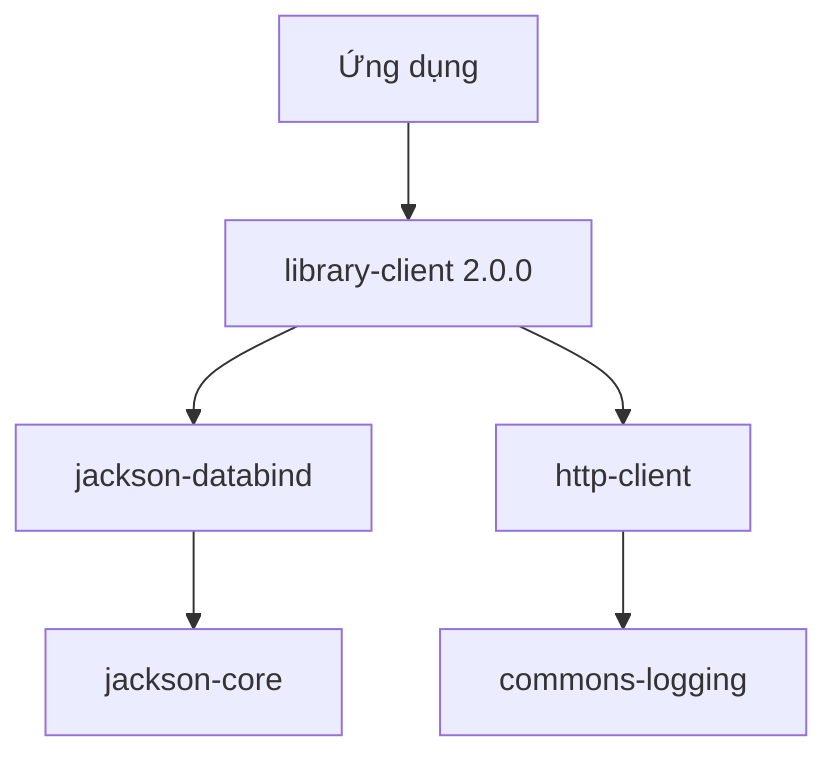
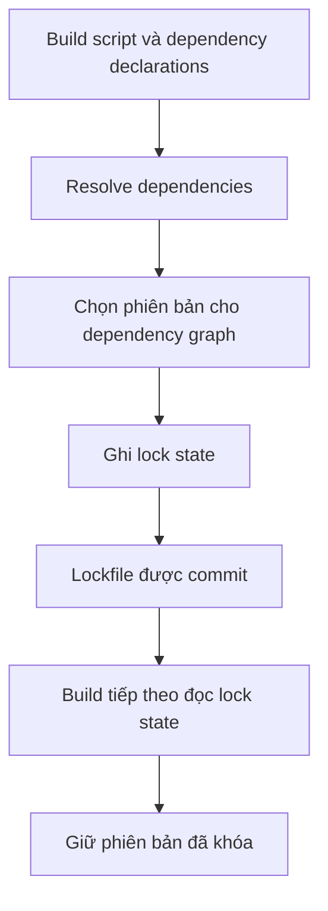
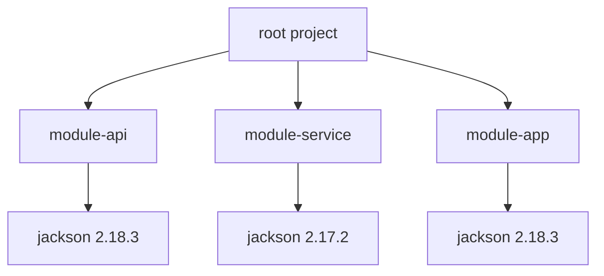
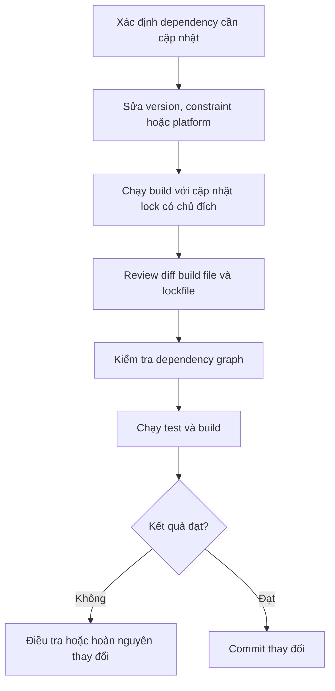

# Kiểm soát thay đổi đồ thị bằng cơ chế khóa phụ thuộc

Khi build một dự án Java, build tool không chỉ tải những thư viện được ghi trực tiếp trong build file. Nó còn phân giải các thư viện bắc cầu, chọn phiên bản phù hợp và tạo ra một dependency graph hoàn chỉnh. Nếu phiên bản được khai báo quá linh hoạt hoặc metadata của thư viện thay đổi, cùng một mã nguồn có thể nhận được dependency graph khác nhau ở những lần build khác nhau.

**Dependency locking (khóa phụ thuộc)** giúp kiểm soát vấn đề này bằng cách ghi lại các phiên bản đã được chọn trong quá trình phân giải dependency. Khi build lại, công cụ sử dụng trạng thái khóa để giữ các phiên bản đó ổn định cho những cấu hình đã được khóa.

Bài học này giải thích vì sao cần khóa dependency, cách Gradle dependency locking hoạt động, cách tạo và cập nhật lockfile có kiểm soát, sự khác nhau giữa locking với version catalog và dependency constraints, cũng như những cách Maven thường dùng để quản lý phiên bản và giảm thay đổi ngoài ý muốn.

## 1. Vì sao cần kiểm soát dependency graph?

Một dự án Java có thể khai báo dependency trực tiếp như sau:

```groovy
dependencies {
    implementation 'com.example:library-client:2.0.0'
}
```

Nhưng library-client có thể phụ thuộc vào nhiều thư viện khác. Dependency graph thực tế có thể là:



Các thư viện bắc cầu này có thể có phiên bản được yêu cầu theo nhiều cách:

- Phiên bản cố định, chẳng hạn 2.18.3.
- Version range, chẳng hạn một khoảng phiên bản được phép.
- Dynamic version trong Gradle, chẳng hạn 2.+ hoặc latest.release.
- Phiên bản được quản lý bởi BOM, platform hoặc constraint.
- Phiên bản được yêu cầu từ nhiều nhánh dependency khác nhau.

Nếu một dependency dùng dynamic version hoặc version range, lần build sau có thể chọn phiên bản mới hơn dù mã nguồn và build file không thay đổi. Ngay cả khi direct dependencies được pin, metadata của dependency bắc cầu hoặc quy tắc resolution cũng có thể ảnh hưởng graph cuối cùng.

Một dependency graph thay đổi có thể dẫn đến:

- Lỗi biên dịch do API đã thay đổi hoặc bị loại bỏ.
- Lỗi runtime do hành vi hoặc tương thích thay đổi.
- Kết quả test khác trước.
- Khác biệt giữa máy lập trình viên và CI.
- Thay đổi về lỗ hổng bảo mật hoặc giấy phép của dependency.
- Khó xác định chính xác phiên bản nào đã được dùng để tạo artifact phát hành.

Dependency locking giúp ghi lại phiên bản đã được chọn để những lần build sau có thể dùng cùng trạng thái dependency.

## 2. Dependency locking là gì?

Dependency locking là cơ chế lưu lại **phiên bản cụ thể đã được build tool chọn** cho một tập hợp cấu hình dependency.

Thay vì mỗi lần build đều tự giải quyết lại mọi phiên bản theo các khai báo linh hoạt, build tool có thể đọc lock state và giữ nguyên các phiên bản đã được ghi.

Ví dụ ban đầu, dependency graph được phân giải thành:

```text
library-client:2.0.0
jackson-databind:2.18.3
jackson-core:2.18.3
http-client:5.4.1
commons-logging:1.3.4
```

Các phiên bản được lưu vào lockfile. Khi build lại, công cụ dùng các phiên bản đã khóa trong những configuration tương ứng.

Có thể hình dung:



Lockfile mô tả trạng thái phiên bản đã được chọn. Nó bổ sung cho build file, không thay thế build file.

Build file vẫn trả lời câu hỏi: dự án cần những thư viện nào và trong configuration nào? Lockfile trả lời: với những dependency đó, lần phân giải đã chọn phiên bản cụ thể nào?

## 3. Locking khác gì với pin version?

**Pin version** là khai báo một phiên bản cụ thể ngay trong cấu hình dependency.

Ví dụ Gradle:

```groovy
dependencies {
    implementation 'org.slf4j:slf4j-api:2.0.16'
}
```

Ví dụ Maven:

```xml
<dependency>
    <groupId>org.slf4j</groupId>
    <artifactId>slf4j-api</artifactId>
    <version>2.0.16</version>
</dependency>
```

Pin version giúp kiểm soát phiên bản của dependency được khai báo trực tiếp. Tuy nhiên, nó không nhất thiết khóa toàn bộ phiên bản của các dependency bắc cầu.

Dependency locking ghi lại kết quả resolution cho cả dependency graph thuộc configuration đã khóa. Vì vậy, nó có thể giữ phiên bản của những thư viện bắc cầu ngay cả khi các thư viện đó không được khai báo trực tiếp trong build file.

| Cơ chế | Kiểm soát điều gì? | Phạm vi |
|---|---|---|
| Pin version | Phiên bản được yêu cầu trong khai báo dependency | Dependency được khai báo |
| BOM / platform | Phiên bản hoặc constraint cho một nhóm dependency | Các dependency được quản lý bởi BOM/platform |
| Dependency constraint | Quy tắc phiên bản cho một module | Module được constraint áp dụng |
| Dependency locking | Phiên bản đã được chọn khi resolve | Các dependency thuộc configuration đã khóa |
| Dependency verification | Tính toàn vẹn hoặc danh tính artifact được tải | Artifact được xác minh |

Các cơ chế có thể được dùng cùng nhau. Một dự án có thể pin phiên bản direct dependency, dùng BOM để đồng bộ một hệ sinh thái, khóa dependency graph và xác minh checksum của artifact.

## 4. Gradle Dependency Locking

Gradle hỗ trợ dependency locking cho các configuration có thể resolve. Khi bật locking và tạo lock state, Gradle ghi lại các phiên bản dependency đã được chọn cho những configuration được resolve trong lần chạy ghi lock.

Lock state thường được lưu trong file:

```text
gradle.lockfile
```

Với dự án multi-project, mỗi project có thể có lockfile riêng tùy cách cấu hình và vị trí project.

### 4.1. Bật locking cho toàn bộ configuration

Trong build.gradle dùng Groovy DSL:

```groovy
dependencyLocking {
    lockAllConfigurations()
}
```

Trong build.gradle.kts dùng Kotlin DSL:

```kotlin
dependencyLocking {
    lockAllConfigurations()
}
```

Cấu hình này yêu cầu Gradle áp dụng dependency locking cho tất cả configuration có thể resolve trong project. Nếu chỉ muốn bật locking cho những configuration cụ thể, có thể kích hoạt theo từng configuration:

```groovy
configurations.configureEach {
    resolutionStrategy.activateDependencyLocking()
}
```

Cần chọn phạm vi phù hợp với cấu trúc build. Với một ứng dụng thông thường, lock các configuration dùng để biên dịch, chạy và kiểm thử giúp kiểm soát dependency graph ở những bước quan trọng.

### 4.2. Tạo lockfile lần đầu

Sau khi bật dependency locking, chạy một build có resolve những configuration cần khóa và yêu cầu Gradle ghi lock state:

```bash
./gradlew build --write-locks
```

Trên Windows:

```powershell
.\gradlew.bat build --write-locks
```

Gradle thực hiện các task được yêu cầu, resolve dependency và ghi phiên bản đã chọn vào lockfile cho những configuration được resolve trong lần chạy đó.

Một ví dụ minh họa nội dung lockfile:

```text
# This is a Gradle generated file for dependency locking.
# Manual edits can be overwritten by Gradle.
org.slf4j:slf4j-api:2.0.16=compileClasspath,runtimeClasspath
com.fasterxml.jackson.core:jackson-databind:2.18.3=runtimeClasspath
com.fasterxml.jackson.core:jackson-core:2.18.3=runtimeClasspath
empty=annotationProcessor
```

Đây là ví dụ để minh họa ý nghĩa của lock state; định dạng thực tế do Gradle tạo và có thể khác theo các configuration được resolve.

Lockfile không phải nơi để tự khai báo dependency mới. Dependency vẫn được thêm hoặc xóa trong build script; lockfile được cập nhật bằng quy trình resolution có chủ đích.

### 4.3. Commit lockfile vào Git

Sau khi tạo lockfile, kiểm tra các thay đổi và commit cùng với build configuration:

```bash
git status
git diff -- gradle.lockfile
git add build.gradle gradle.lockfile
git commit -m "Add dependency locking"
```

Nếu project dùng Kotlin DSL, thêm build.gradle.kts thay cho build.gradle. Trong multi-project build, cần xem các lockfile của từng subproject có thay đổi hay không.

Không commit cache dependency đã tải về. Lockfile chỉ lưu trạng thái phiên bản; các artifact vẫn được tải từ repository khi cần và có thể được cache trên từng máy.

### 4.4. Build với lock state hiện có

Sau khi lockfile đã được commit, thành viên nhóm và CI dùng wrapper như bình thường:

```bash
./gradlew clean build
```

Gradle sẽ sử dụng lock state cho các configuration đã khóa. Nếu cấu hình dependency thay đổi theo cách không phù hợp với lock state hiện tại, build có thể báo lỗi thay vì âm thầm thay đổi graph.

Điều này giúp nhóm nhận biết khi nào cần cập nhật lockfile và review sự thay đổi đó.

## 5. Cập nhật lockfile có kiểm soát

Lockfile cần được cập nhật khi nhóm chủ động thay đổi dependency hoặc muốn nhận một phiên bản mới đã được kiểm thử.

Không nên cập nhật lockfile một cách vô thức trong mọi lần build. Một thay đổi lockfile có thể kéo theo thay đổi hành vi, API, hiệu năng hoặc bảo mật của dependency.

### 5.1. Cập nhật toàn bộ lock state

Khi muốn resolve lại dependency và ghi trạng thái mới cho các configuration được chạy:

```bash
./gradlew build --write-locks
```

Sau đó xem diff:

```bash
git diff -- gradle.lockfile
```

Kiểm tra:

- Dependency nào được thêm hoặc bị loại.
- Phiên bản nào tăng hoặc giảm.
- Dependency bắc cầu nào thay đổi.
- Có dependency mới xuất hiện ngoài dự kiến không.
- Test và build có còn thành công không.

Không nên chấp nhận một diff lockfile lớn mà không hiểu lý do thay đổi.

### 5.2. Chỉ cập nhật một dependency

Gradle hỗ trợ cập nhật lock state cho các module được chỉ định bằng tùy chọn --update-locks.

Ví dụ:

```bash
./gradlew build --update-locks org.slf4j:slf4j-api
```

Lệnh trên yêu cầu Gradle cập nhật lock state liên quan đến module org.slf4j:slf4j-api trong quá trình build. Những dependency khác tiếp tục được kiểm soát theo lock state hiện có, trừ khi quan hệ resolution khiến chúng cần thay đổi.

Với nhiều module:

```bash
./gradlew build --update-locks org.slf4j:slf4j-api,com.fasterxml.jackson.core:jackson-databind
```

Cú pháp module notation cần khớp với group và module thực tế trong dependency graph.

### 5.3. Khi thêm dependency mới

Giả sử mã nguồn bắt đầu sử dụng một thư viện mới. Trước tiên khai báo dependency trong build script:

```groovy
dependencies {
    implementation 'org.apache.commons:commons-lang3:3.17.0'
}
```

Sau đó chạy build với --write-locks để resolve và cập nhật lock state:

```bash
./gradlew build --write-locks
```

Review cả build script và lockfile. Dependency mới cần xuất hiện trong cấu hình đúng, và lockfile cần phản ánh phiên bản đã được chọn.

### 5.4. Khi xóa dependency

Khi xóa một dependency khỏi build script, lock state liên quan có thể được cập nhật khi Gradle resolve lại configuration và ghi lock. Chạy build phù hợp với các configuration cần quản lý, sau đó xem diff để xác nhận dependency không còn cần thiết đã được loại khỏi lock state.

Không nên tự xóa dòng lockfile bằng tay để thay thế việc sửa khai báo dependency. Build script là nguồn mô tả nhu cầu; lockfile là kết quả resolution.

## 6. Dynamic version và locking

Dynamic version là một nguyên nhân phổ biến khiến dependency graph thay đổi theo thời gian.

Ví dụ:

```groovy
dependencies {
    implementation 'org.example:library:2.+'
}
```

Khai báo 2.+ cho phép Gradle chọn một phiên bản phù hợp trong nhánh 2.x. Nếu repository xuất hiện bản 2.9 sau khi trước đó build dùng 2.8, lần resolve mới có thể chọn phiên bản khác.

Với locking được bật, Gradle có thể giữ phiên bản đã chọn trong lock state cho đến khi nhóm chủ động cập nhật.

Tuy nhiên, dynamic version vẫn có thể gây bất ngờ nếu lock state chưa được tạo hoặc bị cập nhật không chủ ý. Với dependency quan trọng, nên ưu tiên version rõ ràng và dùng locking như lớp kiểm soát bổ sung.

Các dạng khai báo cần chú ý:

| Cách khai báo | Ý nghĩa |
|---|---|
| 2.8.1 | Phiên bản cụ thể |
| 2.+ | Phiên bản mới nhất phù hợp trong nhánh 2.x |
| latest.release | Bản release mới nhất mà repository cung cấp |
| Version range | Một khoảng phiên bản được phép |
| Changing module | Cùng tọa độ phiên bản có thể trỏ đến nội dung thay đổi theo thời gian, ví dụ một số SNAPSHOT |

Locking giữ phiên bản đã chọn, nhưng không đảm bảo nội dung artifact tại cùng một tọa độ phiên bản luôn bất biến. Với changing module hoặc repository cho phép ghi đè artifact, cần thêm quy tắc repository và dependency verification.

## 7. Locking không giống dependency verification

Hai cơ chế này giải quyết hai câu hỏi khác nhau:

- **Dependency locking:** Phiên bản nào được chọn?
- **Dependency verification:** Artifact tải về có đúng nội dung hoặc chữ ký đã được tin cậy không?

Ví dụ, lockfile ghi:

```text
org.example:library:2.4.0
```

Điều này khóa phiên bản 2.4.0. Nhưng nếu repository không đáng tin cậy hoặc artifact ở cùng tọa độ bị thay thế, chỉ lock phiên bản không đủ để xác minh nội dung.

Gradle dependency verification hỗ trợ kiểm tra checksum và chữ ký của artifact. Cấu hình verification có thể được tạo bằng:

```bash
./gradlew --write-verification-metadata sha256 help
```

Gradle tạo hoặc cập nhật file metadata verification, thường là:

```text
gradle/verification-metadata.xml
```

File này cần được review và commit. Không nên tự động tin cậy mọi checksum mới mà không kiểm tra nguồn và lý do thay đổi.

| Cơ chế | Bảo vệ điều gì? |
|---|---|
| Dependency locking | Phiên bản được chọn trong dependency graph |
| Dependency verification | Tính toàn vẹn hoặc chữ ký của artifact |
| Gradle Wrapper | Phiên bản Gradle dùng để chạy build |
| Java toolchain | JDK dùng để biên dịch hoặc thực hiện các task Java theo cấu hình |

Một build tái lập tốt thường cần kết hợp các lớp kiểm soát này.

## 8. Lockfile không tự làm toàn bộ build có thể tái lập

Dependency locking là một phần của reproducible build, nhưng không phải toàn bộ giải pháp.

Một build có thể vẫn khác nhau nếu:

- Phiên bản Gradle hoặc Maven thay đổi.
- Plugin build dùng dynamic version hoặc không được pin.
- JDK hoặc compiler toolchain khác nhau.
- Một task đọc file bên ngoài repository.
- Build phụ thuộc vào thời gian, ngẫu nhiên hoặc trạng thái hệ thống.
- Repository thay đổi artifact cùng tọa độ phiên bản.
- Biến môi trường hoặc cấu hình người dùng khác nhau.
- Task không khai báo chính xác input/output hoặc có hành vi không xác định.

Để tăng khả năng tái lập, cần kết hợp:

- Wrapper để cố định phiên bản build tool.
- Plugin version rõ ràng.
- Dependency declarations và lock state.
- Java toolchain phù hợp.
- Repository tin cậy và quy tắc version nhất quán.
- Dependency verification.
- Task có input/output rõ ràng.
- Cấu hình môi trường được tài liệu hóa.

Lockfile giữ phiên bản dependency, còn những thành phần khác cần được quản lý riêng.

## 9. Maven quản lý phiên bản dependency như thế nào?

Maven có cách quản lý dependency khác Gradle. Maven truyền thống tập trung vào POM, dependencyManagement, BOM và quy tắc dependency mediation. Cơ chế này giúp kiểm soát phiên bản nhưng không giống hoàn toàn một lockfile được sinh tự động theo từng configuration như Gradle.

### 9.1. Khai báo phiên bản trực tiếp

Đối với dependency quan trọng, khai báo phiên bản rõ ràng trong POM:

```xml
<dependencies>
    <dependency>
        <groupId>org.slf4j</groupId>
        <artifactId>slf4j-api</artifactId>
        <version>2.0.16</version>
    </dependency>
</dependencies>
```

Tránh dùng version range hoặc các cách chọn phiên bản linh hoạt nếu mục tiêu là build có thể tái tạo. Phiên bản trực tiếp rõ ràng giúp người đọc biết project mong muốn sử dụng bản nào.

### 9.2. Dùng dependencyManagement hoặc BOM

Với nhiều module, có thể quản lý phiên bản tập trung:

```xml
<dependencyManagement>
    <dependencies>
        <dependency>
            <groupId>org.slf4j</groupId>
            <artifactId>slf4j-api</artifactId>
            <version>2.0.16</version>
        </dependency>
    </dependencies>
</dependencyManagement>

<dependencies>
    <dependency>
        <groupId>org.slf4j</groupId>
        <artifactId>slf4j-api</artifactId>
    </dependency>
</dependencies>
```

DependencyManagement cung cấp version policy cho dependency khi nó được khai báo. Nó không tự thêm dependency vào project nếu phần dependencies không khai báo nó.

BOM giúp một nhóm thư viện có phiên bản tương thích được quản lý cùng nhau. Đây là cách phổ biến để tránh mỗi module chọn một phiên bản khác nhau.

### 9.3. Dùng Maven Enforcer Plugin

Maven Enforcer Plugin có thể áp dụng các rule để phát hiện dependency graph không nhất quán.

Ví dụ cấu hình dependency convergence:

```xml
<build>
    <plugins>
        <plugin>
            <groupId>org.apache.maven.plugins</groupId>
            <artifactId>maven-enforcer-plugin</artifactId>
            <version>3.5.0</version>
            <executions>
                <execution>
                    <id>enforce-dependency-convergence</id>
                    <goals>
                        <goal>enforce</goal>
                    </goals>
                    <configuration>
                        <rules>
                            <dependencyConvergence/>
                        </rules>
                    </configuration>
                </execution>
            </executions>
        </plugin>
    </plugins>
</build>
```

Rule dependencyConvergence giúp phát hiện trường hợp cùng một dependency xuất hiện với nhiều phiên bản trong graph. Nhóm có thể bổ sung các rule khác như requireUpperBoundDeps hoặc requirePluginVersions tùy mục tiêu.

Enforcer giúp phát hiện hoặc ngăn một số dạng không nhất quán. Nó không tự tạo một lockfile ghi chính xác mọi phiên bản đã resolve như Gradle dependency locking.

### 9.4. Kiểm tra dependency tree

Dùng Maven Dependency Plugin:

```bash
./mvnw dependency:tree
```

Lọc một thư viện cụ thể:

```bash
./mvnw dependency:tree -Dincludes=org.slf4j:slf4j-api
```

Có thể lưu output để review thay đổi dependency giữa các lần nâng cấp. Tuy nhiên, output dependency:tree là báo cáo kiểm tra, không tự trở thành lock state được Maven áp dụng cho lần build sau.

Nếu dự án cần lockfile theo nghĩa chặt chẽ, hãy chọn một công cụ hoặc quy trình được nhóm hỗ trợ rõ ràng, kiểm tra khả năng tương thích với phiên bản Maven đang dùng và ghi rõ cách cập nhật lock. Không nên nhầm dependency tree, BOM hay Enforcer với một cơ chế lockfile native tương đương Gradle.

## 10. Locking trong dự án multi-module

Một dự án multi-module có thể có nhiều project cùng sử dụng một số thư viện chung. Nếu mỗi module resolve dependency độc lập mà không có chính sách thống nhất, các module có thể sử dụng những phiên bản khác nhau.

Ví dụ:



Nếu module-service và module-api cần phối hợp ở runtime, khác biệt phiên bản có thể tạo ra vấn đề tương thích.

Các cách quản lý:

- Dùng platform hoặc BOM để chia sẻ version policy.
- Khai báo dependency constraints ở vị trí phù hợp.
- Bật dependency locking cho các project cần kiểm soát.
- Review lockfile của từng project sau khi cập nhật.
- Chạy build và test ở cấp root để kiểm tra tích hợp.

Không nên giả định một lockfile ở root tự động khóa mọi configuration của mọi subproject. Hãy kiểm tra cấu trúc multi-project và nơi Gradle tạo lock state.

## 11. Quy trình cập nhật dependency an toàn

Một quy trình cập nhật có kiểm soát giúp nhóm biết vì sao graph thay đổi và xác nhận artifact mới hoạt động.



Các bước nên thực hiện:

1. Xác định lý do nâng cấp: sửa lỗi, bảo mật, tính năng hoặc tương thích.
2. Xem dependency nào trực tiếp và dependency nào bắc cầu.
3. Cập nhật phiên bản hoặc constraint ở nơi quản lý phù hợp.
4. Cập nhật lockfile bằng lệnh có chủ đích.
5. Review những dòng lockfile thay đổi.
6. Chạy test, integration test và build artifact.
7. Kiểm tra dependency verification nếu artifact hoặc checksum thay đổi.
8. Ghi lại lý do nâng cấp trong pull request hoặc commit.

Khi lockfile thay đổi rất nhiều, hãy xác định nguyên nhân. Có thể build tool, repository metadata, BOM hoặc một dependency cha đã thay đổi phạm vi dependency.

## 12. Những lỗi thường gặp

| Hiện tượng | Nguyên nhân có thể | Cách xử lý |
|---|---|---|
| Gradle báo lock state không khớp | Build script yêu cầu dependency khác lockfile | Cập nhật lock state có chủ đích và review diff |
| Dependency mới không có trong lockfile | Configuration chưa được resolve trong lần ghi lock | Chạy task thực sự resolve configuration cần khóa với --write-locks |
| Build vẫn dùng phiên bản cũ dù có bản mới | Lockfile đang giữ phiên bản đã chọn | Cập nhật dependency có chủ đích bằng --update-locks hoặc --write-locks |
| Lockfile thay đổi quá nhiều | Nhiều configuration được resolve hoặc dependency graph thay đổi rộng | Xem diff theo module và configuration, xác định dependency cha gây thay đổi |
| Maven có nhiều phiên bản của cùng thư viện | Dependency mediation chọn theo graph và có thể không hội tụ | Dùng dependencyManagement/BOM và Enforcer |
| Chỉ pin direct dependency nhưng transitive vẫn đổi | Phiên bản bắc cầu chưa được kiểm soát | Dùng constraints, BOM hoặc cơ chế locking phù hợp |
| Lockfile đúng nhưng artifact tải về không đáng tin | Locking chỉ kiểm soát phiên bản, không xác minh nội dung | Dùng dependency verification và repository tin cậy |
| Build local được nhưng CI khác | CI dùng cấu hình, JDK hoặc lockfile khác | Dùng wrapper, commit lockfile và cung cấp cấu hình CI nhất quán |
| Tự sửa lockfile làm trạng thái không hợp lệ | Lockfile là dữ liệu do build tool sinh | Thay đổi dependency declarations rồi để build tool cập nhật lock state |

## 13. Nguyên tắc thực hành

### Bật locking cho configuration quan trọng

Khóa compile, runtime và test configurations để các bước build quan trọng sử dụng cùng trạng thái dependency đã được kiểm soát.

### Commit lockfile cùng build configuration

Lockfile cần đi cùng mã nguồn để thành viên nhóm và CI dùng chung trạng thái dependency.

### Cập nhật theo từng thay đổi có chủ đích

Nâng cấp một thư viện hoặc nhóm thư viện, xem diff và chạy test. Tránh cập nhật tất cả dependency mà không biết mục tiêu.

### Không nhầm locking với pinning

Pin version làm rõ phiên bản được yêu cầu. Locking ghi lại phiên bản đã được resolve, bao gồm cả dependency bắc cầu thuộc configuration được khóa.

### Không nhầm locking với verification

Lockfile không chứng minh artifact tải về có nội dung đáng tin cậy. Dùng checksum hoặc chữ ký để xác minh artifact.

### Quản lý plugin và JDK riêng

Gradle wrapper cố định phiên bản Gradle; plugin version và JDK/toolchain cần được quản lý riêng. Không nên nghĩ lockfile dependency của ứng dụng đã cố định toàn bộ môi trường build.

### Kiểm tra toàn bộ dependency graph

Dependency bắc cầu vẫn có thể chứa lỗ hổng hoặc giấy phép cần xem xét. Locking làm graph ổn định hơn nhưng không thay thế kiểm kê và cập nhật bảo mật.

## 14. Ghi nhớ

- Dependency locking ghi lại phiên bản đã được chọn trong quá trình resolution.
- Gradle lưu lock state trong file gradle.lockfile.
- Bật locking bằng dependencyLocking.lockAllConfigurations() hoặc kích hoạt theo configuration.
- Dùng --write-locks để ghi trạng thái của những configuration được resolve.
- Dùng --update-locks để cập nhật có chọn lọc module cần nâng cấp.
- Lockfile cần được review và commit cùng build configuration.
- Pin version, BOM, platform, constraints và locking giải quyết những khía cạnh khác nhau.
- Dependency locking không xác minh nội dung artifact; cần dependency verification cho checksum hoặc chữ ký.
- Locking không tự cố định Gradle wrapper, plugin version, JDK hay hành vi của task.
- Maven thường quản lý phiên bản bằng dependencyManagement, BOM, version cố định và Enforcer; dependency tree là công cụ kiểm tra, không phải lockfile.
- Cần cập nhật lockfile có chủ đích, kiểm tra graph và chạy test sau khi thay đổi.

## 15. Tự kiểm tra

1. Vì sao cùng một mã nguồn có thể resolve ra dependency graph khác nhau ở hai thời điểm?
2. Dependency locking lưu lại thông tin gì?
3. Pin version khác dependency locking như thế nào?
4. Gradle bật locking cho tất cả configuration bằng cấu hình nào?
5. Lệnh --write-locks có tác dụng gì?
6. Khi chỉ muốn cập nhật một dependency, có thể dùng tùy chọn nào?
7. Vì sao cần commit gradle.lockfile vào Git?
8. Dependency locking khác dependency verification ở điểm nào?
9. Vì sao lockfile không đủ để bảo đảm toàn bộ build có thể tái lập?
10. Maven có thể dùng dependencyManagement, BOM và Enforcer để kiểm soát những vấn đề nào?
11. Vì sao dependency:tree không tương đương một lockfile?
12. Khi review lockfile thay đổi, cần kiểm tra những gì?

Khi có thể giải thích cách lockfile giữ phiên bản dependency, cập nhật lock state có kiểm soát và phân biệt locking với version management và artifact verification, bạn đã nắm được cách kiểm soát thay đổi dependency graph trong quy trình build Java.

