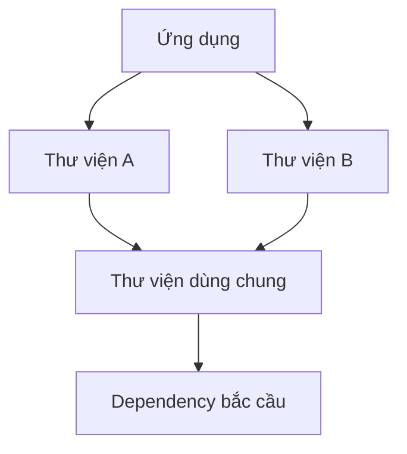
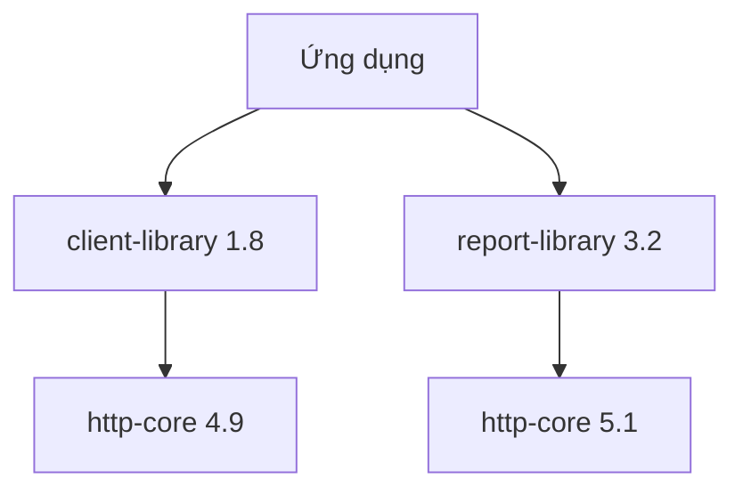
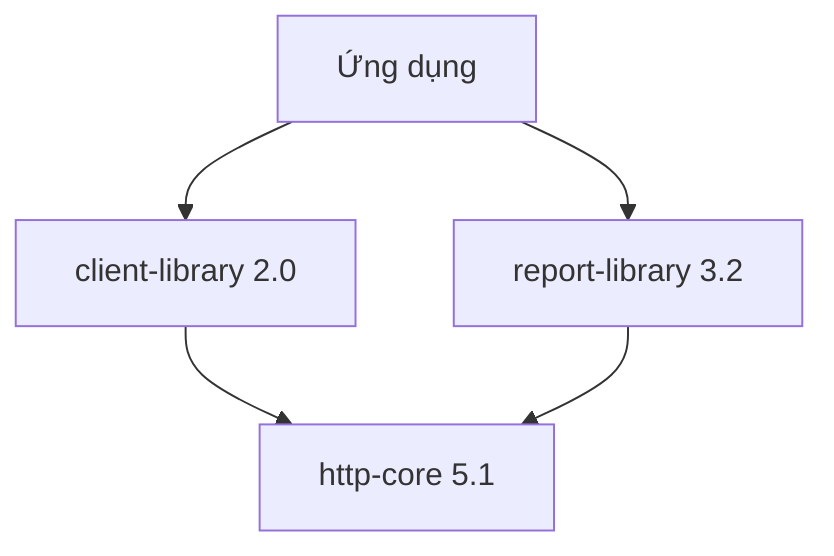
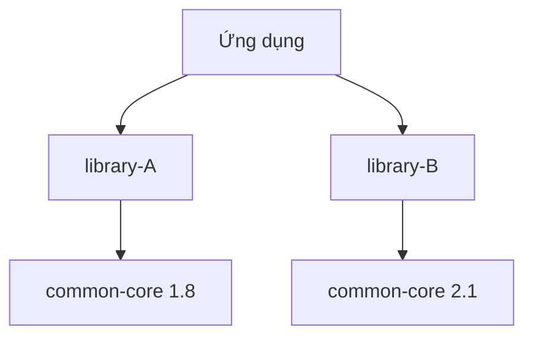
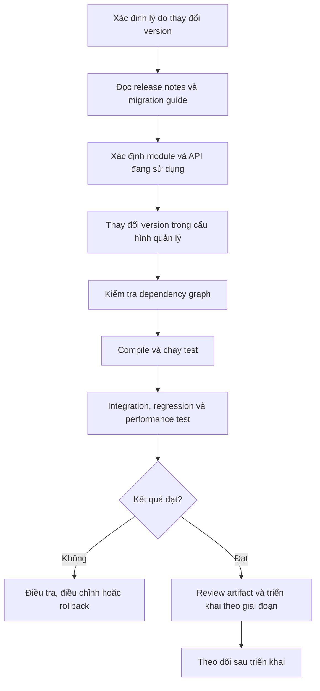

# Đánh giá ảnh hưởng của việc nâng cấp hoặc hạ phiên bản thư viện

Một dự án Java thường phụ thuộc vào nhiều thư viện bên ngoài. Khi nâng phiên bản thư viện, nhóm có thể nhận được bản sửa lỗi, tính năng mới hoặc bản vá bảo mật. Tuy nhiên, phiên bản mới cũng có thể thay đổi API, hành vi, dependency bắc cầu, yêu cầu JDK hoặc cách cấu hình. Hạ phiên bản đôi khi giúp xử lý một lỗi tương thích, nhưng cũng có thể làm mất bản vá bảo mật hoặc đưa dự án trở lại một hành vi đã lỗi thời.

Vì vậy, thay đổi phiên bản thư viện cần được xem là một thay đổi kỹ thuật có ảnh hưởng đến toàn bộ ứng dụng. Cần xác định phần nào đang sử dụng thư viện, phiên bản mới hoặc cũ thay đổi điều gì, dependency graph được phân giải ra sao và những kiểm thử nào đủ để xác nhận kết quả.

Bài học này trình bày cách đánh giá tác động của việc nâng cấp và hạ cấp thư viện, cách kiểm tra dependency graph trong Maven và Gradle, các loại tương thích cần xem xét và một quy trình thay đổi có kiểm soát.

## 1. Vì sao thay đổi phiên bản thư viện có thể ảnh hưởng đến ứng dụng?

Một thư viện không chỉ là một file JAR. Nó cung cấp lớp, interface, phương thức, kiểu dữ liệu, tài nguyên và có thể kéo theo nhiều dependency khác. Mã nguồn ứng dụng có thể gọi trực tiếp API của thư viện, còn các thành phần khác có thể phụ thuộc vào hành vi hoặc phiên bản của nó.

Ví dụ, ứng dụng khai báo:

```groovy
dependencies {
    implementation 'com.fasterxml.jackson.core:jackson-databind:2.17.2'
}
```

Ứng dụng sử dụng Jackson để đọc và ghi JSON. Khi đổi sang phiên bản mới hơn, có thể xảy ra các thay đổi:

- Một API cũ bị deprecated hoặc bị loại bỏ.
- Hành vi xử lý JSON thay đổi.
- Dependency bắc cầu được nâng lên phiên bản khác.
- Yêu cầu Java tối thiểu tăng.
- Cách cấu hình hoặc mặc định của thư viện thay đổi.
- Một lỗi bảo mật được sửa.
- Một lỗi mới hoặc vấn đề hiệu năng xuất hiện.

Tác động không chỉ giới hạn ở mã nguồn import thư viện. Một dependency khác có thể cũng sử dụng thư viện đó. Vì thế, thay đổi một phiên bản có thể ảnh hưởng đến nhiều module trong dependency graph.



Nếu thay đổi phiên bản thư viện dùng chung, cả nhánh A và B có thể chịu ảnh hưởng dù mã nguồn của chúng không thay đổi.

## 2. Nâng cấp và hạ cấp có mục tiêu khác nhau

### 2.1. Nâng cấp (upgrade)

Nâng cấp là chuyển từ phiên bản đang dùng sang phiên bản mới hơn.

Những lý do phổ biến:

- Sửa lỗi đã biết.
- Vá lỗ hổng bảo mật.
- Hỗ trợ JDK hoặc framework mới.
- Nhận tính năng mới.
- Cải thiện hiệu năng hoặc khả năng mở rộng.
- Thay đổi API để phù hợp kiến trúc mới.
- Dùng phiên bản còn được nhà phát hành hỗ trợ.

Nâng cấp có thể nhỏ, chẳng hạn từ 2.4.1 lên 2.4.2, hoặc lớn, chẳng hạn từ 2.x lên 3.x. Mức rủi ro phụ thuộc quy tắc versioning của nhà phát hành và nội dung thay đổi thực tế.

### 2.2. Hạ cấp (downgrade)

Hạ cấp là chuyển từ phiên bản đang dùng sang phiên bản cũ hơn.

Những lý do có thể gặp:

- Phiên bản mới gây lỗi runtime.
- Một plugin hoặc framework chưa tương thích.
- Có regression ảnh hưởng đến chức năng quan trọng.
- Phiên bản mới yêu cầu JDK cao hơn môi trường triển khai.
- Cần khôi phục hành vi ổn định trong thời gian điều tra lỗi.

Hạ cấp có thể giúp khôi phục hoạt động trong ngắn hạn, nhưng cần đánh giá những gì bị mất:

- Bản vá bảo mật có thể bị mất.
- Một lỗi đã được sửa ở phiên bản mới có thể xuất hiện trở lại.
- API hoặc tính năng mà mã nguồn đang sử dụng có thể không còn.
- Dependency bắc cầu có thể quay về phiên bản cũ.
- Phiên bản cũ có thể không còn được hỗ trợ.

Hạ cấp nên có lý do rõ ràng, phạm vi ảnh hưởng được xác định và kế hoạch quay lại phiên bản được hỗ trợ.

## 3. Hiểu version number trước khi thay đổi

Nhiều thư viện Java sử dụng quy ước gần với Semantic Versioning (SemVer), thường có dạng:

```text
MAJOR.MINOR.PATCH
```

Theo SemVer:

- MAJOR: thay đổi không tương thích với API công khai trước đó.
- MINOR: bổ sung chức năng theo cách tương thích ngược.
- PATCH: sửa lỗi theo cách tương thích ngược.

Ví dụ, với thư viện tuân thủ SemVer:

| Thay đổi | Ví dụ | Kỳ vọng theo SemVer |
|---|---|---|
| Patch | 2.4.1 → 2.4.2 | Sửa lỗi, giữ tương thích |
| Minor | 2.4.1 → 2.5.0 | Thêm chức năng tương thích ngược |
| Major | 2.4.1 → 3.0.0 | Có thể có thay đổi không tương thích |

Tuy nhiên, **không phải mọi thư viện Java đều tuân thủ SemVer nghiêm ngặt**. Một số dự án có quy ước version riêng; phiên bản có thể chứa hậu tố như alpha, beta, rc, SNAPSHOT hoặc build metadata. Một số thư viện cũng thay đổi hành vi trong bản minor hoặc patch.

Do đó, không nên quyết định mức độ an toàn chỉ dựa trên số phiên bản. Luôn đọc release notes, changelog, migration guide và chính sách tương thích của nhà phát hành.

### 3.1. Phiên bản mới hơn không tự động tốt hơn trong mọi tình huống

Một phiên bản mới có thể sửa nhiều lỗi nhưng đồng thời:

- Bỏ hỗ trợ JDK cũ.
- Đổi API.
- Thay đổi mặc định.
- Nâng phiên bản dependency bắc cầu.
- Yêu cầu cập nhật cấu hình.
- Có regression trong một trường hợp sử dụng cụ thể.

Tương tự, một phiên bản cũ có thể ổn định trong môi trường hiện tại nhưng không còn được vá bảo mật. Cần cân nhắc lợi ích, rủi ro và yêu cầu vận hành thay vì chỉ chọn số phiên bản lớn nhất.

## 4. Những loại tương thích cần đánh giá

Một thư viện có thể tương thích ở một khía cạnh nhưng không tương thích ở khía cạnh khác. Nên đánh giá ít nhất các loại sau.

### 4.1. Tương thích mã nguồn (source compatibility)

Source compatibility trả lời câu hỏi: mã nguồn hiện tại có còn biên dịch khi dùng phiên bản thư viện mới hay không?

Một thay đổi có thể làm mã nguồn không biên dịch được:

- Xóa hoặc đổi tên class, method hay field.
- Thay đổi kiểu tham số hoặc kiểu trả về.
- Thay đổi generic type.
- Đổi visibility từ public sang protected hoặc private.
- Thêm method abstract vào interface mà implementation hiện tại chưa cung cấp.
- Thay đổi package hoặc module export.

Ví dụ, phiên bản cũ có:

```java
public class ReportClient {
    public String fetchReport(String id) {
        return "";
    }
}
```

Phiên bản mới đổi tên method thành getReport:

```java
public class ReportClient {
    public String getReport(String id) {
        return "";
    }
}
```

Mã nguồn đang gọi fetchReport sẽ không biên dịch với phiên bản mới cho đến khi được cập nhật.

### 4.2. Tương thích nhị phân (binary compatibility)

Binary compatibility trả lời câu hỏi: bytecode đã biên dịch trước đó có tiếp tục liên kết được với phiên bản thư viện mới không?

Có trường hợp mã nguồn ứng dụng vẫn biên dịch sau khi cập nhật, nhưng một module khác hoặc một plugin đã được biên dịch từ trước lại không chạy được.

Các lỗi runtime thường gặp:

| Lỗi | Ý nghĩa thường gặp |
|---|---|
| NoSuchMethodError | Bytecode gọi một method không tồn tại trong phiên bản đang nạp |
| NoSuchFieldError | Field mà bytecode tham chiếu không còn hoặc không tương thích |
| AbstractMethodError | Một implementation không cung cấp method abstract mà runtime yêu cầu |
| IncompatibleClassChangeError | Cấu trúc class/interface thay đổi theo cách không tương thích |
| NoClassDefFoundError | JVM không thể nạp class cần thiết khi chạy |

Ví dụ, một module đã biên dịch với method cũ. Nếu chỉ thay JAR thư viện bằng bản mới mà không biên dịch lại module, runtime có thể báo NoSuchMethodError.

Vì vậy, khi nâng thư viện, nên build lại toàn bộ các module phụ thuộc và kiểm tra artifact cuối cùng.

### 4.3. Tương thích hành vi (behavioral compatibility)

Một thư viện có thể giữ nguyên tên method và chữ ký nhưng thay đổi kết quả hoặc hành vi.

Ví dụ:

- Timeout mặc định thay đổi.
- Cách xử lý giá trị null thay đổi.
- Thứ tự phần tử trong kết quả không còn được bảo đảm.
- Parser trở nên nghiêm ngặt hơn.
- Retry được bật mặc định.
- Encoding hoặc timezone mặc định thay đổi.
- Exception được ném trong trường hợp trước đây trả về giá trị rỗng.

Mã nguồn có thể biên dịch và ứng dụng vẫn khởi động, nhưng kết quả nghiệp vụ khác trước. Đây là lý do cần test theo hành vi mà ứng dụng thực sự phụ thuộc, không chỉ kiểm tra compile thành công.

### 4.4. Tương thích runtime và JDK

Phiên bản thư viện mới có thể yêu cầu Java release cao hơn.

Ví dụ, ứng dụng đang chạy trên Java 11 nhưng thư viện mới chỉ hỗ trợ Java 17. Dù mã nguồn ứng dụng không thay đổi, runtime Java 11 có thể không nạp được class file hoặc thiếu API cần thiết.

Cần kiểm tra:

- Java version tối thiểu của thư viện.
- Class file major version.
- API Java SE được sử dụng.
- JDK/toolchain dùng để build.
- Runtime thật sự ở môi trường triển khai.

### 4.5. Tương thích cấu hình và tích hợp

Thư viện có thể đổi tên thuộc tính, format file cấu hình, default value, protocol hoặc cách khởi tạo.

Ví dụ:

- Đổi tên thuộc tính trong application properties.
- Thay đổi cách cấu hình TLS.
- Thay đổi endpoint mặc định.
- Đổi tên package trong module system.
- Thay đổi schema hoặc format dữ liệu.
- Thay đổi cách tích hợp với framework.

Cần đọc migration guide và xác định file cấu hình, script triển khai hoặc code khởi tạo nào cần cập nhật.

### 4.6. Tương thích hiệu năng và tài nguyên

Phiên bản mới có thể cải thiện hiệu năng nhưng cũng có thể tăng mức sử dụng bộ nhớ, số thread, số kết nối hoặc thời gian khởi động.

Đối với thư viện nằm trên đường xử lý chính, nên kiểm tra:

- CPU và memory.
- Allocation và garbage collection.
- Latency p95/p99.
- Connection pool.
- Thread usage.
- Throughput.
- Thời gian khởi động.

Không nên coi benchmark của nhà phát hành là bằng chứng đầy đủ cho workload của ứng dụng. Hãy đo trên kịch bản gần với môi trường thật.

### 4.7. Bảo mật và giấy phép

Nâng cấp có thể sửa CVE hoặc bổ sung cơ chế bảo vệ. Hạ cấp có thể đưa một lỗ hổng đã được vá trở lại.

Ngoài bảo mật, phiên bản mới có thể thay đổi license hoặc thêm dependency với license khác. Khi phát hành sản phẩm, cần xem xét cả dependency trực tiếp và bắc cầu.

## 5. Tác động đến dependency graph

Một thay đổi version có thể làm thay đổi nhiều hơn một JAR.

Giả sử ứng dụng có hai dependency:



Hai thư viện yêu cầu các phiên bản khác nhau của http-core. Build tool phải giải quyết conflict theo quy tắc của nó.

Khi nâng client-library lên 2.0, dependency graph có thể trở thành:



Phiên bản http-core được chọn có thể thay đổi dù ứng dụng không sửa khai báo trực tiếp của http-core.

Tác động có thể gồm:

- Thay đổi API của dependency bắc cầu.
- Thay đổi phiên bản được chọn do conflict resolution.
- Thêm hoặc bỏ dependency.
- Thay đổi runtime classpath.
- Xung đột giữa các thư viện cùng đóng gói một API.
- Thay đổi license hoặc cảnh báo bảo mật.

Vì vậy, sau khi thay đổi một dependency, hãy xem lại dependency graph chứ không chỉ nhìn dòng version đã sửa.

## 6. Cách kiểm tra dependency graph trong Maven

Maven dùng dependency mediation để chọn phiên bản khi một artifact được yêu cầu qua nhiều nhánh. Quy tắc nearest definition thường được áp dụng; khi khoảng cách bằng nhau, thứ tự khai báo có thể ảnh hưởng kết quả. DependencyManagement hoặc BOM cũng có thể điều khiển phiên bản.

### 6.1. Xem toàn bộ dependency tree

Chạy:

```bash
./mvnw dependency:tree
```

Lệnh này giúp thấy dependency trực tiếp và các dependency bắc cầu. Sau khi nâng hoặc hạ version, so sánh output trước và sau để nhận ra thư viện nào thay đổi.

### 6.2. Lọc một dependency cụ thể

```bash
./mvnw dependency:tree -Dincludes=org.example:client-library
```

Có thể dùng groupId và artifactId để tập trung vào một module hoặc thư viện cụ thể.

### 6.3. Xem effective POM

```bash
./mvnw help:effective-pom
```

Effective POM cho biết cấu hình cuối cùng sau khi kế thừa parent POM, profile và dependencyManagement. Điều này hữu ích khi phiên bản được quản lý tập trung hoặc bị ghi đè ở module cha.

### 6.4. Phát hiện dependency không hội tụ

Maven Enforcer Plugin có thể dùng rule dependencyConvergence để phát hiện một dependency xuất hiện với nhiều phiên bản trong graph.

Ví dụ cấu hình:

```xml
<plugin>
    <groupId>org.apache.maven.plugins</groupId>
    <artifactId>maven-enforcer-plugin</artifactId>
    <version>3.5.0</version>
    <executions>
        <execution>
            <id>dependency-convergence</id>
            <goals>
                <goal>enforce</goal>
            </goals>
            <configuration>
                <rules>
                    <dependencyConvergence/>
                </rules>
            </configuration>
        </execution>
    </executions>
</plugin>
```

Rule này giúp phát hiện sự không nhất quán. Nó không tự chứng minh phiên bản được chọn là tương thích về hành vi; nhóm vẫn cần kiểm thử.

## 7. Cách kiểm tra dependency graph trong Gradle

Gradle có task dependencies và dependencyInsight để giải thích phiên bản được chọn.

### 7.1. Xem dependency của configuration

Ví dụ runtime classpath:

```bash
./gradlew dependencies --configuration runtimeClasspath
```

Compile classpath:

```bash
./gradlew dependencies --configuration compileClasspath
```

Test runtime:

```bash
./gradlew dependencies --configuration testRuntimeClasspath
```

Các configuration khác nhau có thể có graph khác nhau. Một thư viện chỉ dùng lúc test có thể không xuất hiện trong runtimeClasspath.

### 7.2. Xem lý do phiên bản được chọn

```bash
./gradlew dependencyInsight --dependency client-library --configuration runtimeClasspath
```

Output giúp xác định:

- Dependency được yêu cầu từ nhánh nào.
- Phiên bản nào được chọn.
- Có conflict resolution hay constraint không.
- Dependency được chọn do rule nào.
- Module nào đang kéo dependency vào graph.

Đây là công cụ hữu ích khi nâng cấp một thư viện nhưng phiên bản thực tế không giống version đã khai báo.

### 7.3. Kiểm tra sau khi cập nhật

Sau khi đổi version:

```bash
./gradlew dependencies --configuration runtimeClasspath
./gradlew dependencyInsight --dependency client-library --configuration runtimeClasspath
./gradlew test
```

Nếu dự án bật dependency locking, cần cập nhật lock state có chủ đích và review file lock:

```bash
./gradlew build --write-locks
git diff -- gradle.lockfile
```

Không nên cập nhật lockfile mà không xem xét những dependency bắc cầu đã thay đổi.

## 8. Đọc release notes và migration guide

Trước khi thay đổi version, hãy tìm thông tin từ nguồn chính thức của thư viện.

Các tài liệu nên xem:

- Release notes cho từng phiên bản liên quan.
- Changelog.
- Migration guide.
- Breaking changes.
- Danh sách CVE đã sửa hoặc còn ảnh hưởng.
- Java version requirement.
- Compatibility matrix với framework hoặc plugin.
- Known issues và issue tracker của nhà phát hành.

Đừng chỉ đọc ghi chú của phiên bản đích. Nếu nhảy qua nhiều major version, có thể cần đọc migration guide của từng major ở giữa.

Ví dụ, chuyển từ 1.x lên 4.x có thể bao gồm thay đổi ở 2.x, 3.x và 4.x. Một số bước migration bắt buộc có thể được giới thiệu ở phiên bản trung gian.

Một bảng đánh giá thay đổi có thể dùng:

| Câu hỏi | Điều cần xác định |
|---|---|
| Có breaking change không? | API, package, method, interface, behavior |
| Java baseline có đổi không? | JDK tối thiểu và class file version |
| Dependency bắc cầu có đổi không? | Module thêm, bỏ hoặc đổi phiên bản |
| Cấu hình có đổi không? | Tên property, default, format, protocol |
| Có bản vá bảo mật không? | CVE, advisory, mitigation |
| Có migration bắt buộc không? | Schema, data format, initialization |
| Có known issue không? | Regression, memory leak, deadlock, compatibility |

Nếu tài liệu không rõ, hãy thử nghiệm trên nhánh riêng hoặc một module nhỏ trước khi thay đổi diện rộng.

## 9. Quy trình đánh giá trước khi nâng cấp

Một thay đổi version nên bắt đầu bằng việc xác định phạm vi.

### Bước 1: Xác định lý do thay đổi

Ghi rõ mục tiêu:

- Sửa lỗi nào?
- Vá lỗ hổng nào?
- Cần tính năng gì?
- Có yêu cầu hỗ trợ JDK mới không?
- Có dependency nào đã hết hỗ trợ không?

Nếu không có lý do cụ thể, khó đánh giá lợi ích của thay đổi so với rủi ro.

### Bước 2: Xác định nơi dependency được khai báo

Dependency có thể nằm trong:

- Build file của module.
- Parent POM hoặc dependencyManagement.
- Maven BOM.
- Gradle version catalog.
- Gradle platform hoặc constraint.
- Plugin hoặc build logic.
- Dependency bắc cầu từ một thư viện khác.

Tìm nơi quản lý phiên bản trước khi sửa. Nếu phiên bản đến từ BOM, sửa dòng dependency ở module có thể không thay đổi version như mong đợi.

### Bước 3: Xác định phạm vi sử dụng

Tìm nơi mã nguồn gọi API, test sử dụng thư viện và module nào phụ thuộc nó.

Cần phân biệt:

- Direct dependency.
- Transitive dependency.
- Compile-time dependency.
- Runtime dependency.
- Test-only dependency.
- Dependency được phơi bày qua public API của thư viện.

Điều này giúp xác định module và classpath nào cần kiểm thử.

### Bước 4: Đọc thay đổi giữa phiên bản hiện tại và phiên bản đích

Đánh giá breaking changes, migration steps, JDK baseline, security fixes và dependency graph.

### Bước 5: Thay đổi ở phạm vi nhỏ

Nếu có thể, nâng một thư viện hoặc một nhóm thư viện có liên quan trong một thay đổi riêng. Tránh trộn nhiều nâng cấp không liên quan vào cùng một commit vì sẽ khó xác định nguyên nhân khi test thất bại.

### Bước 6: Kiểm tra dependency graph

Dùng dependency:tree của Maven hoặc dependencies/dependencyInsight của Gradle. Xác nhận version thực tế, dependency bắc cầu và conflict resolution.

### Bước 7: Build và test

Chạy compile, unit test, integration test, packaging và các kiểm thử liên quan đến API hoặc hành vi đã thay đổi.

### Bước 8: Review artifact và môi trường

Kiểm tra JAR, runtime classpath, Java baseline, cấu hình và các bước triển khai có bị ảnh hưởng không.

## 10. Chiến lược kiểm thử sau khi nâng hoặc hạ version

Không phải mọi thư viện đều cần cùng một mức kiểm thử. Hãy tập trung vào cách ứng dụng sử dụng nó và mức độ ảnh hưởng nếu hành vi thay đổi.

### 10.1. Compile test

Xác nhận mã nguồn còn biên dịch với API mới hoặc cũ. Đây là bước phát hiện source incompatibility.

### 10.2. Unit test

Kiểm tra các hàm hoặc lớp trực tiếp gọi thư viện. Bổ sung test cho các trường hợp biên như null, dữ liệu rỗng, timeout, exception hoặc giá trị không hợp lệ.

### 10.3. Integration test

Kiểm tra tương tác với hệ thống thật hoặc môi trường gần thật:

- Database.
- HTTP service.
- Message broker.
- File system.
- Authentication provider.
- Serialization/deserialization.

Đây là nơi nhiều thay đổi hành vi hoặc protocol được phát hiện.

### 10.4. Contract test

Nếu thư viện giao tiếp với dịch vụ hoặc API khác, kiểm tra hợp đồng request/response, schema, status code, headers và cách xử lý lỗi.

### 10.5. Regression test

Chạy lại các test quan trọng trước đó để xác nhận chức năng cũ vẫn hoạt động. Không chỉ test tính năng mới mà phiên bản thư viện cung cấp.

### 10.6. Performance test

Với thư viện ảnh hưởng tới đường xử lý chính, so sánh throughput, latency, memory và CPU trước/sau.

### 10.7. Kiểm thử trên runtime tối thiểu

Nếu phiên bản mới yêu cầu JDK khác hoặc thay đổi class file, hãy chạy ứng dụng trên Java release thấp nhất mà sản phẩm hỗ trợ.

Một lần build thành công trên JDK mới không bảo đảm artifact chạy được trên runtime cũ.

## 11. Đánh giá ảnh hưởng của việc hạ phiên bản

Hạ cấp thường được dùng như biện pháp xử lý tạm thời khi phiên bản mới gây regression. Tuy nhiên, cần kiểm tra kỹ hơn việc chỉ đổi lại con số version.

### 11.1. Kiểm tra API mà mã nguồn đang sử dụng

Nếu mã nguồn đã được cập nhật để dùng API mới, phiên bản cũ có thể không còn cung cấp API đó. Khi đó cần:

- Hoàn nguyên thay đổi mã nguồn liên quan.
- Dùng API tương thích với phiên bản cũ.
- Hoặc chọn một phiên bản trung gian hỗ trợ cả nhu cầu hiện tại.

### 11.2. Kiểm tra dependency bắc cầu

Phiên bản cũ có thể kéo về các dependency bắc cầu cũ hơn. Một số dependency đó có thể:

- Có lỗ hổng đã được công bố.
- Không còn tương thích với JDK hiện tại.
- Không tương thích với phiên bản thư viện khác.
- Bị loại bỏ khỏi repository nội bộ.

Hãy kiểm tra lại toàn bộ graph sau khi downgrade.

### 11.3. Kiểm tra dữ liệu đã được ghi bởi phiên bản mới

Một số thư viện thay đổi format serialization, schema hoặc cấu trúc dữ liệu. Nếu phiên bản mới đã ghi dữ liệu theo format mới, phiên bản cũ có thể không đọc được.

Ví dụ cần xem xét:

- Database migration.
- JSON/XML schema.
- Cache format.
- Serialized Java objects.
- File index hoặc metadata.
- Message format trong queue.

Downgrade code không tự đảo ngược thay đổi dữ liệu. Cần biết dữ liệu hiện tại có còn tương thích với phiên bản cũ hay không.

### 11.4. Kiểm tra bảo mật và hỗ trợ

Nếu hạ xuống phiên bản cũ để né lỗi, cần ghi rõ:

- Lý do downgrade.
- Lỗ hổng hoặc bản vá nào bị ảnh hưởng.
- Biện pháp giảm thiểu.
- Người chịu trách nhiệm theo dõi.
- Điều kiện để nâng cấp trở lại.
- Thời hạn xem xét lại.

Không nên giữ một phiên bản có lỗ hổng đã biết chỉ vì nó build được mà không có quyết định rủi ro rõ ràng.

## 12. SemVer không thay thế kiểm thử

Giả sử nhà phát hành tuân thủ SemVer và phát hành 2.4.2 để sửa lỗi. Điều đó cho ta một kỳ vọng tương thích, nhưng không chứng minh ứng dụng cụ thể sẽ không bị ảnh hưởng.

Một bản patch vẫn có thể thay đổi kết quả trong trường hợp trước đây xử lý sai. Ví dụ, parser sửa lỗi có thể từ chối dữ liệu không hợp lệ mà ứng dụng trước đó vô tình chấp nhận.

Tương tự, một bản minor có thể bổ sung API nhưng thay đổi default hoặc xử lý edge case.

Hãy coi SemVer là tín hiệu giúp định hướng đánh giá, không phải giấy bảo đảm thay thế test.

## 13. Quản lý version tập trung bằng BOM và version catalog

Khi nhiều module dùng chung thư viện, nên tránh khai báo phiên bản rải rác.

### 13.1. Maven BOM

Maven có thể import BOM trong dependencyManagement:

```xml
<dependencyManagement>
    <dependencies>
        <dependency>
            <groupId>com.fasterxml.jackson</groupId>
            <artifactId>jackson-bom</artifactId>
            <version>2.18.3</version>
            <type>pom</type>
            <scope>import</scope>
        </dependency>
    </dependencies>
</dependencyManagement>
```

Các module khai báo dependency Jackson mà không phải lặp version. Khi nâng BOM, nhóm cần kiểm tra các module sử dụng những thành phần thuộc BOM vì nhiều dependency có thể đổi phiên bản cùng lúc.

### 13.2. Gradle Version Catalog

Trong libs.versions.toml:

```toml
[versions]
jackson = "2.18.3"

[libraries]
jackson-databind = { module = "com.fasterxml.jackson.core:jackson-databind", version.ref = "jackson" }
```

Trong build.gradle.kts:

```kotlin
dependencies {
    implementation(libs.jackson.databind)
}
```

Version catalog giúp tập trung version và alias. Khi sửa version trong catalog, mọi module dùng alias tương ứng có thể bị ảnh hưởng. Hãy xem xét toàn bộ consumer, không chỉ module đang sửa.

## 14. Dependency locking và kiểm soát phiên bản đã resolve

Một dự án Gradle có thể dùng dependency locking để giữ phiên bản đã được chọn cho những configuration được khóa.

Bật locking:

```groovy
dependencyLocking {
    lockAllConfigurations()
}
```

Ghi lock state sau khi chủ động cập nhật:

```bash
./gradlew build --write-locks
```

Khi nâng một dependency, cần review cả build file và gradle.lockfile. Lockfile có thể cho thấy dependency bắc cầu đã thay đổi dù dòng khai báo trực tiếp không đổi.

Dependency locking giúp giữ phiên bản đã resolve; nó không chứng minh phiên bản đó an toàn hoặc tương thích. Vẫn cần đọc release notes, kiểm tra bảo mật và chạy test.

Với Maven, có thể dùng dependencyManagement/BOM, Enforcer rules và dependency tree để quản lý và phát hiện xung đột. Những công cụ này không hoàn toàn tương đương Gradle lockfile.

## 15. Xử lý conflict khi nâng dependency

Khi hai dependency yêu cầu các phiên bản khác nhau của cùng một module, build tool phải chọn phiên bản hoặc báo lỗi tùy quy tắc.

Ví dụ:



Không nên thêm exclusion hoặc force version một cách tùy tiện chỉ để build qua. Hãy xác định:

- Hai thư viện có tương thích với cùng một phiên bản common-core không?
- Phiên bản nào được nhà phát hành khuyến nghị?
- Có BOM hoặc platform chính thức không?
- Có cần nâng cả library-A và library-B không?
- Có test tích hợp cho các đường gọi chung không?

Trong Gradle, dependencyInsight giúp giải thích phiên bản được chọn. Trong Maven, dependency:tree giúp thấy đường dẫn dependency và mediation.

## 16. Quy trình triển khai thay đổi version an toàn

Một quy trình có thể áp dụng:



Nên giữ thay đổi version trong một commit hoặc pull request có phạm vi rõ ràng. Ghi lại:

- Phiên bản cũ và mới.
- Lý do thay đổi.
- Release notes hoặc advisory liên quan.
- Dependency bắc cầu thay đổi.
- Kết quả kiểm thử.
- Rủi ro còn lại.
- Kế hoạch rollback nếu có sự cố.

Với hệ thống quan trọng, có thể triển khai theo giai đoạn hoặc canary để quan sát hành vi trước khi áp dụng rộng.

## 17. Rollback khi phiên bản mới gây lỗi

Nếu phiên bản mới gây sự cố, rollback cần khôi phục cả dependency graph và cấu hình liên quan.

Các bước:

1. Xác định lỗi có liên quan đến thư viện mới hay không bằng log, stack trace và khả năng tái hiện.
2. Xác định phiên bản ổn định gần nhất và dependency graph tương ứng.
3. Khôi phục version trong BOM, version catalog, build file hoặc constraint.
4. Cập nhật lockfile nếu dự án sử dụng locking.
5. Build lại toàn bộ module phụ thuộc.
6. Chạy test tối thiểu và smoke test.
7. Kiểm tra dữ liệu hoặc schema có bị thay đổi bởi phiên bản mới hay không.
8. Triển khai lại artifact đã xác minh.
9. Ghi nhận nguyên nhân và kế hoạch xử lý lâu dài.

Rollback không phải lúc nào cũng chỉ là đổi version về con số cũ. Nếu phiên bản mới đã thực hiện migration dữ liệu hoặc ghi dữ liệu theo format mới, cần kiểm tra khả năng tương thích dữ liệu trước khi khôi phục.

## 18. Những lỗi thường gặp

| Hiện tượng | Nguyên nhân có thể | Cách xử lý |
|---|---|---|
| Compile lỗi sau khi nâng major version | API đã đổi hoặc bị loại bỏ | Đọc migration guide và cập nhật code |
| Ứng dụng chạy lỗi NoSuchMethodError | Binary incompatibility hoặc runtime nạp nhầm phiên bản | Kiểm tra runtime classpath và dependency graph |
| Test pass nhưng production lỗi | Thiếu integration test hoặc khác biệt cấu hình/runtime | Bổ sung test gần môi trường thật và kiểm tra rollout |
| Nâng một thư viện làm nhiều thư viện khác đổi version | Dependency bắc cầu hoặc conflict resolution thay đổi | So sánh dependency tree/dependencyInsight |
| Hạ version làm mất bản vá bảo mật | Phiên bản cũ có CVE đã được sửa | Đánh giá rủi ro, tìm bản vá tương thích hoặc biện pháp giảm thiểu |
| Build lỗi trên JDK cũ | Phiên bản thư viện mới tăng Java baseline | Chọn bản tương thích hoặc nâng runtime theo kế hoạch |
| Version đã sửa nhưng build vẫn chọn bản khác | BOM, constraint, lockfile hoặc dependency mediation chi phối | Kiểm tra effective POM hoặc dependencyInsight |
| Downgrade nhưng runtime vẫn lỗi | API mới còn được mã nguồn sử dụng hoặc dữ liệu đã đổi format | Hoàn nguyên code/migration tương ứng và kiểm tra dữ liệu |
| Patch update vẫn làm thay đổi hành vi | SemVer không bảo đảm mọi edge case của ứng dụng | Chạy regression test theo cách sử dụng thực tế |
| Lockfile thay đổi quá nhiều | Nâng dependency cha làm thay đổi graph rộng | Review từng thay đổi và chia nhỏ đợt nâng cấp |

## 19. Checklist kỹ thuật cho một thay đổi version

Trước khi merge thay đổi dependency, có thể xác nhận:

- [ ] Có lý do cụ thể cho việc nâng hoặc hạ version.
- [ ] Đã đọc release notes và migration guide.
- [ ] Đã xác định các module trực tiếp sử dụng thư viện.
- [ ] Đã kiểm tra yêu cầu JDK và class file version.
- [ ] Đã xem dependency graph trước và sau.
- [ ] Đã kiểm tra version được chọn thực tế.
- [ ] Đã đánh giá API, binary, behavior và configuration compatibility.
- [ ] Đã kiểm tra CVE và license liên quan.
- [ ] Đã chạy compile, unit test và integration test phù hợp.
- [ ] Đã kiểm tra artifact và runtime classpath.
- [ ] Đã cập nhật lockfile hoặc BOM/version catalog nếu cần.
- [ ] Có kế hoạch rollback và theo dõi sau triển khai.

Checklist này hỗ trợ review, không thay thế việc hiểu cụ thể thư viện và chức năng mà ứng dụng sử dụng.

## 20. Ghi nhớ

- Nâng version có thể mang lại bản vá, tính năng và cải thiện nhưng cũng có thể đổi API, hành vi, dependency graph hoặc JDK tối thiểu.
- Hạ version có thể khôi phục tương thích nhưng có nguy cơ mất bản vá bảo mật và tính năng.
- SemVer là quy ước hữu ích khi nhà phát hành tuân thủ, không phải bảo đảm tuyệt đối.
- Cần đánh giá source, binary, behavioral, runtime, configuration, performance và security compatibility.
- Một thay đổi direct dependency có thể làm nhiều transitive dependency đổi theo.
- Maven dependency:tree và effective-pom giúp hiểu graph và cấu hình cuối cùng.
- Gradle dependencies và dependencyInsight giúp xem graph và lý do phiên bản được chọn.
- Release notes và migration guide là nguồn quan trọng trước khi nâng major version.
- Test compile, unit, integration, contract, regression và performance tùy mức ảnh hưởng.
- BOM, version catalog, constraints và lockfile giúp quản lý phiên bản nhưng không thay thế kiểm thử.
- Downgrade cần kiểm tra API, dependency bắc cầu, bảo mật và khả năng tương thích dữ liệu.
- Rollback phải khôi phục cả dependency graph và các thay đổi cấu hình hoặc dữ liệu liên quan.

## 21. Tự kiểm tra

1. Vì sao nâng một dependency trực tiếp có thể làm thay đổi nhiều dependency bắc cầu?
2. Source compatibility và binary compatibility khác nhau như thế nào?
3. NoSuchMethodError thường chỉ ra loại vấn đề nào?
4. Vì sao API giữ nguyên nhưng hành vi vẫn có thể thay đổi?
5. SemVer giúp đánh giá rủi ro nâng version như thế nào và có giới hạn gì?
6. Cần kiểm tra những gì khi phiên bản mới tăng Java baseline?
7. Maven dependency:tree và Gradle dependencyInsight giúp ích gì?
8. Vì sao không nên downgrade chỉ để làm build pass mà không đánh giá bảo mật?
9. Tại sao cần chạy integration test sau khi nâng thư viện xử lý database hoặc HTTP?
10. Rollback có thể phức tạp hơn đổi lại version trong build file ở trường hợp nào?
11. BOM và version catalog giúp quản lý thay đổi version ra sao?
12. Những thông tin nào nên được ghi trong pull request nâng cấp dependency?

Khi có thể xác định lý do thay đổi, dự đoán ảnh hưởng đến API và dependency graph, kiểm thử đúng phạm vi và chuẩn bị rollback, bạn đã nắm được cách đánh giá việc nâng cấp hoặc hạ phiên bản thư viện trong dự án Java.

