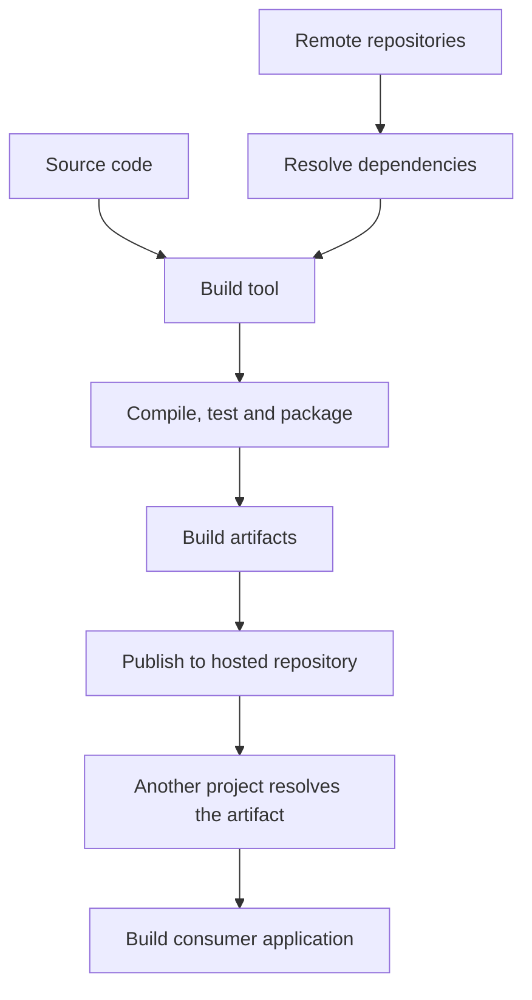
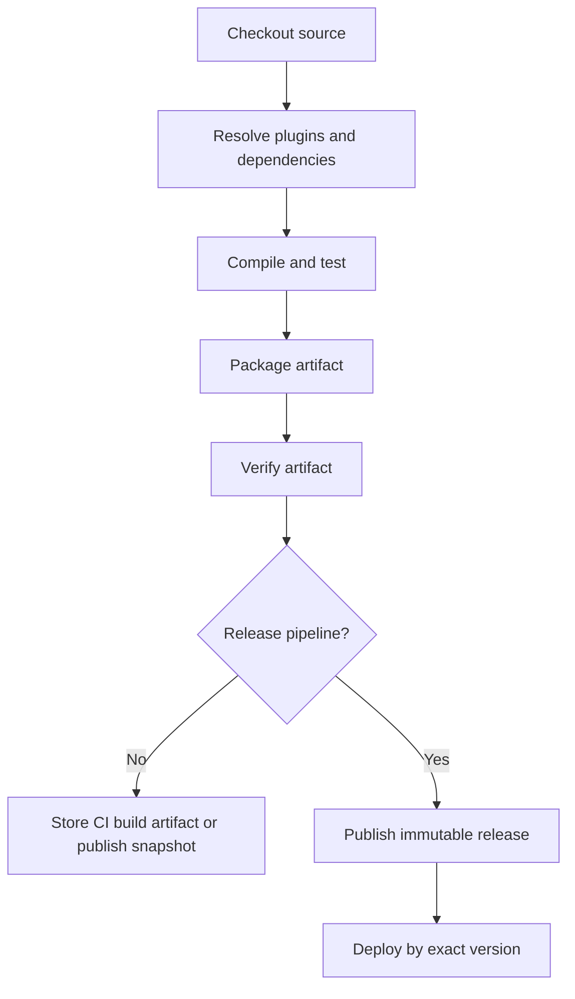

# Kho artifact và vai trò trong việc chia sẻ sản phẩm build

Sau khi build một dự án Java, ta thường nhận được một hoặc nhiều sản phẩm như JAR, WAR, ZIP, file metadata, báo cáo hoặc gói phân phối. Những file này được gọi chung là **artifact**. Artifact chỉ thực sự hữu ích cho nhóm khi có thể được nhận diện, lưu trữ, truy xuất và sử dụng lại một cách nhất quán.

**Kho artifact** (artifact repository) là nơi lưu các artifact cùng metadata để những dự án, thành viên hoặc pipeline khác có thể tìm và sử dụng chúng. Kho có thể là kho cục bộ trên máy, kho từ xa do tổ chức quản lý hoặc dịch vụ lưu trữ package. Trong hệ sinh thái Java, Maven repository format được Maven và Gradle hỗ trợ rộng rãi.

Kho artifact giải quyết một vấn đề quan trọng trong quy trình build: làm thế nào chia sẻ sản phẩm đã được build mà không phải gửi file JAR thủ công hoặc build lại từ source trong mọi dự án tiêu thụ. Một module có thể được build một lần, publish cùng metadata và sau đó được nhiều ứng dụng sử dụng theo tọa độ và phiên bản rõ ràng.

## 1. Artifact là gì?

Artifact là sản phẩm được tạo ra hoặc được phân phối bởi một quy trình build. Với dự án Java, các loại phổ biến gồm:

| Artifact | Nội dung hoặc mục đích |
|---|---|
| JAR | Thư viện Java hoặc ứng dụng được đóng gói dưới dạng Java Archive |
| WAR | Ứng dụng web được đóng gói để triển khai lên servlet container hoặc application server |
| ZIP/TAR | Gói phân phối gồm ứng dụng, script, cấu hình mẫu hoặc tài nguyên |
| Sources JAR | Mã nguồn của thư viện, hữu ích khi đọc hoặc debug dependency |
| Javadoc JAR | Tài liệu API được sinh từ mã nguồn và comment |
| POM | Metadata Maven mô tả tọa độ, dependency và thông tin project |
| Gradle Module Metadata | Metadata mô tả các variant, capability, dependency và thuộc tính của component Gradle |
| Báo cáo | Kết quả test, coverage, phân tích mã hoặc kiểm tra bảo mật |

Không phải mọi file sinh ra đều nên publish lên repository dùng chung. Hãy xác định sản phẩm nào cần được dự án khác hoặc pipeline khác sử dụng. File tạm, log cục bộ hoặc output trung gian thường chỉ cần lưu trong workspace hoặc hệ thống CI có thời hạn phù hợp.

### 1.1. Artifact không chỉ là file JAR

Khi một dự án publish thư viện Java, repository thường lưu cả binary artifact và metadata. Ví dụ, một thư viện có thể được publish dưới dạng:

```text
com/example/catalog/catalog-core/1.4.0/
├── catalog-core-1.4.0.jar
├── catalog-core-1.4.0.pom
├── catalog-core-1.4.0-sources.jar
├── catalog-core-1.4.0-javadoc.jar
└── catalog-core-1.4.0.module
```

Các file cụ thể phụ thuộc công cụ và cấu hình publish. POM cho phép Maven và nhiều công cụ khác hiểu dependency cơ bản. File `.module` là metadata Gradle có thể mô tả thông tin phong phú hơn, chẳng hạn các variant và thuộc tính của chúng. Sources và Javadoc JAR hỗ trợ người dùng thư viện khi phát triển.

Nếu chỉ gửi file JAR mà không có metadata, người dùng có thể phải tự khai báo mọi dependency bắc cầu hoặc tự tìm phiên bản tương thích. Metadata giúp repository trở thành một điểm phân phối có cấu trúc thay vì chỉ là thư mục chứa file.

## 2. Tọa độ artifact và cách nhận diện phiên bản

Trong Maven repository, một artifact Java thường được nhận diện bằng các tọa độ:

- `groupId`: nhóm hoặc namespace của tổ chức/dự án;
- `artifactId`: tên artifact;
- `version`: phiên bản;
- `packaging` hoặc `type`: loại sản phẩm, thường là `jar`, `pom`, `war`;
- `classifier`: hậu tố phân biệt biến thể như `sources` hoặc `javadoc`.

Ví dụ:

```text
groupId:    com.example
artifactId: catalog-core
version:    1.4.0
packaging:  jar
classifier: sources
```

Tọa độ dependency thường được viết ngắn gọn:

```text
com.example:catalog-core:1.4.0
```

Trong Maven, tọa độ có thể xuất hiện trong POM:

```xml
<dependency>
    <groupId>com.example</groupId>
    <artifactId>catalog-core</artifactId>
    <version>1.4.0</version>
</dependency>
```

Trong Gradle:

```kotlin
dependencies {
    implementation("com.example:catalog-core:1.4.0")
}
```

Tọa độ cho phép dự án tiêu thụ yêu cầu đúng artifact mà không cần biết file nằm ở máy nào hoặc URL tải file cụ thể ra sao. Build tool dùng danh sách repository đã cấu hình để tìm artifact theo tọa độ.

### 2.1. Cấu trúc đường dẫn trong Maven repository

Một Maven repository thường ánh xạ `groupId` thành các thư mục, rồi đến `artifactId` và `version`:

```text
repository-root/
└── com/
    └── example/
        └── catalog-core/
            └── 1.4.0/
                ├── catalog-core-1.4.0.pom
                ├── catalog-core-1.4.0.jar
                └── catalog-core-1.4.0-sources.jar
```

`groupId` có dấu chấm được chuyển thành các thư mục con. Cách tổ chức này giúp repository phục vụ việc tra cứu theo tọa độ và hỗ trợ metadata phiên bản.

### 2.2. Version là một phần của hợp đồng

Version giúp người dùng biết họ đang yêu cầu bản phát hành nào. Khi publish một thư viện, không nên thay nội dung của một release version đã được người khác sử dụng. Ví dụ, nếu `1.4.0` đã được publish và project consumer đã build dựa trên nó, thay file JAR bên dưới cùng tọa độ sẽ làm cho cùng một cấu hình có thể cho kết quả khác nhau theo thời điểm tải.

Quy ước an toàn là:

- release version như `1.4.0` được xem là bất biến sau khi publish;
- thay đổi nội dung cần tạo version mới;
- snapshot hoặc version phát triển được quản lý theo chính sách riêng;
- không dùng version động trong môi trường phát hành nếu cần kết quả có thể tái lập.

## 3. Các loại kho artifact thường gặp

### 3.1. Local repository trên máy lập trình viên

Maven có local repository, mặc định thường là:

```text
~/.m2/repository
```

Đây là cache và vùng lưu artifact cục bộ cho người dùng Maven. Khi Maven tải dependency từ remote repository, nó thường lưu bản tải xuống tại đây để các build sau có thể sử dụng lại. Khi chạy `mvn install`, Maven cài artifact vừa build vào local repository.

Gradle cũng có cache dependency và metadata riêng trong thư mục Gradle user home, thường là `~/.gradle/caches`. Cache này không phải một Maven repository local mà người dùng có thể mặc định trỏ đến bằng `mavenLocal()`.

Local repository hữu ích cho một máy, nhưng không phải cơ chế chia sẻ đáng tin cậy giữa các thành viên. Một dependency có thể tồn tại trên máy của lập trình viên nhưng không có trên CI hoặc máy đồng đội. Vì vậy, không nên dựa vào artifact chỉ được cài cục bộ như một đầu vào bắt buộc của quy trình nhóm.

### 3.2. Remote repository

Remote repository là kho được truy cập qua mạng, thường qua HTTPS. Nó có thể do tổ chức vận hành hoặc do nhà cung cấp dịch vụ quản lý.

Các loại thường gặp:

| Loại kho | Vai trò | Ví dụ sử dụng |
|---|---|---|
| Hosted repository | Lưu artifact do tổ chức hoặc nhóm publish | Thư viện nội bộ, bản phát hành của sản phẩm |
| Proxy repository | Đại diện truy cập một kho bên ngoài và cache artifact | Cache Maven Central qua repository manager của công ty |
| Group/virtual repository | Hợp nhất nhiều kho dưới một URL | Cung cấp một endpoint cho dependency resolution |
| Public repository | Phân phối artifact công khai | Thư viện open source |
| Private repository | Chỉ người hoặc hệ thống được cấp quyền truy cập | Artifact nội bộ hoặc package chưa công khai |

Một repository manager như Nexus Repository hoặc Artifactory có thể cung cấp các loại kho trên, quản lý quyền truy cập, proxy, retention và chính sách lưu trữ. GitHub Packages và các dịch vụ tương tự cũng có thể lưu package theo quyền của tổ chức/repository.

### 3.3. Kho dependency khác hệ thống lưu artifact CI

CI server thường có cơ chế lưu artifact của một lần chạy pipeline, ví dụ JAR, test report hoặc log được gắn với build number. Đây là cách chia sẻ output của một lần chạy hoặc giữ bằng chứng build trong một khoảng thời gian.

Repository package thường phù hợp hơn cho việc phân phối component có tọa độ và version ổn định để nhiều dự án tiêu thụ. Hệ thống artifact CI phù hợp để tải output của job, kiểm tra kết quả hoặc chuyển file giữa các stage của cùng pipeline.

Hai hệ thống có thể cùng tồn tại:

- CI lưu test report và artifact tạm của mỗi build;
- pipeline release publish JAR/WAR cùng metadata lên Maven repository;
- pipeline deploy lấy artifact đã publish để triển khai.

Không nên nhầm một file đính kèm trong job CI với một dependency có thể khai báo ổn định trong POM hoặc Gradle build.

## 4. Kho artifact tham gia vào quy trình build như thế nào?

Kho artifact có hai vai trò chính:

1. **Dependency resolution:** build tool tìm và tải dependency mà project cần.
2. **Artifact publication:** build tool đưa sản phẩm của project lên kho để project khác sử dụng.

Hai việc này liên quan nhưng có cấu hình và quyền truy cập khác nhau. Một URL có thể được cấu hình để đọc dependency, còn nơi publish có thể là hosted repository riêng với thông tin xác thực riêng.



Ví dụ, project `catalog-core` build ra `catalog-core-1.4.0.jar` và publish lên kho nội bộ. Project `store-api` khai báo `com.example:catalog-core:1.4.0`; khi build, Maven hoặc Gradle tìm tọa độ này trong các repository đã cấu hình và tải artifact cùng metadata cần thiết.

## 5. Maven: khai báo repository để tải dependency

Maven dùng phần tử `<repositories>` trong POM để khai báo các remote repository mà project có thể dùng khi resolve dependency.

Ví dụ:

```xml
<repositories>
    <repository>
        <id>company-releases</id>
        <name>Company Releases</name>
        <url>https://repo.example.com/repository/maven-releases/</url>
        <releases>
            <enabled>true</enabled>
        </releases>
        <snapshots>
            <enabled>false</enabled>
        </snapshots>
    </repository>
</repositories>
```

`id` dùng để nhận diện repository và có thể liên kết với thông tin xác thực trong `settings.xml`. Cấu hình `releases` và `snapshots` cho phép điều khiển loại version được resolve từ repository đó.

Trong môi trường doanh nghiệp, repository thường được khai báo qua `settings.xml`, mirror hoặc cấu hình dùng chung thay vì lặp lại URL nội bộ trong mọi POM. Điều này giúp nhóm thay đổi endpoint tập trung và kiểm soát việc truy cập kho bên ngoài.

### 5.1. Mirror và repository manager

Maven hỗ trợ cấu hình mirror trong `settings.xml`. Một mirror có thể chuyển các yêu cầu repository về một repository manager nội bộ:

```xml
<mirrors>
    <mirror>
        <id>company-mirror</id>
        <mirrorOf>*</mirrorOf>
        <url>https://repo.example.com/repository/maven-all/</url>
    </mirror>
</mirrors>
```

Với cấu hình phù hợp, Maven có thể truy cập các dependency qua một endpoint nội bộ. Repository manager sẽ proxy kho công khai và cung cấp hosted repository theo chính sách của tổ chức.

Không nên tự đặt `mirrorOf` hoặc URL theo ví dụ mà chưa biết chính sách mạng của tổ chức. Một mirror có thể thay đổi nơi Maven tìm mọi dependency, nên cấu hình cần được quản lý thống nhất.

## 6. Maven: publish artifact lên remote repository

Khai báo repository dùng để tải dependency không đồng nghĩa đã cấu hình nơi publish. Maven thường dùng `<distributionManagement>` để mô tả đích deployment của artifact.

Ví dụ trong POM của thư viện:

```xml
<distributionManagement>
    <repository>
        <id>company-releases</id>
        <name>Company Releases</name>
        <url>https://repo.example.com/repository/maven-releases/</url>
    </repository>
    <snapshotRepository>
        <id>company-snapshots</id>
        <name>Company Snapshots</name>
        <url>https://repo.example.com/repository/maven-snapshots/</url>
    </snapshotRepository>
</distributionManagement>
```

Khi chạy:

```bash
./mvnw deploy
```

Maven đi qua default lifecycle và ở phase `deploy` sử dụng cấu hình deployment để publish artifact cùng metadata lên repository tương ứng. Release version được đưa tới `repository`; snapshot version được đưa tới `snapshotRepository` nếu cả hai được cấu hình.

### 6.1. Thông tin xác thực trong `settings.xml`

Không ghi username, password hoặc token trực tiếp vào POM được commit. Thay vào đó, cấu hình server trong Maven `settings.xml` với `id` trùng với `id` trong `distributionManagement`:

```xml
<servers>
    <server>
        <id>company-releases</id>
        <username>${env.REPO_USERNAME}</username>
        <password>${env.REPO_TOKEN}</password>
    </server>
    <server>
        <id>company-snapshots</id>
        <username>${env.REPO_USERNAME}</username>
        <password>${env.REPO_TOKEN}</password>
    </server>
</servers>
```

Tên biến môi trường chỉ là ví dụ. CI nên lấy token từ secret store được quản lý, cấp quyền tối thiểu cần thiết và không in giá trị secret ra log.

### 6.2. Phân biệt `install` và `deploy`

```bash
./mvnw install
```

`install` đưa artifact vào local Maven repository của người dùng. Nó không publish lên remote repository dùng chung.

```bash
./mvnw deploy
```

`deploy` đưa artifact đến remote repository được cấu hình trong `distributionManagement`. Đây là bước chia sẻ sản phẩm build cho những máy hoặc pipeline khác.

Nếu một module chỉ cần được project khác trong cùng Maven reactor sử dụng, không nhất thiết phải `install` trước. Maven reactor có thể build các module liên quan trong cùng lượt. `install` hữu ích khi cần project khác bên ngoài reactor dùng artifact local trong quá trình phát triển.

## 7. Gradle: khai báo repository để tải dependency

Gradle khai báo repository dùng để resolve dependency trong khối `repositories`:

```kotlin
repositories {
    mavenCentral()

    maven {
        name = "companyReleases"
        url = uri("https://repo.example.com/repository/maven-releases/")
    }
}
```

Khi Gradle resolve dependency, nó tìm artifact theo các tọa độ trong những repository được cấu hình. Có thể khai báo repository Maven, Ivy hoặc các loại repository khác mà Gradle hỗ trợ.

Với dự án nhiều module, repository có thể được khai báo tập trung trong `settings.gradle.kts` bằng `dependencyResolutionManagement`, tùy phiên bản và cấu trúc build:

```kotlin
dependencyResolutionManagement {
    repositoriesMode.set(RepositoriesMode.FAIL_ON_PROJECT_REPOS)
    repositories {
        mavenCentral()
        maven {
            url = uri("https://repo.example.com/repository/maven-all/")
        }
    }
}
```

Chế độ `FAIL_ON_PROJECT_REPOS` yêu cầu project không tự thêm repository riêng nếu cấu hình đã được quản lý tập trung. Điều này giúp nhóm kiểm soát nguồn dependency và giảm tình trạng mỗi module resolve từ một nơi khác nhau.

## 8. Gradle: publish artifact bằng `maven-publish`

Gradle có plugin `maven-publish` để tạo publication và publish artifact lên Maven-compatible repository.

Ví dụ cho một thư viện Java trong `build.gradle.kts`:

```kotlin
plugins {
    `java-library`
    `maven-publish`
}

group = "com.example"
version = "1.4.0"

publishing {
    publications {
        create<MavenPublication>("mavenJava") {
            from(components["java"])
            artifactId = "catalog-core"
        }
    }

    repositories {
        maven {
            name = "companyReleases"
            url = uri("https://repo.example.com/repository/maven-releases/")
            credentials {
                username = providers.environmentVariable("REPO_USERNAME").orNull
                password = providers.environmentVariable("REPO_TOKEN").orNull
            }
        }
    }
}
```

`from(components["java"])` tạo publication từ Java component, bao gồm artifact và metadata phù hợp. `group`, `artifactId` và `version` xác định tọa độ được publish.

Chạy task publish được Gradle tạo ra theo tên publication và repository, ví dụ:

```bash
./gradlew publishMavenJavaPublicationToCompanyReleasesRepository
```

Tên task được suy ra từ publication và repository name. Có thể xem task được tạo bằng:

```bash
./gradlew tasks --all
```

Nếu cần publish vào local Maven repository để thử nghiệm:

```kotlin
publishing {
    repositories {
        mavenLocal()
    }
}
```

Sau đó chạy task publish tương ứng. `mavenLocal()` ghi vào Maven local repository, thường là `~/.m2/repository`. Đây là cách thử cục bộ, không phải cơ chế chia sẻ giữa nhóm.

### 8.1. Cấu hình credentials an toàn

Không hardcode token trong `build.gradle.kts`. Ví dụ trên đọc thông tin từ biến môi trường, nhưng trong CI nên bảo đảm các biến đó chỉ được cung cấp cho job có quyền publish. Có thể dùng secret store của nền tảng CI hoặc credential provider theo chính sách tổ chức.

Không in credentials, không đưa chúng vào artifact, không truyền token trong tham số command line nếu hệ thống có thể ghi lại process arguments. Token publish nên có quyền ghi đúng repository cần thiết và có thể thu hồi khi không còn sử dụng.

### 8.2. Publish sources và Javadoc

Với thư viện Java, có thể tạo sources JAR và Javadoc JAR để người dùng dễ đọc và debug:

```kotlin
java {
    withSourcesJar()
    withJavadocJar()
}
```

Khi publication lấy từ `components["java"]`, các artifact bổ sung được cấu hình cho Java component có thể được đưa vào publication theo cách Gradle hỗ trợ. Hãy kiểm tra nội dung publication và repository sau khi publish.

## 9. Gradle: tiêu thụ artifact đã publish

Project tiêu thụ cần khai báo repository để resolve tọa độ và dependency:

```kotlin
repositories {
    maven {
        url = uri("https://repo.example.com/repository/maven-releases/")
    }
    mavenCentral()
}

dependencies {
    implementation("com.example:catalog-core:1.4.0")
}
```

Trong Maven, project tiêu thụ khai báo `<repositories>` và dependency tương ứng:

```xml
<repositories>
    <repository>
        <id>company-releases</id>
        <url>https://repo.example.com/repository/maven-releases/</url>
    </repository>
</repositories>

<dependencies>
    <dependency>
        <groupId>com.example</groupId>
        <artifactId>catalog-core</artifactId>
        <version>1.4.0</version>
    </dependency>
</dependencies>
```

Sau khi cấu hình, build tool có thể tải JAR và metadata cần thiết. Nếu repository yêu cầu xác thực, người dùng cần credentials đọc trong Maven `settings.xml` hoặc Gradle credentials được cấp qua môi trường/secret store.

## 10. Release, snapshot và version phát triển

Một kho artifact thường phân biệt bản phát hành ổn định với bản đang phát triển.

### 10.1. Release version

Release version như `1.4.0` hoặc `2.0.1` đại diện cho một bản phát hành cụ thể. Sau khi publish, nên giữ nội dung bất biến. Nếu phát hiện lỗi, hãy phát hành version mới, ví dụ `1.4.1`.

Quy tắc bất biến giúp:

- build cũ có thể được tái tạo;
- consumer biết chính xác binary nào đang được sử dụng;
- cache dependency hoạt động có thể dự đoán;
- CI và production không âm thầm nhận nội dung khác dưới cùng tọa độ.

### 10.2. Maven SNAPSHOT

Maven dùng hậu tố `-SNAPSHOT` cho version phát triển, ví dụ:

```xml
<version>1.5.0-SNAPSHOT</version>
```

Snapshot repository có thể lưu các bản timestamped snapshot duy nhất và metadata trỏ tới snapshot mới nhất. Vì vậy, cùng tọa độ `1.5.0-SNAPSHOT` có thể được cập nhật trong quá trình phát triển. Đây là hành vi có chủ đích, khác với release version bất biến.

Maven có thể được cấu hình để chỉ tải snapshot từ repository cho phép snapshots. Không nên publish snapshot vào release repository nếu chính sách kho yêu cầu tách biệt.

### 10.3. Gradle và changing/dynamic versions

Gradle có thể tiêu thụ version snapshot hoặc version động, ví dụ `1.+`. Version động tiện cho phát triển nhưng làm kết quả resolve có thể thay đổi theo thời gian. Gradle cache kết quả dependency resolution trong một khoảng thời gian; cấu hình cache và changing module ảnh hưởng thời điểm kiểm tra lại repository.

Với dependency snapshot hoặc module thay đổi nội dung theo cùng tọa độ, có thể khai báo dependency là changing khi cần:

```kotlin
dependencies {
    implementation("com.example:catalog-core:1.5.0-SNAPSHOT") {
        isChanging = true
    }
}
```

Thời gian cache changing modules có thể được điều chỉnh trong `resolutionStrategy`, nhưng không nên đặt thời gian quá ngắn hoặc dùng version động trong build phát hành nếu không có lý do rõ ràng.

### 10.4. Khóa version trong build phát hành

Đối với build cần tái lập, ưu tiên version cụ thể và quản lý tập trung bằng Maven dependency management/BOM hoặc Gradle version catalog/constraints. Tránh `latest.release`, `1.+` hoặc snapshot không kiểm soát trong pipeline phát hành.

Nếu cần dùng snapshot để tích hợp các module đang phát triển, nên giới hạn trong môi trường development/CI tương ứng và chuyển sang release version trước khi phát hành sản phẩm.

## 11. Repository metadata và dependency graph

Repository không chỉ lưu JAR. Metadata giúp build tool hiểu artifact cần những dependency nào và chọn biến thể phù hợp.

### 11.1. POM metadata

POM có thể mô tả:

- tọa độ của artifact;
- packaging;
- dependency trực tiếp;
- dependency management và thông tin parent/BOM;
- thông tin project và một số cấu hình liên quan.

Khi Maven tải một dependency, nó thường tải POM để biết các dependency bắc cầu cần resolve. Nếu POM thiếu hoặc không đúng, consumer có thể tải được JAR nhưng không resolve đúng các thư viện mà JAR cần.

### 11.2. Gradle Module Metadata

Gradle Module Metadata (`.module`) có thể mô tả các variant, attributes, capabilities và dependency theo cách phong phú hơn POM Maven. Ví dụ, một thư viện có thể công bố các variant dành cho compile và runtime, hoặc thông tin tương thích theo thuộc tính.

Khi publish từ Gradle bằng `maven-publish`, Gradle có thể publish metadata Gradle cùng POM theo cấu hình và phiên bản plugin. Gradle consumer có thể ưu tiên metadata Gradle khi repository cung cấp và metadata được công bố. Maven consumer thường dựa vào POM.

Vì vậy, khi kiểm tra publication, hãy xem cả JAR, POM và file `.module` nếu được tạo. Không nên sửa metadata bằng tay mà không hiểu tác động tới consumer.

### 11.3. Classifier và variant

Classifier phân biệt các artifact cùng tọa độ/version, ví dụ `sources` hoặc `javadoc`. Gradle variants mô tả nhiều dạng sử dụng của component dựa trên thuộc tính và capability. Chúng liên quan nhưng không đồng nghĩa.

Người tiêu thụ thường khai báo dependency chính, rồi build tool chọn artifact/variant phù hợp. Nếu metadata khai báo sai, consumer có thể nhận nhầm artifact hoặc thiếu dependency.

## 12. Cách tổ chức repository cho nhóm

Một tổ chức có thể phân chia repository theo mục đích:

```text
Repository Manager
├── maven-public (group/proxy)
│   ├── proxy-maven-central
│   └── proxy-other-public
├── maven-releases (hosted)
├── maven-snapshots (hosted)
└── maven-staging (hosted hoặc staging area)
```

Một số quy ước thường hữu ích:

- `maven-public` là endpoint đọc dependency tổng hợp, bao gồm proxy các kho công khai và các kho nội bộ cần thiết;
- `maven-releases` chỉ nhận version phát hành, thường bất biến;
- `maven-snapshots` nhận bản phát triển có thể cập nhật;
- staging repository giữ bản phát hành đang chờ kiểm tra hoặc phê duyệt trước khi promote sang release repository.

Tên và cấu trúc thực tế phụ thuộc repository manager. Có tổ chức dùng một group repository duy nhất cho việc đọc và các hosted repository riêng cho publish. Điều quan trọng là nhóm hiểu rõ endpoint nào dùng để resolve và endpoint nào dùng để deploy.

### 12.1. Quyền đọc và quyền ghi

Không phải mọi developer cần quyền publish release. Một mô hình quyền phổ biến:

- developer có quyền đọc repository nội bộ;
- CI build thường có quyền đọc dependency và publish snapshot nếu được phép;
- pipeline release có quyền publish release sau khi vượt qua các bước phê duyệt;
- service triển khai chỉ cần quyền đọc artifact hoặc package cần triển khai.

Tách quyền đọc/ghi giúp giảm rủi ro publish nhầm hoặc ghi đè artifact. Dùng token có phạm vi nhỏ và thời hạn phù hợp.

### 12.2. Không dùng repository như thư mục chia sẻ tùy tiện

Artifact repository được tổ chức theo tọa độ và version. Không nên tải file lên với tên tùy ý rồi yêu cầu người khác đoán URL. Hãy publish qua công cụ build để metadata, POM và checksum được tạo đúng theo format.

Nếu cần chia sẻ một file tạm cho một job khác, artifact storage của CI có thể phù hợp hơn. Nếu cần dependency có version và metadata, hãy dùng repository package.

## 13. Repository trong CI/CD

Một pipeline thường sử dụng repository ở hai hướng:

**Đọc:** tải plugin, dependency và artifact nội bộ cần để build.

**Ghi:** publish sản phẩm build đã qua kiểm tra để các pipeline hoặc ứng dụng khác tiêu thụ.

Một quy trình ví dụ:



CI cần sử dụng cùng repository policy với máy phát triển để tránh khác biệt nguồn dependency. Tuy nhiên, pipeline release phải kiểm soát version và quyền publish chặt hơn pipeline kiểm tra thông thường.

### 13.1. Chia sẻ artifact giữa các job

Nếu job A build JAR và job B triển khai JAR đó, có hai lựa chọn phổ biến:

- job A lưu JAR làm artifact của pipeline; job B tải đúng artifact của cùng lần chạy;
- job A publish JAR lên repository với version/coordinate rõ ràng; job B resolve version đó.

Lựa chọn thứ nhất phù hợp khi artifact chỉ cần di chuyển trong một pipeline hoặc một lần chạy. Lựa chọn thứ hai phù hợp khi nhiều pipeline hoặc dự án cần dùng component đó lâu dài.

Tránh để job B build lại source độc lập rồi giả định binary giống job A. Nếu mục tiêu là triển khai đúng thứ đã được kiểm thử, hãy chuyển chính artifact đã kiểm thử qua các stage.

### 13.2. Không publish mọi commit thành release

Pipeline CI có thể build mọi commit, nhưng không phải mọi build đều là release. Có thể:

- giữ test report và binary tạm trong CI;
- publish snapshot cho nhánh phát triển khi nhóm cần chia sẻ sớm;
- chỉ publish release version khi tag/phiên bản phát hành và điều kiện kiểm tra được thỏa mãn.

Quy tắc này giúp repository release không chứa quá nhiều bản thử nghiệm và làm rõ artifact nào được phép dùng trong production.

## 14. Bảo mật và tính toàn vẹn của artifact

Artifact có thể chứa mã được chạy trong ứng dụng, do đó nguồn gốc và tính toàn vẹn rất quan trọng.

### 14.1. Dùng HTTPS và credentials phù hợp

Kết nối repository nên dùng HTTPS. Credentials nên được cung cấp qua secret store, credential manager hoặc file cấu hình người dùng có quyền truy cập hạn chế. Không commit token, password hoặc private key vào source repository.

Không dùng chung một tài khoản quản trị cho mọi developer và pipeline. Tách quyền đọc/ghi, giới hạn repository và luân chuyển token theo chính sách tổ chức.

### 14.2. Checksum và chữ ký

Checksum giúp phát hiện file tải về không khớp với giá trị mong đợi. Repository manager và build tool có thể kiểm tra checksum theo metadata hoặc cấu hình tương ứng.

Chữ ký số có thể giúp xác minh artifact được ký bởi khóa phát hành tin cậy. Với môi trường yêu cầu chuỗi cung ứng phần mềm chặt chẽ, có thể bổ sung chữ ký, provenance, SBOM và attestation cho artifact.

Checksum không tự chứng minh người phát hành đáng tin cậy; nó chủ yếu xác nhận nội dung khớp với giá trị checksum được cung cấp. Chữ ký chỉ hữu ích khi public key và chính sách xác minh được quản lý đúng.

### 14.3. Không ghi đè release version

Nếu release repository cho phép thay thế file dưới cùng tọa độ/version, hai lần resolve cùng một version có thể nhận binary khác nhau. Hãy cấu hình repository để ngăn redeploy release nếu chính sách hỗ trợ và xử lý bản phát hành sai bằng version mới hoặc quy trình thu hồi rõ ràng.

### 14.4. Kiểm soát dependency nguồn ngoài

Repository manager có thể proxy và cache kho công khai. Nhóm có thể áp dụng allowlist, kiểm tra license, quét lỗ hổng, kiểm tra checksum hoặc yêu cầu phê duyệt dependency mới. Điều này giúp biết dependency đến từ đâu và giảm phụ thuộc trực tiếp vào nhiều endpoint bên ngoài.

## 15. Cache dependency khác repository

Một nhầm lẫn thường gặp là coi cache dependency và repository là một thứ.

| Thành phần | Vai trò | Phạm vi |
|---|---|---|
| Remote artifact repository | Nguồn lưu và phân phối artifact có tọa độ/version | Dùng chung qua mạng |
| Maven local repository | Lưu artifact đã tải hoặc cài cục bộ | Một người dùng/máy theo cấu hình |
| Gradle dependency cache | Cache artifact và metadata đã resolve | Gradle user home của máy hoặc môi trường tương ứng |
| CI artifact store | Lưu output của job/pipeline để tải hoặc chuyển giữa stage | Một hệ thống CI và chính sách retention |
| Build cache | Lưu kết quả task có thể tái sử dụng dựa trên input/output | Cục bộ hoặc dùng chung tùy cấu hình |

Repository lưu sản phẩm theo tọa độ và version để phân phối. Dependency cache giữ bản tải xuống và metadata nhằm tránh truy cập mạng lặp lại. Build cache giữ kết quả của công việc build có thể tái sử dụng. CI artifact store giữ file được tạo bởi một lần chạy pipeline.

### 15.1. Vì sao không nên phụ thuộc `mavenLocal()` trong CI?

`mavenLocal()` trỏ đến kho Maven cục bộ trên máy. Nếu dependency chỉ tồn tại ở local repository của developer, CI runner mới có thể không tìm thấy nó. Ngược lại, runner dùng lại workspace/cache có thể vô tình resolve một artifact cũ chưa được publish chính thức.

Hãy publish artifact nội bộ lên repository dùng chung nếu nhiều máy hoặc pipeline cần tiêu thụ. Dùng `mavenLocal()` chủ yếu để thử nghiệm publication cục bộ và không nên là nguồn bắt buộc trong build phát hành.

### 15.2. Cache không thay thế version chính xác

Cache giúp tải nhanh hơn nhưng không làm version động trở nên bất biến. Nếu build dùng `1.+` hoặc snapshot có thể thay đổi, kết quả resolve có thể thay đổi sau khi cache hết hạn hoặc bị làm mới. Build phát hành nên khóa version và dùng dependency verification/lockfile khi phù hợp.

## 16. Những lỗi thường gặp khi làm việc với repository

| Triệu chứng | Nguyên nhân có thể | Hướng xử lý |
|---|---|---|
| Không resolve được artifact | Sai tọa độ/version, repository URL sai hoặc artifact chưa publish | Kiểm tra tọa độ, URL và nội dung repository |
| HTTP 401 | Thiếu hoặc sai credentials | Kiểm tra token, server ID/credentials và quyền đọc |
| HTTP 403 | Có xác thực nhưng không đủ quyền | Yêu cầu quyền phù hợp; không dùng tài khoản quản trị thay thế |
| HTTP 404 | Artifact không có ở repository hoặc đường dẫn không đúng | Kiểm tra groupId/artifactId/version và repository được truy cập |
| Máy developer build được, CI thất bại | Dependency chỉ có trong local cache/repository hoặc CI thiếu quyền | Publish lên remote repository và cấu hình credentials CI |
| JAR tải được nhưng thiếu dependency bắc cầu | POM/metadata sai hoặc thiếu | Kiểm tra POM/Gradle metadata được publish cùng artifact |
| Consumer nhận phiên bản cũ | Snapshot/dynamic version bị cache hoặc tọa độ không đổi | Kiểm tra metadata, cache policy và version được resolve |
| Hai build cùng version cho kết quả khác nhau | Release artifact bị ghi đè hoặc dependency động | Không redeploy release; khóa version và xem provenance |
| Publish thành công nhưng consumer không thấy artifact | Publish sai repository hoặc consumer đọc endpoint khác | Đối chiếu publication URL với repository resolution URL |
| Không publish được snapshot | Snapshot repository không cho phép ghi hoặc version không có hậu tố snapshot theo chính sách | Kiểm tra version, snapshot repository và quyền ghi |

### 16.1. Chẩn đoán Maven

Xem dependency tree:

```bash
./mvnw dependency:tree
```

Xem cấu hình POM hiệu lực:

```bash
./mvnw help:effective-pom
```

Chạy Maven với log chi tiết hơn khi cần xác định repository được truy cập:

```bash
./mvnw -X dependency:resolve
```

Log debug có thể chứa đường dẫn, thông tin cấu hình hoặc dữ liệu môi trường. Không chia sẻ log chưa kiểm tra nếu nó có thể chứa secret hoặc thông tin nội bộ.

### 16.2. Chẩn đoán Gradle

Xem dependency report:

```bash
./gradlew dependencies --configuration runtimeClasspath
```

Xem lý do một version được chọn:

```bash
./gradlew dependencyInsight \
    --dependency catalog-core \
    --configuration runtimeClasspath
```

Chạy với log thông tin:

```bash
./gradlew build --info
```

Nếu cần làm mới dependency cache để chẩn đoán, Gradle có tùy chọn:

```bash
./gradlew build --refresh-dependencies
```

Không nên dùng `--refresh-dependencies` như một giải pháp mặc định cho mọi lỗi. Trước hết hãy xác định repository, tọa độ và metadata nào đang gặp vấn đề.

## 17. Quy trình publish artifact có kiểm soát

Một quy trình publish thư viện nội bộ có thể gồm các bước:

1. **Xác định tọa độ:** group, artifact và version theo quy ước của tổ chức.
2. **Build:** biên dịch mã nguồn và tạo artifact.
3. **Kiểm thử:** chạy unit test, integration test và các kiểm tra được yêu cầu.
4. **Kiểm tra nội dung:** xác nhận JAR/WAR, POM, metadata và dependency đúng.
5. **Kiểm tra version:** release version chưa được dùng; snapshot được đưa vào đúng kho.
6. **Xác thực quyền publish:** CI sử dụng token có quyền ghi đúng repository.
7. **Publish:** chạy `mvn deploy` hoặc task Gradle publication tương ứng.
8. **Readback:** resolve artifact từ endpoint tiêu thụ hoặc tải lại để xác nhận publication có thể sử dụng.
9. **Ghi nhận nguồn gốc:** lưu commit, build number, version và thông tin provenance cần thiết.

Việc build thành công không tự chứng minh artifact đã publish đúng. Cần xác nhận tọa độ, repository đích và metadata mà consumer sẽ sử dụng.

## 18. Chọn nơi chia sẻ artifact theo nhu cầu

| Nhu cầu | Nơi lưu phù hợp | Lý do |
|---|---|---|
| Một developer thử dùng JAR vừa build | Maven local repository hoặc thư mục build cục bộ | Nhanh và chỉ phục vụ thử nghiệm trên máy |
| Module trong cùng một Maven/Gradle multi-project build | Reactor hoặc project dependency | Build tool quản lý dependency nội bộ trong cùng build |
| Nhiều project trong tổ chức dùng chung thư viện | Hosted Maven repository hoặc package registry | Có tọa độ, version, metadata và quyền truy cập |
| Chia sẻ output giữa các stage của một pipeline | CI artifact store | Gắn với lần chạy và dễ chuyển file giữa job |
| Phân phối thư viện open source | Public package repository | Người dùng bên ngoài có thể resolve theo tọa độ |
| Lưu container image | Container registry | Image có định danh và manifest riêng, phù hợp quy trình container |
| Lưu báo cáo hoặc log của một build | CI artifact store hoặc hệ thống báo cáo | Có thể quản lý retention theo pipeline |

Không nên đưa mọi output vào cùng một nơi. Hãy chọn hệ thống dựa trên cách người nhận cần tìm, xác minh và sử dụng artifact.

## 19. Checklist cho project tiêu thụ và project publish

### Project tiêu thụ dependency

- Repository URL có đúng endpoint đọc không?
- Dependency tọa độ và version có chính xác không?
- Repository có yêu cầu credentials không?
- Credentials có được cấp qua cơ chế an toàn không?
- POM hoặc Gradle metadata có mô tả dependency bắc cầu đúng không?
- Build có dùng version động hoặc snapshot cần chính sách cache riêng không?
- CI có thể resolve dependency trong môi trường sạch không?

### Project publish artifact

- Group, artifact và version có theo quy ước không?
- Artifact binary có được tạo từ source/commit dự kiến không?
- POM và metadata có đúng dependency và variant không?
- Release version có bất biến và chưa bị publish trước đó không?
- Snapshot có được gửi đến snapshot repository không?
- Credentials có quyền tối thiểu và không nằm trong source control không?
- Pipeline có lưu thông tin build/provenance cần thiết không?
- Consumer có thể resolve artifact sau khi publish không?

## 20. Bài tập thực hành

### Bài 1 — Phân biệt local và remote repository

Tạo một thư viện Java nhỏ. Chạy Maven `install` hoặc publish vào `mavenLocal()` bằng Gradle. Xác định file JAR và POM được lưu ở đâu. Sau đó tạo một project khác dùng dependency đó từ local repository.

Ghi lại vì sao project thứ hai có thể chạy trên máy của bạn nhưng chưa chắc chạy được trên một CI runner mới.

### Bài 2 — Publish vào repository thử nghiệm

Nếu có repository manager thử nghiệm, cấu hình một hosted repository riêng cho snapshot và một repository cho release. Publish một version snapshot, sau đó tạo một project consumer resolve snapshot đó.

Không dùng repository production hoặc token có quyền ghi rộng cho bài tập.

### Bài 3 — Maven `deploy`

Tạo `distributionManagement` trong POM, đặt server credentials trong `settings.xml` và chạy `mvn deploy` với một version phù hợp chính sách repository. Xác nhận artifact, POM và metadata xuất hiện tại repository đích.

### Bài 4 — Gradle `maven-publish`

Áp dụng plugin `maven-publish`, tạo publication từ Java component, cấu hình repository và publish một version thử nghiệm. Kiểm tra JAR, POM, sources JAR và Gradle Module Metadata nếu được tạo.

### Bài 5 — Kiểm tra dependency được consumer resolve

Tạo project Maven hoặc Gradle khác khai báo dependency theo tọa độ đã publish. Xem dependency tree hoặc dependency report và xác nhận đúng version, dependency bắc cầu và repository được sử dụng.

### Bài 6 — Mô phỏng lỗi repository

Thử các tình huống trong repository thử nghiệm: sai version, sai URL, thiếu quyền đọc hoặc dùng version snapshot với repository chỉ cho release. Ghi lại mã HTTP/log và phân loại nguyên nhân.

## 21. Câu hỏi tự kiểm tra

1. Artifact là gì? Vì sao artifact Java thường cần metadata đi kèm?
2. `groupId`, `artifactId`, `version` và `classifier` dùng để nhận diện điều gì?
3. Local Maven repository khác remote repository ở phạm vi và mục đích như thế nào?
4. Repository manager có thể cung cấp hosted, proxy và group repository ra sao?
5. Dependency resolution khác artifact publication ở điểm nào?
6. Maven `<repositories>` và `<distributionManagement>` có vai trò gì?
7. `mvn install` khác `mvn deploy` như thế nào?
8. Gradle `repositories` và `publishing.repositories` phục vụ hai việc gì?
9. `maven-publish` dùng publication và component để tạo những thông tin nào?
10. Vì sao không nên ghi credentials trực tiếp vào POM hoặc build script?
11. Release version khác snapshot version như thế nào?
12. Vì sao không nên ghi đè một release version đã publish?
13. POM và Gradle Module Metadata giúp consumer giải quyết dependency ra sao?
14. CI artifact store khác package repository ở mục đích sử dụng nào?
15. Vì sao `mavenLocal()` không nên là nguồn dependency bắt buộc trong CI?
16. Khi build developer thành công nhưng CI không resolve được artifact, cần kiểm tra những gì?
17. Vì sao cần xác nhận artifact có thể được consumer resolve sau khi publish?

Khi hiểu vai trò của kho artifact, bạn có thể theo dõi trọn vòng đời của sản phẩm build: được tạo ra từ source, nhận tọa độ và version, publish cùng metadata, rồi được dự án khác resolve và sử dụng. Kho artifact vì vậy là một phần của hợp đồng chia sẻ giữa các nhóm và pipeline, giúp sản phẩm build có thể được truy xuất, kiểm soát và tái sử dụng một cách nhất quán.
